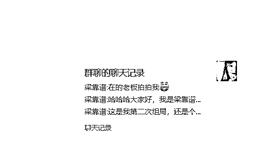
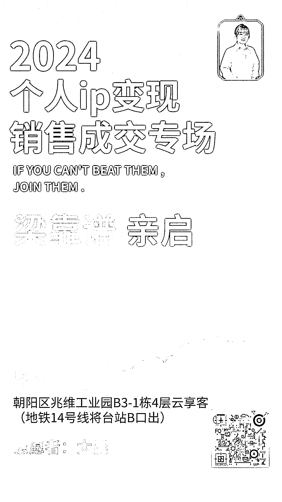
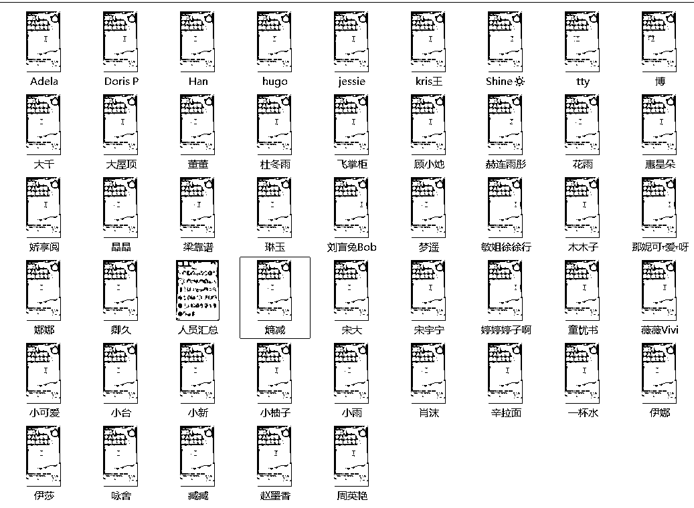
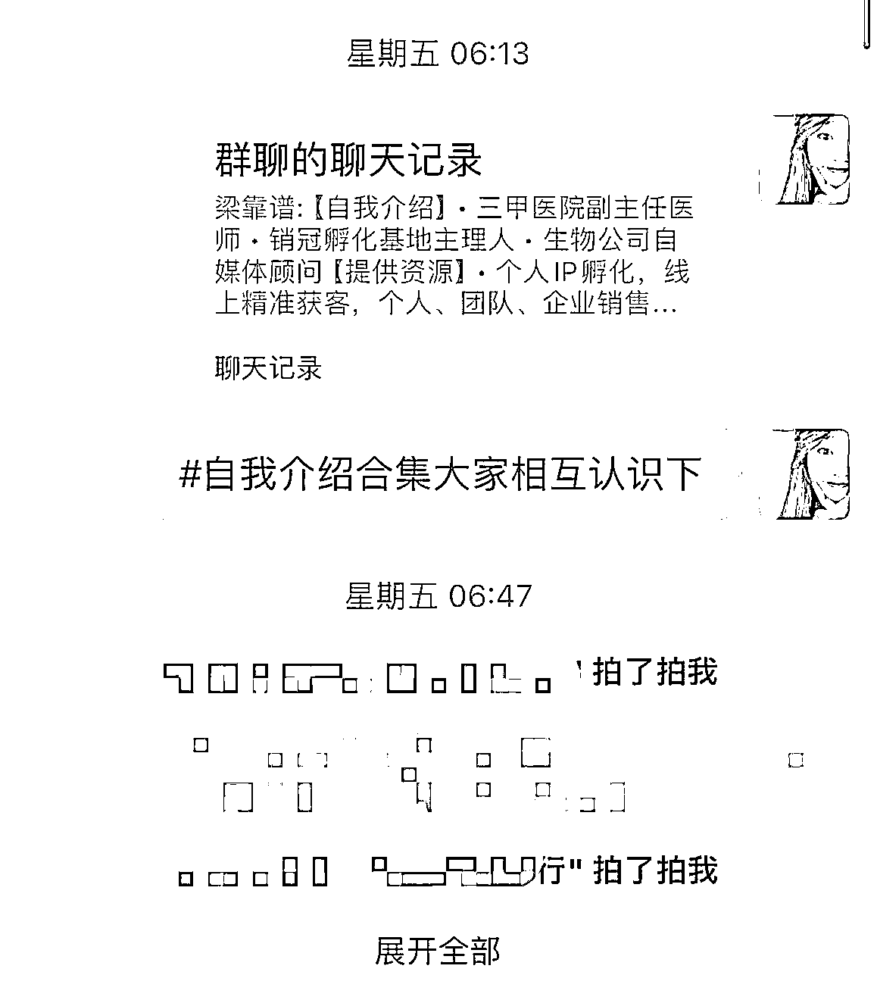
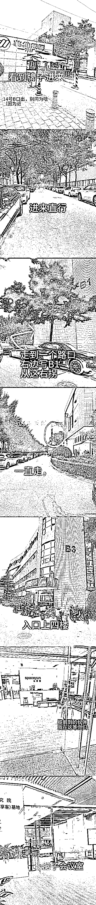
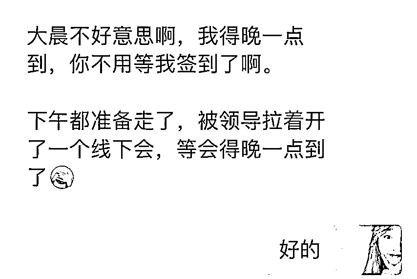
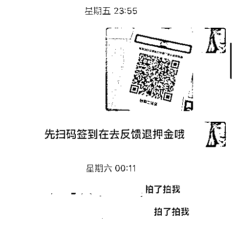
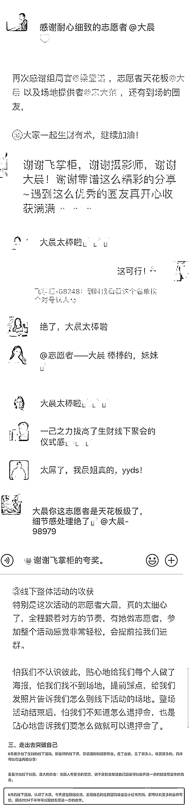

# 被梁靠谱封为“志愿者天花板”的那次北京局

> 原文：[`www.yuque.com/for_lazy/zhoubao/ndq3dvhe9kc55dfg`](https://www.yuque.com/for_lazy/zhoubao/ndq3dvhe9kc55dfg)

## 被梁靠谱称为“志愿者天花板”的大晨

作者：大晨

日期：2024-07-01

先说下对6月梁靠谱北京线下复盘的感谢。[@梁靠谱](https://wx.zsxq.com/dweb2/index/footprint/582222485184144) 给了我这次志愿者的机会，让我能得到实战历练、搭上线上的优秀伙伴，也让我找到了能一起做事的同频人，非常感恩。海报制作方面多亏了@一群的指点。还要感谢到场的所有圈友的支持。

大家好，我是梁靠谱直播口中“志愿者天花板——大晨”。能担任梁靠谱组局的志愿者，我特别感谢梁靠谱和张子安的信任，让我独立操盘一场50人规模的聚会。在锻炼自己的同时也认识了不少高质量圈友。呈

我累计做生财志愿者已接近半年，今天把这次为梁靠谱线下服务的完整打法梳理出来，和大家分享下。

### 一、线上筹备与群务

#### 一场聚会，志愿者主要要把控的三件事

##### 1、加人

做过志愿的都懂，每周的聚会是靠群接龙领取。点个小技巧：接龙当天把群消息设为“提醒所有人”，避免错过。派单后参照【志愿者信息同步表】去加组局官和参会人。

加好友时申请理由写清楚身份和目的，能大幅度提升通过率。让对方明白你是谁、加他干嘛。

**举例：“你好，我是生财志愿者大晨，加你后拉你进聚会群。”** 基本秒过。

加完记得统一备注：日期-组局官-姓名；日期-xx 组员-姓名

1.  **举例：0621-组局官-靠谱；0621-靠谱组员-董董，**
2.  这样后续拉群好区分。微信加人不适合一次塞满，可分批分天操作，避免账号异常。
3.  组员失联

这次遇到两个组员怎么都联系不上，微信、电话、短信全试过。遇到这种情况可以找鱼丸协助，或发短信告知**“你好，我是生财志愿者大晨，你已报名21号的组局，麻烦加我微信拉你进群，48h内未回复将视为放弃名额并取消聚会。”**最后两人还是顺利来了。

##### 2、建群与名额管理

把组局官和官方成员拉齐：鱼丸、领队、张子安、杨杨。把组局官、领队、鱼丸设为管理员，并打开**群聊邀请确认。**

群名统一格式：“日期”生财“城市”聚会 **-**“组局官昵称”

**举例：0621 生财北京聚会-梁靠谱**

建群后按【志愿者手册】发群公告并**【置顶】**。

拉群前先私聊确认时间，确认OK再拉。

**举例：你好，我是本次志愿者大晨，拉你进21号16点梁靠谱聚会群哈，时间可以的话点个赞~**

会有两种临时退出情况

1）报名截止前退出，问清楚星球编号，在【志愿者正式群】@张子安帮忙撤回押金，并移出群聊。
2）报名截止后是否退押金看具体情况自行判断。这次也有组员临时被公司临时通知赶不来，只能遗憾取消。

名额释放
这次报名太火爆，1小时内就满员。有人退出释放名额后，及时发朋友圈喊下，想去的圈友就会及时跟进。上次我一发就有人来找我占位，志愿者要主动盯名额流转。

##### 3、破冰引导

有两位组员一直联系不上，我第一时间同步给了梁靠谱，避免影响她后边的流程安排。尽量做到聚会前四天完成拉群，给组局官充足的背调时间。

梁靠谱在群里亲自说明当天安排和流程，真的很暖心！

开营后大家聊得热烈，聊天记录滚得很快。我会把重点信息整理成合集发在群里，方便大家回溯。

21号聚会，我在18号就为每位参与者制作了专属海报。自己从山东赶到北京，物料必须提前准备好。

A4纸双面彩印欢迎海报，既方便认人也提升体验感。

就这样拿到了“志愿者天花板”的称号，也收获了大家的喜爱。参加人数多，我把海报打包成合集发群里，避免大家爬楼太累。再谢一次@一群的海报指导。

核心思路就是“能为TA解决什么问题”，站在对方视角去落地，基本不会错。

破冰环节我也会主动参与自我介绍，毕竟这也是链接人脉的好机会。结束后第二天一早把合集发群里，方便大家持续交流。

志愿者本质就是服务，为大家省心、为大家便利。

##### 4、流程推进

聚会前反复同步地址和关键信息，并置顶。担心有人找不到，我还把电话直接打在了群公告里，真找不到可以打电话，避免错过增值的机会。

### 二、线下现场执行

#### 线下操盘要点

##### 提前踩点
靠谱这场是16点开始，我早上从山东出发，14点就到场，确认路线和会议室，并做了指路图发给各位。

3.  

（有了指路图，大家到达都很顺畅，全程没有人问路迟到）

##### 现场布置
大部分场地需要志愿者配合布置。茶歇点心通常有专人，志愿者帮忙摆放凳子、准备拍照物料即可。谢谢梁靠谱提供的精致茶歇@梁靠谱

##### 签到和到场确认
签到台设在门口，到场即见。准备五样东西——参与者海报、参与者名单、签到二维码、签名物料、名牌贴纸，方便大家快速认识。笔多备几根。

##### 正式开始
志愿者要在门口待命，应对突发情况。这次有位圈友临时接到家里电话必须离开，我立刻核实姓名并移出群聊。未到的伙伴也实时私信确认是否在路上，了解特殊情况。

4.  

##### 守护蛋糕
聚会开始大家就座，志愿者站在后方守住蛋糕，方便休息时拍照。

##### 拍照与时间把控
提前备好拍照物料，大合照时及时递给组局官。休息间隙提醒组局官时间节奏，避免拖沓大家等。

##### 活跃气氛
开场时现场有很多I人，自我介绍一度冷场。志愿者要主动调节气氛、带头参与，等大家熟悉后就自然了。

##### 收尾工作
散场后要把会议室打扫干净，提醒圈友注意安全。记得发送反馈链接并提醒退押金。

最后把【志愿者信息同步表】填完，这一轮志愿服务才算完整收官。

### 三、圈友反馈

这次收到了很多好评：志愿者天花板、细心、有耐心。自己也间接链接了不少伙伴，最大的收获是认识了更多优秀的人。期待下一次再聚。

* * *

评论区：

华商 : 学习了

宋晓元 : 剩下的内容在哪里看，谁能教教我呀

绢绢感恩美学 : 牛啊，果真是榜样

小龙 : 牛啊 下次北京聚会 我也想去

* * *