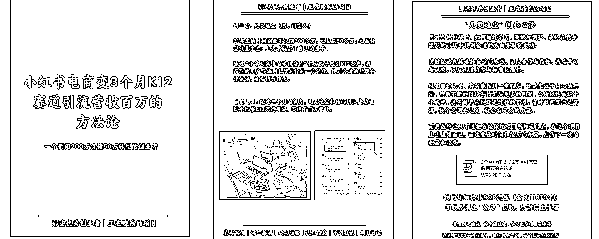
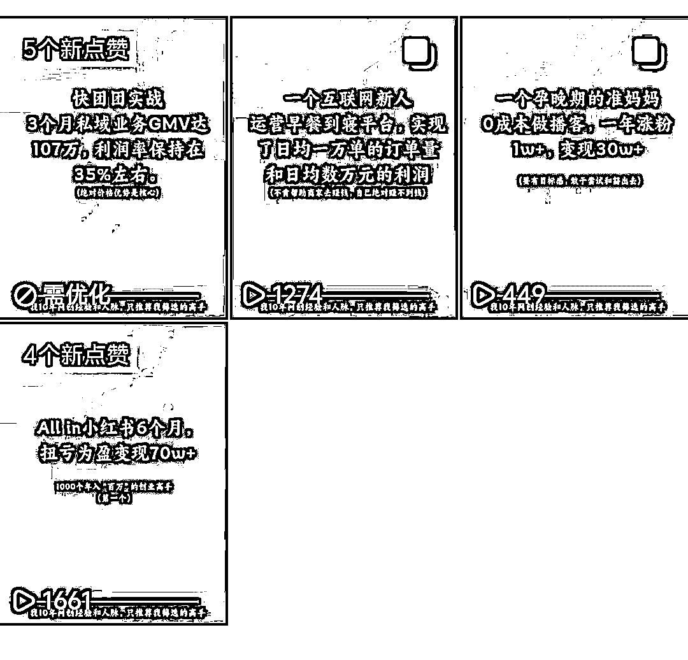
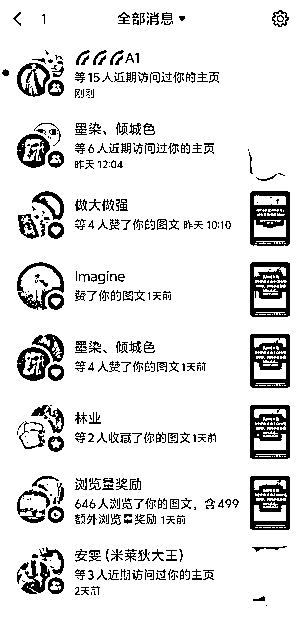
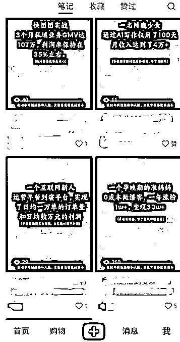
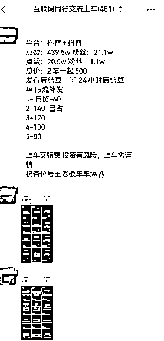

# 中介赚钱法：本月我实测两套打法，一套只通一半，一套完整跑顺

原始文章：[`www.yuque.com/for_lazy/zhoubao/dxgc5kt4tfzcrsxu`](https://www.yuque.com/for_lazy/zhoubao/dxgc5kt4tfzcrsxu)

分享人：领飞  
时间：2024年6月26日

常读我文章的人应该清楚，我热衷于做资源拼接，习惯站在中间人位置赚差价。本月我又拿了两套打法做验证，结果是一条走了一半，一条全流程跑顺。

## 先看那条只走了一半的：卖人

在航海家俱乐部里待了些日子，圈内确实藏龙卧虎。我手头没有自己的业务模型，天生就是那种哪里有钱赚就往哪里凑的倒爷，所以平时基本只看不聊。说真的，用一枚龙珠换这个入场券，我事后觉得有点奢侈。多年独自创业，养成了不主动社交、不主动加人的性子。不过我有个习惯：遇到感兴趣的东西就翻来覆去研究，觉得可行就直接下场试。于是，我从航海家俱乐部里琢磨出一套打法——

把赚钱的会员资格当货卖，把赚钱里的大咖当招牌，再把大咖和具体项目牵线搭桥，打包变现。

这套路你们完全可以照搬。我自己还没走到终点，但绝对值得一试。

先说三个根本判断：

做生意，核心就是卖。  
放到线上，核心就是吆喝。  
能成交，拼的是一股自信。

手里如果握着成熟产品，你自然有底气去叫卖、去张扬。自信是撬动成交的支点。你对自己卖的东西深信不疑，面对客户时腰杆才硬；客户看到你腰杆硬，才敢痛快付款。很多订单死在实际付款前，就是因为销售少了一句掷地有声的保证。

举例，三只羊直播间里，有人问“嘴哥”买到假酒怎么办？嘴哥答得干脆：去告小杨哥，去告三只羊。话一出口，反而让人放心。

赚钱就是一个被反复验证过的成熟产品，堪称全网大众创业平台的头号选择。里面现有六万多名付费成员，一小撮已经做出成绩，大部分仍在寻找赛道，还有一部分在盘活资源。

六万多人，看着不少，但放到整个创业市场里，根本不够看。多少创业博主的粉丝群里，还有大把人没听说过这个平台。想创业、想搞钱、想找信息差的人，仍是一片接一片的蓝海。几千万创业大军摆在眼前，六万不过是个零头。

### 如何从赚钱身上赚钱

随便找个粉丝，丢过去一张72小时试读券，明确告诉他期限内不满意全额退。只要他愿意进场逛一圈，我不敢担保百分之百，但至少四成会被留住。

四成是什么量级？进来十个人，成交四个，四单乘553元等于2212元。按基础两成抽成算，你一年拉到的新人超过100个，抽成比例还能上浮8%。

这里的关键是：分母必须是真正进入赚钱的10个人，而不是你引流到私域里的10个路人。

### 赚钱为什么好卖

知识付费最怕的是先交钱后看内容，内容不行还不给退。赚钱偏偏做了72小时反悔机制，这个设计基本把用户的心理顾虑统统卸掉了。

往后几年，失业人群只会越来越多，骗子也会成倍增长。未来五年，很可能出现大学一毕业就失业的常态。学历的光环越来越淡，掌握一门手艺反而更值钱；如果会点人工智能力，那更是稀缺价值。

80后90后被淘汰的速度也会加快。AI顶替人力，企业又要配合政策拿补贴，于是辞退老员工、招募应届生，就业率就是这么堆出来的。接下来十年，割韭菜的会越来越多——因为急着求财的人更多，认知浅、渴望快钱的占大多数，找不到出口就只能被反复收割，如同初到陌生城市，总免不了走几次弯路。

所以，“赚那些一心求财者的钱”本身就是大风口。

### 赚钱本身就是项目

外面所谓的一个个项目，说穿了不就是先引流、再卖货吗？你直接卖赚钱就行，等同于代理一个有名气、体验好、售后棒的大品牌。赚钱如今已经是牌子了，却还在品牌早期，代理门槛为零。虽然它运营了7年，市场才刚刚开始热。

你帮品牌拉新，品牌自然欣赏你。亦人老大嘴上未必说，实际好处都是实打实的真金白银。那些百万粉丝的商业大V，卖私董会、卖合伙人、卖课程，几万几万地收，本质无非是卖自己的东西。赚钱却不需要你自己造产品，只需要众人添柴火焰高。

### 卖赚钱的完整闭环

**第一步：制造案例素材。**  
把赚钱里的成功案例，加工成图片、文章、短视频。📕上那些“1000个搞钱路子”“1000个信息差”的账号，做的就是这种内容。我们只是换了个角度：做成1000个创业高手拆解。

这三张图承担三件事：封面用来吸引点击，成功案例用来建立信任，结尾用来留钩子。我为了快速验证，用智能工具赶出图，细节做了很多删减。更完整的版本在下面的在线文档里，大家自取：

[`x87o4rv4xr.feishu.cn/docx/I4NId7OZ6oi7q9xxH9ScKKG4nUe?from=from_copylink`](https://x87o4rv4xr.feishu.cn/docx/I4NId7OZ6oi7q9xxH9ScKKG4nUe?from=from_copylink)

**第二步：守住版权底线。**  
所有二创内容，只拿来做分享，不拿来卖，也不拿来送人。就算有些大咖的原始分享是飞书公开链接，你也不要去转发。尊重版权是原则问题。确实有人靠倒卖赚钱资料赚钱，也有一些博主乐于你转发他的链接帮忙带流量，但你想把生意做长久，就必须有自己的规矩。随便卖、随便送，格局一缩，注定赚不了大钱，最后只能沦为一个网络小混混。

**第三步：承接成交。**  
粉丝上门后，会跟你要资料。这时候甩一张海报过去，讲清楚赚钱平台的价值，讲清楚72小时退费的保障。他进场后自己一搜，分享里的东西都能找到。走到这一步，四成转化已经稳了。

提醒一句：吆喝的时候务必自信，要用不容商量的语气告诉他——进入赚钱后不满意，100%按规矩退。这一句话既是勾子，也是定心丸。

**第四步：经营私域后端。**  
表面看你在卖赚钱，实际上每成交一单，私域里就多一个优质创业粉。你长期用赚钱内容引流，长期卖赚钱产品，一边囤积私域资源，一边完成变现闭环。

假设一年卖出1000个会员，按分成推算，能落袋80到100万。第二年还有续费可以接着赚。好产品就是这样，越做越上瘾。

等你卖了1000人，亦人老大肯定会注意到你。线下聚会你能拿到入场资格，航海家俱乐部也为你敞开，大咖资源顺势对接。更关键的是，你🛰️里未必只有1000个好友，可能是几万个。后续与这些高手合作带货、带项目，赚到的何止那80到100万。

**第五步：看底层逻辑。**  
线上创业最难的地方，一是要有取之不尽的引流素材，二是要有让人放心的交付。卖赚钱恰好两头都占：素材挖不完，交付也不用费口舌，一句“72小时不满意退费”顶过所有解释。

很多赚钱里的小白，项目还没影，整天刷大咖文章，刷完只是自嗨。与其这样，不如把我这套方案直接拿去执行一遍，至少先跑起来。

---

本来想把这篇先递给亦人老大，问能不能做一期航海陪跑，后来作罢。我因为个人原因没全力推，收获有限，索性先公开出来看看大家的反馈。

这件事是三赢：

对你——靠赚钱挣钱，往后再靠私域持续挣钱；  
对赚钱——拉来新用户，扩大影响力，推动平台变得更好；  
对大咖——等于免费帮他们做了传播，人家还会感谢你。

我用两个号做了小范围测试，数据看起来还行。唯一明显的短板是违禁词偏多，有待继续优化。

三个端分别是：抖音号、📕号、视频号。我没有养号，也没有实名认证，素材发得相当粗糙，所以眼前的数据并不算客观。如果你把养号、提权重这些全套做好，数据大概率会更好。

📕的情况是发出去就有人点赞，但账号权重太低，之后不再给推荐；抖音的数据比较平稳，基础流量都吃得下；视频号发了4条，其中1条跑出了5000多播放。

总体而言，需要优化的地方不少，但小测结果已经说明方向靠谱。目前全网几乎没有同类内容，很快会出现一批跟风者。尤其中小创业博主，这件事比他们自己另立项目去卖，更有价值，也更有格局。

---

## 再说那条完全跑顺的：卖项目

本月我整理出18套智能小项目操作手册，投了互推广告群和📕博主的广告位，定价79元一份，10天内卖出900单，流水5万，扣除广告成本，净赚3万多。

智能小项目如今很火，分享的人也很多，但我发现一个缺口：多数博主只讲亮点，不讲流程，不讲技术，也不讲制作过程。

举个例子，有人讲智能绘本故事项目，说流量多猛多猛，告诉他这么做那么做，就是不提用什么工具。粉丝只能私聊他去领资料，领到一份文档，看完还是一头雾水。

正因为有这种痛感，再加上智能项目遍地开花，我判断：只要有人把操作步骤写透，就一定能卖出钱。自己做IP太慢，周期太长，我索性沿用中介路线：一边收别人的智能项目，一边买别人的流量，然后把项目转手卖掉。

投放渠道包括互推群、📕博主、网站广告位。这里涉及我的投放细节，就不展开演示了。但“同行互相导流”这件事，真的值得每个人都去试：

同行互推的完整玩法，我在《拥抱同行“借势”课：互推扩列涨粉操作手册》里专门写过。

这18套手册其实没花我多少成本。就是把各种智能工具整理好，再根据博主们展示的内容，反推制作流程，完整跑一遍后形成文档。我本来还想付费进“AI破局”找素材，但亦人老大之前对他们有意见，我这人护短，就没掏钱。全部靠自己去摸索，把项目内容亲手复刻了一遍。

现在我的产能大概是一天2到5套。只要看到有人分享智能小项目，我就抓取回来，自己做完做成手册。

说实话，我并不喜欢做这类小项目——太耗时间，单个利润又薄。如果做不到批量生产，赚大钱基本无望。但小项目天生就是拿来卖的。那些智能博主自己真正做吗？大多也是在卖课、卖社群、卖项目。

我没有精力去重新起号打造一个“智能博主”人设，那就继续用中介思维，直接卖就好了。

我的路径总结成一句话：一手收别人的智能小项目，一手买别人的流量，再当作自己的货卖出去。

说白了，我就是掮客。  
掮客这门行当自古就有。一个人总要掌握某种赚钱能力，而选择什么，往往由自身条件决定。我待在大西北的一座小城，资源匮乏，连出行都不方便，很多事想做也做不成。所以不是我去选掮客身份，是掮客身份选了我。

下面把18套智能小项目全部公开，大家直接去文档里看。因为之前文档夹带广告，我重新做了排版，没有废话，只有操作步骤。你拿到手可以直接做，也可以拿去卖。这是第一批，以后想到好选题，再放第二批、第三批。

仓库里还附送一套我在用的智能工具包。项目合集配工具包，搭配使用就够你产出了，我这套手册全部是用这些工具跑出来的。

**18套项目清单：**

1. 智能绘本制作——适合宝妈做副业  
2. 智能猫咪图片——📕引流玩法  
3. 儿童英语动画——AI辅助制作教学视频  
4. 动漫美女跳舞——智能生成舞蹈短视频  
5. 西游题材图频——AI还原名著画面  
6. 壁纸号运营——智能制作动态壁纸  
7. 一键做PPT——人工智能办公提效  
8. 👸号爆文——智能写作自媒体稿  
9. 智能艺术照——一键生成写真大片  
10. 原创歌曲——AI谱曲写词  
11. 伤感氛围短片——智能剪辑情感视频  
12. 古诗词动画——AI还原诗中美景  
13. 军事主题视频——智能合成大片场景  
14. 电商产品图——AI生成商品素材  
15. 小说推文——智能生成推广短剧  
16. 爆款绘本故事——AI批量产出童书  
17. 成语故事短片——智能制作知识动画  
18. 民间故事合集——AI整合演绎传说

在线文档：18套智能小项目合集（第一批）

[`x87o4rv4xr.feishu.cn/docx/NYQudhv11oDkUvxSE4RcSmcEnoc?from=from_copylink`](https://x87o4rv4xr.feishu.cn/docx/NYQudhv11oDkUvxSE4RcSmcEnoc?from=from_copylink)

在线文档：智能工具包

[`x87o4rv4xr.feishu.cn/docx/TckadgkskogJ5gxRhNrcWlDCnZg?from=from_copylink`](https://x87o4rv4xr.feishu.cn/docx/TckadgkskogJ5gxRhNrcWlDCnZg?from=from_copylink)

---

评论区：

老船长李阳：写得很实用，我现在就用的这个方法，只不过走的是个人IP导流私域，暂时一天才几单，感觉还没把价值吃透，也在摸索更好的玩法。  
🐬Rita：[强][强][强]  
旅星：太强了，正好需要这个，万分感谢！  
希平：很实用，我特别爱看赚钱，刚好可以帮它拉新人。  
biangbiang*：厉害，看完直接豁然开朗。  
柠檬茶🍋：思路不错，适合想尽快看到结果的新手。我也是小白，想在赚钱结识更多牛人。V+Q16633339999  
领飞懂运营：我正在写《108个中介思维赚钱术》，下次有机会再分享。  
小鱼：已经实操，昨天就有人来找我领资料了，感谢分享。

