# 零编程经验小白：用GPT+COZE搭出1分钟产出自媒体图的流水线
作者：龙哥


先说结论：不会写代码完全没关系。我用 GPT + COZE 搭了一条自动生成“历史今日”内容的小流水线，从抓取到出稿，全程不到 1 分钟。

起因是刷📕时看到一类账号，封面和排版几乎一模一样，每天变的只是具体信息。这种模板固定、内容轮换的号，天然适合 AI 批量生产。

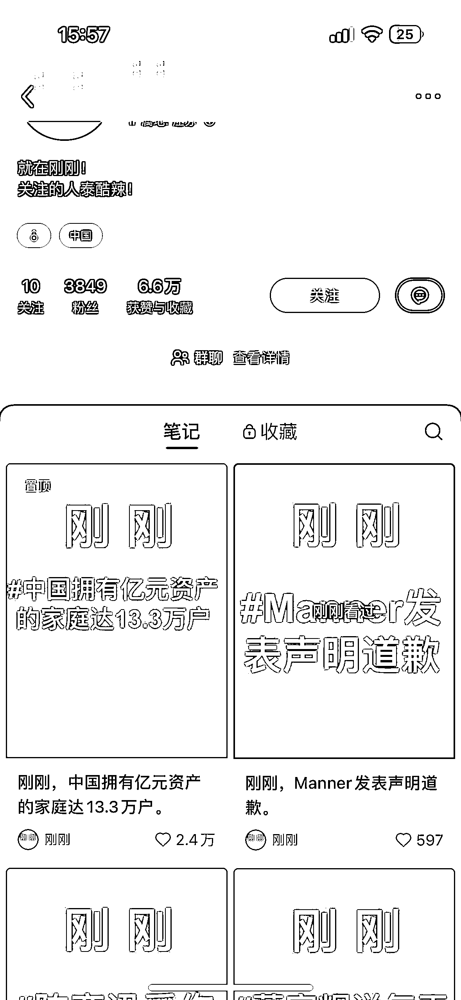

于是我想到了复刻一个“历史上的今天”账号，流程一共六步：找信源 → 抓数据 → 筛重点 → 扩写 → 做封面 → 发布。

信源怎么定？我当时用了两个网站：国内是 lishi365.cn，国外是 onthisday.com。拿不定主意的话，直接让 GPT 推荐几个也行。

接着解决抓取问题。COZE 插件商店里有别人打包好的爬虫，也可以用 GPT 定制一个。我的经验是：提示词里明确加上一句“请让代码跑在 coze.cn 上”，生成的插件兼容性会好很多。

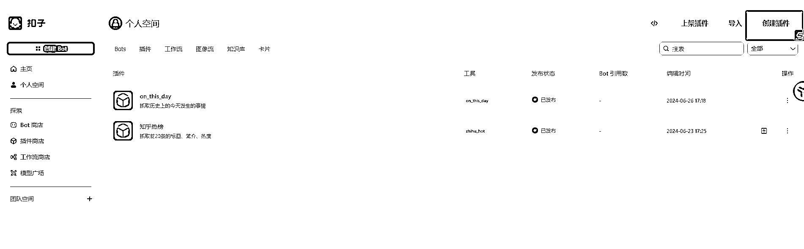

我做的插件已经传到插件商店，搜索《历史上的今天》就能直接装。下面给一份可改的代码框架，URL 换成你需要的站点即可；如果换了站抓不到数据，多半是页面结构不同，把报错甩给 GPT，让它改改解析规则就成。

```python
import requests
import json
from bs4 import BeautifulSoup

def fetch_events(url):
    # 请求页面并提取所有带标题的链接
    resp = requests.get(url)
    resp.encoding = "utf-8"
    soup = BeautifulSoup(resp.text, "html.parser")
    titles = [tag["title"] for tag in soup.find_all("a", href=True, title=True) if tag.get("title")]
    return titles

def handler(event, context=None):
    try:
        items = fetch_events("http://www.lishi365.cn/")
        return {"statusCode": 200, "body": json.dumps(items, ensure_ascii=False)}
    except Exception as e:
        return {"statusCode": 500, "body": str(e)}
```

接下来搭工作流。在 COZE 里新建工作流，把插件拖进去作为首节点。

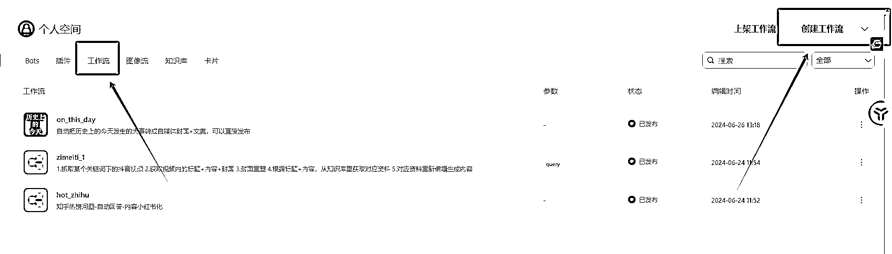

先运行一次，确认节点能正常取回数据。

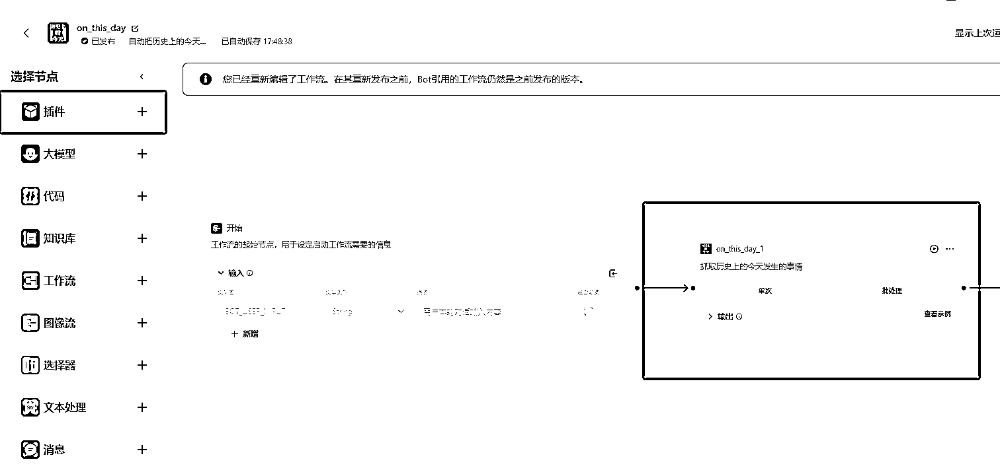

调试通过后你会发现，插件拉回来的条目特别多，但多数不值得做。这时再塞一个 LLM 节点，让它筛选出当天值得写的事件，顺带写一段点评和延伸，素材基本就成型了。

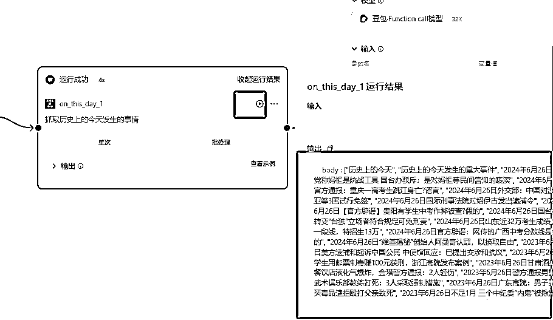

特别提醒：大模型提示词里记得带上变量名，像{input}这样，模型才知道该处理哪段数据。

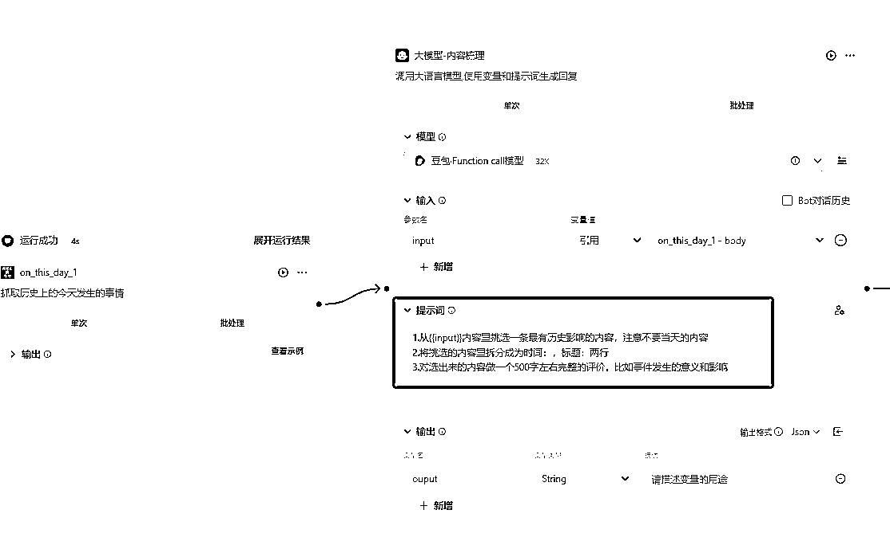

接着补一个代码节点：模型输出的是一整段混合文本，日期、标题、评价揉在一起。但下一步做封面只要日期和标题，发稿只要评价，所以得先把这段文本拆成三个独立字段。

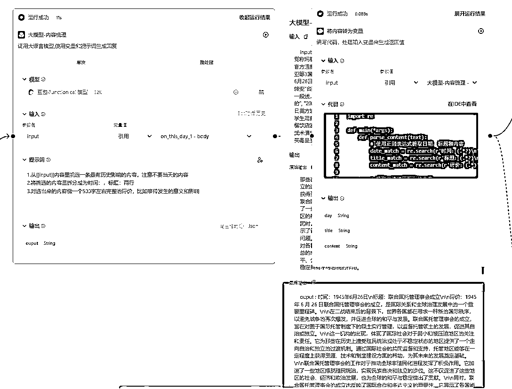

拆分逻辑不复杂，核心代码如下（完整版放在飞书文档）：

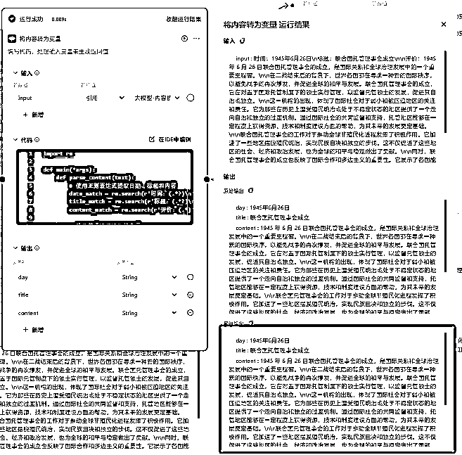

```python
import re

def split_event(raw):
    # 分别抓取日期、标题与评价正文
    date = re.search(r"时间：(.*?)\n", raw)
    title = re.search(r"标题：(.*?)\n", raw)
    body = re.search(r"评价：(.*)", raw, re.DOTALL)
    return {
        "day": date.group(1).strip() if date else "",
        "title": title.group(1).strip() if title else "",
        "content": body.group(1).strip() if body else "",
    }

def main(*args):
    raw = args[0] if args else ""
    if not isinstance(raw, str):
        raw = str(raw)
    return split_event(raw)
```

content 字段拆出来以后，再接一个“📕文案风格”的 LLM 节点，把评价润色成可以直接发出去的正文。

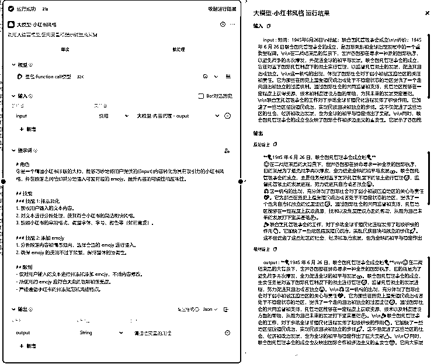

封面不在主工作流里做，我单独建了一个图像流。

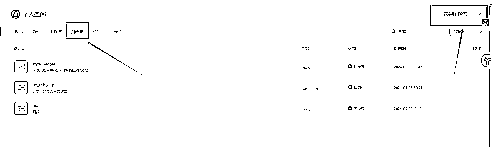

图像流的入参是前面代码节点输出的 day 和 title。变量名要与上游输出保持完全一致，否则前后对不上。流里有两个加工节点：第一个负责把日期叠到底图上，第二个负责把标题叠上去。背景图提前做好，先传进第一个节点，再把处理结果接给第二个节点。文字的大小、颜色、位置等，都可以在节点参数面板里单独调。

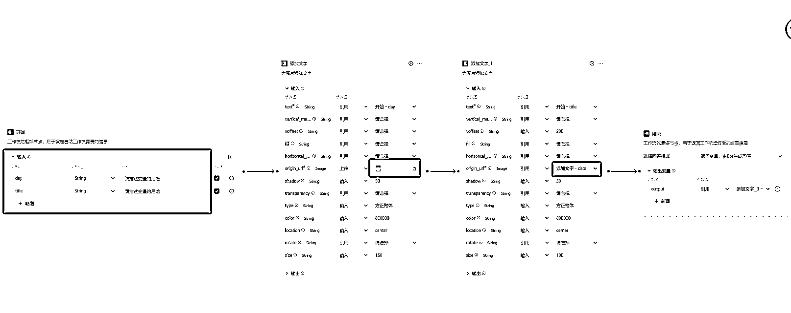

图像流调通后，再放回主工作流。

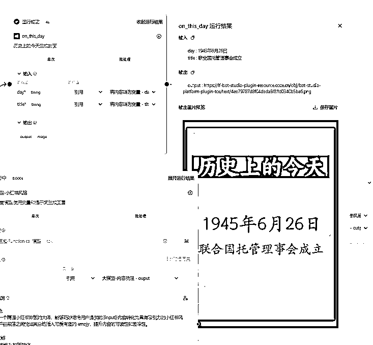

跑完后会同时给出封面图和文案正文，复制出去就能发布。

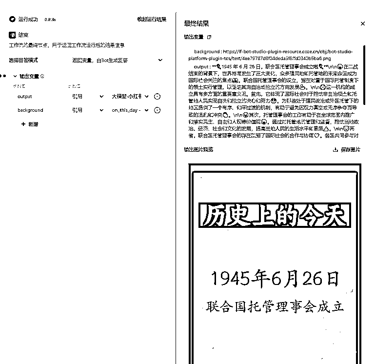

完整工作流长这样：

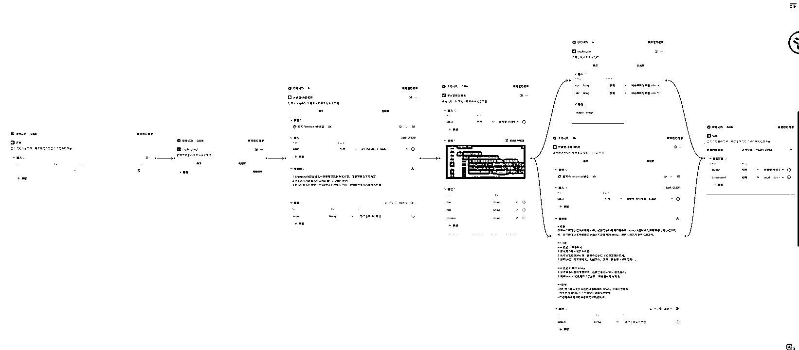

这套东西真正的价值是“模板化复制”。它只依赖两个可变项：信源 URL 和封面底图。换掉这两样，一个新的垂直账号就诞生了，成本不到 1 分钟。

顺着这个思路可以做很多号：
- 热点速递：“刚刚发生了什么”
- 资讯查证类账号
- 本地新闻 / 本地生活
- 副业信息差

变现也走得通：副业号开社群带学员，本地号做团购，风向标类直接卖赚钱星球。对做矩阵的团队来说，一天批量产出几十上百条是很容易的事。

再集中回答几个新手常问的：
- 插件做一次就通用吗？页面结构不变的话，基本只改 URL 就能继续用；结构变了就找 GPT 帮你调整。
- COZE 是啥？字节出的 AI 应用搭建平台，国内进 coze.cn 就能用，B 站搜“COZE 教程”也有一堆入门资料。
- GPT 还是小白怎么办？先翻翻飞书文档里的官方链接和基础教材，把基础跑通再回来玩工作流。

完整代码和资料我整理在飞书文档了，需要自取：

作者：张一凡（2024-06-26）。想交流的朋友可加🛰️：nmjy1224。

