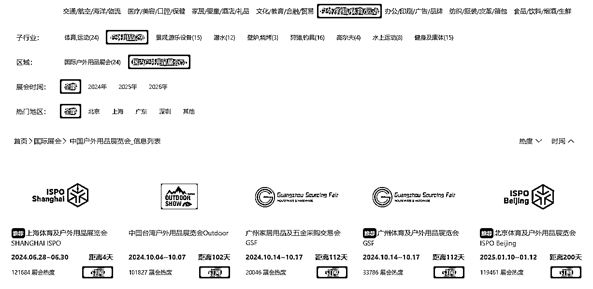
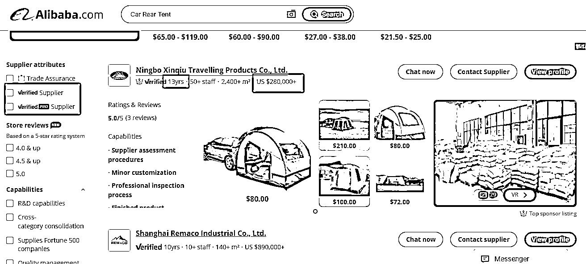

# 亚马逊卖家如何有效挖掘优质供应链（货源）--实战心得
作者：龙哥

**跑了几十家工厂后，我把亚马逊卖家的供应链玩法彻底想明白了**

做亚马逊越久越会发现，选品和运营只是水面上的功夫，真正决定赚不赚钱的，是你能不能找到一个靠谱的源头工厂。今年开年到现在，我陆陆续续跑了几十家工厂，户外、儿童玩具、医疗、宠物、个护、家居都看过，横跨好几个类目。看多了最大的感受是：谁能在供应链上先人一步，谁就已经赢了大半。

如果你现在还只会打开1688拿货，那我劝你早点收手，趁着茅台降价买两瓶放着都比这强。市面上教人“在1688找到好货源”的文章，要么是没真正做过采购，踩的坑还不够多，要么就是在把人往沟里带——一个侵权投诉就能把你打回解放前，还谈什么创业。所以对新手来说，最靠谱的路子是：直接去专业线下展会、阿里国际站，或者跑产业带现场找工厂，尤其是切入新品类或者有大批量采购计划的时候，一定得亲自去。

怎么找专业展会？可以常刷 qufair.com/fl/217-273-0 或者 10times.com 这两个工具。要记住，只去有行业针对性的专业展，那种大而全的综合展基本可以跳过，谁去谁知道，逛下来全是零售摊位的既视感。预算和时间允许，最好把目光放到海外，香港展的含金量普遍比内地很多展高出一截。另外，很多产业带也会自办展会，多打听就能摸到门路。

阿里国际站也不是不能碰，但一定要带着筛子去。我通常会看四个硬指标：第一，最近销售额，别人花真金白银踩过的坑，就是你的最好避雷针；第二，公司成立年限，不过要小心有些工厂会同时养好几个号，所以还得翻公司简介多留个心眼；第三，产品专业度，如果这家店什么都卖、没有主打方向，大概率是贸易公司倒手，不是说贸易商一定不行，而是新手最好先和真正的工厂搭上线；第四，联系地址，正经工厂至少要写到几栋几层，而不是某小区某单元某零几号。如果看着像工贸一体，再顺手把公司名称丢进天眼查，底细能扒个七七八八。

再说说找产业带的方法。你可以在阿里国际站上搜核心产品词，如果搜索结果前几页的商家地址集中在宁波，那这类产品的源头八成就在宁波，当然也不是绝对。举个例子，我之前跑卫浴，发现佛山卖的马桶，很多其实来自河南许昌长葛，是在那边生产好再运到佛山的；家具也是一样，大量货都是江西赣州做完，再拉到佛山集散。现在的产业带比过去分散多了，不过你多聊几家老板就会发现，有些地方的产业带，其实是另一地的人带过去的。我自己第一桶金做婚纱礼服，这个圈子里很多老板都是安徽六安人，但公认的源头产地还是在苏州虎丘。所以发货地不能全信，多听口音、多聊天，源头线索就出来了。

找好目标工厂之后，真正考验人的是现场看厂。先说一个小建议：去之前把车洗得干净点，穿着得体一点。如果条件允许，尽量直接和工厂老板聊，中小厂的老板往往就是最牛的销售，既懂产品又懂市场；大厂就算了，人家不一定看得上你这种量级。什么样的厂值得长期合作？按我的标准，珠三角地区的工厂主营业务营收在3000万到5000万人民币（或者1000万美金到1亿人民币这个区间），长三角可以再上一个台阶。低于这个体量的厂，后面生产、管理、品质大概率都会出问题。时刻提醒自己：中国工厂千千万，选择大于努力。宁可单价贵一点，也别在后面因为各种奇葩问题亏得更多。

进厂之后，六个细节帮你快速摸底：

第一，看门头。旧一点没事，但要干净整洁，这说明老板有心经营。如果门卫都笑脸相迎，通常代表工厂效益不差，老板舍得发钱。看到同是来验厂的同行，递两根好烟，信息量往往超乎你想象。

第二，样品间别待太久，它就是个门面。主战场一定是生产车间：看有没有同行或者国外大牌在代工，如果绝大部分货都是往国内卖，这种厂先标记待定；看工人多不多、手头熟不熟练，看物料堆得有没有章法，这些直接关系到品控。看完车间再去仓库，成品和原材料区都是偷偷记品牌的好地方，能拍照就拍，不能拍就赶紧给自己发条消息，把看到的品牌记下来。前几次去工厂，第一趟信息量最大。

第三，看生产工艺。如果工厂只是做做粗加工再组装一下，那中间的加价和品质风险都大。反过来，如果连原材料都在自己手里生产，那重点看机器模具多不多、是不是真的在运转，停在角落的压根不算数。问的时候可以细一点，业务员或老板都能聊，有些老板是技术出身，有些是销售出身，但只要聊到自己深耕的品类，都门儿清。

怎样才能快速装成专家？两个办法：用AI，或者扒亚马逊后台的评论分析。找出你类目里销量靠前的ASIN，把差评挨个看一遍，挑出几个高频痛点，然后当面问工厂：这个问题你们怎么改？最多问个两三家，谁有真本事谁是混子，一目了然。甚至有些厂是不是真的在做产品，你都能判断出来。

第四，看实验室。当然这要看品类，但稍微正规点的厂，哪怕产品再简单，也会放一台跌落测试设备。重点不是有没有，而是设备是不是最近还在用，是真的测试还是纯纯摆样子。从这一点，能侧面看出工厂对自己产品的底线。

第五，看认证。扫一眼证书日期，再看看有没有做目标市场大牌代工。有认证是加分项，但别全信，因为实验室数据代表不了你后面每一批货的品质，有些认证塞个红包也能过。更关键的判断标准是：这工厂有没有做欧美市场，有没有接一线顶级品牌的单，还是只做商超货。这两条路线，代表的品质要求可以说是天差地别。

最后，直接问老板去年欧美订单做得怎么样，有没有服务过大牌，这也是在帮自己扫雷。如果样品间陈列得整整齐齐，还按欧美产品线的逻辑来组合，墙上挂着一整面和外国客户的合影，那这种厂做欧美市场通常不会差。还有一个加分项：看画册，如果画册风格做得非常欧美化，款式基本不会土。说实话，我跑了这么多厂，能达到这个水准的也就5%，大部分还是普普通通。所以有机会一定要多去香港展，找台资或港资贸易商，翻翻他们的画册，看看人家怎么做产品组合，你会像打开新世界一样。

不同的人看同样的经验，有人觉得这说的全是废话，也有人一眼看到从10倍到100倍的放大机会。供应链这条路没有捷径，多跑多看多问，把钱和功夫花在源头，比什么都值。

