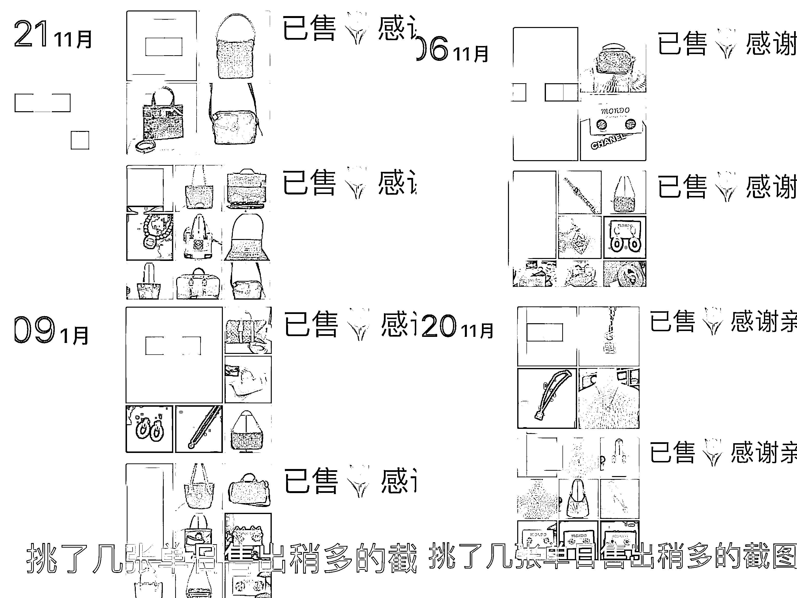
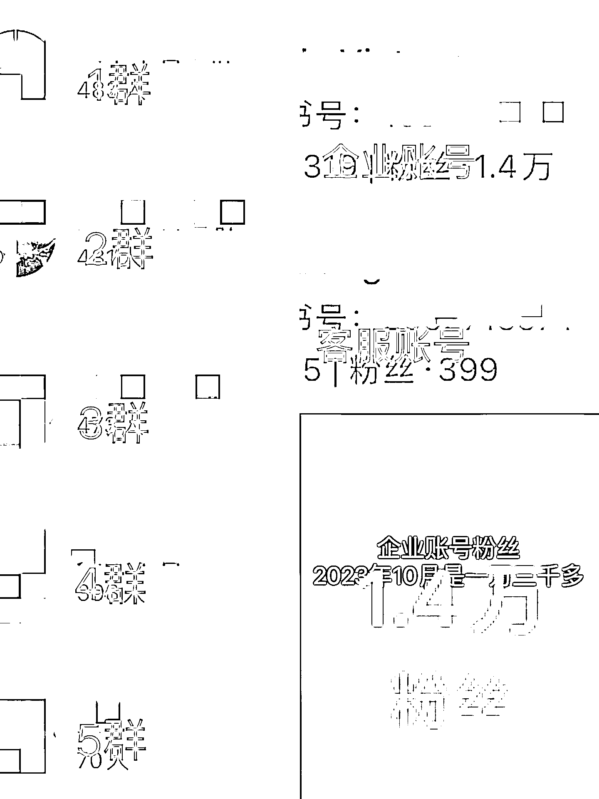
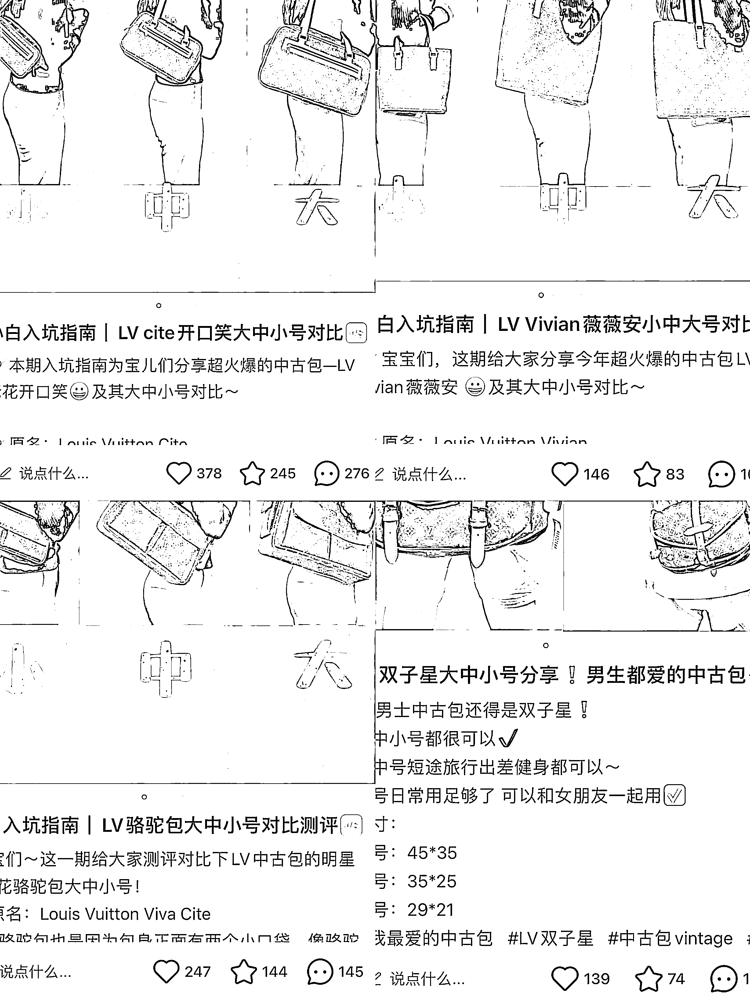
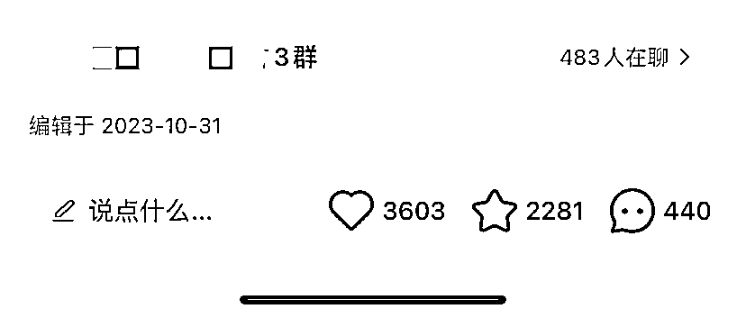

# 千粉怎么做到 GMV200w？把一类人群做透，爆品多发

一个只有千把粉丝的📕账号，凭什么能做出年入200万的成绩？很多人觉得不可思议，但有人真的做到了。而且方法并不复杂——盯住一类人，把爆款内容反复打到极致。

这条路径，来自一位中古店长的真实复盘。她叫芝慧，曾在一家佛系中古店做店长兼运营，从接手一个几百粉、转化惨淡的账号开始，硬生生把年GMV做到了200万以上，最高单日卖出7万多。听起来像运气？她靠的其实是一套可复制的方法论。

先说项目底子。主营3000到7000元左右的中古包，基本都是八九十年代或零几年停产的老款，很多款式数量稀少，成色各不相同。目标客户很清晰：二十多岁到45岁、有审美品味、消费力不错的女性，外加一些喜欢中古的潮流男生。平台选📕，因为受众就在那里。考虑到精力有限，她放弃了视频，专注图文。

最关键的破局点，是测品后发现异常值。当时随手发的“男士中古包”和“罗意威”两个选题数据格外好，她没有犹豫，立刻顺着这条线疯狂深挖——“罗意威中古男包”“通勤中古男包”“6只罗意威斜挎包”……换着角度、换着封面、换着组合，一遍遍重复发。爆款带来的价值远远超过一百篇不温不火的笔记。她总结了一个思路：数据反馈好的品或款，就换个形式重新发，或者延展一下再发，既能稳住流量，还能测出更多潜力款。

流量拉起来之后，转化靠的是信任。她反复强调店里的差异优势：明码标价、原始成色、自助式购物、360度细节展示、支持复检鉴定。这些标签不仅写在简介和朋友圈，连合作探店的博主帖子里都反复出现。其中“明码标价”和“自助购物”是她最主打的记忆点，专门吸引不喜欢被推销、讨厌问价压力的客户。引流🛰️也做得非常主动：用小客服账号在评论区、私信、群聊里回复敏感信息，哪怕账号违规也在所不惜，废了再换一个。到离职时，两个🛰️号加了一万多好友。

整个运营分四个阶段推进。第一阶段靠博主探店+账号推店推品，探店选300-2000粉、报价100-500元的小博主，要求数据稳定、真实评论多、有潜在消费性提问。同时自己每天刷同类内容养号，发干货帖、用多产品的封面图增加点击率。第二阶段就是测爆款+重复发，发现哪个标签反馈好就猛攻哪个，甚至一个爆帖直接拉满3个500人的群聊。第三阶段同行变多，开始参考同行的爆款选题和拍照形式，并且把群聊价值榨干——用合集图、满减活动、稀缺款预告等方式引导群友加🛰️。第四阶段做📕矩阵，企业号、个人IP号、中古男包号、客服号多账号配合，还顺应趋势开了店铺和直播。

当然，过程中踩过的坑也不少。最头疼的就是中古包非标品，一个爆款可能只有一只货，帖子爆了但没法批量变现。解决办法是先把流量引到私域，再推荐类似款或替代款，沉淀下来慢慢转化。后来明码标价自助购物的同行越来越多，优势被稀释，就只能靠矩阵和抢占更多流量入口来应对。她说得很实在：做📕，篇篇爆是不可能的，流量不好才是常态，但只要坚持发，就有爆的概率，就有变现的机会。遇到问题，解决了你就胜出，被流量淘汰的永远是那些停下来的人。

回头看，她的核心打法其实就两句话：把一类人群做透，把爆品重复发透。如果你正好在纠结📕怎么做、粉丝少怎么变现，不妨借鉴她的思路——先找到一个有反馈的小切口，然后用力打深，别贪多。

账号布局上，她用一个企业号加一个小客服号，企业号做到1.3万粉，五个群聊累计两千多群友。

🛰️端，第一个号加了9000多好友，第二个号也有1000多，离职时突破一万。

线上展示优势的地方一个都不放过：🛰️简介、📕简介、店面推广帖、探店博主帖、评论区、群聊、背景图，全都埋好提升信任的钩子。

养号阶段，每天刷中古相关内容一两小时，点赞收藏评论关注转发，再用干货笔记积累权重。

有一篇爆帖直接拉起了三个群聊，每个都接近满员——爆款的力量真的无穷。

评论区的回应也很关键：爆款帖下面，很多商家连评论都不回，白白浪费流量。她却坚持及时回复每一条评论和私信，把互动热度滚起来，再顺势引导加🛰️。数据只是数字，回复才是转化。

说到底，千粉做成200万GMV，靠的不是花哨技巧，而是想清楚人群、盯紧爆款、反复输出、认真承接。这套打法放在今天依然有效，就看谁更愿意沉下心去执行。