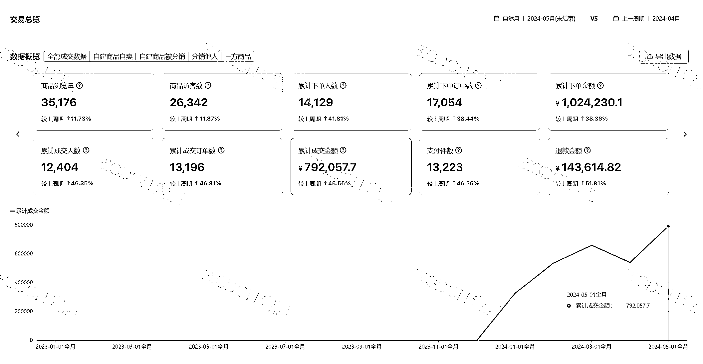
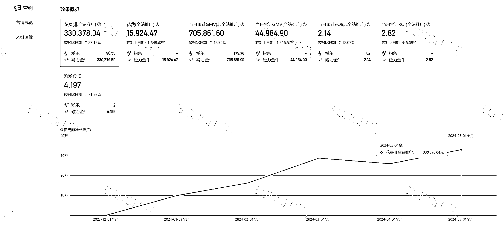
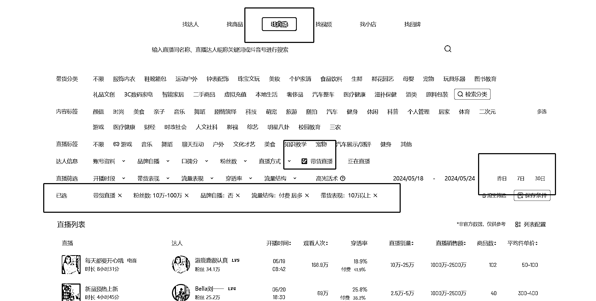
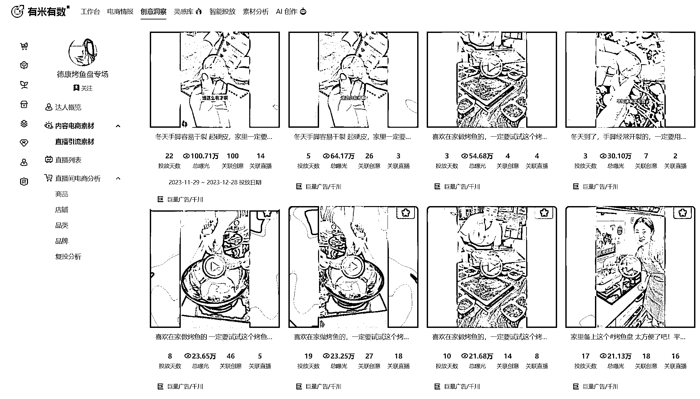
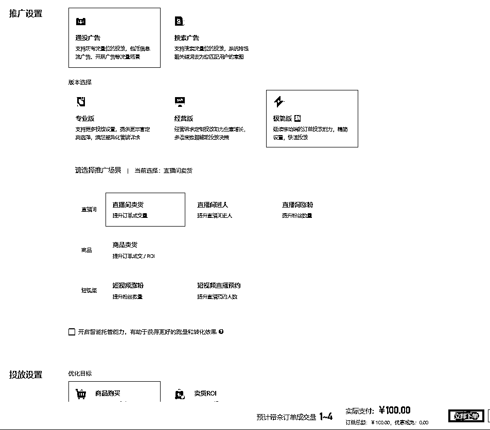
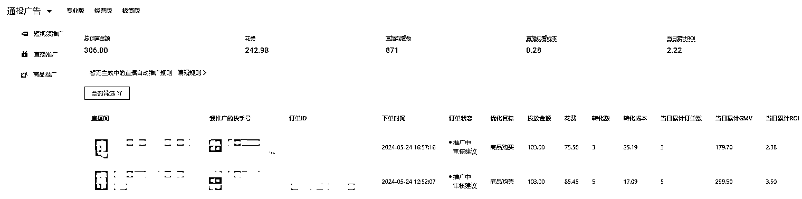
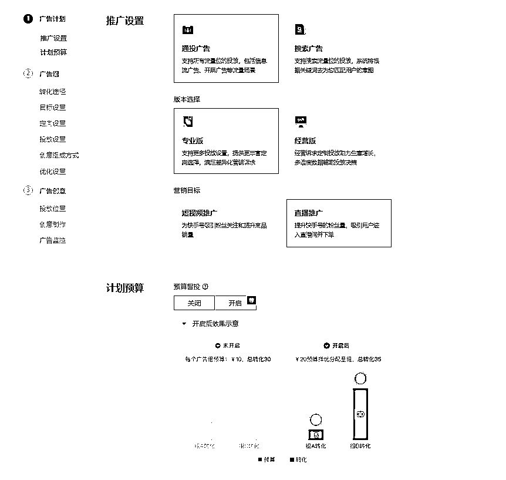
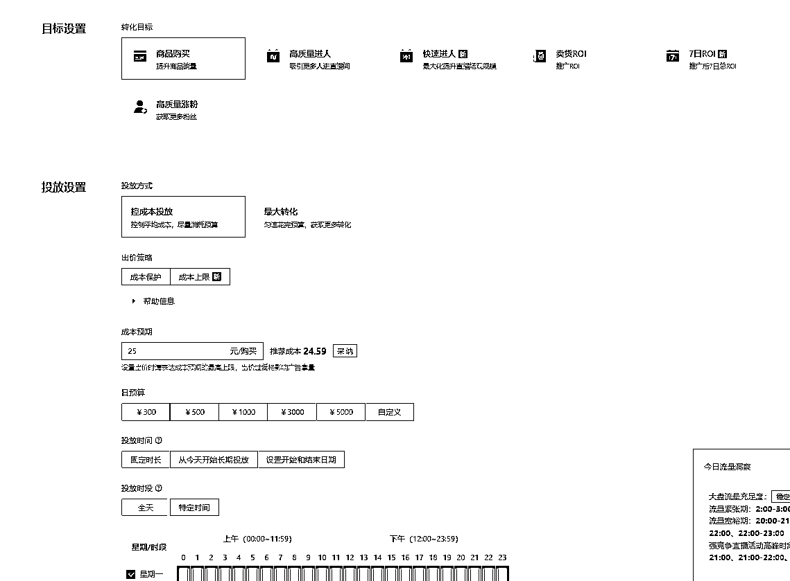
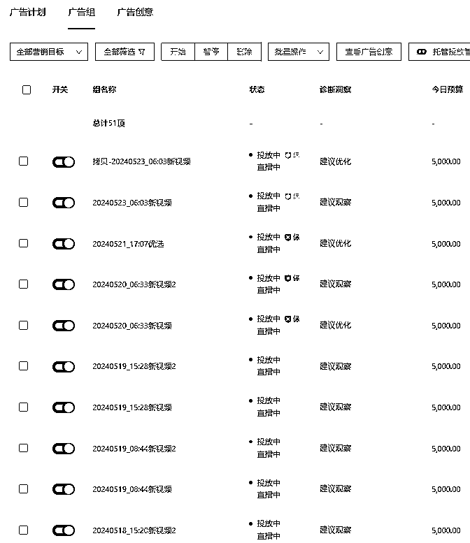

# 快手数字人直播，单品 4 个月净利润超 60W，GMV 超 250W

我是在赚钱潜水了好几年的BIGDON。2021年加入后，跟着几轮航海跑下来，从纯小白慢慢能独当一面，再到搭团队把项目放大，这条路走了挺久。这次分享的快手数字人直播打法，我是从今年1月26号开始测品的，到现在为止五个月不到，单一产品、单一店铺，净利拿了六十多万，成交总额干到了两百五十多万。数据摆出来说话：

GMV 图：

付费广告图：

先聊聊这个玩法的底层逻辑——快手数字人直播说白了就是借力：从抖音上挑一款对快手用户胃口的爆品，围绕这个产品批量产出短视频，用付费投放把视频热度拉起来，再把人导进直播间成交。但那个直播间里并没有真人主播，播放的其实是提前录好的对标抖音账号的直播画面。

做过抖音付费投流的朋友应该不陌生，底层思路确实相似，但真上手就会发现，两边的操作门槛和竞争烈度完全不是一个量级。也许有人会问：快手还有人在用吗？我朋友圈子里压根没人刷快手。快手体量才抖音的几分之一，有什么好做的？其实恰恰是这些想当然的判断，把一个没什么人抢的市场留了出来。

顺着这个思路往下拆，这个项目能跑通，主要是四个环节撑起来的：选品、短视频、付费投放、数字人直播间搭建。一个个说。

**选品：看准人群，认准打法**

选品是决定生死的第一步。我选品始终围绕着“新奇特”这个原则打转，这条逻辑不只适用于快手，放到📕或者别的平台也成立。

为什么这么强调“新奇特”？因为这个项目的转化路径是：付费把视频推给用户，用户被内容打动后点进直播间下单。说白了视频就是开路的先锋，而产品能不能在第一眼就抓住人，直接决定了视频有没有吸引力。新鲜、奇巧、有辨识度，这三样占齐了，选品这件事等于成了六成。再结合快手主流用户的面貌，最终落点就是那些带点新奇感的中老年用品。

那剩下四成怎么把握？我是这样分配的：

一成看对标产品的素材厚不厚。如果一个品找不到足够的广告素材来做参考，后面剪视频、做投放会非常吃力。素材可以到有米有数、抖音、快手、视频号这些地方去挖。

一成盯退货率。这个必须严格把关，本来就是靠付费买流量，退货率一高利润全被吃掉，到时候听到出单提醒心里反而发慌。

再看一层对标直播间的情况。

剩下这一成，是我踩过不少坑才悟出来的关键：看看快手上有没有已经用同样套路卡位的对手。这里说的对手不是单纯跟你卖同一个品的人，而是跟你用一样的素材、一样的付费打法、一样靠短视频引流去直播间截流的人。快手盘子看着不小，好像多几个竞争者也无所谓，但事实不是这样。所以我现在挑品的原则就是：如果快手已经有人用同类打法在打，我就不碰；但我愿意去尝试那种在快手上还没被同行用同样方式抢占、在抖音上却已经卖得飞起的品。

落到具体操作上，没有网感的新手可以先借助选品软件建立起对品的感觉，等审美和判断力练出来了，再回归最朴素的方式去刷抖音找品。以考古加举例，可以按这个思路筛选：找直播板块，选7天周期，看带货直播，锁定粉丝量10万到100万之间的账号，排除品牌自播，把流量结构设为付费占比最高，再筛选带货表现超过10万的直播间，最后按商品数倒序排列，爆品基本就浮出水面了。

做快手数字人这个项目，选品的重点其实是找到一个合适的抖音对标账号：得和你的选品方向匹配，长期开付费直播，最好只卖单一产品，粉丝体量不大，不是品牌官方号，带货成绩亮眼，产品毛利率尽量保证在50%以上，价格带落在30到100元之间。如果一个账号能同时满足这些条件，这款产品就可以进入测品名单了。但这才只是开始，你要不断扩充候选池，攒上几十上百个备选，再慢慢筛选、测试。

选品工具属于花了钱人人都能用的公开资源，你能看到的东西别人同样能看到。这个环节真正拉开差距的，就是执行力。你比别人早一步动手，机会窗口就大一分。

对老手来说，过度依赖选品工具反而显得低效。真正好用的、也是撞品几率最小的方法，就是专门养一个抖音号去刷。准备一个新号，持续给系统喂你想要的对标品类的关键词，慢慢把这个号的推荐流“喂”成你的选品雷达。这需要一些时间和耐性，但养成之后，你每天打开抖音就是在淘品。

**短视频：素材的好坏决定项目上限**

第二条命脉是视频。这个项目的转化全靠付费流量把视频打爆，把人导进直播间，所以好产品加上能跑量的视频，差不多已经锁定利润了。

一条能起量的视频，拆开看无非这几块：爆款底稿、前五秒钩子、产品卖点展示，以及引导用户跳转直播间的收尾。

底稿从哪里来？最直观的办法是去有米有数扒对标账号投放过的广告，找出总曝光量最大、关联创意最多、投放周期最长的那些素材。另一条路是直接参考同类目下已经跑出量的爆款视频，因为同一个品类里能爆的脚?往往趋同。

脚本不用贪多，关键是要找到适合你这个账号的那一个。测试期内多试新脚?，发现某个脚?能跑到几十万甚至上百万播放，就用它批量做出大量变体视频，把这个脚?能吃到的流量全部吃透。这个过程中通常还会持续蹦出十万级、几十万级的视频，订单也就能稳定一波。

前五秒的重要性不需要多讲，做电商的都有感受。用户看到一个视频的第一眼就决定是划走还是留下，所以反复测试属于自己的黄金开头是件优先级很高的事。测了一段时间、也出了单以后，可以去磁力金牛后台查看广告消耗和成交回报，反向分析是哪些视频在持续出单、消耗快，然后找出它们的共性，特别是前五秒是不是同一个模子。

产品展示部分，前期可以从素材库里直接做混剪，用现成的镜头把产品全方位展示出来；后期素材用得差不多了，就按一比一的方式重新摆拍，这是最省力也最直接的补素材方式。

结尾引导属于做了不亏、不做可惜的细节。虽然很少有人会完整看完视频再去直播间，但对快手这批中老年用户来说，一句明确的引导有时候就能带来额外的转化，细节做足了总归有回报。

关于批量混剪，单条视频剪出来不难，难的是每天稳定产出足够多的新视频投入投放。这块市面上有很多剪辑特训的教程可以参考，核心思路就是建立一套可复制的混剪模板，把剪辑变成流水线作业。

**付费投放：账户分工，用预算换数据反馈**

磁力金牛的投放，我在赚钱里翻过不少帖子，专门写这个方向的内容确实不多。后来机缘巧合认识了书豪，去他公司聊过一次，才把快手数字人直播和付费投放这盘棋彻底看清了。这里先谢过。

投放体系里有两个账户需要配合着用：极简账户和PC账户，各管一摊、互相补充。

新号刚下来时是没有精准流量模型的，整个投放节奏会经历起号、稳定、衰退三个阶段。每个阶段的发视频频次、两个账户的投放节奏都要跟着灵活调整。而且每个人跑久了都会磨出自己的风格，我这里只讲一讲我的习惯，大家参考就好。

极简账户的定位是拉新视频的消耗。每次投放15条新视频，预算控制在100元，时长设置为6小时，用来快速试探新素材的流量表现。

跑的时候我会随时盯着数据，如果出现空跑超过50元的情况就直接停掉计划，如果ROI跑得正就让计划自然跑完。

PC账户则是在极简账户筛出有爆款潜质的素材之后，放大投入去拉爆这条视频，同时承担长期稳定转化的功能。

我的操作习惯是：每条新视频上传后就建一条计划，每条计划放15条新视频，出价范围大概定在利润的八成左右。

整个流程其实就是重复劳动：今天拍视频、建计划，明天也拍视频、建计划。PC账户自带成本保护机制，不太容易跑飞，所以胆子可以大一点，一直建计划，只要有一条跑出来，订单量就起飞了。下面这张图就是我每天的实际状态：

怎么样判断一个品还能不能继续打？我给的底线是：3天时间，总预算600元。如果一个品在3天内亏掉了600元以上，就不再犹豫直接放弃。实际上跑过一段之后，基本第一天、第二天就能感受到这个品撑不撑得住，是能做长期还是短期爆一波，心里大概有数了。有了这种感知，选品策略和投放策略都能跟着快速调整。

**数字人直播间：录播也是一门被低估的手艺**

直播间搭建本身没什么高深的，真正的功夫在找对标直播间。我们不需要多完美的直播间，但一个契合自己产品的直播间，确实能切实拉高转化、帮广告费省下不少。

什么样的直播间算及格？我的标准是：主播全程状态在线，没有偷懒摸鱼；话术完整，产品介绍、逼单、演示样样到位，最好避开画面里有抖音活动标识或时间水印的直播间；另外对标的直播场次足够多，或者单场时间足够长，这样才能给24小时甚至48小时的循环录播提供充足的素材。

有了对标直播间之后的操作也很简单：用市面上的直播录制软件把目标直播间实时录下来，现在这类工具已经很多了。录到至少6小时的素材之后不需要做剪辑，顶多加点文字把不想展示的区域遮住，就可以丢进OBS里面调整画面尺寸，音频选项设为“监听并输出”，再启用虚拟摄像头，最后连到快手直播伴侣，数字人直播间就开起来了。

最后做个简单总结。快手数字人直播显然不是谁都能上手的项目，但恰恰是这道门槛挡住了大部分人，技术本身形成了一层护城河。而且这个模式是通过付费投放来驱动成交的，比单纯做自然流有更高的天花板，掌控感也更强。

一篇文章的容量有限，我讲的更多是整体思路和框架，还有很多细节可能没完全展开。如果反响不错，我再写一篇进阶篇，把大家的疑问一并揉进去，聊得更深一些。

感谢赚钱这个平台，几轮航海下来让我一个门外汉系统地补全了抖音、📕、视频号、快手、淘宝等多个电商平台的认知拼图，也认识了很多能互相切磋的朋友。

特别感谢书豪，是他带着我真正走进快手数字人直播这个领域，在我一度犹豫的时候给了我方向，让我在最难的时候撑了下来，最终把这个产品重新盘活，做到了新的高度。

评论区：

希平：书豪哥确实是个很实在的人

Bill 陈：这里的数字人是把别人的直播间录下来循环播放吗？等于是无人直播，用来承接短视频爆发之后的直播流量？

BIGDON：可以这样理解

BIGDON：他确实是我职业生涯里非常重要的贵人

simple：翻录别人的直播间内容，这种操作会不会有违规风险？现在也有专门做数字人直播的，需要买软件，一个品对应一段话术，麻烦的是每换一个品就得重新录一段。

