# 小红书+考证私域，半年只出了两单

## 小红书+考证，私域项目折戟，半年成交两笔

作者： 刘信庭

日期：2024-06-24

### 本文的干货提炼：

解决不了痛点，就绕开痛点，直接找能把痛点接住的人

一个赚钱想法冒出来的瞬间，往往是身边熟人给的启发，我们习惯把这种关系叫圈子

团队协作时，效率类缺陷必须死磕，且只能靠系统化建设来补齐

就像俄罗斯方块致命的那一下，其实是前期堆起来的小错最终压垮了你

竞价投放的底层逻辑是，平台会把当期综合花费最高的广告放到最前

做项目的心态是否稳健，取决于你踩过的坑够不够多，这句话我一直用来给自己打气

* * *

# 目录

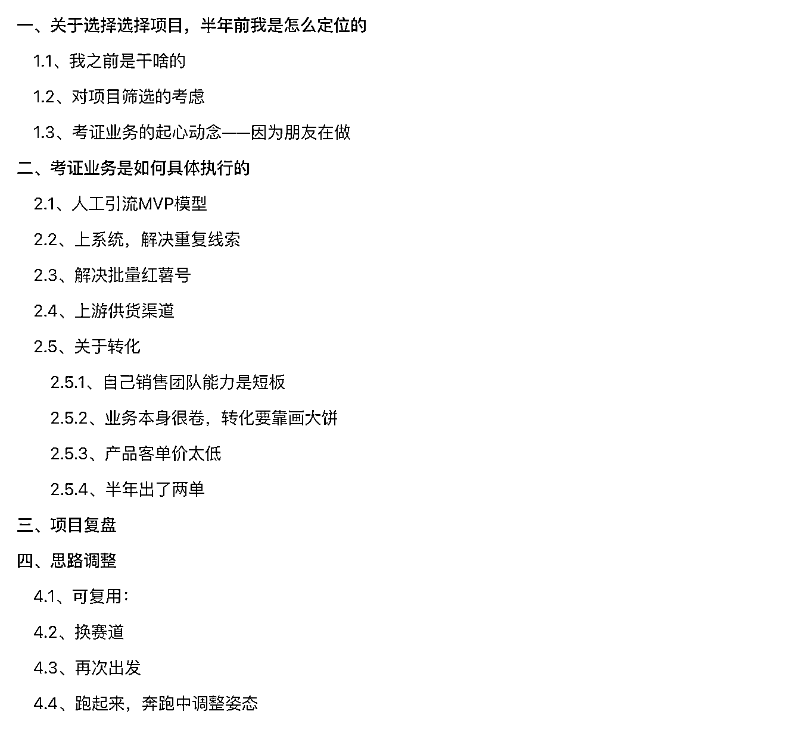

# 一、项目是怎么定的，半年前的判断是什么

## 1.1、我此前在做什么

2018年起，我们主要做微信生态的营销工具，核心客户是K12和知识付费的B端机构。疫情刚来时，线下转线上带来一波红利，随后双减加疫情后遗症，业务直接断崖。顺带说下，当时客单价区间在3000到24000元。

**团队最强的部分是技术研发加运营，这一点后来成了考证业务起不来的关键原因之一**

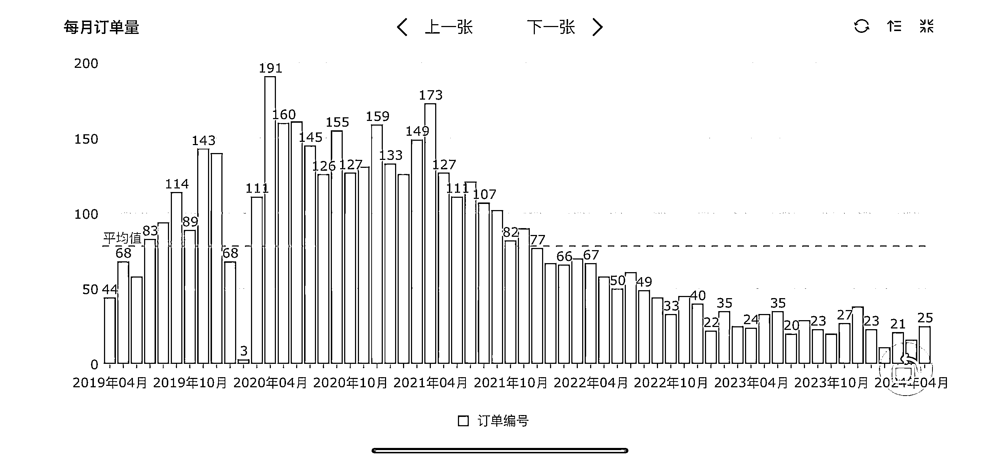

## 1.2、当时筛选项目的标准

做软件研发，周期普遍很长，短的三个月，长的半年以上。市场节奏很快，等产品做出来，需求早被占满了，软件卖的钱连投放费的零头都不够，没有资本加持或时间窗口，一把抓住的概率极低。我已经摔过不止一次，教训很深。

**因此对新方向的底线是：**

①研发周期超过一个月的产品直接剔除，这一下就去掉了99%的软件研发类机会

②销售是团队短板，所以不碰客单价三千以上的业务，只能做轻交付、标准化的产品

## 1.3、为什么会想做考证——被熟人带入

回想一下：

你现在所在的行业，最初因何进入？

你现在的业务，起因是什么？

你现在做的项目，缘起何处？

七八成的原因是：你看到身边有人真挣到钱了，是同学、朋友、同事或亲戚。这种基于信任的社会关系，让你觉得机会就在眼前，也就跟着下场试试。这种关系圈，我们就叫圈子。

**我身边有个在抖音开店做号的哥们，我亲眼看见他银行卡的流水，我误判了能把他那套打法直接复制到二十人以上的团队里。**

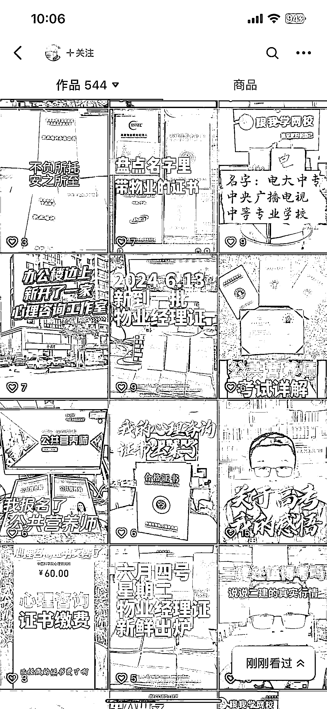

# 二、考证业务落地时发生了什么

## 2.1、人工引流的MVP打法

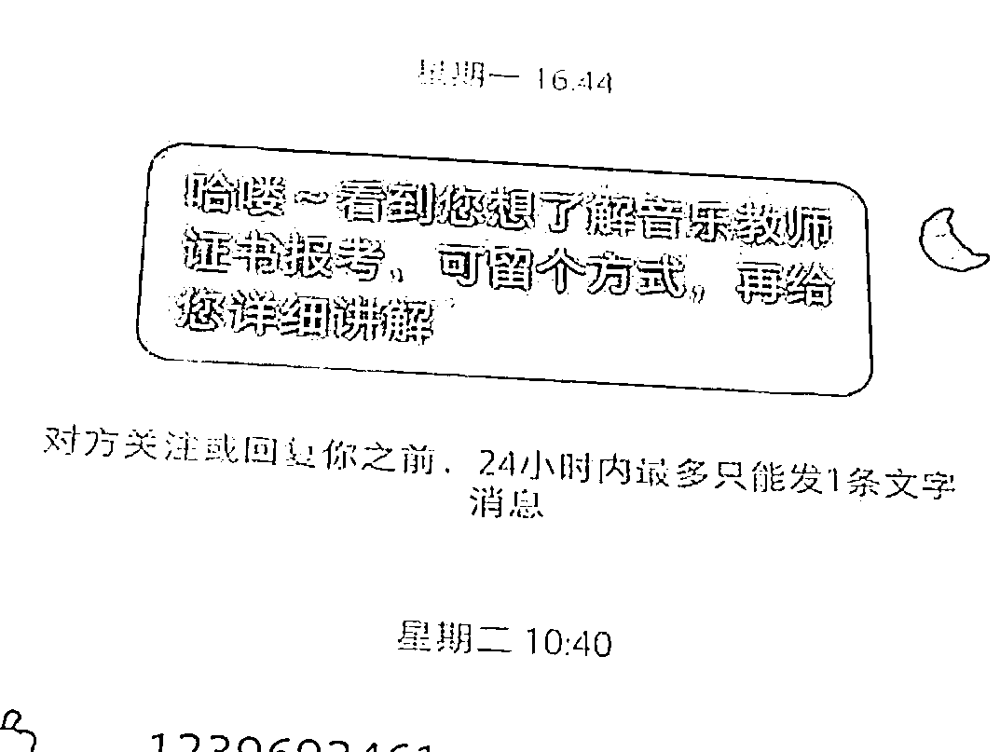

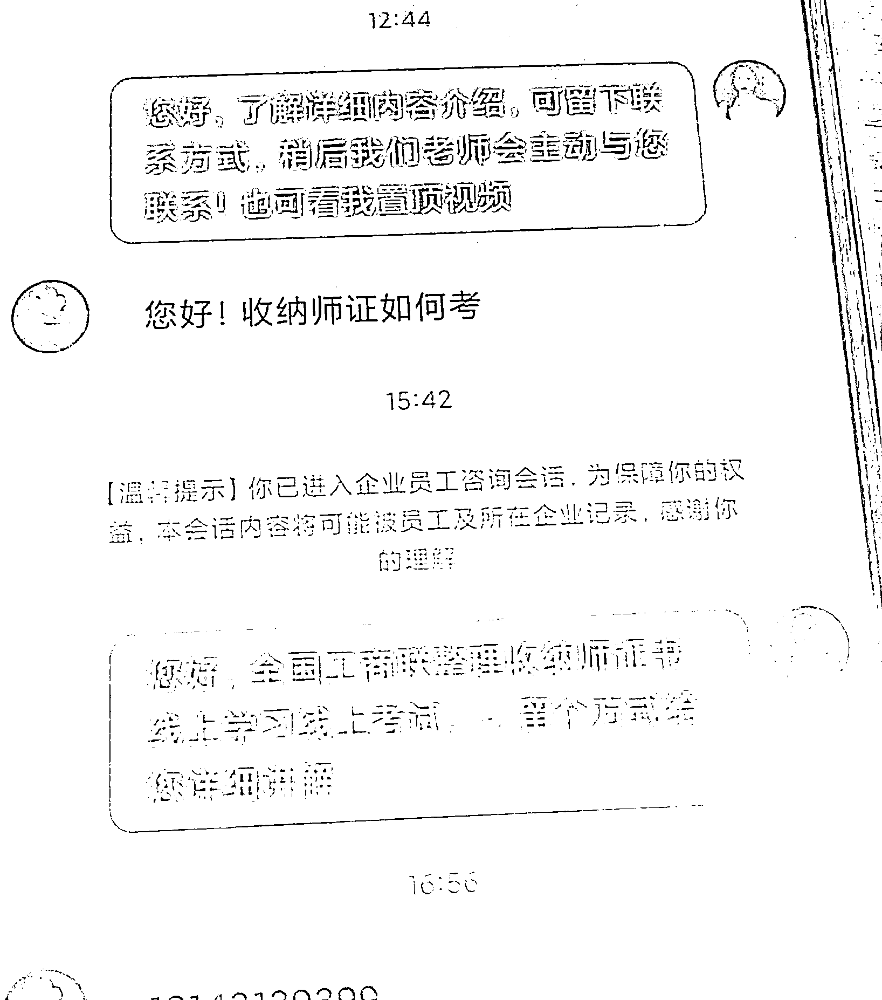

**起初的思路很简单：养一批小红书小号，去竞品笔记评论区私信邀约加微信，私域里进行转化。**

开头效率还不错，很快就撞上了致命问题：**线索去重**。

怎么判断这条评论我是否已回复过，

怎么判断同事有没有跟进过同一条笔记，

怎么判断笔记下的某条评论是否被重复触达，

怎么持续获取新鲜评论

结果就是重复线索堆积，重复率越来越高。**这种效率问题在团队作战里必须解决，而且只能靠系统化来解决。**

## 2.2、用系统解决去重问题

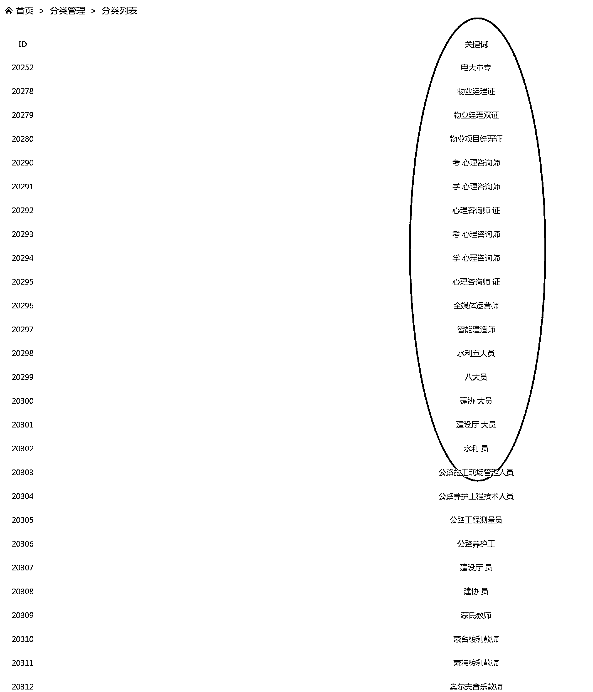

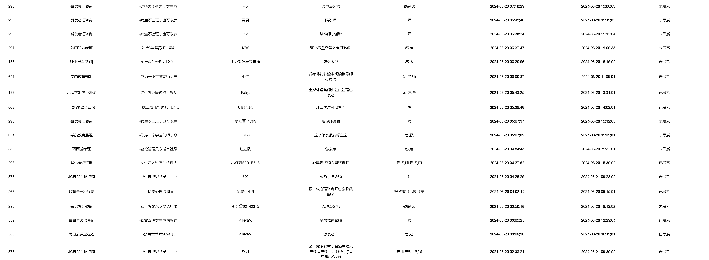

## 2.3、解决账号规模化问题

**按照10:1的反馈率算，发出10条私信，大概只有1条能拿到有效线索，而只要有人在评论区互动，就有5-10个同行同时去撸。**

这意味着按天算，每一条有效线索背后要对应一台手机+一个小红书号+一个实名手机号。细节就不展开了，反正我们花了几个月慢慢啃下来，每天能稳定产出约200条新线索。

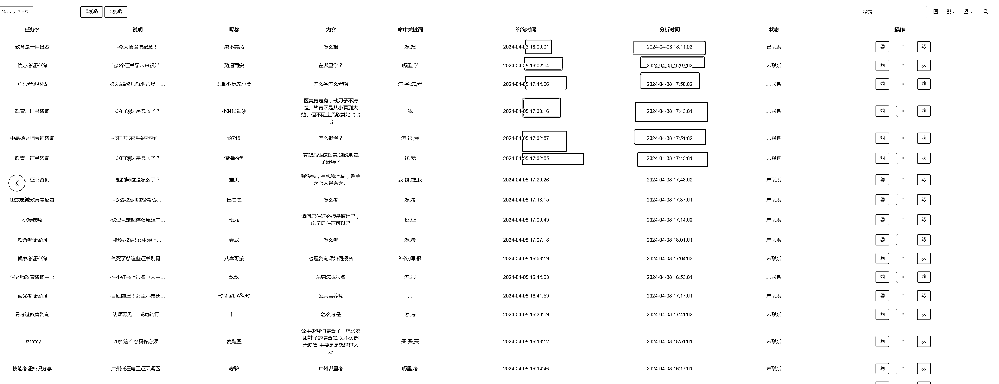

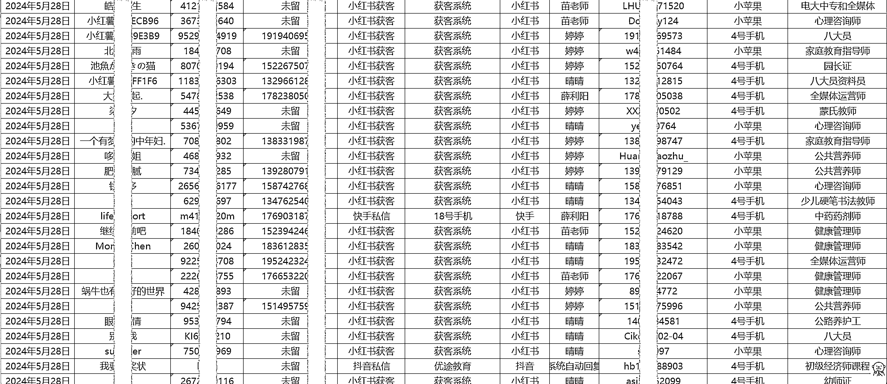

## 2.4、后端供货渠道

渠道有很多，我们最终筛选出价格和服务相对靠谱的，也耗费了不少沟通成本。

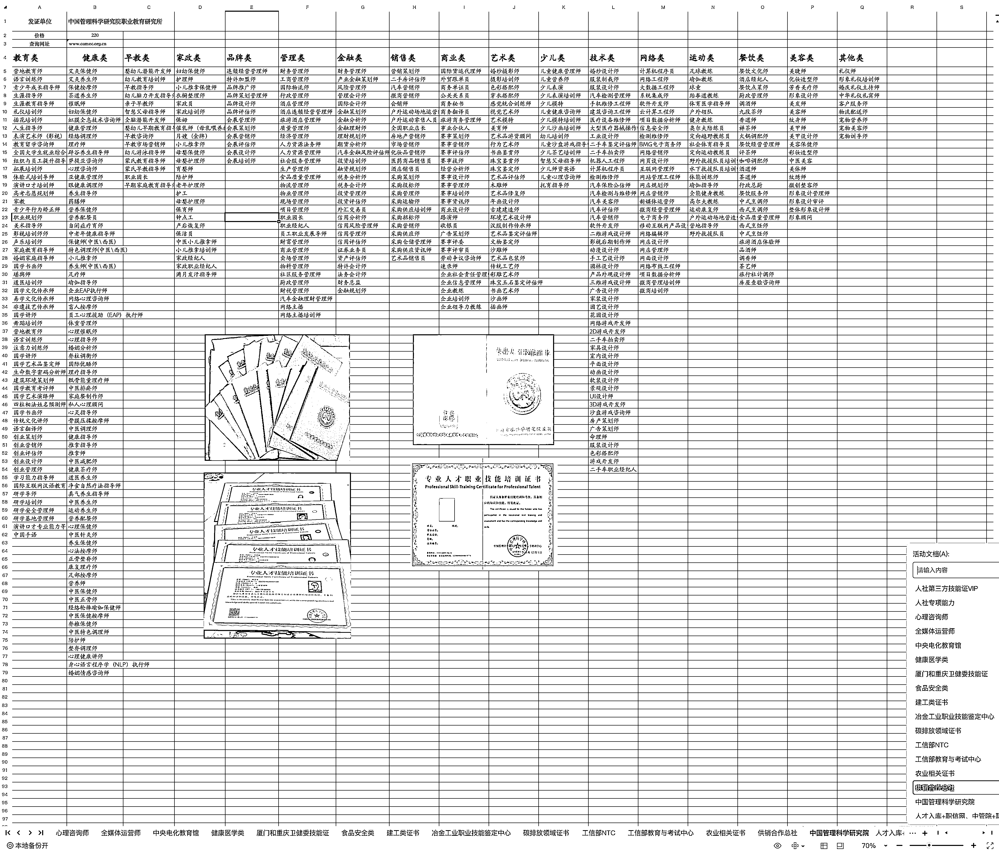

## 2.5、转化环节的困境

### 2.5.1、销售是硬伤

开头就说过，团队优势在技术和运营，流量端我们能搞定。转化需要对业务吃透、验证话术模型，而我们犯的错是同时铺多条线，产品不聚焦，证书类型全都要，时间都花在测流量模型上。转化这件事，本就需要经验沉淀和反复验证。

### 2.5.2、行业本身很卷，需要夸大卖点

同行普遍的说法是：花1400考个全媒体运营师就能月入两万；考了心理咨询师就能挂靠，年入几万。

**这种话术我不让团队用，误导用户，也违背公司价值观。**我们自己招运营，简历上写全媒体运营师的一律不考虑。身为运营，我清楚，有点水平的不会去考，水货居多。来了反而拖累团队。

### 2.5.3、客单价太低扛不住成本

相关证书的售价基本都在2000元以内，行业内卷导致互相压价，用户也比来比去。成本占一半，毛利就剩几百块，量起不来根本养不活团队。

### 2.5.4、半年两单

实话实说，转化率接近于零。

打败仗不可怕，可怕的是不承认。

说到底，项目结束要面对的是几百台手机的硬件投入、人力成本、系统研发成本，最关键的是时间成本，还有想跟着你赚钱养家的员工。说多了心酸。

**一个人的抗压能力，往往来自失败次数的累积，这句话我一直拿来提醒自己。**

# 三、复盘总结

**得到：**引流成本和效率的问题被解决了，换到任何一个有大量竞品笔记的赛道，我们也能做到日产200条新线索。

**失去：**选了一个我们以为不需要强销售技巧、实际极度依赖销售技巧的赛道，直接撞上了短板。就像俄罗斯方块，压垮你的，是从一开始就埋下的、不断累积的错误。

# 四、调整思路

## 4.1、可复用能力

小红书获客的成本优势和效率优势，目前仍在我们手里。**具体打法上面已讲清楚，这里就不展开了，大家都懂。**

## 4.2、换赛道

一位在杭州做知识付费的朋友告诉我：他们春节期间流量大爆发，因为投放的优质广告主集体休息了，实体电商也发不出货。小红书运营的原话是，这波流量一定要接住。

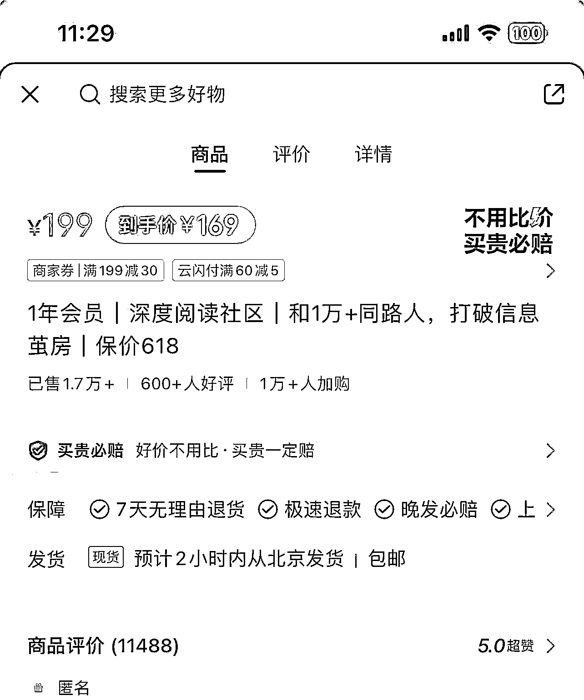

这句话点醒了我：**电商平台要的是GMV总额，谁付费能力强，平台就把优质流量给谁，平台收入靠成交额抽点；竞价投放的本质，就是平台把周期内综合出价最高的广告推到最显眼的位置。**

这跟我们没跑成的【小红书+考证】有什么关系？接着看。

* * *

有圈友说过一句话：**如果一个问题解决不了，就绕过问题本身，去找能解决这个问题的伙伴**。做项目同理，获客效率已经跑通，就去匹配更合适的后端。

考证客单价低，那就换**客单价高、对转化率容错更高的赛道**；销售能力跟不上，就跟圈内伙伴联动，**我们提供优质线索，用我们的引流效率去赋能他们的高客单高转化后端交付。**

## 4.3、再出发

目前已与多位圈友建立合作，在跑的项目包括留学、法律、旅游、雅思托福、MBA。细节可看这篇[`t.zsxq.com/S9P8b`](https://t.zsxq.com/S9P8b)

## 4.4、边跑边调

大家会发现这篇文章表述有点乱，标点使用随意，可能还有错别字。我没刻意逐字润色，因为我想表达的核心观点不受这些影响，也不影响主要矛盾。这也是我做项目的原则：**不要追求完美，先跑起来，在奔跑中调整姿态。**

* * *

评论区：

Landis : 加油，多试几条路径，找到正反馈再放大

刘信庭 : 感谢，已和多位圈友建立链接

Pakhoo : 高端国内游，你做的是哪一块？

小鱼丸 : 你这个获客系统能用在抖音吗，还是只能小红书？

刘信庭 : 目前只适配小红书，抖音我们测过，对方收不到提示的比例超过九成

小鱼丸 : 懂了

* * *