# 爱豆卡片被炒到天价，普通人真的能吃到这波红利吗

## 明星周边、小卡爆火，这背后有什么机会可以入局？

作者： 刘榛

日期：2024-06-28

一张当红偶像的卡片动辄上万，究竟谁在买单？

答案很直白，是粉丝在买单。明星热度越高，对应周边越稀缺，价格越离谱，利润空间也越可观。我们当时做的是直播抽卡的玩法，近似盲盒，综合毛利能维持在35%上下。若转到线下地摊，毛利可以拉到50%。

看似风光，实操门槛却不高。归根结底，这门生意成败看货。只要把货拿稳，就能直接开拍开播，或者直接拿去街头售卖。

我们曾做过线下试水，一个月营收2万3。相比线上，线下进货规模小，不用处理售后，也省去物流与包装开销。缺点是单城市场天花板低，更适合低成本试水、拿点现金流反馈的人。

货源这块没有捷径可走，我们也是踩坑无数才逐渐理清。所以除了讲清楚玩法，我会重点拆解当时走过的弯路，希望能帮想参与的人避坑。

## **一、所谓小卡抽抽乐是什么**

小卡最初是韩娱公司在发售专辑时赠送的艺人照片卡，尺寸约三寸，硬卡材质，本质属于专辑附赠周边。在饭圈文化推波助澜下，小卡逐渐演变成收藏品。

类似潮玩盲盒，小卡在二手交易平台上大量流通，形成了所谓的“小卡经济”。整个模式的底层是借助明星热度撬动的粉丝消费。

抽抽乐就是在直播间里进行抽卡，形式类似盲盒，先看后抽，趣味性和观赏感都比较强。毛利水平大约在35%左右。

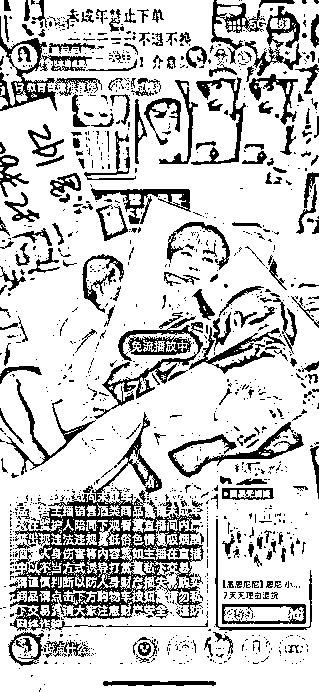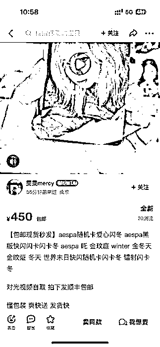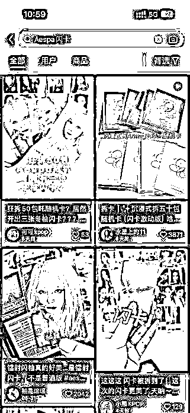

## **二、项目画像速览**

1、我始终认为，小众爱好赛道很值钱。与其让八成用户点三十个赞，不如让一成用户上头两百个赞。我们团队一直深耕小众兴趣，活得还算滋润。

2、这个项目源于去年和一位刚毕业的小姑娘聊天，偶然了解到这个圈子。出于对小众兴趣的敏感度，我去抖音看了一眼，发现做相关直播的房间寥寥无几，但月流水多在150万到300万之间。

今年追踪的几家头部房间，数据依旧亮眼。

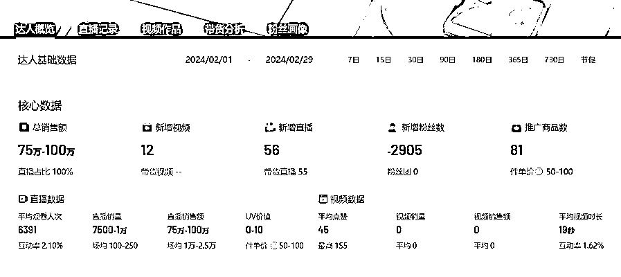

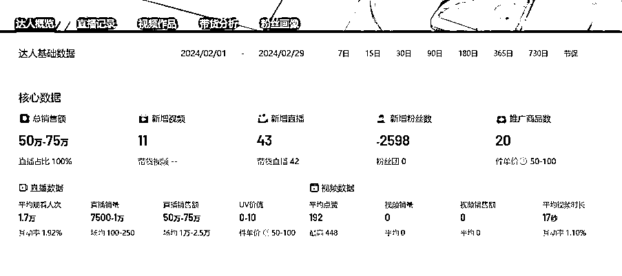

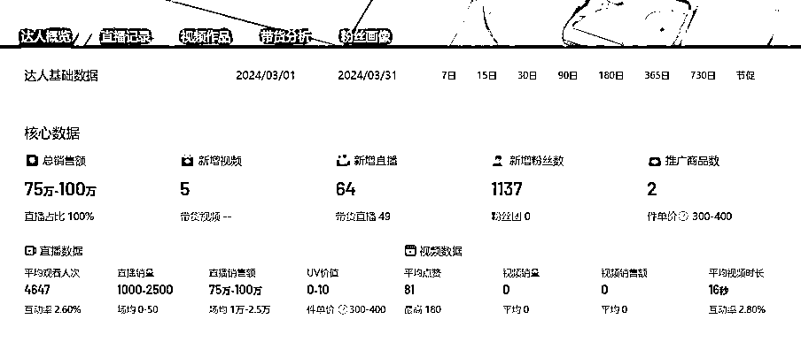

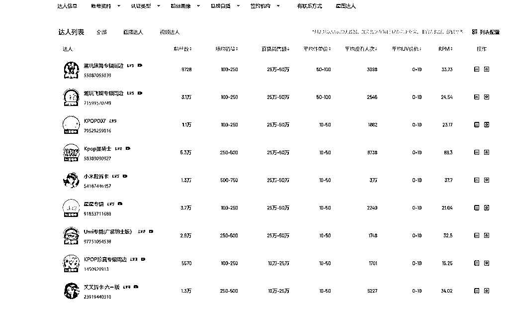

可以看出，所有相关房间粉丝基数都不高，但成交数据非常能打。

直播内容非常朴素，核心是借用韩团组合的自带流量。引流成本低，不用出镜，不用高超话术，直接开播抽卡即可。当时看起来毫无阻力，我们也低估了圈子内的复杂性，后面坑踩了不少。

## **三、开播路上的血泪记录**

**1、起号出奇顺利**

公司里正巧有对圈子略有了解的人。知道这个圈子极度反感搬运，对抄袭极敏感，于是我们去TK搬运海外KPOP拆专视频，删掉原声后配上中文配音与字幕。

结果首条就爆了。

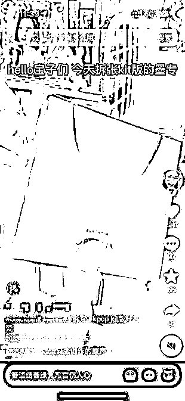

**2、两天内实现0-1**

看到流量起来后，当时连进货渠道都一无所知，直接去闲鱼收了一本视频里的同款专辑试水。当天通过抖音私信就成交了，虽然仅赚10元，但0到1的效率感很强。信心爆棚，准备加大备货。

**3、进货环节交学费**

**1、根本不知道要进什么**
在深入圈子前，我从未见过这么混乱的货盘。一个韩团人少四到六人，人多的十三人甚至更多，每个成员热度不均，还分个人SOLO盘、正规专一二辑、电子盘、PB盘、单封盘等，单封一套就是13本，还夹杂着克拉盘、彩虹克拉盘等粉丝黑话。每一种叫法对应不同价位与需求，新手直接懵掉。

**2、照抄同行瞎下单**
放弃研究后开始照搬同行。抖音直播间基本是一个商品链接挂几百个SKU，数据完全看不出热销款。我们就录屏、扒主播口播频率，挑出被念次数最多的三款下单。

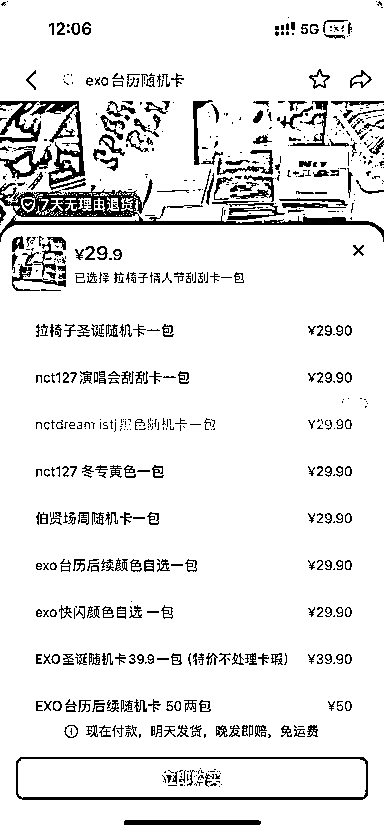

**3、找货源很折腾**
属于进口品，很难找到国内厂商。起初只找代购、对接韩国经销商，连续一周每天打到深夜。刚起步不敢多进，每次二十本三十本的下单，代购根本不愿理，价格贵、周期长，还常被坑。

**4、被代购坑过**
一个团里通常只有个别成员吸流，大多数成员平平，热门成员价格至少贵50%。第一次进货代购全发了冷门成员，播期被迫一拖再拖。

**5、用钱换经验**
最终体会到，进货没有捷径，只能不断试代购。最后锁定一家可长期合作的经销商，第一批投入约10万元，覆盖6个不同韩团的专辑。

**6、到货周期拉长**
韩团订货一般需要半个月到一个月，且多为全款预售。现货多为老专，难卖。因此必须提前规划未来一个月的到货量，否则直播间会空仓。

**4、直播环节**
其实开播是最简单的环节。没人下单就自抽，用户看得爽，抽中喜欢再下单带走。我们起步早，又有视频积累，没经历试抽环节。平时就是不断展示卡池构成。

**5、爆单速度超预期**
首日500元，次日1000元，第三日直接7000元，一分钱没投流，纯自然增长。反馈速度远超预期。

**6、售后很麻烦**
抖音不支持以盲盒类目售卖非盲盒商品，只能挂明星周边类目。这导致用户抽到不喜直接申请退款，收件后再退。无解，只能接受，整体利润为正即可。

**7、断货危机**
首批10万的货，陆续到约3万就开播了，卖得比预期快，一周不到就断货。后期总结规律：月流水50万，备货至少要备65万，否则必然断货。

**8、塌房引发现金流险断**
随着资金滚动，进货金额不断抬升，却忽略了生意本质依赖明星热度。一次MV风波，我们主推的组合塌房，且该组合资金占用率高，流水直接腰斩。资金错配导致机会成本巨大，无货可卖就无收入，无收入就无法补货，公司账户一度只剩463元。

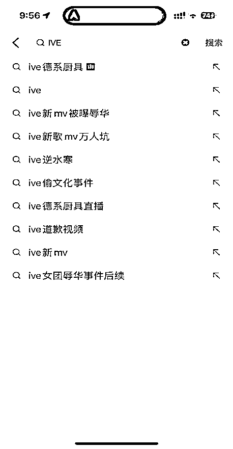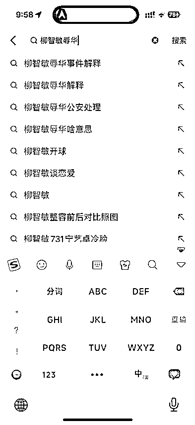

## **四、新手可行的两条路径**

**1、线上直播，目前竞争激烈**

多刷同行直播间学习话术与节奏；优先解决货源，📕上有大量韩国代购资源；熟记主流男团女团名称，或直接招聘圈内人负责播报；用闲鱼了解各组合及单卡的价值区间；从外网搬运拆专视频，去水印后发到国内平台，注意不要搬运国内内容，该圈子对原创保护意识极强且爱挂人；搬运十条左右等流量起来再开播；开播后多做试抽，可让自家人下单制造节奏。

**2、线下摆摊，适合应届毕业生尝试**

该赛道在各平台流量充沛，引流至线下很容易，各地均有KPOP地摊文化。虽然单城容纳有限，赚不到大钱，但上手极快。

我们四月试做一个月卖了2万3，毛利50%，进货量小，无售后，无物流，无包装。

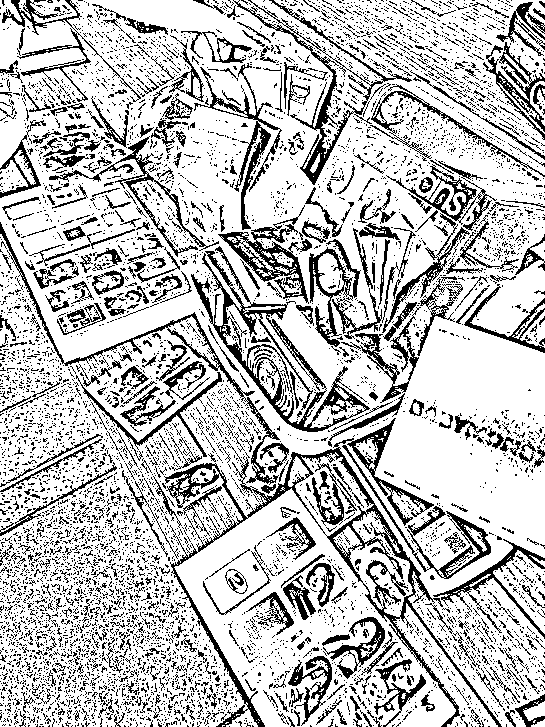

## **五、线下摆摊操作要点**

**1、前期选址思路**

**人流量**
先列出本地三到五个客流高的区域。随后在📕搜索“地名+KPOP”，若发现同行或大型专辑店存在则避开。筛选后通常剩两到三个备选。

**随舞摆摊**
随机舞蹈在各大城市都很火，去的人基本都是潜在用户。可提前在📕查找城市随舞活动，联系主办方现场摆摊，成交率会明显提升。

**市集摆摊**
多数城市有固定市集，可长期固定摊位，方便复购。但需缴纳管理费且有出摊时间限制，适合长期经营，不适合短期尝试。

**2、进货策略**

**以新带旧**
线下最好卖的是新专，老专渠道多。建议以新专为主，少量搭配经典老专。品类要丰富，才能吸引人群驻足。

**热门团参考**
女团：墨、娃、吒、芙、鲸、爻、炽
男团：次、nct、迷、恩嗨盆

保持品类多样化，不要一次性压太多货，边卖边补更稳健。

## **六、优缺点总结**

**优点：**
对主播要求低，无需出镜，核心靠明星自带热度，起号容易。玩法是抽卡，用户可先试抽，满意再下单，新号也能出单。

**缺点：**
账期极长，韩国预售1月1日付款5万，可能2月初发货，运输清关一周，再加上平台17天账期，资金回笼需两个半月。明星塌房风险无法规避，红利越大风险越大。

* * *

评论区：

暂无评论

* * *