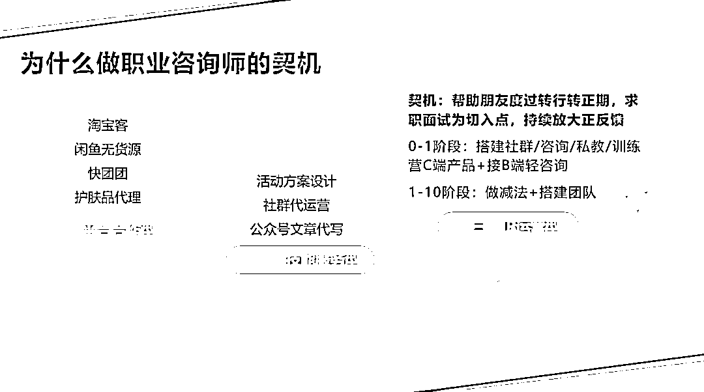
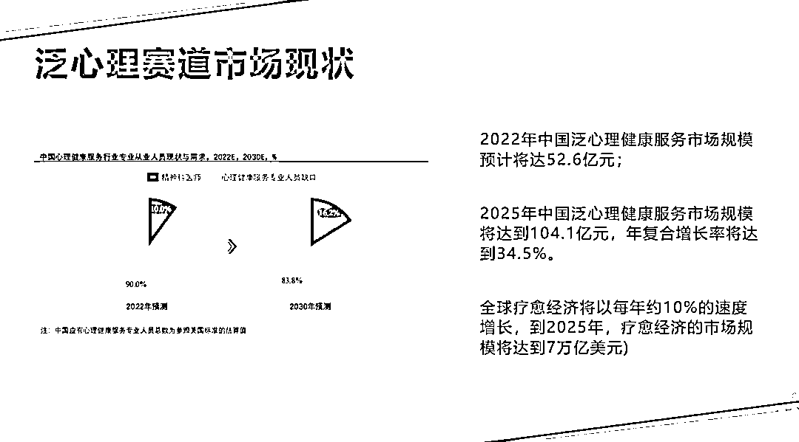
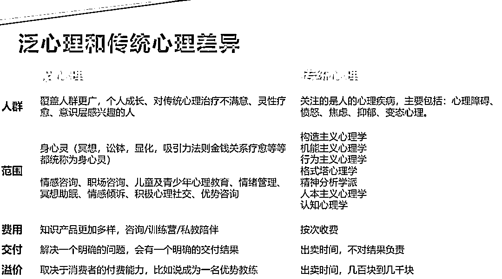
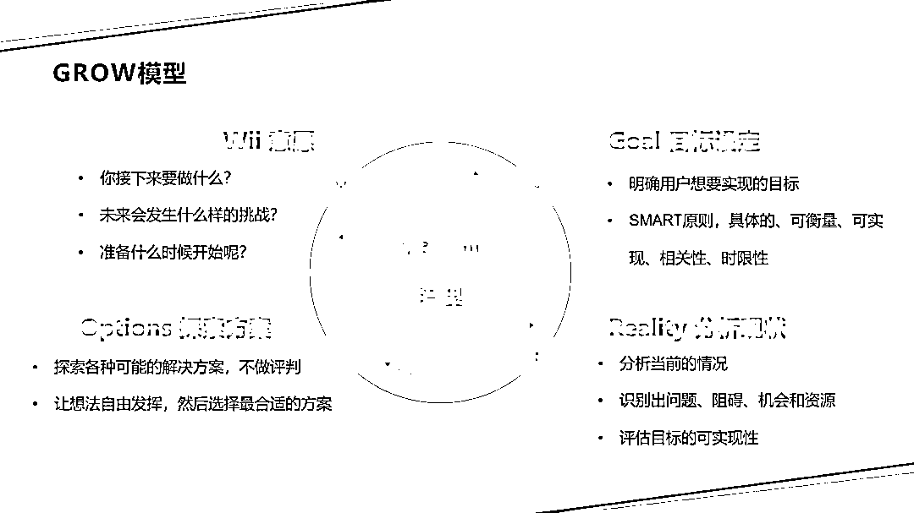
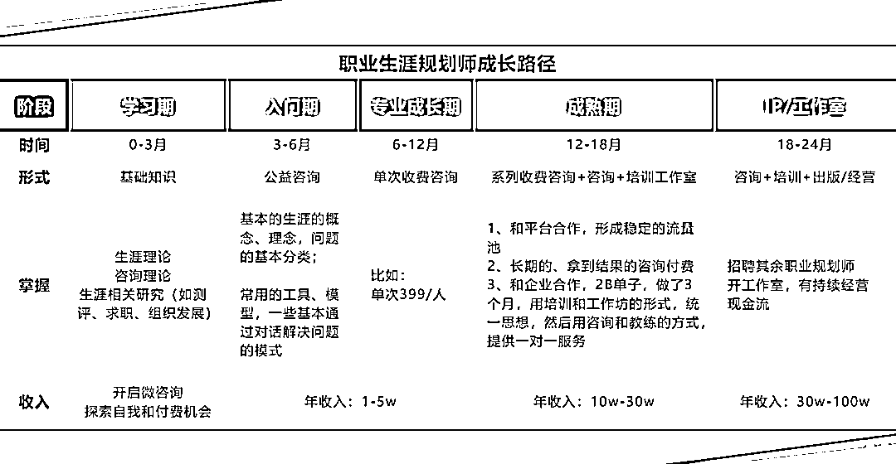

# 关于做职业咨询师，你必须知道的 4 件事
作者：龙哥

**从月入4万的独立职业咨询师身上，我挖到了4个关键认知**

大家总问我：之前做什么都三分钟热度的你，为什么突然就想通去做职业咨询师了？又是怎么看到背后机会的？

我是龙哥，独立职业咨询师，也算半个知识IP孵化教练。去年6月正式离开职场，全职干咨询，第一个月营收破了4w，开启数字游民生活。今天想把关于职业咨询师，你必须知道的4件事一次讲透。

**第一件事：这个职业是怎么"长"出来的？**

和很多打工人一样，我经历过996的折磨：干不完的活、背不完的锅、同事挖坑我来跳、领导甩锅我来接，每天都在心里上演一万次离职大戏。

2021年我开始疯狂折腾副业，淘宝客、闲鱼、个案咨询、社群代运营、微商、兼职讲师……全都碰过。但因为总是不够专注，看着别人深耕一个领域拿到结果，自己心态反而崩了。

于是我决定收回心思搞主业。后来我把复盘日记发到一个圈子，意外被一家中小企业老板看上，接到一份代运营合作。

再后来，一个做汽车渠道运营的朋友来找我。他说自己组里的人不懂营销，看到我主业副业双曲线增长，想付费找我聊聊怎么做运营。

说实话，我当时慌得一批——从来没带过人，居然有人要付费咨询？

但事情就这么开始了。每周一次电话咨询，定价99元；之后又升级成3个月799的陪跑。每次都是1v1通话，手把手帮他改方案，生怕误了人家。

3个月后，他顺利转正。我长舒一口气，然后突然想明白了——原来"成人达己"这四个字，是真的能让人上瘾的满足感。帮助他人拿到结果，自己也会得到巨大的正反馈。

这就是所有故事的起点。

**第二件事：泛心理赛道，藏着什么机会？**

如果你平时关注各类趋势报告，会发现心理健康、情绪疗愈、精神需求正在高频出现。全球健康研究所预测：全球疗愈经济正以约10%的年增速扩张，到2025年市场规模将达到7万亿美元。

后疫情时代，人们对心理健康的意识变强了，尝试轻量级心理服务的意愿和付费习惯都在养成。中国的情况更特殊：需求广泛存在，供给却严重不足。

来看数字：2022年，中国泛心理健康服务市场规模预计达52.6亿元；到2025年预计达104.1亿元，年复合增长率34.5%。

那"泛心理"到底指什么？它区别于传统心理学，覆盖的是一系列轻量级心理服务：身心灵类目（冥想、颂钵、显化、吸引力法则、金钱关系疗愈等）、情感咨询、职场咨询、儿童青少年心理教育、情绪管理、冥想助眠、情感倾诉、积极心理社交、优势咨询等。

传统心理学关注心理疾病——抑郁、焦虑、人格障碍这类病理性问题，强调科学规律，按次收费且不对结果负责。而泛心理更倾向于解决一个明确的问题，输出明确的交付结果；它的知识产品形式也更多样，可以是1v1咨询、训练营，也可以是私教陪伴。

另外，泛心理的溢价空间和你的投入直接相关。想成为盖洛普优势教练或ICF教练，必须花钱学习精进，而这些都对应着市场上的定价空间。

**变现方式，从C端到B端**

先看C端：测评工具（盖洛普、MBTI、大五人格、霍兰德）、知识付费（线上电子书/1v1咨询/社群/私教/合伙人/私董会，线下工作坊/演讲）、实体产品（书籍、日记本、冥想垫、正念钟）。

再看B端：企业内训（员工测评、咨询、培训工作坊）、企业顾问（提供专业内容或服务，拿分成或服务费）、第三方合作（与学校机构合作开心理健康课程）、数据分析（心理市场研究、用户行为分析）。

**第三件事：一场咨询怎么做，才算专业？**

1v1咨询的核心目的是帮用户拿到解决方案。就像买衣服要挑尺码，咨询也要根据每个人的情况量身定制。

为了让咨询顺利进行，Saki总结了5个原则：

1. 道德保密——开场就告诉来访者隐私会受保护；咨询师自己的知识产权、专业边界也要提前声明。
2. 规则前置——流程、交付物、陪伴服务，全都前置说清。
3. 认可用户——引导来访者回忆自己的高光时刻，在现状和理想之间找到差距。
4. 专注倾听——不急着评价，可以用"嗯嗯""明白"或追问"我很好奇，你觉得呢"来接住话题。
5. 积极引导——永远用正向语言，避免负面描述。

除了这5条，还有一个底层信念：你得充分信任来访者"本自具足"——TA自己就有解决问题的能力，你要做的只是引导。

具体到流程，Saki的做法是：付费后约时间、填咨询材料表；正式开始时先说明流程。单次咨询1.5小时，前40分钟以教练提问为主，后40分钟给中立的建议和方案，最后10分钟做复盘。结束后留一个小作业，再送7天陪伴——期间定期回访行动情况，问感受、看卡点。7天一过，服务闭环。

如果拆得更细，一场完整咨询分三步：
- 咨询前：建立关系、挖掘需求、确认痛点、展示产品、解答疑惑、成交；
- 咨询中：目标澄清→用GROW模型理清思路→落地方案→让用户给反馈（建议录音回听）；
- 咨询后：单次定价399元，送7天陪伴+成长社群；咨询师自己复盘；把用户反馈截图存档当朋友圈素材。

**第四件事：用GROW模型做一场咨询**

GROW是咨询教练常用的提问框架，四步分别是目标、现状、方案、行动。

目标层：澄清用户真正想要的，尽量符合SMART原则——具体、可衡量、可达成、有相关性、有时间限制。
现状层：看清当前处境，识别阻碍、机会和已有资源，评估现实可行性。
方案层：放开想象去探索所有可能路径，不评判、不设限，再挑最合适的去执行。
行动层：确认下一步做什么、会遇到什么挑战、何时启动。

看一个真实案例。应届生小A毕业被安排进国企，但受不了重复机械的工作，整个人失去了创造力，想转行又不知道方向。

这时用GROW来提问：

目标层面："今天想探索什么话题？""转行对你意味着什么？""理想的工作状态是什么样的？——公司、薪水、岗位、同事关系，越具体越好。"

现状层面："你现在情况如何？""尝试过哪些努力？做了的话结果怎样？没做的话卡点在哪？""如果是别人面对这个困境，他们会怎么做？"

方案层面："有哪些资源能帮你转行？""身边有谁可以助力？需要准备多少资金过渡？""万一转行遇到状况，你的Plan B是什么？"

行动层面："聊到这里，你放下了什么？感受到了什么？""接下来想做什么改变？""可能会遇到哪些挑战？""打算什么时候开始第一步？"

通过这套提问，小A发现自己写作和创造力是强项——大学期间语音写作写了30w字小说，还有新媒体运营助理经验。于是转行方向清晰了：去互联网公司做文案策划。

最后，Saki整理了一份职业生涯规划师的成长路径：从新手到老手，每个阶段学什么、收入区间大致多少，都有框架参考。她说，每个人的执行力、天赋、资源不同，变现也会不一样。不怕慢，就怕站；持续迭代和微调，拿到结果是早晚的事。

如果你看完也想成为一名独立职业咨询师，欢迎来链接Saki。

