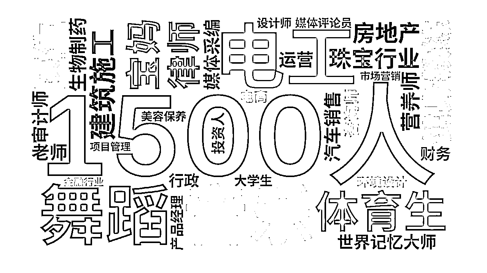

# 1500 个零基础普通人，和我一起靠 AI 学会编程，这件事是怎么发生的？

大家好，我是乔帮主。6 月的 AI 编程航海在上周四正式收官。作为这趟航海的主教练，我想把自己如何联合 70 多位圈内朋友一起打磨项目，并最终带着 1500 名普通人用 AI 入门编程的全过程摊开讲讲。

这篇文章花了 6000 字左右做复盘，从最初的灵光一现、方向试探、前期验证、立项确认、研发建造到最后的交付运营，层层拆解。希望对想做培训、知识付费、内容交付的朋友有一点借鉴意义。

# 1、这期 AI 编程航海到底发生了什么

我过去带编程，都是在培训机构教有一定基础的大学生转岗程序员。这次的 AI 编程爬虫航海，技术背景的人只占很小一部分，绝大多数都是编程小白。

有位健身教练跟我说：“乔帮主我来带你撸铁，你带我学编程。”我一口答应，还给这个组合起了个名字，叫“肌肉猛男与 AI 编程”，反差感拉满。

报名的人里不只有艺术生、职场人、体制内和创业者，还有电工、建筑工人、外卖员，这些跟代码八竿子打不着的身份，都坐在了同一艘船上。

曾经编程是程序员的专利，现在随着互联网和 AI 的普及，它正在变成普通人必须掌握的一种能力。

本期 AI 编程爬虫航海，最终有 1476 人同行。其中 1341 人坚持完成了 12 次以上的航海日志，顺利上岸，上岸率 90.85%。上岸的伙伴们，值得点个赞。

更让人惊喜的是，有 31 位伙伴在上岸后仍旧保持行动，完成了 21 天全勤，成为本期的「行动的巨人」。

21 天里，我们累计记录了 17919 篇航海日志，航海中发生了 2666 件好事。每个数字背后，都是行动和成长的印证。

# 2、最初的念头是怎么种下的

去年 4 月，我在星球里写了两篇推文：

*《为什么越来越多女性开始学习编程？| 编程不再是 IT 男的专属》
*《普通人如何快速学习编程 | 在📕赚钱的项目机会》

发完之后，大概有 100 位女生，加了我🛰️，都是文科、艺术背景，想找我学编程。那颗面向普通人的编程课的种子就埋下了。

同年上半年，我在赚钱招了两位合伙人 @绿兔子 @阿沛，和她们线下一起孵化这个想法。当时我很笃定，市场上的课都是给程序员的，普通人根本啃不动。只要把门槛拆掉，做职业提效和成长方向的编程课，一定有机会。我的专业自信让我觉得我能做到。

现实却给了当头一棒。两个合伙人对编程几乎零了解，找不到对标账号，市场还是早期空白。项目连 MVP 都没跑通，就卡在想法阶段，先是遭遇了一次小挫败。

# 3、方向是如何慢慢找准的

转机来自我对 AI 的深度使用。我发现 AI 能把几乎所有知识的学习门槛打下来，编程自然也不例外。顺势借 AI 的东风，于去年 7 月，我初步画出了 AI 编程课程的蓝图。

去年 8 月我还写过一份航海计划书，想在赚钱试水一下这个方向的可行性。只是当时市场还不成熟，我的精力也被别的 AI 项目占据，落地被搁置了。

真正点燃火花的，是去年 8 月 28 日，赚钱圈友也是本期航海教练 @邱比特 发的那篇精华帖：《用 ChatGPT 写个爬虫爬取🛰️👸号文章》。第二天，星主龙哥的帖子《一个人可以不依赖于别人，创造出一些新东西，这是真正快乐的来源》也做了同类实践。

邱比特这篇帖子让我看到了惊喜，我和他深度交流过后，又专门重塑了一版 AI 编程的内容框架，为后续课程的定位奠定了关键基础。

# 4、从想法到手感的前期验证

我直接把这个爬虫案例塞进了去年的 AI 线下课。去年国庆在赚钱做的《GPT+PPT/爬虫/定制 AI 实战组局》，就是第一次线下实操带跑。

在梳理案例时，跟圈友也是我的线下合伙人 @亮仔 一起打磨，他也由此写了精华帖：《使用 gpt，小白不用一行代码就可以爬虫》。

随后在和 @力华 @启斌 @亮仔 @越越 的配合下，这个 AI 爬虫案例被放进了我们的付费 AI 线下课里交付给学员。相关复盘我写过：《如何做好一场 2 天 1 夜 GPT 线下课：全流程复盘分享》。

从帖子到线下实操，再到付费课交付，AI 爬虫这个案例为 AI 编程航海做了充足的预热和积累。

# 5、立项和反复打磨的过程

今年 3 月的航海群里，龙哥抛出一句话：“有没有航海家能开一期 AI 写代码的航海，我来报名学。这个如果内测好，我觉得能推向市场火一把。”

结合之前的沉淀和普通人对编程的需求，我单独和龙哥聊了课程的可行性。我们前后讨论了四版大纲。

第一版是去年 8 月的初稿，龙哥反馈太技术化，建议从具体场景和可交付的产品入手。

第二版我按建议做了调整，龙哥觉得像上一代程序员的课，和赚钱圈友距离感太强，建议参考 AI 场景在解决什么问题，把场景提炼出来贴近赚钱。

我意识到这其实是在做另一门课，于是做了第三版。大纲出来后，龙哥点醒我：不是教普通人学编程，而是教他们用编程做能赚钱的产品。

但我也发现，当时直接做产品门槛太高。UI、前后端、支付、部署维护，普通人根本扛不住。所以当下可落地的航海只能聚焦在三类方向：

1. AI 学编程，让普通人先掌握技能和思维；
2. 工具方向，用现成工具解决赚钱痛点；
3. 爬虫+数据分析，通过信息整合提升赚钱效率。

继续和龙哥沟通后，我明白学习编程是手段，不是目的，需要一个固定场景让学员学完就能用。第三版里提到的批量化思维被点名要深挖。

于是我做了第四版大纲，涵盖 AI 编程、信息整合技术爬虫、信息清洗、信息分析等核心技术。和 @森林 针对落地性反复讨论。

最初想做 AI+RPA 方向，比如《告别信息焦虑，RPA 影刀+Claude 自动化，一觉醒来读完赚钱精华帖》这类案例。但很快发现那属于 RPA 体系，和航海想做的 AI+编程是两回事。当时航海里已有 RPA 项目。

最终我们锁定场景：用 AI 做一个爬虫，比如面向👸号的爬虫工具。4 月底，我定下了航海的正式方向：AI 编程爬虫。

航海启动前，很多圈友建议加入职场提效、数据分析等场景。早期大纲里确实有，但考虑到 0 基础学员，场景太多会抬高门槛。我们选择聚焦爬虫一个案例，让内容更收敛。

历时一年，主题和大纲才彻底敲定。很多好案例并不适合做成体系化航海课，把大家真正教会，才是最难的。

# 6、研发阶段的取舍和细节

5 月进入航海手册开发。我邀请 @邱比特 @毅鸣 @聂明星 加入编写。他们在环境配置、技术调研、提示词设计上贡献很大。

比如最初大纲里有《用 ChatGPT 爬取📕笔记和图片》《用 ChatGPT 爬取抖音短视频并下载》，调研后发现绕不过反爬机制，直接砍掉。

《用 ChatGPT 爬取赚钱知识库内容》看似简单，实则涉及登录、Token 抓取，远超零基础范围，也拿掉了。

页面元素定位同样被移除，前端结构对新手来说解释成本太高。

航海手册前后改了十几次，最后成稿 10 万字。要特别感谢 @艳君 ，她经常凌晨还在电话里和我对手册做优化。

她提出 Python 语法不要放在第二章，太枯燥。改为第二章装环境，第三章直接上实战跑通案例，先建立信心再学语法，放在第四章。

第四章的语法部分，我已经尽量简化，但代码门槛依然高。最终我们做了个关键决定：手册里不再讲解语法细节，直接引导学员借助 AI 自学，版本才变成大家现在看到的样子。

正是因为 @艳君 从普通人视角对难度和易读性的极致追求，以及 @森林 的多次优化建议，才逼出了这份被大家称为“保姆级、有手就能做、一句废话没有”的手册。离不开 @艳君 @森林 以及赚钱团队的默默付出。

# 7、交付阶段的真实体验

报名时官方运营以为只有四五百人，最后报名人数突破 1600，和火爆的 ChatGPT 提效航海持平，也侧面验证了普通人学编程的趋势。

学员群里常能看到凌晨一两点还在改 Bug 的消息，大家真切体验到了编程的乐趣。手册尽量通俗，AI 降低门槛，但编程本身还是有挑战的。

我们用手册学习+直播讲解+打卡日志+社群陪跑的组合交付，基本做到了培训级别的服务。

圈友 @笨拙的自由 的感慨说出了很多人的心声：“赚钱不仅是搞副业赚钱的地方，居然还能系统学编程。Python 之前全网卖课价格高得离谱，在赚钱参加一次航海就能打下基础，赚钱真的与时俱进。航海结束后，搜索一下还能继续深挖资源。”

这么好的交付体验，要感谢官方运营 @欢欢 @肉松 @小霸王 的幕后支持，教练 @一泽 @MD @扬书记 @Y2024 的群内答疑，领队 @Gavin吴佳文 @骄阳 @不重要的NPC @Rice 的每日带领，以及志愿者团队 @铁柱 @Yan洁 @will阿伟 @鹤酱 @李飞 @周周 @三月雨 @支点探索者 @阳羽 @拾年(同路人) @墨小川 @许则则 @海翔 @SlackW @云逸 @鱼多多 @凌一同学 @钱塘江鲤 @世松 @雨幕漉雪千山尽 @花闲 @蘑菇 @豆哥 @李明建 @阿紫 @土豆君 @wanted(式钦) @MD @书虫 @陈平安 @运军 @lin @杭庭 @逐梦 @Annia Shaw @宇泽 @荣佳 @Silence @阿杰努力成长 @万物皆有门道 @范磊 @追风 @断桥 @TH @雨飞 @大王派我来巡山 的长期陪伴。

航海手册也得到 @逐梦 @一白 @土豆君 @一泽 等多位圈友的案例补充和优化。

# 8、这次航海带来的四个核心收获

汇总反馈，AI 编程爬虫给参与者带来了四个最有价值的收获：

1. 通过 AI 体会到编程的快乐。看着代码控制浏览器自动运行并把结果导出到 Excel，那种上头的感觉令人难忘。
2. AI 能把知识学习门槛降到最低。航海手册里的提示词，能帮助学员学习编程、写代码、改 Bug，对 AI 的进阶使用非常有价值。很多学员已经举一反三用到其他场景。
3. 生活和工作的提效。不少人用 AI 写了职场小工具，用 Coze 设计自动化流程，显著提升了赚钱效率。
4. 思维的升级。通过编程，学员掌握了互联网编程思维：严谨、自动化、批量化、模块化。这些思维让他们面对问题时更有能力高效解决。

利他才能利己。这次航海我也成长很多：

一是收到大量来自打卡日志、群聊、直播间的正反馈，成为继续前行的燃料。

二是经历从想法到交付的一年多迭代，我更明白好产品不是拍脑袋出来的，而是市场趋势+用户需求+持续优化的产物。我的课程设计和交付能力得到明显提升。

三是我的影响力和价值被更多人看见，链接了大量志同道合的资源和案例，也和多位圈友开启了新的合作。

四是发现了新的商业机会。6 月 27 日的《培训赛道线下闭门会》上，我拿着面向宝妈的 AI 亲子课和面向 K12 的 AI 编程课做交流，又打开了一些新的可能性。

任何时代都不缺机会，关键是我们有没有能力在机会出现时抓住它。赚钱是结果，背后是能力。

这次 AI 编程爬虫航海，让 1500 个普通人用 AI 开始了编程，也让我自己收获满满。互相成就，携手前行。

感恩在这趟航海中与大家相遇。这篇复盘希望能给大家一点启发和参考。