# 抖音直播第一天就出单，免费流单人单月19.8W变现的项目复盘
作者：龙哥

不久前刷到一种画风清奇的抖音直播间：画面谈不上精致，甚至有点简陋，但人家硬是在平台上活得挺好。出于好奇我扒了下数据，结果被惊到了——单月销售额竟然能冲到100万到250万。我当时的第一反应是：这种看起来“不上档次”的直播间，居然还能在抖音立足？但转念一想，这不就是机会吗？

我这两年一直在做抖音直播，免费流、付费流、无人直播、半无人直播都试过。今年明显感觉流量比往年更冷，于是带着团队做了一轮大调研，翻了一万来个账号、几千条商品链接，最后筛出一千多个纯免费流直播间。其中一个“怪咖”引起了我的注意：它流量不高，单小时进人不到一千，开播16个小时场观也才一万出头；但转化率却高得吓人，能到8%-10%。要知道抖音直播的平均转化通常只有1%-5%，这几乎翻倍了。评论区不少人都在问：这种低流量、低在线的直播间，凭什么卖出这么多单？

答案藏在流量来源里。我扒到同类账号的后台发现，它的访客超过80%来自搜索。也就是说，用户不是刷视频刷进来的，而是带着明确购买意图搜进来的。抖音发展到现在，很多人已经习惯把它当百度、当淘宝用。我们过去总盯着推荐feed流量，却忘了搜索也是一座金矿。我把这类玩法称为“抖音搜索流直播间”，核心逻辑非常简单：用户搜索产品名→点进你的直播间→在官方旗舰店链接里下单→你赚佣金。整个环节不需要拍短视频，不需要投流，甚至直播画面都能用固定图和录音撑起来。

路径摸清后，我让团队小伙伴立刻复测。结果第一天开播就出单，第三天做到1.39万，到6月25日累计变现19.8万，整月超过20万（佣金收入5.3万，净利润约1.8万）。本来我已经打算把项目停掉，觉得它太小生意、太耗人力，后来发现家里50多岁、连电脑开机都不会的老丈人，经过一周培训也能干，一天最高赚过3000多。干脆就交给他继续做了。

下面我把整套玩法拆给大家，干货比较长，建议先收藏。

先看利润公式：净利润=产品价格×佣金率×90%（扣技术服务费）-达人券成本。也就是说，佣金要扣掉10%平台技术费，再减去你自己补贴给消费者的优惠券，剩下的才是赚头。

流量端怎么做？就两件事：第一，把直播间挂品挂满200个，这是抖音上限，所有商品都要选有搜索流量的；第二，把直播时长拉长到10到16小时，因为不知道用户什么时候搜，播得久、覆盖的搜索时段才多。转化端靠三招：一是每个商品都发达人专属优惠券，真金白银补贴，价格比官方旗舰店还低；二是直播画面上直接打出“领券下单更便宜”的提示；三是话术就那两句，不断重复“新来的宝宝看什么直接下单，主播补贴了大额券，比官旗还便宜”。从消费者角度看，搜索进来的人本来就有需求，发货方是官旗，产品质量有保障，价格又更划算，下单几乎是顺理成章的事。

团队复盘下来，核心就两句话：找到有搜索流量的品，拉长直播时长。

实操环节，先说直播间搭建。一台苹果12以上的手机当直播机，配水冷散热器、充电器和支架；另一台随便不卡的手机当展示机；背景随意，家里找几个化妆品瓶子、饮料罐子摆一摆就行；买一个百来块的直播灯，或者干脆用LED灯把房间弄亮；电脑用平时能打游戏的就行，主要用来盯后台和选品；因为一个人播十几个小时太累，必须配一个几十块的小音箱放录音话术。

账号准备方面，优先用1000粉丝以上的老号，没有严重违规就行，不用管人群标签，因为搜索流不在乎这个。新号得先涨到1000粉、实名认证、开通橱窗。另外账号等级要LV1以上才能发券，抖音每月2日考核升级，记得提前一个月把等级做上去。第三方数据软件（蝉妈妈、考古加之类）用于找品，蝉妈妈建议买企业版；再准备一个小不点直播软件，用来做自动讲解、弹话术和踢人。

选品是重中之重，直接决定流量和利润。类目上优先看美妆护肤这种搜索量大的，但竞争也大；绿色冷门类目竞争小、利润高；黄色类目容易踩坑、退货率高，基本不碰。选品有几个渠道：跟同行上品最快，但利润薄，同行发8元券你可能要发9元才能抢到单，一单只挣五毛；自己选品最好，专盯最近几天的新品，别人还没发现你就挂上，直播间权重和券位优先，还能少发券多赚钱；也可以混团长达人群拿一手新品信息，或者自己找商家谈定向佣金。

选品的具体标准：绝对佣金（实际售价×佣金率×90%）最好在5元以上，越高越好；优先选官方旗舰店发货的链接；不要选官方旗舰店自己直播间也在挂的链接；同行超过5个的链接基本放弃；价格高低不是关键，十几块和三四百块都能卖，几百块的品牌货发几十块佣金，利润反而更好。判断有没有搜索流，可以参考最近热销的百货（防晒霜、驱蚊液之类）、新爆品牌（比如李陌茶）、复购率高的南北干货和生鲜水果；巨量算数也能查品类搜索趋势。

选品不用纠结，200个位子能挂就挂，出单就留，不出就换。做个表格记录实际到手价、佣金和发券金额，注意要看手机下单页面的实付价，因为店铺券、官方券能叠加，光看第三方软件的预估不准。利润低或者同行扎堆的直接删掉，凑够200个以上再进下一步。

发券在巨量百应后台操作，选商品直减券，钱得提前预充。每场直播前手动发券大概要花半小时到一小时；用户没用掉的券会在过期后2-3小时退回账户。直播中如果某个品卖爆了，随时补券；佣金要等订单完成约22天后才能提现，所以至少要备一两万周转金，月销20万、佣金5万左右时，占用资金大概5万。另外有些品牌方禁止达人发券，遇到加不了券的链接直接跳过。

测品也很简单：每场挂满200个，连续2-3场一单不出的链接就换掉；每天补充新品替换旧品，不断优化。这类直播间同样符合二八定律——20%的品吃掉80%的利润。跑通以后每天的工作就是选品、测品、发券、开播。

直播过程中要盯两件事：一是热门链接的券被领完了要马上补；二是每隔一两个小时查一下佣金，有些品牌方发现你带他的货发券后，会悄悄把佣金改成0，白嫖你的订单，发现后立刻下掉这个品。

最后说结论。这个项目为什么适合小白？它不需要懂流量分配，不需要运营技巧，不依赖主播能力，只要会电脑和手机操作就能干。我特意把它停掉转给老丈人，正是因为它太耗费时间，一个月净利也就一万出头，扣除人工和场地，团队规模化做不划算。真正的个人玩家上线更轻便：避开美妆大爆款，别和同行拼血，利润率能做到销售额的10%-15%，月利润1-2万，占用资金5万左右。那些做到月销100万的大号，其实大多在美妆领域，竞争激烈，发券金额几乎等于佣金的90%，最后净利润只有销售额的2%-5%，还要压三五十万资金。所以别对这个项目抱暴利幻想，它看着不起眼，但坑少，算好账就不会亏，无非挣多挣少。只要你肯拉时长、勤选品、会发券，就有机会跑通。

下面是我在拆解过程中遇到的一些同类型直播间，逻辑都差不多，有兴趣可以自行研究。

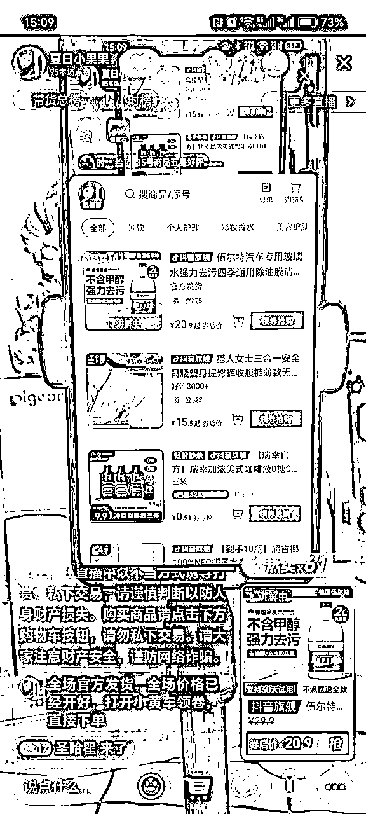

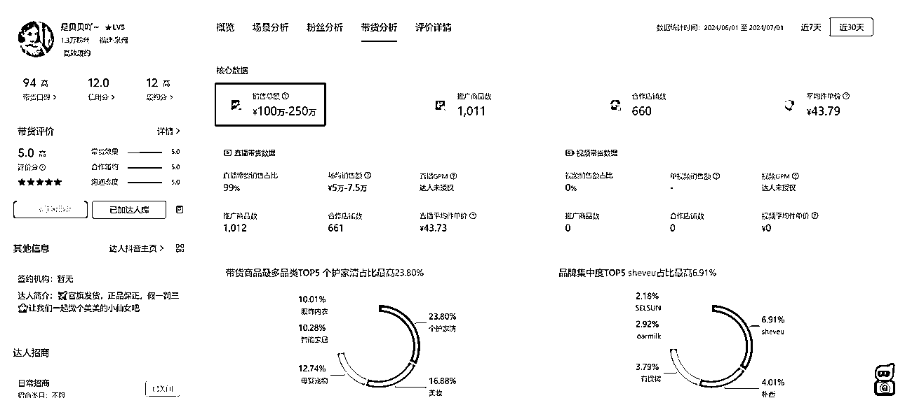
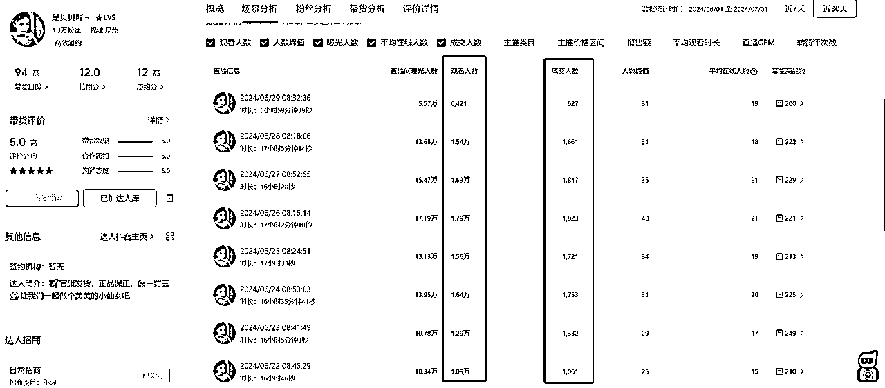
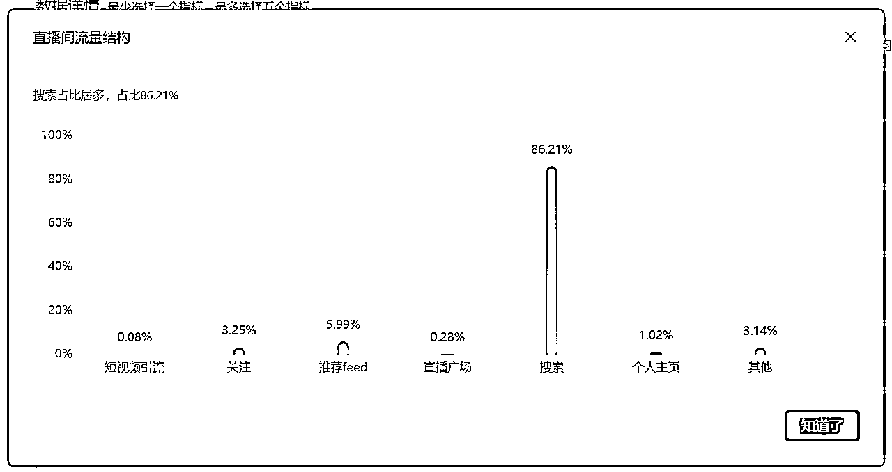
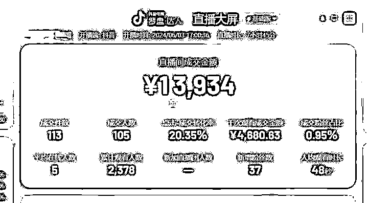
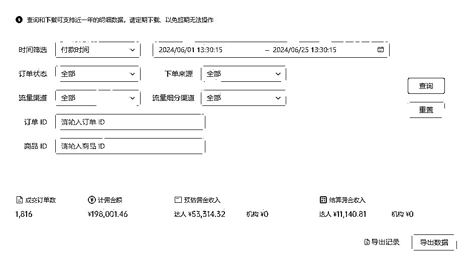
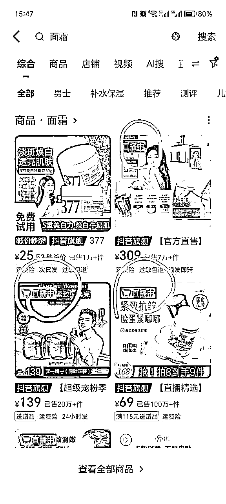
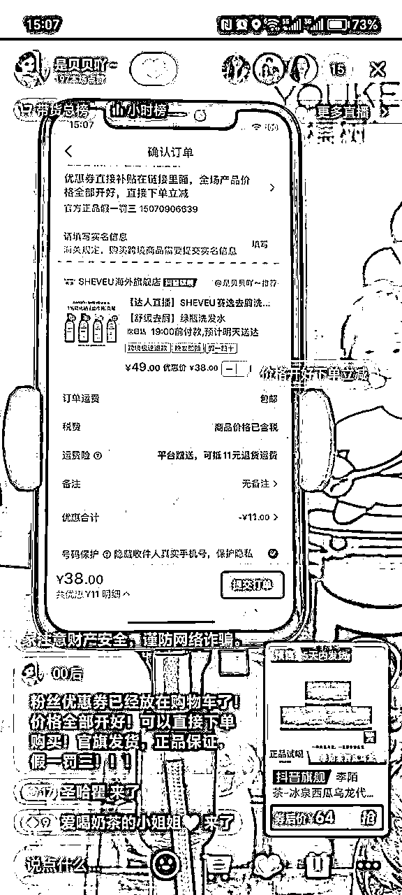
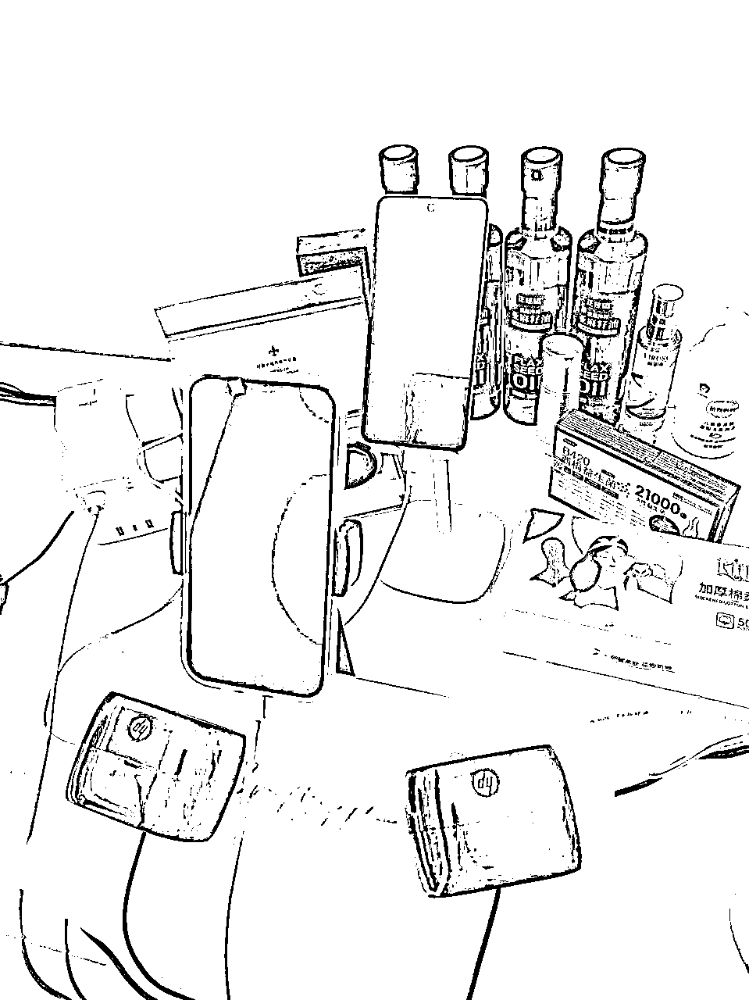
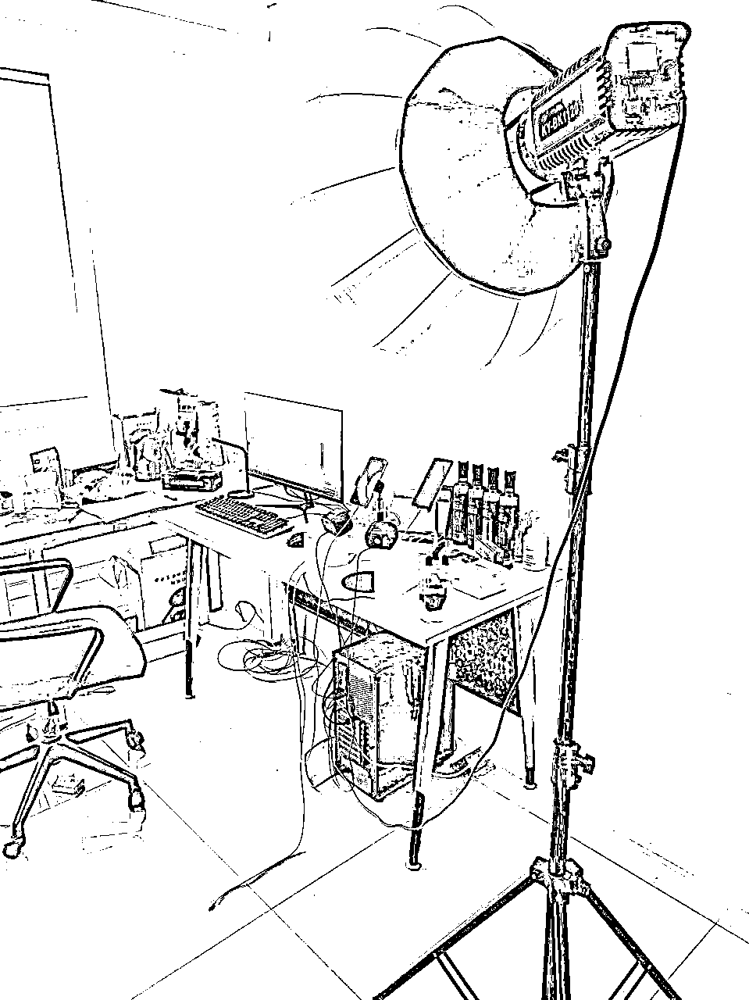
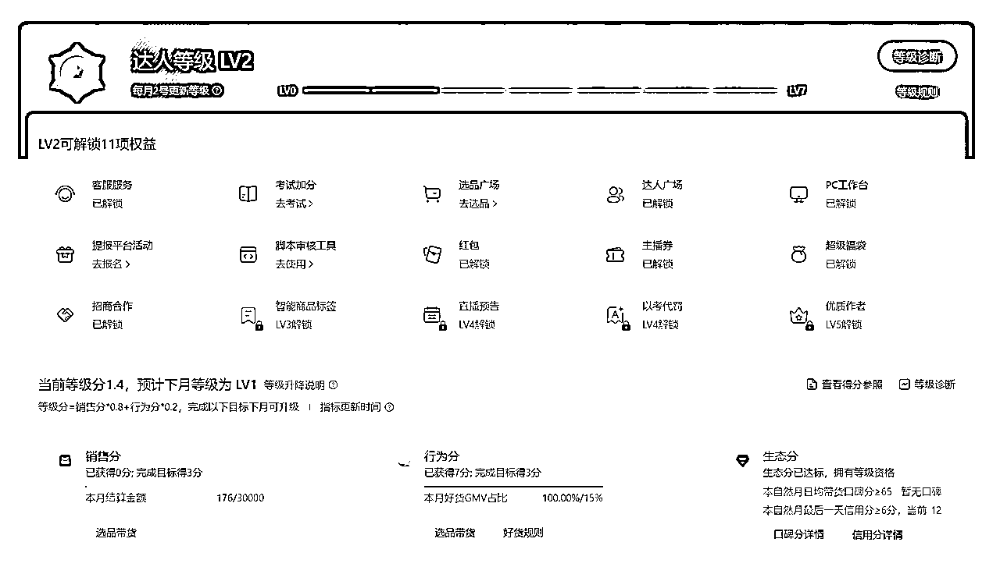
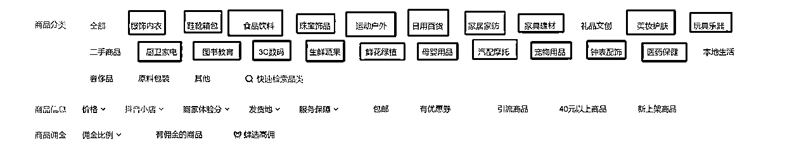
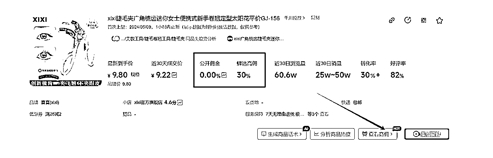
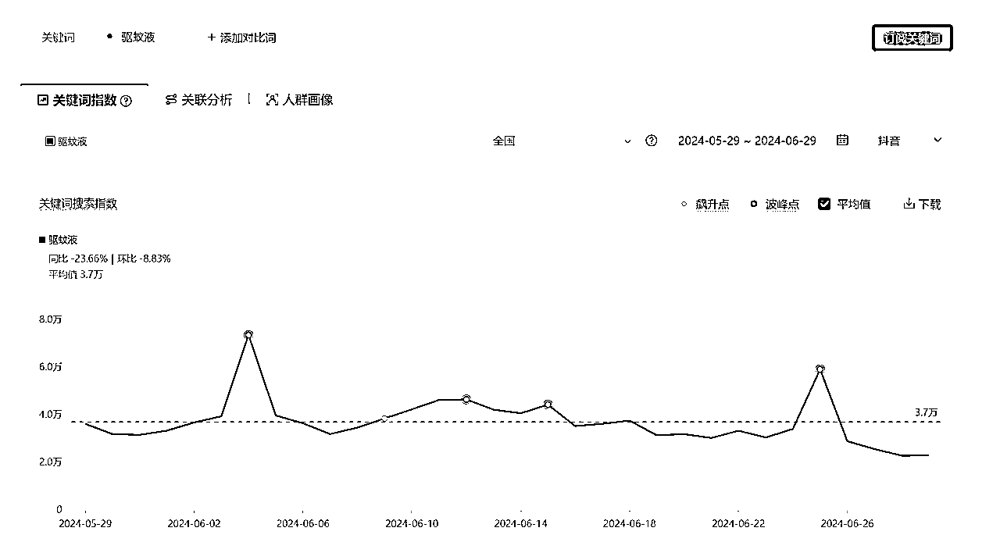
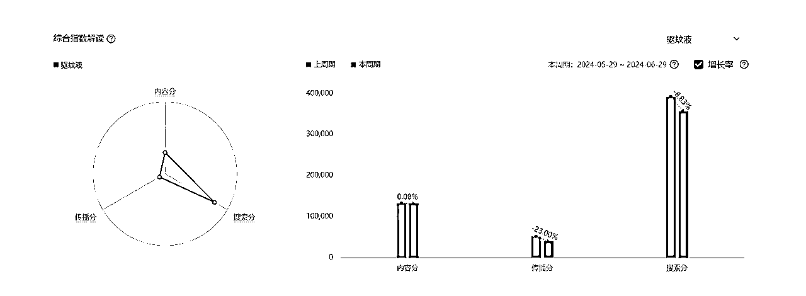
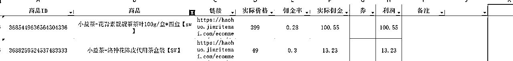
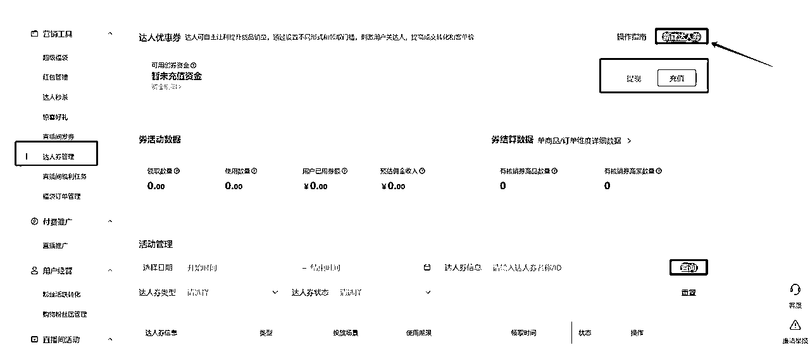
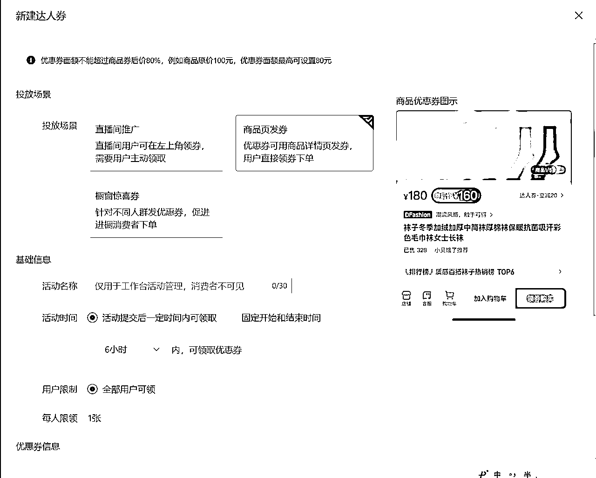
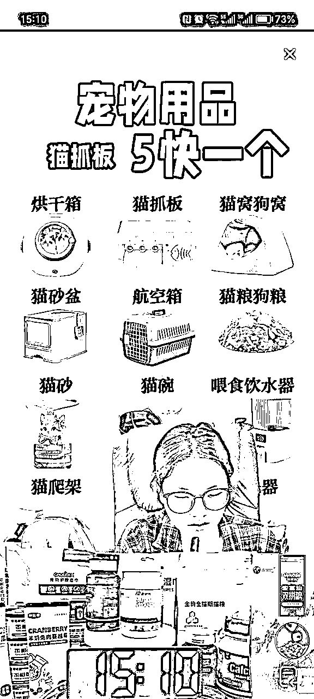

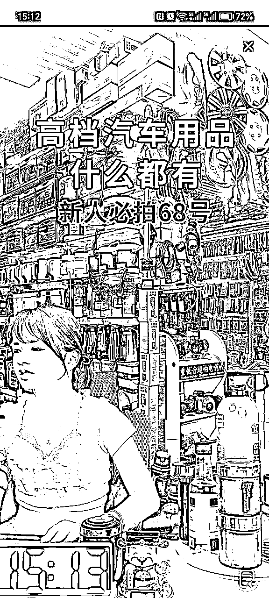
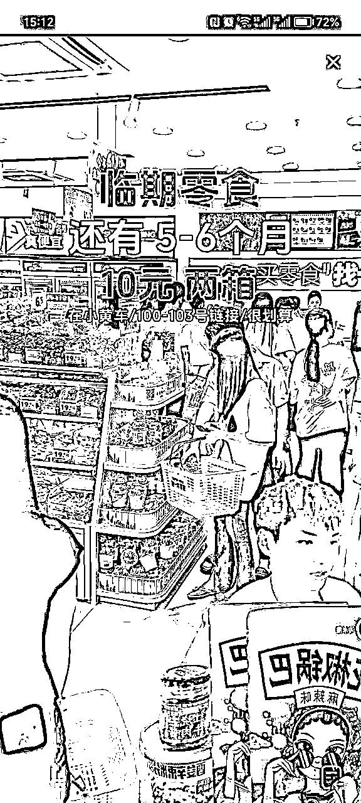

我是千易，9年自媒体人，6年电商人，操盘过不少项目，现在主要做大健康领域的直播和短视频带货。如果你也在研究这条赛道，欢迎一起交流。