# 给拥有7000人总部团队的企业做线下📕内训，我把实体商家最常卡住的5个点梳理出来了
作者：龙哥

哈喽，我是龙哥。刚结束了一场当地行业龙头的线下内训，对象是实体门店的店长团队。整场下来两天，聊的全是落地执行里的实操痛点。

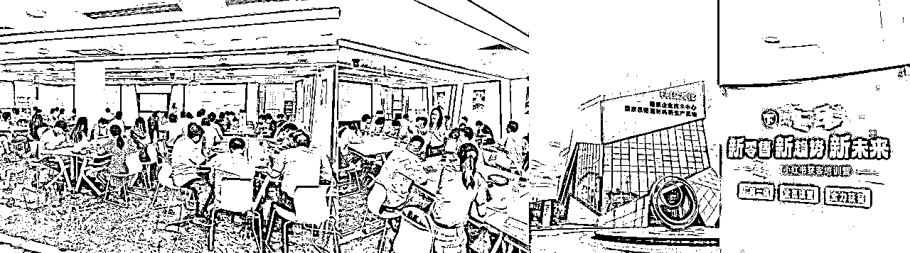

培训收尾后，对方直接邀约下个月再来复训。

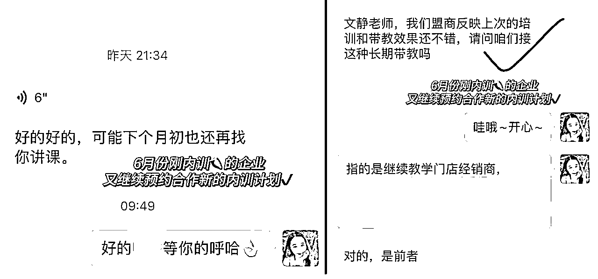

跟一线门店负责人交流后，我把商家在📕实操中最常出现的困局做了复盘，结合内训课件和一手项目经验，整理成这篇笔记，希望能帮到正在做的店主们。

# 一、为什么中高客单的实体店都在往📕靠？

## 1、客群重合度高
📕的受众整体偏向生活品质、消费能力在线的群体，与中高客单实体店的目标人群几乎同频。

## 2、内容带来的种草效率高
平台以图文视频内容为核心，用户习惯看高质感、高价值的信息并主动传播。近期的春晚话题、飞盘出圈、I人E人、毛坯人生精装朋友圈等热度，都有📕的推动。中高客单实体店线下本身就有强场景和强产品，完全可以反哺内容生产。

## 3、搜索占比高
现在平台搜索流量占比已到60%左右。用户有需求时优先搜索关键词。抢占与业务相关的长尾词，就能提升曝光与线索。

# 二、先定方向：明确要服务谁、解决什么

很多店家上来就写笔记，顺序错了。先定“为谁写、解决什么问题”，后续选题、关键词、转化才有准头。

以家居家装举例，店主随口说“业主、装修、平层、别墅”，就到头了。要把需求拆细。

## 1、需求如何找

### （1）关键词锁定需求
产品词、品牌词体现卖点身份；热搜词、痛点词体现用户强意图。

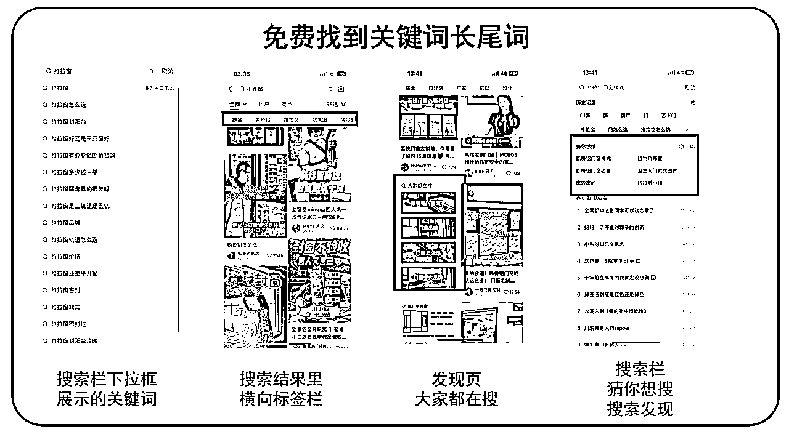

### （2）模拟用户种草路径
被看到 -> 被信任 -> 被推荐

看到：新房装修、旧房翻新、换风格的场景触发，搜索“家居装修”“装修风格”“家具推荐”，刷首页推荐，在评论区求推荐。

信任：对比产品品牌、咨询到店、对比环境服务案例价格、看口碑舆论。

下单后：晒体验、发测评、安利他人。

### （3）回访已成交客户
问清是从哪里找到你、当时想解决什么、是否愿意晒单成为案例。

### （4）行业与竞品分析
📕每月都有行业月报，可直接获取规模、增速与用户偏好。

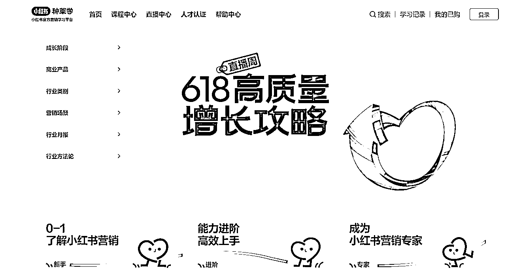

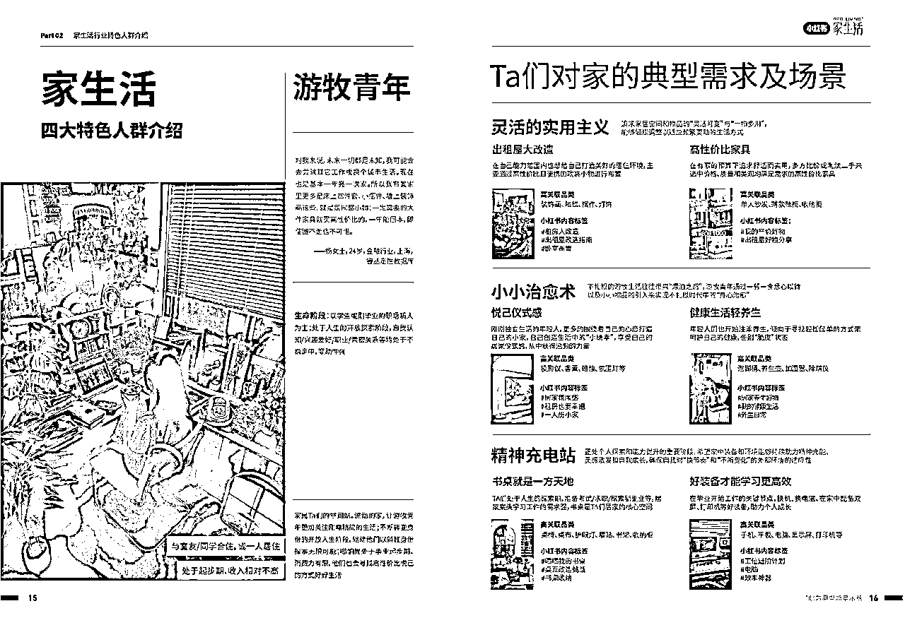

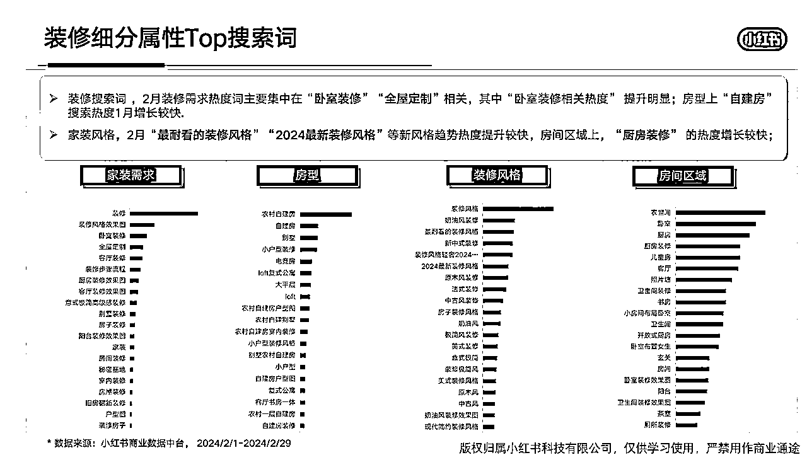

## 2、用户分层

### （1）对品类认知
需求导向型：重对比实用性和性价比，适合攻略内容，转化较易。
小白型：凭喜好冲动，适合情绪价值内容，转化相对容易。
品牌偏好型：重品牌忠诚，适合品牌故事与活动，转化较易。
专业研究型：重参数评测，适合专业评测内容，转化难但忠诚与传播强。

### （2）消费关系
新用户、首单用户、复购用户、流失用户，对应情绪价值、生活方式、会员特权、新品内容。

### （3）费用占比
高占比用户要高质高附加值内容；中占比要质价比内容；低占比要满足基础需求的价优笔记。

### （3）其他维度
年龄、收入、家庭构成、房屋状态如新房旧房、小户型大平层、生活风格如现代简约中式北欧等。

方向清晰后，选题和关键词布局才不会跑偏。

# 三、做出能种草能转化的笔记：找、拆、抄、创

## 1、找对标
按解决的问题找关键词长尾词，优先近一年内、点赞收藏评论高的笔记，尤其是一周内更新的“最新”内容，能反映当下口味。

看品类爆文，可用站内频道或第三方工具筛选最近的榜单，注意时效性。

对标同行，重点看曝光高的爆款和转化好的产品笔记。

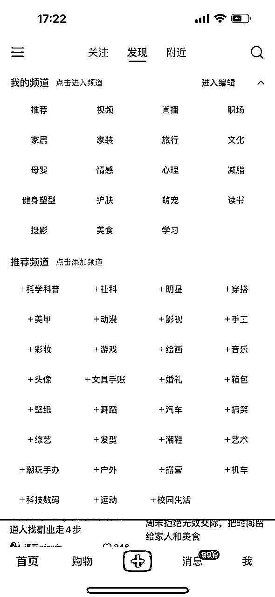

## 2、拆解与极致借鉴
选题：为何受欢迎？满足了哪类需求？干货还是情绪？对照目标人群判断。

笔记形式：图文友好上手，短视频获扶持涨粉快但制作门槛高。1.0阶段做合集教程测评，2.0-3.0阶段做沉浸式vlog。

封面与内页：封面决定点击率，约占70%。尽量高度还原配色排版滤镜，尺寸建议3:4。内页关注素材排序逻辑与自身优势点。

标题：不复制，学会两条爆款标题拼接。例“卫生间”相关可组合成“小户型卫生间细节满满！还能装修出高级感！”检查是否包含品类词品牌词痛点词同城词。

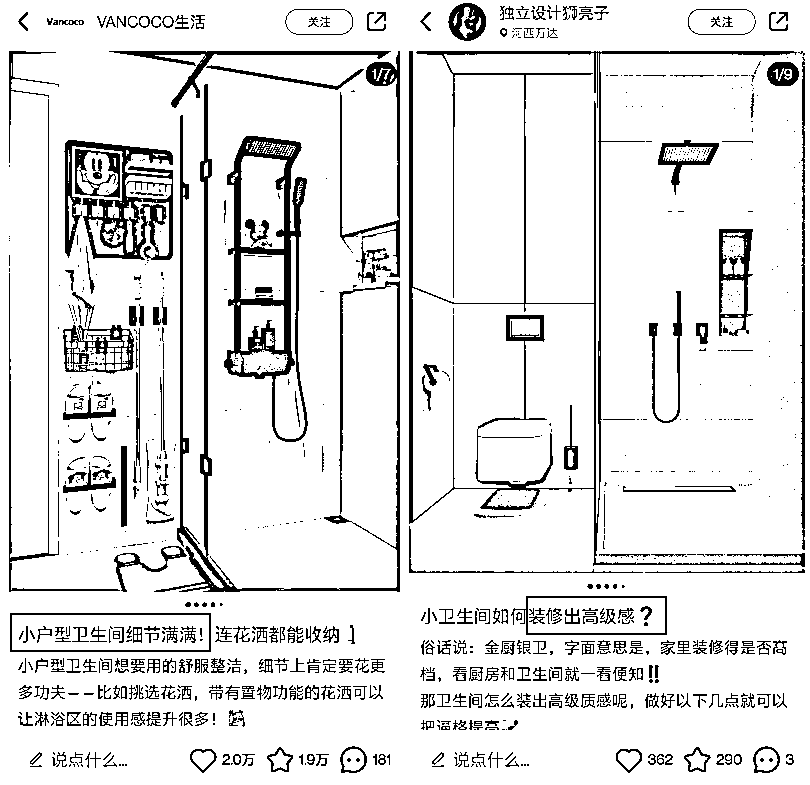

正文脚本：借鉴结构而非照搬。保留痛点、核心观点、解决方案、步骤、爽点、情绪价值。可叠加热点、案例、素材。

常见结构①总分总：起笔点痛点，中间3-5点分述，收尾总结号召互动。
常见结构②角度+观点+佐证+升华+结尾思考。

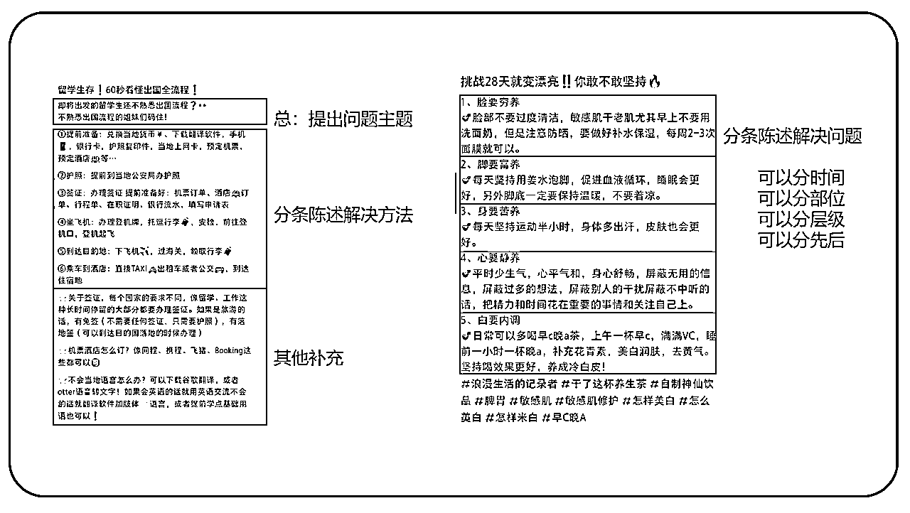

评论区、话题、发布时间可参考对标账号。违禁词用句易网、零克查词排查标题正文及图片文字。

## 3、创新反超
长期同圈抄会内卷。尝试跨行业对标、换呈现形式如插图图表AI、旧词新用如港女冻龄法、张雪峰学习法、互动造节如citywalk慢人节等。

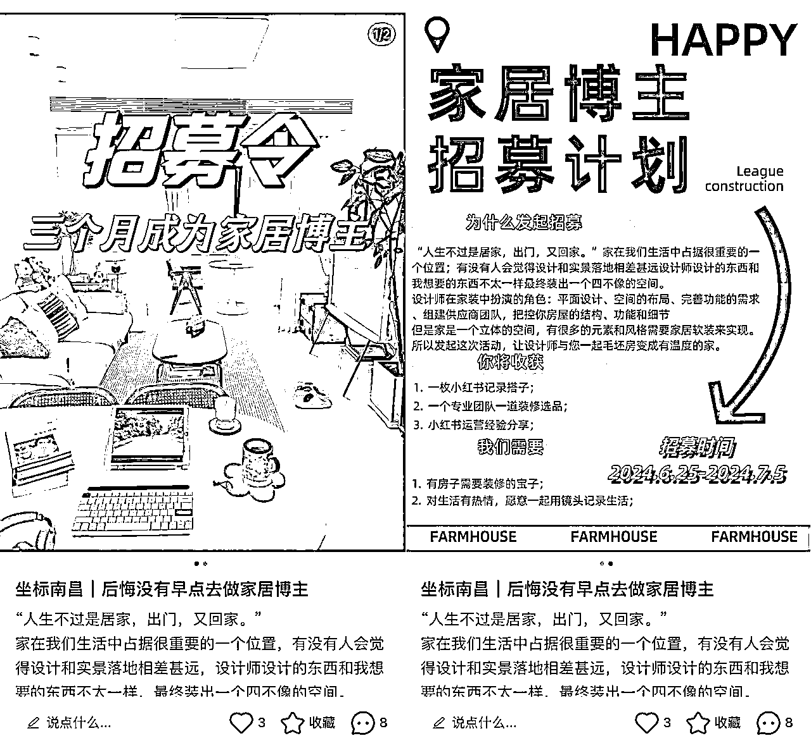

抄得准、超得快，内容才持久。

# 四、放大流量：矩阵与多平台

爆款后要复用。

## 1、内容矩阵
直接搬运测试→标题封面微调→封面固定换内容或内容固定换封面做A/B测试。

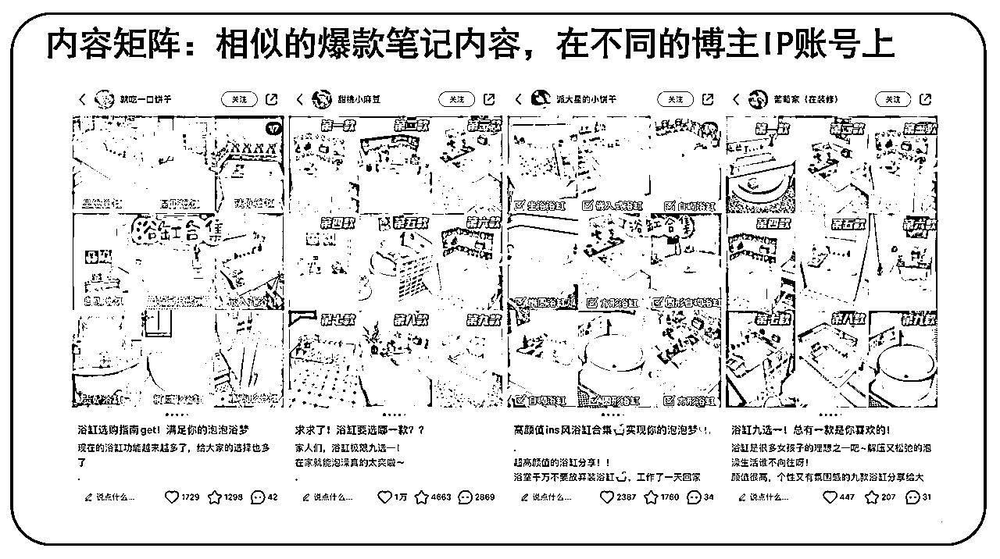

## 2、人设矩阵
企业号：产品介绍、新品、案例、品牌理念、活动、行业资讯。

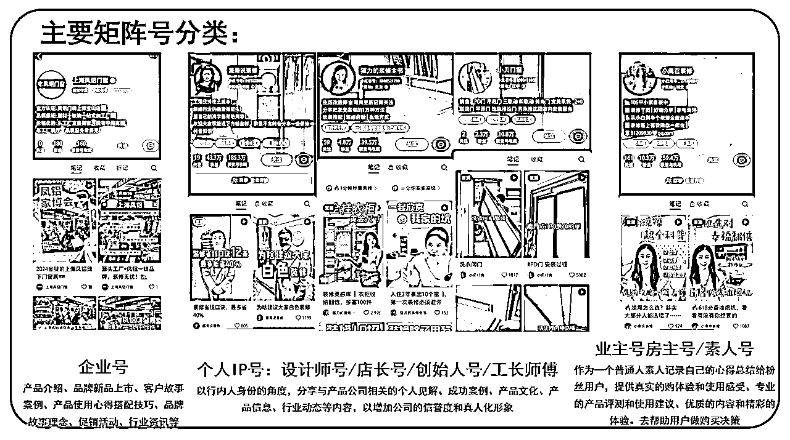

个人IP号：设计师、店长、创始人、导购、安装师傅，用行业人视角输出见解与过程，增强信任感。

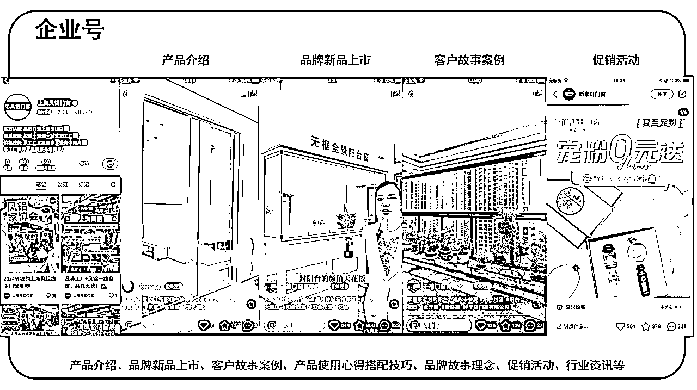

业主号/素人号：记录装修日记、好物推荐、探店测评，生活感真实。

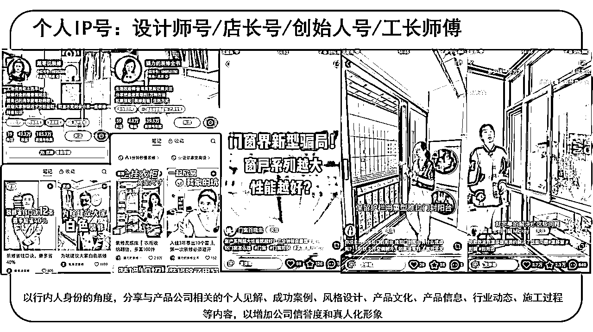

一个实操案例：家装公司在验收后引导业主发📕笔记，按引流成交给分佣。业主不愿拍则由门店同事代拍代写，流量收益分给业主。某门店由此撬到一个有粉业主，单条笔记带来几十个意向客户。

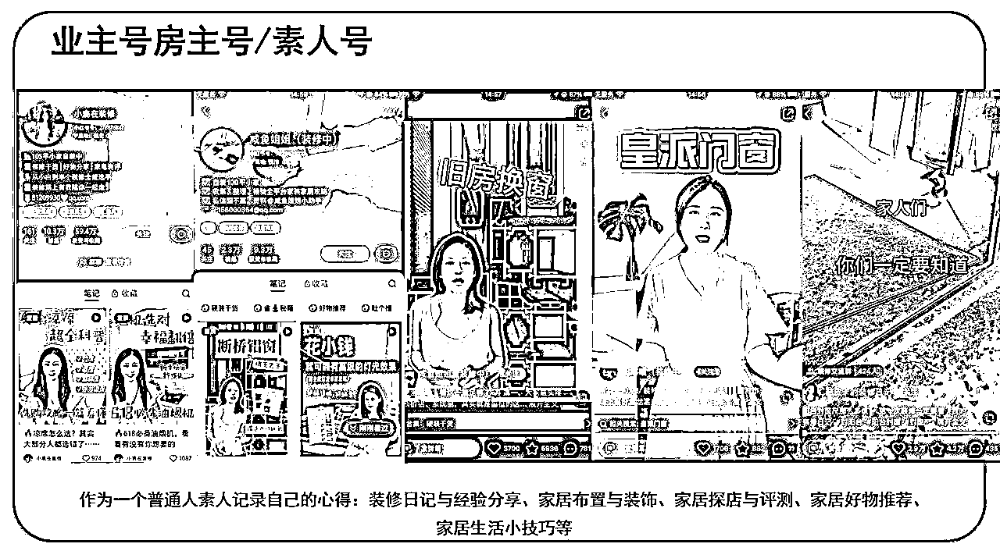

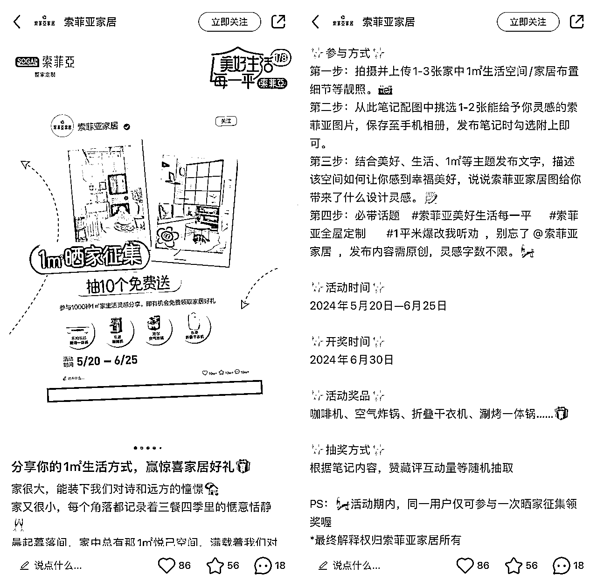

## 3、一鱼多吃
图文同步朋友圈、👸号、知乎、🧣、今日头条、好好住等；视频同步视频号、抖音、快手、B站。

# 五、限流自检与恢复

## 1、限流原因
引流信息如🛰️二维码外链；内容质量差如广告违规色情暴力；行为异常如短时间内大量发文私信；账号长期不活跃。

## 2、判断方法
看笔记是否审核通过，转发链接是否可打开。
用薯条试投，不付款测试是否可投放。
搜标题能否找到。
换号搜索昵称，看近期笔记是否可见。

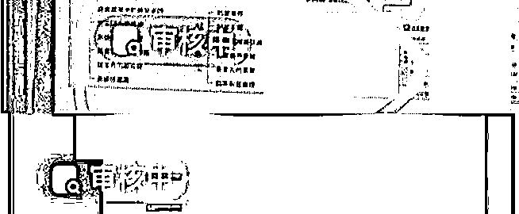

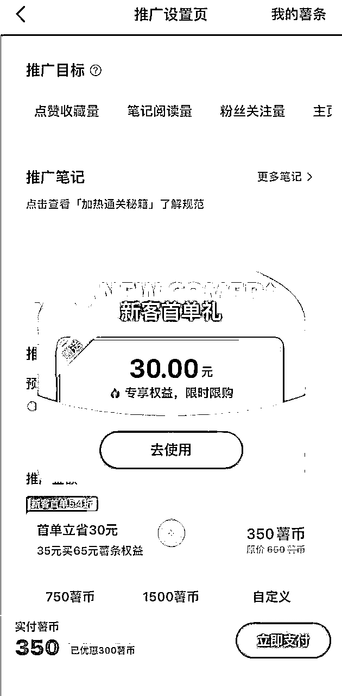

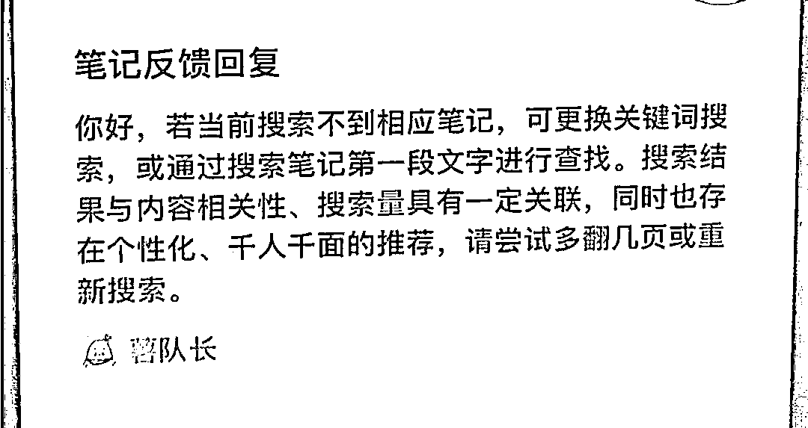

## 3、恢复方式
立即停止违规操作。收到违规提示勿删笔记也勿无视，申诉成功率较高且常有流量券补偿。

以上是实体店做📕最集中的几个高频问题。把握定方向、做内容、放大矩阵、规避限流，就能在“抄”与“超”之间找到自己的节奏。

当一条笔记被判定违规后，如果申诉没有通过，但这条内容的数据表现很亮眼，可以等24小时左右再调整一下申诉的表达方式，重新提交一次申诉。通常情况下，申诉仍然无效的话，最稳妥的做法是直接删除这条笔记，不推荐选择隐藏。

一、笔记被判定违规，疑似审核失误

a、疑似搬运或抄袭

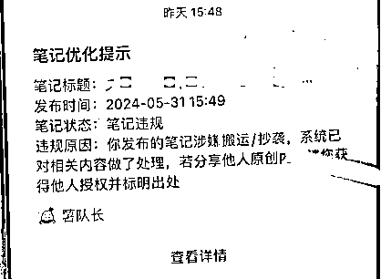

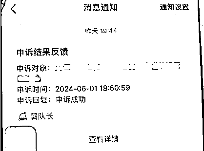

申诉思路参考：语气真诚+主动说明合规情况

✅申诉话术可根据系统提示做小范围调整即可

这篇笔记是我自己创作的原创内容，内容属于真实分享，并未直接盗用他人作品，也没有携带其他平台的水印，请薯管再帮忙复核一下是否误判了，感谢~

b、高风险互动/疑似骗赞

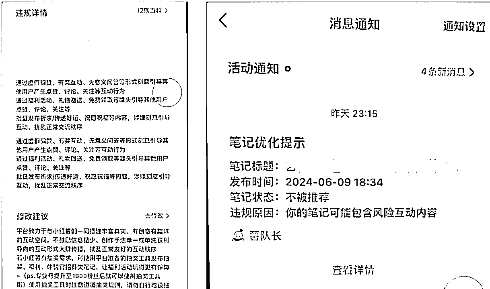

申诉思路参考：先修改内容+语气真诚+说明无违规

⭕建议先把正文里或评论区中涉及引导互动的表述清理掉，再发起申诉

薯大大您好，已自行检查过，笔记里没有违规的互动内容。只是日常分享，并不存在虚假抽奖、诱导点赞收藏评论等违规引导行为，请帮忙再核实一下是否误判，谢谢~

c、发布内容涉及个人财产信息安全或财务风险

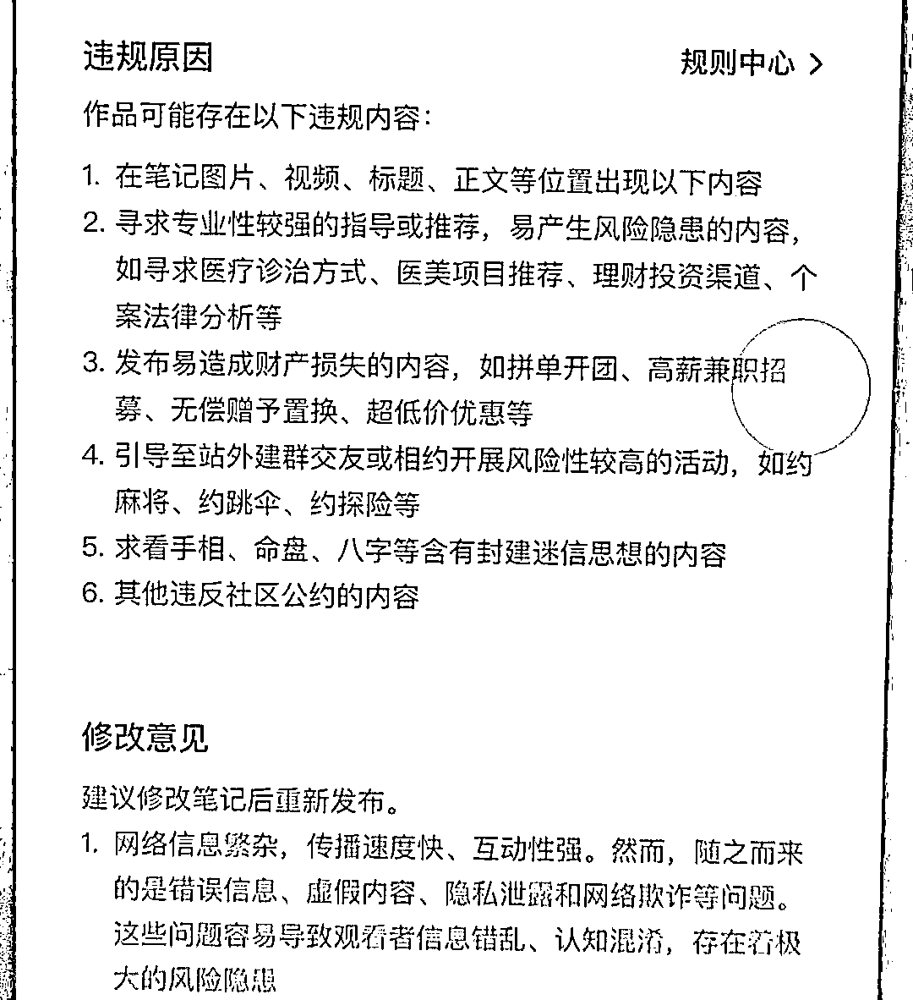

⭕先把正文或评论区里可能触碰规则的词句修改或删除，再去申诉

薯大大您好~ 已自查，目前内容不存在违规。内容纯属个人分享，并没有做行业营销、商品推广或服务宣传的意思，麻烦再帮忙看一下是否误判，谢谢~

二、笔记发布后搜不到

笔记发出24小时后，可以用关键词在搜索框里自检标题是否能检索到。能检索到就说明已被系统收录，普通用户也能搜索到；如果连自己都搜不到，就需要催审或申诉“笔记搜不到”的问题。

申诉话术参考：

薯大大您好~

我在搜索栏输入该笔记的完整标题，却检索不到这篇笔记，麻烦帮忙再审核一下，谢谢~

三、账号无法投放薯条 / 粉丝、流量异常

申诉话术参考：

薯大大您好~

本账号发布的所有笔记均为本人原创，只是真实分享，并非用于推广营销。

但现在账号下的笔记均显示不支持使用薯条投放，请帮忙复核一下是否误判，感谢~

最后一点心态建议：把📕账号当成消耗品来经营。

这一条笔记没做起来，就立刻发下一条试试

这一个号遇到限制，就再开一个新号继续

保持持续输出就够了

# 总结：始终相信选择的山，一定有宝箱

这次为期两天的线下课程，陪伴近百位做中高客单实体门店的创始人和店长，从平台的价值认知，到能种草、能转化的内容方向，到如何做出爆款高流量笔记，再到矩阵化批量引流的方法，再深入到账号常见的限流、违规处理问题…一路同行，很荣幸也很开心

我在内训现场也提到过：真正好做的赛道，并不是为了做自媒体而硬选的赛道，而是回到你线下门店的日常，你在工作、生活中本就擅长的角色和身份。

把这件事做透，边做边记录到📕上，也是在放大中不断精进。做出选择后，就不要把时间浪费在反复纠结上，要相信你我选择的这座山，终究会有宝箱。

把精力放在持续学习、反复练习、精细打磨、稳定更新上，一步步一起登顶。

也欢迎更多想探索📕新引流方式、想突破流量焦虑的伙伴，一起交流~