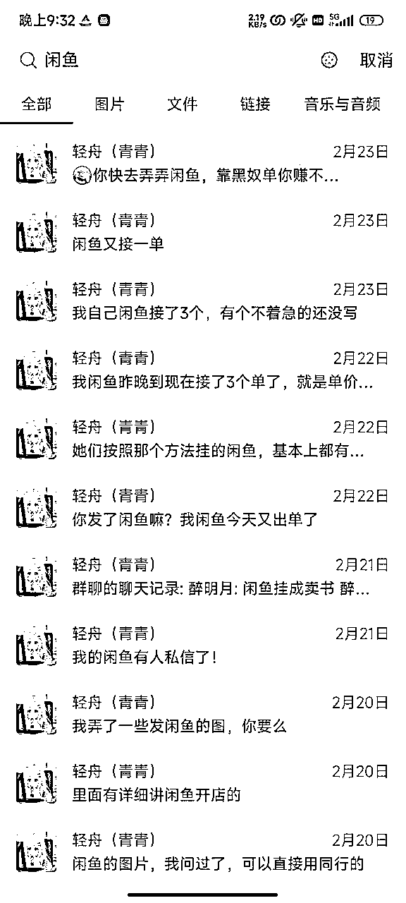
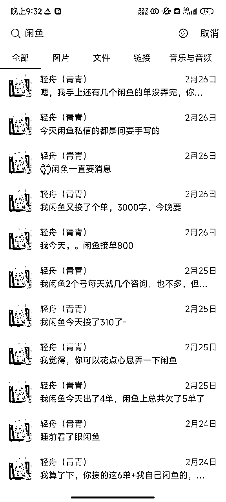
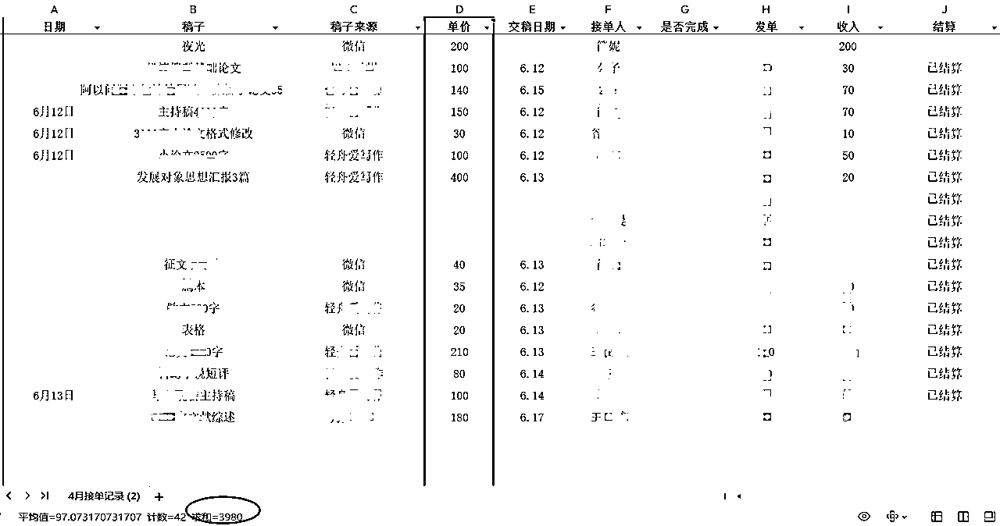
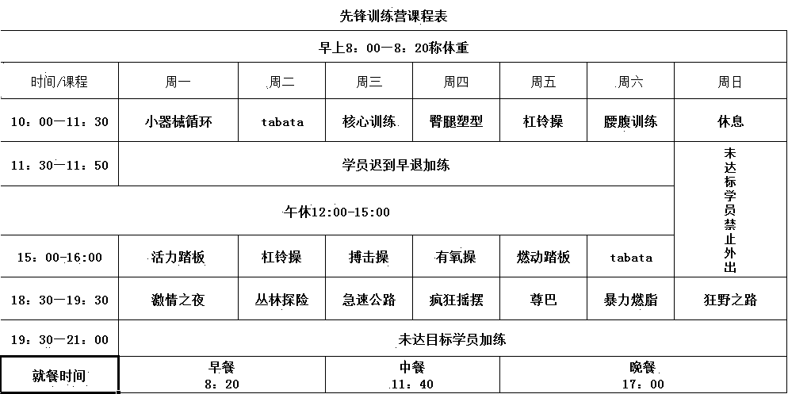
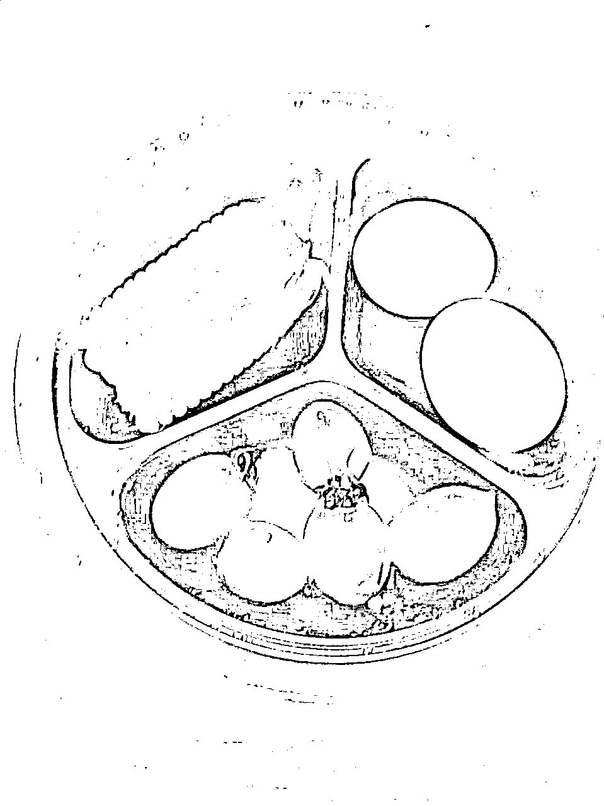
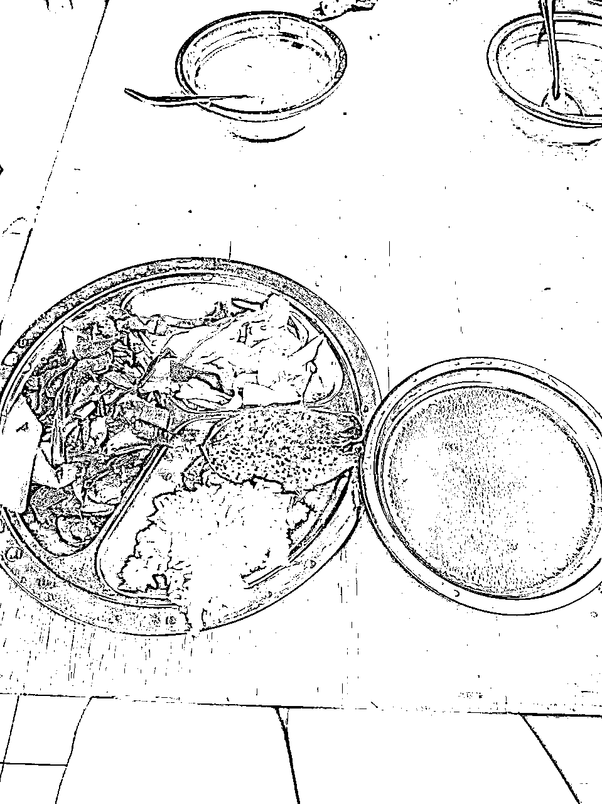
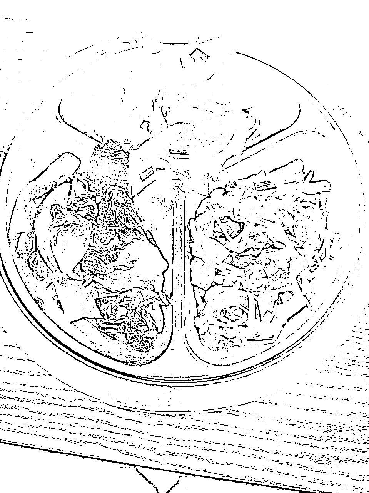

# 我的2024上半年复盘：还了10万负债，27天瘦了17斤
作者：龙哥

前几天，一位圈友跟我感慨：2024年过得好快，一晃半年就没了。

我也深有同感。不过好在，这半年我没白过。

年初立下的两个flag——还清20万负债、瘦回理想体重——目前都走在正轨上。负债差不多清了10万，剩下的今年大概率能全部搞定；减肥这边，6月终于入了心心念念的训练营，27天，从161斤掉到144斤，整整17斤。

很多人问我怎么做到的，其实说来也巧，两个目标能同时推进，功劳得记在“Ai写作变现”这个项目上。正是从2月底接触它开始，我才能在每个月还债的同时，攒够钱进营封闭减肥。

今天就借这个机会，把这段经历掰开揉碎了讲一讲，也聊聊眼下正卡住的难题，看看圈友们有没有好建议。

# 01 黑暗期后的转折

去年对我来说，是特别灰暗的一年。

年初投资失手，背上负债；下半年病急乱投医式地试了不少项目，结果越做越亏，窟窿越捅越大，20万的债就是这么滚出来的。那阵子，我几乎每天下午三点左右都会躲在出租屋里崩溃大哭，那种“又混过了一天、还是没赚到钱”的焦虑，压得人喘不过气。

和大多数负债人一样，我一度觉得自己是个彻头彻尾的失败者。

转机出现在过年那阵。我在赚钱上刷到几个不需要流动资金的活儿——Ai写作、Ai写真、微头条。那会儿我连爸妈的过年红包都没给上，反而是跟朋友借钱买了这三个项目的知识付费，打算趁假期把课学完，开年就开干。

大年初四，我就从老家杀回了长沙。说实话，没收入的日子搭配负债，那种压力真的能把人逼疯。

回来后，三个方向的命运各不相同：Ai写真因为平台判重的问题一直搞不定去重，就搁浅了；微头条的课倒是认真看完了，但我自己写个几百字的稿子，居然要磨两三个小时；最后，我把重心压在了Ai写作上。

我当时的算盘是：学会了Ai写作，既能接单赚钱，又能顺手给微头条供稿，往后说不定还能试试👸号爆文的路子。

为什么是它？原因其实挺实在的：

第一，不用投钱，跟我之前做过的📕电商完全两回事；
第二，对时间和场地没有硬性要求，有手机电脑就能开干；
第三，赚到钱的门槛低，实在不行还能去淘宝接单，收入相对稳定；
第四，对自身的写作功底要求不高，不需要你下笔生花，只要能熟练驾驭Ai工具就行。

# 02 从接不到单到写不过来

之前提到过，我借钱报了荷包蛋的Ai写作课。有趣的是，还没等课程看完，我就先跑去加了好几个淘宝店。等过完年正式开工，花了几个小时速刷了一遍课程，当天就试着接单了。

我的第一单是一篇文献综述。说实话，当时我连“文献综述”这四个字是什么概念都不清楚，但那单子有50块，在淘宝店里算中上价了，咬咬牙就接了。一边写一边厚着脸皮问荷包蛋，磕磕绊绊地交了第一版。

但很快我就意识到一个尴尬的问题：店里差不多九成的单子我都看不懂，看不懂就不敢接；剩下那10%看得懂的，要么单价低，要么抢的人多，一天下来挣不了几个钱。每天又要筛单子又要写稿子，效率特别低。

后来我想了个办法，把现实里的朋友拉下水：她去淘宝店铺接单，我来负责交付。分成比例是她三我七，算下来我拿的其实是千字7元的价——但是，这个模式直接救了我。

因为很多单子——比如教案，我连内容都看不懂，纯靠Ai出稿硬写。但这种“赶鸭子上架”的方式，反而在最短时间内把我训练出来了。

印象最深的是一篇征文。客户特地说要质量好一点的，我当时心里直打鼓，觉得自己搞不定，最后还是荷包蛋上手帮我做完的。现在回头看看，那篇征文的难度简直不要太低。

这件事让我悟出一个道理：别总想着“等我准备好了再上”——很多时候，你不逼自己一把，永远也不知道自己能写到什么程度。更何况，现在客户自己都会用Ai写东西了，如果你交付的稿子跟人家自己动手写出来的效果没啥差别，那凭什么让人家花钱请你呢？

# 03 闲鱼带来的波段式爆发

淘宝单写了大约半个月，我开始两条腿走路：一边写稿，一边研究闲鱼运营。

当时我准备了两个号（一个人实名三个支付宝，也就能开三个闲鱼号），每个号发了10条商品动态。不知道是不是运气的缘故，第一天就有号来了咨询。

后来慢慢地，淘宝的单子越写越少，闲鱼的单子越接越多，再后来闲鱼的单已经多到自己写不完，淘宝那边索性就放下了。有一说一，跟淘宝比起来，闲鱼的甲方真的不要太友好——之前在淘宝写得龇牙咧嘴的稿子，到了闲鱼客户手里，我居然轻轻松松就搞定了。

就这样，我完成了从“淘宝写手黑奴”到“私域自由写手”的蜕变。靠着三个闲鱼号，每天闷头写写写，月收入相当可观。具体的数据和运营细节，之前发过帖子，这里就不展开了，有兴趣的圈友翻翻我前面的分享。

不过说说也没人信，我这个人是真不爱上架新商品，一个字：懒。所以最初我请了个附近的大学生，每天来我家两小时帮我挂商品，一小时15块，结果人家连续请了三天假，这事儿就不了了之了。

后来我又拿了家里人的身份证，多开了几个闲鱼号，还试着招了个全职助理。计划是她来打理日常运营、处理沟通和后台，结果她动不动就在旁边刷手机，管理上也有问题，磨合了半个月就散伙了。账号又闲置了一段时间。

直到6月，我决定进减肥训练营。为了保证每个月照样还得上负债，我把闲鱼号翻出来重新盘活，又招了个线上的学员当客服对接客户，运营和回复都由我亲自盯着。6月10号到13号那几天，流水做到了6000多（表格上登记的只有3980，还有2000多来不及填）。

13号之后停止了这个节奏，其实是我人已经进了训练营，天天要上课，根本没法捧着10台手机回消息。于是换了玩法：闲鱼只开自动回复，把客户往🛰️导，由客服去对接转化。测了几天发现，自动回复能引过来的大概是30%的人，而这30%里最终成交的又只有30%——这个漏斗确实有点深。

所以我现在又把重心挪到了📕上。目前安排了一位兼职客服负责发笔记和留钩子，但引流的指路牌做得不太显眼，有人来私信咨询，却很少有人顺着指引摸到🛰️上来。眼下正卡这一环，有圈友能支支招吗？

# 04 27天，17斤

提起减肥这事，我真的是有执念的——特别特别特别想瘦一次。

早前处过一个对象，我爸妈很喜欢他，但我去见了他爸妈之后没几天，他就提了分手。理由？他妈妈嫌我太胖。虽然现在回过头来想，庆幸早早看清了一个妈宝男，被人嫌胖这件事却一直扎在心里。

这些年我试过的方法能写一箩筐了。健身也咬牙坚持过一年，体重纹丝不动。减肥训练营是我最后的希望，去年就开始想做这事了，奈何一直在负债的泥潭里，也不敢真的脱产去。

今年6月能下决心来，说到底还是Ai代写给的底气。2月到6月，靠它清掉了一部分债务，压力小了不少；再加上我在营里不运动的时候照样能写稿，不至于完全没了收入。

现在入营27天了，体重从161到144，瘦了17斤，自己能明显感觉到衣服空了一圈。要知道，我以前一个月上15节私教课，不上课的日子还要做一小时有氧，硬扛了9个月都没怎么掉秤。那时候我都怀疑自己是不是内分泌有问题，还特地去医院做了全面体检——结果显示，身体啥毛病没有。

来了训练营我才发现，问题就俩字：亏空不够。以前我总觉得“练得够多了”，其实远远不够；总觉得自己“吃得够少了”，其实多得很——光是训练营食堂的素菜，都比我过去一天吃过的菜量还大。

现在除了白天的常规课表，这周起每天早上7点我还会自己加练80分钟。跟以前那个运动一小时就喊累的自己一比，真不知道到底哪来的自信觉得自己“够努力了”。

# 05 最后说点得罪人的话

这半年，有不少圈友来交流，也有人带着问题来问我，今天就一次性说开了。

问得最多的一个：闲鱼号没曝光、没人来问。

说实话，每次听到这种问题，我都会让对方扔个链接过来看看。不看不知道，一看：好家伙，就发了一条两条商品动态，还是好几天前的。

如果发一两条就能躺着吃流量、天天爆单，那谁还愿意满世界分享经验？闷声发财不好吗？就拿我自己来说，算运气不错的了，可我也是两个号同时发力、每个号每天发满10条，才等来了第一个咨询。

还一个是：淘宝单抢不到。

这个问题让我不知从哪里开始吐槽。很多分享帖子不都写了吗？先加群，每天加5-10个，屯到20-40个群再说。如果颗粒无收，先问问自己——群加够了没？

其实不管做项目也好，还债也罢，还是减肥，我们总习惯把锅甩给外部，或者觉得自己“已经够努力了啊”。但真相往往是：你眼里的“足够”，远没到及格线。发的作品够多了吗？上架的选品够多了吗？写的稿子真的写到量了吗？

永远别高估自己的付出。这句话，与各位共勉。