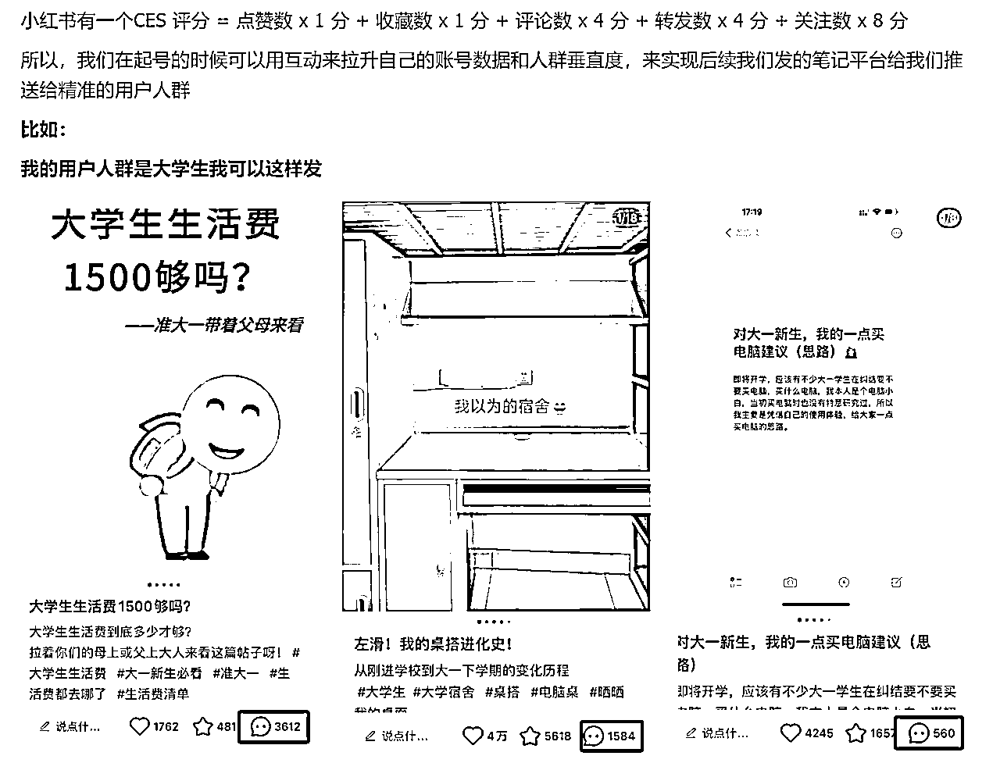
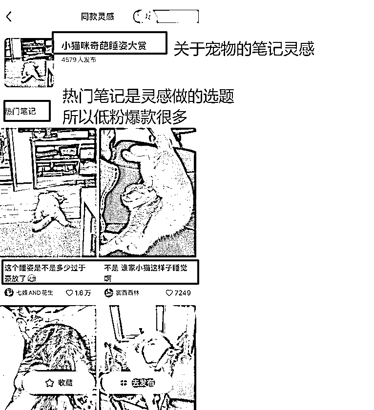
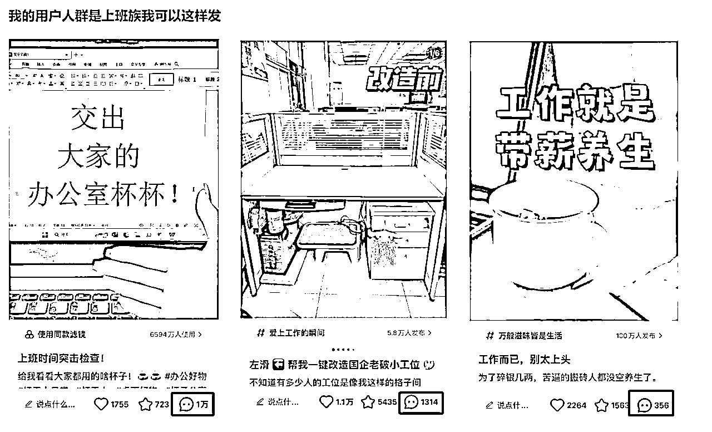

# 📕店铺爆款逻辑

你是不是也这样过：明明照着对标的爆款笔记在操作，眼睛都快看花了，可自家笔记的浏览量硬是停留在几十、几百，一周想凑三单都难？

又或者，文案翻来覆去改了无数遍，封面换了一轮又一轮，数据却始终卡在1000的关卡前面，怎么也突破不了。

再或者，每天搭进去五六个小时，吭哧吭哧忙活大半个月，结果一单没出，连个正反馈都摸不着。

如果以上几条你中了，那今天这篇内容，值得你认真看完。

我是曜文，做📕五年了，手上一共带着200多家店铺。这几年我摸爬滚打总结出来一套关于📕店铺的爆款逻辑，今天一次性拆开揉碎讲给你听，希望能帮你真正提高起店率和爆款率。

核心就三件事：笔记为什么能爆？爆款笔记该从哪些维度拆解？以及怎么优化才能持续复制爆款？

先说第一件事：笔记为什么能成为爆款？

很多人一上来就扑在文案、封面上，却忽略了最底层的东西——品。

做电商笔记，品的选择太关键了。如果你的品恰好是当下的“实时爆品”，那笔记起量会快非常多，等于顺风局；反过来，如果品还没火，就需要花时间先把账号各项数据养起来，慢慢把它“推”成爆品。

什么叫实时爆品？简单来说，就是最近7天销量能破千，在各个平台都有一定讨论热度的品。

什么叫打造爆品？就是靠账号自身的数据积累和权重提升，把流量一点点吸引过来，最后喂出一个爆品。

要打造爆品，绕不开下面这几个维度。

第一，账号权重。

用大白话说，权重就是你这个账号的“等级”。等级越高，发笔记能分到的初始流量就越多。你可以这么理解：账号给平台贡献得越多——比如每天稳定在线、持续发笔记——平台就会悄悄多给你一些流量。但这事儿官方不会明说，权重也看不见摸不着，只能靠笔记的数据来反向测试，靠浏览量来判断。

举个例子你就懂了：A账号不管发什么内容，起步都有1000的基础播放；B账号拼死拼活写半天，基础播放也就200。差别在哪儿？就在权重。

那新号怎么提权重？看看我们是怎么做的：新号一上来，先发一些容易引发互动的笔记，基本都能跑出几万、几十万、甚至上百万的播放，权重就是这么一点点拉起来的。

第二，账号垂直度。

垂直度这东西，说白了就是：你本来是想把笔记给宝妈看的，但平台却推给了学生党；学生党对你的内容不感兴趣，自然不会点，浏览量立马就难看了。

你想想，你自己的📕发现页，刷到的一定都是你爱看的东西，对吧？平台不会天天给你推不感兴趣的内容。把这个逻辑反过来用：你发的内容越垂直，被推送到精准用户面前的概率就越大。如果你今天发美妆、明天发健身、后天发美食，平台压根不知道把你推荐给谁，精准用户自然也就找不到你。很多账号播放量一直起不来，卡就卡在这儿。

所以，想做能变现的爆款，想让平台持续给你推流，内容一定要垂直，别搞成大杂烩。

第三，封面点击率。

打开📕，在信息流里让你停下手指点进去的，是不是封面？只有看到封面才有点击，封面点得越多，平台算法就觉得你这篇内容越优质，就会把它推给更多人看，流量自然就像滚雪球一样变大。

而且📕的展示逻辑是“图重于文”：主图几乎占满了整个卡片，标题只缩在封面下方一行小字里。用户点不点你，很大程度上看封面能不能吸引住他——有没有戳中需求点？有没有一眼能看到的亮点？这才是做封面真正该思考的问题。

第四，选题吸引力。

创作中心里有个“笔记灵感”功能，里面有非常多的类目标签，这些词都是官方发起的，还自带热度，代表当下大家正在聊什么。把这些词揉进你的选题里，就是最简单的借势。

当然，选题这事儿靠的是长期积累。最简单的方法是学会“找”：把你垂直类目里那些已经被验证过的选题都捞出来，再对照当下热点去组合，方向基本不会跑偏。

第五，内容吸引力。

内容吸引力的本质是：用户凭什么给你点赞、收藏、评论？这些动作会触发📕的笔记评分机制，帮你拿到更多推荐。

比如下面这类案例，就很有代表性。

图1的“突击检查”，一直是📕上的热门词。它胜在跟用户有互动感，评论区活跃度甚至比点赞还高，平台自然愿意多推。图2的“工位改造”，内容实用性很强，大家看完觉得有用，默默点赞收藏，但评论相对较少。图3这种选题，直接戳中了上班族的共鸣点：用户认同你的观点就点赞，觉得有道理就收藏。

规律一下就出来了——做内容别自嗨，多站在用户角度想：他看到这篇内容，会不会有情绪？愿不愿意互动？能触发用户反应的笔记，才有爆的基因。

说完这些底层逻辑，我们再往前走一步：爆款笔记到底该从哪几个维度分析？

在发笔记之前，你已经可以对照上面说的，给自己的账号做个体检了。哪一步出了问题，导致爆款迟迟不出现？我把维度一个个拆开说。

先看权重。

如果你发的笔记，浏览量常年卡在100上下、连500都上不去，大概率是权重太低了。这时候可以发一些互动性强的笔记——比如热点话题、有争议性的话题，先把权重拉起来，再考虑破流量池的事。

但也有一种特殊情况：笔记数据一直在50以内，甚至自己都搜不到自己的笔记。这种账号光靠养号很难救回来，多半是注册环境或设备出了问题，被平台暗中限流了。最省事的方法就是注销，重新注册。

还有一种账号天生就自带高权重，随手发一条就是几千播放。这种账号不需要搞复杂的互动，直接做垂直品或者细分人群的内容就行。虽然这种账号可遇不可求，但只要碰上了，爆款率往往特别高。

那怎么判断自己权重是好是坏？新号注册好之后，先别急着卖货，发一篇笔记测试账号是否正常，再准备两篇笔记专门拉互动权重。基础打牢了，后面做产品、冲流量都顺得多。

再看垂直。

如果你的浏览量属于正常水平，几百上千都有，但你的目标人群是女性，点进来看的却多是男性——那要查三件事：第一，内容上是不是不自觉偏向了男性爱看的东西？第二，起号的时候标签是不是打错了？第三，这个账号是不是平时刷了太多不相关内容，把平台的推流带偏了？

想打正账号的垂直度，可以多刷一些相关领域的内容，该点赞点赞、该收藏收藏。同时，在笔记里铺上人群关键词，让账号足够承接搜索流量。时间久了，标签会越来越精准，平台的推流也会回到正确轨道上。如果你想做一个能长期赚钱的账号，垂直是第一位的，泛流量再热闹也没用，精准人群带来的收益才够实在。

第三个维度，封面。

封面是最影响数据的一个因素。你先想想，自己的封面是直接从视频里截一帧出来当封面，还是专门动手制作过的？如果是前者，数据差很正常——爆款封面从来不是这种偷懒做法，不参考爆款做专门设计，点击率上不去。如果是后者但数据依然很差，那大概率只是你自己觉得封面好看，并没有经过市场验证。

怎么解决？非常简单：去翻最近7天里、你所在垂直赛道上的爆款封面，照着那个方向去测试。这些封面都是用户用点击投票投出来的，照着它们的逻辑来做，反馈往往不会太差。

第四个维度，选题。

浏览量已经能上千了，这说明你的账号正在往爆款方向走，权重、垂直、封面三项基本过关了。这时候真正该盯的是选题：有没有踩中热度？是不是被用户喜欢？

“被用户喜欢”可以从三个角度来判断：内容能不能解决问题？能不能给用户带来帮助？是不是容易被搜索到？再结合人群和周期去做选题。

比如：眼下这个季节，学生党关心什么？上班族在聊什么？宝妈有什么新痛点？今年冒出了哪些新话题？历年来有哪些爆款话题反复出现？把这些线索串起来，素材方向就有了。跟着用户真正关心的走，比闷头自己拍脑袋强一万倍。

第五个维度，内容。

选题定好了，内容一定要跟着选题走。这里面有两种情况：做视频，可以简单点，不写长文案只带话题；做图文，内容必须跟标题严丝合缝地对应。如果牛头不对马嘴，数据和推流人群都会被带偏。

做📕是场持久战，流量来源就两大块：要么被推荐，要么被搜索。当你的内容里自然嵌入了关键词、人群和产品，长尾流量就会源源不断被搜出来，根本不愁后续没人看。

以上就是五个环环相扣的维度。任何一个环节漏了，爆款都难产。所以，每次发笔记前，记得做一轮自检，每一项都过关再发出去。

最后说说怎么提升爆款率，找到属于自己的爆款方法论。

其实优化的动作上面已经讲得很细了，核心就是把手头每个数据环节都做到位。只要笔记各项指标都贴着爆款跑，流量翻倍是迟早的事。但优化之前，你得先有个参考标准——这个标准在哪儿？就在📕里面。

打开平台，对标账号、爆款笔记，就是最好的现成教材，尤其是对新手来说，这是最容易上手的一条路。

想做持续优化，背后一定得有一个够硬的素材库。刷到好的内容不能只看看就划走，要有意识地搜集——把你做的类目、相关的产品里所有爆款笔记都存下来，然后找爆款、拆爆款、复制爆款。爆款从来不是靠灵感撞出来的，而是一套可以拆解的方法论。

再直白一点：如果你现在还不具备凭空做爆款的能力，那就先把对标账号或同赛道里的爆款拿出来参考，做一条相似度足够高的笔记。

但很多人这么操作了一段时间，依然没出爆款，问题多半出在选题上——他参考的那个话题可能是两三个月前的旧料了，已经过了平台推荐的时间窗口，怎么可能被推送？

所以，建立属于你自己的素材库，把爆款率高的封面、标题、内容分门别类存好，再结合实时热点不断注入新鲜选题，笔记数据自然会往上走。

最后这句话，你一定要记住：优化之前，先自查，全部达标了再发送！

新手做爆款，路径应该是这样的：先搜集，再参考，然后动手去做。在做的过程中用数据验证，再根据数据反馈持续优化。这样才能不断抓住一个又一个爆款机会，真正把账号做起来。