生财的朋友们，你们好。我是枕棠，二十岁，在一所985高校读大三，同时也是一个时间管理教练。说实话，刚认识生财的时候，我只是一个喜欢围观别人怎么赚钱的小透明。可这一年多泡下来，我的商业认知发生了天翻地覆的变化，从前那个自卑的县城做题家，如今居然能一边拿奖学金，一边把月收入做到五万。这个结果，连我自己回想起来都觉得恍惚。

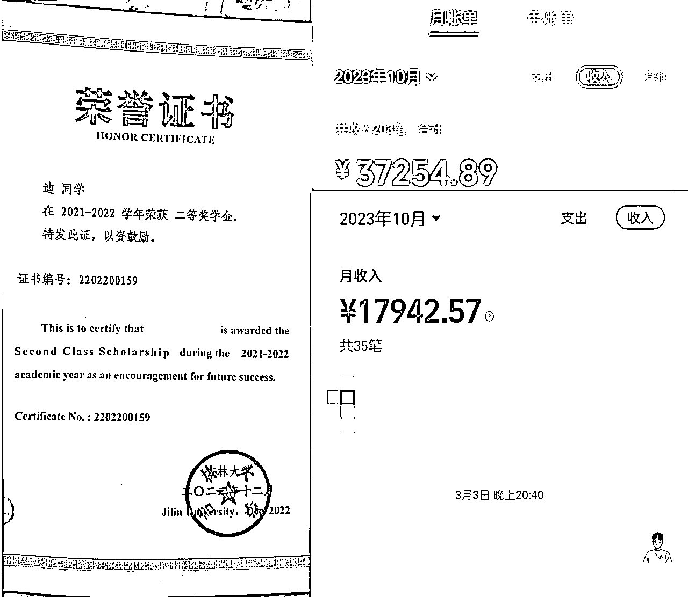

我这个人做事情有点完美主义倾向，总觉得文章没打磨到满意就不该发出来，所以一直默默潜水。后来梨云老师多次鼓励我，我这才下定决心把它写出来。从最初搭框架，到正式动笔，再到反复修改、排版，前前后后用了四十多天。这篇分享不打算讲空泛的理论，主要是想把商业世界的运行规律、新人在知识付费赛道从零起步的完整路径，以及定位、流量、产品、转化这四个模块的进阶心法，都仔仔细细地呈现出来。每一条内容，都是我用真实经历换来的。

# 一、商业到底是什么

我来自陕西一座经济落后的小县城，考上大学以前，我甚至没坐过火车，飞机更是在梦里都没出现过。到了大城市以后，眼花缭乱的世界一下子把我内心的欲望勾了出来。但我的父母都是朴实的人，从小到大，没有人教过我任何赚钱的道理。现在想想，我对金钱那股强烈的渴望，其实是被许多尴尬的瞬间硬生生逼出来的。

为了攒下200块钱，我咬咬牙省了一个月的生活费，把每一餐的开销都盘算得清清楚楚；同学聚会时，大家聊着各自的旅行故事，我只能默默低头不说话；路过人均六百的海鲜自助餐厅，隔着玻璃窗驻足了几秒，最终转身离开。这些画面深深烙在我脑子里，所以从踏进大学那天起，我告诉自己：一定要搞钱。

最早的时候，我尝试做线上家教，一周七天，每天一小时，也只能挣120元。之后又接过视频剪辑的工作，其实就是把自己的时间廉价外包，根本看不到任何上升空间。没过多久，我醒悟过来——我要做的，必须是一件有累积效应的事情：越做越值钱，越做越轻松。想通了这一点，再去观察周围的机会，目光一下子就不一样了。

## 1. 一次受伤，换来一次顿悟

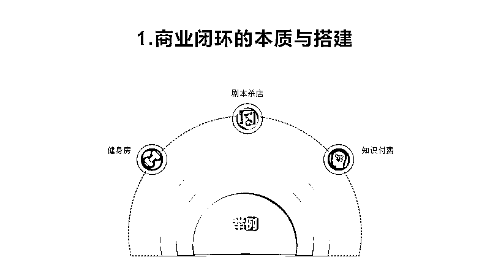

今年三月，我的账户里已经有了六位数的存款，但说实话，那些钱是怎么赚到的，我只有一种模糊的直觉，讲不出底层逻辑。我的性格测试里，“思辨”和“战略”都排得很前面，如果一件事我弄不懂背后的原因，我就会坐立不安。也正是因为这个，我特意去参加了生财的线下聚会，还翻阅了不少商业著作。直到某个风和日丽的下午，答案才在一场小意外中浮现。

那天我去健身房，本来是想好好练一练，结果在用爬楼机的时候一不留神，把腿摔伤了。简单消毒之后，我坐在旁边休息，理疗区正好有两个人——健身房的老板，以及另一位来锻炼的会员。闲聊之后才知道，这位会员开着一家剧本杀店。三个不同行业的人坐在那里，话题从剧本杀聊到健身动作，最后竟然拐到了生意经上。

聊着聊着，我发现了一件值得琢磨的事：健身房、剧本杀和知识付费，表面上毫不搭界，但大家操心的问题却惊人一致。所有人都在担心客源——健身房愁没人来体验，剧本杀店愁大众点评的新客转化，我则愁小红书来的用户不够精准。所有人也都在精心打磨用户的第一次接触：健身房的体验课、剧本杀店的第一套盒装本、我的低价体验产品，本质上都是为了让用户更轻松地迈出第一步。

就在那一瞬间，我隐约摸到了商业世界的一条暗线——行业形形色色，但底层的运转逻辑可能是同一套。

## 2. 规律之一：生意就是一条循环

我得出的第一个结论是：任何一门面向消费者的生意，都能被抽象为四个环节——目标人群、产品、获客和成交。它们循环滚动，共同构成一套完整的业务链路。健身房如此，知识付费如此，剧本杀门店同样如此。

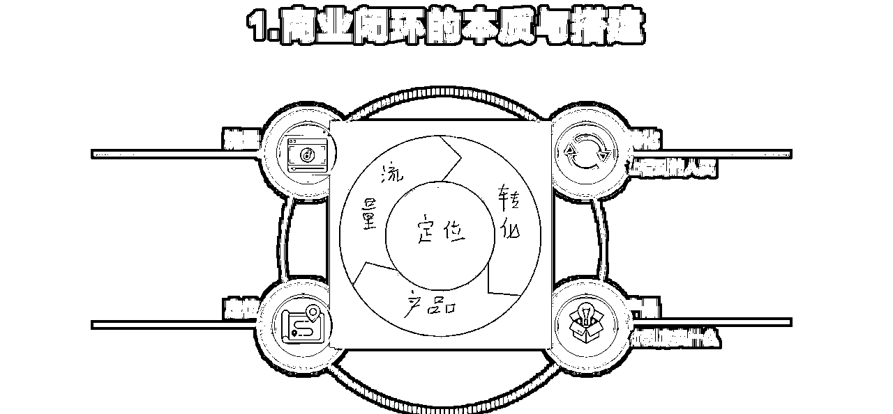

把这四个环节逐一说透，其实并没有想象中复杂。

先说目标人群。说白了，就是搞清楚你在替哪一群人解决问题。健身房瞄准的是那些想锻炼、想管理健康的人；剧本杀店面向的是想放松、想寻求新奇体验的年轻人；我的时间管理产品，对应的则是那些想自律却一直动不起来的人。这个环节是整个系统的心脏，一旦方向模糊，后面所有的动作都会失焦。就像健身教练，不管是带课还是销售私教套餐，都得先弄明白会员在想什么，否则沟通再多都是对牛弹琴。

接下来是获客。获客的本质只有两个字：曝光。小红书笔记、大众点评的推广、街边散发的传单，形式各不相同，实质都是让目标用户看见你。等对方留下联系方式，你才有机会一次次触达，慢慢把路人变成客户。

再说产品。产品是你能交付出去、用来换取收入的东西。私教课、剧本杀体验、知识付费的课程与陪伴服务，都是不同形态的产品。它不需要外观多么精美，关键在于，它能否真正帮用户解决某个具体麻烦。只要能，它就有了被购买的价值。

最后是成交。成交就是通过种种方式，让看到产品的用户愿意付款。健身房用体验课来吸引用户办卡，知识付费从业者用朋友圈、直播、公开课来催促下单。方法千变万化，本质无非是不断打消用户的戒备，给对方一个“此刻就该买”的理由。

四个环节串成一条线，生意才会转动起来：先确认人群，再做产品，然后获取曝光，推动成交，最后保质保量地完成交付。哪怕每一步都做得笨拙，只要整条链路能转起来，钱就会自然汇入。觉得抽象？没关系，后面我会用一个具体的小项目，带大家完整体验一遍。

## 3. 规律之二：创业只需要两种东西

老一辈常说，富二代千万别碰创业，因为那是烧钱的无底洞。这话其实只说对了一半。传统行业确实费钱——单是健身房，器械、房租、水电、宣传，哪一样都离不开资金。可是创业真的只靠砸钱吗？我越来越不认同。你再有钱，也需要一个懂行的人来制定方向、把控节奏。钱是燃料，认知才是方向盘。

于是我把个体创业的要件总结成两样：认知和资源。资源，指的是你可以使用的一切条件，包括钱、时间、精力、人脉。认知，则是你判断一件事“应该长成什么样”的感觉，是方法论，是你知道事情该怎么做、为什么这么做的笃定。不妨随便挑一个商业动作来看：凡是真正能创造价值的动作，几乎都是这两者的结合体。

以一节高质量的私教课为例。教练付出的时间、场地器材、洗浴硬件，以及购买这一切的资金，都是资源。而如何设计训练计划、如何针对不同体质调整动作、如何把握课堂节奏，则属于认知。两者结合，这堂课才立得起来。再比如一条高品质的小红书笔记：电脑、剪辑工具、投入的精力属于资源；选题嗅觉、封面审美、文案技巧，则完全依赖认知。缺了任何一块，这条笔记都不可能成为爆款。

顺着这个思路看，不同商业模式对认知与资源的要求，差异极为悬殊。电商要囤货、要交保证金、要垫付各种成本，资源门槛明显更高；知识付费则几乎不需要资源，一台手机加时间，就能开张。可为什么做知识付费的人如此之多，真正跑出来的人又如此之少？答案就藏在认知二字上——这个行业对认知的要求实在太高了。

我自己在这行摸爬滚打了两年，一点点体会到这句话的分量。朋友圈怎么写、软文怎么配、课程大纲怎么列、视频怎么录、价格怎么定，每一步都在检验你的认知水平。闷头乱撞不会带来进步，你只能去学、去试、去付费买经验，把认知短板一块块补上，才能赚到认知范围内的钱。

你赚到的钱，说到底就是你对世界认知的变现。明白了这一点，接下来我就用自己的例子，分享知识付费从零到一的实践过程。

# 二、新人如何踏入知识付费

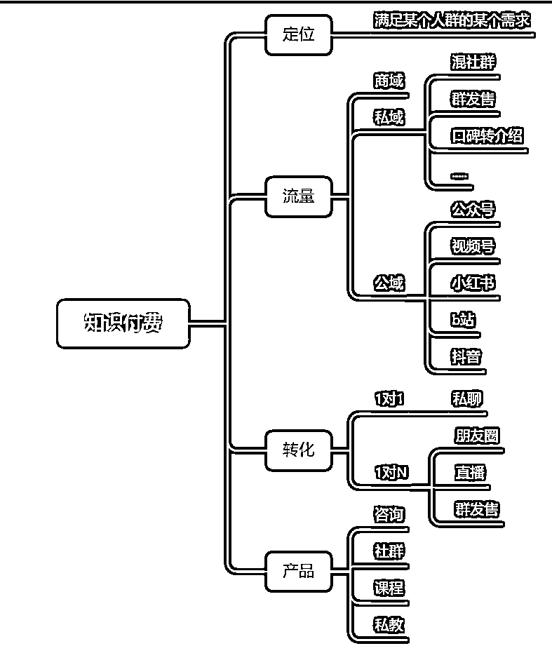

先花十秒钟看一张逻辑图，建立整体框架。这张图基本勾勒了知识付费的全貌：流量来源有哪些、产品类型有哪些、转化手段有哪些。不用急着记，后面每一模块都会讲到。

## 1. 先跑通一个闭环，胜过读一百篇文章

时常有人问我，新手学知识付费，最快入门的方法到底是什么？我的回答永远是那句话——别蹲在岸边研究理论，先跳下水扑腾两下。圈内讲“光说不练假把式”，我更愿意把这句话翻译成：做成一个小小的闭环，比学任何课程都重要。

为什么？因为当你凭着自己的能力，在互联网上挣到第一笔钱时，哪怕只有9块9，你的心态已经完全不同了。从心里，你不再把自己当旁观者，而是一个真正做事的创业者。这种身份的转变，是任何外部知识都给不了的。

那具体做什么呢？我最推荐的方式，就是开一个9块9的陪伴群。这个项目不起眼，也不费力，却可以一口气把定位、产品、流量、转化全部串在一起。做得简陋不要紧，关键是要让这台小机器转起来——哪怕转速很慢，它也是转起来的。

## 2. 定位不用太窄：先占据“成长”和“赚钱”

很多朋友一上来就问：我怎么才能找到一个小众的定位？我的意见是：作为新手，你其实不需要刻意去找。你既没有丰富的积累，也还没有获得外界的反馈来校准，硬选一个极窄的切口，反而容易卡死在原地。

不如把目光放得宽一些——比如“成长”，比如“赚钱”。这两个词几乎覆盖了所有人的基本愿望。希望自己变得更好的人、希望增加收入的人，天然就会成为你的潜在用户。当然，太过宽泛的需求注定撑不起高溢价，但对一个9块9的小社群来说，已经绰绰有余。

你甚至可以不需要制造任何噱头，坦然地对大家说：“如果你愿意花9块9投资我，我会把自己在成长路上看到的、学到的、经历的，都毫无保留地同步给你。咱们互相交换价值。”这种坦白，反而比那些华而不实的包装更能赢得信任。

## 3. 产品不复杂：一个群，足矣

定位定了，接着要考虑的是卖什么。有人嘲讽自媒体是“卖空气”，我们就偏要打破这种偏见：我们要交付的，是实打实的增量信息。

产品名字很容易起，就叫“某某的成长陪伴群”，某某换成你的IP名。至于群里面放什么，大可以灵活一些：自己的思考、报名课程学到的干货、收集的资料包、练习某项技能的记录、线下聚会的观察、读完一本好书的感悟，等等。只要是你亲自验证过并且觉得有价值的内容，都可以放进来。

别总是担心自己交付的内容够不够硬核，9块9的门槛就在这里，用户的期待不会太高。你能持续提供一点点信息增量，就已经对得起这个价格了。

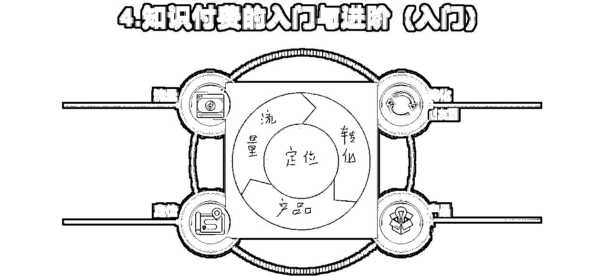

聊完内容，再聊聊运营工具。对一个陪伴群来说，最核心的物料只有一样：群公告。群公告相当于社群的门面，它既能承载群规、活动预告、群主介绍，也能承载最关键的两种信息——这个社群是干嘛的，以及此前沉淀过哪些好内容。举个例子：“欢迎加入枕棠的成长陪伴群，本群分享时间管理心得和副业赚米思路，每周六晚八点安排固定分享。往期精华见文末链接。”你看，一段话就交代清楚了。

## 4. 流量从哪来：先混群，再私聊

知识付费里的“流量”，说穿了就是把陌生人加到你的微信里来。只要人在微信上，你就能反复触达，通过长期的内容输出逐渐取得信任。

获取微信好友的方法很多，小红书、公众号、直播、公开课都可以，但新手没必要一上来就搞这么复杂，最省力的起步方式，其实是在别人的社群里混个脸熟。

具体操作就两步。第一步，加入与成长、赚钱相关的社群，付费的免费的皆可。进群之后，找个合适的时机发一段自我介绍，真诚地说明来意；看到同频的人，就大大方方地添加好友。第二步，加上好友之后不要冷场，立马给对方发去一段简介，再附赠一份你亲手整理的资料。如今大多数人都有社交恐惧，加了微信也不知道聊什么。你只要做到主动，就已经胜过了很多人。

把这个动作反复执行，当微信里的好友数量突破300人时，你的流量池就有模有样了。这些人短期内未必会下单，但他们会持续观察你、慢慢信任你，一旦时机成熟，转化自然发生。

## 5. 转化别想复杂：海报加朋友圈就够

等你集齐了定位、产品、流量，就只剩最后一环——转化。我建议新手先别碰直播、公众号这些门槛较高的玩法，从最基础的做起就好。

需要准备的东西只有一张海报。做海报也不需要专业设计工具，手机自带备忘录或者锤子便签都能胜任，操作不复杂。海报内容越简单越好，说清楚两件事就行：服务是什么，价格是多少。

示例：

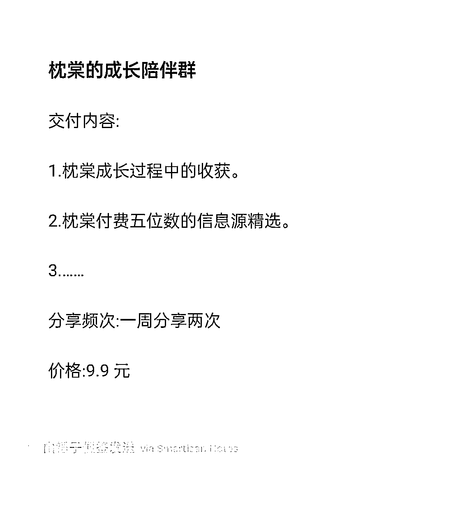

海报做好之后，可以发给两类人：一是你觉得可能感兴趣的微信好友，私聊说明来意；二是直接发到朋友圈，配上几句话介绍。9块9的试错成本实在太低，只要对方有一丝兴趣，就很容易跨出这一步。

就这样，一个最小的商业闭环就拼装完成了。当然，这只是最基础的1.0版。想获取更多灵感，不妨去朋友圈搜一搜“陪伴群”，会看到大量同行免费给你提供参考。但比起方法，真正阻碍大多数人出发的，其实是自己头脑里的几个念头。

# 三、打破心魔，放大成果

## 1. 第一道坎：觉得自己太差，不配教人

刚进一个高手云的社群时，人特别容易产生一种渺小感。看着那些厉害的人，你会不自觉在心里说：他们才配做知识付费，我还是老老实实当学生吧。

请打住。知识付费领域流传着一句经典：100分的人教90分，90分教80分，60分也可以教不及格。你会读书，会写作，会表达；甚至，你只是耐心看完了这篇长文——那么你的分数已经在及格线以上。你不需要比所有人都优秀，只需要比你的用户多懂一点点。哪怕这些也不确定，你也可以直接把产品做出来试一试，用市场的反馈代替内心的纠结。有人买单，说明你有价值；没人买单，就回来调整方向。无论如何，你都会得到有效的信息，而不是原地内耗。永远不要提前给自己判“不可能”，把结论交给现实。

## 2. 第二道坎：一收钱就心虚

如果你出身于普通的农村或工薪家庭，大概从小听过不少类似的话：“赚钱是件很辛苦的事，人要本分，别走歪门邪道。”这话的本意没有错，但它常常带来一个副产品——我们会下意识地觉得，凡是跟“线上收费”沾边的事情都不太光彩；只有老老实实上班挣工资，才算正路。

但我们不妨冷静拆解一下。上一代人赚钱难，第一是因为认知局限，他们没有条件接受高等教育，也没有机会接触前沿领域；第二是因为赛道局限，种地的天花板摆在那里，再努力也追不上新行业的风口。新媒体就是这样一个正在起风的地方。既然风已经吹到了你面前，为什么要躲开？

另外，人还有一种思维惯性：喜欢把自己理解不了的东西归为“骗局”。有人一听到知识付费就觉得是“传销”，这其实只是认知盲区带来的防备感。可你的产品并不是凭空画饼，而是实打实地提供经过验证的知识、方法与陪伴。用户觉得值，所以付费；你提供价值，所以收钱。这分明是一场公平的交换，你在用自己的劳动换取报酬，何来“罪恶”一说？更进一步，知识付费其实是双向的成全：用户用金钱换取成长，你用收入继续投资自己，然后输出更多价值。两个人都因此变得更好，这样的生意，完全可以做得理直气壮。

## 3. 跑通之后，如何放大收入

到现在，最小闭环的操作细节，以及心态上的几道坎，我们都聊透了。接下来，就是最后一个话题：怎么把人从月入几百，带到月入过万？

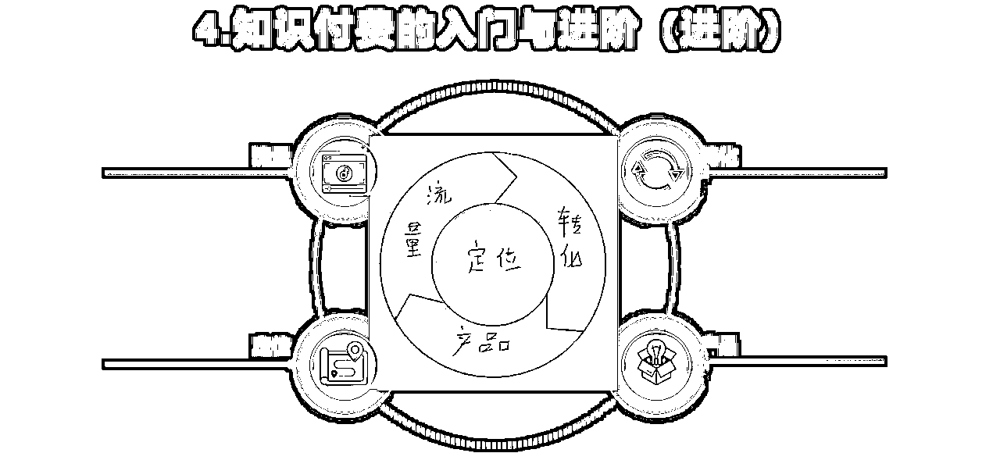

首要的建议是：别贪多。不要试图一口气把定位、流量、产品、转化四个模块全部升级，那既不可能，也没有必要。实际上，这四个模块中只要有一个出现突破，你的收入就会明显上一个台阶。

过去两年，我见过太多人在做出陪伴群之后就止步不前。他们的困境不在于不努力，而在于路径依赖。始终沿用最初的那套打法——继续混群、继续发朋友圈、继续卖9块9，渐渐发现这套流程带来了边际递减，收入不再增长，精神却越来越疲惫，最后只能失望地离场。

之所以会这样，是因为他们缺少一种“进阶”意识。想实现跃迁，不需要全面开花，聚焦一个环节做深就够了。比如，产品可以做梯度：在低价陪伴群之外，开发价格更高的训练营、年度社群、一对一私教；流量可以从混群升级到小红书、公众号这类有内容沉淀价值的平台；转化可以借助直播、公开课这些密度更高的场景来放大；定位则可以逐步收窄，从“成长、赚钱”这样宽泛的方向，收缩到某一人群的某个具体痛点，从而提高客单价。

入门的标志是跑通一个闭环，而进阶的标志，是敢于打破上一次的成功路径，刻意去寻求突破。道理讲得再多，最后都得靠你自己动手。希望下次听到你的好消息。

很多朋友做自媒体，一开始都会纠结：要不要定赛道？怎么找赛道？说实话，定位这东西，不是一步到位的，而是不断收窄的过程。

比如你之前做了陪伴群，整体定位是“成长”，那下一步就得往成长下面更小的板块切，像是时间管理、学习方法、思维模型、知识管理、亲密关系、演讲能力、写作能力……这些都能成为你的细分方向。

如果你之前定位的是“赚钱”，那其实也要再往下拆：项目拆解、小红书引流、视频号带货、小红书无货源、公众号爆文……每一个方向都足够深。

也有人说：我不想切那么细，我想把每个领域的钱都赚了，行不行？

我的答案是：真的不行。

尤其你打算做知识付费，定位必须足够细。原因不复杂：后面要引流、转化、做产品，每一步都考验你的专业程度、对客群的了解、以及成功案例的积累。这些东西不是几天就能堆出来的，需要十年如一日地深耕。你的时间就那么点，今天做这个、明天做那个，大概率哪个都做不成。

我身边就有这样的例子。几年前跟我一起做个人IP的朋友，一开始这也想做、那也想做，经常换方向。结果就是没法持续满足同一群人，也没能做出一个有口碑的产品，后来大多数人都没赚到钱，回去考研了。

再者，你不可能把所有人的钱都赚了，因为你没有那么多精力满足所有人。

专注，才是走得远的前提。

那问题来了：怎么找到适合自己深耕的领域？或者说，怎么找到自己的定位？

我分享两个方法。

第一个方法：先发现自己的隐藏优势。

我刚做自媒体时听过一句话：“你能创造多少价值，就能赚到多少钱。”对知识付费来说，创造价值就是教别人不会的东西。而想教别人，前提是你在这件事上确实比对方强。

可很多人觉得自己没什么过人之处。其实只要认真找，一定能找到；实在找不到，也可以从0开始积累。这里有三个问题可以参考：

1. 别人常找你请教什么问题？
2. 你最容易收到什么夸奖？
3. 做什么事你毫不费力，却能超过大多数人？

前两个问题要从日常反馈里挖，第三个问题可以借助工具，比如盖洛普优势测评。

我自己就有过这样的经历。做时间管理之前，我大二加入了一个大佬的线上团队，为了链接人脉，我免费干活，管着一个几十人的小团队。有一天组员问我：“棠哥，为什么你效率这么高？”我愣了一下：“啊？我效率高吗？没有吧。”后来深聊才发现，我一天能专注工作十个小时，很多人只能三四个小时。于是我在群里做了一次内部分享。

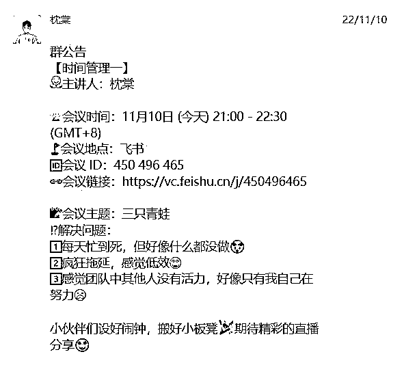

结果你猜怎么着？分享完反馈直接炸了，好多人都说我讲得太好了。

正是因为那次提问和那些夸奖，我才意识到：原来我的时间管理能力真的强。那我为什么不去做时间管理的内容呢？于是就这么一路做到了现在。

第二个方法：你的困扰，就是你最好的赛道。

你遇到的问题、踩过的坑，一旦爬出来，就是最适合你的定位。

每个人都是独一无二的，但遇到的问题却高度重复。你感到迷茫、不自律、不会社交、学不进去、赚不到钱——这些问题，和你年龄相仿、处境相似的人，大概率也有。

既然你能解决，就可以去教那些“曾经的自己”。而这时候，你是最好的老师，因为你刚从坑里爬出来，坑底有什么石头、哪里有泥巴，你比谁都清楚。

把解法教给别人，顺便做这个赛道的IP，我强烈支持。

而且这件事最爽的点，不是“找到了定位”，而是整个过程：深陷问题 → 解决问题 → 把解法教给别人。最大的受益者不是别人，恰恰是你自己。你把自己从深渊里拉了出来，又在教别人的过程中收获金钱和正反馈，推动自己继续学习、继续升级。

随着你解决的问题越来越多，定位自然会浮动。这很正常。

定位从来就不是一个固定不变的东西，它随着你解决问题、持续精进、探索世界、接收反馈而不断漂移。人是活的，定位也是。

讲讲我的故事吧。

我从小就不自律，初中开始每天玩手机到凌晨，然后才写作业。后来考上一所很差的高中，一本率不到10%，学校每年最好的成绩也就是个普通211。

高中时经历了一些事情，我发愤要考985。可学校环境撑不起这个目标，我只好回家自学。没有学校管，对自律的要求反而更高。于是我开始一边自学，一边练自律，一边自己安排模拟考，最后成了学校里近几年唯一一个考上985的人。

上了大学，我开始分享时间管理和自律相关的东西，就像刚才说的社群分享，后来也顺理成章做了时间管理方面的知识付费。

做了一段时间后，我的自律能力上了新台阶，几乎不再被这个问题困扰。可新的问题又冒出来了——迷茫。

那时候我一天能高效工作十个小时，却不知道做什么。大一的我只爱看书、学专业课、赚点零花钱。书读了100多本，觉得有点无聊；专业课也学得不错，接近满绩。但还是迷茫，觉得生活没有意义感。

于是我去学了目标管理，看了很多书，搭出一套清晰的目标管理系统。当我发现自己不再迷茫、能坚定地拿结果之后，我就知道：我可以去教目标管理了。

研究清楚目标管理后，我心里有了一个核心目标：早日经济独立，早日财富自由。顺着这个目标，我意识到按部就班保研、就业、赚钱不行，于是开始做自媒体，学流量、做产品、做课程，大三做到了月入5万。后来我又学了商业知识，这时候我又能教别人做知识付费了。

你看，我的成长和定位变化，既有点刻意，又像自然发生。都是遇到问题 → 解决问题 → 再讲出来 → 顺便赚钱。

我很推荐你也试试这种模式，既能赚钱又能成长，还有比这更好的吗？

说完定位，再聊流量。

之前我们说，私域起步最简单的方式是混社群加人。但混着混着你会发现，这招有两个天花板：

第一，愿意主动链接别人的人是有限的，加多了社群你会发现，活跃来活跃去就那批人；第二，主动加好友只能小范围做，大规模做容易被人举报。

所以混社群适合起步，不适合放大。想赚更多钱、获得更大流量，就要进阶流量板块。

进阶主要看两个指标。一是私域存量，也就是微信好友数，起步可能几百，进阶以后要五千甚至破万。二是流量渠道，从原来的混社群，扩展到口碑转介绍、公众号、小红书这些公域渠道。

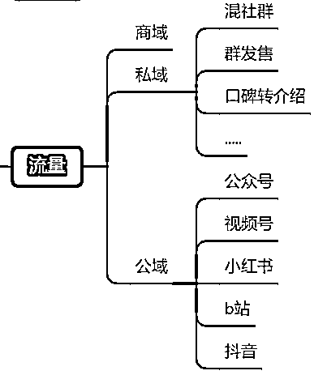

流量渠道大致分三类：商域、私域、公域。每个领域都有不少门道，这里先讲小红书引流的完整流程。

第一步，找选题。

做小红书笔记，第一步永远是定选题。选题就是一篇笔记的核心论点，是灵魂，直接决定笔记会不会爆、有没有人看。

我刚开始做小红书时，直接搬家朋友圈，压根没想过选题。结果赞藏数非常惨，连两位数都到不了。后来被老师点拨，才明白选题是要专门去找的，不能自己瞎想。

怎么找呢？一个好用的方法：去扒已经爆过的选题。我学到最重要的一句话：“爆过的选题会一直爆。”过去大家爱看的，以后大概率还爱看。

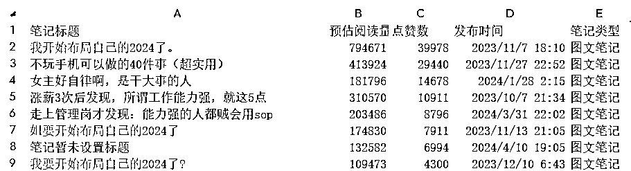

比如我扒目标管理赛道过去一年的爆款选题，前十名里，有三个和“布局2024”有关。爆过的选题果然会继续爆。

具体操作：去小红书或数据平台搜你的赛道关键词，把高赞爆款选题摘下来，然后照着做。

第二步，做笔记。

做笔记有几个关键点。首先，内容要有干货，但必须简单易懂。我本来就是长文爱好者，朋友圈动不动写两千字，公众号帖子没有完整体系不落笔，一写就上万字。这个习惯写长文挺好，但做小红书就很痛苦。以前我总忍不住写长文、堆干货、铺长逻辑，结果认认真真写出来的笔记没人看。

后来我彻底想通了：娱乐平台，通俗易懂、口语化可能比干货更重要。具体怎么做到？四个小技巧：

1. 要素要少。一篇笔记只讲一个问题，最多给五个方法；
2. 文字要短。一句话尽量缩到20字以内；
3. 多用语气词，比如“~”“呀”“啊”“嘛”；
4. 逻辑链要短，一个主题尽量100字以内说完。

其次，创作要有架构。确定了选题、懂得了文风，但不能随心所欲地写，得有结构，才能可持续地产出。高质量笔记正文，基本由三部分组成：

1. 痛点引入。开头先抛一个痛点，然后给出解决方案框架，吸引用户往下看。用户不在意你写得多用心，只关心这篇笔记能不能解决他的问题；
2. 方案解决。针对选题给方法，可以借鉴同类笔记，也可以自由发挥；
3. 引导互动。正文结束后做个结尾，可以是引导反馈的钩子，可以是引导收藏，也可以放引流模板。

这里分享我一条近两万赞藏笔记的元件。

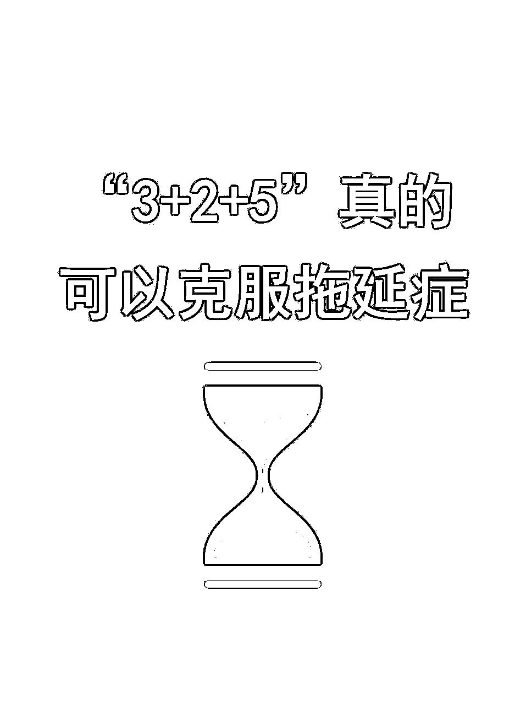

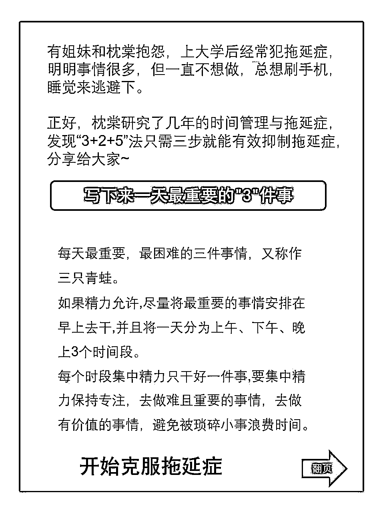

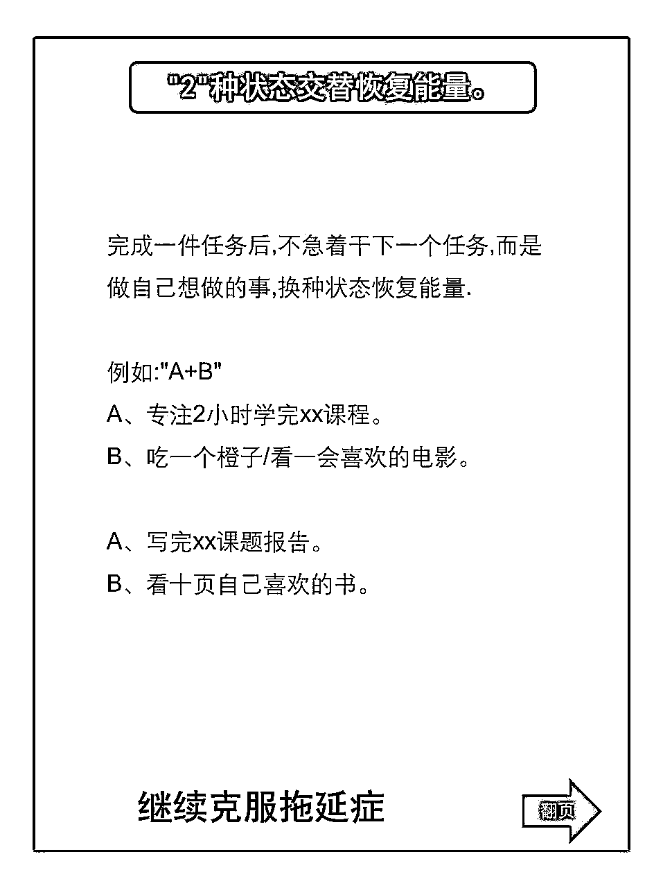

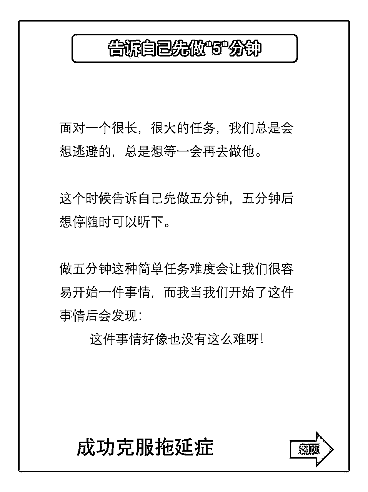

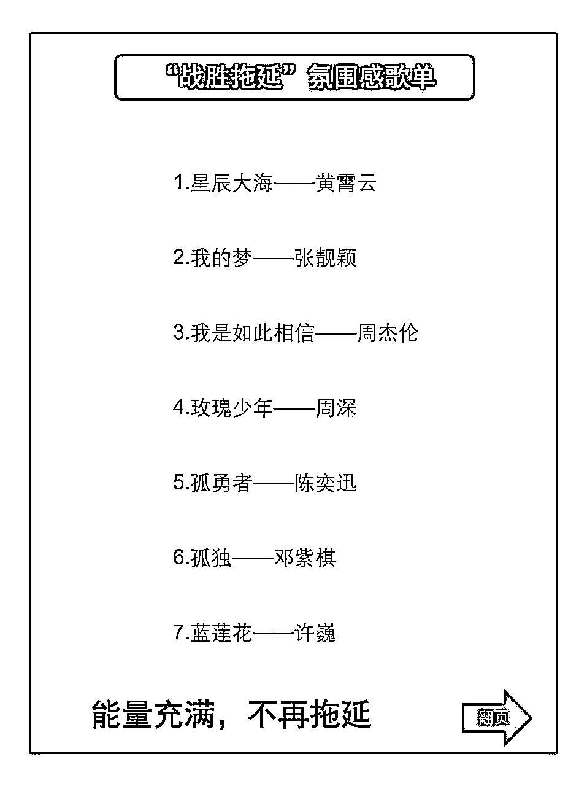

最后，引流变现。

第一招：评论区引导，制造羊群效应。按照上面的方法做好笔记、留下钩子后，用户会对你的模板资料感兴趣。但中国人普遍内敛，不好意思主动开口。这时候请一个朋友在评论区发句“求模板”，马上就会其他人跟着评论。每条评论你都可以私信，然后引流。

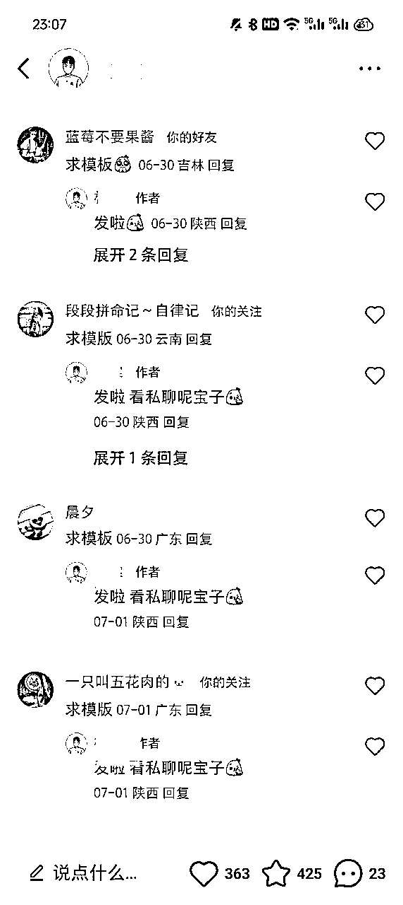

第二招：准备引流物料。说白了就是一句话：“加我领资料。”人都是利己的，不会无缘无故加微信，除非有好处。所以我整理了大量时间管理领域的资料当钩子。

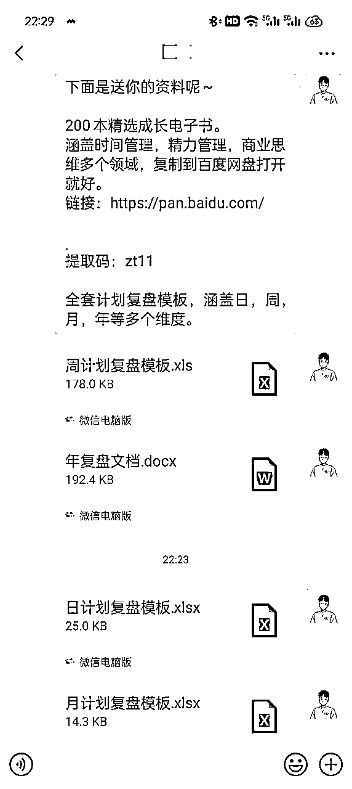

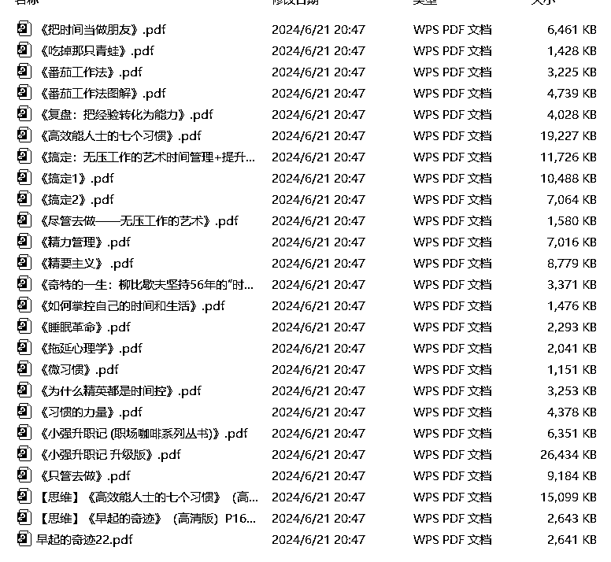

第三招：做图片汇总。把物料和微信二维码做成一张笔记图，用小号发布。

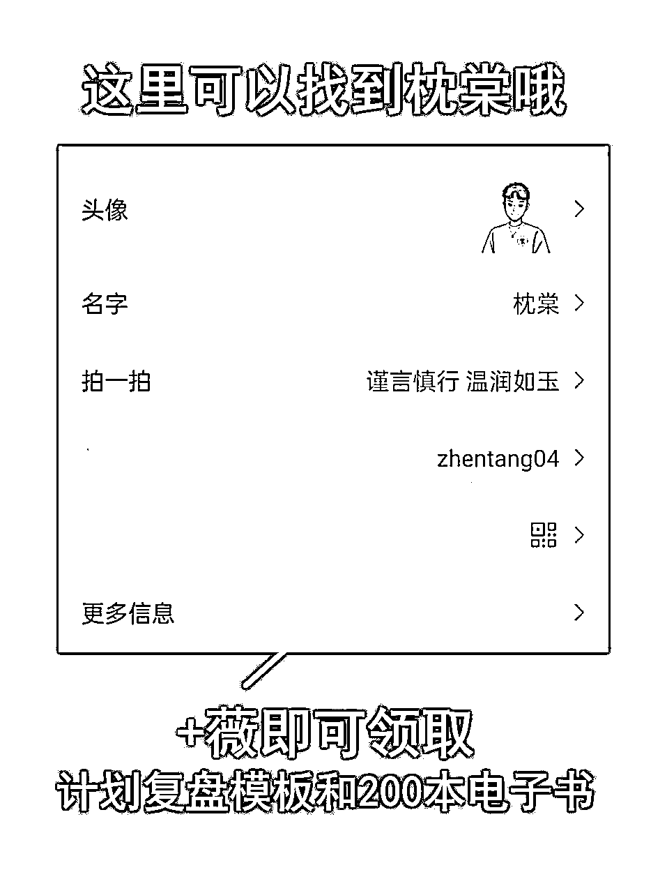

第四招：准备好物料后，在引流笔记的评论区，私信所有发过“求模板”的人。

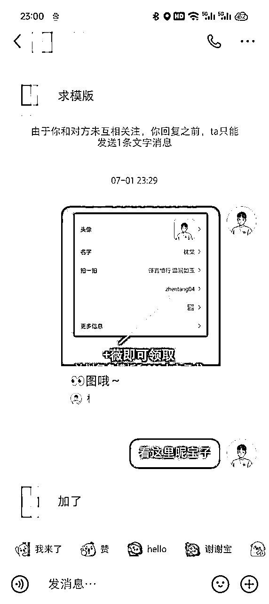

第五招：加上微信后，发资料的同时附一段简单自我介绍——“你是谁，能带来什么”，做一个初步触达和转化。

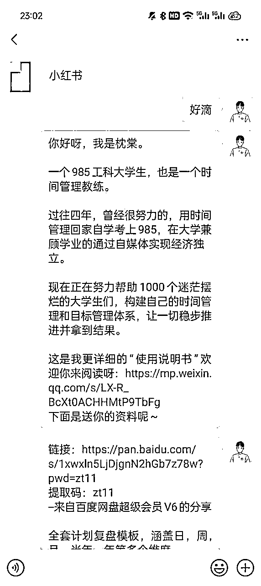

流量来了，怎么优雅地转化？

销售或者说转化有很多种方式，本质上就是让看见你产品的人产生购买欲。有一对一的私聊，也有一对多的公众号、朋友圈、直播、群发售等。

转化能力的进阶，一方面在形式：学习私聊和朋友圈以外的其他玩法，比如直播、群发售。直播是个很好的转化方式，因为它能营造场域，面对面时的表情、动作、声音，信息量远大于文字，人也容易被情绪打动而冲动下单。

另一方面在深度：学习不招人反感的成交聊天，学怎么发朋友圈。比如朋友圈要有规划，一部分发软广，一部分发干货，一部分发生活日常。

关于聊天销售、发圈、直播、群发售，圈内已经有很多分享，我就不班门弄斧了。我想分享一个做产品卖点时特别有用的价值公式，能实实在在提高转化率。

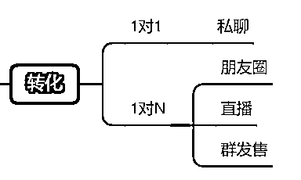

对做自媒体产品的人来说，最理想的状态是：做出一个高价值产品，用户恰好需要，你简单介绍，他就付费。

但现实往往是，你“十年磨一剑”做出一个好东西，发出去没人买。

为什么会这样？因为用户感知到的价值 ≠ 产品本身的价值。用户没听过你的课，自然不知道它有什么好。他能感知到的价值，只来自你免费提供的东西和对产品的描述。

那用户怎么感知价值？凭感觉？凭玄学？不，背后有逻辑。

做了两年自媒体，我总结出一个用户感知价值公式：

用户感知价值 =（客户渴望获得的结果 × 客户获得结果的可能性）/（获取结果需要付出的代价 × 需要付出的时间）

分子是：结果渴望度和实现概率；分母是：付出的钱和时间。想提高感知价值，就要增大分子、减小分母，由此能延伸出一堆实用方法。

增加分子，可以从两方面着手。

一是强化“客户渴望获得的结果”。具体做法：选择客户感兴趣、痛点集中的方向；把普通场景切换到极端场景。比如知识付费产品带来的改变，短期可能不震撼，但你可以描述改变后的高光画面。教小白做知识付费，别说“月入过万存款变多”，要说“其他同学在奔波投简历的时候，你一边做自媒体一边潇洒自在；其他人为一两千生活费精打细算时，你已经经济独立，去旅游、玩剧本杀、买想要的东西”。在真实的前提下，给用户一个“乌托邦”。

二是提升“客户获得结果的可能性”。具体做法：
1. 先验价值：卖产品前先给文章、视频课，让用户体验到免费内容也值钱，进而愿意买更完整的方案；
2. 自我和学员案例：展示自己通过这套方法拿到了结果，学员的成长也能增加信任；
3. 理论体系：讲清楚背后的逻辑，让用户觉得拿到结果是确定的。

关于理论体系，举个例子。我在私教文章里说过：人的行为由潜意识和意识（理性）共同决定。潜意识是不自觉的习惯，理性是认知框架思考后做的决策。想从摆烂变自律，只需要改变两件事：习惯和认知框架。

这样一来，用户会恍然大悟：哦，原来改变是可以按步骤实现的，那付费就是顺理成章的事。

定位、流量、转化，这一整套走下来，其实没有一步是能偷懒的。但只要方向对了，每一步都会让你离“既能赚钱又能成长”更近一点。

很多朋友问我，为什么我的时间管理私教能持续出效果？其实答案很简单——我做的不是“教方法”，而是通过一套套定制化的解决方案，帮用户重塑行为习惯，升级底层认知框架。一旦认知框架被打破了，改变就自然发生。也正是因为这样，我的私教转化率一直保持在蛮高的水准。

当然，无论我们讲先验价值、亮真实案例，还是搬出整套理论体系，本质上都只是为了让客户感受到一件事：在这里，他有接近“百分百”的把握能拿到结果。

**四、如何“开心地”省时间、省钱？**

再来聊聊“减少分母”这件事，拆分下来，其实可以落到两个方向上。

**a. 让客户愿意付出的代价更低**

**(1) 定价要有“对比感”：**  
给产品设计三档价格：预售价、正式价、还有标价。标价可以定得比正式价高出一大截，这样用户看到正式售价时，心里会觉得“太值了”，下单就痛快很多。

**(2) 别消耗用户的心力：**  
有些产品，用户学起来特别累。为什么？因为主理人给人感觉冷冰冰、高不可攀，用户不敢提问，只能自己硬扛，最后越学越心累。但如果我们把文字写得更温和、更亲切，用户的学习体验就会轻松很多。同样，课程大纲如果全是一堆“硬骨头”，用户一看就觉得难，也会打退堂鼓。把课纲做得直观、易懂，就能帮用户省下大量心力和认知资源。

**b. 让客户愿意付出的时间更少**

**(1) 预售也能给即时反馈：**  
比如我们要做一个课程，提前一个月就开始预售。那就可以设置成“报名后立刻领取资料包”，让用户付款的瞬间就有收获。这种即时反馈，能明显带动购买率。

**(2) 把拿结果的时间“缩短”：**  
如果我们的培养体系足够成熟，且体验优于市场上大多数同类产品，那我们就有底气告诉用户：我的产品帮你拿结果的速度就是比别人快。别人要三个月，我这边两个月搞定。

---

**七、怎么做出属于自己的产品？**

**1. 知识付费的产品，到底有哪几种？**

前面我们只讲了陪伴群，但实际上知识付费的产品形态非常多元。我整理了一个表格，方便大家对比：

| 产品服务 | 核心优势 | 明显局限 | 常见价格区间 |
|---|---|---|---|
| 一对一咨询 | 能深入了解用户需求，积累一手素材 | 时间只能卖一次，收入天花板低 | 100~2000 |
| 线上录播课 | 可重复售卖，边际成本极低 | 价值感偏弱，不容易出案例 | 99~999 |
| 训练营（录播课+社群答疑） | 能带出案例、沉淀素材，还能适当规模化 | 比录播课更耗精力，运营成本高 | 499~3000 |
| 社群 | 交付很轻 | 极度依赖IP本身的影响力 | 100~3000 |
| 私教陪跑 | 客单价高，容易出结果案例 | 交付重，占时间多 | 3000~10000 |
| 线下课、合伙人 | 我还没做过，不太懂 | —— | 5000+ |

一般来说，做产品的成长路径是这样的：

*   如果你有一项能帮到人的技能，比如我的时间管理，那你先做陪伴群——这是用来跑通闭环、体验收钱感觉的场域。
*   然后开始提供免费/付费咨询，实打实地帮人解决问题。
*   等到咨询做多了，积累了大量行业知识和常见问题，你就有底气做课程了。
*   课程卖得不错后，再考虑升单：用训练营或私教来跑出深度案例。
*   等案例出来了，IP影响力也起来了，就可以做更大的社群。

说到底，“知识付费”里，“知识”和“付费”同样重要。不同产品有不同的操作细节，但下面这个万能模型，可以帮你省掉不少弯路。

**2. 怎么做出一款好卖的产品？**

前面我们已经聊过定位，这一步咱们直接进入制作环节。但你可能没发现：**制作产品的过程，其实就是在进一步清晰产品定位。**

为什么这么说？先来想想产品定位到底怎么找。

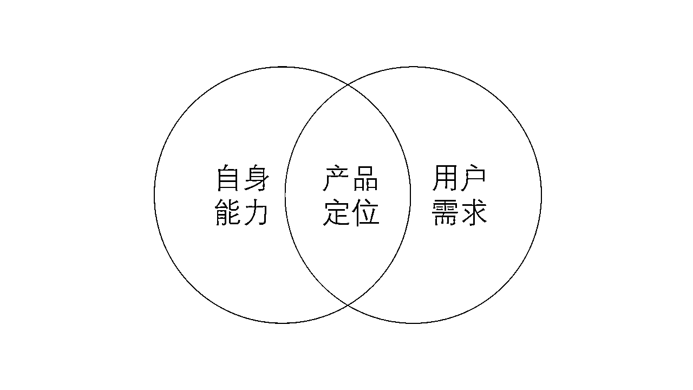

想清楚定位并不难，它一定是两个圆圈的交叉点：**你擅长什么** + **用户需要什么**。

必须在你能力范围内，是因为如果自己都不擅长，你根本拿不出真正有价值的内容；必须契合用户需求，是因为如果只是自嗨，跟用户毫无关系，那肯定卖不出去。

我们对自身能力往往有数，但对用户需求却常常是一头雾水。

那怎么判断用户需求？

先抛个问题：时间管理能力、自媒体能力、学习方法、演讲能力、英语阅读能力……这些是用户需求吗？

答案是：不是。没有人会为了“学习方法”这四个字付钱，也没有人会因为“英语能力”这个词而掏腰包。

能让他们掏钱的，永远是“场景”——一个他亲身经历过、想马上逃离的场景，或者一个他心心念念、想要到达的场景，才叫真实需求。

举个例子：没人会为“时间管理能力”付费，但很多人愿意为了“摆脱迷茫摆烂、效率低下的状态”付费；也有人愿意为了“达到自律、目标稳步推进的状态”付费。

再举例：没人会为“自媒体能力”付费，但很多人愿意为了“脱离寄人篱下、花钱抠搜的窝囊”付费；也有人愿意为了“经济独立、靠自媒体赚到钱”付费。

所以用户需求的本质就是：**脱离A状态，到达B状态。**

A状态是用户现在的处境，也是他不满意的现状；B状态是用户向往的理想，也是他不知如何抵达的目标。那从A到B的这条线段，就是我们要给方案；把这条线段走通的方法，就是我们的产品本身。

再来看个例子：

A状态：迷茫摆烂，效率极低。  
B状态：拥有自己的时间管理和目标管理体系，让事情稳步推进并最终拿到结果。  
A到B的线段：我的时间管理课、我的时间管理私教。

另一个例子：

A状态：大学时花钱抠抠搜搜，买不起想要的东西，没有底气。  
B状态：经济独立、精神独立，跑通自媒体闭环。  
A到B的线段：我的商业闭环营。

所以做产品第一步，就是**确认AB点，确认你的客群，确认他们真实的需求**。明确你要带用户到达的状态，再把这条路做成产品。

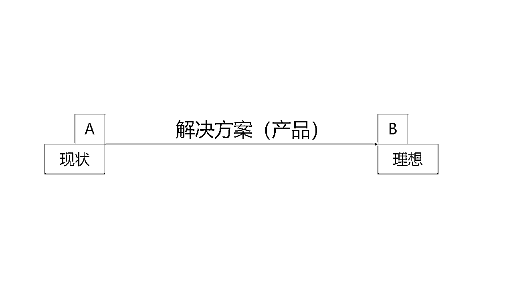

那AB点到底怎么确认？下面给出两个好用方法。

**3. 两个方法，快速找准产品定位**

**方法一：找种子客户做访谈**

动工之前，你心里其实多少会有点方向感，也知道哪些人可能对你的产品有需要。这些人，就是你的种子用户。

找到他们，聊聊天，AB点自然就清晰了。

确认A状态，可以问：
- 你最近遇到最大的困扰是什么？
- 最近最让你难受的事是哪一件？

确认B状态，可以问：
- 为什么这件事对你来说这么重要？
- 它为什么会让你这么难受？

顺便还能把A到B的线段拿到手：
- 你打算用什么办法来解决这件事？
- 你曾经试过哪些方案？效果怎么样？

**方法二：研究同行，向对手要答案**

你要是选了个好赛道——也就是投入回报比不错的赛道——别担心，那里大概率已经有一堆同行了。

自媒体圈有句老话：“同行就是最好的老师。”

我们完全可以借同行的经验，来完善自己的AB点和产品本身。

**(1) 看同行的产品文和海报**  
知识付费类的产品介绍文和宣传海报，往往是一部产品的精华浓缩。从中你能提炼出大量有效信息。比如你是做时间管理的，拆解一下我的时间管理课海报就很有用——海报上最亮眼的字眼，往往就是产品的AB点。

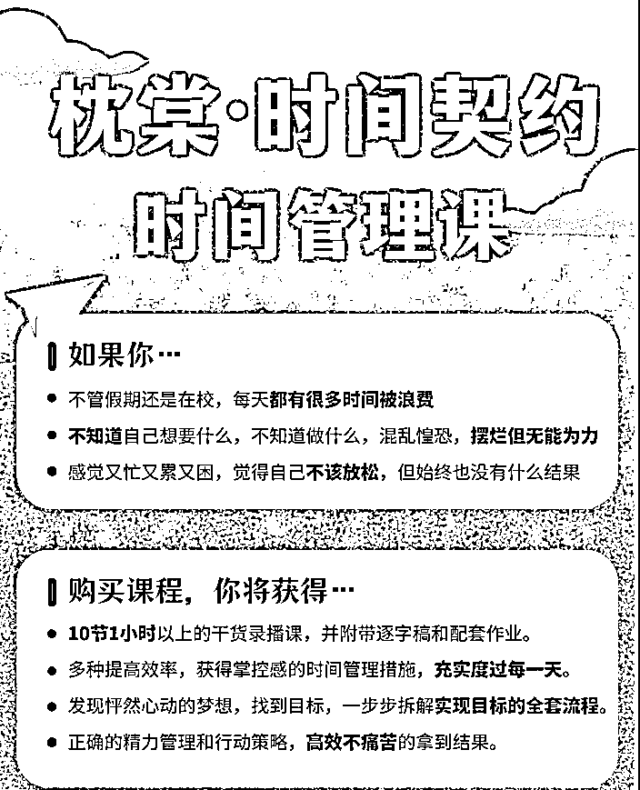

**(2) 翻同行产品的用户反馈**  
去翻同行的朋友圈、公众号，找到他们的用户反馈。然后从这些反馈里提炼：用户对什么最感兴趣？哪个点最触动他们？他们解决了什么问题，才激动地跑来写反馈？

这些就是用户真正关心的点，也是你产品开发的方向。

举个例子：

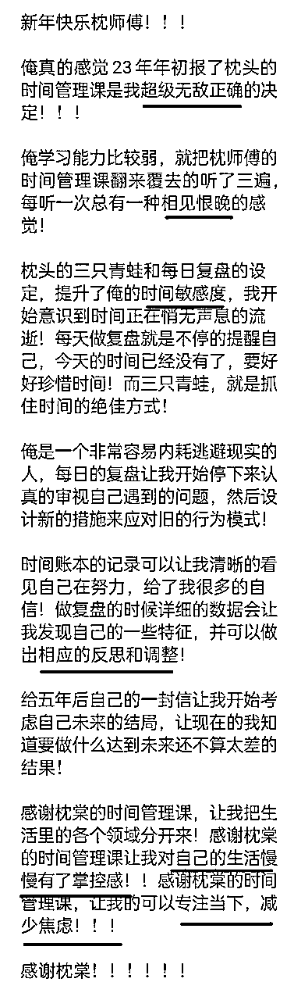

比如我的时间管理课就有这样一个真实反馈。如果你也想做时间管理方向的知识付费，这几个点非常值得参考：
1. 让人重新拿回生活的掌控感。
2. 能让人专注当下，减少内耗焦虑。
3. 提升了对时间的敏感度，明显更会抓住时间。
4. ……

看到这里，你应该也就明白了：为什么我说“找产品定位的过程，就是制作产品的过程”。因为当你把AB点想得清清楚楚之后，A、B之间的那条线段——也就是解决方案，你的心里就已经有一个大框架了。接下来，只需要把这个框架孵化成具体的产品，就大功告成。

---

**八、最后总结：认知+时间，就是一切**

我一直坚信一个价值观：

**只要方向正确，然后往里面大量投入时间，拿到结果是必然的。**

方向正确，靠的是认知，而认知靠学习；时间投入，靠的是坚持，而坚持靠时间管理和目标管理。

再细细品一下：只要我一直在学习，一直在提升认知，我就能知道什么是对的；只要我一直做好时间管理、目标管理，把时间砸在正确的事情上——那按这个逻辑，成功不过是个水到渠成的结果。

事实也确实是这么回事。

两年前，和我一起做IP的大学生朋友不在少数。当时我总担心“这一代创业者会不会卷到飞起”。可两年过去，我发现在坚持做知识IP的人，已经少了一大半。而那些留下来的，如今基本都稳定月入过万了。

两年时间，说长不长，说短不短。足以大浪淘沙，筛掉大多数；也足以让一直坚持的人拿到属于自己的结果。

因为——

**“难走的路上，从来不拥挤。”**

以上就是今天的全部干货。愿其中某一段对你有启发，祝各位生财有术！