# 《90后小白做视频号，3天冲13万，我踩过的坑你别再踩》

嗨，我是大柚子，90后，沙雕爱折腾的菇凉，现在在视频号上做带货。

我的赛道是美食混剪带货。航海训练期间，视频总数已经破百，变现gmv大概一万出头。期间除了运营老号，还另外起号两个，都是一周内就破千粉。

老号目前粉丝最高6万多，为什么粉丝不少变现却一般？因为老号主要变现集中在5月，后来因为同质化、非原创被判违规，流量掉到两三千，每天也就出点零散的小单。

航海期我把重心更多放在原创实拍美食上。

【做厨房小白还想色香味俱全，前期走了不少弯路。试了各种脚本和拍法，内容乱成一锅粥，后来重新开号，目前还在涨粉，等到1000粉再考虑挂车】

接下来重点聊聊视频号这条路我吃过的亏。

【能早点认识生财就好了，这些坑完全可以少踩】

我是4月初入局视频号，到现在多个号总gmv已超20万+，【要是能早点找到生财，可能翻倍】

先放一张我其中一个号的收益截图

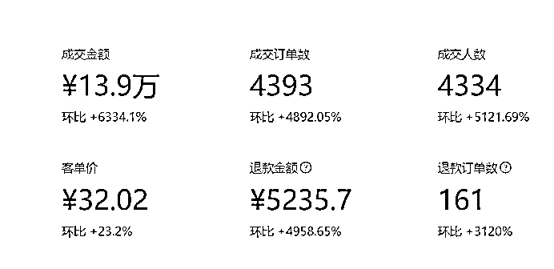

我的起号打法很直接：抄同行、抄爆款、讲究快。越近期的爆款越先抄，比如今天看到同行昨天刚爆，我立刻就上手复刻。

抄的核心是抄到爆点。拆解视频为什么火：是前三秒抓人？是钩子够强？是有争议点？还是有共鸣？

实在拆不出来就直接搬，火过的东西会再火。

靠着这种抄改结合，我拿到几条爆款。

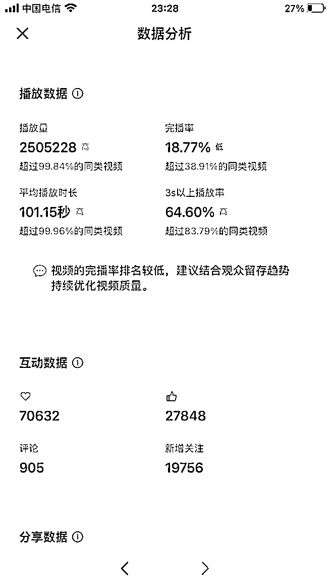

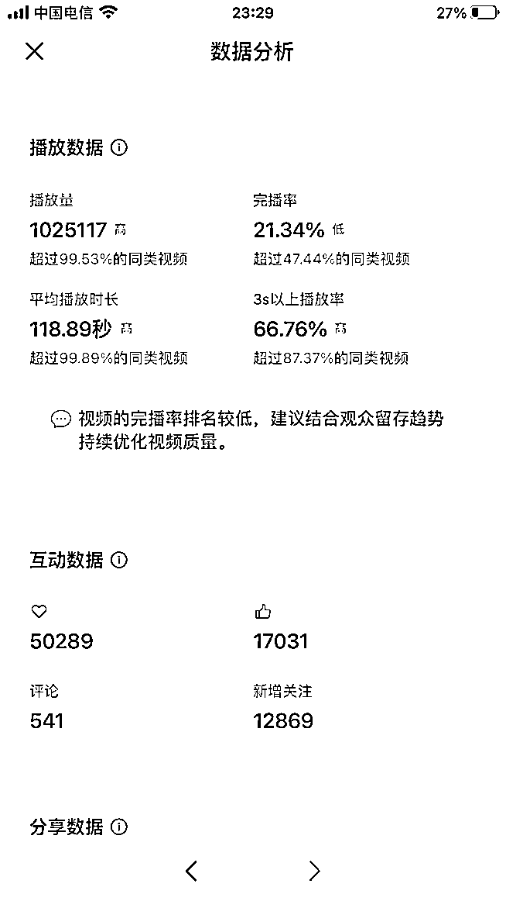

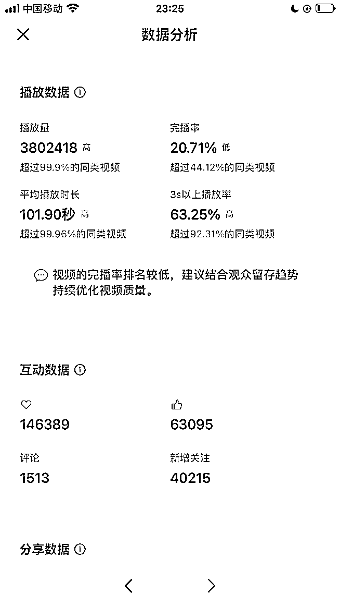

就这么一路抄，七天之内我撬动了4个千粉号，原本5个，有一个申诉原创时手滑，8条就去申诉了，号废了。【新号有流量扶持，内容过关，一条几万播放很容易上去，所以别盯着粉丝焦虑】

你以为到这就顺了？才刚开始。

1000粉后我急着开橱窗带货，结果4个号有3个直接挂车卡零播放，只有1个能挂车带流。完全懵了，【不挂车有播放，一挂车直接20播放】。我给每个号都定制了拯救方案：A号日更流量向，B号隔日更，C号停更一周。半个月过去，卡零的还是卡零，心态直接崩。

好在还有一个正常挂车的号，我就all in它，同时继续起新号。

测品阶段我也是跟着同行走，同行卖什么我上什么。挂车号慢慢有了小单，稳定了大概半个月。某天我发现一个品转化异常高，5000播放能出300块，【当时真的觉得守得云开】。确定这个品后我就死磕它。

到4月底，这个品彻底炸了。早上开播时播放才5000多，边播视频边起，直播转化同步起来。当天直接播了十多个小时，到12点多实在撑不住了才下播，当日短视频+直播共卖4.8W！

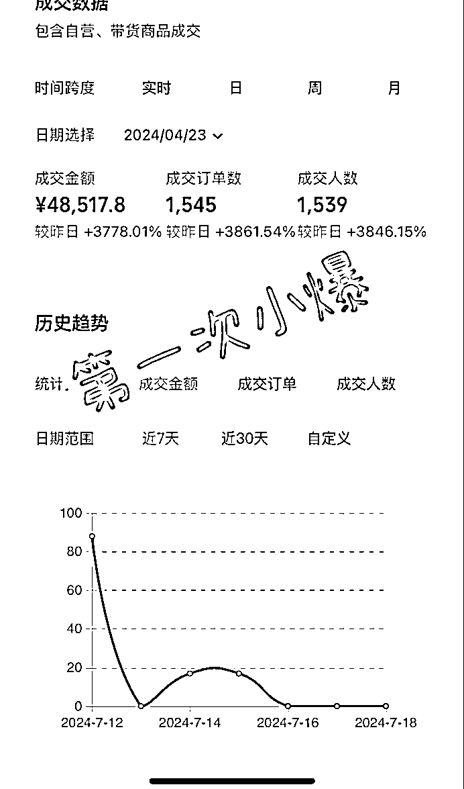

就按这个节奏连着三天走，3天合计gmv13万……

第四天流量断了，一天才卖一千多。原因是被原创作者举报，16条同时违规，开始限流了。

下面是几个关键账号的数据。

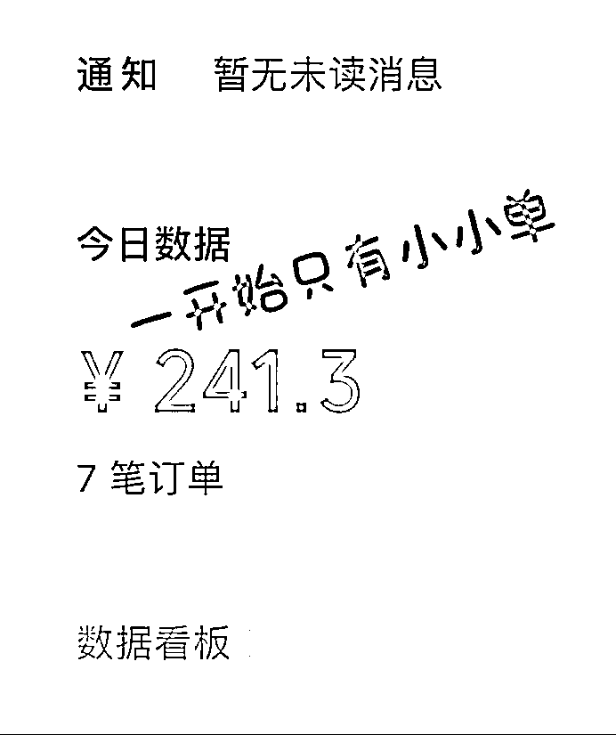

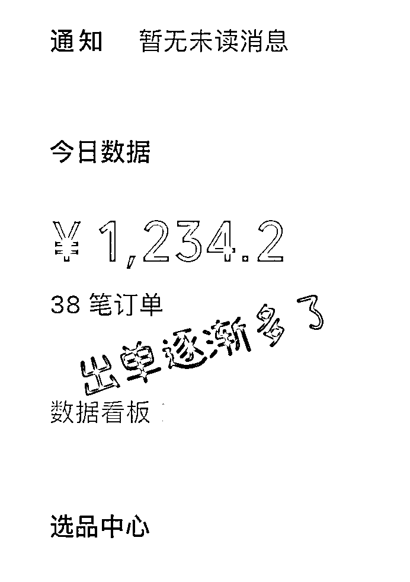

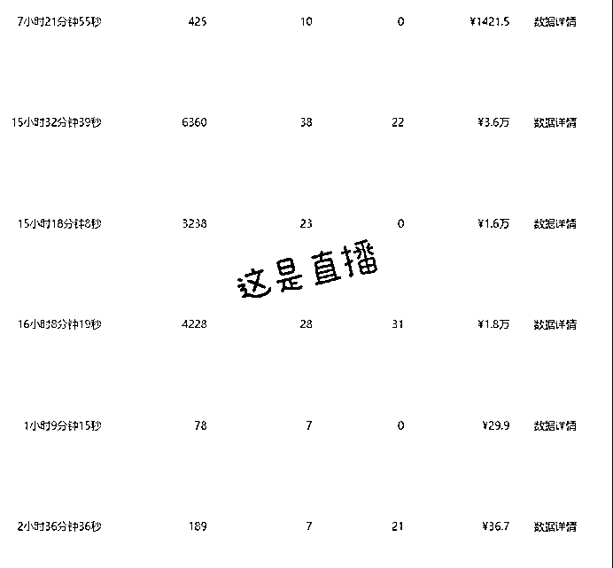

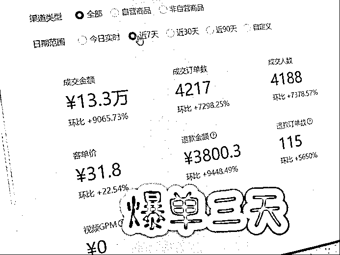

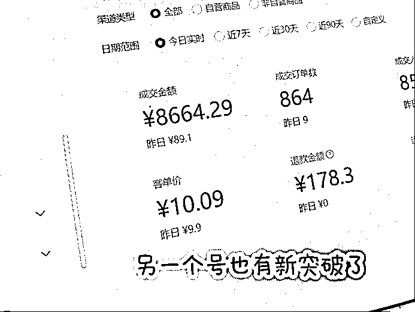

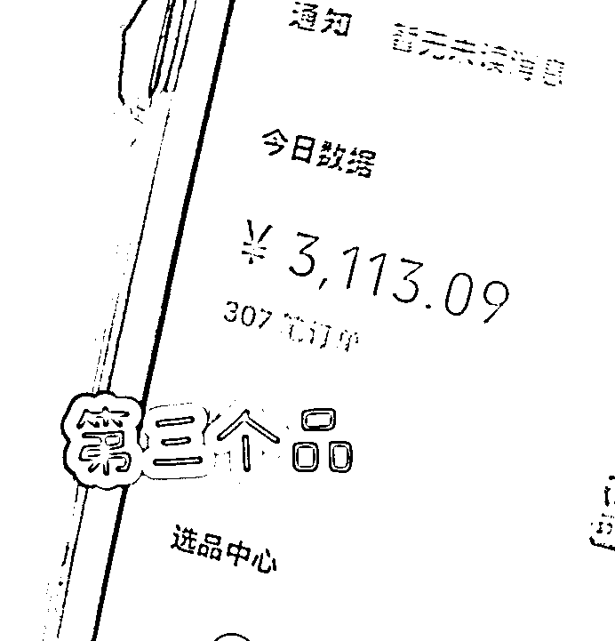

总结下我认为最核心的几件事：

1、流量来了就得死死承接住。视频号违规快，流量说没就没，必须抓住每一次爆发的窗口。
2、播前一小时发视频，播时后台定时补发，实现直播和短视频双向引流。自己播的时候根本顾不上发，所以视频要提前备好。
3、播不了就找代播。我没早进生财吃了大亏。当时号在爆的期间，另外两个新号也起来了，人手不够，没直播承接，挂车只卖了几千，至少损失了一倍的gmv。连续十几个小时直播嗓子哑了不算，还戴着钢丝牙套口腔溃疡，累到崩溃。当时下播时订单还在不断进，如果有日不落代播就好了。
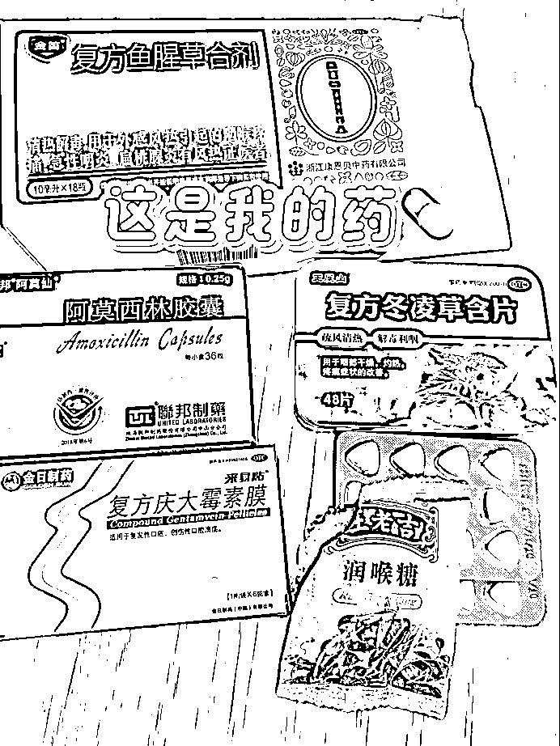
4、测品是必修课。后面我的号都是不断测试才找到匹配度高的产品。选品我一般先看同行在卖什么，再去选品中心看爆款榜，我那个爆品就是榜上有名又契合账号调性的，所以第一时间测了。
5、混剪一定要做去重。简单的镜头最好自己实拍替换。我后来的几个号爆了以后都被判同质化和非原创。细节要抠，耐心拆解爆款，瓶颈期就拉片复盘。
6、样品提前备着。我有一次播到一半样品才到，忐忑又赶上。还有的号爆品直播就卖了几千，全靠提前囤货。真没样品也可以人脸出镜+商品贴纸，或按航海手册里的操作来处理。
7、时刻盯同行。灵感要多刷，直播广场也要逛。有空就开播，不爆也当练手。我前面练了好几天才爆，状态才在线。当时朋友还说我较真，放个录音不就行了？我觉得路得自己走，首播4小时才卖9.9。
8、敢试敢错。灵感优先看视频号，但别局限。有一条爆款的灵感就来源于小红书。
9、心态。爆是常态，不爆才是常态。我摸索一个月才爆单，而且是从9.9起步。别焦虑，按手册执行总会有回报，爆了之后你会觉得之前所有的挫折都是铺垫。
10、商务一定要加。无论你带不带这个品，先加上。能要到最近的爆单对标账号做参考。我一个关系好的商务，会定期寄样品还会发爆单账号给我看。跑得好的品要主动找商务谈定向佣金，比选品中心高2%，量起来就是质变。

自己摸索会花钱买认知。我最初那几个被注销的卡零号，其实完全可以转直播承接，这些加入生财后才想明白。

航海手册+百问百答+教练答疑+志愿者+船员互助，对我来说就是王炸。我做自媒体花过不少钱，这次良心说，生财真的超值。

坑生财已经帮我们排好了，剩下的就是执行和坚持。

有问题我直接搜手册，通过航线图也能快速定位到答案。下阶段我想做实拍投流，手册里操作和注意事项都写得很细。

最后说一句：

人生没有白走的路，

每一步都算数！

乾坤未定，你我皆是黑马！

各位爆款见！

分享到这里，感谢生财，感谢各位！
祝大家爆单不断，一起生财有术！