# 0到1孵化本地生活招商品牌，一年做到千万级变现的流量复盘

> 来源：[https://avk9oq3bp6v.feishu.cn/docx/PeCBd7SwYoPyxvx5a2AcNtvcnXd](https://avk9oq3bp6v.feishu.cn/docx/PeCBd7SwYoPyxvx5a2AcNtvcnXd)

前言：

大家好，我是阿伟，抖音深耕五年的老运营。这篇笔记想复盘我和团队去年操盘的一套小餐饮技术加盟项目从0到1的全过程：从零搭建品牌，到一年累计招收1400人，变现破千万，全网总曝光破亿，且自然流视频几乎每月都能稳定产出百万播放。保守估算一年孵化了500多个同行，甚至这套打法已经帮到‘徒弟的徒弟又收了徒弟’。

下面主要拆解流量端的实操细节，以及项目从冷启动到放大结果的关键动作和底层逻辑。

# 项目总览

先简单说一下背景。2022年12月25日品牌首店试营业，三个月就把门店爆款模型跑通。投入5万开店，一年下来单店做到170万营收。等到2023年底，通过短视频矩阵加直播，一年招了1400多名学员。学员结构大概是60%有餐饮经验，40%是纯新手。

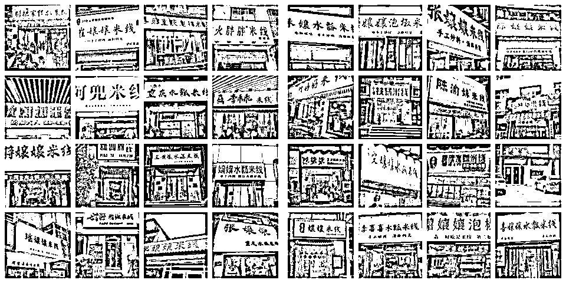

（部分门店和教学案例）

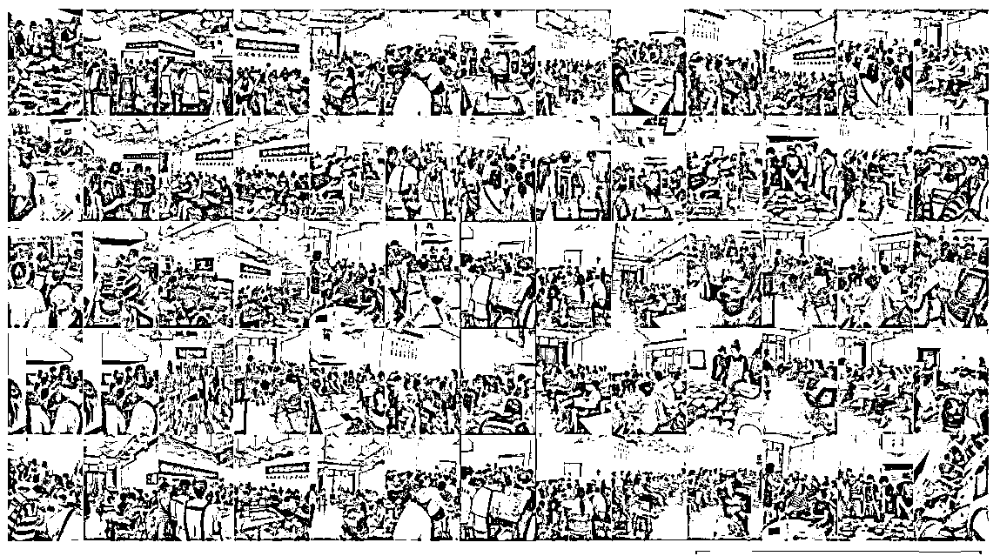

课程定价全国统一9800元，先线上付1000元定金，线下考察确认后再补齐8800元尾款。交付包含3天线下集中培训、一年线上陪跑，外加一本200多页的全流程SOP手册。交付内容覆盖技术培训，也包含加盟体系里的供应链、门店搭建、经营指导和新媒体运营指导，不过不允许用品牌名挂牌，属于技术加盟模式。

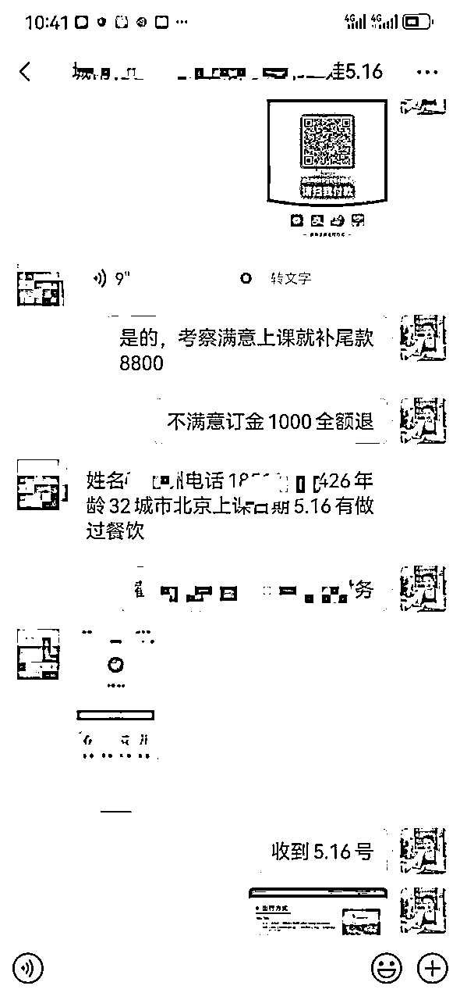

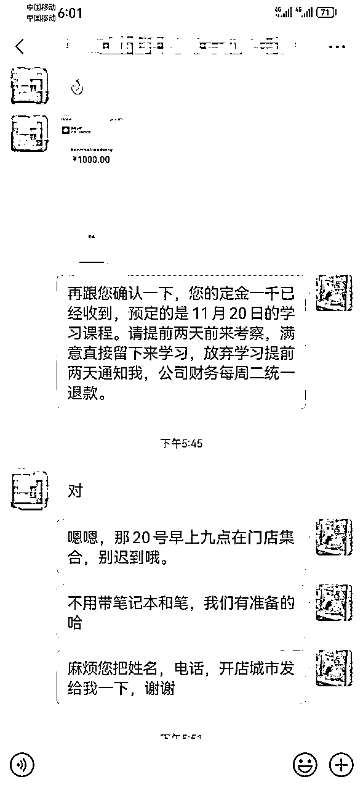

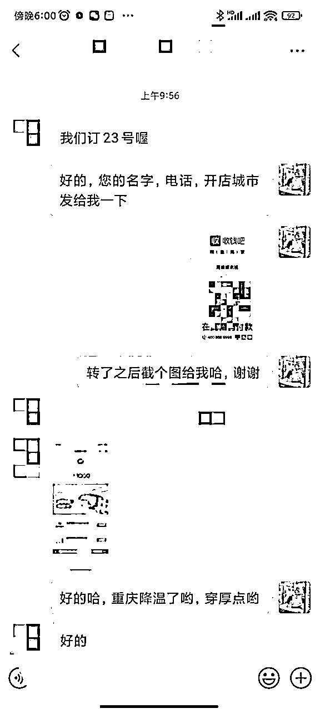

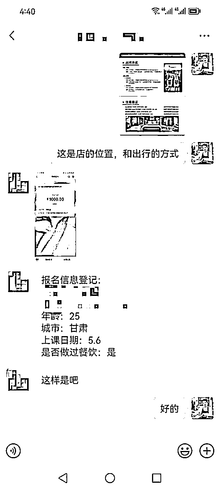

学员三天培训结束后，按SOP回去改造整店，大约一个月能完成建店，总投入通常在4到8万区间。后期门店存活率在90%左右，投入越轻，抗风险能力越强。

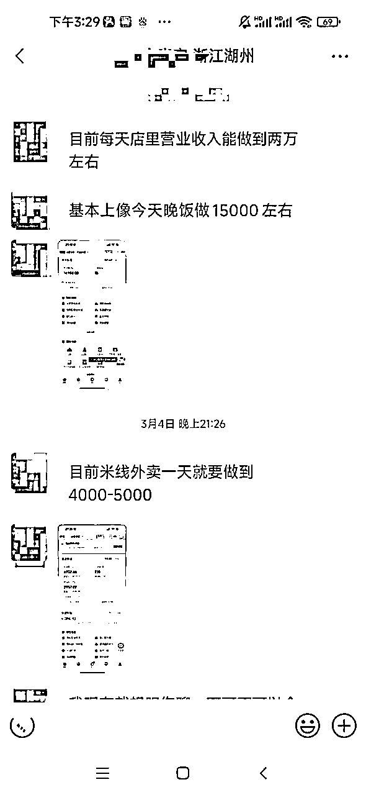

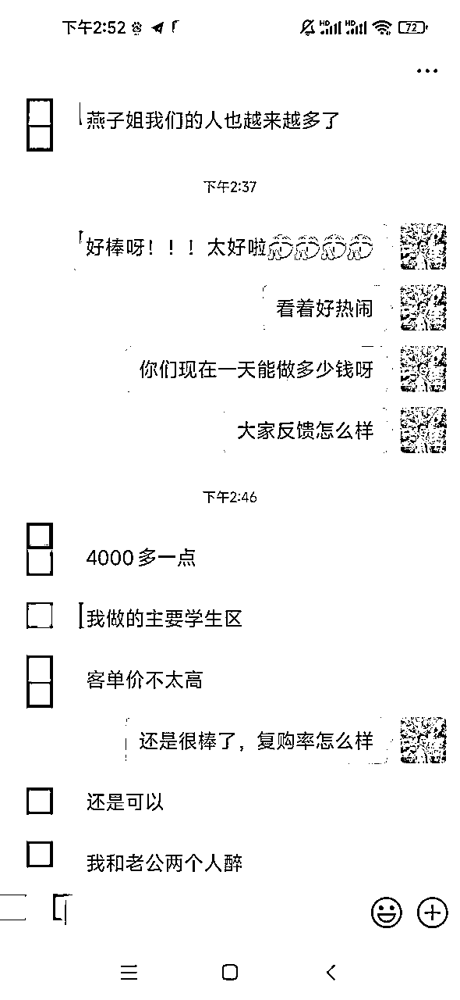

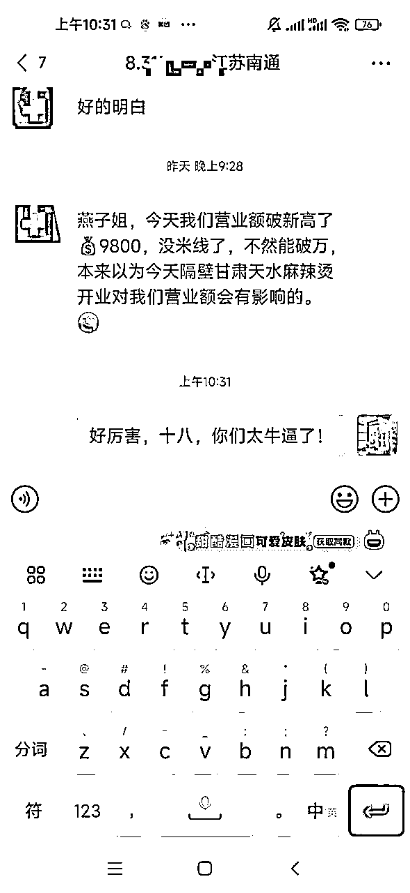

（下面是优质学员店的真实案例，并非托）

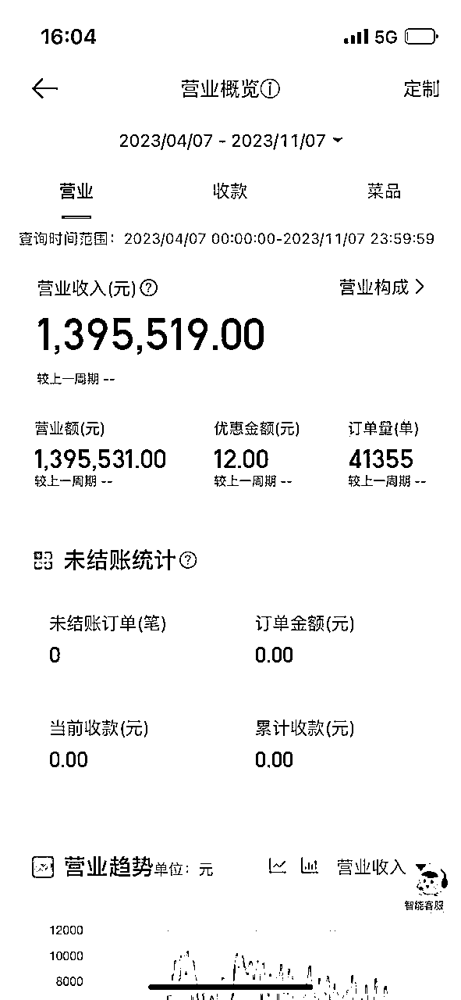

（太原店半年做到140万）

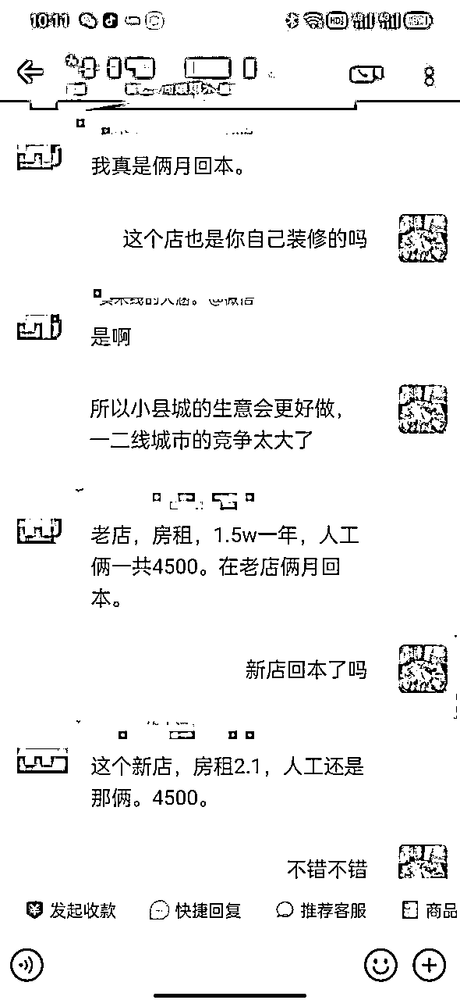

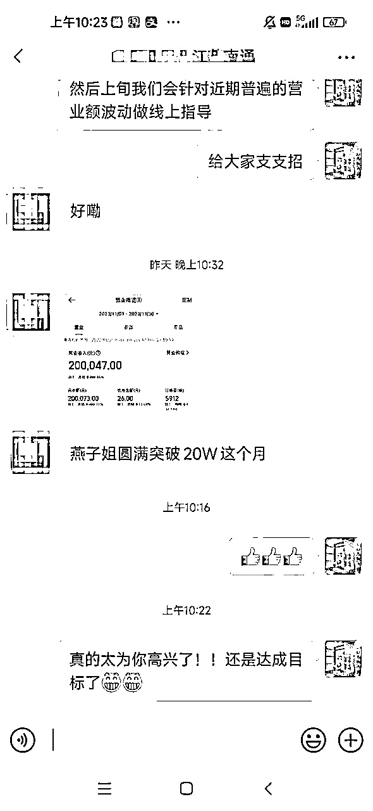

流量层面，2023年3月拿到第一条百万级自然流作品后，之后每个月基本都能稳定出一条百万播放。素材沉淀半年多后，从10月开始进入爆发期，11月单月最高拿到2万+条客资，自然流贡献占比超过90%。

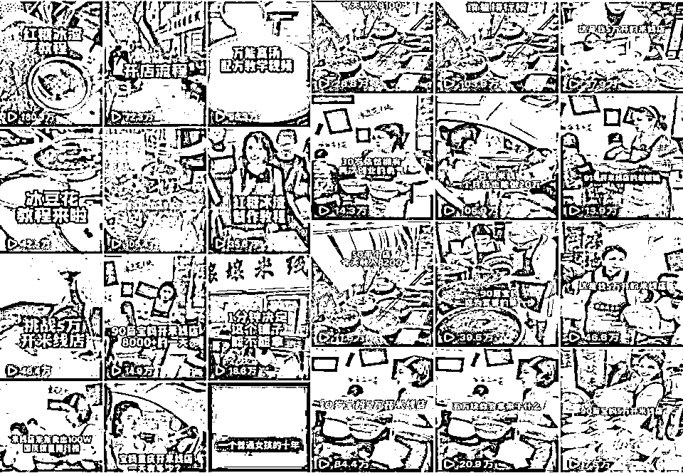

# 项目缘起

## 为什么选这个赛道

最早可以追溯到2022年12月的重庆，疫情解封后结合过往餐饮新媒体经验，我们迅速锁定小餐饮技术培训方向。判断主要有三点：

1. 宏观环境利好创业。疫情后失业增多，小成本创业需求大，餐饮门槛低，涌入的人很多。
2. 小餐饮抗风险能力强。消费降级背景下，社交型餐饮承压，刚需型小吃市场更稳。
3. 市场有现成爆款参考。当时‘林妹妹葱油饼、烈火牛肉’等账号异军突起，拆解后发现其招商转化路径很清晰。

## 细分品类怎么定

我们是从商业变现倒推来定品类的：

* 做餐饮技术加盟，就必须有一家持续火爆的线下店，品类要具备高频刚需属性；
* 招商要快速回本，建店模型就定在5万级别，且装修风格接地气，从产品到形象都要具备可视化传播力，产品还要高毛利、易复制；
* 招商具有周期性和地域性，品类还要兼顾南北口味差异，男女老少都能接受。

从几十个候选品类里筛下来，最终锁定川渝米线。

川渝米线同时满足上述条件，在短视频里表现也很好。全国推广时，地方特色还能成为加分项，很多学员会主动打上‘川渝米线天花板’、‘XX市首家重庆米线’等标签，这是后期才发现的意外红利。

品类筛选很难面面俱到，但这些点后来证明确实是成功的关键因子。

# 流量萌芽期：先做好店和产品，再谈流量

我一直认为，可复制的实体品牌起步要遵循：好店、好品、好营销。做餐饮赋能时，我们也更看重门店模型和产品竞争力。

好店看选址、装修、动线、体量，是基因级要素，后期难改。
好品看价格、颜值、差异化、群众认可度，是营销前提，可迭代优化。

## 首店爆款模型，我们做了这五件事

### 1. 选址
前后花了一个多月，最终在重庆一线商圈的三线位置拿下50平米。

选一线商圈是因为人流大，能突破小餐饮三公里辐射限制。
选三线位置是因为租金低，能讲清楚5万开店的故事，且新媒体推广后导航能精准带客。

### 2. 低成本装修
旧乳胶漆+手写菜单+旧报纸+3块一把的胶皮凳，营造老居民楼质感。

低成本装修降低顾客心理门槛，显得便宜又正宗，同时给内容包装留出空间，我们对外统一口径‘5万内开整店’，后期很多三线城市学员确实用5万内开起来了。

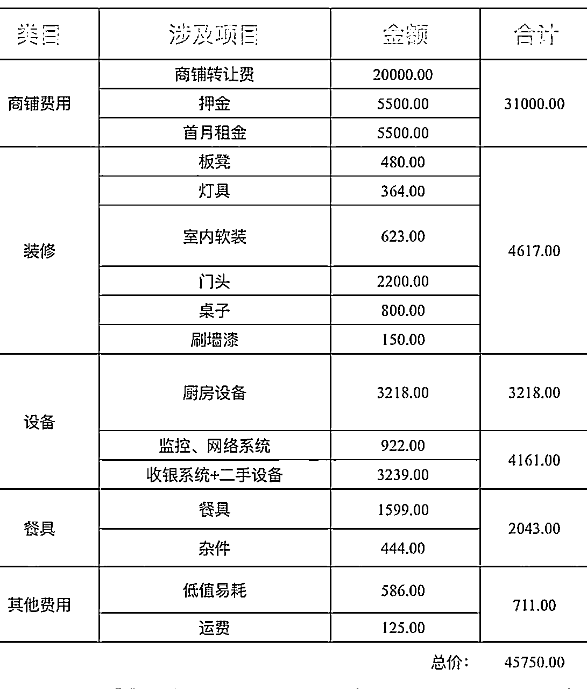

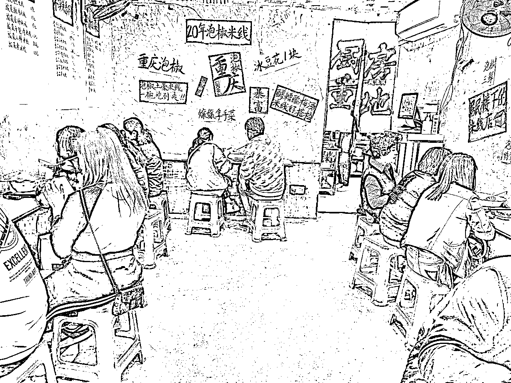

便宜不等于粗糙。我们在细节上讨好年轻群体，手写文案、趣味软装都有设计。铝材质水瓢容器搭配泡椒红油米线的高颜值，促使用户自发传播。

### 3. 上线1元引流品
互联网营销离不开引流品。把火锅店的甜品引流逻辑搬到米线上，就是降维打击。冰豆花1块一份，进店必点，开业以来每天限量百多份，天天售罄。

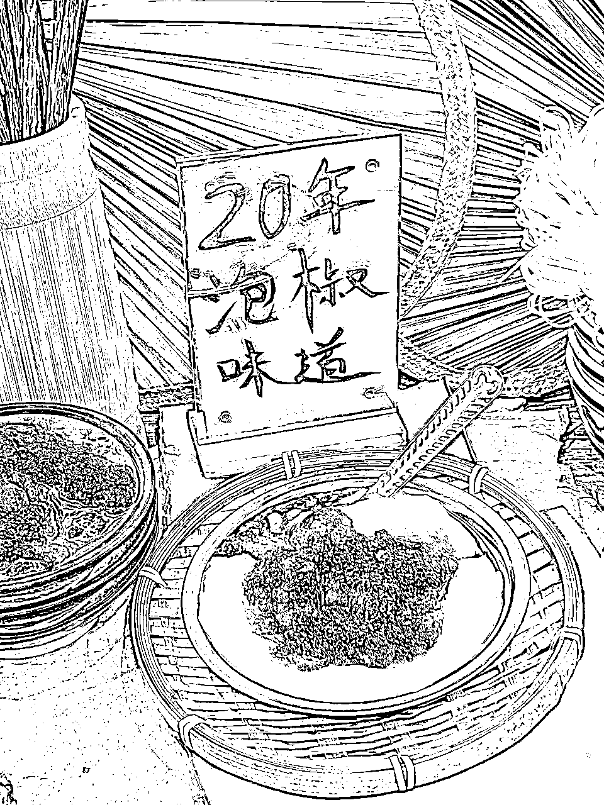

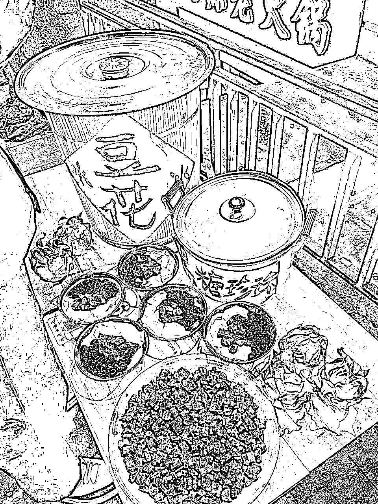

米线均价在21元左右，在降级期略高，需要保持6-7成毛利，对招商有吸引力。人手一份1元单品，既提升套餐价值感，也拉高复购。

### 4. 不做团购，只做内容
团购会拉低客单价，且买完低价就不复购，对想做招商的品牌是致命伤。而且自助点单系统下核销成本高。

所以门店从未做团购，全部靠特色新品和短视频做拉新复购。

### 5. 爆品：2-3人份68元豪华米线
堂食翻台稳定后，提升营收的唯一路径是抬客单。门店不打价格战，保持8小时营业。

68元的土豪米线，主打分量足、荤菜多。外摆路人看到走不动，顾客上桌忍不住拍照。推出后，日堂食营收从3000涨到5-6千，外卖再加1-2千，店里天天排队，配了8个人手。

有人说50平米卖米线月入20多万不现实，若再说纯利四成更是天方夜谭。若再补一句：这家店只花5万开，且不止一家，别人生意更猛。整个市场就炸了。

评论区上千条互动常态，褒贬参半。最关键的是，这套说辞经得起来店考察，客户实勘后销售能淡定回应‘嗯，这很合理’。

后来同行纷纷复刻，我们每月在土豪米线基础上推出新款68元产品轮换，保持新鲜感，日营收稳定在7-8千。

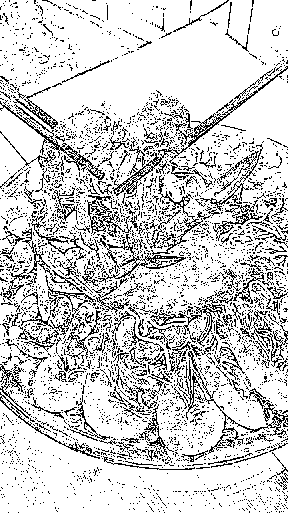

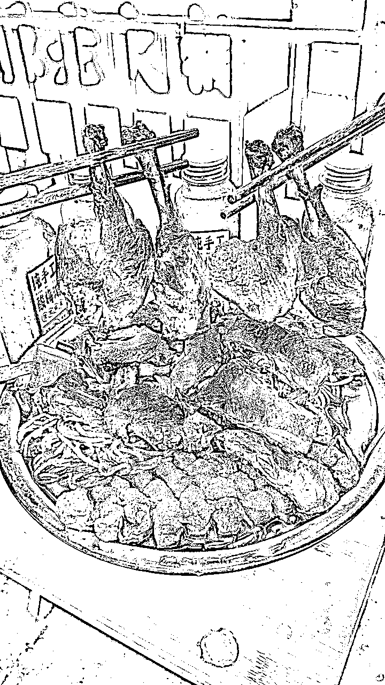

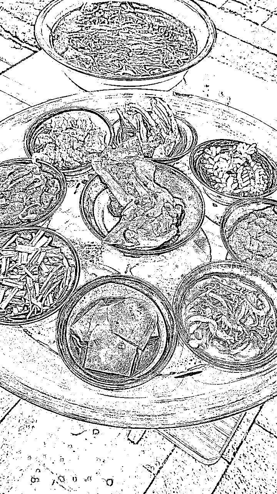

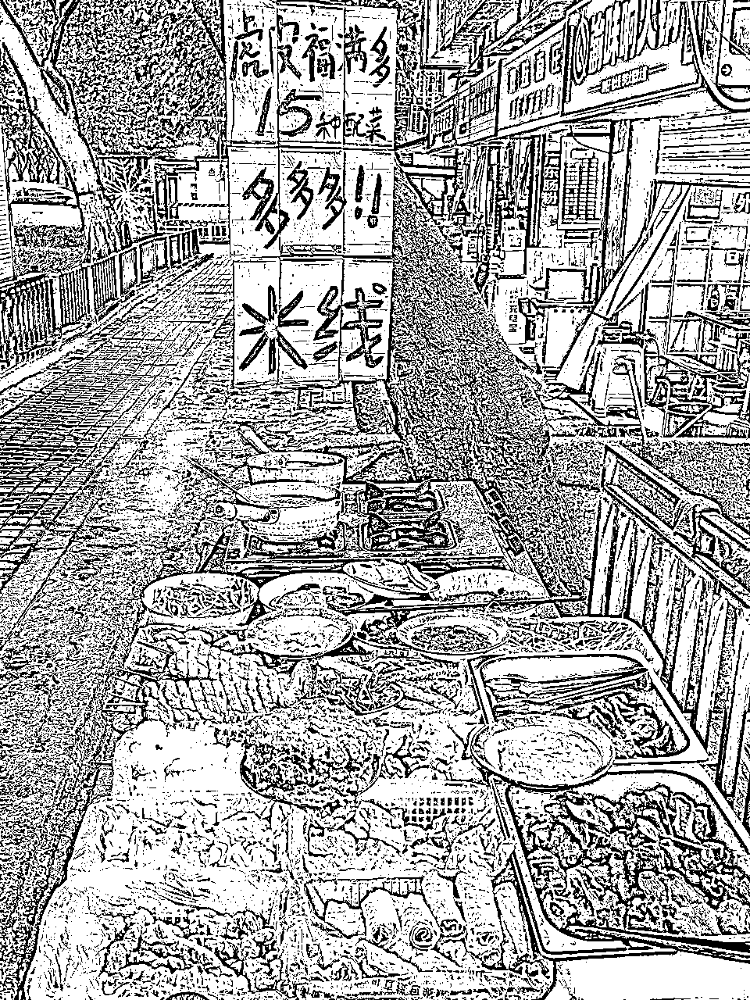

这就是爆品赋能品牌，再经新媒体放大后的效果。

# 流量起步期：内容深耕，多平台试水

有门店模型后，商业模式就成了一半。接下来就是流量获取和转化。

内容也要从0冷启动。跟着门店从选址、选品、硬装软装一步步记录，原创度高、有连载感，天然适合涨粉。生意不好时就讲问题、打磨产品，对外说试营业，同时雕琢IP属性，培养团队对行业和用户的理解。

我们同步在抖音、快手、小红书、视频号全平台分发测试，前期成本低，上限高。

营业第一个月我们就成交十几个学员，实现自负盈亏。几个关键动作：

### 1. 编导下沉到培训现场
内容越贴近消费者越容易成功。培训现场是学员集中、痛点集中的场景，内容团队能直面感知需求，反向优化内容。让内容更打动人。

### 2. 主IP下店，从真实老板娘出发
IP必须真实。亲力亲为既是低成本建店的一部分，也锻炼了IP感染力。起盘第三个月，门店模型未完全跑通时，账号就已拿到第一条自然流百万作品。

# 流量上升期：矩阵化+低成本直播

内容到了一定阶段，尽头是复制。找到爆款后，两种选择：复制一次爆款模型，或复制一百个成功账号。

复制模型需注意节奏。同一周期作品要分类：流量型、人设型、转化型要有序发布，单一模型吃不遍天下。

于是启动矩阵号。IP一致，素材库互通，换文案、换剪辑做降重。起盘第五到六个月起，先后做了十几个小号。统一口径高频出现‘日销8000、月入20万、5万开店、1000块软装’等信息，形成洗脑式记忆。粉丝观望期拉长，成交周期不一，但反馈普遍好。

同时把直播纳入矩阵。白天半录播矩阵，定期换素材即可。晚上主号直播连线粉丝，平均一场能收三五十个客资，且转化率高。

为什么起盘期不直播？因为IP需要粉丝沉淀和内容打磨。精力从门店到短视频再到直播，是老板娘人设沉淀—内容表现力打磨—直播变现的递进过程。

# 流量波动期：自然流+付费流混合

2023年下半年，矩阵号批量上线，限流问题随之而来。一方面招商要导私域，成果晒多了有炫富和引导创业嫌疑，长期在平台边缘试探；另一方面小红书新规要求站外引流必须搭配薯币和聚光投放。

我们从纯自然流转向自然流+付费混合。投放以赛马机制筛选能过审且转化高的作品。

转变后，付费流带来稳定客资增量，同时保障私信导流安全。矩阵复制+直播+付费三重加持，品牌进入腾飞期。

# 成交井喷期：重复做对的事，精细化迭代

跑通矩阵模型后，内容组每天做两件事：复制内容、复盘迭代。并持续从同行作品吸取文案灵感融入自身模型。

### 1. 平台差异化微调
货架类平台更看重封面和标题，我们建立了爆款标题库和封面库。不同爆款模型在各平台表现差异大，复制周期和发布节奏也要调整。遵循连爆原则：一个内容在平台爆了，同类内容和账号在短期内更容易连爆。数据好的平台就加大倾斜。

### 2. 前5秒画面文案强钩子
要求每条开头5秒全是已验证的爆款镜头，文案重人群钩子。建立了开头像库和爆款画面类型档案。新人能快速上手，老成员可在此基础上精进创作。

# 三大核心壁垒

## 1. 用新媒体可视化逻辑建店
流量转化靠视听语言。场景打造第一位。

建店时就考虑拍摄角度、直播机位、动线布局；门头灯光色调、软装；餐具容器、菜单设计、爆品形态。门店第一天开业，流量就赢在起跑线。

网红店不是贬义，可视化强、利于自传播、契合算法，是我们和同行的核心差异。

## 2. 团队从简到奢，有节奏加武器
项目起步是单号运营，编导一手抓全流程。矩阵号、直播间、付费投放都是后期逐步加。操盘手要把握节奏，过早亏本，ROI算不过来；过晚流量掉坑，号可能就没了。

2023年一年封号十个左右，现存账号都经历过至少一次限流。内部整理的《账号/视频违规案例及应对办法》很有用，避免重复踩坑，也成为学员培训资料。

## 3. 持续学有结果的人，接受交智商税
机会成本大于一切。起盘期操盘手到编导、直播运营，每天大量对标，每周集中拆解爆款，每月深度拆解一个结果好的同行。

流量端拆IP设定、账号运维、选题、镜头、结构；转化端卧底当学员跑完交付全流程。有价值就果断投钱买教训。

说实话，这套打法带来的回报很难用具体数字来丈量，但回头看这一年，团队确实从中受益不少。更关键的是，复盘时我们发现，有几回险些撑不过去的关口，恰恰是靠着那些外部团队沉淀下来的方法论和资源，才硬生生挺了过来。

站在今天的视角回望这套商业模式，它的亮点其实很清晰：

**一、试错代价极小，上限却高得惊人。**
新媒体的想象空间不用多说。我们当初起步，账上不过10万启动资金加5万备用金，绰绰有余。三个月内盈亏打平，就能进入长期稳定经营；技术培训的边际成本几乎可以忽略不计。只要踩中一波红利，起飞就是一瞬间的事。

**二、从零到一的全流程，处处可复制。**
从店铺启动到流量冷启动，我们反复验证过无数次：爆款不是玄学，是可以被拆解、被复制的。顺带提一嘴——我们随课附赠的那份全流程SOP手册，居然有人在二手渠道转卖到两千多块。这个价格本身，就是这套模式含金量和落地性的最佳证明。

**三、换个赛道，依然能打。**
这套玩法不仅适用于糖水铺、甜品面包店、特色小吃（比如麻辣鸡、酱板鸭），也能无缝嫁接到各类地方风味的粉面馆（螺蛳粉、陕西面馆都行）。更进一步说，凡是注重场景体验、又具备技术培训体系的行业，比如芳疗馆、头疗店，也完全可以拿来参考。

当然啦，如果你有不同的行业经验，或者有更妙的点子，欢迎评论区不吝赐教，咱们互相补补课。