# 从推荐机制到变现玩法，📕运营看这一篇就够

嗨，我是叁斤，专注📕四年。这些年我运营过上百个账号，好物分享、电商、个人IP、品牌企业号、聚光投放都试过，几乎所有变现模式都跑了一遍，现在主要深耕个人IP方向。今天这篇，我把📕运营的入门干货一次性整理给你，从推荐逻辑到赚钱路径，再到内容类型，全程无废话。

## 一、📕是怎么把你的笔记推出去的？

先看大流程：笔记发布后通过审核，就会进入平台的数据库。用户打开或刷新App，系统从这个数据库里“捞出”大量候选笔记，接着用粗排、精排、重排几轮算法筛选，最后只把一小部分展示到用户首页。

这里面真正值得研究的是“召回”——也就是笔记被捞出来的过程。粗排、精排、重排基本是算法内部机制，搞懂了对运营帮助也不大；召回规则才直接决定你的笔记能不能进入候选池。

### 老笔记的三种召回通道

**1. 笔记相似度推荐**

用户喜欢某篇笔记，系统就会找和它相似的其他笔记推给用户。判断相似的方式包括：看过A的人也看过B、给A点赞的人也给B点赞、两篇内容的受众重合度高、标签重合度高。但要注意，小圈子里几个人互赞互点，不能证明两篇笔记真的相似；转发到群里求赞，反而可能弄乱账号标签。所以找对标笔记时，别直接照抄大爆款——点赞过同类内容的人，可能已经对相似内容免疫，不会再给你点赞。

**2. 用户相似度推荐**

系统发现A用户和B用户兴趣高度重合，A点赞了一篇笔记，B还没看过，那这篇笔记就很可能推给B。判断依据是两人的点击、点赞行为重合度，以及关注作者重合度。这对运营的启示是：先把目标用户定清楚，再围绕他们做选题，或者把爆款选题换一个角度写，公式化操作也能拿到不错的数据。

**3. 作者推荐**

用户关注了某个作者，作者新发的笔记会被优先推给他；用户和某篇笔记互动过，这个作者的其他笔记也会被推给他；如果A作者和B作者内容风格相近，用户关注或互动了A，B的笔记同样会被推荐。这也是很多人采用“80%干货+20%营销”笔记配比的原因——干货先拉流量，让看过的人有机会再刷到你的营销内容。

### 新笔记怎么获得推荐？

新笔记几乎没有历史数据，所以平台会额外照顾：

- **类目与关键词推荐**：账号平时常看的类目、常搜的关键词，会成为系统匹配新笔记的依据。
- **聚类召回**：用户互动过某篇笔记，平台会继续推类似主题的笔记，比如搜过“裸辞创业”，之后就会收到大量相关笔记。
- **保量推荐**：新笔记数据不足，直接和老笔记竞争肯定吃亏，所以平台会给新笔记保量曝光。内容越优质，保量目标越高。如果一段时间内曝光不达标，后面会加大推荐概率；如果曝光太快，后面就会减少扶持。历史笔记质量高的作者还有额外保量，但有上限。

需要清楚：保量保的只是曝光，用户点不点、有多少人点，最终拼的还是内容质量。

### 这些规则给运营的启发

- **养号不是刷内容**。整天刷同类内容，养出来的只是你的“兴趣标签”，和笔记标签是两回事。真正有用的养号，是持续发赛道相关的优质内容，或者发点互动类内容测试账号是否限流。
- **发笔记前先明确目标**：选题清晰、受众清晰，标题、正文、图片、视频里埋好关键词，图片上的文案也别省，能帮系统快速识别。
- **在内容里埋互动刺点**：想要收藏，就多写干货；想要评论，就多提问、说半句留扣、或者制造一种“我们是一边的”氛围；想要点赞，就营造美感、展示自己厉害的地方、结尾来句金句。
- **保持稳定更新**。笔记超过一个月后基本不再被召回（搜索除外），持续产出优质内容，新笔记拿到的保量也会更多；如果保量目标提前完成，保量结束，后续就要靠正常通道和老笔记竞争。
- **垂直的是人设和价值**，不是死磕单一类目。比如穿搭和美妆可以同时做，因为它们都是帮女生变美；只要你的人设和价值是垂直的，用户依然会喜欢你。
- **互粉互赞对推荐没用，发布时间的影响也可以忽略；没有人设支撑的话，内容跨度别太大；对标笔记别直接抄。**

## 二、📕的变现路径，归根结底就两条

几乎所有玩法都能归结为：拿着产品找流量，或者拿着流量找产品。

### 路径一：拿着产品找流量

如果你有自己的产品，就去📕上找目标人群。这个平台月活2.6亿，一半是95后、三成是00后，一二线城市用户占50%，男女比例3:7，消费力也不弱。常见的落地方式有两种：开店卖货、私域引流。

### 路径二：拿着流量找产品

没有产品也没关系，先圈住一群人，再根据人群去匹配产品。

- 卖别人的产品：接品牌广告（按报价收钱），或者做CPS带货（按销售额拿佣金）。
- 卖自己的产品：找货源开店，或者做知识付费、社群服务。我自己就是先吸引了对📕感兴趣的人，再给他们做课程。

落地方式主要有三种：接广告、买手带货、私域导流。

### 四大主流变现玩法

#### 1. 电商卖货

📕开店不需要粉丝门槛，只要开通专业号、完成实名认证，就能开个人店。流程是：确认货源→注册账号→认证店铺→上传产品→发产品笔记→出单→发货→确认收货→提现。平台现在正在严打“无货源代拍”，没有稳定货源的，一定要找靠谱供应商，至少能提供电子面单，否则容易封店。

#### 2. 私域导流

📕对导流的打击力度，在全平台里数一数二。现在连发布专业知识科普都需要资质认证。所以引流难度确实变高了，但反过来说，竞争门槛也挡住了很多人。至于具体怎么导，这次先不展开，后面我会单独写一篇。

#### 3. 广告变现

账号和笔记有曝光，笔记里又有“广告位”，商家就会主动找来。站内走蒲公英平台：1000粉丝就能开通，报价一般能报到粉丝量的10%左右，平台也会参考同行报价和近期数据给你建议。站外私下接广虽然方便，但现在风险很大，容易被限流或降蒲公英等级。能走平台就走平台；一定要私下接的话，做成合集，写软一点，别露出品牌名。

#### 4. 买手带货

最近一年，平台把流量扶持重点压在了买手方向。买手说白了就是带货分佣的人设，可以通过笔记或直播带货，门槛是1000粉+专业号。流程大致是：注册→做到1000粉→认证买手→在合作中心选品→做笔记或开播→挂链接→用户购买→分佣→提现。

### 买手型博主怎么起步？

几个关键条件：

- **垂类IP**：购物分享型或专家型都行，目的就是让特定人群关注到你。
- **真人出镜加上口播干货**：买手和普通带货的区别在于，用户是信任你这个人、喜欢你的审美才买单；不出镜，信任感就很难建立。
- **人设立体**：既要有专业和审美，也要有生活化的一面，别做“工具人”。
- **人设独特**：有鲜明观点和高辨识度，才能让人记住你。

两条落地路径：

- **分享型IP**：产品先自用，再用真实感受种草，门槛低、谁都能做。
- **强专业IP**：有专业背景加持，比如医学毕业讲护肤、中医背景谈养生，变现能力更强。

### 两种赚钱账号逻辑

**摆地摊逻辑**：相当于把地摊搬到线上，把产品摆出来叫卖。典型的是书单号、好物分享、普通薯店。优点是见效快、内容成本低；缺点是纯体力活、没有积累、流量波动大。运营上要放大“快”和“省”的优势，不去纠结点赞涨粉，直接做转化；出了爆文赶紧复制；同时用矩阵号抗风险，适当投点付费流量。

**买手店逻辑**：这就是个人IP玩法，可持续性更强，也是平台主推的方向。优点是选题自由、粉丝粘性高、流量稳定、转型容易；缺点就是见效慢，对个人综合能力要求高。运营时忘掉产品，把📕当社交平台，不断给用户提供价值——有专业就分享专业，没专业就分享进步、人品和想法。但注意，选题可以自由，人群和提供的价值必须垂直。

## 三、常见笔记类型，一篇分清

📕内容生态很丰富，下面这些类型在各赛道基本通用。

### 1. 种草类

直接推荐产品。难度2星，变现2星。优点是制作简单、适合批量做、方便组矩阵；缺点是人设弱、起号难、内容很难做出特点。

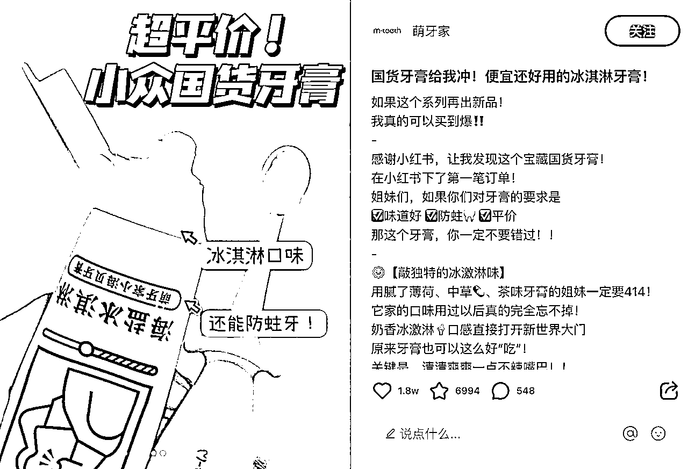

### 2. 攻略类

分享旅游、购物、穿搭等攻略。难度2星，变现3星。优点是好吸引互动，也能给个人故事加分；缺点是制作难度稍大。

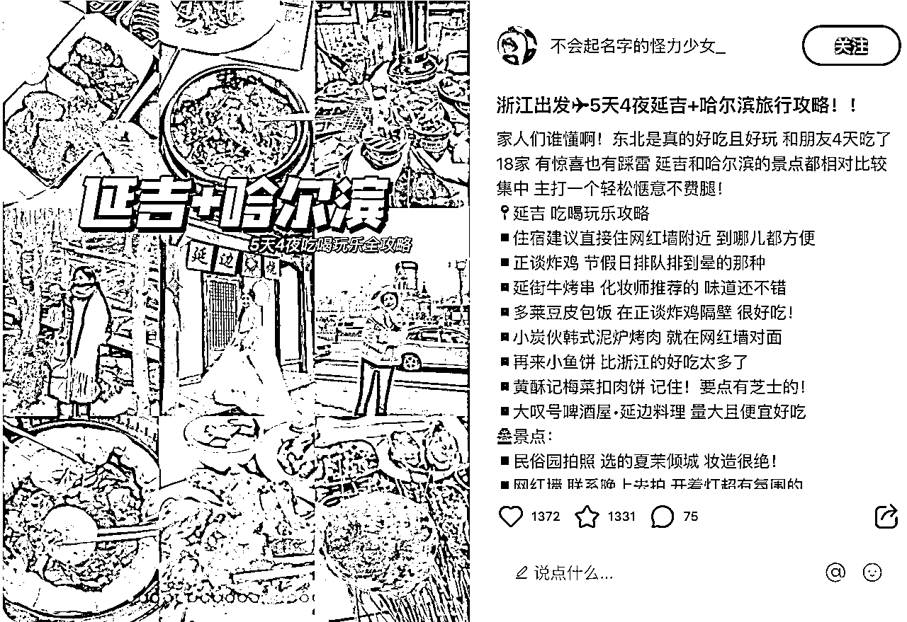

### 3. 解决问题类

专门解决用户的一个具体问题。难度3星，变现3星。优点是内容容易吸睛、变现空间大；缺点是问题容易找不准。

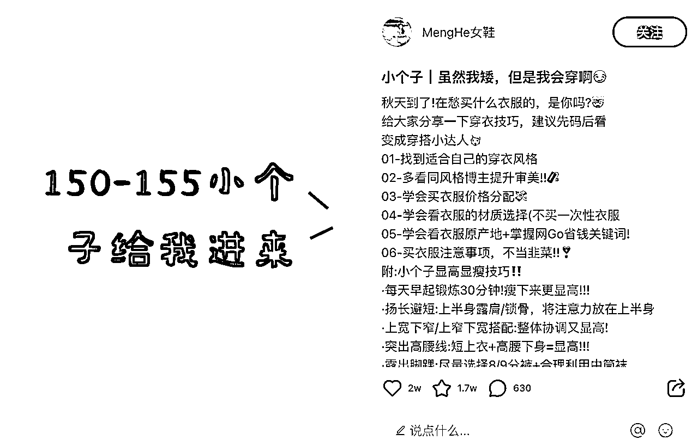

### 4. 测评类

可以多产品横评，也可以单个产品深评，把优缺点讲清楚，再给购买建议。难度4星，变现3星。优点是吸引用户、变现空间大；缺点是制作难度大。

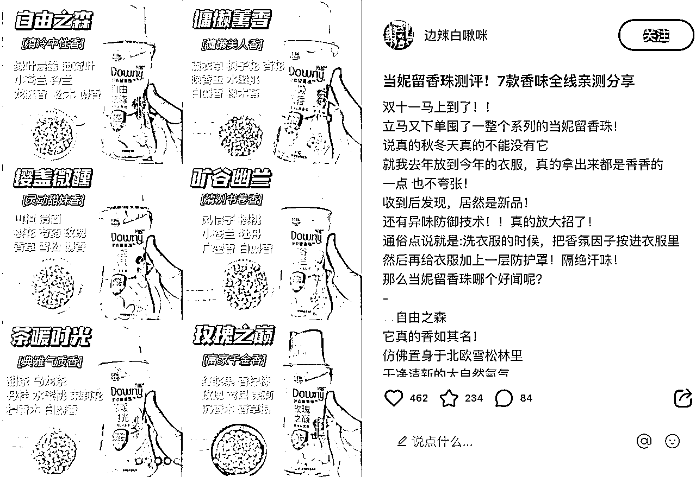

### 5. 产品合集类

分两种：多选一——把多款同类产品放一起，各自优缺点，让用户选一个最合适的。

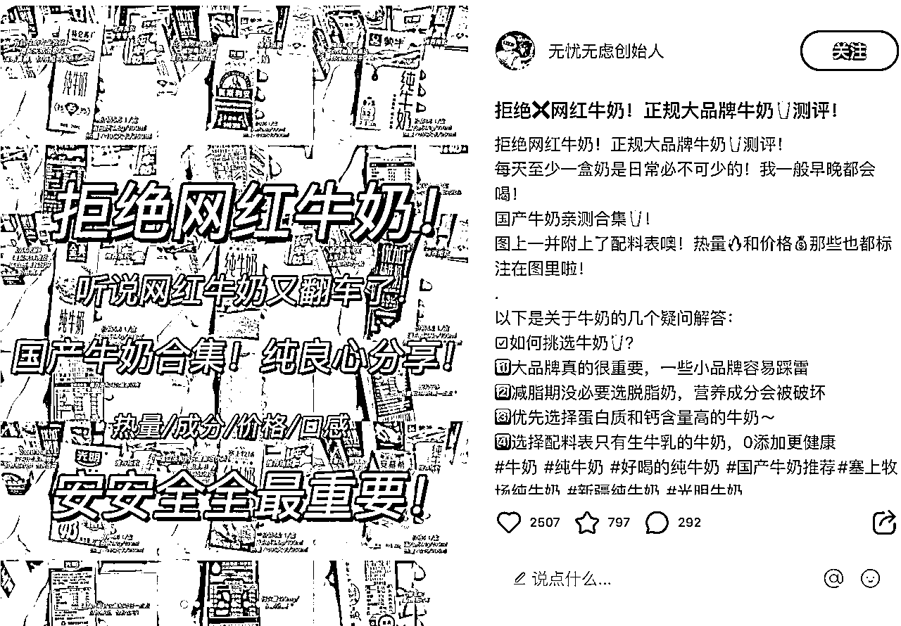

多选多——介绍多个不同产品，用户可从中挑一个或多个。

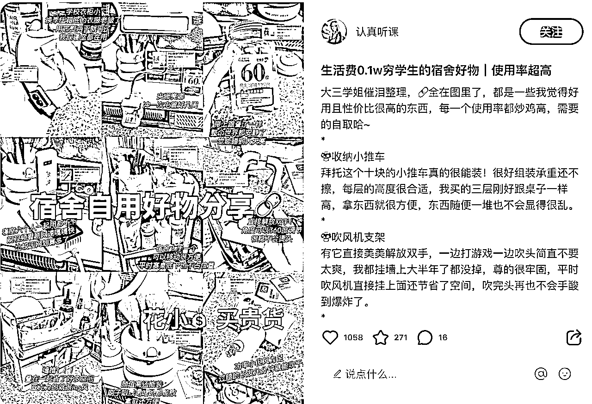

难度4星，变现3星。优点是吸引用户、变现空间大；缺点是制作难度大。

### 6. 教程类

教用户化妆、穿搭、拍照、修图等技能。难度3星，变现3星。优点是吸引用户、变现空间大；缺点是制作难度大。

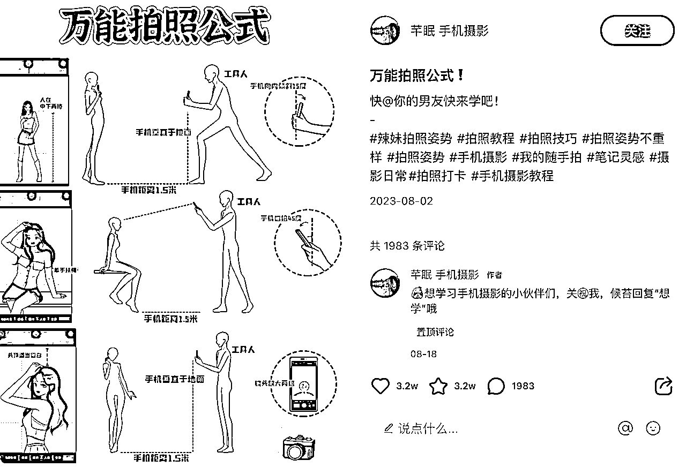

### 7. 养成类

记录成长过程，比如素人改造、挑战做自媒体。难度4星，变现4星。优点是吸引用户、变现空间大。

---

好了，这篇从推荐机制、变现玩法到笔记类型都讲完了。无论你是刚开始做📕，还是运营中遇到瓶颈，都可以对照自己的账号看看问题出在哪。觉得有用就收藏一下，有任何疑问也欢迎在评论区聊，我会尽量回答。

在这个社区做内容，最消磨人的不是没人看，而是两件事：产出的成本越堆越高，盈利却迟迟没有动静。两者凑到一起，足够劝退一大批人。不过，这些问题并非无解，只要拆开来做，都能找到对策。

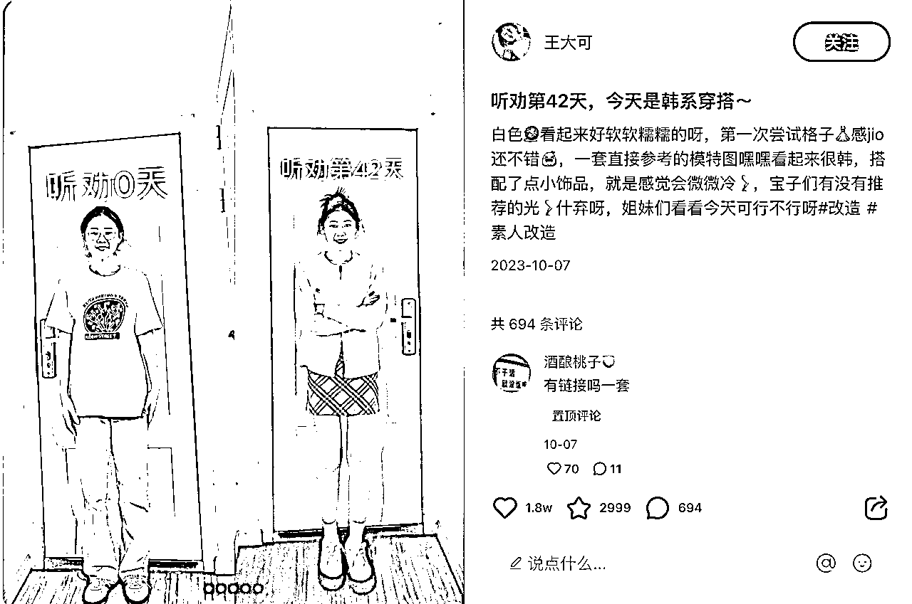

先说知识科普类。每天固定讲一个冷知识，这类内容很有吸引力，涨粉也不难，但短板同样明显：商业出口窄，回本周期长。它更适合当流量入口，而不是唯一的收入来源。

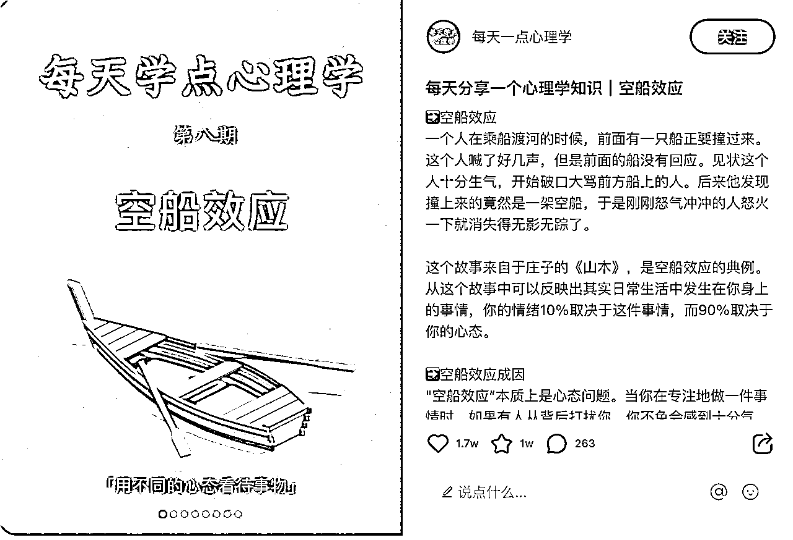

接着聊一个号的根基。总结下来就一句话：号 = 方向 × 受众 × 核心意义 × 个人形象 × 画风。这里面，受众和个人形象最要紧，其他三项都是围绕它们展开的。

方向要如何选？有几条原则可以拿来参照。

第一条，挑自己真心喜欢，或是本身有积累的方向。人只有面对真正有兴趣的事，才会愿意反复钻研。不要只看别人做得风生水起，更要确认自己能否一直做下去。像穿搭、护肤、美妆、健身、户外、宠物、美食、家居、亲子这些大类，都算常见选择：喜欢搭配衣服，可以走穿搭路线；常去健身房，可以做训练分享；哪怕只是把书桌布置得有美感，也能拍桌边好物开箱。可选的方向很多，真正要紧的是你愿不愿意常驻其中。

第二条，选靠近收益的方向。毕竟做号不是为了纯粹自嗨，最终要考虑商业回报。判断起来也不难：去千瓜、灰豚这类数据站看看同行的报价，再翻一下官方商单广场里品牌的投放热度，大致就能判断哪条路更好赚钱。美妆、护肤、身体护理这几个类目，一直是收益靠前的典型。

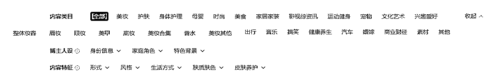

第三条，看方向的后劲。有些领域当下火热，但热度未必能维持太久，也可能被规则收紧，这种长期风险需要先想明白。

第四条，方向之间可以组合。前期设定并非封闭题，做了A也不等于不能碰B，关键是受众、价值和形象能否互相咬合。一旦把价值层次往下放，组合的可能性就多了。举个例子：只做穿搭或只做美妆，起步快，但天花板低；可穿搭受众里，不少人对美妆也有兴趣；而那些同时关心穿搭与美妆的人，底层的愿望其实是“变好看”。所以当穿搭号撞上瓶颈，可以把价值锚点从“教穿搭”降到“帮人变美”，再补进美妆、发型等内容，过墙的空间就被打开了。

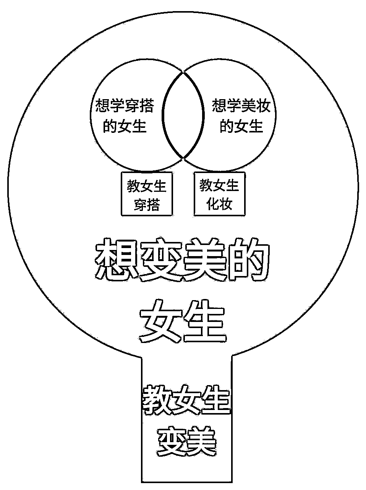

其他方向同理：以单一价值点切垂直人群，受众准、起号快，但高度有限；遇到天花板后，试着放宽受众边界，把价值点下沉，就能圈进更广的人群。

动手之前，必须想清楚你在为谁创作。这个“谁”不是抽象的订阅者，而是某个有清晰场景、清晰需求的人。如果你脑中画不出这个人，创作就会越来越散，渐渐失去方向。

拿减脂号来说，受众至少可以分为两类：想靠吃瘦下来的人，和想靠练瘦下来的人。前者需要的是食谱和食物搭配，主题应当围绕“不动也能瘦”来写；后者需要的是动作示范和训练安排，内容应偏向器材推荐与动作拆解。不少号断更、没主题，根源就在于没想清楚自己到底在服务谁。

号的商业价值与盈利方式绑定，先想好赚谁的钱，再做价值设计。若打算赚个人受众的钱，就倒推：你能替他们解决哪些难题？你在他们眼中是怎样的人？他们是否愿意为你掏钱？以我为例，我做的就是私域知识付费，给用户提供关于内容运营和盈利路径的解决方案，在他们眼里我是有实战经验的操盘手，筛选之后留下的人，就成了愿意付费的核心用户。

如果想赚商家的钱，就要回答另一个问题：你能给品牌方带来什么？是曝光，还是销量？你的订阅者会不会因信任你而下单？比如先接产品曝光，再启动带货，那么从一开始就要在内容里预留植入位，逐步放入种草信号，替后续带货做好铺垫。

个人形象怎么定？等方向、受众和盈利方式清晰之后，形象通常会自己浮出来。若还拿不准，可以对照几个关键词：个性鲜明、好识别、有记忆点、接地气、不像广告。形象必须真实，最好从自身优势开掘。起步期不要做太复杂，先找一个参考号照着简化。如果一开始就立一个假人设，或者把设定搞得过于繁琐，后面很容易崩，吸引来的人群也会跑偏。

你的性格、兴趣、优缺点、年龄、城市、外形、讲话方式，都是形象素材，也可以组合成复合型人设。不清晰时，用一个句式来套：我是那个专门替XX搞定XX难题的XX人。例如：我有6年操盘经验，专门帮刚入行的创作者解决流量和收入问题；我自己就是身形娇小又很会穿的人，专门帮同类身材解决穿搭困扰；我当年考过全省第一，专门帮高中生突破分数困境。

视觉方向倒不复杂，先决定做图文还是做视频，按自己的条件来。新手我建议先用图文起手，方便做对照测试，确认文字表达过关后，再做视频不迟。直接拍视频，数据不好时往往分不清是文稿的锅、拍摄的锅还是露脸的锅。先用图文把文稿的风险排除，后面自然顺。要做矩阵的话，口播是原创度很高的形式，省去写稿环节，用采访或问答的方式连续提问、回答，再把每一轮对话剪成一条片子。

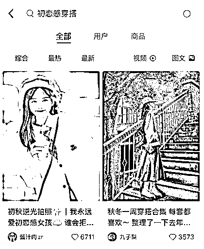

下面进入高热度内容的制作流程，先说怎么找参考。

第一种：直接搜主词。不要搜太偏太生僻的词，最好用和方向强相关的主词。比如做垂直穿搭，可以直接搜“法式穿搭”或“通勤穿搭”。

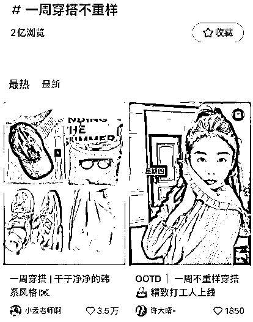

第二种：逛话题聚合页。大多数帖子会挂话题，当你刷到一条合适的参考，点进这个话题的聚合页，还能看到大量使用同一话题的内容。

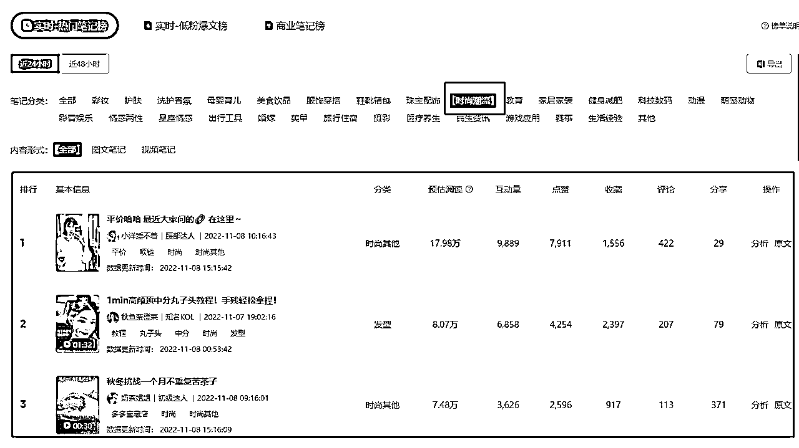

第三种：借助第三方数据站。千瓜、灰豚这类工具，可以筛出最近涨粉明显、且与你的方向高度相关的号和内容。第四种：靠推荐页自然喂养。平时多刷同领域的内容，算法知道你的口味后，会把更多优质参考主动推到你面前。

拆参考号，可以从盈利方式、方向设定、个人形象三个维度逐层看进去。但要记得，拆解不是为了照搬，而是为了训练网感。具体观察点包括：对方的盈利模式是否与你想的一致？内容中有没有明确的目标受众？核心意义是怎么呈现的？能不能从字里行间感受到博主是个怎样的人？对方的画风你是否能做到？哪些主题经常出好成绩？题名有没有固定套路？内容骨架是否与你的设想重合？

工具层面，灰豚数据可以把参考号的内容导出，用来复盘题名和数据，新用户一般有15天试用期。

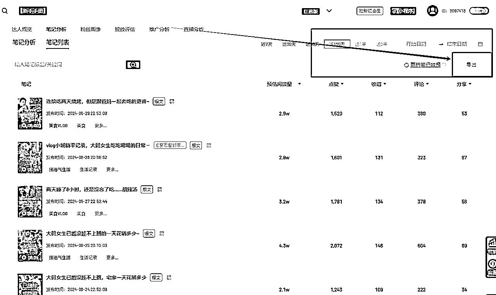

另一个是 Kimi 的免费浏览器扩展，放在号的主页上，就能让它快速分析内容和形象，但它只能看到题名与简介，这反而能检验一个号的形象到底有没有立住。

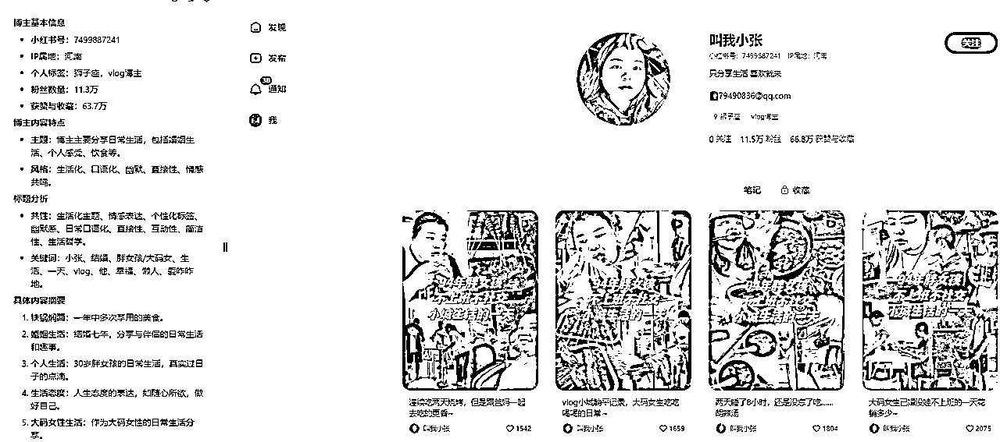

主题库的建立也不难。当你把盈利方式、方向、形象都定清楚后，手里至少会有二十个可写的主题。要是还想继续加，可以试试几招借力。

第一招，从参考号里借。进一个参考号主页，翻它最近十篇内容，看是否存在某篇互动数据明显甩开其他内容。一旦有，且数据够大，就可以收进主题库。同时记得看更新日期，一周以内的内容参考价值更大。

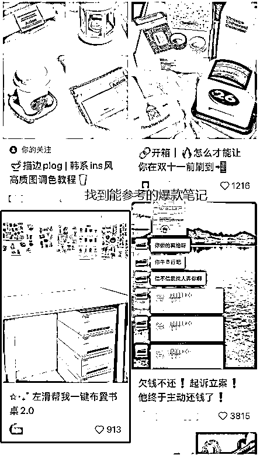

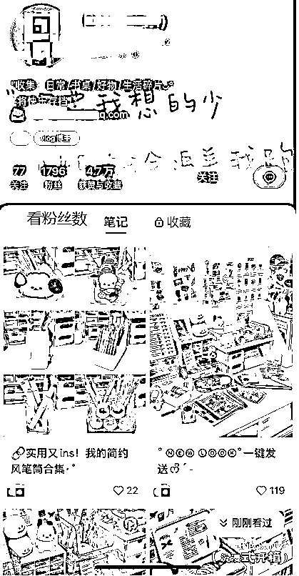

比如图里这条，互动冲到了九百多，日常数据只有一两百，这种悬殊本身就是信号。

第二招，借检索联想。在输入框敲一个词，系统会生成一串联想词，挑和自己方向贴近的来用。除了联想词，结果页里还会有一排小词，也可以当成主题来源。

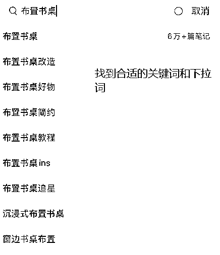

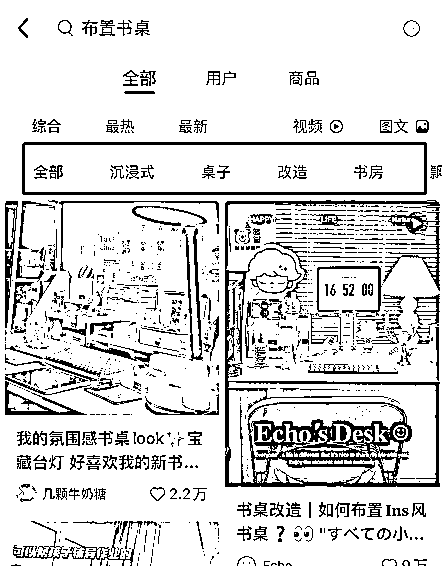

筛选标准同一招。

第三招，从热门留言区借。数据不错的内容底下，藏着很多真实需求。那些被大量受众认可、点赞靠前的反馈（非手动置顶），都有机会成为主题。第四招，跨平台借。抖音、B站、快手、微信短视频、微信订阅号、知乎等都可以去翻，看看各平台大家最近都在关心什么，留言区里的困惑也值得留意。

配图制作没有想象中难。实拍不需要专业摄影水平，但基础功夫得做足。

设备方面，手机建议iPhone 11以上，打开九宫格；桌布尽量选纯色，不花哨；光线足的时候不用补光设备，晴天拍出来最好看；小道具可以上拼多多找，假书、香薰、杂志、小摆件、假花都很容易营造氛围。开拍前先用酒精湿巾擦干净镜头，这个动作非常关键。白天阳光充足，就直接用自然光，别开室内灯；光线不够再做补光。

调色方案可以在社区里搜索现成参数，不少创作者会分享自己的配方。

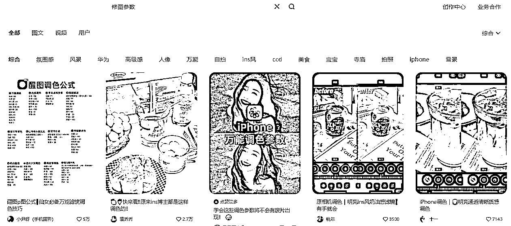

但别人的配方不能照单全收。环境不同，参数必然有浮动，学的是背后的调色思路，而不是机械复制。

不需要实拍的内容，可以交给在线设计工具。除了用苹果自带记事本做纯文字图，还可以用PPT或Keynote排版，或者直接用可画、稿定、创客贴这类的在线编辑器，模板很多，拿起来就能改。

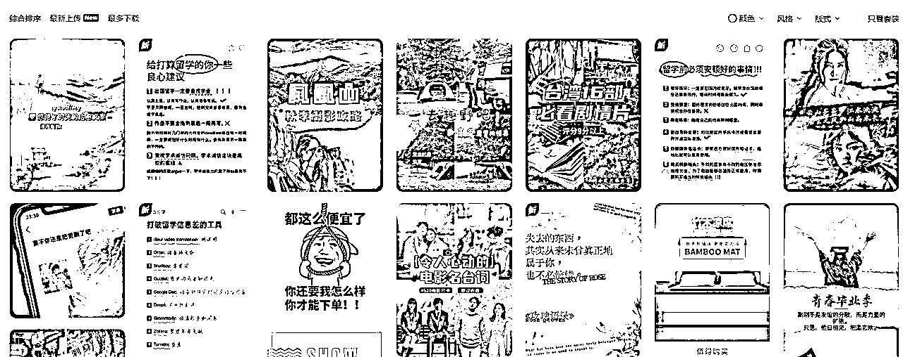

不会设计，模仿就是最快路径。操作分四步：先把参考内容的配图存到手机；打开设计软件（用稿定作例子），新建一张1242×1660的白色画布。

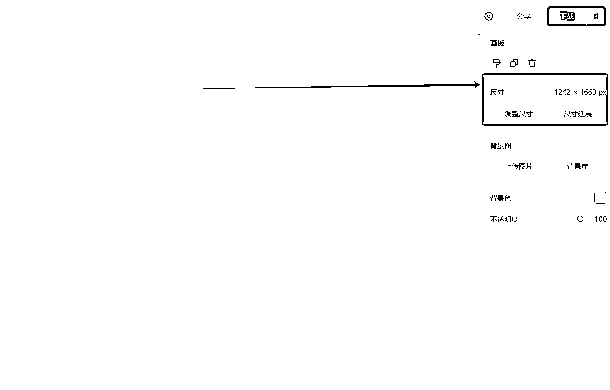

把下载好的配图导入，铺成背景。

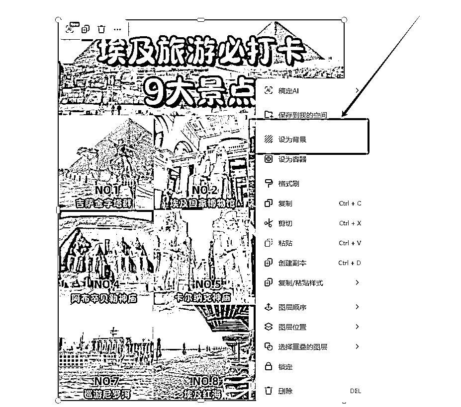

再把素材一比一放上去仿着排。

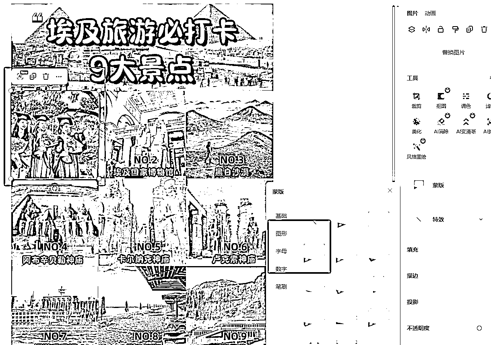

版式可以学，但主题和文字必须换成自己的，排好后导出即可。

写题名有一个新手友好的三步法。

第一步：收集样本。主题定了之后，去搜同主题的高热度内容，挑5到10个数据好的题名记进表格。比如你写的是防晒衫，可能会看到这类句式：“这件防晒衫也太好看了”“今年夏天的衣柜必须有它”“通勤路上被问了八百次的防晒衫”等等。

第二步：拆解可迁移的部分。比如“也太好看了”可以抽出来，配上其他单品名继续用；“夏天的衣柜”也能换到其他季节性单品上；“被问了八百次”是典型的种草句式，适合搭配实拍图。

第三步：重新组合。把抽出来的关键词拼到一起，生成几个备选题名，比如“这件防晒衫也太好看了”“夏天衣柜一定要有的防晒衫”“通勤路上被问了八百次的防晒衫”。先发其中一个，数据不理想就换下一个继续测。

正文写作没那么玄。主题与形象定了之后，按四步走：先锁定主题；再翻5到10篇高热度内容拆结构；借它们的骨架，结合自身风格搭出框架；最后提炼核心检索词，让正文围绕这些词自然展开。多数情况下，主题本身就能充当核心词。

几个细节值得单独提醒。

第一，正文别用冷僻字，也别堆专业名词。不要默认读者都懂，表达越直白，理解成本越低，传播效果越好。

第二，细节比形容词更动人。比如“我吃了碗面”和“我拐进巷子里的老面馆，老板娘记得我不要葱，面端上来还卧了个溏心蛋，辣油香得直冲鼻子”，后者明显更有画面。

第三，每篇内容都埋检索词。想一下用户平时会怎么搜，把那些表达写进正文，搜索流量就是这么蹭出来的。第四，图里或视频里已经讲过的话，正文不要原样再说一遍。第五，能短则短，套话一多，离好数据就远了。

话题区与留言区也别忽略。标签只保留与主题、检索词相关的，5到10个即可，带无关标签纯属浪费力气。留言区值得维护，如果你对某条内容有信心，发出去一天后只有赞没有评，可以请一两个朋友先留句话，再用主号回复。不要发这种没有实质内容的评论：

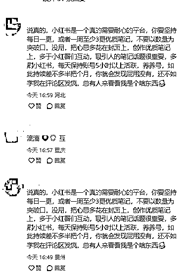

这类评论对号本身毫无帮助，反而会让留言区失真，把关注者的注意力带偏。

再分享一个很适合冷启动的做法：单变量对照测试。图文内容里的可调项包括主题、封面、配图、图内文字、题名、正文、标签、定位等；视频内容还要加上视频素材、口播文稿、配音、配乐、拍摄手法、后期风格等。具体来说，就是每做一条新内容，只改动其中一个元素，用它和旧内容对比数据。比如第二条换了封面，如果曝光和互动全面领先，说明封面环节很关键。留下表现好的版本，隐藏掉逊色的版本，再以优胜版为基础，继续换题名、换配图、换正文，逐步测出一个综合表现稳定的组合。当天围绕同一主题做多轮测试，次日再用前一天的优胜版去测新主题，效率会高不少。

最后是私域引流。这套方法我上次分享过，现在仍然有效，我自己也还在用。精简版如下。

先确定承接渠道。如果走站外交易，比如淘宝、闲鱼，把店铺准备好就行；承接私域流量，主要两个容器：微信和微信订阅号。

接人的个人号尽量用老号，别拿刚注册的新号。如果只有新号，先花几天养一养：把昵称、头像、签名、地区和性别等资料补齐；个人动态不要复制粘贴，也别发营销内容，每天更新一至五条正常生活内容；绑一张储蓄卡，偶尔用微信付款；在大量加人以前，每天先加三五个熟人，聊聊天，偶尔在群里冒个泡。这些操作就够了，前期别急着营销，基本不会出问题。

不过个人微信有个隐患：内容一旦爆掉，短时间内加人请求会非常多，容易触发风控，而且每天通过数量有限，不少用户会因此流失。微信订阅号更适合做长期的沉淀和承接，用来兜底会更稳。

有时候流量说来就来，根本不会提前打招呼。如果担心平台一下子涌进大量用户，👸号其实是一个非常稳的承接容器——哪怕一天新增几百个关注，也完全扛得住，而且配置起来并不复杂。

注册流程这里就不赘述了，随便搜索一下就能搞定。重点说说👸号的基础配置思路：

1. 关注后的自动回复必须安排上，核心目的是把用户引导到你的微信。我个人习惯把自动回复指向菜单栏，这样以后换联系方式不用改回复内容，只动菜单就行。

2. 菜单栏别搞太复杂。如果没打算长期深耕👸号，就留一个“联系我”的入口足够，越简单用户越不容易迷路。

3. 微信账号多备几个，一旦流量突然爆发，可以随时替换菜单栏里的微信名片，避免一个号被加爆。

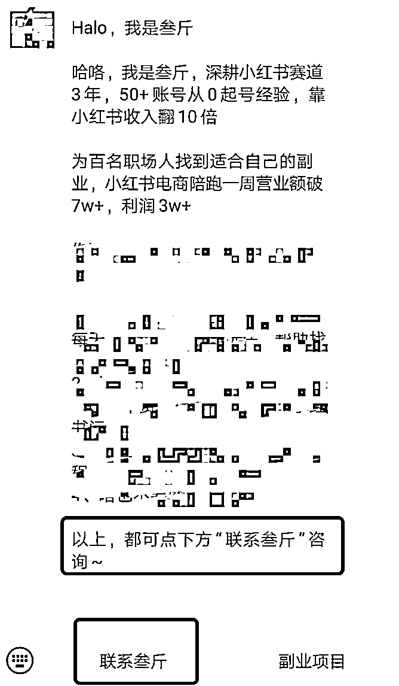

至于到底用什么方式做承接，取决于你的引流能力和用户精准度。👸号承接有个明显短板——很多人看完就走了，并不会真正加到微信，流失率相对偏高。

## 小助理号怎么设置

专门准备一个用来引流的小助理号，命名就很简单粗暴——“XX小助理”即可。我自己做过一个小实验：把微信号拆开，分别写到两张首图里，发布两篇笔记，让用户自己组合出完整微信号。

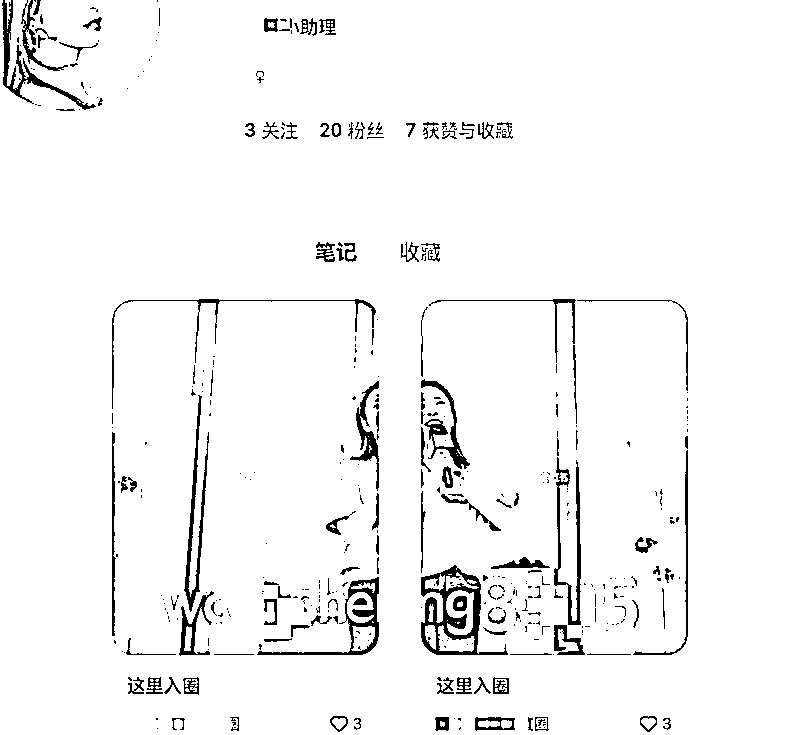

具体玩法是这样的：把微信号拆成两部分，做成两张图片，按顺序发布。用户看到这两篇笔记，就能自然拼出完整微信号，而且操作路径非常清晰，目前来看安全度也比较高。

## 主号设置的几个细节

基础配置方面：

1. 大号提前收藏小助理的那两篇笔记，用户点开收藏夹，只看到这两篇，组合起来就是完整微信。

2. 把📕ID直接改成微信号，但要注意有被平台重置的风险。

3. 建立📕群，把小助理账号拉进群里。

简介部分可以这样设计：

* @小号指路：注册一个“XX小助理”的账号，在主号简介里@它，并给用户一个点击理由，比如“@小助理 领取资料”。
* 引导进群：简介里写明“资料在下方群聊”，用户进群后再在群内发布引流信息。
* 引导看收藏夹：写上“资料看收藏夹~”这类引导词。
* 引导看📕号：写“资料看📕号~”即可。

上面四种方式选一种就行，别全堆上去。给用户的选择越少，行动越明确；选项一多，反而不知道点哪里。

微信号的设置也有讲究：📕ID只能改一次，如果用手机号很容易被重置。目前比较稳妥的是英文+数字、英文+符号或纯英文组合。而且别搞太长，6位左右最好——我自己用的是4个英文加2个数字，用户搜起来、记起来都很轻松。

背景图同样可以放引导语，比如引导进群、引导看收藏或引导看📕号。不过如果不知道怎么设计，背景图这块也可以忽略，因为它的引流效果相对间接。

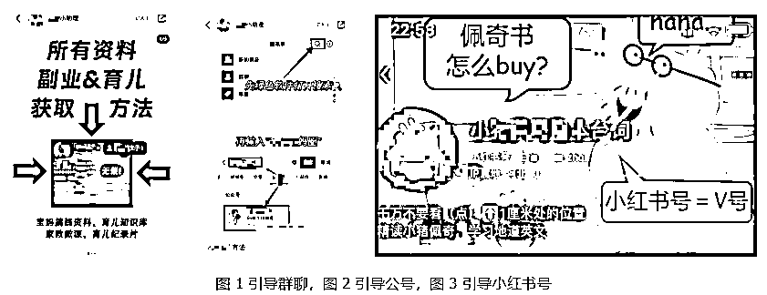

# 运营方向上的建议

看到这里，📕入门的基础操作应该已经清晰了。结合我自己的实战经验，再聊几句方向上的思考。

## 手里有项目的人

如果你本身有项目，那就聚焦项目引流即可。先想清楚玩法：是“摆地摊”式的直接叫卖，还是“买手店”式的个人IP打造。我更推荐买手店模式——做出人设、形成IP，比摆地摊更持久，流量也更稳。

现在📕的内容赛道已经卷到不行，平台整体流量见顶，进入存量博弈阶段。创作者数量还在增加，同质化内容泛滥成灾。举个例子，你搜“云南旅游攻略”：

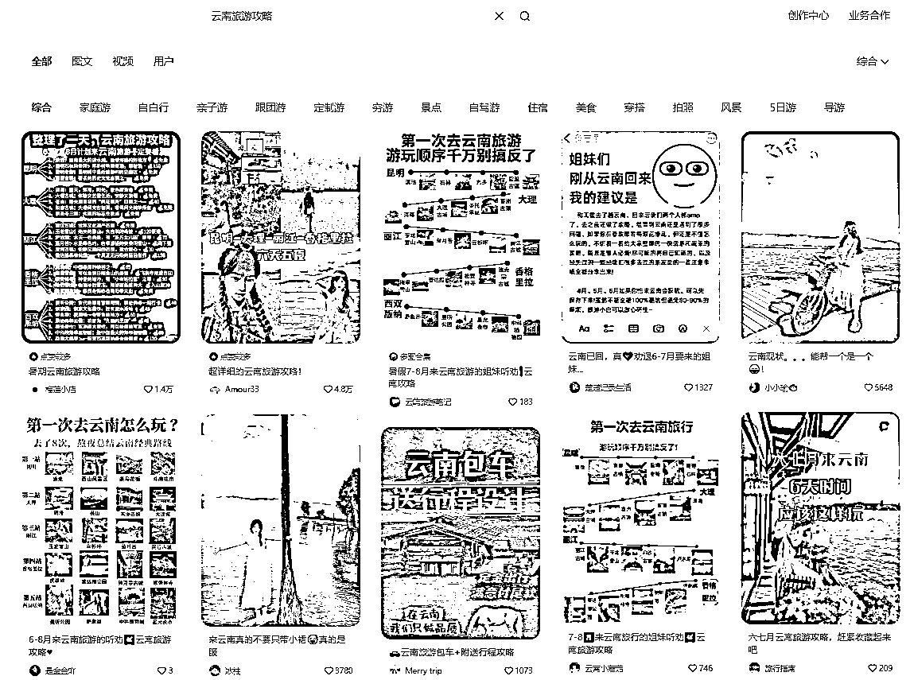

首页刷出来一堆笔记，真正真人发的可能就一个，其他全是旅行社批量制作的。还有很多模板套出来的内容，不光云南攻略里能看到，你换个城市搜，图片几乎一模一样。

在这种情况下，做个人IP账号是摆脱同质化最快的方式，同时能明显提升用户信任度，转化率也是最高的。

## 完全零基础怎么起步

如果你是纯小白，只想靠接广告变现，大致有三条路：

1. 千粉号接单模式  
2. 好物分享模式  
3. 个人IP模式  

### 千粉号接单模式

先把账号快速做到1000粉，然后接一些品牌方直发的软广。但这个模式坑不少：

1. 广告不稳定，报价也低。这类代发广告最不值钱，哪怕做到5000粉，报价可能也就一两百，返点还高得离谱。

2. 个人很难直接接单。千粉号通常都由MCN机构统一派单，品牌方根本不会单独联系你，太费精力。

3. 机构抽成太狠。一旦签约，解绑很难，抽成还高，本来就没多少广告费，再被机构切一刀，到手可能连一半都不到。

很多千粉号做着做着就坚持不下去了。由于实名认证的限制，账号既不能卖，也没法单方面和机构解绑，最后只能注销，非常难受。所以这种模式我最不推荐，不长久。

### 好物分享模式

这个比千粉号强一些。同样涨到1000粉，但内容方向不同，专门做好物分享类笔记，比如这类：

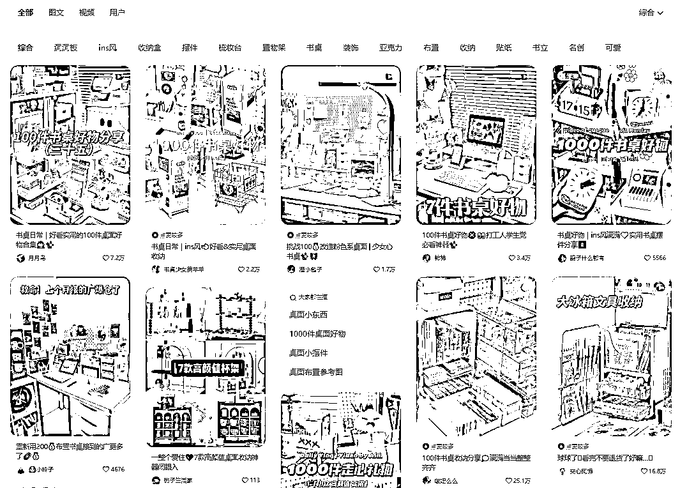

穿搭、宠物、健身等其他赛道也同理——核心就是没人设，纯粹分享好东西。因为粉丝是冲着好物关注的，所以比千粉号精准得多，而且会有广告商主动找来合作，不签MCN也能接到单。

不过也有两个明显缺点：

1. 前期如果手头没有实物可拍，账号就不太好起。
2. 因为没有鲜明人设，粉丝粘性不会特别强，报价自然也不高。

虽然广告费不算多，但合作的产品可以挂闲鱼卖掉，也不亏。产品报价和拍摄风格、选题方向关系很大——如果内容里都是廉价小物件，环境也普通，那合作产品价值自然低；如果拍摄场景高级、画面质感好、用的东西也贵，报价自然水涨船高。

### 个人IP模式

个人IP是我最推荐的玩法，至少未来一两年依然有空间，而且不比前两种差。个人IP同样能接广告，费用普遍更高。我拆解过很多这类账号，平均合作价格基本都超过粉丝数的10%，一万粉的账号也能报到千元以上。

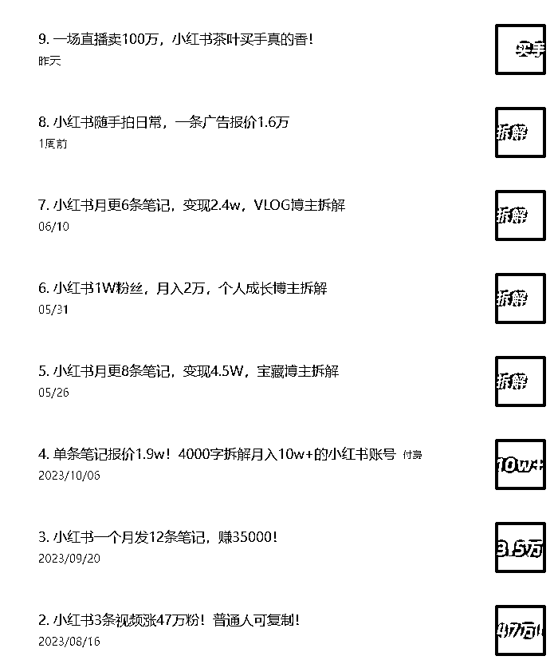

个人IP的发展方向很多，可以走买手、接广告、引流等路线。而且IP一旦立起来，粉丝跟随性很强，即使你后续换内容方向，只要风格还是这批粉丝喜欢的，转型也很快。

但个人IP没那么容易。如果只是取了个像人的名字，内容依然发洗稿模板文，那顶多算个普通账号，够不上IP。真正的个人IP，必须有强烈的个人色彩：

1. 哪怕是纯干货，也要融入自己的故事、经历、经验和观点。
2. 只有干货没有个性，用户看谁都觉得一样，不算IP。
3. 带有个人色彩的笔记火了，IP才算真正立起来。
4. 简介里说“我是谁”不算IP——好的IP是用户光看内容就能感受到你是谁。

# 几个高频问题

## Q：修改笔记会不会影响后续曝光？

笔记可以改，但确实会影响后续流量。如果数据不理想，调整首图和标题，说不定还能把数据救回来。数据本来就好的，如果改内容时碰巧加了违规词，也可能触发限流。

另外，修改大概率会重新审核。内容若比较敏感、处于违规边缘，最好别动。投放薯条时如果提示广告，可以把疑似违规的措辞替换或删掉，再重新投放，有时也能通过。

## Q：账号之前流量还行，但半年没运营了，重新启动会受影响吗？

长期不更新的账号，建议先发几条互动类笔记再正式更新。如果数据还是差，观察一下小眼睛数量——只有个位数，可以申诉查查有没有违规；如果是几十几百，说明没有问题。互动类笔记可以参考这些：

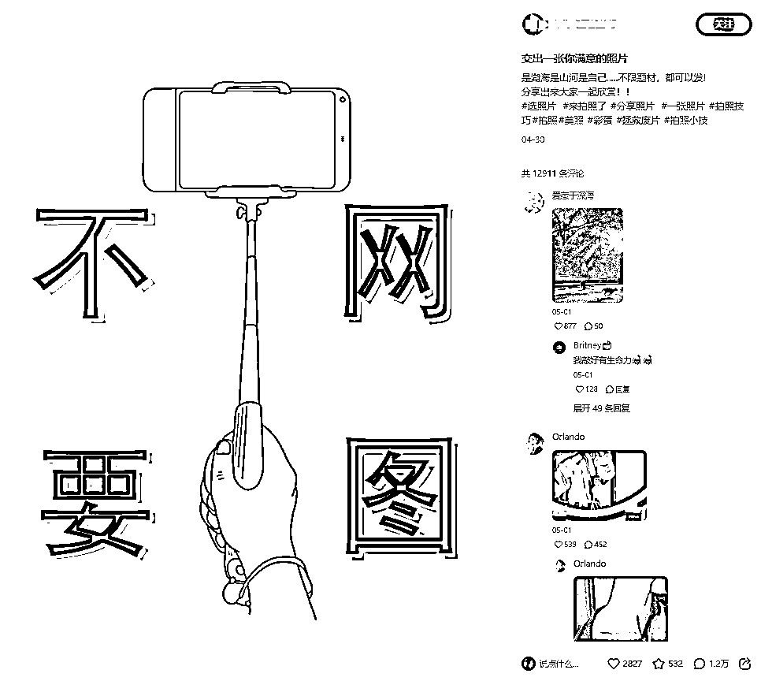

## Q：一部手机可以同时登录或者切换多个账号吗？

切换登录是没问题的，前提是你做的是不容易违规的普通内容。如果赛道本身比较敏感，那就别切来切去，也别同时登录。

## Q：想换赛道的话，换什么合适？

如果有粉丝基础，优先考虑新赛道是否和原有粉丝人群重叠或相似。如果没有粉丝基础，那就直接换。

具体换什么方向，可以从变现端倒推，哪个赛道离钱近，哪个就更值得考虑。

## Q：几台手机可以连同一个WiFi运营吗？

① 如果你做的内容容易违规，比如涉及引流，建议老老实实用4G。否则一个账号出问题，同一个WiFi下的其他账号容易被连带。

② 如果只是正常做账号矩阵，比如博主接广告变现或走平台转化，那连WiFi基本不用担心。

但如果你要往私域引流，安全第一，还是4G稳妥。

更多问答我整理成了合集，需要的话可以翻看。

以上就是本期的全部内容了。2024年已经过半，是时候认真把📕搞起来了。