# 说实话，成人用品这个赛道，25天赚了近2万，普通人能抄作业吗？

最近刷到一位圈友“锦城”的分享，看完挺有感触。他说自己在星球潜水了三年，这次聊起和朋友最近在测的一个情趣用品卖货项目，两个人忙了二十来天，流水大概跑到了1.9万以上。后面他又说，做到26天左右的时候，营业额已经超过2万，利润也在1.8万往上。

关于利润，他提了一句：这个数字在行内不算高，但每一单的利润基本都破百了。\(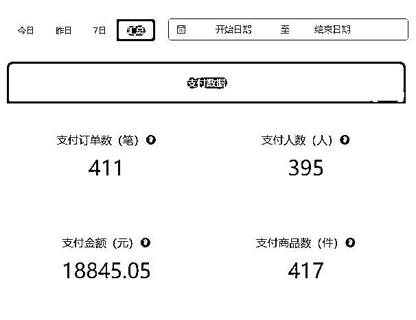\)

他还晒了某天单日收益最高的数据。那天能爆，主要是因为视频直接出圈了，播放量冲到30多万，评论区热闹得不行。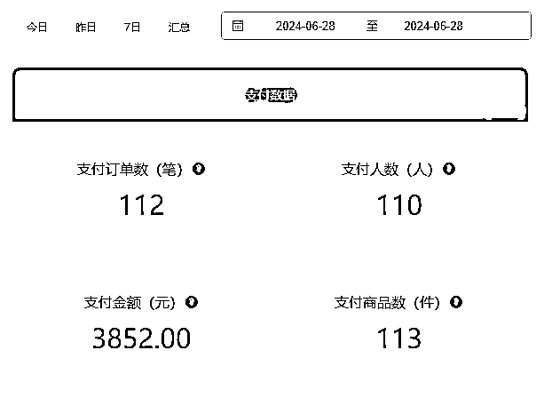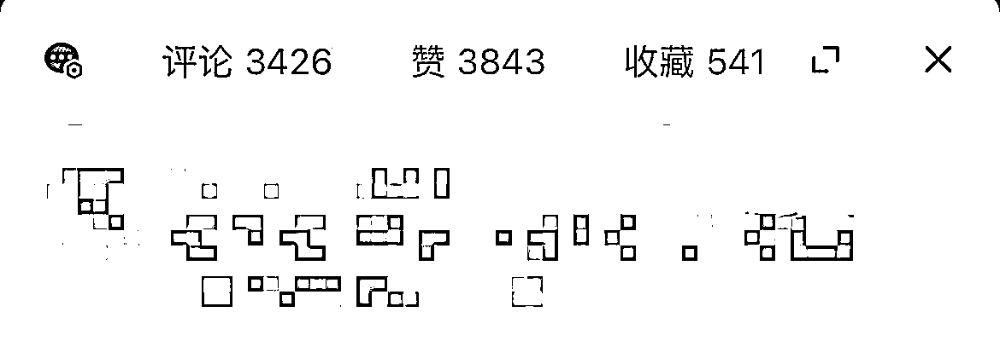

如果只看到这里，可能很多人觉得“哇，这么赚钱”。但如果你听完他的故事，可能会跟我一样，心里冒出来另一句话：哪有什么随随便便的成功，全是一路踩坑踩出来的。

## 一、先说说他这个人：曾经赚过600万，也曾亏到只剩一百多万

他很坦诚，说自己就是“少年得志”的反面典型。高三毕业就开始折腾赚钱，大学四年做搜索引流、公众号引流和淘宝客，一共赚了600多万。那时候他才24岁，觉得自己好像还挺牛。但后来才明白，不过是踩中了时代的红利。

毕业后在省会城市买完房车，手里剩个一百多万。随后投资了一些实体项目，结果碰上疫情，基本上都亏完了，只剩下房子和车子还在。

再往后，他试过闲鱼无货源、小红书电商、视频号直播、私域卖货……都能跑通，也都能赚点小钱。但他心里一直憋着一股劲儿：“我要找一个能做很久、天花板很高的项目。”结果越想走捷径，越容易摔。

后来和曾丽姐聊了很长时间，有一段话点醒了他：做项目不是一上来就奔着月入十万去的。很多人是趁着平台红利期，先把事做起来、把钱赚到，心态放平，再慢慢积累自己的优势。

听完这些话，他彻底想通了——自己是普通人，那就从零开始，做长期有价值的事，哪怕短期收益小一点也没关系。

## 二、为什么选成人用品这一行？

说来也巧，不是他自己选的，是一个认识了很久的互联网好友告诉他的。

那个朋友当时在测一个项目：差不多10万播放量，每天营业额能跑2000到3000，成本只要两百多块。锦城听完觉得可行，也没犹豫，直接拉了小伙伴开干。

那位朋友说的也很实在：“女生去做效果会更好，客户有时想听语音，男生反而不太方便。”他说这话的时候还发来了一堆数据截图。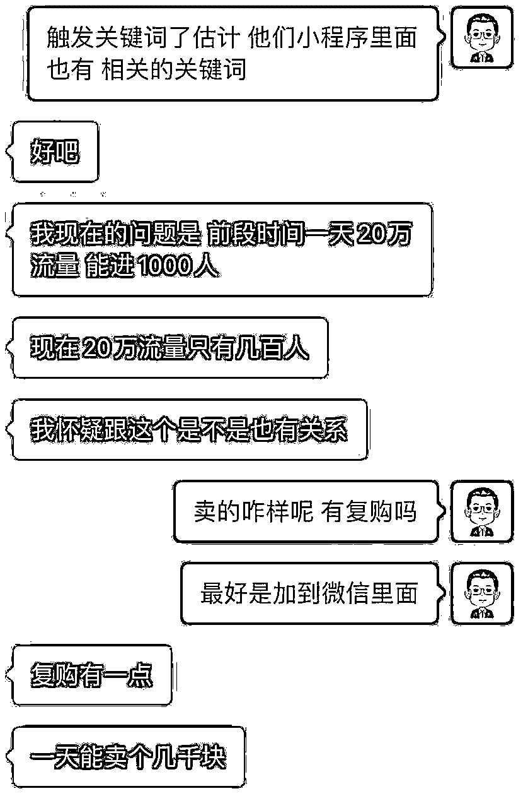

## 三、从0到1跑通全流程，具体怎么操作？

他把整个项目拆成了五个板块：找货源、完善后端、学话术、补基础知识、引流转化复购。

### 1. 货源去哪找：1688挑“超级工厂”

货源这块不算难，重点是在1688上筛“超级工厂”和“实力商家”。同一个商品，价格差异也挺大。注意分辨那些挂着“厂家”名号实际也做无货源代发的人，最好多找几家比比价，重点问清楚售后政策。1688上的商家大多数都留了联系方式，能直接谈。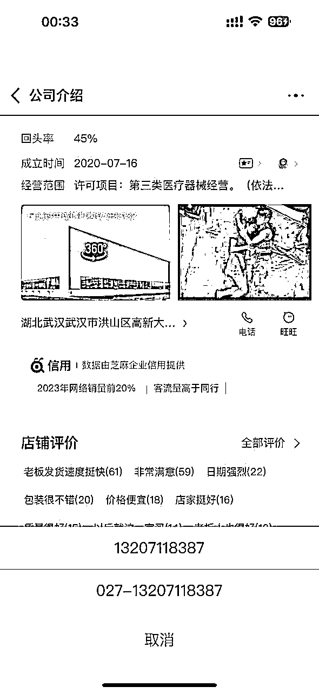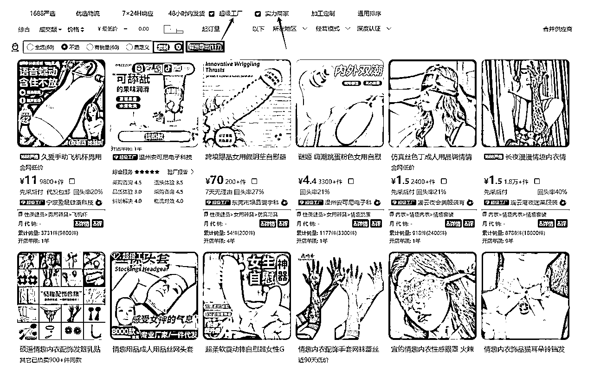

顺便提醒：货源稳定性很关键。他这次就遇到了供应商突然涨价的情况，幸好提前有备选，不然就卡住了。

### 2. 后端商城怎么做：小程序花了十来天，错失一波红利

后端方面，他们调研了不少对标账号，发现同行几乎都用小程序商城来做成交。于是就去闲鱼上搜小程序定制服务，一家家问价格。拿同行的案例发给商家问能不能做成同款，对比了好几家，最后用一千多块拿下来。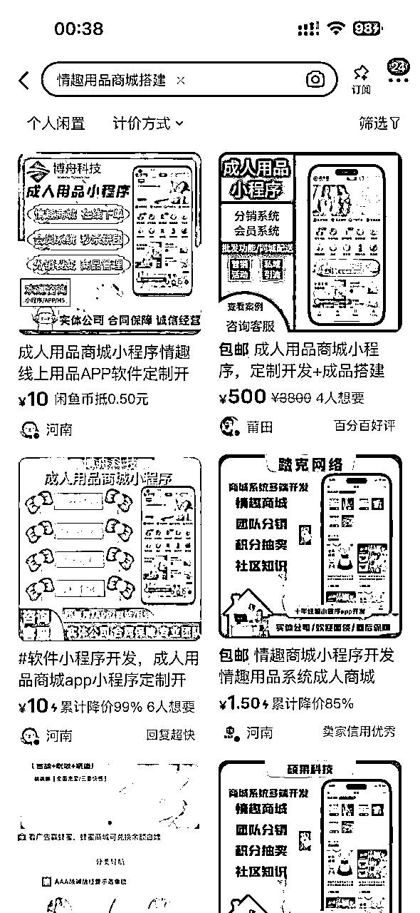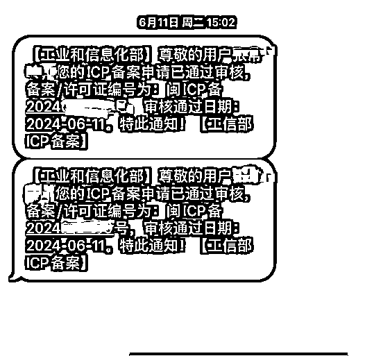

但这里有个血泪教训：小程序从备案到上线，足足花了十几天。那段时间流量特别好，他这边却啥也干不了。朋友同样的流量能跑2000到3000，等他小程序上线后，流量骤降只能跑一千多了。

所以他的经验是——“流量好的时候，要想尽一切办法接住”。比如先注册个公众号，把流量导到公众号里，或者直接引流到私域，回头再慢慢做转化。

### 3. 话术从哪来？直接去问20个同行

情趣用品这个私域，客户什么问题都问得出来。有些问题你没准备，就会傻眼。

锦城的方法很粗暴：先加20个同行，把自己能想到的客户问题挨个发过去，等人家回复后直接记下来当话术。如果还有客户问了没准备的问题，再跑去同行那儿“偷师”，复制答案改改就能用。

他说好的话术跟差的话术，一天营业额能差出几百块。别小看这个细节。

### 4. 基本知识必须补课

除了话术，基础专业知识也很重要。比如：

- 哪些避孕套品牌性价比高？
- 男用产品有哪些？
- 女用产品有哪些？
- 外用内用、情趣内衣……

如果只是死记硬背话术，很多问题还是搞不定，该补课就补课。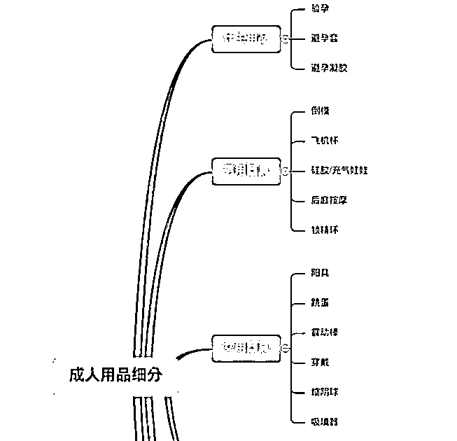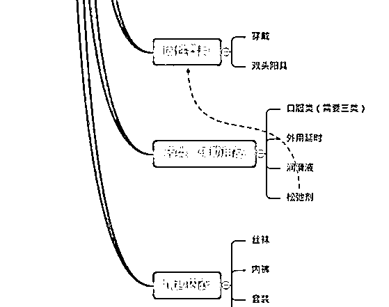

### 5. 引流：大量囤号、大量发，被封是常态

重头戏来了。

这个行业封号很严重，对纯小白来说确实有门槛。他刚开始准备了12个抖音号、10个小红书号，现在只剩下5个抖音号、3个小红书号了。抖音基本发七天就要轮换，小红书一上来就容易被封一个月，只能解绑手机号、拿原号码再注册新号。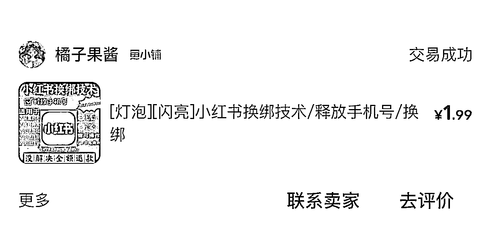

抖音号不够的话也有办法，可以去搜索相关的养号方法。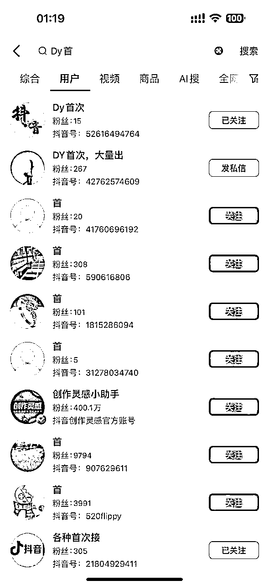

他还提醒，如果手上有代发资源会轻松很多，每天只负责做素材就行。找不到靠谱代发的可以去闲鱼发帖找，但一定要小心骗子，不少是坑。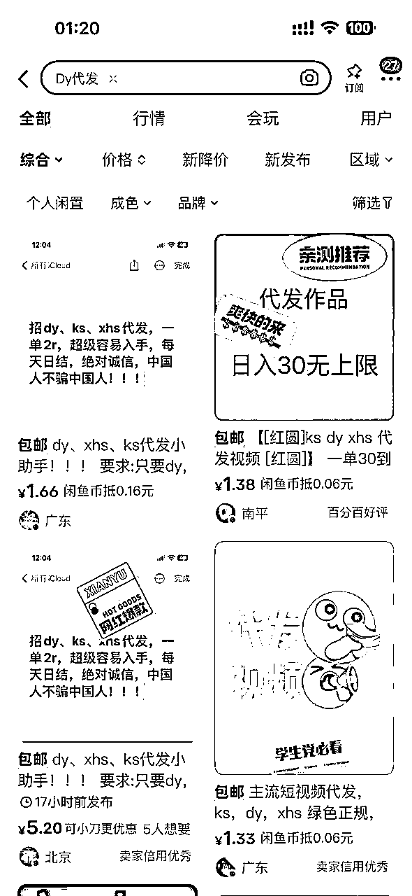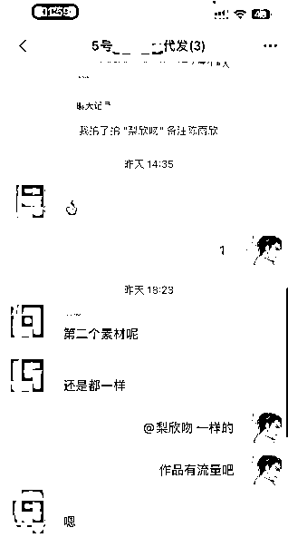

#### 小红书引流：打女性用户，靠笔记展示产品

小红书链路是：笔记引流到粉丝群，小号在群里加人微信做转化。这个渠道能贡献20%到30%的客源，剩下的主要靠抖音。

小红书对标的账号有这几个，可以直接搜着看：

- 傲娇小公主（小红书号832470933）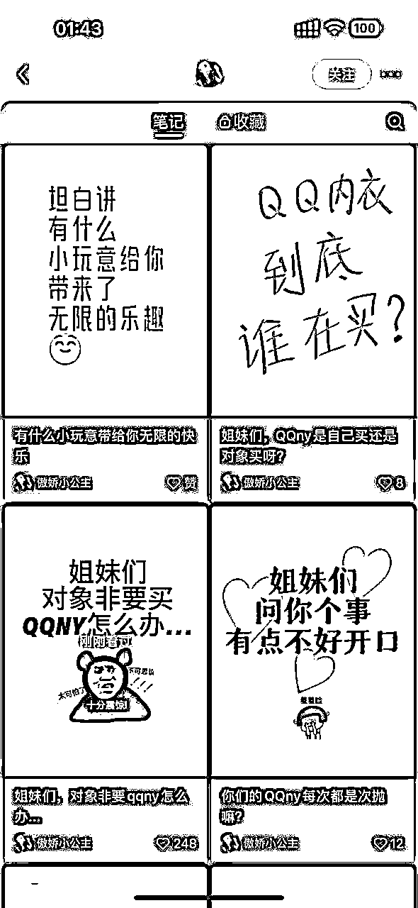
- Kitty 酱酱（小红书号6738266945）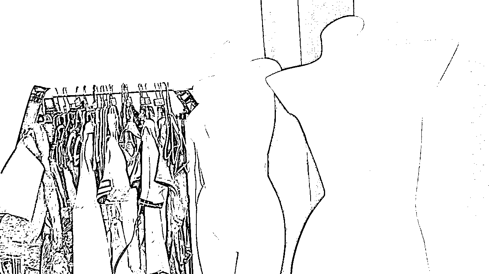

他们的笔记形式主要是展示情趣内衣和玩具模型。他和小伙伴之前正好有卖剩下的货，拿来拍就行——一分钟一条，拍起来很快。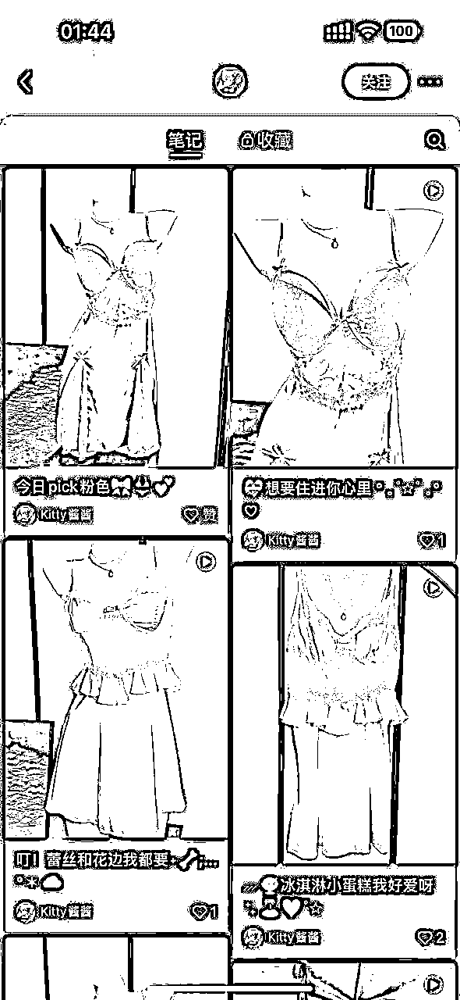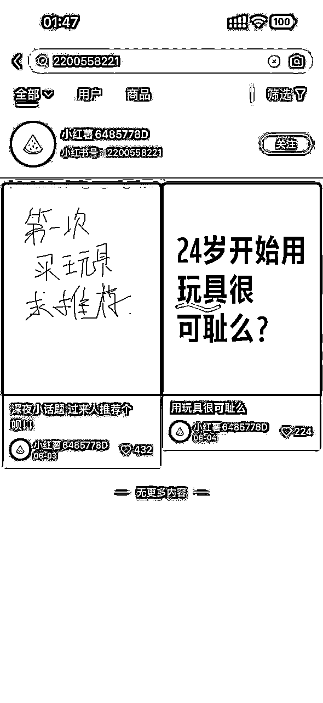

另外也可以拍实拍产品、玩具测评，或者聊天记录截图这类形式，去小红书搜一搜就能刷到不少。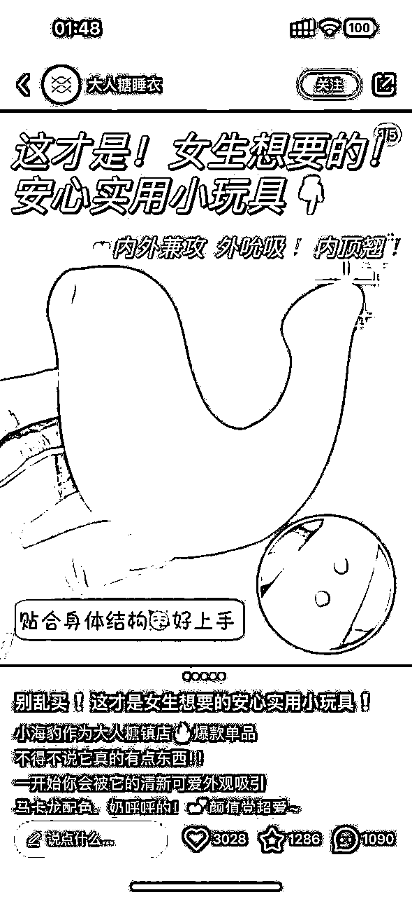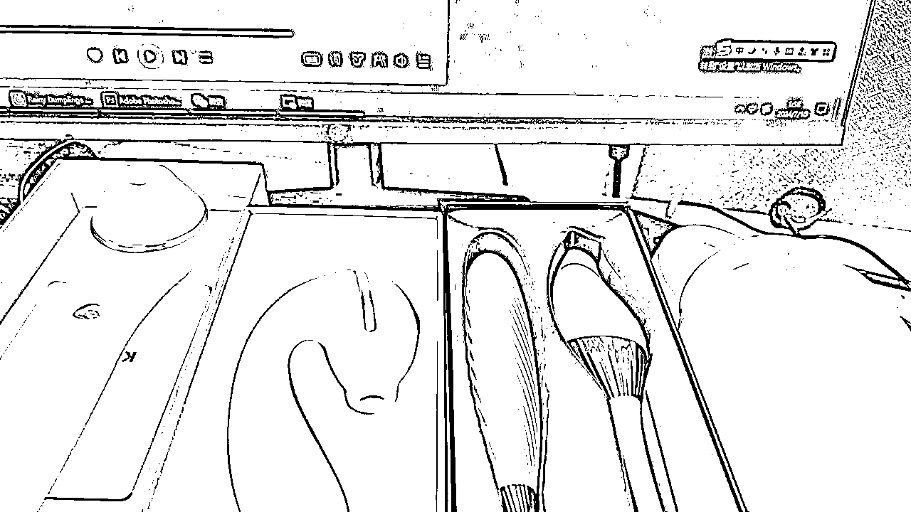

小红书做女粉，抖音做男粉，两者逻辑完全不一样。粉丝接回来之后，发的朋友圈也要区分标签，最好两个微信分号承接。

#### 抖音引流：打男性用户，男粉转化率更高

抖音的引流逻辑，简单来说分几步：

1. 新号先刷两三天关键词，只看相关视频，养号
2. 第四天发一条风景内容测试流量
3. 第五天开始发引流视频

一机一卡一IP这些基础就不展开说了，最重要的是素材去重和混剪基本功。如果这一步搞不定，基本就可以放弃这个领域了。

抖音对标账号也放出来，大家可以直接参考：

- 桃趣工作室（抖音号50869155164）：搜索小红书美女视频，混剪去重就行，做起来比较省事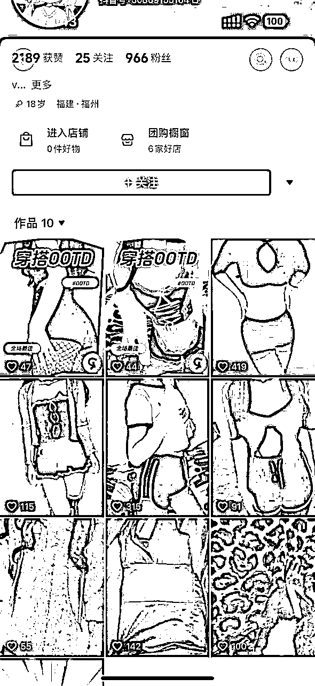
- 一口芭乐（抖音号dgyjvffcbjm）：拍“00后在情趣用品公司上班的第X天”这类场景视频，需要大量素材片段，火了流量很大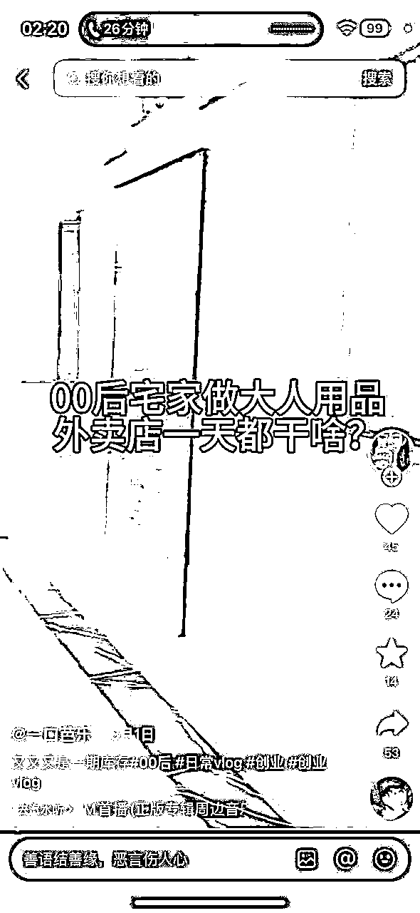
- 悦怜（抖音号80995181115）：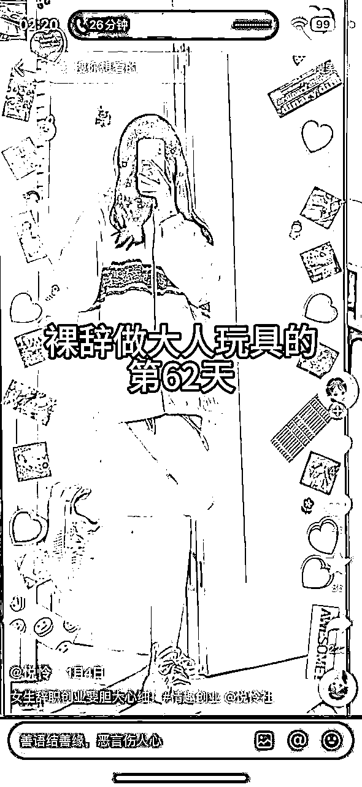
- T7（抖音号97855737173）：聊天记录视频，模仿文案去做就行，不过最近流量稍微差一些
- 温玉（抖音号94172191881）：这种视频很简单也很容易爆，基本是拿小红书美女素材混剪出来的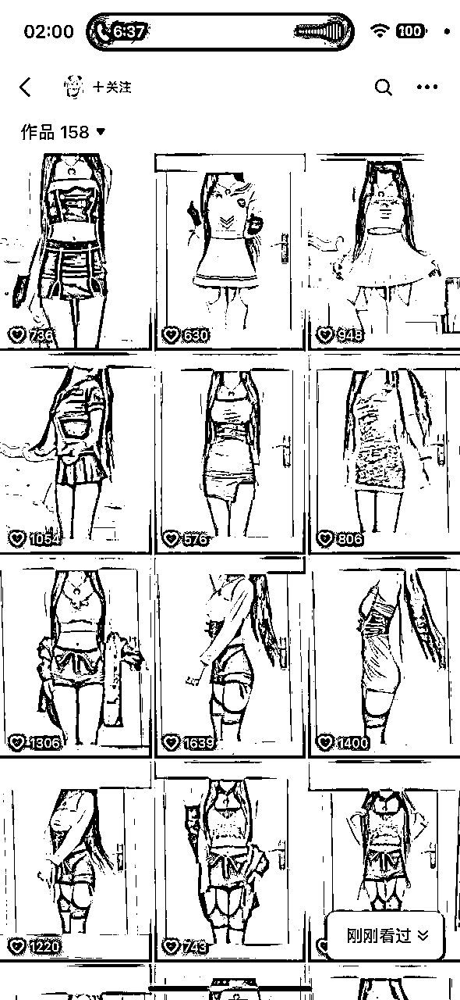

各账号的粉丝量不同，玩法稍有差异，但大同小异。

### 6. 转化与复购：私域细节决定用户粘性

每天小程序的访问量都有好几百，如果愿意加微信，就得看你扛不扛得住了。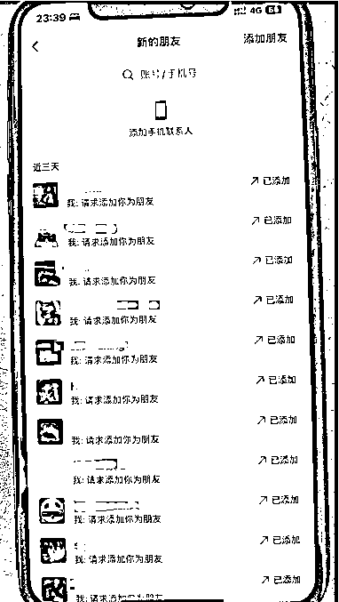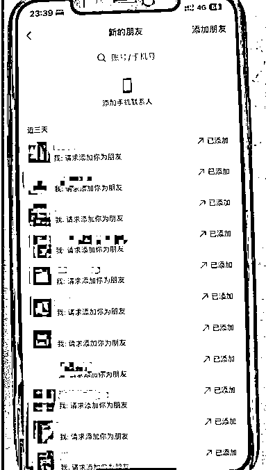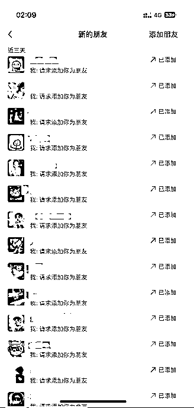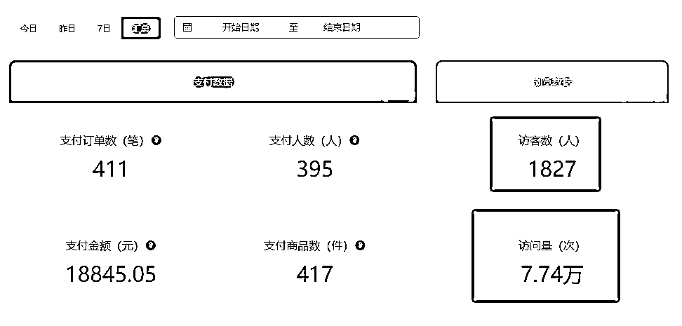

他的做法是：下过单的客户打A标签，有意向的打B标签，加了不说话的打C标签。男女客户再各打上性别标签。不同标签的人，发不同的朋友圈，这一点非常关键。

客户买完单之后，可以送一些写真实拍、脱敏资料之类的小福利；女性客户就发一些实用的技巧说明。他特别强调，“售后做得好，复购自然来”。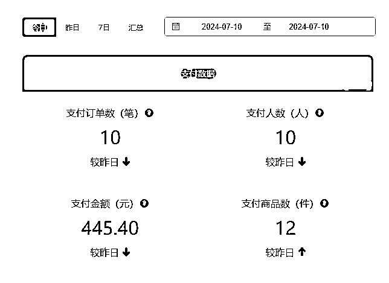

抖音导流还有几个实用套路：

- 简介里放小程序名称
- 评论区里做引导
- 粉丝群里做转化

## 四、最后说说，这个项目有什么坑？

他毫不犹豫列出了一串：

1. 封号太严重，设备数量要求高，纯小白真的很难搞
2. 素材要敏感，紧跟对标账号的最新模板，一旦爆了马上跟上
3. 懒人做不了，发视频加承接客户，基本一整天连轴转
4. 供应链和商家后端必须靠谱，后台还被攻击瘫痪过两个小时，白白损失了一波流量
5. 没流量的时候别灰心，坚持发就会有量进来
6. 朋友圈维护太太太重要了，决定复购率，他也还在学
7. 还有很多坑，一时半会说不完

## 五、他的一点真心话

很多人以为炸项目靠的是运气，但锦城说，做任何一个项目，背后都是一堆技能的拼接。比如这件事，表面是在卖货，实际要用到的有：修图去重、混剪视频、朋友圈运营、营销文案、成交话术……

每次能练出几个基本功，就算赚到。哪怕这个项目不做了，下次换赛道，照样用得上。

写在最后，他说这些的时候，已经是凌晨2点多——后台还叮叮咚咚地跳出新订单。这条路，确实有人在闷声赚钱，但也确实不是谁都能吃下来的。

如果是你，会考虑试一把吗？评论区聊聊。