# 近十亿曝光不到一年，Aelfric Eden 社媒引流的打法拆解

> 来源：[https://z8qt74rchp.feishu.cn/docx/CustdlXWloBJiRxUhj4c0SPmnif](https://z8qt74rchp.feishu.cn/docx/CustdlXWloBJiRxUhj4c0SPmnif)

pipiads 大数据监测显示，广告主 Aelfric Eden 在多平台的投放累计曝光逼近十亿，时间跨度却不足一年。如此体量的声量是如何跑出来的？下面拆开来看。

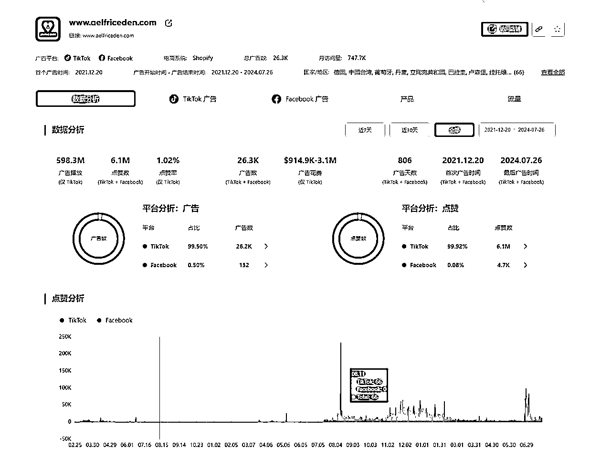

广告主链接：https://www.pipiads.com/zh/advertiser-analysis/62184b819a301ef93d2475db/

街头时尚：正在改写全球潮流风向的细分赛道

源自街头的自发文化，以强烈的个性、多元混搭和实穿属性为核心，街头风正快速渗透全球时尚体系。欧美 Z 世代对这一文化接受度极高，相关品类与市场也在持续扩容。在产品迭代加快、品牌生命周期缩短的红海环境里，新锐品牌 Aelfric Eden 凭借 TikTok 为主的多元化投放策略完成突围，成为 Z 世代追捧的对象。

#### 品牌画像

Aelfric Eden 由一位亚裔美国人创立，主张东西方文化的碰撞融合，把亚洲街头语汇与西方审美结合，形成辨识度极高的时尚语言。创始人的初衷是打破次文化与主流文化的壁垒，用更包容多元的视角生产服饰。

品牌品类覆盖印花卫衣、图案 T 恤、夹克及各类配饰，设计上糅合滑板、涂鸦、网球等街头符号，风格新颖吸睛，牢牢抓住年轻消费群。其核心理念是将小众街头元素升级为主流时尚，与 Z 世代追求多样与包容的价值观高度契合。大胆用色、高辨识度图案，让品牌在全球年轻人中迅速圈粉。

据 PIPIADS 统计，Aelfric Eden
广告投放周期:2023.08.17-2024.07.23

广告播放量:594.2M

广告数量：26.1k

投放天数：802

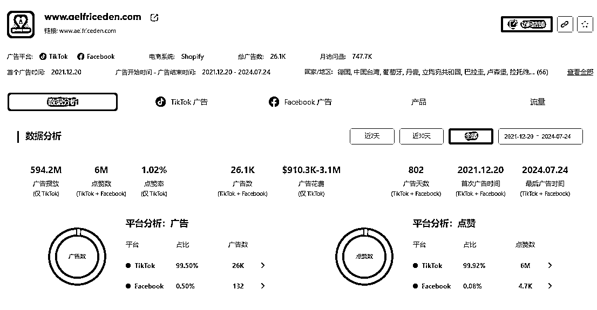

pipiads 已支持 TikTok 与 Facebook 双平台投放监测，可进行更立体的广告数据分析

从投放分布可见，品牌重心明显偏向 TikTok 端。

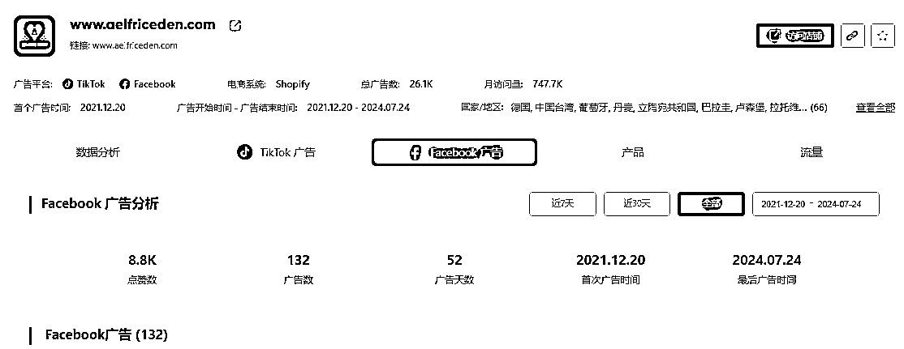

日程表显示投放节奏密集，持续性强。

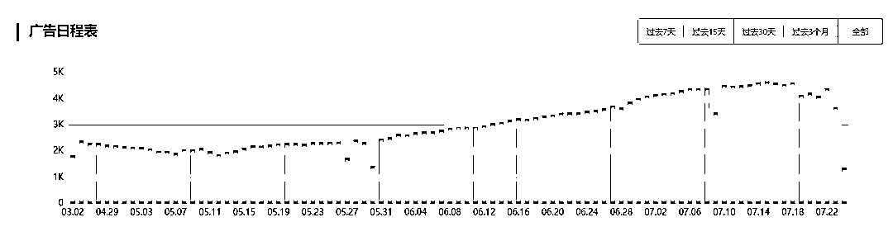

总产品数：176

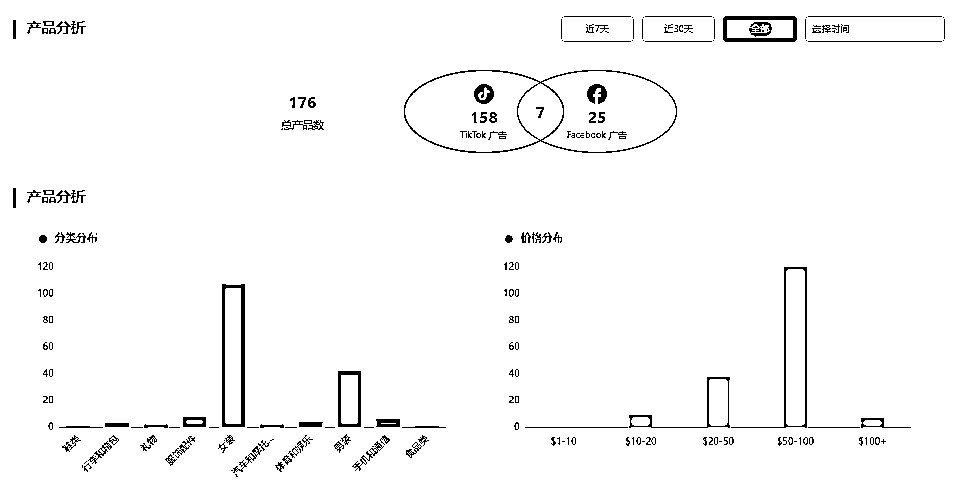

TikTok 素材合计播放约 24.8M

视频普遍采用多场景快切、多产品轮播的方式，在短时间内塞入大量信息。场景切换快，既提升趣味性，也有效抓住注意力。

广告视频链接：https://www.pipiads.com/ad-search/217d89cf4379b209b0fc/

落地页观察

Aelfric Eden 官网整体风格清爽现代，以大面积白底加简洁排版为主，突出单品视觉。首页聚焦新品上架与促销信息，用大图加醒目文案引导点击。

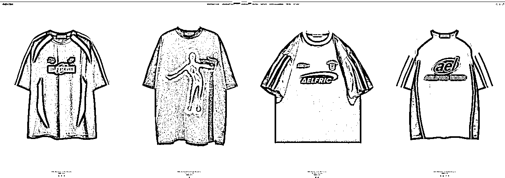

独立站上新节奏观察

官网服饰 SKU 超过 2000 款，月均上新 200+。价位集中在 39.95-69.99 美元。设计大量使用街头涂鸦、文字贴花与高冲击色彩，满足年轻用户对个性与街头文化的双重需求。

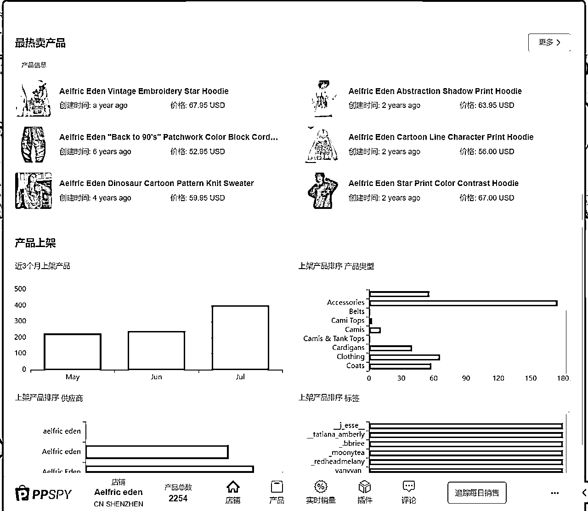

Facebook 投放素材以静态图与轮播图为主

图式广告胜在直给，清晰的画面配上简短文案，能让用户瞬间get到卖点与价值。

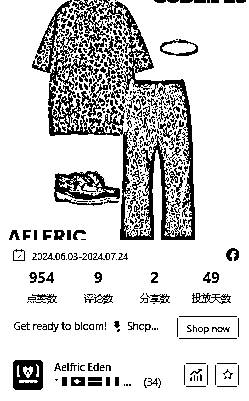

#### 社媒矩阵布局

品牌在 Instagram、Facebook、TikTok、Twitter 等平台持续运营，覆盖不同人群，实现全球影响力的扩散。

TikTok 官方账号观察

粉丝量：700.5k 平均播放量：5000~10000+

内容核心是不同场景下的穿搭组合展示。

通过创意短视频、话题挑战与粉丝互动，品牌在 TikTok 上积累了大量关注。平台的病毒传播属性极大加速了品牌声量提升。

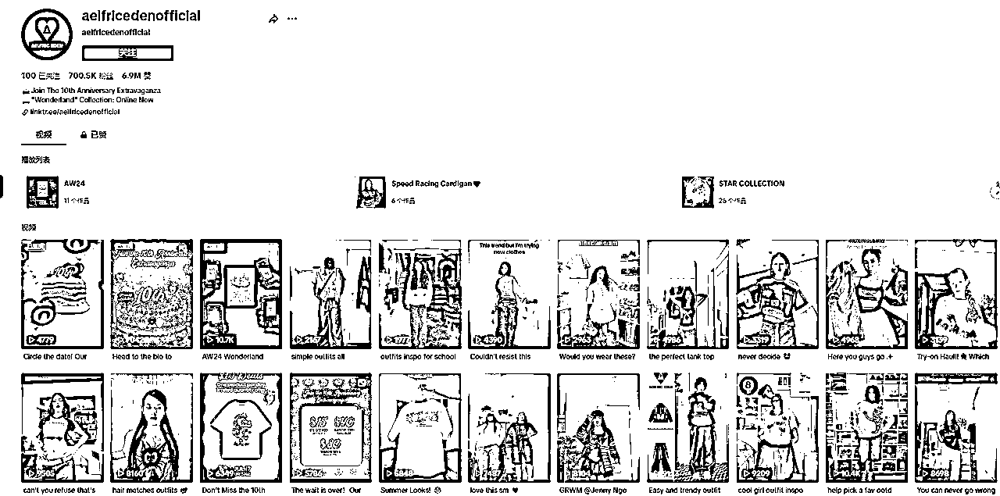

Facebook：7.7万粉丝

主要用于发布品牌动态、促销信息及粉丝互动，保持内容更新以维系关系。

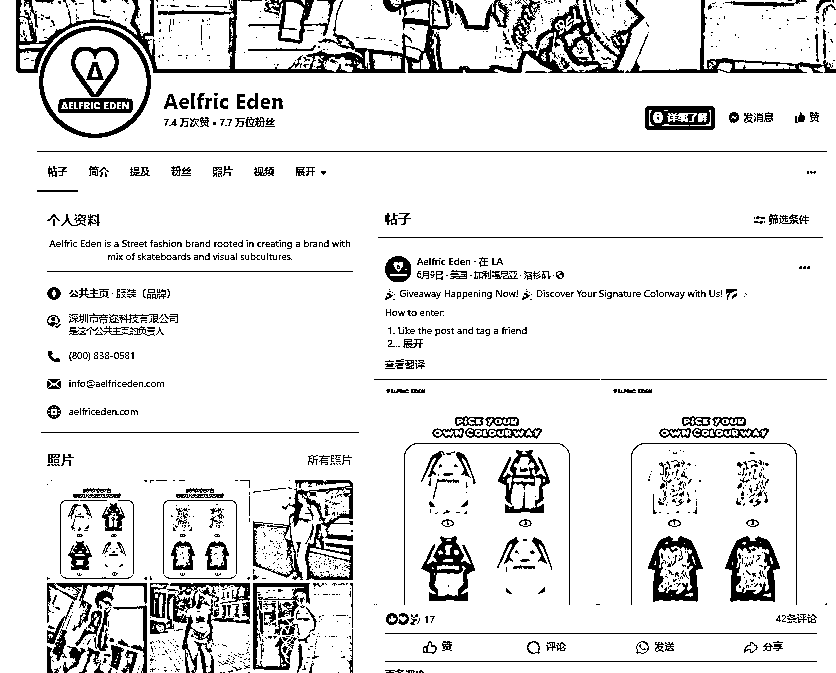

UGC 策略

品牌高度重视用户生成内容，鼓励用户在社媒晒出穿搭照视频，并经常在官号转发。借助 #AelfricEden 等品牌标签强化社区归属感。UGC 提升了品牌真实感与亲和力，也带动了更多互动裂变。

Aelfric Eden 通过多平台广告引流，尤其在美国市场带来大量访问，用户访问深度与停留时长表现不错，但跳出率偏高，用户体验仍有优化空间。全球化布局初见成效，后续可在重点市场进一步精细化投放。

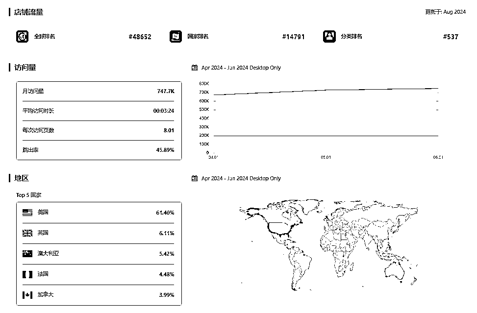

细分赛道的破局思路

品牌选择深耕街头时尚这一细分赛道，以小搏大避开大牌正面竞争。相较主流时尚品牌，Aelfric Eden 更强调亚文化深度融合，借势欧美街头潮流打造差异化形象。

广告素材拆解

解析 TikTok 上播放量最高的三条素材

素材1：2480万次展现

广告文案：Back to school outfits ideas #bcktoschool #outfitinspo #fits #fyp

视频采用快节奏轮播形式，多套穿搭快速切换

开场三秒钩子：Back to school outfits ideas，精准锁定开学季的年轻群体

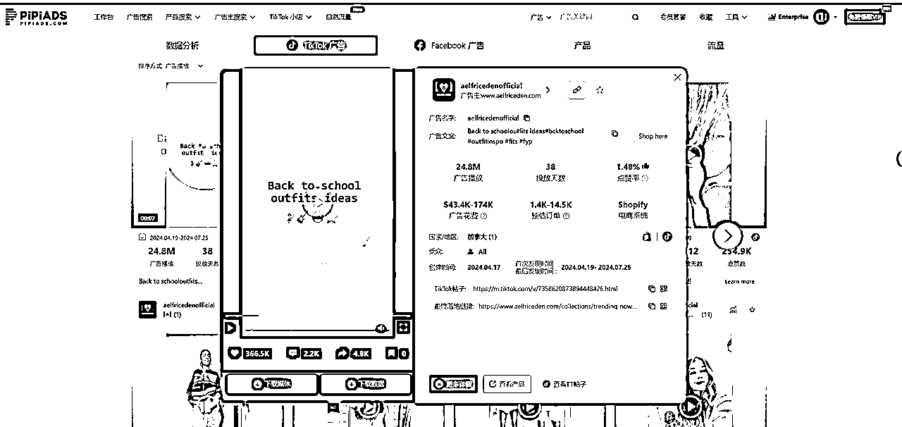

快节奏轮播，多套穿搭+，制作门槛低

主要靠制图工具+图片拼接完成

素材2：2440万次展现

广告文案：WHICH HOODIE IS YOUR FAVORITE?😉 #aelfriceden #aelfricedenhaul #hoodie #fall #unboxing #fallfashion #streetwear #viral #trending

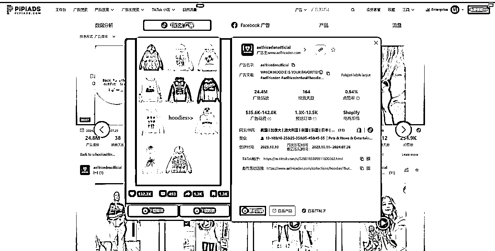

直接套用剪映、可画类图片模板完成品牌曝光与宣发

开场三秒钩子：hoodies>> 直接点题

素材3：1760万次展现

广告文案：Tops to wear this summer with your friends #fyp #summer #foryou #inspo #clothes

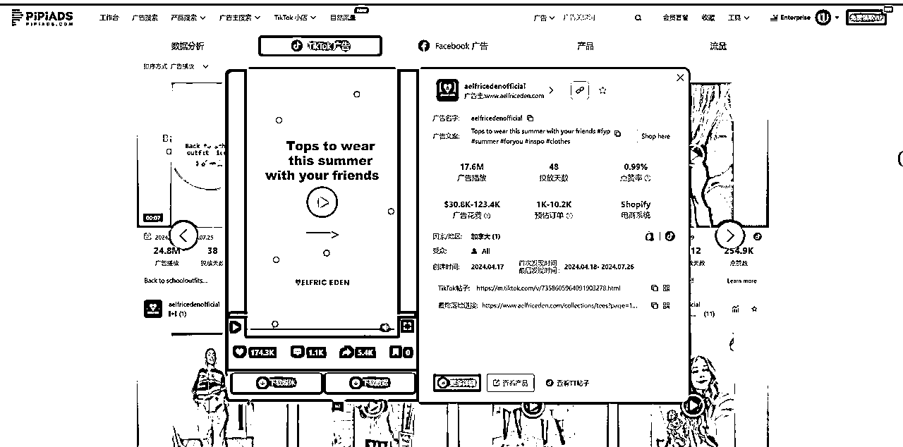

视频轮播图形式，简单高效

开场三秒钩子：Tops to wear this summer with your friends

个人解读：素材整体逻辑简单高效，对平台流量与算法的理解很到位，但细节打磨空间仍大，图片质感与设计可进一步升级。

优化建议1：背景图可选用更高级的纯色质感图，提升整体调性。

优化建议2：服装创意可更大胆释放

pipiads 上可挖掘大量同类低成本高产出的创意案例。

创意一：

抽帧混搭，多套实拍与产品图快速拼接，形成流畅过渡兼顾实景与平面，刺激冲动购买。

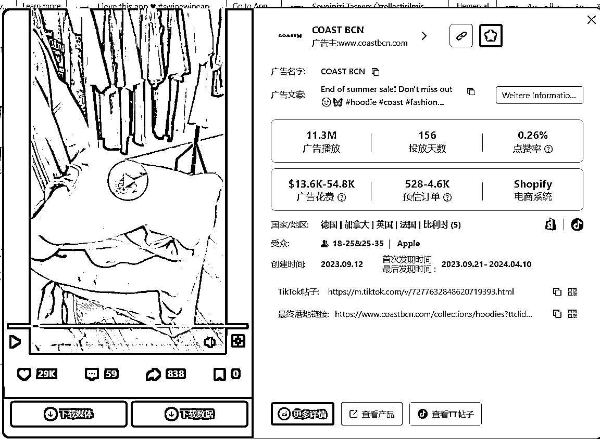

创意二：

真人实拍全套穿搭，前三秒真人出镜，后续每秒切换一个场景卡点展示多套造型。

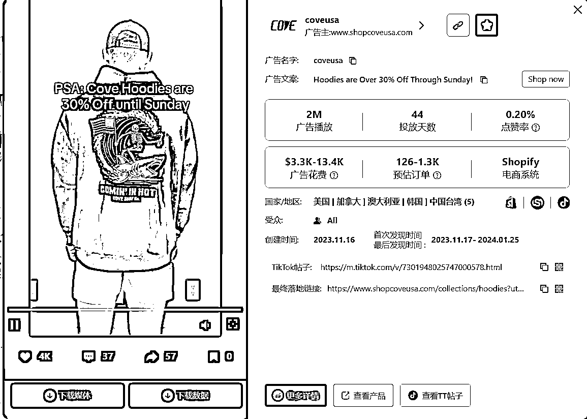

创意三：

真人实拍全身展示，如不方便露脸可用背影呈现，通过肢体动作表现穿着效果。

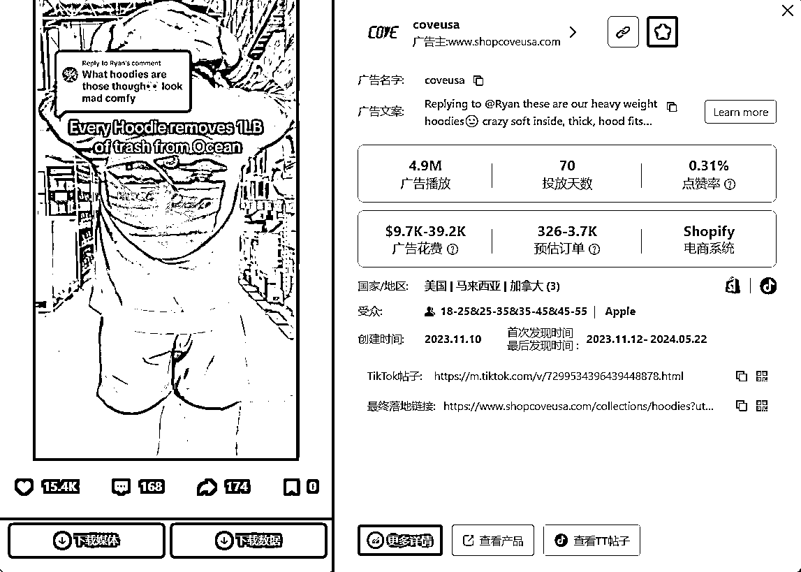

创意四：

多人物实景展示叠加商品图，增强购买欲望。

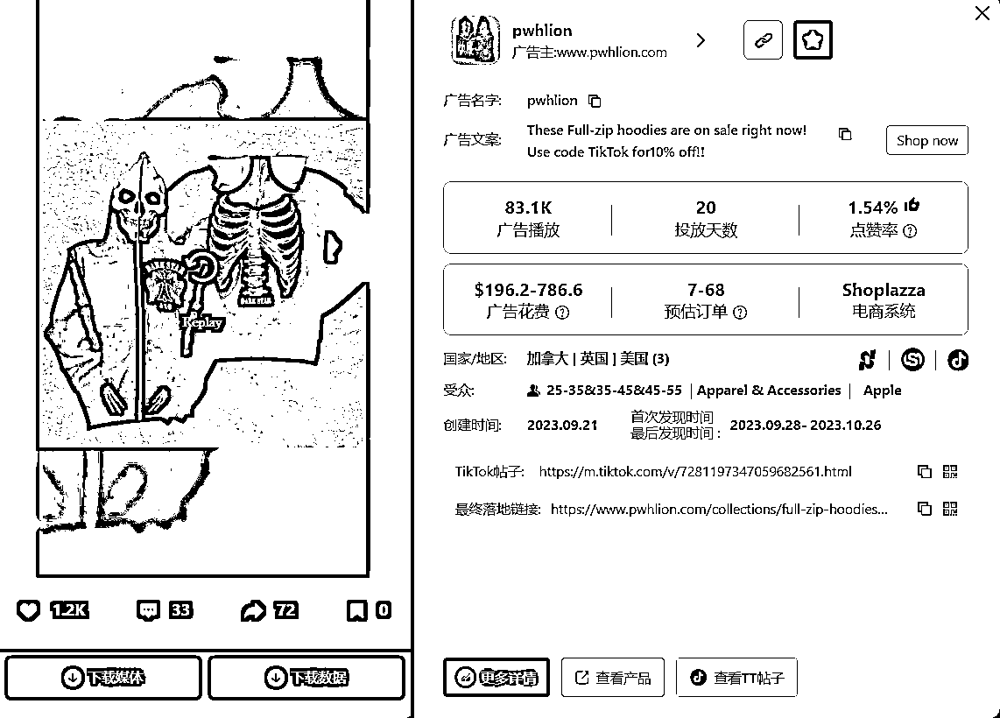

创意五：

一套实拍穿搭+一张同款商品合成图，制造实景种草效果，促进下单。

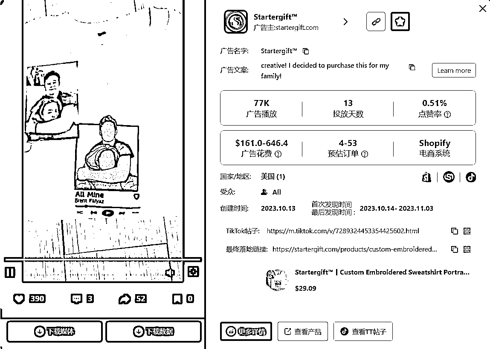

创意六：

情绪化文案+基础款单品，可在沙滩、电梯、商场等场景拍摄人物氛围感画面。

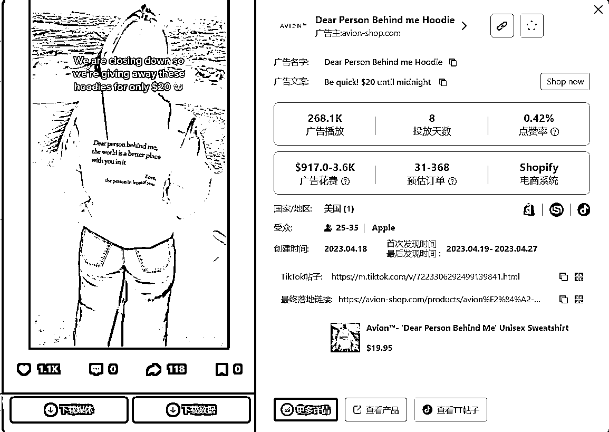

pipiads 平台汇聚全球广告创作者的创意灵感，可持续挖掘。

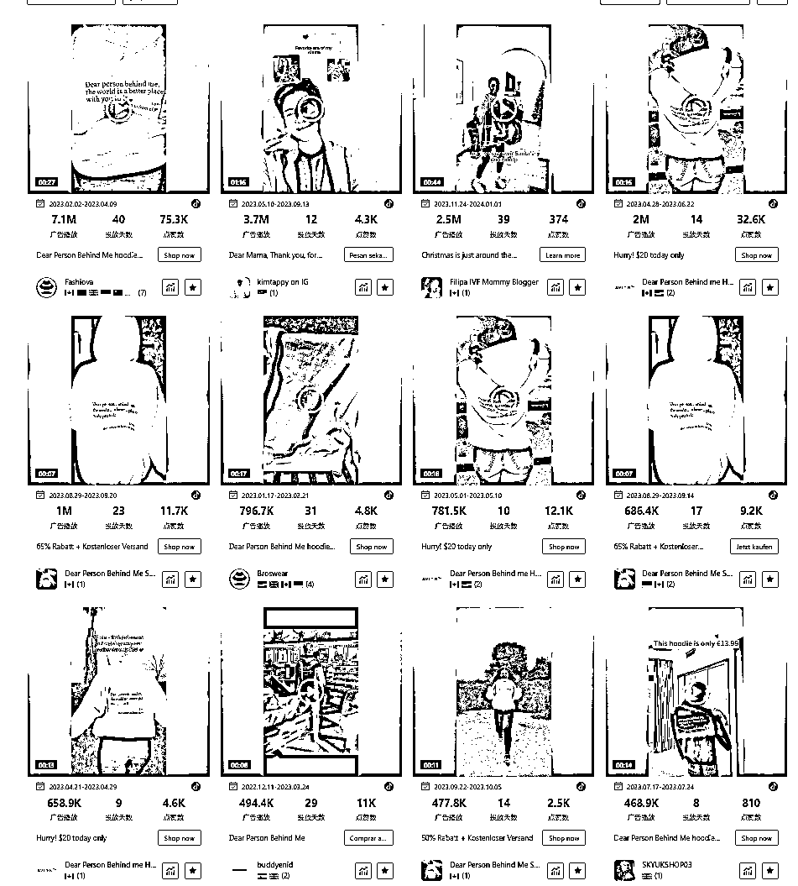

立即体验：www.pipiads.com

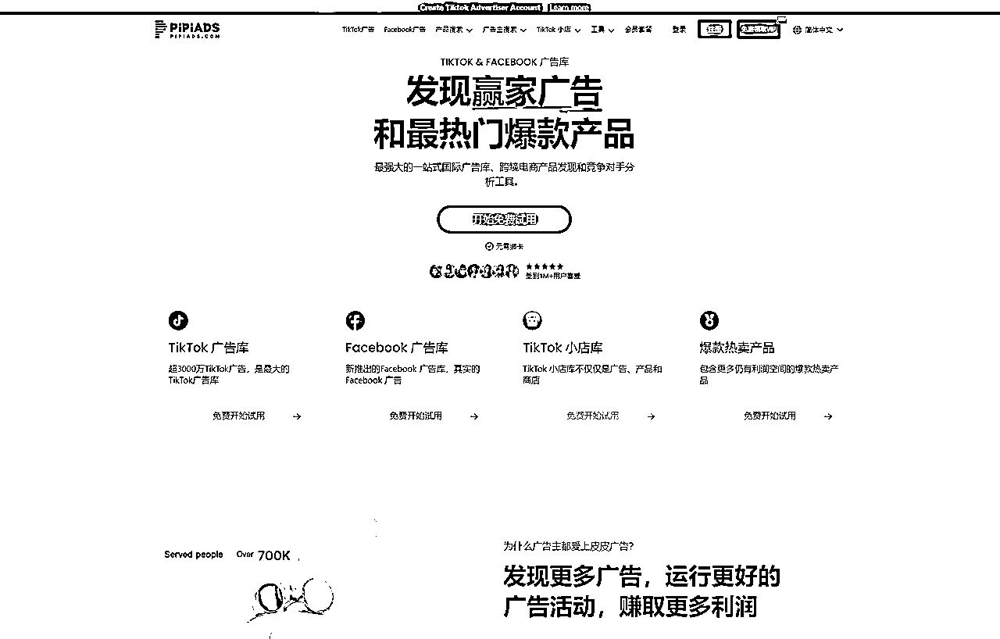

总结

Aelfric Eden 的增长并非偶然，产品设计与市场策略之外，更关键的是对文化的深刻洞察与高效的传播执行。精准定位、文化融合、渠道多元、KOL 联动、用户反馈闭环、全球化视野与社会责任感，共同构成了品牌的成功样本。对想在细分市场突围的品牌而言，具有很强的参考价值。

品牌的成败，最终取决于对目标人群的精准把握，以及对消费者需求的洞察深度。