# 小红书低粉高获客玩法，每月精准「引流高客」800+，加V率30%-40%，1.5万字SOP

如果你正为公域获客发愁：产品不错但客户难找；客单价高却扛不住流量成本；在小红书上折腾半天，转化寥寥——那这份总结可能正好对症。

我是叶凡，做保险四年，带团队累计运营粉丝超1200万，横跨抖音、快手、小红书、视频号、百家号等平台。互联网保险刚起步时，我们抓过政策红利，单账号单月实现过500万营收。

2023年3月，我们发现小红书保险赛道有空间。当时一个保险客户的微信号，市场价能到800-1000元。

结合我们多年跨平台的账号操盘能力，我们决定入局。现在运行了近一年半，已经沉淀出一整套标准流程：

发布笔记 → 小红书内回复咨询 → 引导加微信 → 微信端沟通需求、出方案、跟进 → 成交。

这套打法有几个显著特点：

1. 粉丝量不是重点，低粉照样获客。刚开始时，一个只有16个粉丝的号，带来了21个咨询，加V率38%，当天就成交了一单8999元的高端医疗险。

2. 加V率稳定在30%-40%。我们的客户属于高客单价，年保费从几千到几十万。小红书用户教育背景普遍较好，保险行业25%的加V率已经很优秀。我们通过调研同行、反复优化SOP，做到了30%-40%，成了同行参考的对象。

3. 客户精准，成交快。我们只发垂直内容，来咨询的人需求明确，后端不需要筛选无效线索，因此成交周期短：最快1-3天，多数在两周内完成。

4. 不靠付费投流，全凭自然流量。

这份SOP大约1.5万字，是在带新人用的流程基础上，吸收其他行业案例，前后迭代了一个多月。希望其他行业的朋友看完也能套用到自己的业务里。

链路逻辑是相通的。目前房产、母婴、婚恋等赛道已经有人用类似方式在做。

接下来讲四部分：
01 为什么来小红书获客，适合谁？
02 高加V率的关键逻辑
03 从0-1再到矩阵放大的执行SOP
04 避坑心得

# 一、为什么选小红书？

## 1. 用户质量高：有消费力、有认知、体量大

小红书聚光平台官方数据：月活2亿，用户月均可支配收入超4000元，50%在一二线城市，70%是90后。

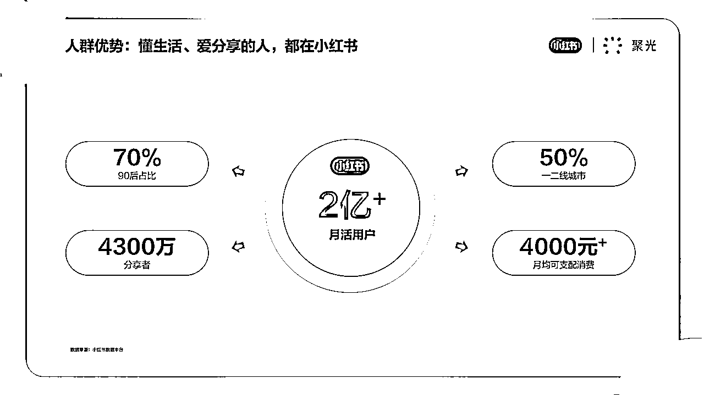

这个人群跟互联网保险用户很匹配。

当时一个微信能卖800-1000元，也能侧面说明小红书的用户价值。

我们实测下来，小红书用户的消费能力高于抖音、快手和视频号。

## 2. 平台种草氛围浓，用户精准，产品容易卖

小红书启动页写着“你的生活指南”，这决定了它的内容调性。

它已经部分替代了百度的功能。大家在生活中遇到问题，常常会来小红书找答案。

我自己就是重度用户：从怀孕起，各种攻略都在小红书查。产后第一个月，这个App几乎不离手。遇到带娃难题，第一反应就是来搜别人的处理方式，看到素人分享，感觉很真实，就照着试。

看着看着就会被种草。

数据表明，81%的小红书用户曾在App上浏览产品或服务后产生购买意愿。

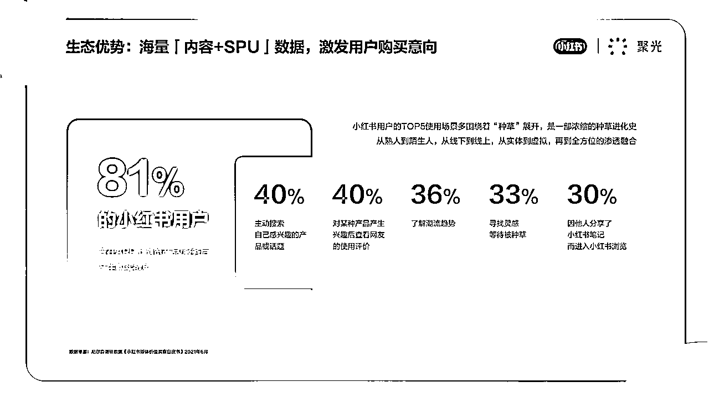

用户愿意来这做攻略、也容易被种草，这是小红书的独特优势。

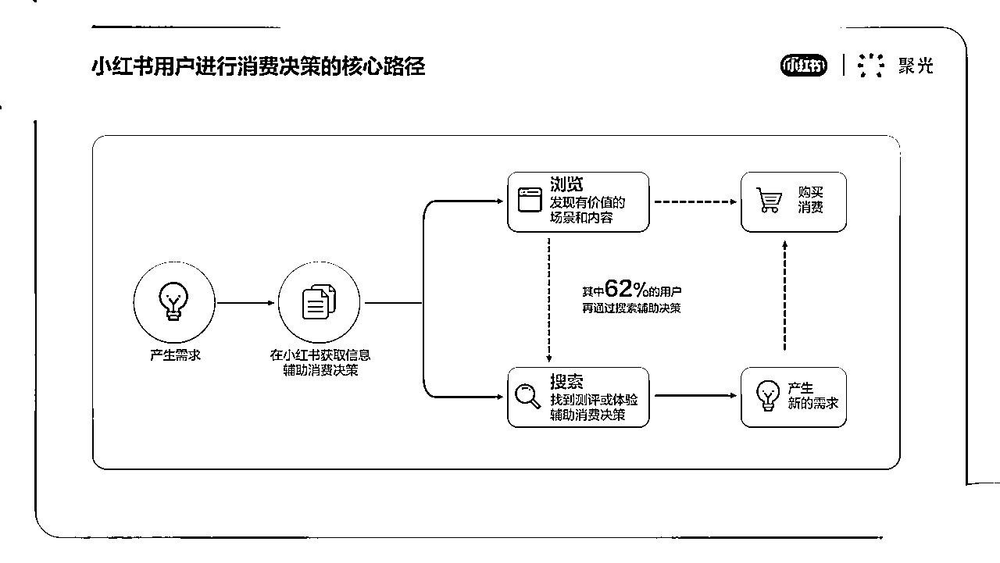

我们只需发布帮助消费决策的内容，让目标用户刷到，就有机会被种草，进而完成获客。

一句话：小红书有足够多优质客群，只要你的用户画像匹配，就值得深耕。

# 二、高加V率的核心逻辑

这套获客链路的关键是：做小红书的「精准搜索流」🔍

## 1. 什么是「精准」「搜索流」？

◼️ 精准：笔记只围绕产品展开，跟产品无关的题材不碰。

比如保险，可以发“某款高端医疗险评测”这类具体产品笔记；但“社保科普”不建议发，因为它跟产品没有直接关联。

◼️ 搜索流：用户不是刷到你，而是通过搜索找到你。

约40%的用户会靠“搜索”辅助消费决策，这个流量池非常大。

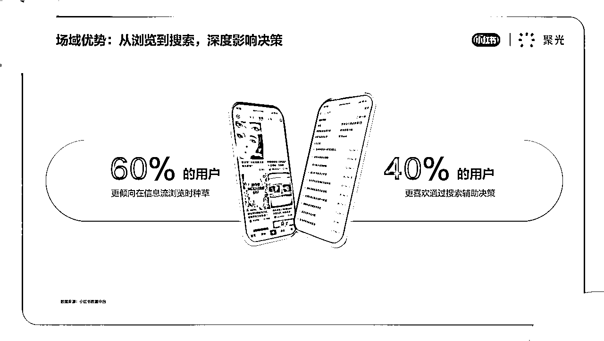

结合起来就是：用产品相关笔记，去截获用户的搜索意图，让用户看到、被种草、主动咨询，直到成交。

举个例子：有人已经动了买保险的念头，只是不知道怎么选。他心里想的是“XX最近很火，到底值不值得买？适合我吗？”然后带着问题来小红书搜。

他看到了你的笔记，觉得靠谱，于是来私信。

## 2. 为什么一定要做「精准搜索流」？

本质是快速筛选客户，省后端精力，缩短成交路径。

成交公式是：需求 + 方案匹配 + 信任你。

精准搜索流直接完成了第一步：筛选出有需求的人。我们不必费劲去教育用户“你应该买保险”，这一步省下大量时间。

我们要做的，只是把产品价值写清楚，并在服务中建立信任。

给大家看几个真实对接案例，客户有多直接：

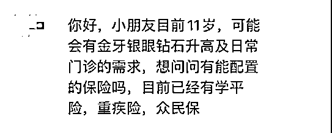

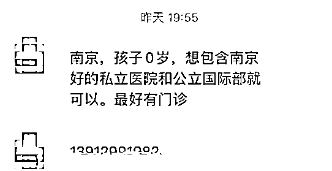

## 3. 高加V率的几个关键环节

先看用户路径：

用户搜索问题 → 平台根据关键词匹配笔记 → 用户在结果流中看到封面和标题 → 点击进正文 → 对产品或资料产生兴趣 → 私信 → 加微。

这里有个背景：小红书是双列信息流，不是抖音那种上下滑瀑布流。用户先看到的是封面和标题，因此这两者几乎决定了笔记的点击率。

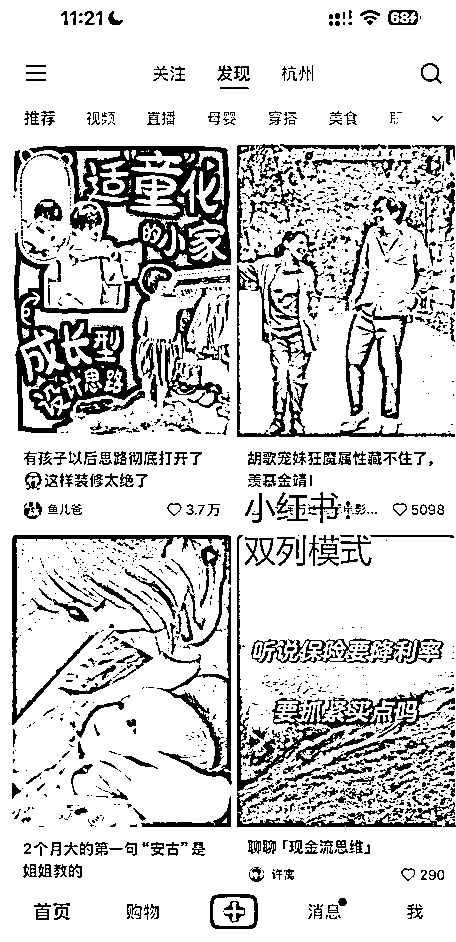

拆解下来，用户要完成四个动作：
1. 关键词匹配
2. 点击笔记
3. 产生咨询兴趣
4. 加微信

对应的运营动作：
1. 做搜索词表，把词埋进标题、封面、正文、配图，扩大被搜到的概率
2. 优化封面和标题，提高点击
3. 正文讲清卖点，埋下咨询钩子
4. 设计导流话术和跟进细节，把留V率拉高

以上动作怎么做，第三部分展开。

# 三、具体执行SOP

我们前期走过弯路，后来找到正确打法，跑通0-1，然后矩阵放大，最后优化了导流环节，把加V率做到30%-40%。

分两部分讲：避坑经历 + 从0到1的SOP。

## 1. 踩过的坑：从弯路到跑通

### 三个月的弯路

刚进小红书时，我们浪费了三个月。

因为做短视频起家，习惯性去找视频类对标账号。

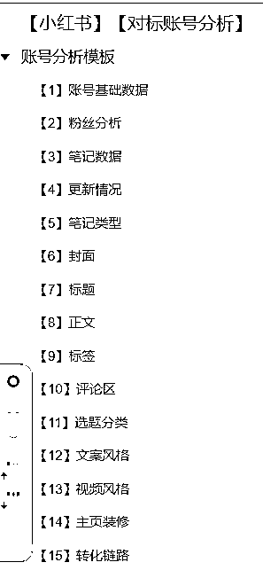

当时发现几家成熟的矩阵团队，内容结构是“泛流量视频涨粉 + 精准视频获客”。

泛流量视频：跟产品无关，比如社保福利、报销攻略、存钱方法、省钱技巧。受众广，容易起号。

精准视频：直接聊产品，比如“儿童高医怎么选”“XX高医测评”。受众小，但都是带着需求的潜在客户，内容好就能来咨询。

我们学他们两条腿走路，开了3个号，3个月累计1万多粉丝，咨询却少得可怜。

后来发现这些对标在投聚光。我们也投，结果一个微信成本80-400元，又贵又不稳定。

视频获客这条路没走通。

### 看到机会，跑通0-1

正发愁时，保险圈冒出一批图文号：封面不起眼、点赞少、粉丝少，但咨询量很惊人。笔记高度相似，制作成本极低，转化却很好。

而且我们盯着的几家头部团队，一边做视频号，一边悄悄上了这类图文号。

早期的笔记已经搜不到了，我拿近期的类似案例对比：

◼️ 第1组：
两条笔记封面文字相同，只是换了模板，标题和正文也接近。评论区咨询量分别有50-100条。

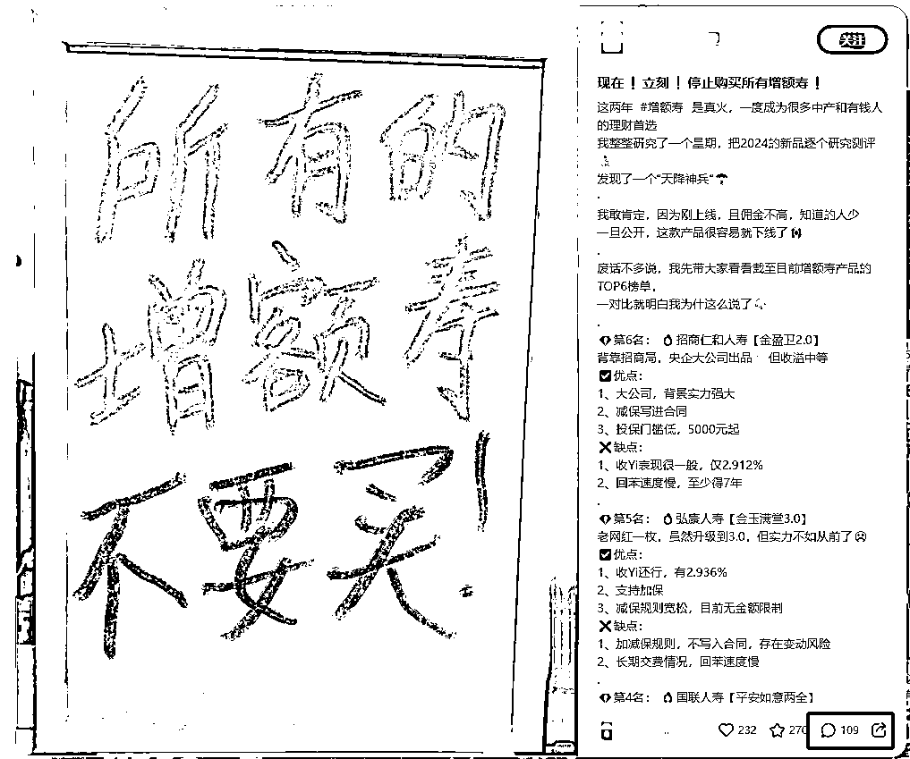

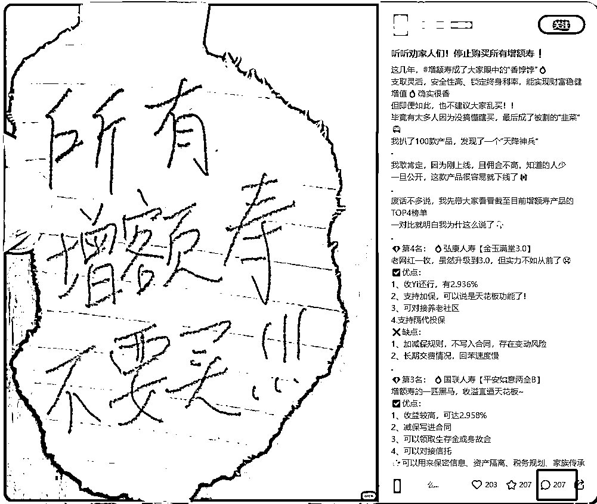

◼️ 第2组：
两个不同账号，封面、标题、正文略作调整，咨询量都是100-200条。

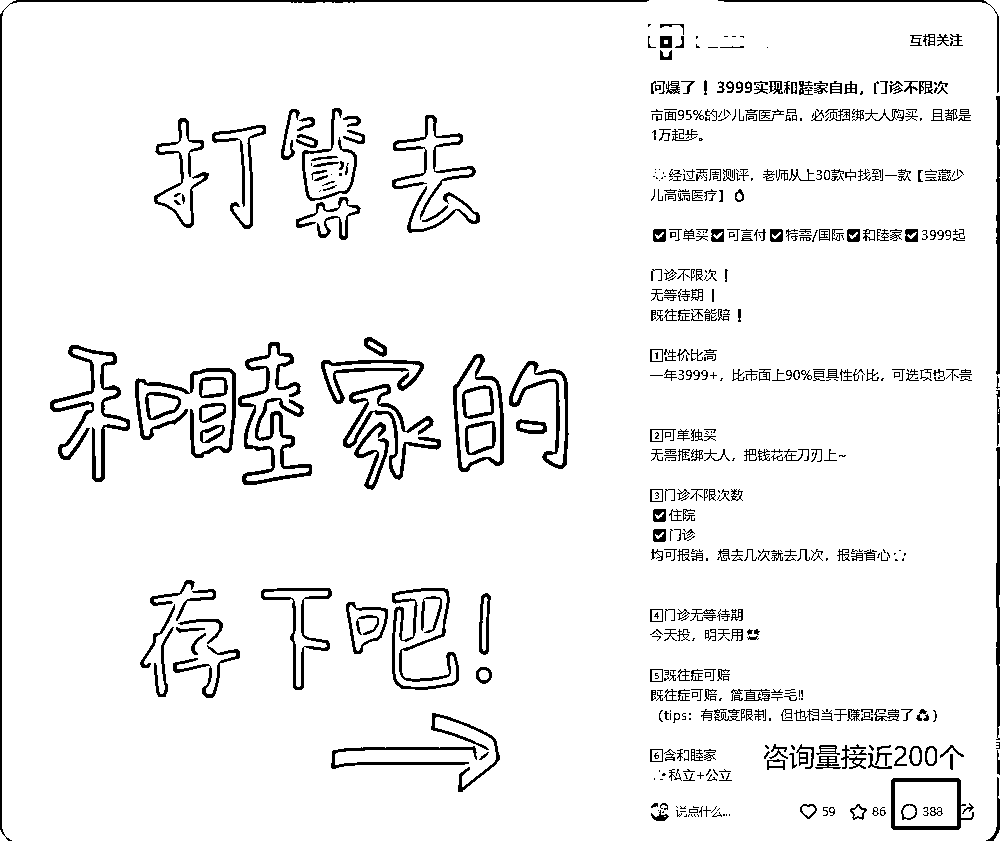

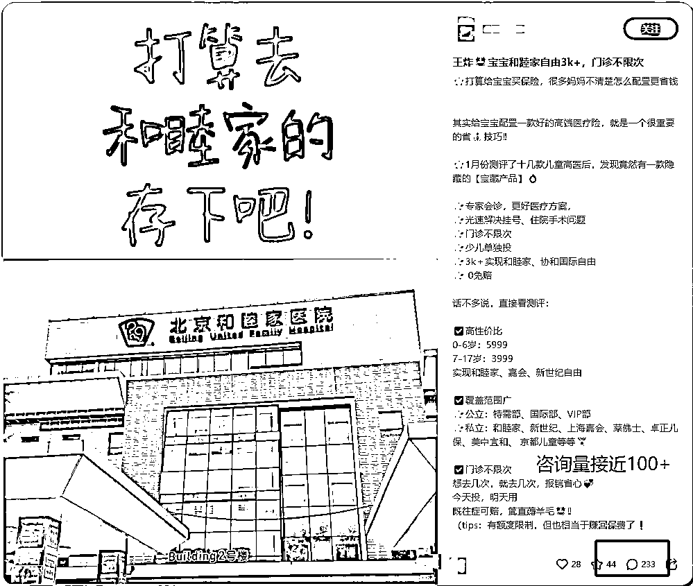

看到这些，我们确认：这是机会。

于是快速模仿爆款图文：换封面样式、换标题、微调正文。不到半个月，一条笔记带来50多个咨询。图文不需要拍摄剪辑，制作速度远快于视频，效率一下就上来了。

接着我们研究这些图文的底层逻辑，到底是什么在起作用。毕竟不能一直抄同行，抄得越像，效果越差。

研究后得出：小红书精准搜索流。

按这套方法，我们跑通了0-1。

我们还做过对照实验：同一条笔记分别发在1万粉的泛流量号和几十粉的垂直号上，结果是垂直小号获客效果更好。垂直+精准的价值，数据说得很清楚。

分享这段经历，有两个价值：

1. 做微信导流业务的朋友一定记住：小红书粉丝量不重要，垂直+精准+搜索流才是核心。这个坑我们替你踩过了。

2. 做平台要盯着同行，机会常常藏在同行的新动作里。

## 2. 从0到1的SOP

包含两块：
◼️ 内容制作：注册账号、养号、建搜索词表、找对标、搭选题库、做出第一个爆款、复制放大
◼️ 私信导流：调研同行、持续迭代

### Step1 注册账号

账号名、简介、头像这些细节略过。

关键是尽量做蓝V专业号（年费600元），理由有二：

① 有些行业有资质门槛，如保险、律师。认证后发产品笔记才合规，不会被随意限流。这是最基本的入场条件。

② 专业号的导流限制更少，这是我们的实际体验。而且2025年1月7日起，小红书规定「私信获客工具」是全行业商家和用户交换联系方式的唯一通道。留资卡片很好用：用户能一键填电话，也能通过微信名片、企业微信名片加你，还能留下自己的微信号。

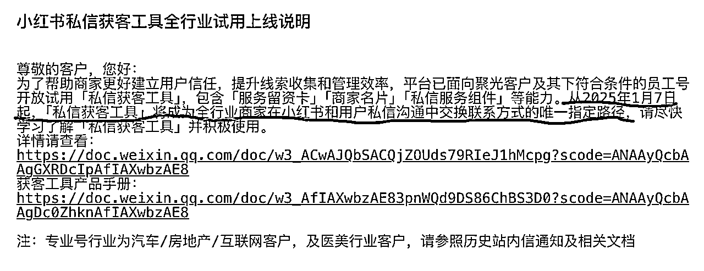

不认证也能做，只是受限更多，导流方式会不一样。

👉小红书专业号入驻网站

### Step2 养号

我们没有特别的操作，就是模拟真人：平时刷刷小红书，搜索关注的话题。每天20-30分钟，3-7天基本就正常了。

### Step3 梳理搜索词表

这一步极其重要。

搜索词要提前埋进笔记，让目标用户搜索时能看到你。

搜索词从三个渠道搭建：

① 聚光平台后台的推词、行业推词功能

网址：聚光平台

操作流程：

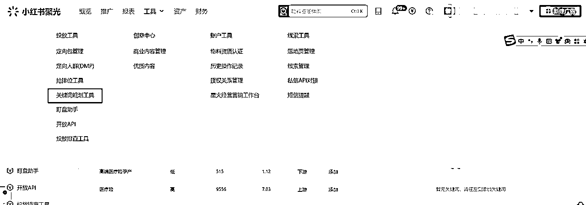

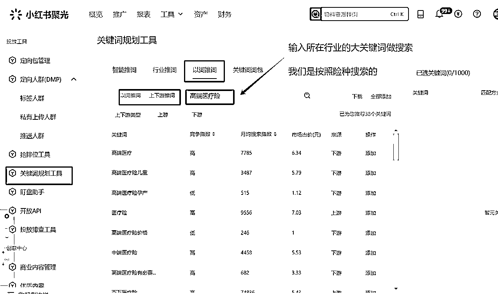

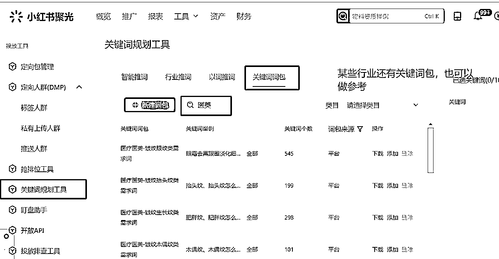

先输入大类词，如高端医疗险、重疾险，再往下挖二级词，如此反复。

最后把结果整理成表，提炼高频词。

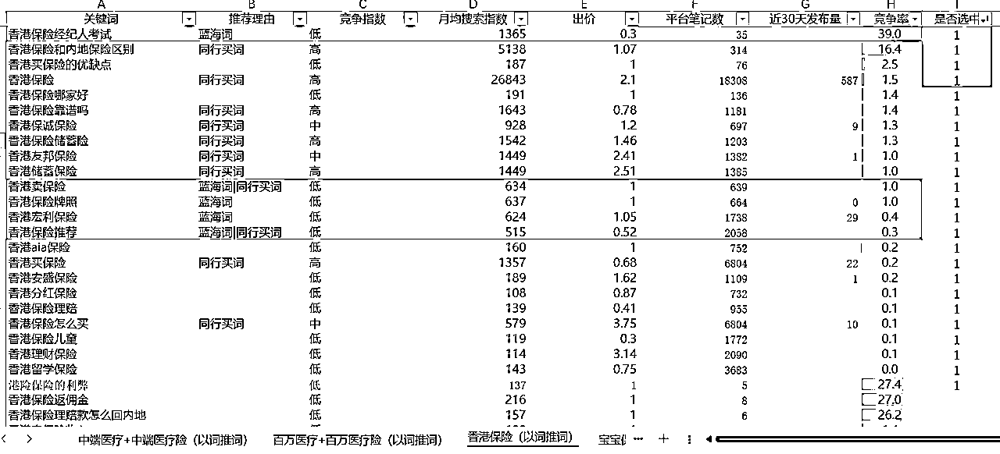

说明：
- 聚光需要企业充值，不同行业门槛不同，保险是2万，不投放可退。
- 不用聚光也行，下面的方法同样够用，只是效率低一点。

② 小红书搜索栏 + 分类栏

步骤：
- 输入大词（这里用“高端医疗险”演示）
- 把联想出来的话题都点开
- 再结合分类栏逐层下探，直到没有新话题为止

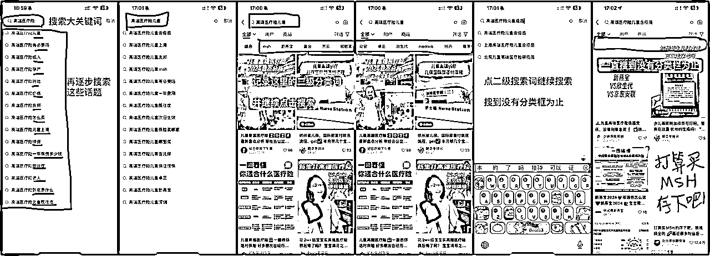

- 将搜索词整理归类，记录热度高低。判断热度不看点赞收藏，看评论区咨询量。

怎么判断笔记咨询多不多？看评论区。

有咨询的评论区长这样：
（用户留言“表格”，其实是在问博主领资料，博主就能私信导流。）

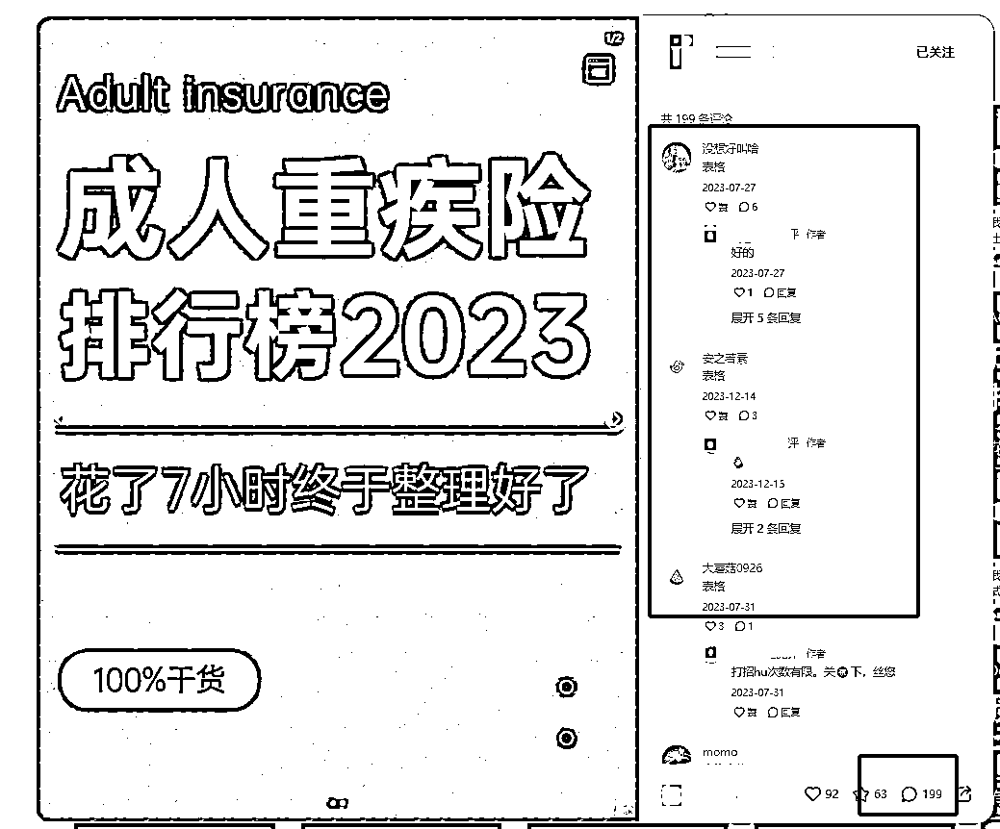

四步走完，行业搜索词库和热搜词就出来了。

以高端医疗险为例，搜索词可以分成：
- 人群：成人、儿童、孕产
- 功能：疫苗、续保、既往症等
- 品牌/产品：友邦、MSH、京东、新燕保等
- 场景：和睦家、卓正、协和国际、嘉会等医院，儿保
- 地域：上海、深圳、北京……
- 问题后缀：保什么？有必要吗？对比、价格

举这些例子只是为了给思路，大家按同样方式去扩展。

③ 拆同行爆款，总结高频词

目的：找到用户高需求词，优先创作相应笔记。

爆款标准依然是评论区咨询量，不要看点赞收藏！

操作方法：找评论区咨询多、近期仍在出单的笔记，特别是“谁发谁火”的选题。分析封面、标题、正文，记录高频出现的词。

比如高端医疗险里，和睦家、协和国际这类医院词火得概率大。

所以我们会优先发解决这些医院费用问题的笔记：比如能报销和睦家费用的A产品种草，或ABCD多款产品对比测评。

三步下来，搜索词库和重点词就清楚了。

搜索词按人群/品牌/产品/险种/功能/场景/合集等维度划分，其他行业大致也能这样分，搜一下就明白。

### Step4 找对标账号

在第三步搜索时，你会发现值得对标的账号。

选对标的两个标准：评论区咨询量高、更新稳定。

重点对标模板化强的账号：选题、标题、封面、正文都有明显套路，拆起来非常轻松。

例如这个账号：

◼️ 封面标准化：固定模板，主标题两行字+副标题一行+左下角一行字+左上角英文
- 主标题：2行，险种类/人群方案/产品名+种草词（黑马、王牌、王炸、之王、榜单、宝藏、第一名、大央企、年化8.1%、绝版、地板价、逆天、国企、n月排行榜、万能、神仙、顶级、头部、热门）
- 副标题：1行，表示价值或卖点（看完就会！花了7天/8小时整理！致命缺点）

◼️ 选题公式化：排行榜类——③④⑦；避坑类——⑤⑥⑨⑩；险种种草——②⑧；产品种草——①⑧

正文也有固定结构，不再贴图，懂即可。

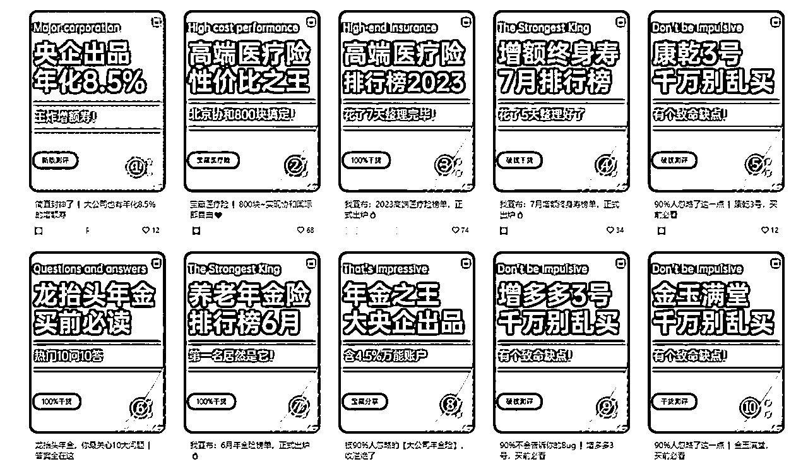

如果找不到模板化账号，也没关系，你可以按这个思路自己成为行业里的模板号。

有圈友问有没有找账号的捷径工具？没有。

# 四、避坑心得

最后整理几点：

1. 别把粉丝当目标。小红书获客关键是垂直内容+精准搜索，粉丝量不是决定因素。

2. 保持对同行的敏感。我们很多机会都是看同行动作发现的，比如图文笔记的风口。

3. 不要执着于泛流量。泛粉再好看，也不如精准用户带来成交。一百个对的粉丝，胜过一万个围观者。

4. 导流设计要以“降低用户行动门槛”为核心。封面、标题、正文、钩子、话术，每一步都在减少用户犹豫。

很多人有好产品，却在小红书上做成了一潭死水。不是平台不行，是方法不对。

希望这份SOP能帮你绕开那三个月的坑。觉得有用就转给同样需要公域获客的朋友，把小红书的精准流量，变成你稳定持续的客户来源。

在小红书刷到一种“隐形账号”，粉丝数只有几百、上千，甚至用新红这类数据工具都搜不到，但笔记带来的咨询量却高得惊人。这类账号粉丝少、转化率高，做关键词搜索和找对标时非常值得留意，别只盯着大号。

接下来进入第五步：建三个素材库——主题库、封面库、标题库。

先说明什么是“选题”：简单说就是笔记想表达的核心，比如“小孩的保险怎么买”。封面、标题和正文的对应关系，见下图。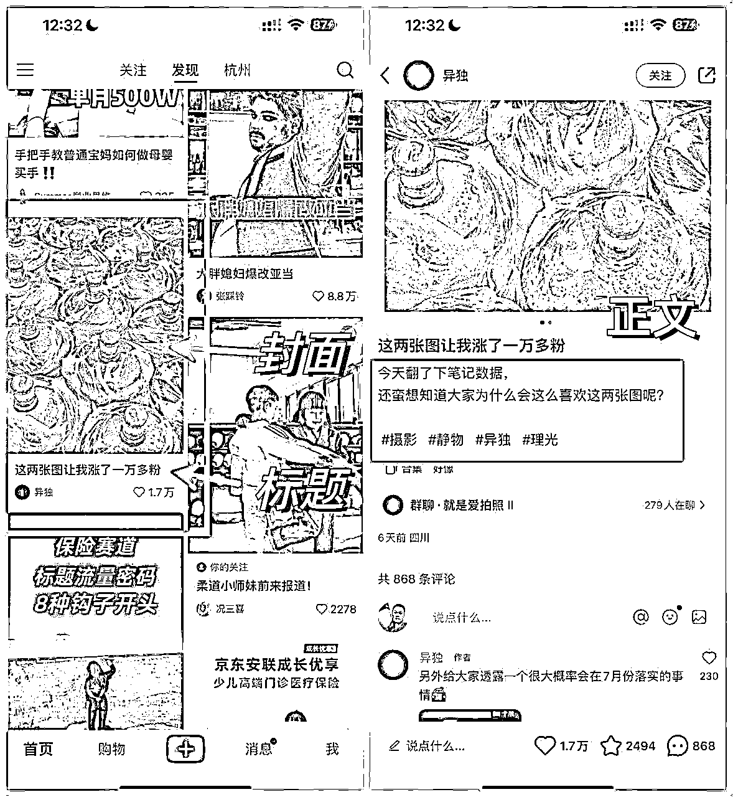

为什么要把这三个库分开？因为一条高赞笔记可以拆成四个模块：选题、封面、标题、正文。把这四个模块当作独立的积木，自由排列组合，就能持续制造热门内容。

用几个真实案例说明：

案例一：保留原笔记的选题、封面、标题，只重写正文。左边四篇笔记的数据都很亮眼，右边是两版正文的差别。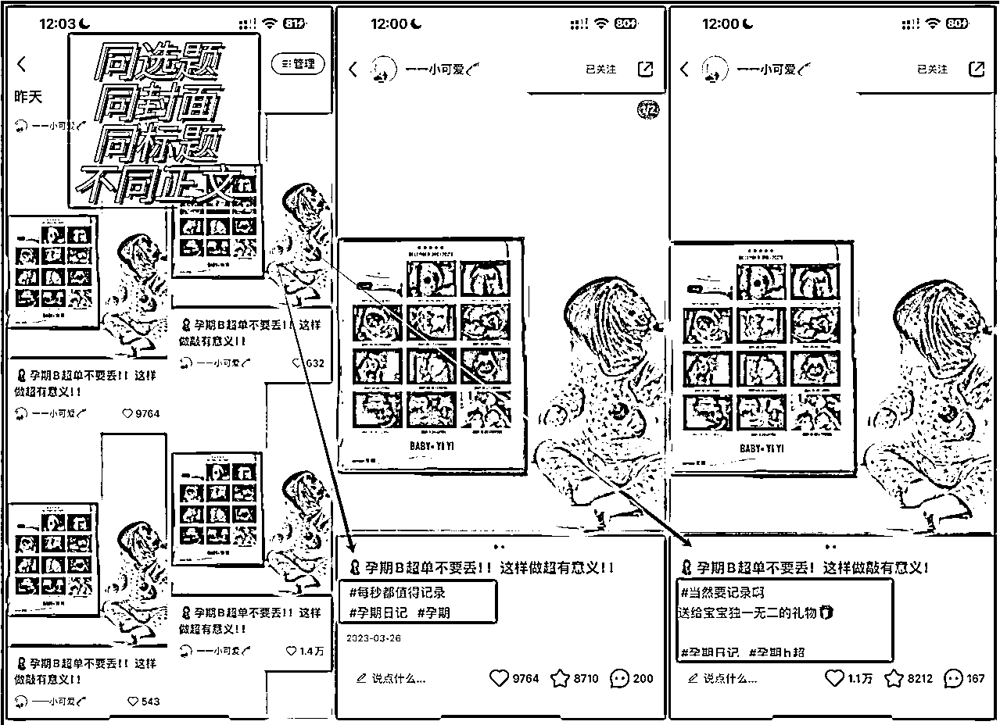 可点链接对比：
http://xhslink.com/s6buxN
http://xhslink.com/1WjuxN
http://xhslink.com/9nuuxN

案例二：选题还是B超报告拼图这类，封面也一模一样，但换了标题和正文，数据同样很好。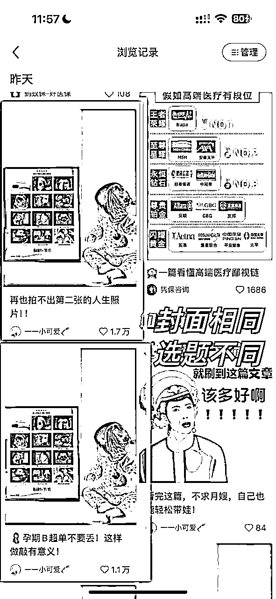 对比链接：
http://xhslink.com/1WjuxN
http://xhslink.com/1wewxN

案例三：封面版式相同，标题句式都是“拜托，____的姐妹赶紧收藏起来”，选题和正文完全不同。一个讲拍摄技巧，一个讲旅行攻略，结果都成了爆文。

案例四：只沿用同一种标题句式，封面、选题、正文和行业全部更换。五篇笔记的标题都是“拜托，____的姐妹赶紧收藏起来”，依旧全部走红。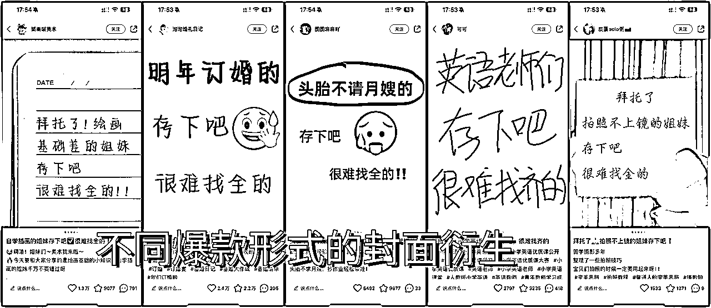

所以，所谓爆款，就是四个要素的组合游戏。把行业里验证过的要素拆出来，重新组装，就能快速产出第一条爆文，并反复复制。

主题库怎么搭？

先新建一个表格，把看到的爆款链接、评论数、点赞数等信息都放进去。 然后归纳主题方向。以保险为例，常见的选题方向有：产品测评、榜单、产品种草、避坑、需求合集、需求种草等。优先模仿那种很多人发都能火的题材，比如《3999和睦家自由》《MSH欣生代猫腻》。之后刷到新的爆款，要持续往里补充，创作时才能随时对标。

封面库同样可以直接复用被验证过的样式。

用法一：把其他行业已经跑通的封面版式，原样搬到自己的行业。比如拍摄类账号常用的纸片风格，旅游号直接套用也能跑。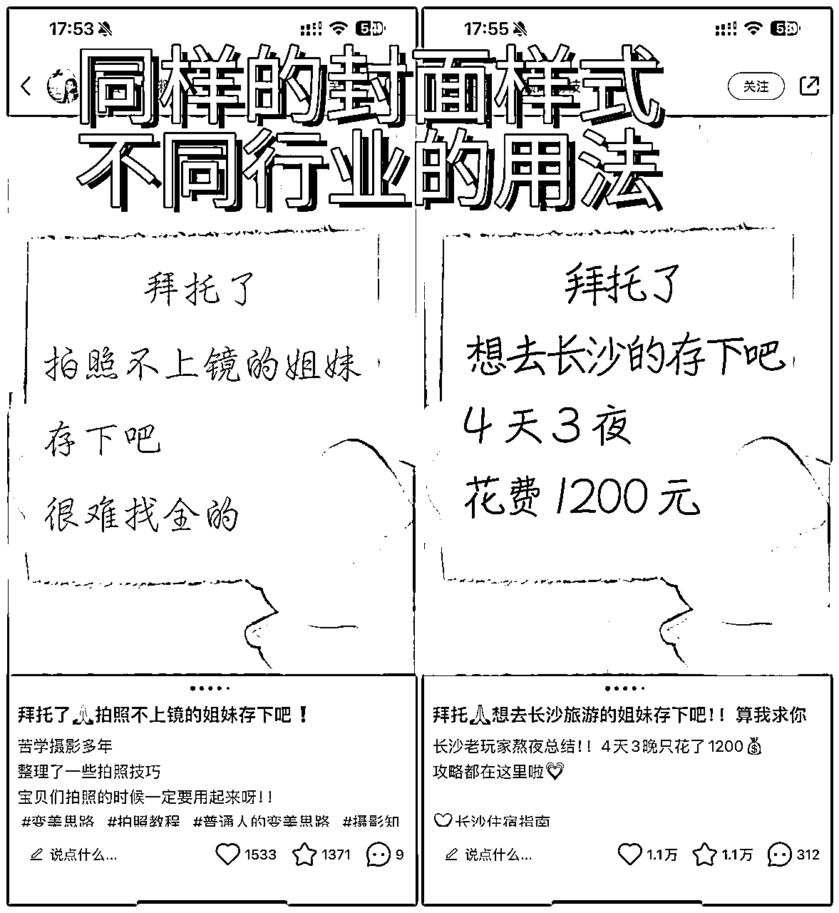

用法二：一条笔记火了之后，换几套封面再发一遍，依然有爆的可能。小红书图文查重并不严格，这个方法效率极高。下面两个封面乍看不同，其实文字内容完全相同，只是换了版式。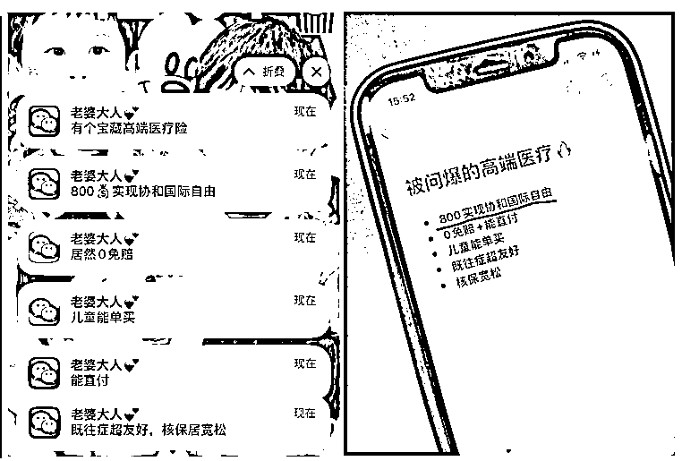

我这边还整理了一批保险领域的热门封面模板，可以直接拿来用。保险圈子的朋友如果缺客户，欢迎私信聊合作，我们手上有稳定的精准资源。

标题决定点击率，所以标题库也是可以套用的。分两类：

第一类是平台热门的标题句式。比如“终于有人把____讲透了”“____快收藏，很难找全”“一句话讲清____”，这些都是被验证过的，换到任何行业都适用。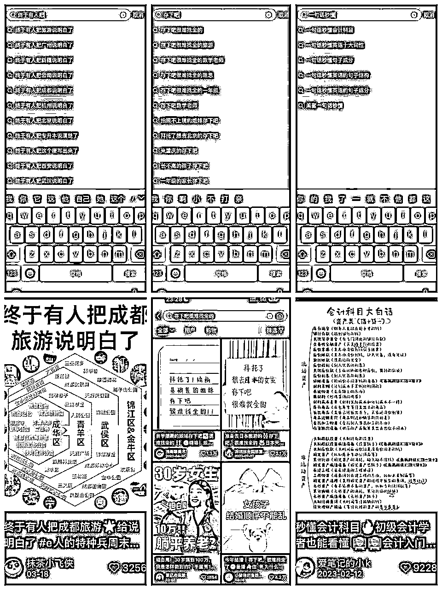 这类句式我收集了44个，平时刷到就存进文档，创作时直接挑一个替换关键词就行。

第二类是关键词组合标题。保留用户会搜索的核心词，再补上情绪词。比如同行的标题是“高端医疗险|800实现协和国际部自由”，我们可以改成“逆天！800元协和国际自由，高端医疗王炸”，核心词“协和国际”“800”“高端医疗”都保住了，情绪词和语气符号是新增的。

接下来是第六步：产出第一篇爆款。

前期的素材都备好后，就进入大量模仿阶段。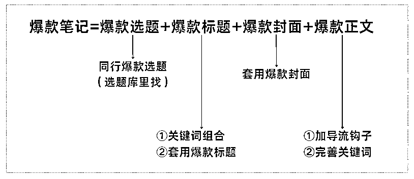

具体操作：

1. 选对标笔记。建议至少找两条以上，确保这个主题确实容易爆。示例链接：
http://xhslink.com/kVmMXu
http://xhslink.com/ja24pv

2. 提关键词。把对标笔记标题、封面、正文中出现频率高的词拎出来，按次数降序排列。前三个是核心词，其余是次级词，再对照关键词库补充。
示例拆解：
核心词：协和国际、800、高端医疗
次级词：零免赔、核保门槛低、绿通、儿童可单独参保
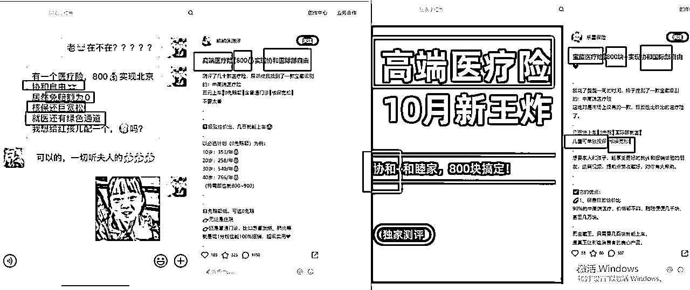

3. 写标题。可以用平台句式，也可以组合关键词。都拿“高端医疗险 800 实现协和国际部自由”来示范：
套句式：去协和国际的姐妹，赶紧收藏起来，很难找全；终于有人把去协和国际看病讲清楚了
关键词组合：每天2元，协和国际自由，10月高端医疗王炸；逆天！800元协和国际自由，高端医疗王中王

小技巧：标题和正文里加一些亮眼的emoji，能提升阅读体验。常用emoji：🔥❌🌈💁💡✔️👩‍⚕️🏥💌🔍🔸✅🚀✨❓❗️

4. 写正文。核心保证三点：一是完整嵌入核心关键词，方便被搜索到；二是把产品亮点说透；三是设置私信钩子，比如价格测算或资料包。大多数爆款笔记本身就具备这三点，如果缺什么就补什么，完整的话微调即可。还可以在原基础上做信息增量，比如补充产品细节、互动话术，再加两个钩子。范例拆解见图。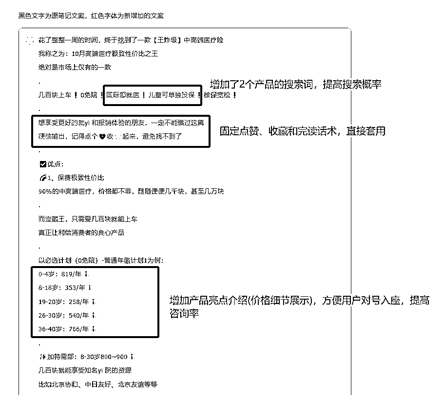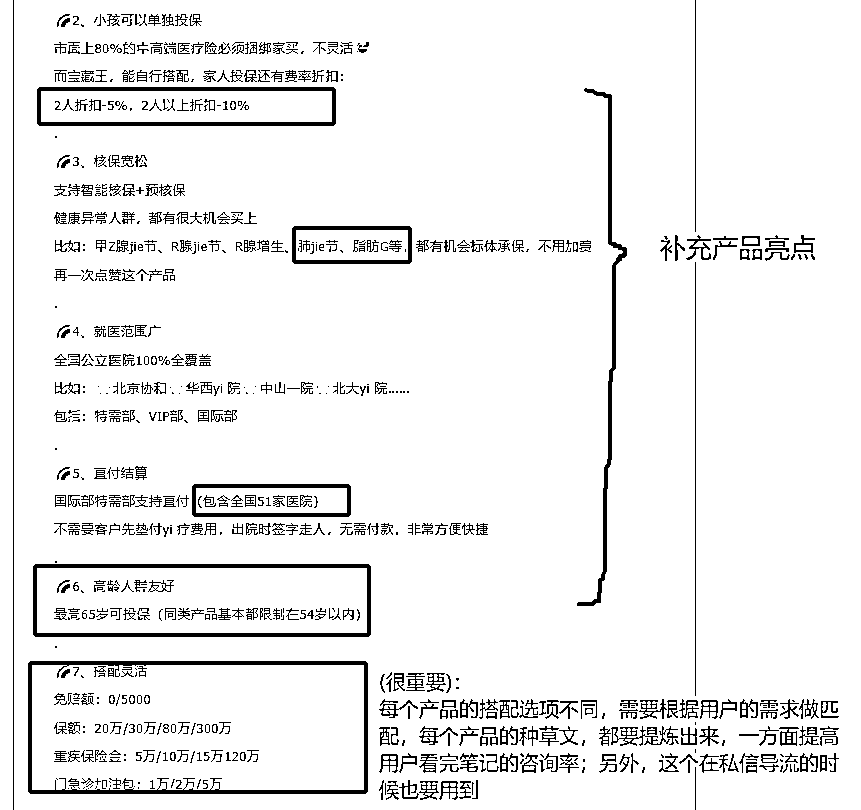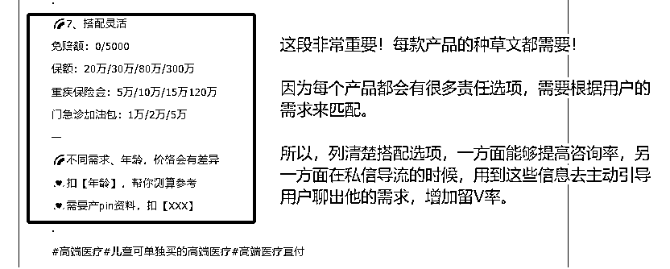

5. 做封面。两种方式：一种是模仿原封面版式，只调整次要关键词；另一种是直接套用热门封面模板，比如聊天弹框、备忘录样式，把信息填进去就行。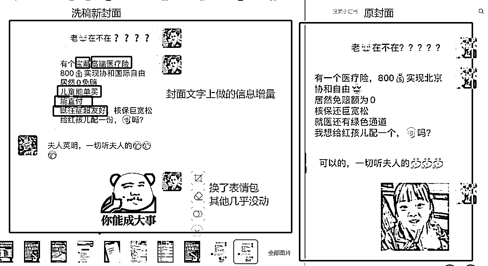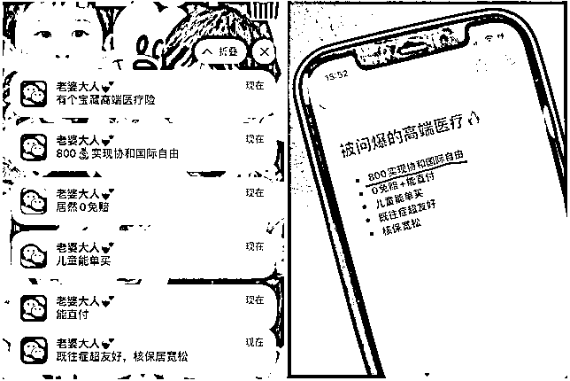

6. 做内图。根据正文讲到的亮点，把产品计划书或介绍页截图放上去，框出关键信息，加上简单备注。好处有三个：信息量更大，更容易火；显得更专业；私信沟通时也方便参考。范例见图。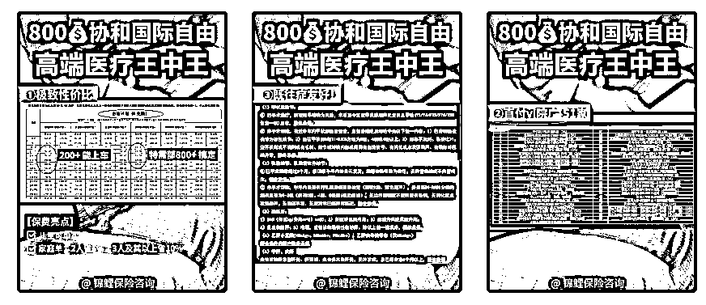

7. 发布测试。模仿某条笔记时，至少准备2—3个版本，多账号分发。主要差异化封面和标题，正文和内图可以基本不动，发完后观察咨询数据。这样快速批量测试，直到第一条爆文出现。

当第一条爆文出现后，立刻开始复制。

具体操作是：只调封面和标题，正文微调，内图不变，继续发在已经爆过的账号上，大概率还能再火。甚至只改正文其他都不动，也仍有再爆的机会。之前的案例里，同一个笔记反复发了十多次，数据始终稳定。

不断复制的过程中，还要做衍生创作。

先分析这篇笔记为什么爆，找到爆点，再围绕爆点延伸新选题。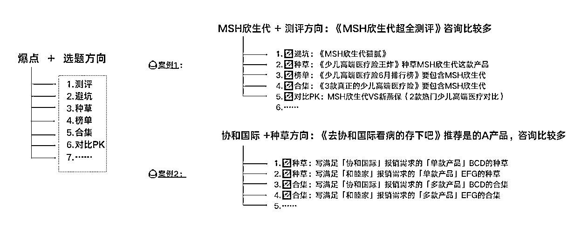

举保险行业的例子：《MSH欣生代全面测评》带来不少咨询，爆点是产品“MSH欣生代”，方向是测评。那就可以衍生同产品的避坑向内容《MSH欣生代避坑指南》，也可以衍生合集向内容《真正值得买的3款少儿高端医疗险》。

衍生创作的具体步骤：
一，提炼爆点，确定新选题方向；
二，去小红书搜相关话题，如果已有爆款，直接拿来参考创作；
三，如果没有现成的，就自己原创，标题封面沿用前面的方法，正文结构可以参考行业热门笔记的框架。

保险行业常见正文结构：
- 榜单类，参考《2023成人重疾险榜单正式出炉》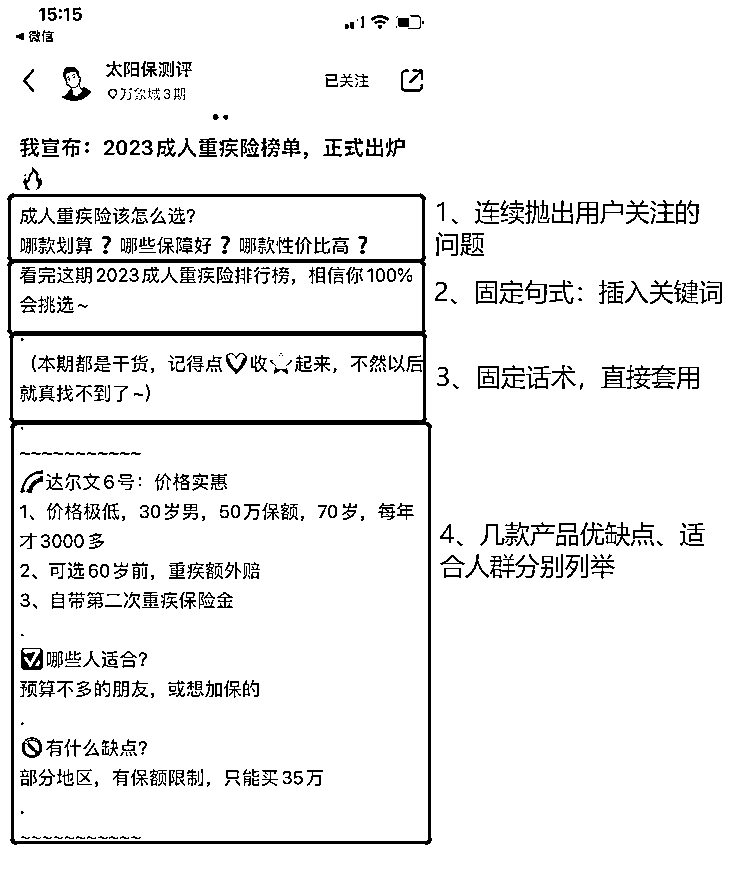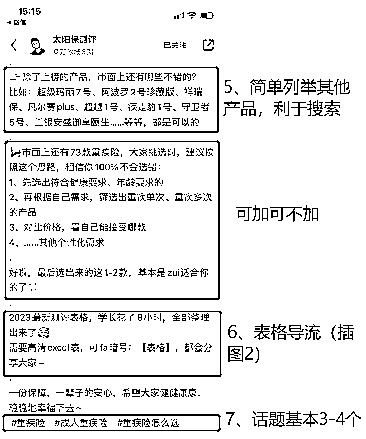
- 单款产品种草类，参考《7月增额寿别急，8月这款新品火出圈了》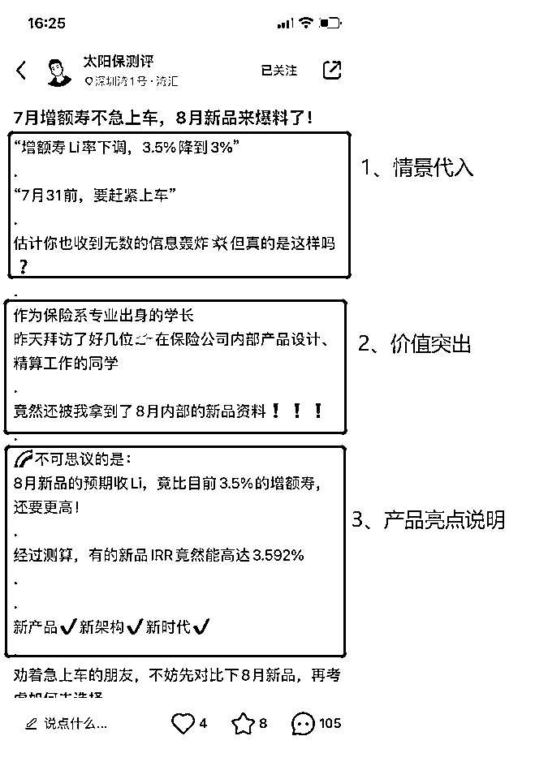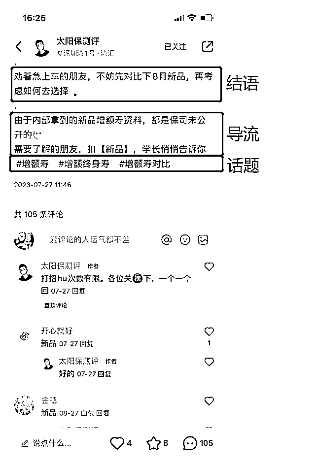
- 单款产品避坑类，参考《90%的人都忽略了，康乾3号买前一定要看》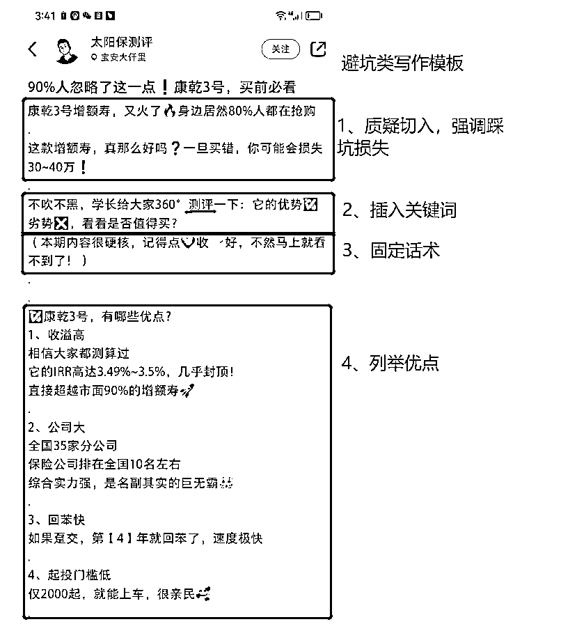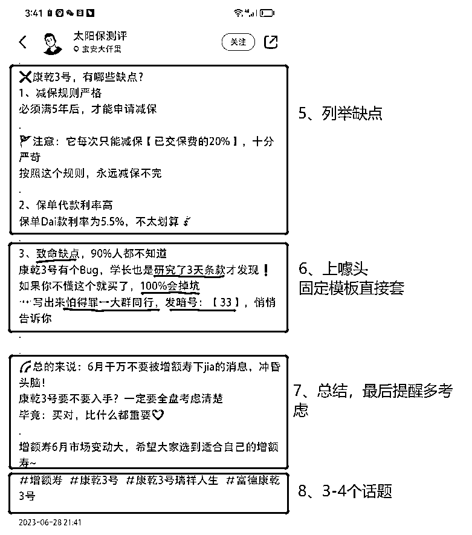

最后说说私信承接，这一步决定你能否把平台咨询变成微信好友。

我们专门调研过同行的回复方式，大体有三种：

第一种：不聊需求，直接把自己的微信号发给用户。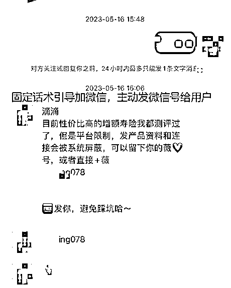
第二种：不聊需求，直接让用户留下微信号。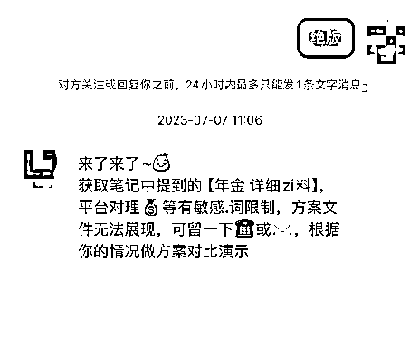
第三种：先了解用户的具体情况，再引导用户留微信。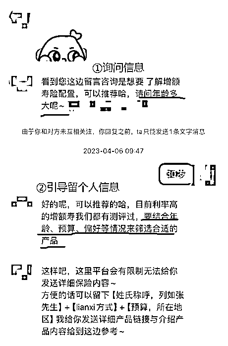

三种都测试后，第三种的好友转化率最高。前两种缺少前期沟通，信任感不够，用户不愿意留联系方式；而且主动发微信号，违规风险更高。让用户自己留微信号，相对安全。

后来，我们的一条笔记单日咨询量破百，发现用户的问题高度重复，于是结合营销心理对话术再次迭代，好友转化率稳定在30%—40%。

细节拆解：

第一阶段，提高咨询量。
咨询来源主要是两个：评论区留言和主动私信。
- 在评论区置顶一条引导留言的评论，能明显增加评论量。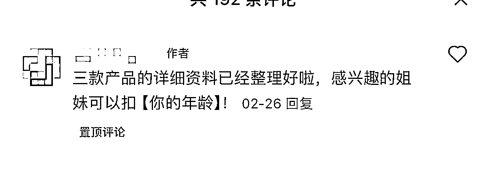
- 正文引导用户关注，关注后就能直接主动私信，平台每天只允许给非粉丝发20次，关注后没有这个限制。
- 设置两个咨询钩子：一个是报价测算，一个是产品资料或对比表，提高用户来找你的概率。

第二阶段，回复要点。
- 看到评论区的留言，主动私信并给用户点个赞，增加触达概率。
- 私信后回到评论区回复提醒。如果对方已经关注，就回复“已丝”；如果没关注，就回复“已丝，注意查看陌生人消息”。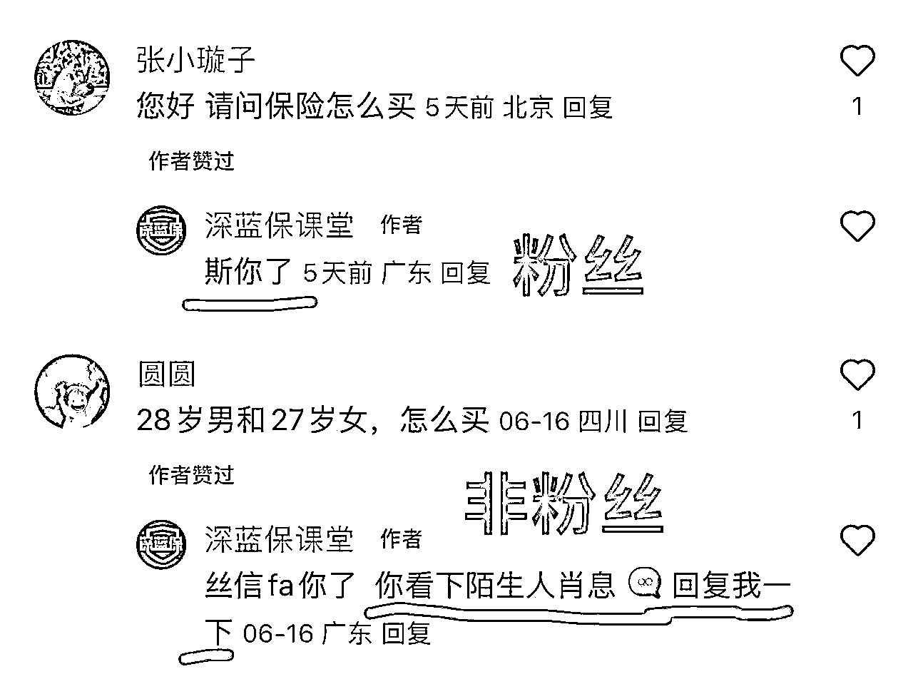 因为未关注用户的回复会被折叠在陌生人消息里，提醒一声，用户打开消息的概率会高很多。

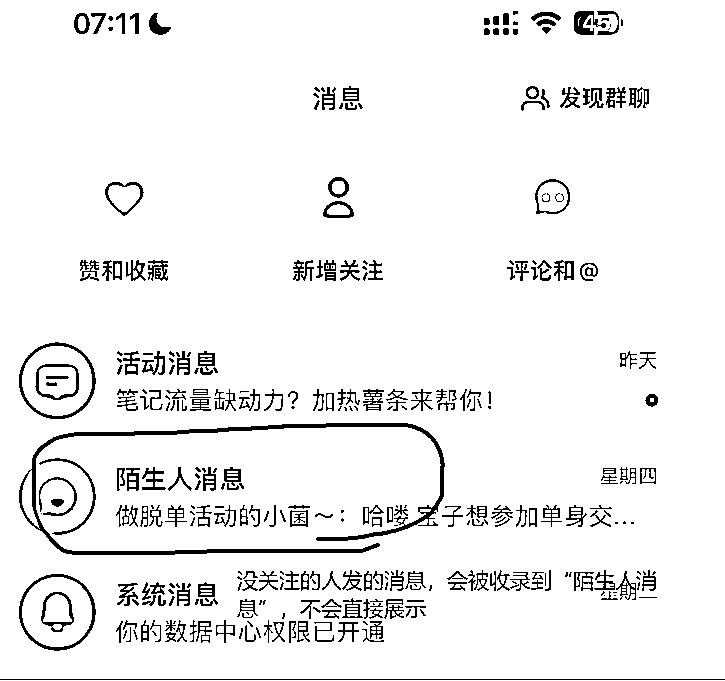

③处理后台私聊时，开场别急着讨要号码，先解答对方的疑问、弄明白来意

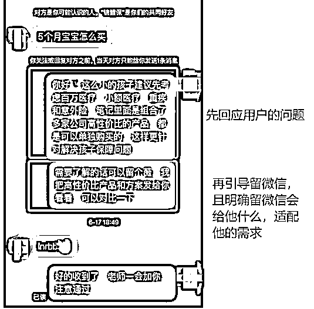

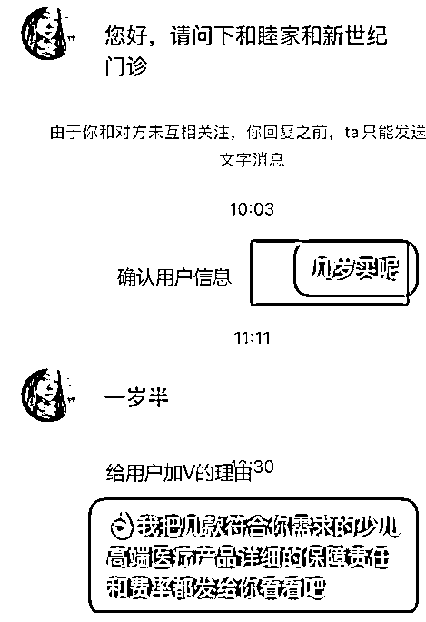

不少运营者收到站内信的第一反应就是要联系方式，这种做法其实很劝退。对方主动冒泡，多半是带着具体困惑来的，还在犹豫要不要深入了解。此时就提加号，会让人立刻绷起防御。更稳妥的顺序是：先接住问题，用专业姿态回应，让人觉得你靠谱，再把话头引向下一步。换成你自己，感受也一样直观。

因为回复内容要因人而异，有人担心这活儿没法假手于人。其实完全可以标准化——把高频问题拆成一张应答表，照着表回就行。

④回复时连续抛出两个问题，摸清对方底细

一次连抛两问，等对方答完再补一问，把对话节奏始终攥在自己手里，让对方顺着安排走，往后加微的概率会大很多。

具体问点啥，给个思路：对方要买这类产品时，我们得掌握哪些背景？每个人情况不同，适合的方案也不同。拿保险举例，就诊习惯、所在城市、身体状况不一样，搭配出来的组合就不一样。先把这些关键信息问明白，让对方觉得你是在做个性化分析，不是背话术，信赖感自然就升上来了。

⑤增加一道加微确认步骤

用户报完薇芯号，我们会补一条留言：告诉他需求已转给后端老师，留意好友请求。毕竟留了号又不想加的情况不少，有了明确的回执，体验会完整很多。

⑥安排一次回访唤醒

对方聊完显露出购买意向，但没留下薇芯，第二天我们会再补一条留言，把自己的账号放上去，也能捞回一部分摇摆的人。

⑦追踪加微进度

内部用线索表登记：留号后隔天仍未通过，就再留言提醒一次，同时把联系方式再发一遍，请他主动来加。

#### 3、后台私聊的全链路图

#### 4、回复应答设计说明

◼️ 常见误区：开场就要薇芯

平台用户做功课习惯货比三家，会同时聊好几家。他不选你，也照样能找到别人。所以回复后台私聊要传递两个信号：①你看到了他的诉求 ②你够专业，值得加号深聊。

◼️ 核心要领：

【紧扣对方诉求】【主动发问一次】【两三个来回】【不等对方开口】始终【握着主导权】，让客户贴着你的节奏走。

◼️ 带来的好处：

加微成功率上去了，信任先一步建立，需求也提前摸清，无效线索被筛掉，后端成交也跟着涨。

◼️ 提速做法：

攒一套应答素材，用搜狗输入法的“闪光语录”按场景分类，对方问哪类就抽哪套。

素材库成型后，团队可以共用一个搜狗输入法账号，多台手机同时登录，协作很方便。

#### 5、对话模板案例

单日咨询量破百后，我在海量回复里发现，大家的问题特别集中，绕来绕去就是 5 类：

<1>来问产品叫什么，比如内容里写的那款是什么？
<2>想要附赠资料：内容里埋了资料钩子
<3>打探价格：XX 岁入手要花多少
<4>询问购买路径：XXX 岁怎么拿下这款？
<5>想让人参谋：比如孩子买哪款保险合适？

顺着这些高频诉求做完归类，再配搜狗输入法的快捷短语，加微成功率和回复速度都提上来了，而且可以直接用来培训客服，哪怕完全不懂保险，照着思路也能回。

下面放出我们的对话模板，大家可以代入自己的行业和客户画像去改。

✅后台私聊模板

<1> 来问产品名称：先甩笔记+两段式应答

我：①这款叫Xxx，你以前接触过吗？②打算给谁安排？多大年纪？

⚠️主动来问的粉丝分两条发；其他场景合并成一条发（因为平台只支持回复1条消息）

用户：没听说过

我：那你现在想解决什么问题？我帮你判断合不合适；或者丢一篇团队介绍给他（遇到嫌公司规模小的，就继续深挖他的真实想法，告诉他可以安排有经验的人对接）

用户：有听过

我：那跟你实际情况贴合吗？

用户：我的情况是xxx

我：明白了，这款产品可能合适/不合适，我让后端同事根据你的具体情况，筛好资料和方案发给你细看

用户：今年xx岁

我：切到<3>的报价套路

案例：

<2> 想要附赠资料：甩笔记+通用应答

我：你好，来领XXX资料对吗？这里传文件容易拦，把薇芯给我，我发你

我：发出后回我一声，免得系统拦截，我这边没动静

案例：

<3>打探价格

我：

①Xxx岁保Xxx要花多少
②现在有没有优惠（视情况说）
③不过还要看适合不适合你的情况/这个年龄还买不买得了
④对这些维度（影响报价的几个关键因素）有偏好吗？这款组合相当灵活（追问一句，把话头接回来，很关键！）

⚠️主动来聊的或粉丝，分两条说；其他情况合并回复

用户：我在意这些

我：分析解答

①需求对得上：那你加我薇芯，这边问的人多，我让后端同事按你的情况整理好资料和方案发你
②需求对不上：明白了，加我薇芯，后端同事会重新按你的情况挑一套更合适的给你

用户：没什么概念/不懂

——没关系，我让后端同事先跟你聊清需求，再发资料和方案，加我薇芯就行

案例：

<4>指定某款产品的入手方式：甩笔记+问年纪+算报价+追问+通用引路话术

我：你好，是给Xxx（比如孩子）投保Xxx吧？今年多大？（年龄）

用户：今年Xx岁

——

我：回到<3>的报价套路

<5> 咨询某类人群怎么选，或点名要推荐：三连问+引路

我：

①好，被保人多大了？
②就医医院、保额、门诊、体检有偏好吗？
③有刷到哪篇帖子吗？发我或截图，我帮你看

用户：说了一堆要求

我：明白了，加我薇芯，后端同事会按你的要求整理好方案发你细看

用户：发来某篇帖子继续问

我：切到<3>

案例：

划重点！！

加微话术也要专门设计。私聊一多，对方发来的薇芯号可能被吞，我们回出去的也可能被吞。

所以多补一道确认，加微成功率就能往上走

<6>加微确认的通用应答

*   对方留号

留号前：发出后回我一声，免得系统拦截（这句话也会推着对方赶紧留号）
留号后：好的，留意（Xxx）老师的好友请求

*   我方留号

我：
①Xxx（薇芯）
②看到了吗？加完跟我说一声，我好去对接

（对方说没看到，就拆成多段发；或者发薇芯截图；也可以拼音首字母加数字错开发）

✅留言区互动应答

<1>当天的打招呼额度还有剩（两套轮着用，防止被限流）

我：已经私过你啦，看看招呼列表那条

我：私你了，招呼列表那边看下收到了没

<2>打招呼次数用完

1）求资料/问产品

我：好，今天打招呼名额满了，点个关zhu再喊我，或者直接来私聊我发你

2）问入手方法？报年龄

我：好，今天打招呼名额满了，点个关zhu后提醒我，或者把帖子发我+“年龄”，我来帮你分析

✅把应答模板收进输入法

——通用模板

——单款产品模板

每款常见问题单独建一套

拿高端医疗来说，绕不开的问题无非这些：

*   看病能直接结算吗？
*   合作医院有哪些？
*   自付门槛设多高？
*   门诊开药限次数吗？
*   一年保费多少？

● 范例1：尊享e生2023高端医疗

● 范例2：新燕保

## 3.3 批量铺号，放大矩阵

链路跑通后，我们把这套标准动作拿去培训新人，账号从3个视频号+2个图文号扩到8个图文号，总咨询量就起来了

# 四、项目避雷与心得

## （1）项目成立的关键

1、只接高度精准的来访，与产品无关的泛粉不碰

衡量内容价值的硬指标：留言区有多少人来问。别被点赞数据带偏。

1条只有100次浏览却有3人来问的内容，远比10万浏览却零咨询的爆款强

2、把行业搜索词体系建起来

整理平台上的高频词+聚光的投放后台词+爆款内容反复出现的词+产品线相关的词

操作细节见 三.（2）

3、攒一套封面和标题的热门样板

这类资源换行业也能用，可以拿我们的做底子，平时刷平台时顺手补充

4、设计一套顺畅引客的应答模板

## （2）容易踩的坑

1、别拿粉丝数当回事

这是烧了时间和金钱换来的体会：粉丝数真没什么用。

我们测过多轮：同一条内容放在1万泛粉的号上，带来的线索还不如20粉的垂直小号多。

2、不用纠结账号有没有独特人设

内容能被搜到、能吸引目标客户、能对上他的诉求，就够了。

把搜索词、封面、引流应答每个环节磨到位，线索自然会来。

真要谈差异化，只有一处可做：立一个专业人设，置顶一条自我介绍，再在每篇帖子结尾补一句人设收尾，信任感能上去。

3、后端销售要够专业

平台用户消费力与学历普遍更高，很多人来之前功课做得比一般保险代理还深，我们手里就接过不少北大毕业的咨询。所以后端接单的人必须更硬。

另外，用户转到薇芯后的跟进节奏、私域日常经营也格外重要，这两块要舍得投入，成交才跟得上。

END

有想法的欢迎来聊聊～

VX:Yfwy100