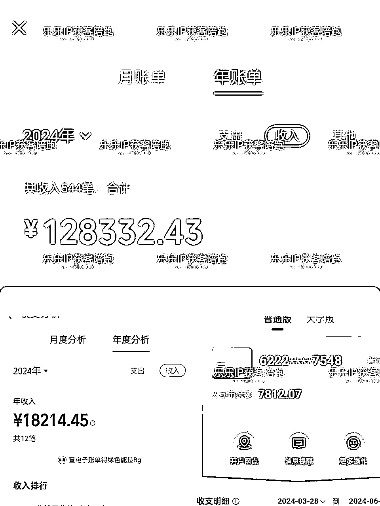
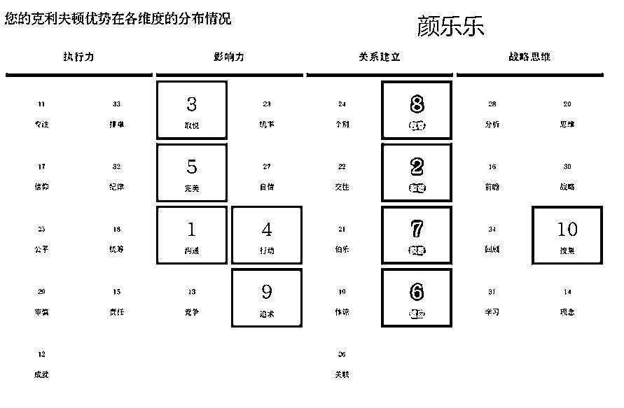
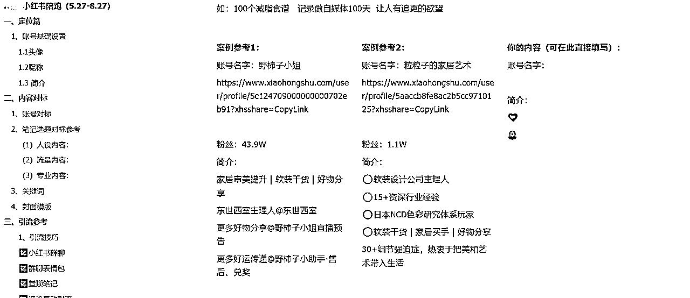
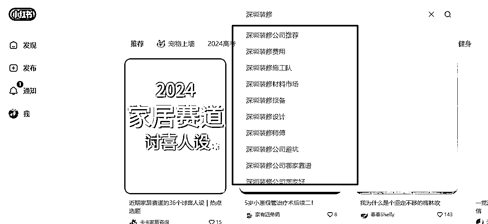

# 4个月从失业救助到月入4万，我把📕做成个体服务生意的过程复盘

见帖赚钱，我是颜乐乐。2022年4月入圈，至今在赚钱的第三个年头，也是我开始自由职业的第一年。

这次想和做品牌、运营、市场推广的朋友聊聊我离职后的真实转身路径。

很幸运，第一年试错了好几个方向，终于把闭环跑通了。23年5月被迫离职后靠2000元的失业救助金续命，到现在可以自给自足。5月份单月收入冲破4万，上半年累计15万。现在的主营是📕高客单获客陪跑，客户基本都是深圳本地的个体户和实体门店。

看到这里可能会有人心动：辞职创业、财务自由、炒老板鱿鱼。但现实没那么丝滑，先吃块冰西瓜冷静一下。下面我把选赛道到变现的完整思考拆给你看。

### （一）离开公司体，我还能靠运营吃饭吗？

在赚钱潜水时我一直怀疑，自己脱离企业还能不能活。当时收入结构单一，工资为主，自媒体只是副业。2023年5月，老板没保住，我被迫失业。家里随后又出了点事，暂时没法回去上班。但不工作也要吃饭。

出来后我清楚自己能接运营类活。以前月薪2万，自己在家做代运营，一个月挣个几千块问题不大。我也真这么干了两个月。结果发现，一人两手要带娃还要做代运营，根本扛不住。接少了钱不够，接多了做不完，因为要亲自出图写文，客户大多是个体户，预算极低，对ROI极度敏感。账号稳定后有量了，他们通常就把号拿回去自己发了，也悟出门道了。代运营这条路，我做到第二个月就止损了。

想赚钱就要解决真问题，问题解决了钱自然来。那我能解决什么问题呢？

做完代运营后我一度逃避，做了几件不用社交的项目：短剧推广、👸号流量主、直播切片。粉丝是涨了，变现却拉胯。白天在家效率低下，晚上熬夜，钱没赚到身子快垮了。我又开始找适合自己的方向。期间做了个盖洛普测评。

典型的黄人+蓝人。和老师解读后，我明白自己还是得去多接触人。

### （二）把职业技能变成产品要怎么做

回溯过往：📕1万粉，抖音6000粉，今日头条2万粉。写得一般但能写，拍得一般但能拍。上班时也做过累计播放破亿的视频。我没有自己的产品，那能不能服务有产品的人？代运营又不想做了。

在赚钱看到不少人在做📕服务，于是加了他们观察。感觉这事我也能做，但又怕水平不够被质疑。后来有人提到本地市场，我想先把范围锁在深圳试试。

临近年底，大家都在做新年规划。我猜有人想明年做📕获客，却不知道怎么做、平台玩法是什么。于是我约人线下来聊，面对面讲📕怎么起号引流放大业务。

第一个产品就这样诞生了：

1、线下一对一咨询

我把当年在企业里给公司做媒体号的做法迁移过来：先找业务人群画像，再设计内容。我能不能也帮个体老板梳理账号定位？梳理完送一个年度社群，后续有问题群里随时问我。想法和朋友一说，就有人愿意付费了。

线上老师海量，我扎根本地能面对面讲，体验感更好。实操问题可以直接现场演示。价格还能筛掉没业务没后端的人。有交付有售后，口碑就立住了。

这个产品帮我拿到第一批用户，大概30人左右，一半来自转介绍。现在因为精力限制，线下还在做，价格已提到699元/次，每月只做8个，一周2个。这样我能出门见人，保持身心愉悦，也能维持深度链接。

但这还不够。很多学员听完懂了，动手还是不行：标题烂、钩子不会、卖点提炼不出来、文案没结构。咨询的学员主动问能不能一对一陪跑一段时间。我觉得可以。

于是第二个产品出来了：

2、一对一陪跑 3980元/3个月

我没做过陪跑，不知道SOP，但我买过课体验过。普通流程是老师前期沟通，助教后续跟进。我请不起助教，只能全程自己跟。客户说他们行业4k-5k接受度很高，我就定了3980的体验价。陪跑主要来自咨询转化的用户，因为已经了解我，信任成本低。

高客单必须有明确交付，不能只说3个月答疑。第一个客户跑完一个月，我对模式更清晰了：就是陪着用户把事情推下去。

服务清单最终整理为5点：

（1）需求诊断，客户迷茫，我帮梳理当下最关键的问题是内容生产还是定位，给出解题思路
（2）找对标、建选题库，基于思路落地
（3）客户问我答，客户做我纠
（4）客户摸鱼，我按头推进
（5）客户情绪低落，我做心理按摩

基于此，我必须提供数据看板和内容计划表，让用户随时可查。我的工作也明确了：每周看号、每周至少沟通3次。

到这一步，我已有2个产品，私域也转化了几个高客单客户。算是走通了第一阶段闭环。

### （三）私域吃不饱，必须开公域

光做陪跑只靠私域是死路。转介绍前期能吃，但不长久。流量才是生意持续的关键。

我自己有📕号，转型时遭遇万粉号被平台封禁。天塌的感觉，原因是被反复举报。建议大家不要随便把账号给别人看，除了深度付费用户，其他情况别轻易展示。

号没了就再开。我一个陪跑📕的，总能再做一个新号吧。我找了对标开了两个号，一个做账号拆解，一个做垂直干货。

不出意外，账号拆解起势快，2个月做到5000粉，私域加了近千人。但问题来了：流量太泛，转化率低。最多买个社群，就是之前送咨询客户的那个，我以199元卖给他们。这是产品空缺时用补充产品填补。

聪明的朋友这时已经看出我的坑了。我前面靠深圳本地有优势，公域却做全国，和大博主拼流量无意义。

结合过往经验和地域优势，我家在百安居附近，以前服务过保险客户。我把内容方向调成保险、家居、减脂等赛道。出效果很快，加来的人更同城、同行业，最快的一单加我后1小时见面，喝完咖啡就定了一对一陪跑。

现在服务的客户基本都是深圳香港同城。我相信同城深耕还有更大空间。

### （四）交付体系是如何一步步完善的

服务行业是在做中才发现用户真正要什么。新手别做标品，流量有限，必须做非标，一对一差异化才有溢价。

交付流程我现在是这样走：

下单后先电话沟通，了解他最想解决的问题，我给出解题思路。电话结束做一次内容调研，整理出平台优秀案例和内容策划方案。

二次电话拉齐双方对📕内容和获客思路的预期。

确认后进入第一批内容测试，完成首阶段执行。

内容设计上针对具体赛道搭建内容铁三角：

1. 流量型选题 40% — 提升曝光、覆盖人群
2. 专业型选题 40% — 展示专业度，建立信任
3. 人设型选题 20% — 差异化展示，增强粘性，说明服务边界

用户从“知道你-认识你-信任你-为你买单”是进度条，📕主页体验也是进度条。先被流量内容看到，进主页通过专业内容建立信任，再通过置顶人设内容明确业务范围并提供联系方式。

本地业务更重搜索关键词，这块可用输入法A-Z辅助挖掘。

公域引流阵地单一后，来的人画像趋同，行业理解越深，后续新客户转化率越高。技能+垂直行业，越打磨越值钱。

### （五）做渠道合作，让收入更稳

公域跑通后，客户量上涨，每月有300-400流量进来，我个人最多能接下5-6单陪跑，前期交付重，接太多会崩。于是出现客户来我接不住的情况。有些项目体量大，我选择找人合作，不要什么都自己吞。

我整合了一些做📕陪跑私教的老师，有北方的，也有做香港保险赛道的。真诚推荐资源给他们，他们也会把吃不下的客户推给我。CPS分佣，盘子一起做大。

以上就是我离职后从0到1探索个体业务的实操全过程。感谢在探索路上给我支持的芷蓝老师、靠谱老师，他们帮我打通了产品设计和销售转化的卡点。感谢赚钱平台，离职前我已参加7次航海，至少上过15艘船不断试探边界，没有这些项目跑动，也没有勇气做这次尝试。继续感谢赚钱平台——无限期续费！

祝大家一起龙哥盟。