# 能落地！项目选择核心方法论，他帮我4次用5W做到年利润100W~
作者：龙哥

我反复验证过的一套挑项目思路，帮我把几万块滚成了百万年收

做内容这几年，总有人跑来问我：千易，你是怎么找到能赚钱的事的？说实话，我也不是天生就会，以前一样交过不少学费。一路跌跌撞撞，才慢慢摸出一点门道。如果你现在正发愁没方向，不知道哪儿有机会，或者试了很多回都没做成，那这篇值得你认真看完。

这套思路是我亲手跑出来的，也反复验证过。最早靠它，我拿5万块启动金把年利润做到了百万级以上；近两年我又拿它试了不少新方向，没有一个让我亏本，基本都能把从零到一的路走通。它不是纸上谈兵，全是实打实的操作总结，所以尤其适合个人、新手小白，以及想扩新业务的小团队。

下面我会拿“内容型直播间”来演示，带你看一遍完整的挑选、判断、上手过程。提前声明：文中所有案例都只是拿出来讲解方法，不是让你照着做，方法本身比案例值钱得多。

# 选方向之前，先把这些底层问题想透

先讲个现象：有些大佬好像做什么成什么。我刚起步时也特别羡慕，后来才想明白，不是人家运气好，而是他们在“选”这件事上花的功夫比我深太多。运营技巧学起来很快，真正拉开差距的，是判断一个方向能不能做的眼光。说到底就是“道”和“术”的区别——光懂操作不够，先得懂判断。

一个方向能做大，至少要过三道关。第一，它本身得有真实需求、能产生利润，不然再努力也白搭；第二，你得有本事压过现有同行；第三，你有没有机会干进这个行业的前几名。最后一条达不到，最多赚点快钱，早晚被挤出去。

很多新人走偏，是因为喜欢“想当然”。市场早就挤满了聪明又勤奋的人，空白地带几乎不存在。别为了躲竞争，自己去臆想一些虚无缥缈的东东。除非你是万里挑一的天才，否则就老老实实找一个已经有人做通的模式，跟着干。普通人赚钱的核心就是复制，谁赚到钱就照着学。创新这种事儿，交给有钱有资源的大公司，大众创业里创新基本九死一生。

但复制不等于瞎抄，动手之前得做足调查。一个方向最后能不能成，80%的变量都在前期调查里。你要是选了个高手遍地、自己又没有半点优势的地方，那基本等于去送人头。聪明人专找还在上升期的、对手还比较弱的领域——小学水平去打幼儿园，赢面才够大。

调查的终点，是找到一个参照样本。怎么判断一个方向真实、有市场、又还没那么挤？就看你能否找到在里面赚钱的人。只要有赚钱的对标存在，就说明这条路本身没问题。

而那个赚钱的人，就是你最好的老师。他能告诉你这个领域能做多大、客户是谁、产品怎么组合、同行什么段位，甚至连话术怎么设计、账号怎么养这种细节，他都替你踩过坑了。有样本摆在眼前，你手上就相当于拿着参考答案，抄就行。

不过也有人说：我也找到参照了，为什么还是做不成？原因多半是——你不具备那个参照对象的资金、资源、技术。这些关键要素凑不齐，自然复制不了。如果差距实在太大，别硬上，换个目标。老练的猎手不会贸然开枪，没把握绝不出手。我们的时间、精力和钱都有限，只在有胜算的时候出手。

还有一个容易被忽略的点：任何一件事都是一个完整系统。再小的领域也有自己的运行规律和经验门槛，所以从零起步需要时间积累。既然决定干了，就得给自己充足的测试和调整周期，三天打鱼两天晒网，永远做不出结果。

选方向真正难的地方，在于“判断”本身。市场环境、对手实力、未来风险，这些客观因素谁也控制不了，准确预判靠的是长期经验积累。而且人很容易高估自己、低估对手，等真正交上手才发现对方比想象中强得多。这种自知之明，需要刻意练习。

提升胜率还有一个笨办法：扩大选择基数。从3个候选里挑一个，和从300个候选里挑一个，哪个更容易挑中适合你的？世界的运转从来不是平均的，行业也一样，总会冒出来一些正在成长期、竞争还不大的机会。想抓住它们，就得多看、多听、多收集信息，再用上面这套标准去筛。

最后记住一个顺序：先圈出几个大方向——深入摸底——找到参照样本——分析自己与对手的差距——确认有优势、有胜算——再搭团队——小范围测试——抠细节——持续迭代——成了就放大，不成果断放弃。这个顺序不要乱。实操中后头某个环节卡住了，可以回头调整前一个环节来补救。比如方向没问题但测试做不出来，那很可能是团队人员有问题，换人就行；可如果方向本身错了，换谁都没用；人和方向都没问题，那就死磕细节，一定磨得出来。

# 怎么粗选大方向

先定义一下：所谓方向，就是一个具体的行业或者项目。电商里卖女装、卖男装、卖玩具，就是不同方向。方向还能继续往下拆，比如女装按风格、年龄、价格、人群细分，像大码女装、通勤风、汉服这些，越细越能精准对应某一类人。

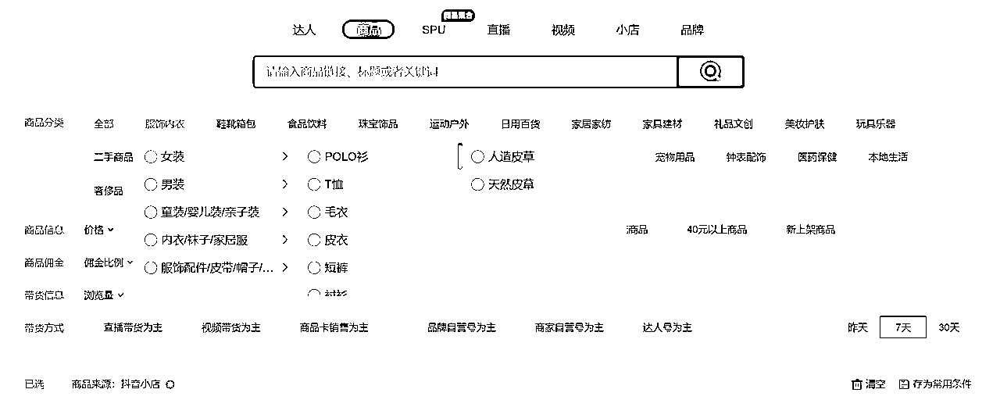

那什么不是方向？像“大健康产业”“旅游产业”这种，是很多行业加起来的统称，只能算一类概念，不是一个具体方向。选的时候别碰这种又大又虚的。达人领域里很多大分类，同样算不得方向。

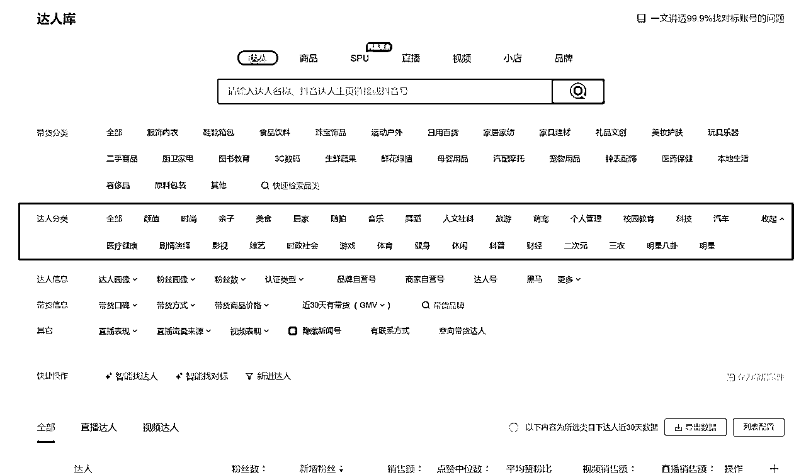

怎么粗选呢？当你对很多方向都不了解时，不要急着乱挑，先把自己从上到下盘一遍，把明显没有优势的方向排除掉，再从看着还行的里面挑出大概3个，准备进入摸底。

拿内容型直播间来举例，你要先想清楚，做好这件事需要哪些资源和能力，心里有个清单。只有当项目需要的和你具备的恰好匹配，后续才有戏，这也是选方向的起点。

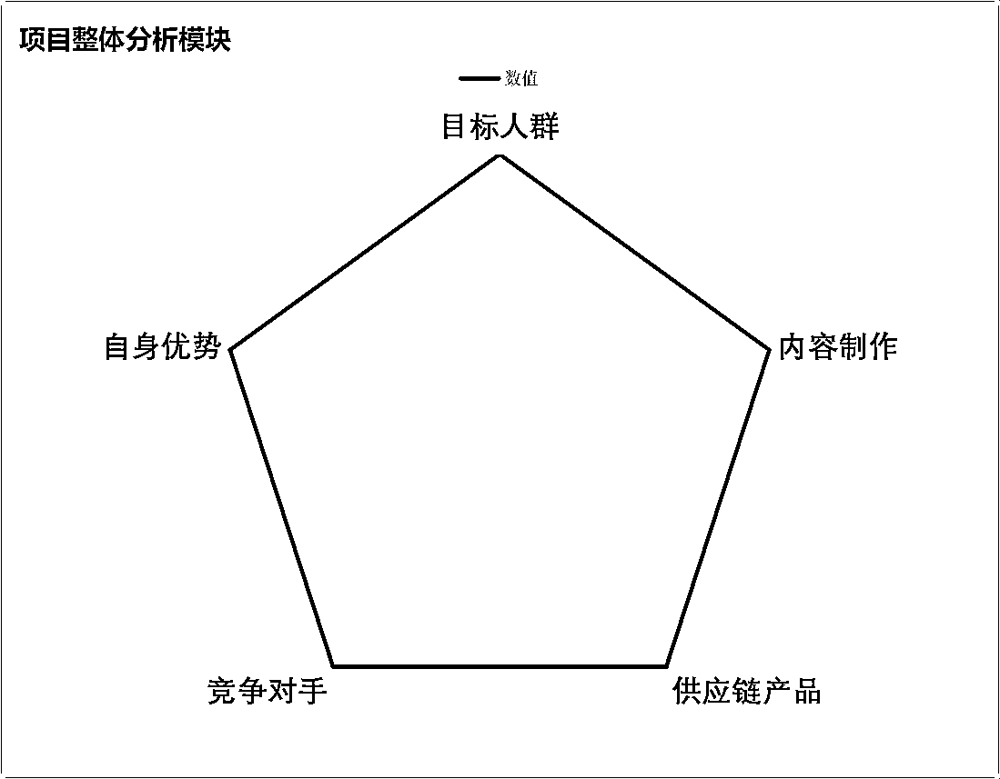

记住：项目能赚钱的前提，是你的优势刚好是它需要的，别一门心思追风口。机会永远留给准备好的人。所以第一步是认认真真剖析自己。每个人的经历、生活方式、家庭条件、所在城市都不一样，这些差异都会带给你一些别人没有的东西，它们很可能就是你的优势。

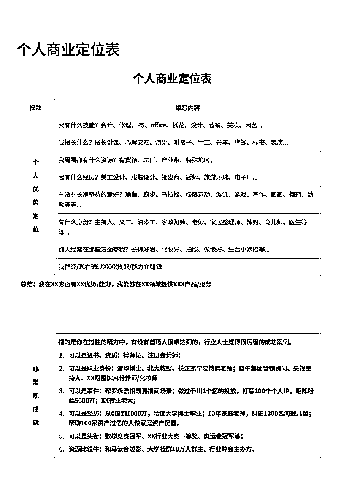

为什么优先从自己的优势里选？因为优势是拿时间和精力换来的，从零学起成本太高，从已有优势出发，胜算大得多。

同时也要看客观条件。一个项目要跑通，需要多方面因素相互匹配，所以盘点自身优势时，还得判断整体上自己更适合哪一类方向。

把自己想做、又有优势的方向写下来，挑出两三个，就可以开始摸清了。

这个环节有几个常见病：第一，听到一个信息差就热血上头，压根不判断自己能不能做，盲目跟风进场，最后大多拿不到结果。第二，心态不够开放。这个阶段除了确定干不了的，其他都先放进候选池，别急着做决定。否则你的分析会变成“先有结论再找证据”，也就是确认偏误，很容易造成误判。没看清全貌，别轻易下结论。第三，实在找不到自己的优势怎么办？其实绝大多数人都有，只是还没发现。真找不到，就先挑一个门槛低、容易上手的，干起来再说，边干边挖。如果你在龙哥盟，跟一期航海跑一跑也是个挺好的入口。

# 摸底阶段：真正花功夫的地方

从这一步起，才算真正进入调研。整个过程就是不断收集信息、判断信息、排队筛选。很多人觉得自己面前有无数条路，但等做完敌我分析，你会发现真正能走的路也就一两条——这就是调研的意义。

先确定平台。现在能做的平台实在多：抖音、视频号、📕、美团、百度、虾皮、亚马逊……每个平台都有自己的调性、人群和内容风格，同一个方向在不同平台上，对应的人群画像可能完全不同。所以动手之前，先锁定一个平台。比如内容型直播间，抖音、快手、视频号、📕都能做。

我把几个主要平台的情况概括一下：

快手目前的窗口期已经很小，用户增长乏力，买流量的成本偏高，但对某些类目管得比较松；
抖音是体量最大的内容平台，用户广、细分多，不过竞争也在加剧，高客单价的生意越来越难做，付费流量占比不断上升。今年看，内容型直播间和短视频真人带货还算有空间；
视频号相对蓝海，对普通人友好，用户偏大龄、偏下沉，消费力不算高，但免费流量空间大，不少在抖音干不下去的人都转到了这边，新手小白建议从这里切入；
📕也偏蓝海，对普通人友好，它本身是UGC社区，素人很多，用户质量高，高客单价产品更容易成交，而且管控较松，像大健康类目里很多不让说的词，在这里可以直接讲。

客观来说，新手建议优先视频号、📕，其次是抖音，最后是快手。主观来说，你平时最爱刷哪个、最熟哪个，就优先考虑哪个。个人或小团队想做到一年几十万利润，这几个平台都有机会；但如果你追求高爆发、大流量，只有抖音能做到。

一句话：看个人习惯和平台窗口期来选，先干透一个平台，再往外扩。实在定不下来，几个平台一起摸底也行。

再确定变现形式。同一个方向里，赚钱的方式不止一种。就拿抖音来说，可以开店做商品卡，可以找达人带货，也可以自己拍短视频带、开直播带、做图文带。先选准一个切入点，再去找参照样本。

从利润角度看，做流量端比做供应链端更赚。自己有流量能力就做流量，没有那个本事但有货源，就去做供应链。
从内容难度看，真人出镜比非真人难，非真人比半无人难；直播比短视频难，短视频比图文难。大致排个序：真人出镜直播 > 非真人出镜直播 > 真人出镜短视频 > 半无人直播 > 非真人出镜短视频 > 真人出镜图文 > 非真人出镜图文。

下一步，把一个方向里能看到的账号全都捞出来。这一步的目标是看见全貌，信息越全，决策越稳。账号就是项目的承载体，把数据足够多地抓在手里，整个项目的面貌自然就清晰了。很多人翻到几个账号就开始定对标，同样会掉进确认偏误的坑。数量越多，理解才越深。我们做调研，经常是上千上万地看，千万别拿战术上的勤奋去掩盖战略上的懒惰。

捞账号有几种办法：

第一种，商品反向匹配。用蝉妈妈这类数据平台，直接搜索产品关键词，就能找出对应的账号，把数据记下来。

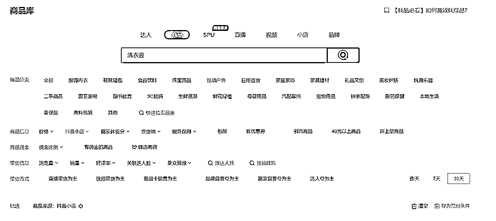

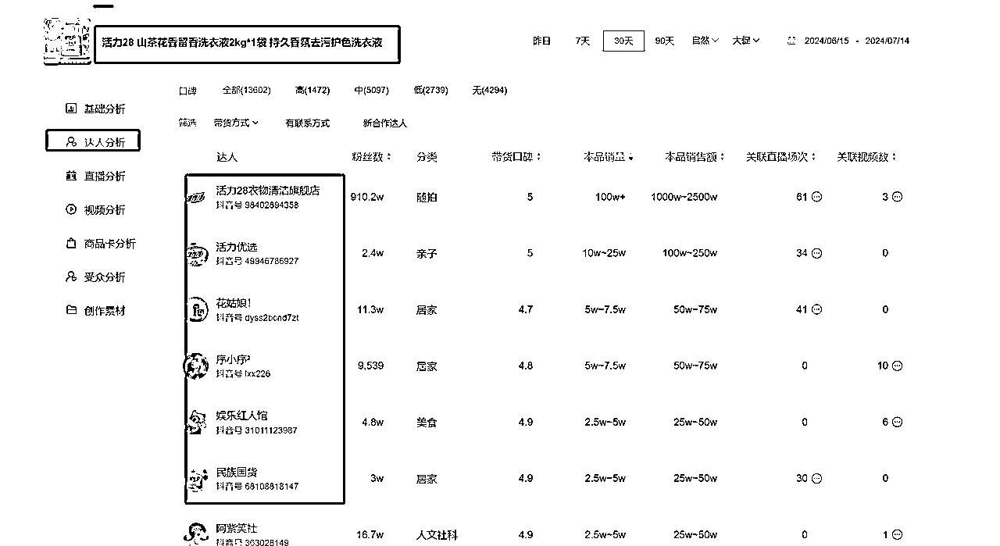

第二种，达人关联达人。找到一个账号后，翻它的带货列表，从列表里能顺藤摸瓜找到更多同方向的玩家。

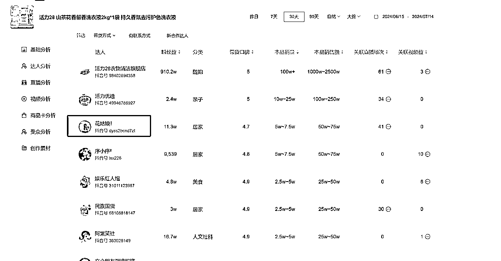

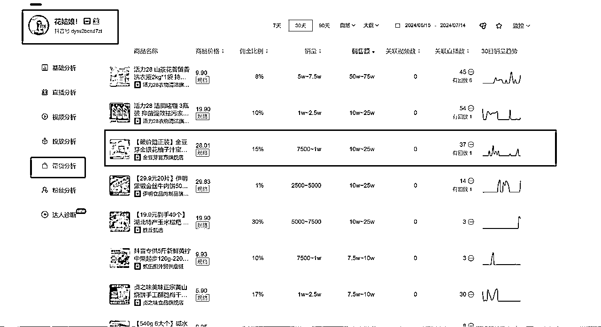

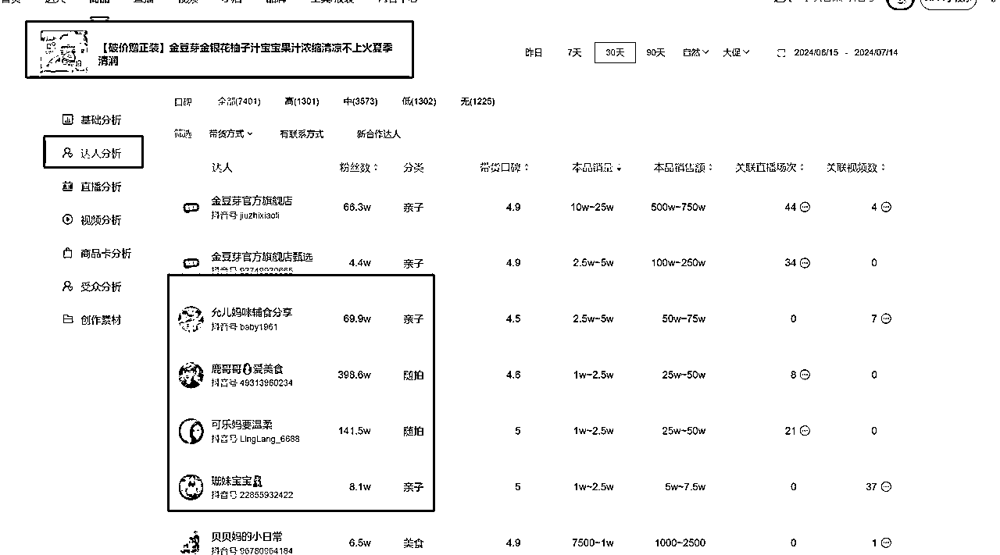

第三种，关键词直接搜。确定某个方向后，一定有对应的关键词，直接搜就行，比如“清仓”“护肤”。工具可以用抖音APP、蝉妈妈、达人广场。搜的时候注意开筛选，找直播间账号选“直播达人”，找短视频账号就只看“短视频达人”。

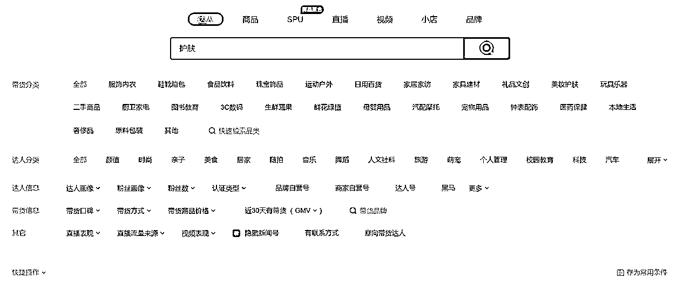

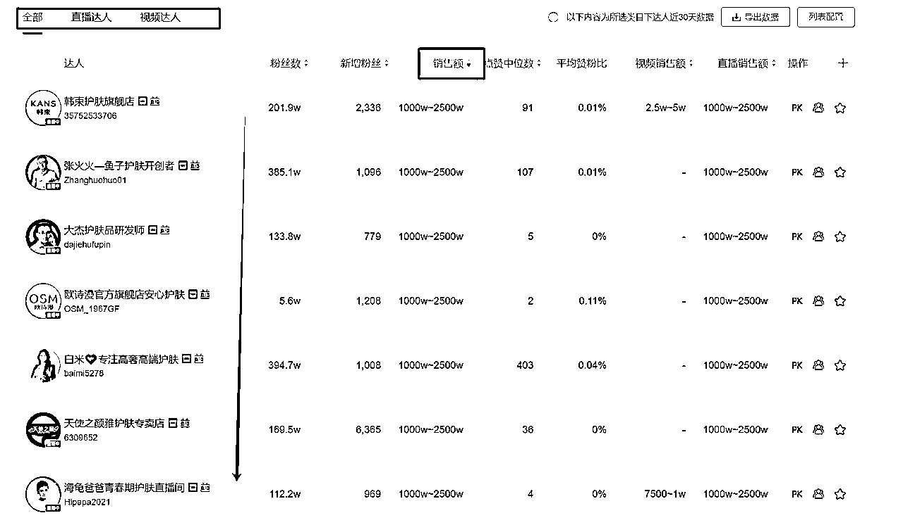

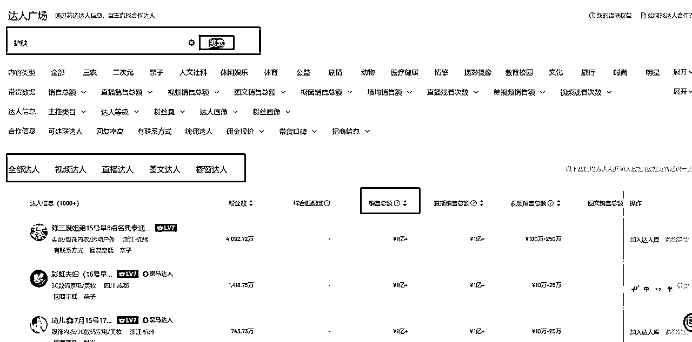

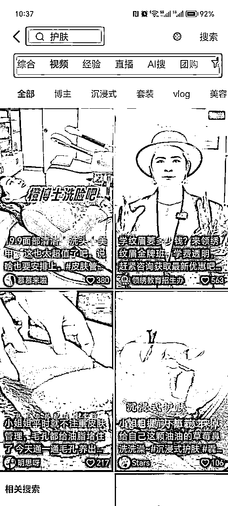

第四种，让系统来推荐。注册一个新抖音号，先养号、打标签，再去搜方向关键词，刷到目标账号就点赞关注，把号养成这个领域用户的样子，系统就会源源不断推给你想要的账号和内容。现在抖音的推荐速度很快，基本几天就能把标签养准。

关键词从哪里来？这是搜索好不好用的关键。方向里的关键词分四类：产品词、用户词、人群词、类目词。

最基础的是产品关键词。去翻产品标题，标题里往往藏着大量产品相关词，直接整理进表格。比如我之前见过一个产品，标题里能提取出洗衣液、去污、护色、香氛、持久、山茶花这一串词。

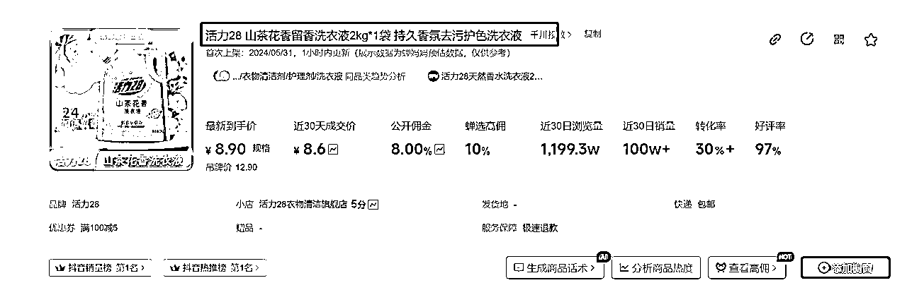

想扩展产品关键词，可以用巨量算数、百度指数、5118、🛰️指数、淘宝指数等工具。

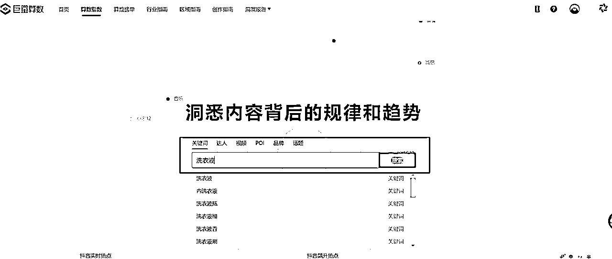

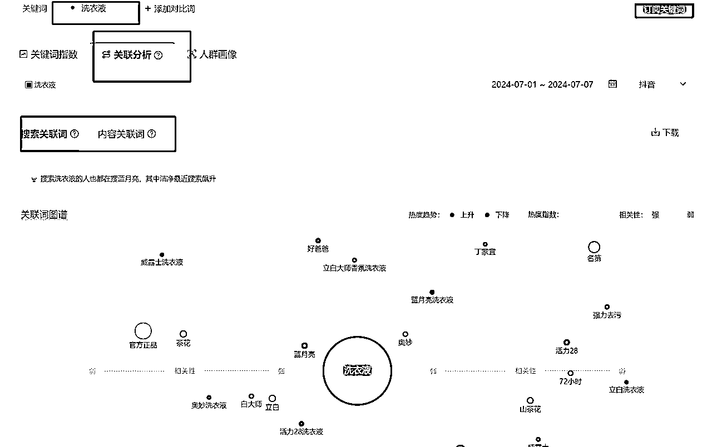

还有话题词扩展。抖音上有大量话题词，话题之间彼此关联，这些词也能直接作为关键词使用。

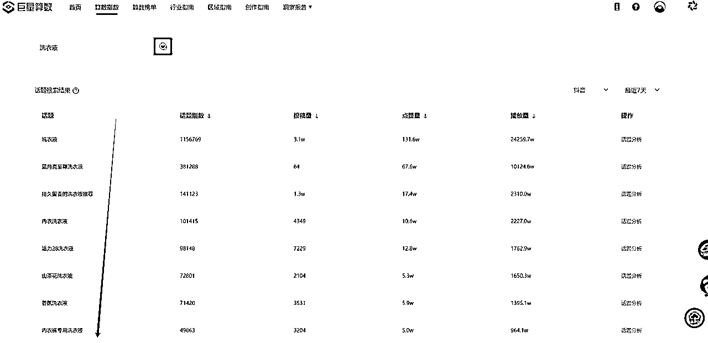

一句话总结：关键词越多，数据抓取越快、越全，账号也就越容易找齐。

找完账号，要记得记录数据。抖音优先看达人广场的数据，其次看蝉妈妈；📕用灰豚和APP自带数据；视频号暂无太好的工具，手动统计。

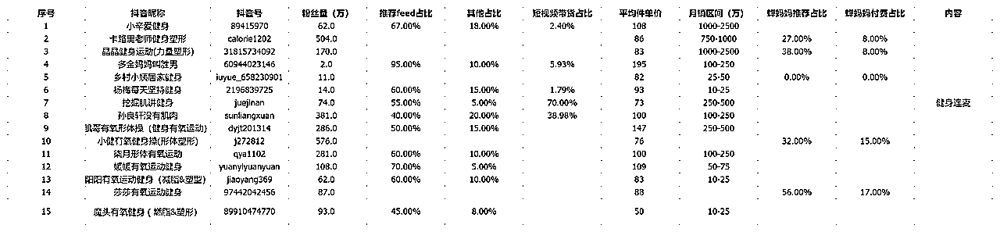

# 数据清洗，别急着分析

数据统计完，在动手分析之前，必须先分类。因为大方向下面还藏着细分方向，切分清楚，分析才够准。拿健身来说，可以分成有氧健身、塑形增肌、健身舞、形体运动、瑜伽，还有面向中老年的拍打操。

切分标准是：用户画像相同、卖点主题相同、产品类型相同、流量形式相同，这些归为一组；只要有任何一项不一样，就单独拿出来。前面说的健身分类表，就是这么做的。

有些明显不对的数据，比如录入错误、极端异常值，也得修掉，不然容易带偏判断。

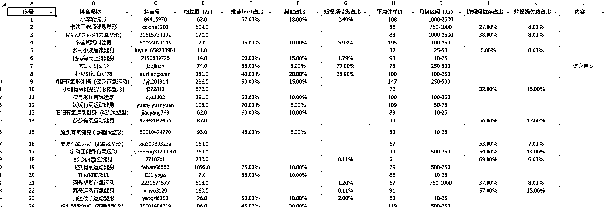

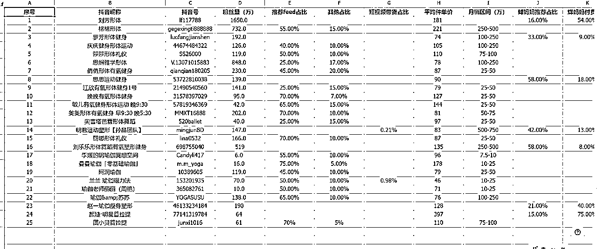

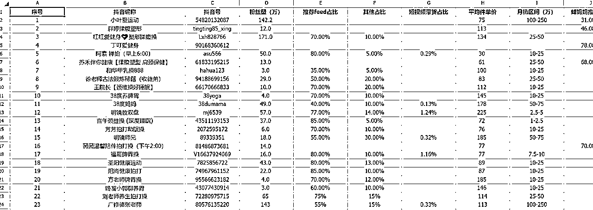

# 分析数据：核心中的核心

当一个方向的大多数账号都找齐了，就可以坐下来好好分析了：自己能不能干、天花板有多高、对手怎么样、跟自身情况是否匹配。这个环节才是整个选项目过程中最难的部分。

## 先看项目本身

看存活周期。找这个方向里做得最久、粉丝量最大的账号。如果有干了超过一年还活得很好的老号，说明这个方向能长期做，只是竞争会不断加剧；如果全是新账号，就要琢磨清楚老账号为什么活不下来。拿健身赛道说，前面那几个大号基本都是2019、2020年就开始做的。查这个用蝉妈妈很方便；没有第三方工具的话，就去看他第一条短视频发布的时间、第一场直播的时间。

比较好的局面是：头部只有1到3个十几万或几十万粉丝的大号，中间一大片全是几千、几万的账号，说明还有空档可以钻。

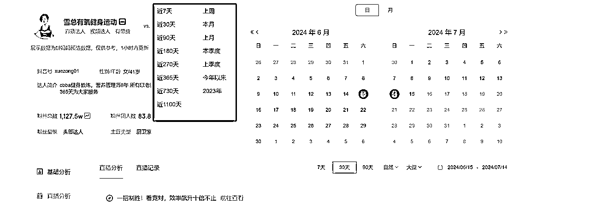

看天花板。一个方向里营收最高的账号，基本就是天花板。比如健身类直播间，历史上限能做到1000万到2500万。作为新手进场，你的上限大概是对标老大营收的三分之一，也就是100万到300万，再差一点就是几十万。这些数字，从统计表里就能看到。

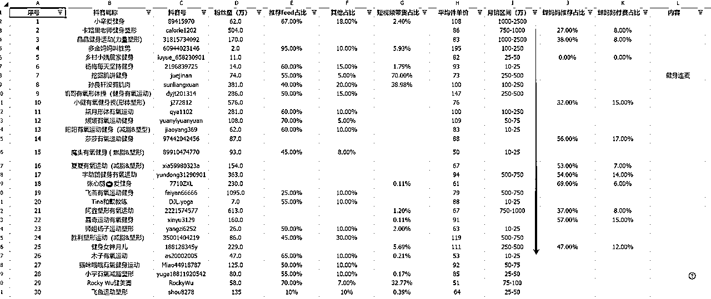

看阶段。判断窗口期还剩多少，主要看两点：第一，头部玩家是靠免费自然流量还是付费投流？如果大佬们都在付费，窗口期至少到中后段了。第二，新起来的那批几千、几万粉丝的账号，到底是免费流还是付费流？如果新账号付费比例也超过了50%，说明基本没有窗口期了。像护肤带货赛道，除了走教程路线的直播间，其他带货直播间几乎全在付费。

注意了：没有流量红利的赛道，新手千万别碰。竞争白热化，存量市场里你争我抢，又累失败率又高。头部神仙打架，后面跟一堆全是陪跑的。

## 再做竞争分析

从六个维度综合判断竞争难度：

1. 过去3个月有没有新号跑出来。一个行业长时间没有新面孔，说明已经挤不进去了。比较理想的情况是：最近1个月，有几个几千、几万粉丝的新号能做到几十万带货，而且不止一个案例。反观有氧减脂赛道，几万粉丝的新号销量和自然流量都很低，一个月很难过30万。

2. 新号流量规模和头部之间的差距。如果新号能做到接近头部的水平，说明竞争还不大；如果明显分层——粉丝多、入场早的账号吃走大部分流量，新号流量少得可怜——那就是竞争激烈，对起号能力要求很高。

3. 新号付费占比。有些类目大号靠自然流，但新号付费比例很高，这往往意味着内容同质化严重，新号用同样的玩法很难再自然起量，必须做出不一样的内容。这种不建议新手做。

4. 近1个月新号起号的数量。如果一次跑出来超过5个，背后还有一堆正在起号的，说明发现这个机会的人越来越多，竞争正在快速加剧。这时候要赶紧进、赶紧起号，抖音先发优势非常明显。

5. 不同类型账号的成功比例。同一方向里，有非真人、真人、IP几种内容形态。如果近1个月已经没有非真人的新号再跑出来，说明非真人路线竞争耗尽，该做真人了。

6. 粉丝增长情况。如果大号和新号的涨粉速度差不多，说明赛道还有没被挖出来的流量，竞争不大；如果大号停止涨粉甚至掉粉，新号却在大量涨粉，说明新号吃到了老号够不着的人群，直接对标新号；如果整个赛道涨粉都慢，那就是竞争非常大了。

做完这轮分析，要找到近1个月内、靠免费流起号、且稳定盈利的新号作为重点对标，然后深入拆解。如果连一个近期跑出来的新号都没有，这个方向一定要慎重。对标可以多找几个，但必须同方向、同人群画像。

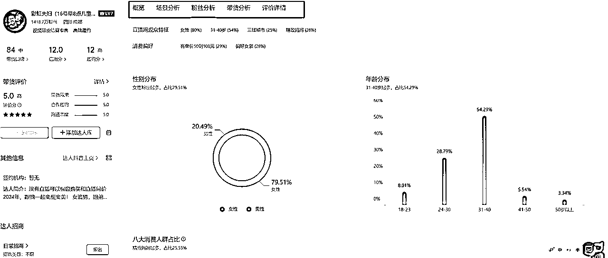

## 最后算钱

选定对标之后，按下面这几个维度算一笔账，就能大致知道自己的成功概率。

先看盈利能力。看对标主推什么产品、卖多少钱、货从哪里来、单日销售额多少、退货率高不高，然后算利润：

收入就是客单价乘以每日成交人数；
退货率等于退货金额除以总收入；
利润率大约等于佣金率乘以0.9（平台要抽10%的技术服务费），再减去产品成本占收入的比例；
总成本要把人员成本、场地成本、损耗成本、投流成本全部加在一起。

账算清楚了，心里才有底。

以上就是我反复用、也反复被验证的完整选项目流程。把这套东西跑通一遍，你对“做什么、怎么做、能不能做”的答案，会比大多数人清晰得多。

判断一个方向值不值得做，第一步先算账。

核心公式是：净赚 = 成交总额 ×（1 − 退款比例）× 毛利空间 − 总支出。这个公式用来摸清参照账号的真实收益。

成交总额去精选联盟的后台直接看就行。

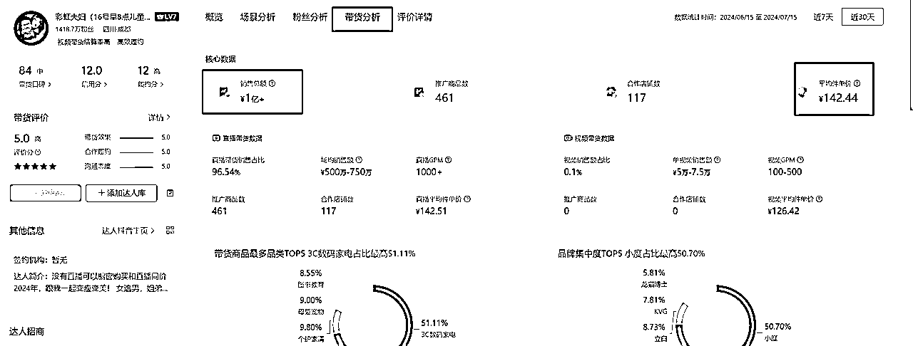

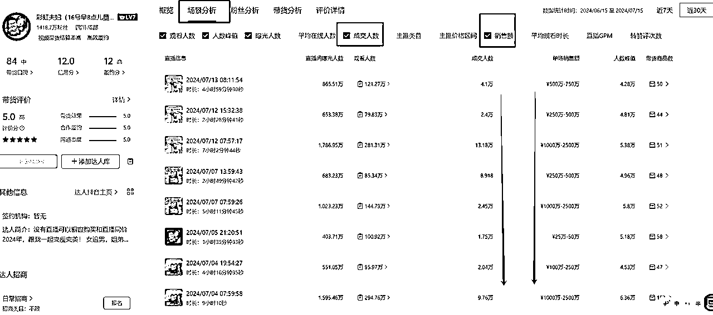

流量结构要留意一点：免费流量和付费流量不是分开显示的，“付费”会和“其他”算在一起。如果“其他”占比异常高，基本可以推断对方在投流。

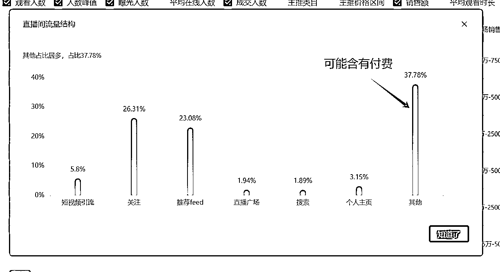

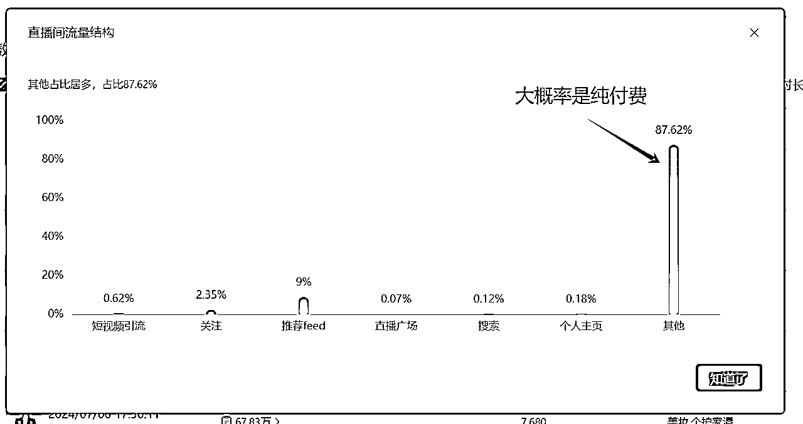

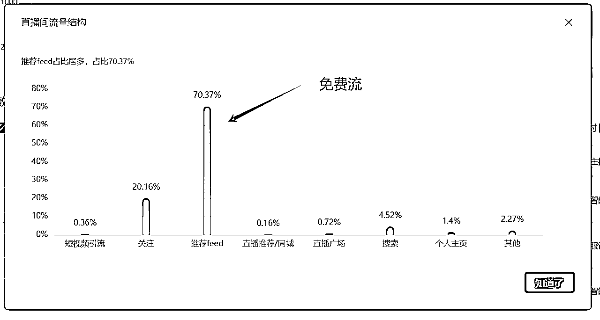

退款比例别自己猜，直接问供应链方，他们手里有行业平均水平的实数据。

把这几组数填进公式，就能知道参照账号一天赚多少、一个月赚多少，再对照自己的预期，决定还要不要继续。

第二步是风险预估。

任何生意都有翻车的可能，哪怕前期研究做得再细致。我们不是要消灭风险，而是提前想清楚最坏情况：这个项目要做下去要砸多少钱，最惨会亏多少。

要盘的有五笔账：

基础类：场地租金、手机、SIM卡、人员工资，这些固定开销自己拉个表；

设备类：真人露脸的直播场景，设备成本比较高，不知道怎么算可以看我前面发过的文章；

货品类：走精选联盟基本等于零库存，自己做货源就要算选品、仓储、发货、快递这些费用。新手不要轻易囤货；

投流类：起号阶段不用考虑投流，自然流量做不起来，砸钱也很难救活。除非你本来就是纯付费玩法的路子；

机会类：这一项很容易被漏掉。如果是全职干，要想：原来上班每个月有稳定收入，现在辞职做项目，那笔收入就没了。项目一旦失败，这部分隐性损失也要算进去。

把所有数字汇总，再乘1.2，才是你真正要承担的风险总额。

第三步看资金链。

风险的本质，是失败后你要付出的时间和金钱。先问自己能不能扛住，扛得住才继续往下看。

很多人把投入产出和资金链混成一个概念，其实是两码事。

先说个人生活资金：全职做的话，先算存款能撑多久。比如你有20万存款，家庭月支出1万，那至少要留10到15万做安全垫，保证一年没收入也能正常过日子。别总想着绝地反击，大概率会输得很惨，很多老板跑路就是因为没给自己留后路。

再说试错次数：没有哪个项目能保证一次成，要靠数量去换概率。比如你能拿出5万试，单次测试花1万，就有5次机会；如果一个测试就要5万，你只有1次机会。所以尽量把单次测试成本降下来。

还要算正常运转资金：看参照账号跑起来以后，每个月光维持需要多少钱。纯内容直播间如果不投流不囤货，人力成本就很低；如果投流，就要把投流预算算进去；如果囤货，还要加上周转资金。

做项目就像上牌桌，不是每一把都能赢，资金链就是手中的筹码。只要还没下桌，就保留翻盘的可能。

前面三步看完，觉得能接受，就进入复制难度评估。

内容电商要从五个维度拿自己跟目标账号做对比，看差在哪、强在哪、用什么办法补齐短板。

核心原则：找一个比你更弱的对手去打，胜算才高。

先拆数据。把目标账号最近30天的表现和起号初期的数据都拉出来，看它当前的水位：停留、互动、下单，以及起号花了多长时间、增长是什么节奏。

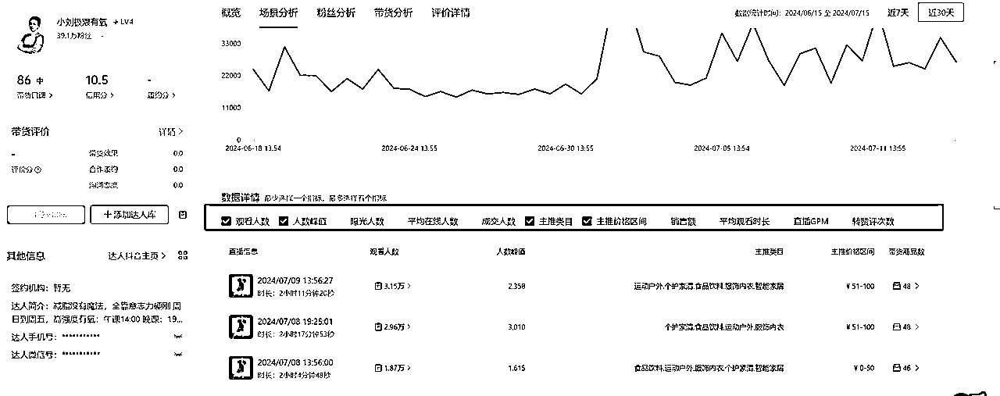

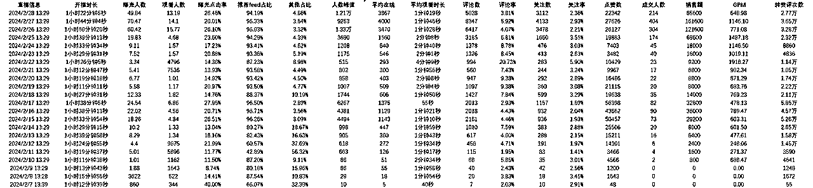

再拆直播场景。

画面维度：真人还是非真人？虚拟背景还是真实环境？画面清不清晰？设备专不专业？

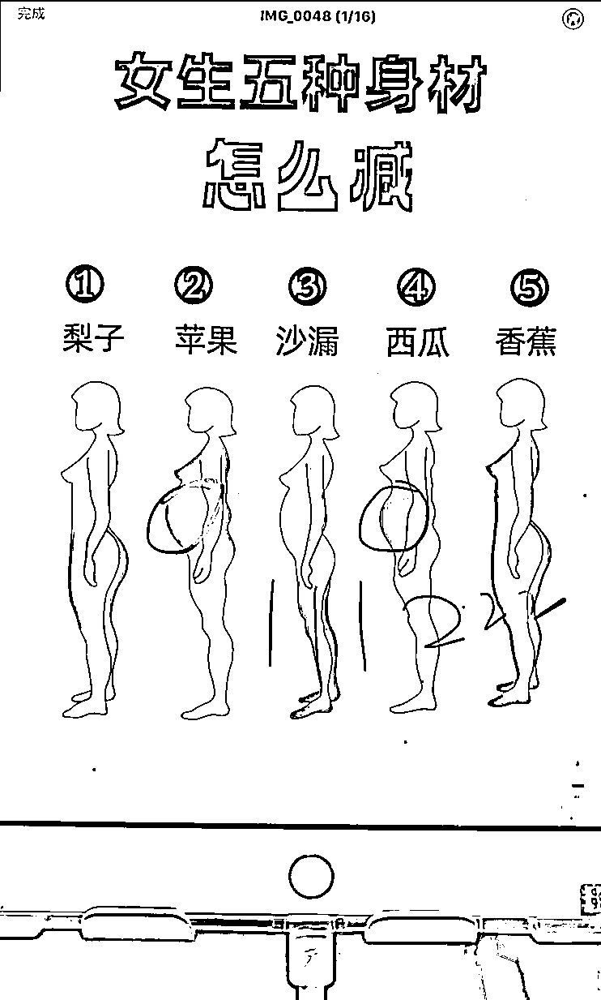

这一种最容易模仿：手机开播，摆一张图片或者平板就行，搭建费极低，复制门槛也极低。

这是典型的虚拟背景直播，电脑加绿幕就能搭，花不了几个钱，复制难度不高。

这种是真实场景直播，搭建不复杂，但费用明显更高，场地也不能太小。

这种同样是实景，但对硬件要求更高，光设备就要好几万，整体投入更大。

主播维度：主播是不是素人？专业知识怎么样？有没有个人IP？外形气质有没有记忆点？真人出镜的项目，主播本身往往是决定成败的关键。

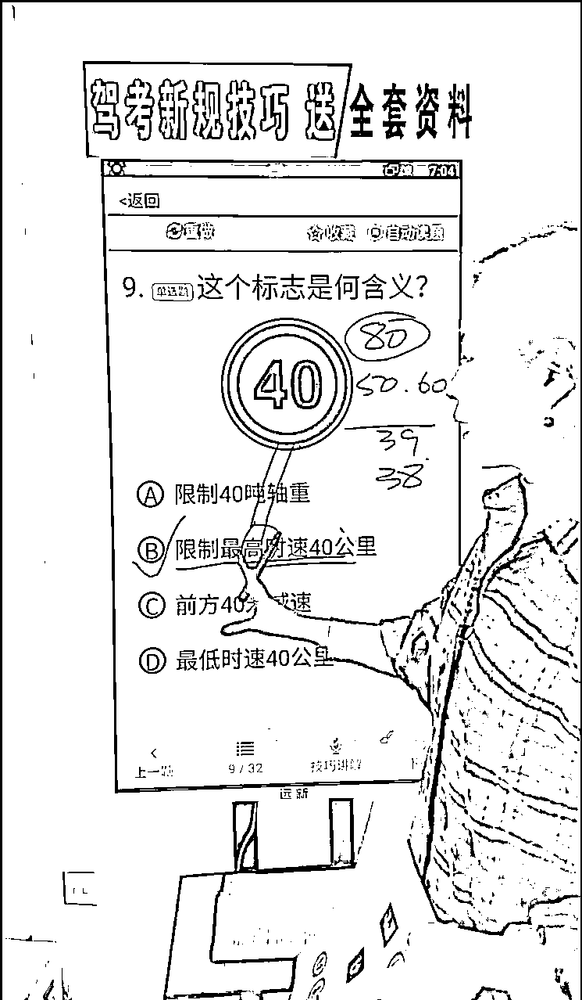

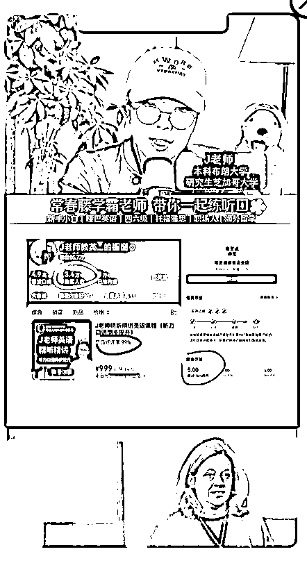

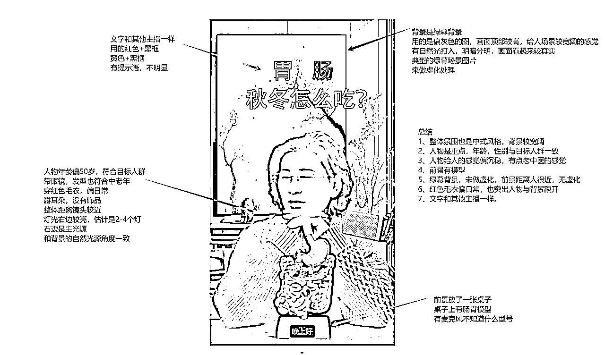

运营维度：对方有没有成功起号的经验？这套玩法的难度在你能力之上还是之下？你懂不懂平台算法和规则？是否有现成的运营资源？如果你没有同类型账号的起号经历，很难准确判断自己的水平。这也是很多人做直播做不起来的原因——运营能力无法量化，甚至花钱招人也未必能解决。

产品维度：后端货品从哪来？对方要是自有品牌，你自己找工厂生产，难度很大；做一件代发，难度中等；用精选联盟或选品中心，最省事，大部分热门产品不用愁货源。

匹配度：综合看你手上的资源和能力，能不能撑起这个直播项目。可以按几个模块分别给自己和目标账号打分，最后画成雷达图做对比。

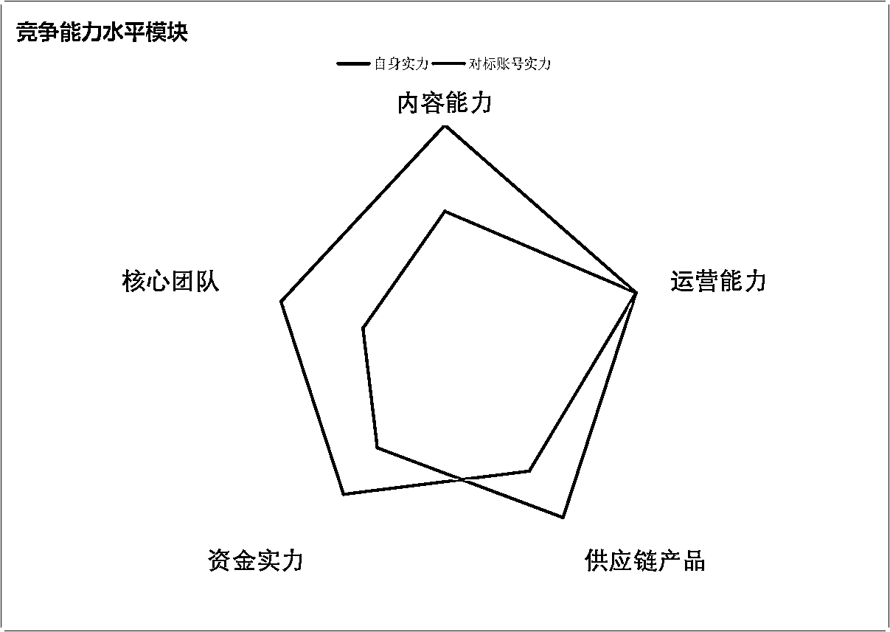

如果在评估中发现自己的短板，不要急着开干，先想清楚怎么补。比如产品不行就多找几家供应链；主播、运营缺人就想怎么招或怎么培养；完全没有运营能力也要有对应的方案。

能把能力短板补上，成功率才可能提上去。如果严重不匹配又偏要做，就必须找人帮你补位，否则大概率做不成。

难点在于：打分和判断极度依赖你对行业的理解，以及对目标账号水平的准确感知。没有经验的人容易高估自己，低估对手，甚至有很多维度根本意识不到。等真正下场才发现，那些被忽略的模块才是核心，短时间根本解决不了。

最后是项目总结。

1、只有把整个流程走完，能力跟项目需求对得上，成功率才高；

2、做到心里有数，把项目当成开卷考试，是快速复制赚钱的前提，这一步不能省；

3、就算分析得再细，实际操作还是会有新问题，所以前期要用MVP跑流程；

4、MVP就是用最低成本启动，先用最少的人、最少的钱卖出去第一单。刚开始甚至不用谈佣金，直接拿目标账号同款链接开播，先跑流量，先出单；

5、第一单完成，说明流程通了，项目真实可行。这时候再开始优化细节，比如拉时长、换场景、上实景、谈佣金，把利润真正做出来，直到越过盈亏平衡线；

6、中途遇到不懂的运营、主播问题，就去找对应课程或加入相关社群，加速拿到结果；

7、每一步分析都要先判断自己能不能干，不能干就立刻停下，换个方向重来；

8、按顺序推进，不要打乱。

整个项目选择的路径：粗筛赛道 → 调研赛道 → 找目标账号 → 分析敌我 → 确认有优势有胜算 → 组团队 → MVP测试 → 扣细节 → 迭代 → 成功或放弃。

抖音内容型直播间的具体运营技巧，这篇文章写不下了，下次有机会再详细分享。现在先找一个适合自己的项目吧。这套分析方法不只适合抖音，做任何平台、任何赛道都可以套用。

我是千易，9年自媒体人，6年电商人，2017年开始做今日头条到现在。头条、抖音、视频号、📕都碰过，现在主要深耕抖音和📕。三次拿5万本金做到100万，操盘过多个项目，目前聚焦大健康产业的直播间和短视频带货，有相关资源的朋友欢迎来聊。