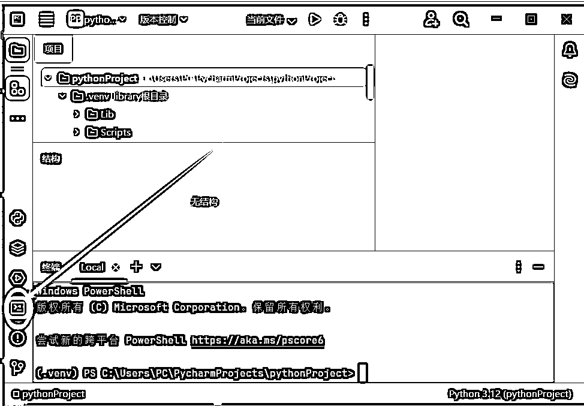
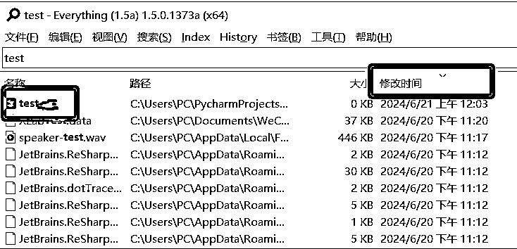
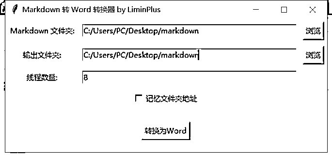

# 把 Python 脚本变成 EXE，可执行程序打包实战


# 一、作者自述

【昵称】壹壹

【所在地】苏州

【个人简介】

①盖洛普五大优势：思维、专注、学习、竞争、理念

②本职：建筑央企打工人。兼职：1、👸号爆款文章写作；2、闲鱼带货；

③入局赚钱项目约一年。

大家好，我是龙哥。这次加入AI编程航海计划，主要是想把RPA技术往深里做，把之前解决不了的痛点彻底打通，让它继续服务于本职工作的提效，以及副业矩阵的无人化运营。

起步阶段跟着航海课程上手UiBot，随后自学影刀的Xpath语法，算是对影刀有了初步掌握，期间累计写出几十个脚本和项目。在这个过程中不可避免地接触到Python，也用了一部分。航海期内，数据抓取相关的模块大约3-4天就搞定了。

后续随着工作推进，需求不断冒出来。

比如处理Excel时手动操作太费时间，就让AI生成宏代码尝试自动化，这也是我第一次用宏。

在👸号爆文写作运营上，以前靠影刀做文本处理，时常遇到WPS、Office闪退不稳定、运行卡顿的问题。

于是转头学Python，用AI辅助写代码，最终把流程跑通了。

但成品体积太大、依赖环境多，跑起来不方便，我就到处找Python脚本打包成EXE的方法。一晚上试下来就搞定了，其实门槛并没有想象中高。今天就把这个过程分享出来。

# 二、Python 项目打包成 EXE 的完整思路

想把脚本封装成独立可执行文件，需要满足三个前提。

1、Python程序本身已经跑通，代码经过验证，功能达标；
2、对运行界面有明确想法，提前规划好交互方式；
3、能借助AI或自行编写代码，实现界面搭建。

这三点齐了，照着固定步骤就能把Python项目做成EXE。

操作流程拆解如下：

1、确认代码可用
这个前提大家通常都已完成，保证脚本在本地无报错正常运行。

2、规划界面交互
先想清楚用户需要哪些操作入口。我的案例里界面长这样：


3、用AI或自写代码落地界面
我当时给AI的指令是这样写的：

给我的代码内容增加用户界面，需要包含以下元素：

- 输入文件夹选项

- 输入Excel文件选项

- 输入保存文件夹选项

- 处理文件按钮

- 保存路径信息按钮

AI会据此生成界面相关代码，直接嵌进原有脚本中。

```
import os
import sys
import tkinter as tk
from tkinter import filedialog, messagebox, ttk
import pandas as pd
from docx import Document
import win32com.client as win32
import json
import threading
from concurrent.futures import ThreadPoolExecutor
import queue

# 获取当前脚本所在目录
if hasattr(sys, '_MEIPASS'):
    # PyInstaller打包后的临时文件夹路径
    BASE_DIR = sys._MEIPASS
else:
    BASE_DIR = os.path.dirname(os.path.abspath(__file__))

CONFIG_FILE = os.path.join(BASE_DIR, "config.json")

def get_desktop_path():
    return os.path.join(os.path.expanduser("~"), 'Desktop')

def get_files_in_folder(folder_path):
    return [os.path.join(folder_path, f) for f in os.listdir(folder_path) if f.endswith('.docx') or f.endswith('.doc')]

def read_word_file(file_path):
    if file_path.endswith('.docx'):
        doc = Document(file_path)
        full_text = []
        for para in doc.paragraphs:
            full_text.append(para.text)
        return '\n'.join(full_text)
    else:
        word = win32.Dispatch("Word.Application")
        word.Visible = False
        doc = word.Documents.Open(file_path)
        text = doc.Range().Text
        doc.Close()
        word.Quit()
        return text

def replace_text_in_word(file_path, replacements, save_path):
    if file_path.endswith('.docx'):
        doc = Document(file_path)
        for para in doc.paragraphs:
            for key, value in replacements.items():
                if pd.isna(value):
                    value = ""
                if '^p' in str(value):
                    value = value.replace('^p', '\n')
                para.text = para.text.replace(key, str(value))  # 替换所有出现的文本
        save_file_path = os.path.join(save_path, os.path.basename(file_path))
        doc.save(save_file_path)
    else:
        word = win32.Dispatch("Word.Application")
        word.Visible = False
        doc = word.Documents.Open(file_path)
        for key, value in replacements.items():
            if pd.isna(value):
                value = ""
            if '^p' in value:
                value = value.replace('^p', '^p')
            find = word.Selection.Find
            find.Text = key
            find.Replacement.Text = value
            find.Execute(Replace=2)  # wdReplaceAll
        save_file_path = os.path.join(save_path, os.path.basename(file_path))
        doc.SaveAs(save_file_path)
        doc.Close()
        word.Quit()

def process_file(file, replacements, save_path, progress_queue):
    try:
        # Read and replace text in Word file
        replace_text_in_word(file, replacements, save_path)

        # Read updated text to check length
        updated_text = read_word_file(file)
        if len(updated_text) < 500:
            os.remove(file)
            print(f"Deleted file: {file}")

        # Update progress
        progress_queue.put(file)
    except Exception as e:
        print(f"Error processing file {file}: {e}")

def process_files(folder_path, excel_path, save_path, progress_queue):
    # Load Excel file
    df = pd.read_excel(excel_path)
    replacements = dict(zip(df.iloc[:, 0], df.iloc[:, 1]))

    # Get list of Word files
    files = get_files_in_folder(folder_path)
    total_files = len(files)

    with ThreadPoolExecutor(max_workers=None) as executor:
        futures = []
        for file in files:
            futures.append(executor.submit(process_file, file, replacements, save_path, progress_queue))

        for future in futures:
            future.result()  # wait for each future to complete

    progress_queue.put(None)  # Signal completion

def update_progress(progress_queue, total_files):
    processed_files = 0
    while True:
        file = progress_queue.get()
        if file is None:
            break
        processed_files += 1
        progress_var.set((processed_files / total_files) * 100)
        progress_label.config(text=f"正在处理: {os.path.basename(file)}")
        root.update_idletasks()

    messagebox.showinfo("处理完成", "文件已处理完成。")

def select_folder():
    folder_path = filedialog.askdirectory(initialdir=get_desktop_path(), title="选择文件夹")
    folder_entry.delete(0, tk.END)
    folder_entry.insert(0, folder_path)

def select_excel():
    excel_path = filedialog.askopenfilename(initialdir=get_desktop_path(), title="选择Excel文件",
                                            filetypes=(("Excel文件", "*.xlsx"), ("所有文件", "*.*")))
    excel_entry.delete(0, tk.END)
    excel_entry.insert(0, excel_path)

def select_save_folder():
    save_path = filedialog.askdirectory(initialdir=get_desktop_path(), title="选择保存文件夹")
    save_folder_entry.delete(0, tk.END)
    save_folder_entry.insert(0, save_path)

def on_process():
    folder_path = folder_entry.get()
    excel_path = excel_entry.get()
    save_path = save_folder_entry.get()
    if not folder_path or not excel_path or not save_path:
        messagebox.showwarning("输入错误", "请选择文件夹、Excel文件和保存文件夹。")
        return

    files = get_files_in_folder(folder_path)
    total_files = len(files)
    progress_queue = queue.Queue()

    threading.Thread(target=process_files, args=(folder_path, excel_path, save_path, progress_queue)).start()
    threading.Thread(target=update_progress, args=(progress_queue, total_files)).start()

def save_config():
    config = {
        "folder_path": folder_entry.get(),
        "excel_path": excel_entry.get(),
        "save_path": save_folder_entry.get()
    }
    with open(CONFIG_FILE, 'w') as f:
        json.dump(config, f)
    messagebox.showinfo("保存完成", "路径信息已保存。")

def load_config():
    if os.path.exists(CONFIG_FILE):
        with open(CONFIG_FILE, 'r') as f:
            config = json.load(f)
            folder_entry.insert(0, config.get("folder_path", ""))
            excel_entry.insert(0, config.get("excel_path", ""))
            save_folder_entry.insert(0, config.get("save_path", ""))

# Create GUI
root = tk.Tk()
root.title("Word文本替换器")

tk.Label(root, text="选择文件夹:").grid(row=0, column=0, padx=10, pady=10)
folder_entry = tk.Entry(root, width=50)
folder_entry.grid(row=0, column=1, padx=10, pady=10)
folder_button = tk.Button(root, text="浏览", command=select_folder)
folder_button.grid(row=0, column=2, padx=10, pady=10)

tk.Label(root, text="选择Excel文件:").grid(row=1, column=0, padx=10, pady=10)
excel_entry = tk.Entry(root, width=50)
excel_entry.grid(row=1, column=1, padx=10, pady=10)
excel_button = tk.Button(root, text="浏览", command=select_excel)
excel_button.grid(row=1, column=2, padx=10, pady=10)

tk.Label(root, text="选择保存文件夹:").grid(row=2, column=0, padx=10, pady=10)
save_folder_entry = tk.Entry(root, width=50)
save_folder_entry.grid(row=2, column=1, padx=10, pady=10)
save_folder_button = tk.Button(root, text="浏览", command=select_save_folder)
save_folder_button.grid(row=2, column=2, padx=10, pady=10)

process_button = tk.Button(root, text="处理文件", command=on_process)
process_button.grid(row=3, column=0, columnspan=3, pady=10)

progress_var = tk.DoubleVar()
progress_bar = ttk.Progressbar(root, variable=progress_var, maximum=100)
progress_bar.grid(row=4, column=0, columnspan=3, pady=10, sticky="ew")

progress_label = tk.Label(root, text="等待处理...")
progress_label.grid(row=5, column=0, columnspan=3, pady=10)

save_config_button = tk.Button(root, text="保存路径信息", command=save_config)
save_config_button.grid(row=6, column=0, columnspan=3, pady=10)

load_config()  # Load previously saved config if it exists

root.mainloop()
```

在打包成 exe 之前，先把代码本地跑通一遍，确认无报错再进行下一步。

如果运行过程中提示缺包，先去终端把依赖装上：


```
pip install pywin32 python-docx
```

* * *

等这三件事都准备好后，就只剩最后的打包环节了。整体打包流程可以拆成 4 个环节来做：

1、把 pyinstaller 装到环境里。操作共两步：

点击这里


在命令行里执行 pip install pyinstaller，看到安装日志滚动后耐心等到完成。

2、确定你要打包的 Python 脚本名，可以直接敲也可以复制路径。举例我这边用的是 test.py


3、开始封装程序，分两步完成。

点击这里：



执行命令 pyinstaller -F -w test.py 然后回车。

也可以写完整路径的方式执行：pyinstaller -F -w C:\Users\PC\.cursor-tutor\projects\python\test.py 回车即可。

这里的第二个写法就是指定文件的绝对路径。

我的示例文件叫 test.py，你只要把文件名替换成自己的即可。

你是不是也有这种体验：让 AI 写个小工具，跑完却找不到成品在哪？今天分享下我的完整流程，顺便聊聊哪款大模型最靠谱。

程序打包完成后，exe 并不会主动出现在你面前，而是被存进默认目录。别慌，打开 Everything，直接搜“test”，按时间倒序排列，最新那个文件就是我们要的成品。把它复制出来，想放哪都行，放到桌面最顺手。



接着双击运行，这三个小工具是我自己写的，专门配合文章批量处理。


这是程序运行后的窗口界面。



窗口长成什么样，完全可以让 AI 按你的需求调。比如我日常处理时最烦每次都要手动填文件夹路径，于是让 AI 加了个“记住上次路径”的选项，从此省了一步。

最后说下我的测试心得。通义千问、KIMI 我都试过，综合下来 GPT-4O 的成功率最高。如果你让 AI 写的是系统内固定模板的代码，基本很稳，但能到什么程度，和提问者的描述能力直接相关。至于抓网页内容，就没那么乐观了，问题大多出在定位元素上，八成得人工介入，老老实实用 XPath。我的建议是：整体框架放心交给 AI，XPath 这类细节自己改完，再丢回给 AI 继续迭代。这样反复打磨，整体跑通是完全可行的。