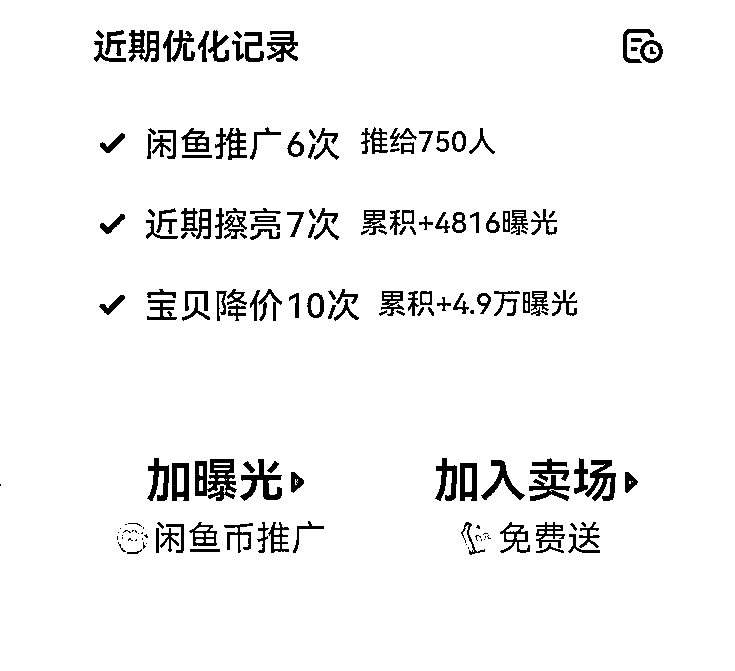

# 月入六位数的AI写作私域变现，我把路数拆给你看：咸鱼引流实操全拆解

AI写作变现这条赛道，今年是真炸了。近半年想入场的人越来越多，问我最多的问题只有一个：怎么找客源、怎么把流量引进来。今天这个分享就直接上干货，我本人做这个项目四年，累计变现已超过60万+，今天就用「咸鱼获客」这个打法，把新手最容易卡住的点一次性讲透。

# 先说咸鱼这个渠道

咸鱼本质是二手交易市场，但它的搜索流量非常真实。账号养好了，不仅能稳定出单，还能沉淀自己的私域客户。这套方法论核心就是：养号-找标-发帖-降价-转化-复盘。

## 一、咸鱼运营的日常打法

**1. 账号准备与养号**
建议准备两个号，主号运营，副号备用。头像要看起来专业可信，昵称、地区、个人简介全部补全，简介要简短清晰，直接点明你主营的写作服务。
新号一定要养。先用号去买点小东西，强化买家身份；每天完成平台任务，提升活跃度，这样才像真人。

**2. 找标与素材囤积**
去搜索「撰写」「文章代写」这类词，找到数据好的账号，盯住它的标题写法、配图风格、上架节奏。每天至少扒5组对标的图片和文案，建个素材库，保证自己永远有东西可发。

**3. 发帖与内容打磨**
节奏是每天1-3条，优先去热门帖子下面用「卖同款」入口截流。每1-2小时上一个新链接，一天至少5个，等商品池到50条时开始筛选下架和重发。
标题要短平快，直击需求点；描述里把服务流程、交付标准写清楚，避开平台敏感词。配图要清晰干净，可以加亮点批注、手写字幕，提升点击欲。

**4. 降价和曝光**
有了曝光但没咨询，就要降价。每天至少降一次，降得勤曝光就高。配合平台的【超级曝光】、【急速卖】等工具，重点时段中午12点、晚上8点降价，转化率最好。

**5. 引流到私域**
咸鱼私聊不能硬广。提前把智能自动回复打开，用关键词触发话术，把用户一步步引导到🛰️。第一次转化一定要走SOP，别在平台上聊太久。

**6. 数据复盘**
盯曝光、浏览、咨询这三个核心数据。表现差的帖子直接优化或下架；表现好的多复制。结合对标账号的打法，不断迭代话术和发帖策略。

## 二、咸鱼违规的避坑清单

**1. 商品相关**
咸鱼偏向实物交易，虚拟服务容易被判定违规。不要频繁刷单刷量，一个产品不要同一时间反复编辑擦亮；同一批次上架的多条商品，内容和图片要有差异。

**2. 私聊相关**
私聊里别出现「引流」「🛰️」「转账」等敏感词，用模糊话术引导。客户如果直接问「代写」这种词，别正面接，先问具体需求再绕。

**3. 通用建议**
遇到可疑提问，不要正面回答，迂回处理最安全。降价本身也是提升流量的正向操作。

## 三、从0到1的实操路径

准备好双号后，可以按这个顺序走：
先搜关键词找标，选3-5个数据好的对标账号抄作业；
完成账号包装，熟悉平台功能；
学习私域转化话术，建立自己的SOP；
按方法每天至少发1条，理想是3-5条，优先在高流量帖下卖同款截流；
每天补充5组素材；
帖子有曝光没咨询，立刻降价，每天一次；
把智能自动回复打开，完成第一次私域沉淀；
持续复盘数据，优化内容和话术；
结合引流话术指导，沉淀属于自己的转化流程。

## 四、新手高频问题

**新号养不起来？** 先买东西做买家，刷任务提升权重。前1-3天可以先上两本家里闲置的书试水，扫ISBN码上架不违规。如果一天有几百曝光，后续就按正常流程引流。

**发了十条没流量？** 先看曝光。如果是0或个位数，大概率标题/描述违规或内容太水。两天曝光不过百的链接直接砍掉。多做任务、多降价，新链接可以先高一点再逐步下调。每天去看对标为什么火，先抄后超。

**发二手书需要出版物经营许可证吗？** 不需要，按教程的两种上架方式发即可。

**发布时间有讲究吗？** 没有绝对的黄金点，早中晚各发一个都行，关键是链接需要时间跑熟。

**老号和新号有区别吗？** 老号权重一般更高，无违规记录的账号更稳。做的是搜索流量，和主页人群标签关系不大。

**违规了怎么办？** 会限流，按安全中心要求修复闲鱼值，尽量别触发。

**同一时间发很多会不会被判定垃圾贴？** 搜索流量为主，质量够高就不影响。我个人一个号一天发3条，早中晚分开。

**怎么合法获客？** 链接多、常降价、多参与平台活动、头像亲和、简介专业、内容更原创。

**怎么提升曝光？** 三个字：降价、推广、擦亮。

以上就是我用四年时间跑通的咸鱼引流方法论，核心就是养号做信任、刷标做内容、降价做曝光、私域做留存。只要把这套循环跑起来，AI写作的变现就不会缺客户。