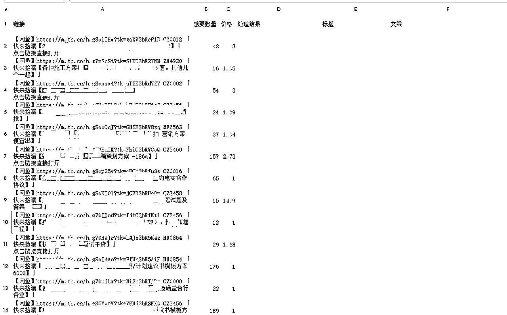
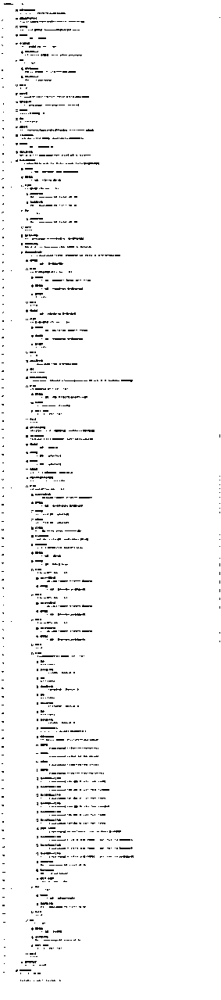
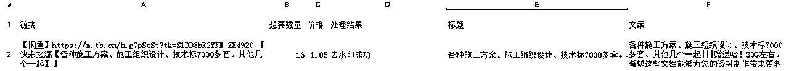
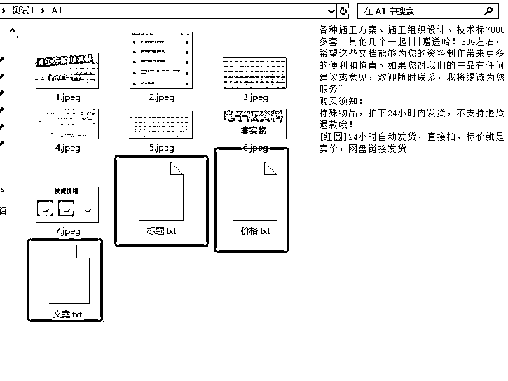
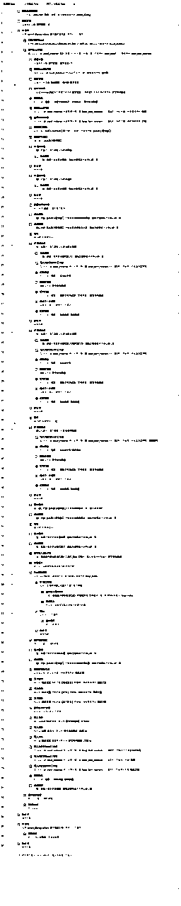
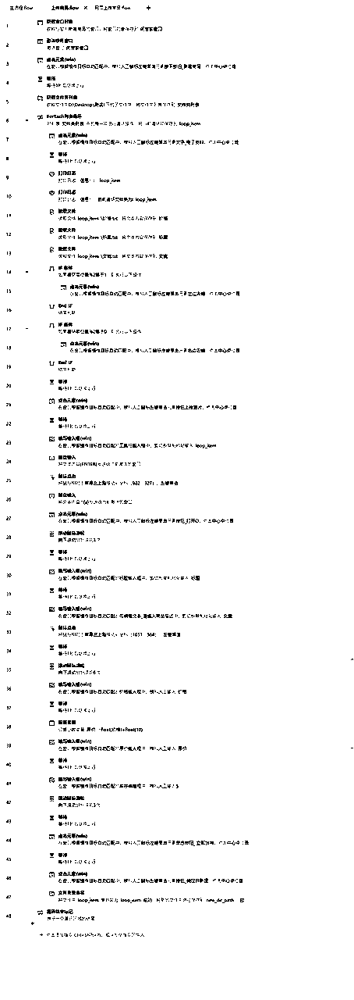
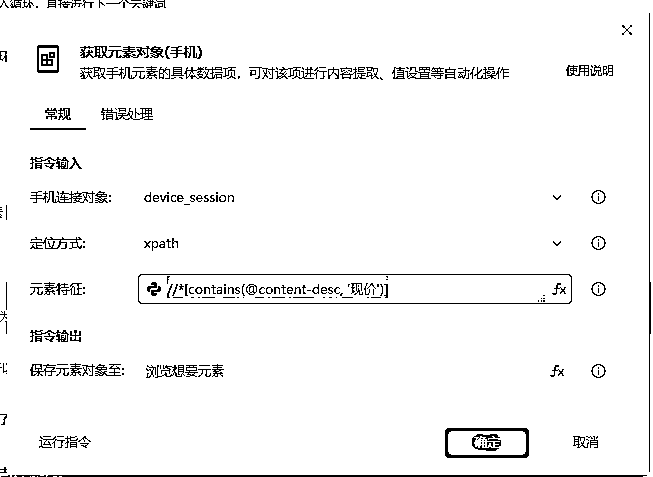
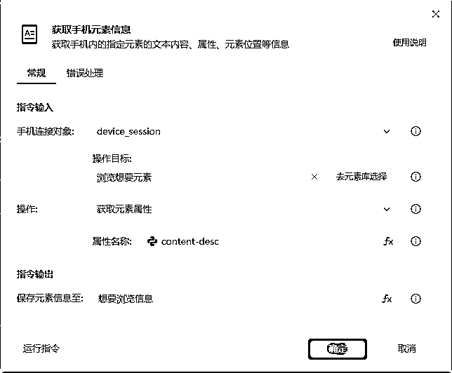

# 闲鱼虚拟项目自动化：我用影刀打通了爆款采集、去水印到自动上架的整条链路

> 来源：[https://riodtlbegu.feishu.cn/docx/JCINdp7czohdI7xbdKLcKlCinDc](https://riodtlbegu.feishu.cn/docx/JCINdp7czohdI7xbdKLcKlCinDc)

最近在实操闲鱼虚拟电商这条赛道，手动跑下来一套流程下来很吃时间。

光是每天筛爆款、处理水印、发布商品，就得耗掉两三个小时。为此我抽出半天时间，把这三件事串成 RPA 流程，复用起来直接省心。

目前这套组合拳是这么搭的：

1. 爆款采集端，直接调用影刀的手机端自动化来跑
2. 去水印环节，暂时借助微信小程序里的去水印工具在处理
【也可以走接口，昨天我测过接口是加密的，我暂时没攻克，有现成的接口资源能直接省掉一大截时间】
3. 闲鱼上架部分，用的是闲管家电脑版的模拟操作

跟做虚拟赛道的同行聊聊，除了省时间外，有个现实问题也得说明白：这几段脚本本质都是在模拟人工点击，去水印和商品发布这两个环节，电脑是需要一直有人看着、不能离开的。

## 一. 闲鱼爆款自动抓取

思路很简单，往里丢一个品类关键词，脚本就会自动去爬取相关商品信息。

#### 1.演示视频:

#### 2.采集格式:

#### 3.抄作业:

## 二. 闲鱼商品去水印与标题文案提取

#### 1.演示视频

#### 2.处理结果格式

#### 3.抄作业

## 三. 闲鱼商品自动上传

1.演示视频

2.抄作业

## 四. 小结

整体实现门槛都不算高，有需要的话自己照着跑一遍就行，不明白的地方可以一起探讨。

唯一卡了我一下的是手机端采集时想同时拿到点赞和浏览量，这部分需要用 xpath 去定位数据节点

//*[contains(@content-desc, '现价')]

直接照抄就能用！