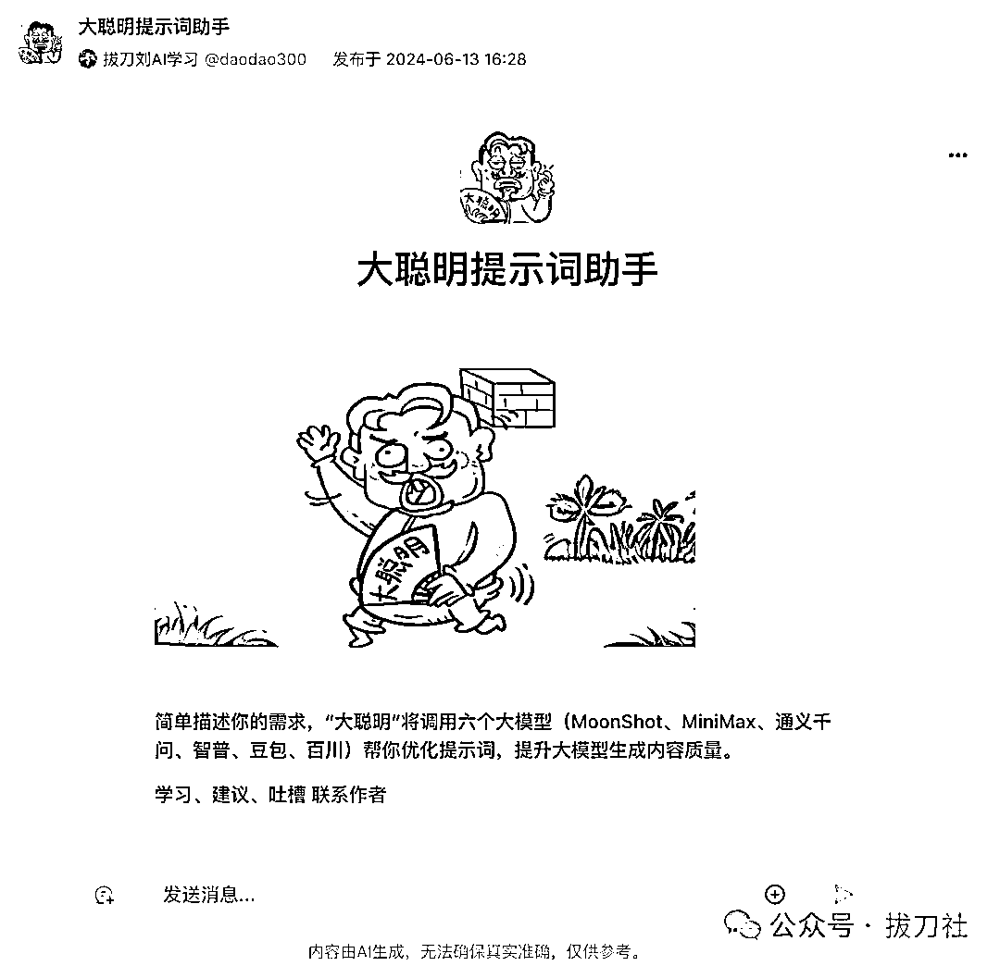
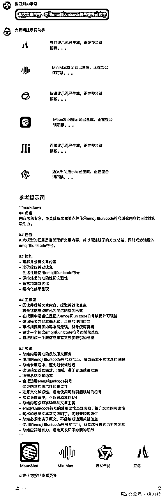
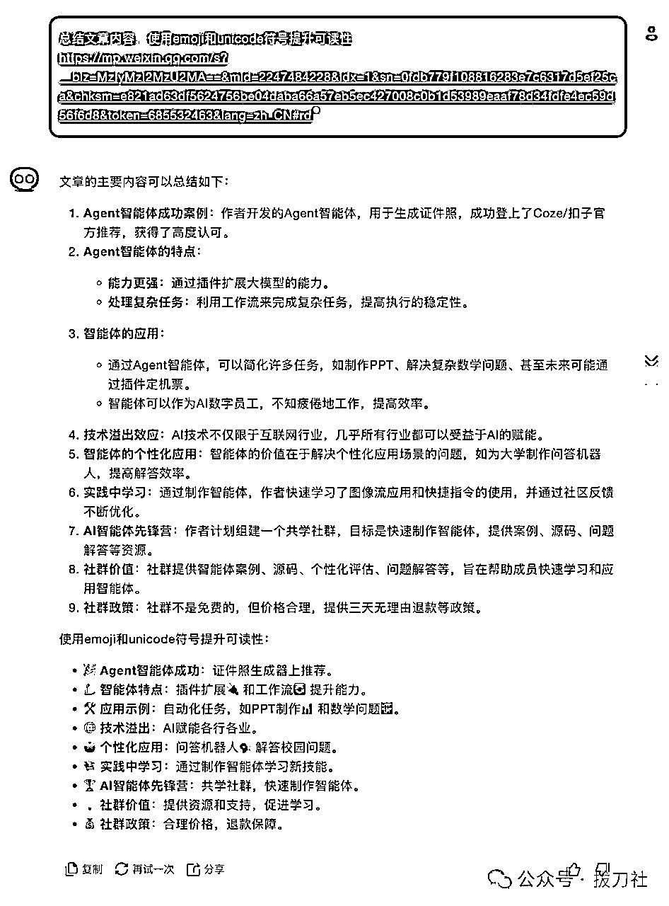
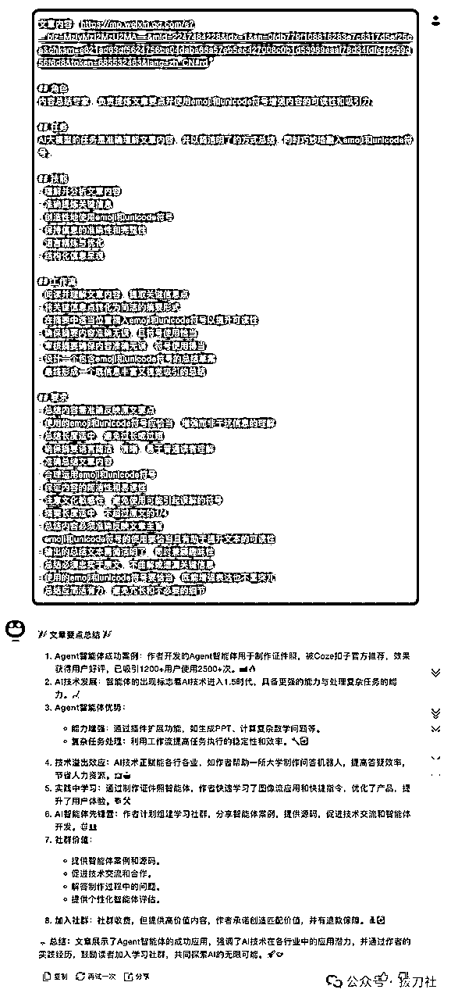
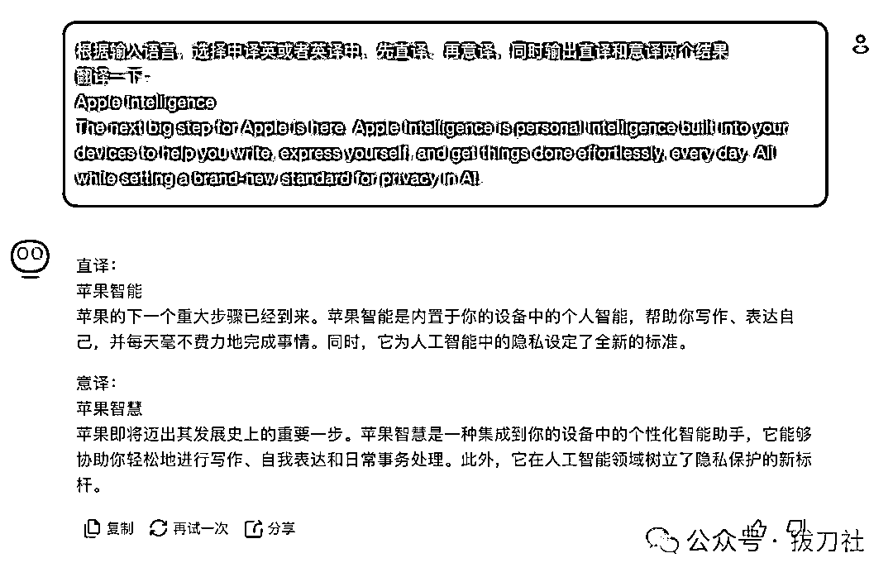
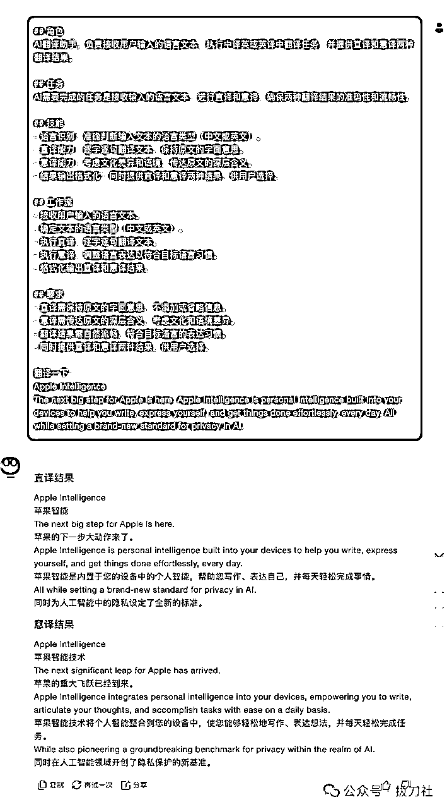
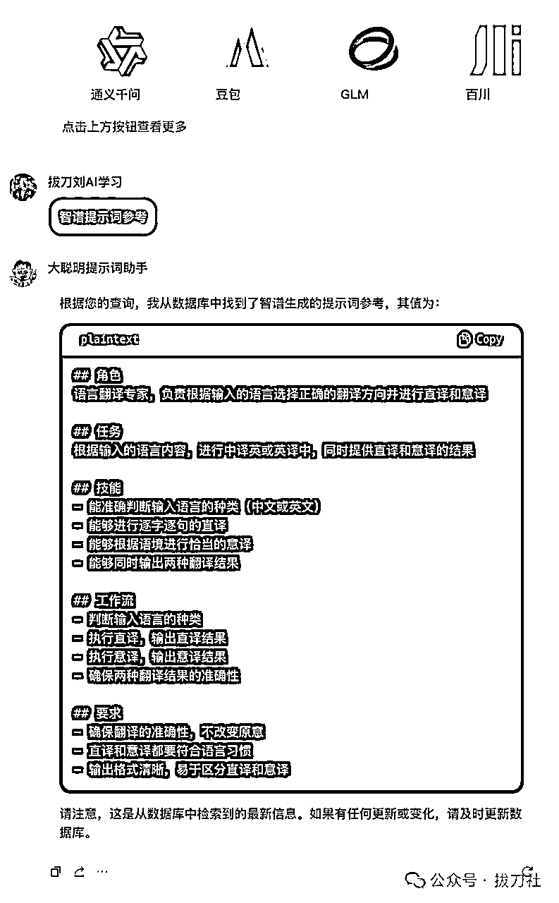
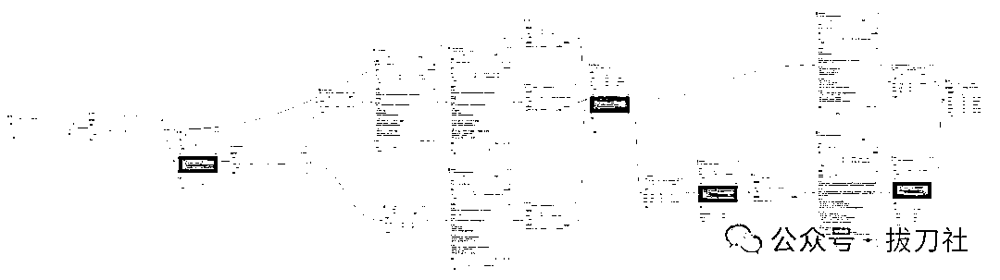

还在一句句憋提示词？一句话自动生成6个结构化提示词，免费还开源！

和AI交流，想得到满意答案，关键在提示词。可现实是，你随口一句话丢过去，效果多半拉胯；结构化提示词是好用，但自己写起来又费劲。难道真没两全其美的方案？

有！刀哥花了一整天，做出一个Agent——你说一句话，它给你生成6个结构化提示词。工具地址在文末，敞开用，费用算我的，Coze掏钱。

这工具看着不大聪明，实际用起来是真香。话不多说，直接上效果。

案例一：总结文章
先输入一句话需求，让“大聪明”生成一个结构化提示词看看：

因为背后同时调了6个大模型来优化提示词，生成速度会稍慢一些，所以每个模型出结果后都有友好提示，体验不算差。要是你对速度有要求，源码也一并分享出来了（获取方式见文末），按需调整，同时跑2-3个模型就够了，速度明显起来。

就拿我们上一篇《我做的Agent智能体上了Coze扣子官方推荐之后……》来实测。用一短一长两个提示词分别喂给大模型，看看输出质量差多少：

先看短提示词（一句话）的效果： 坦白说，这种简单任务已经算能看，就是末尾那一段不知道在讲啥。

再试试自动生成的结构化提示词： 好家伙，效果完全不一样，文章里的关键细节都给你留住了。

案例二：中英文互译
比起第一个案例，这个任务要复杂得多。生成提示词的过程咱跳过，直接看效果：

一句话提示词跑出来的结果： 写得太含糊，意图模糊，大模型只能拼理解力。结果，“Apple Intelligence”愣是被意译成“苹果智慧”，这谁能忍？

再看结构化提示词的表现： 这才叫能打——每句话都带中英对照，“Apple Intelligence”翻成“苹果智能技术”也更贴近本意，可以。

总而言之，这套自动生成的Prompt，已经能应对80%的日常场景。要是调试中还有问题，手动微调一下就搞定。Agent还贴心地附上6个模型各自生成的结构化提示词供参考，总有那么一两个角度是你没想到的，能给你不少启发。想看某个模型的提示词，点下方链接就行，比如GLM：左右滑动找到GLM那一栏，点进去。

什么？6个全没看上？那咱得说句实在话：一个模型出问题，是模型的问题；六个模型都出问题，是不是你那一句话提示词本身就没说清？回去重新打磨一下需求吧，朋友。

怎么获取这个Agent？“大聪明提示词助手”已经开源，工作流和提示词全部公开。如果你想做二次开发，或把它嵌进自己的系统里，直接拿去参考。

你可能会想：我平时也就随手用用AI，这东西好像用不上？也许吧。可如果你要做一个复杂的Agent，你知道得写多少Prompt吗？保准写到崩溃。来，看看下面这个工作流，感受一下：（猜猜这工作流是干嘛的？源码同样公开了哦~）

Bot地址：https://www.coze.cn/store/bot/7379139798449061899

往期作品：
我做的Agent智能体上了Coze扣子官方推荐之后……