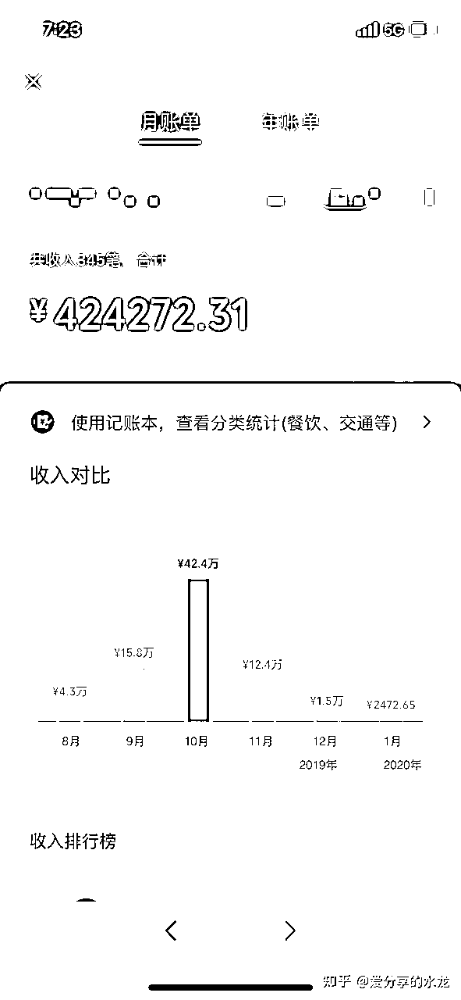
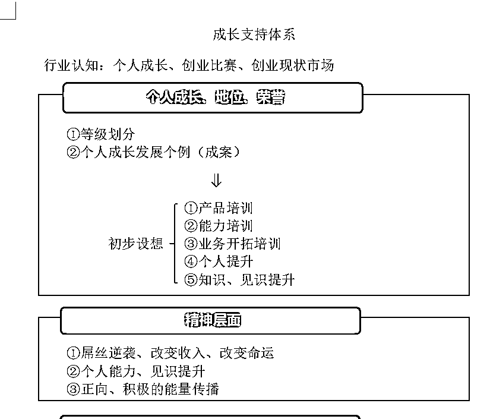
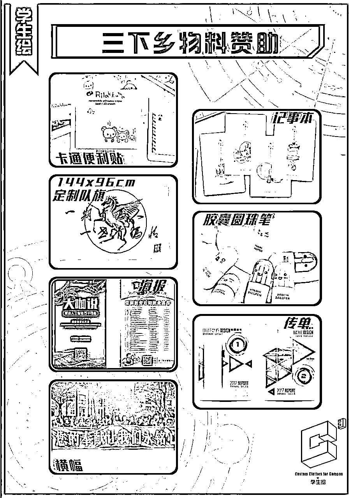
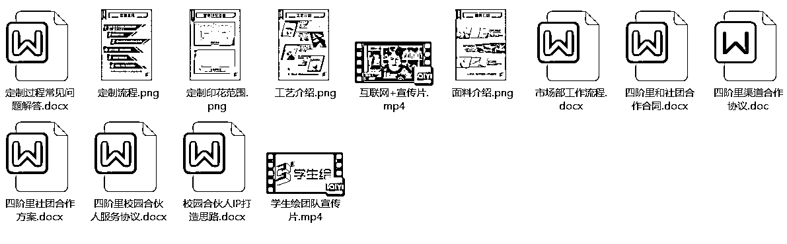
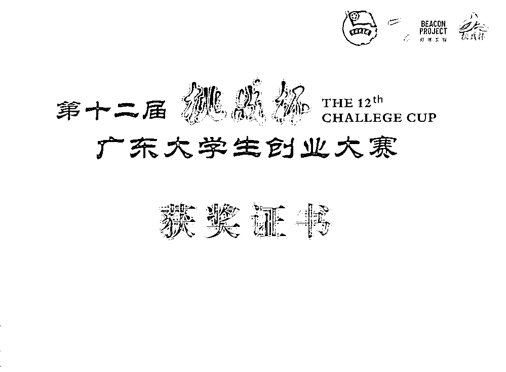
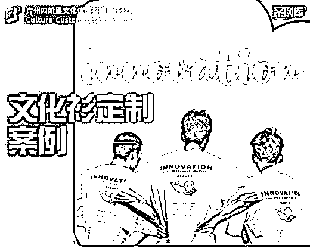
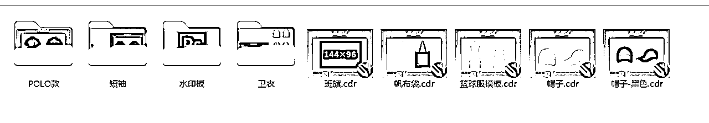

# 靠卖T恤年赚50万？我把这套校园冷门生意经拆给你听

在校园里掘到第一桶金，这事听起来像励志故事，但确实发生在我自己身上。大二那年，我带着几个伙伴在学校里做定制T恤的买卖，半年流水逼近200万，个人进账50多万，最猛的一个月收入冲到了40万。后来毕业打工，业余时间依然有不少老客户和代理找我下单，每年还能额外赚十几万。这套玩法，今天完整分享给你。

## 谁在为文化衫买单？

这个项目的客户群体其实比想象中宽广：

- 中学的班服需求，几乎每个班都要定制
- 大学里的社团服、班级服，年年换新
- 企业的周年纪念衫、日常文化衫
- 奶茶店、小餐厅、咖啡厅的员工工服
- 各类付费社群定制的专属周边

## 利润空间有多可观？

单件T恤的进货成本8到20元，挂到淘宝能卖25到55元，每件净赚20到30元。订单量通常在30到50件之间，一个单子保底利润500块。碰上定制上百件的大客户，赚头就更猛了。

卫衣的进价在30到50元，零售价70到100元，单价利润能到40到50元。一个常规订单，入账千元起步。

有意思的是，客户除了定制衣服，往往还会顺手把帆布袋、帽子、裤子这些周边一起做了。你卖得越多，赚得越爽。

## 校园市场怎么打？

### 第一招：铺设代理网络

代理分两个层级。第一类是零门槛的推荐型代理，只需把我们的小程序链接甩给班长或者负责下单的人即可。按件数给佣金，一个单子的提成在150到300元上下。对高中生和新生来说，这是一笔颇具诱惑力的外快，推荐起来特别积极，而且拿过一次佣金后，就会持续帮你拉单。

第二类是校园合伙人，需缴纳999元代理费，收益按订单总额的比例抽成。除了分润更丰厚，我们还会把他们拉进专属社群，帮着打造个人IP。说白了，就是锻炼他们的销售实战能力，让他们能更好地发展下级代理、开拓更多客户。

### 第二招：绑定社团外联部

大学社团的外联部每年都在发愁赞助任务，而业内恰好有一种“文化衫赞助”模式。班服公司先行提供迎新赞助，按每件衣服6到10元结算，条件是社团在迎新结束后，把定制单交给这家公司。

说白了，这就是羊毛出在羊身上。我们利用足够的利润空间给社团让利，本质上等于用更便宜的价格卖衣服给他们，而社团外联部也顺利完成了赞助KPI，双赢。

有一点要注意，部分社团会要求先打款。想做社团生意，手上得备点启动资金，一万块基本够用。有些社团不要现金，要物资，那就更好解决了，海报传单这类东西在淘宝或1688上定制，花不了几个钱。

如果你的销售能力够硬，甚至可以和外联部长商量新生班服的统谈合作。有些学校的班服由学生会统一决策，我们就试过把总销售额的20%分给一位学生会主席，结果整个学院的班服订单全部落到我们手里了。

社团客户几乎每年都有复购需求，前期的关系铺得越广，后期越是躺着收钱。我现在基本就是这种躺赚状态。

### 线上怎么搜刮各校学生？

- 直接在网上搜高校名单和中学名单，按城市逐一“扫荡”。每年6月左右，用QQ或抖音混进新生群，以学长学姐创业的身份发展代理。朋友圈务必提前包装好，展示正能量、有能力、会赚钱的人设，然后把各个学校的代理统一拉到微信上管理。
- 做小红书图文引流，要么靠高中资料吸引学生，要么用“高薪线上兼职”的标题吸引关注。
- 直接买大学生兼职群、新生群、交友群的成员资源，规模化开发校园代理。

代理变客户，客户再变代理，这个循环一旦跑通，客源就像滚雪球一样越滚越大。

## 社会市场又怎么玩？

企业客户基本都是靠口碑推荐来的。T恤定制这个行当，客户要么上淘宝，要么找熟人。我们的货源是工厂直供，价格和质量天然占优，所以开拓市场最关键的就是破圈：多参加企业线下交流活动，花钱进创业圈子。圈子里做文化衫的人不多，你只要亮出源头工厂的身份，订单就会主动找上门。而且只要做过一次，基本都会帮你转介绍。

至于奶茶店、小餐馆这类散客，核心是直接认识老板本人。单量不大，但几乎每个月都来，积少成多，一年下来也是一笔可观的收入。

最近我又在闲鱼和小红书上尝试引流创业粉，后续打算用文化衫做进一步的变现。

## 做项目需要什么硬性条件？

### 搞定供应链和工艺

你需要两类核心资源：底衫供应链（T恤、卫衣、马甲、风衣、职业装等），以及印花工厂（丝印、烫画、直喷、刺绣等工艺）。

文化衫的源头供应在1688上根本找不到，必须去线下面谈。这行的工厂主多为老一辈，讲究面儿，见过面才愿意长期合作，账期才能谈得宽裕。供应链主要扎堆在几个地方：

- **广州白云新百佳市场**：底衫的集散地，可以逐家比价。A区主打广告衫，其中好几家专供班服市场的底衫，淘宝上很多店都是从这里进货的。B区则是足球服和篮球服，附带一些简单的印花。
- **贯通市场**：烫印和刺绣厂聚集地，丝网印和全身印工厂一般不在这边，得自己出去找。找厂有个笨招，热情地和店老板聊，甩几单生意出去，他们自然会把朋友介绍给你。
- **佛山和中大布行**：面料和各种辅料（吊牌、包装袋）应有尽有，适合那些对品质有要求、单量也够大的客户。
- **潮汕揭阳和江西义乌**：真正的制衣厂基地，做文化衫未必用得上，但值得去了解。

当年我创业的时候，在线下谈过500多家工厂，最终稳定合作的也就10来家。行业里号称自营工厂的大有人在，但绝大多数是无货源的空壳。

作为一名从业四年的过来人，给你四个避坑忠告：

**第一，能不用全身印就不用。** 校园市场经常要用数码全身印，但这类工厂最不可控。淡季时答应两三天发货，一旦到了开学旺季，他们优先做自己手里的大客户。我当年就是太年轻，听了厂家的漂亮话，订单几乎全压在全身印上，结果差点被坑死。几百件单子，一单2000来块，客户天天催着骂着，我只能盯在工厂里一件件盯着发货。文化衫往往是活动定制，错过活动时间，客户退货投诉双管齐下，那叫一个惨烈。后来我果断把大部分订单改成烫画和丝印，成本是上去了，好歹货能按期发出。

**第二，印花费用别压得太狠。** 工厂最怕偷工减料。我之前合作过几家丝印厂，打样时的品质和实际发货的品质完全两回事。后来出了售后，我直接跑去工厂理论，才明白是同行把印花价压得太死，人家只能用次等染料。找到供应商深聊后，达成“口碑第一”的共识，后面改用最好的用料。零售端的利润足够覆盖这点印花成本，别因小失大。

**第三，底衫必须亲自试穿。** 我在大学时期跑客户有个土办法，带一箱衣服直接约见社团负责人或老师。自己像测评博主一样，每件都上身试穿，看成版效果、摸面料耐穿度。选品上不要贪多，校园生意备两种纯棉款就够了——一个走性价比、一个走高质感。

**第四，售后别和供应链斤斤计较。** 文化衫定制偶尔会碰到破洞、印错的情况。件数不多就自己掏钱补上，毕竟零售端的利润比供应链高出不少。想走远路，和工厂的关系就要当回事来处。

### 开发市场的筹备清单

- **招募代理的文案、图片、视频**必须提前备全。我们暑假就会招募20名留校大学生，以比赛项目的名义，给一个月800元的底薪，让他们去拓展校园代理。多数大学生缺少商业思维，所以我们提供了保姆级的操作手册，从账号申请到聊天话术，全部做成SOP，照着做就行。原则很简单：代理越多，开学季的转化就越可观。
- **招募推文和班服销售推文**要趁早写好。中学一般在7月放假，所以6月底就得启动代理招募，最常用的渠道是找校园墙投广告。推文重点突出“线上兼职、零代理费、高佣金”三大卖点。班服销售推文在8月底前完成，以设计图为主，强调好看的款式和实惠的价格。我们当年靠29元印两个图、38元全身印的套餐，直接打爆了整个市场。
- **营业执照和获奖证书是利器。** 对学生来说，权威性就是信任度。我们能用低薪招到兼职，主要是手里握着省赛金奖，有些学生甚至愿意免费加入团队。而中学生看到你的真实学校身份，通常愿意支持学长创业，还会主动帮宣传。

- **客户下单案例必不可少。** 新客户做设计时，几乎都会先看看别人的成品作参考。整理好一堆真实案例，随时能拿出来展示，成交率能提高不少。

### 设计难题怎么解？

把当年淘宝卖得最好的200个班服设计图提前买下源文件，做成按编号排列的画册。客户只要报出编号，设计师就能直接下单，方便又高效。画册可以打印出来，让校园代理直接拿着给班长或老师看。

此外，自己花点时间学基础PS，再去淘宝买班服相关的模板素材，整理成图库。你只需要掌握把原始图做成效果图的本事，底板提前做好备用。

遇到解决不了的复杂设计，可以和学设计的同学合作，或者去闲鱼搜“画画”，给20到50元的设计费就能搞定。和客户谈单时，设计越复杂，越要提前收100到200元定金，说清楚不退费。拿着这笔钱去闲鱼找设计师，稳赚不赔。

## 各平台的商业模式之争

我观察了同行们的各种打法，这里说点个人判断：

**淘宝**的坑在于开店成本。保证金、客服、财务、运营推广，底薪加提成是一笔不小的开支，还要加上刷单、直通车投流，以及永无止境的同行竞争。平台效率高的店铺越卖越好，没有方法的新手很容易死。如果非要做淘宝，建议一定要做包裹卡导流到私域，否则利润会低得可怜。

**抖音**需要开通店铺橱窗交保证金，而且卖货必须要真实的办公场景。个人做的话还要搭直播间，前期投入不小，且得坚持做直播和短视频，不是所有人都能耗得起。

**拼多多**是很多人会动的心思：做店群，开店从1688拿货。真这么想，说明你对PDD了解不够深。第一，仅退款政策会让人钻空子，很多买家故意退款，对新手极度不友好。第二，起店确实有流量扶持，但过一阵子就会推来低质量流量，逼你花钱买量。第三，PDD是拼价格的修罗场，利润被压得很低。说实话，连工厂都不乐意做拼多多的生意。

**小红书**倒是值得投入。开通电商就能获取定制流量，我自己用几个小号引流了不少精准客户，虽然还没系统化运营，但已经有同行在上面做得风生水起。

**我个人最推荐的路径**：公域引流到私域，引导客户在微信上成交。这样才有高复购、高利润、低退货的可能，这也是我认为该项目可复制的核心逻辑。操作上就是通过小红书、抖音、公众号文章获取学生粉，沉淀到微信后靠朋友圈和社群运营，把其中一部分发展为代理，最终在小程序上成交并自动发放佣金。

## 写在最后

1. 文化衫定制完全可以扩展到手机壳、鼠标垫等周边，全部都是无货源操作，不用压货。
2. 这个行当利润空间可观，复购率高，特别适合深耕私域运营。
3. 核心就三个环节：供应链、设计、招代理。只要跑通这三件事，基本就能实现零成本躺赚。
4. 个性化定制正在成为消费趋势，市场还在持续扩大。这虽然是个小众赛道，却是真真正正值得好好研究的生意。