# 《4天卖出6万，靠的不是话术，是把自卑的自己翻盘成月度销冠》

嗨，大家好，我是花花。

意大利名校本硕的小镇做题家，现役外企打工人。主业让人窒息，但【优势创富教练】这份副业，是我每天的救命稻草。

我自己被雨淋过，所以想给别人撑伞。自媒体做了大半年，累计服务300+独立创业者实现稳定变现，咨询时长150小时以上，投入超过1160小时，营收突破20万。

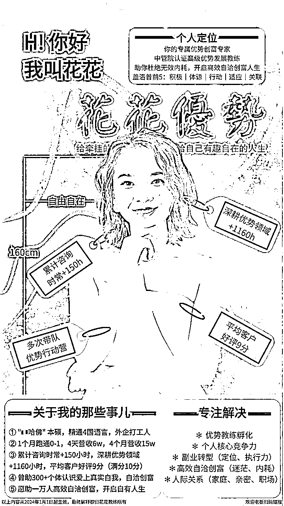

商业，才是最大的善意。

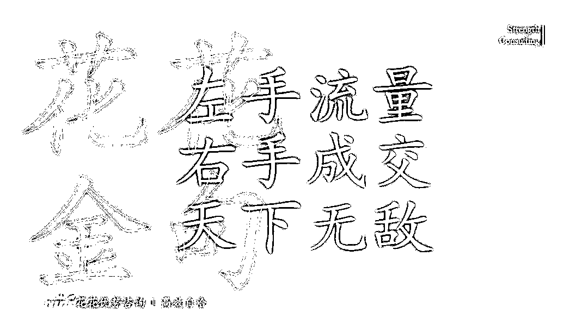

对于一部分人来说，成交是天赋，比如靠谱老师。

可对另外一部分人而言，明明道理都懂，一开口就卡壳。比如曾经的我。

普通人获客已是难题，再加上转化能力薄弱，基本就很难活下来。毕竟在这个行业，业绩就是你的底气。

今天就复盘我是怎么做到《4天突破6万营收：从自卑到多次拿下月度销冠》的，希望能给你一些借鉴。

当你把盖洛普优势模型真正用进生活和工作中，正向反馈会源源不断。找到适合自己的成交方式，善用优势，效果完全不一样。

# 目录

一、货好为什么卖不动？

二、销冠的底层思维长什么样？

三、找到你的销售优势风格

四、四大优势领域人群的销售画像

五、面对“缺xx才干”的焦虑怎么办？

* * *

# 一、货好为什么卖不动？

“我的产品明明很棒，为什么就是没人买？”

卖货时的你，和谈恋爱是不是一个样？

一开始热情满格，话也多，结果客户回一句“再看看”，你瞬间石化，像掉进冰窟。

客户拖延、砍价、消失，这些剧情几乎天天上演。

圈子里很多朋友，脸皮薄，加个微信都要鼓起勇气，发条朋友圈要斟酌半天，生怕别人评头论足。

客户多问一句细节，心里就慌得像没复习就被点名。

忙活一圈，业绩依然干瘪。

为什么会这样？

原因其实很多：没底气、产品不熟、话术生疏、目标不清、跟进不到位、情绪 swings...

这些坑，点破就破。

核心问题在于：你是否清楚自己的优势和盲区，能否把长处用起来，避免把优势的反面暴露出来。

请相信，每个人都具备成为销冠的潜质。

真正打动客户的，从来不是套路话术，而是你的真诚、你的理解力、你给出的额外价值，以及你的格局和原则。

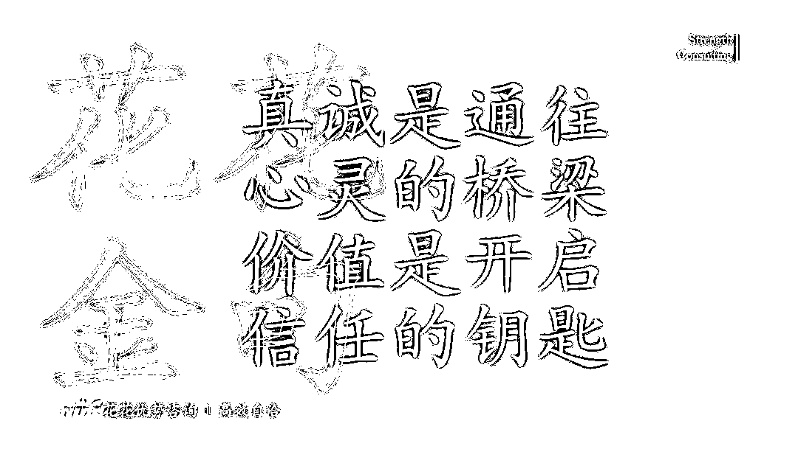

在照搬销售技巧之前，先问自己一句：这招适合我吗？适合他吗？

事实上，成交的是客户自己。

你的角色是把事实呈现清楚，让客户在正确的选项里做出选择。

即便这次没成，也能留下好印象。

销售本质上是心理博弈。

你要做的是客户的贴心人，读懂需求，用专业和真诚去触达，让他愿意主动掏钱。

说白了，就是用【用户思维】抓住真实痛点，再用“真实且有价值”的自己去建立信任。成交自然就水到渠成。

成败在细节，细节决定成败。

每个沟通瞬间的选择都可能改变结果。

用好优势，管住弱点，用客户接受、自己舒服的方式去接触。

心态占70%，技巧占30%。

心态上，掌握优势理念后，大部分销售困境都能快速调整。

盖洛普四个优势领域【战略思维、执行力、关系建立、影响力】，每个人都会有自己的卡点。

我今天就带你用优势视角，把这些问题拆掉，走上销冠之路。

没做过测评也没关系，先对号入座。有报告的朋友，这期会更受益。

希望听完你能马上上手，今天就开单。

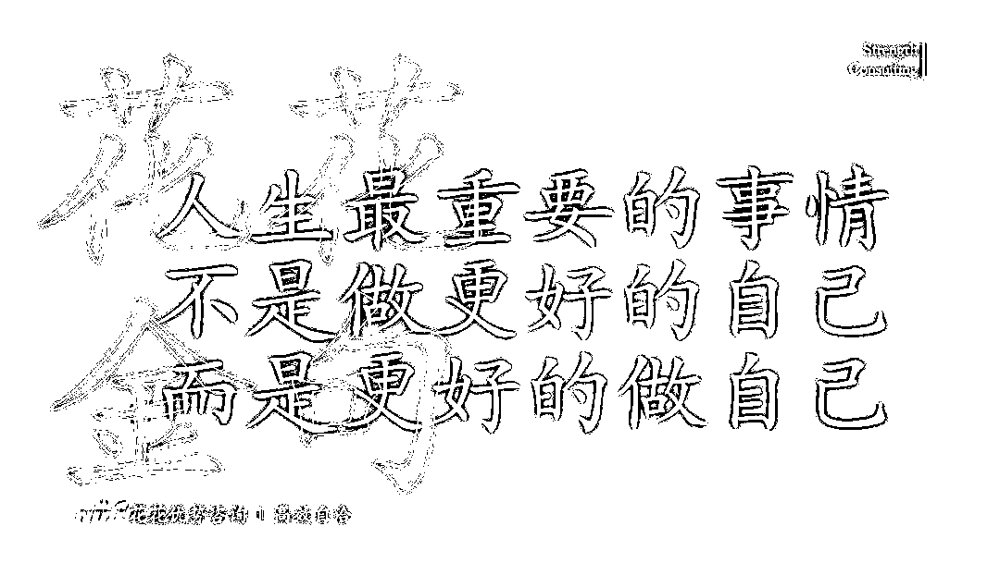

这是我每次对L1优势精品小班学员说的原话。

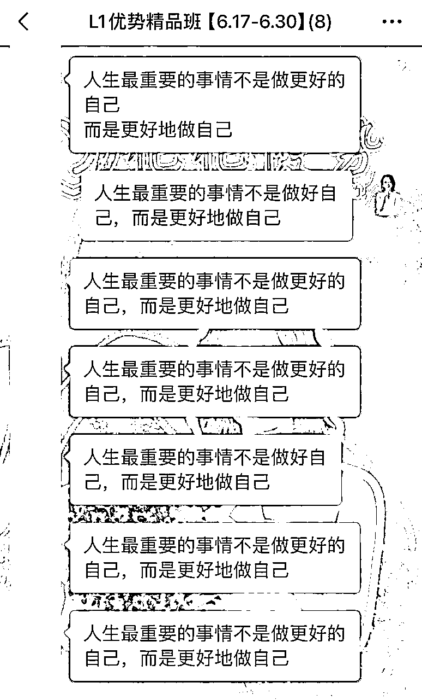

# 二、销冠的底层思维长什么样？

提到销冠思维，大家第一个想到的就是梁靠谱老师吧？

她拥有的【销冠三件套——取悦、沟通、个别】，听起来像销售界的秘籍。

但别被误导，成为销冠并不等于必须拥有这三件套。

我就是最好的证明。

我是一名1月才入行的新手优势教练，平时被主业和家庭轮番轰炸，但今年已两度拿下月度销冠。

做法很简单：找到自己的优势与销售模式，然后无限放大。

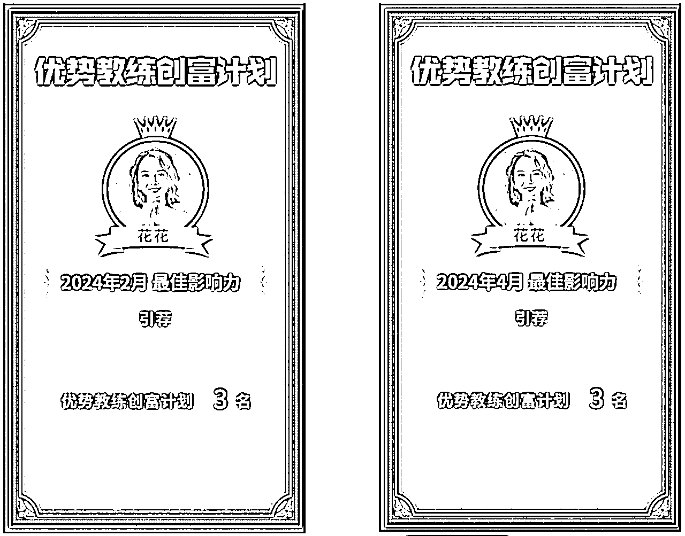

👇这是我的盖洛普优势图。

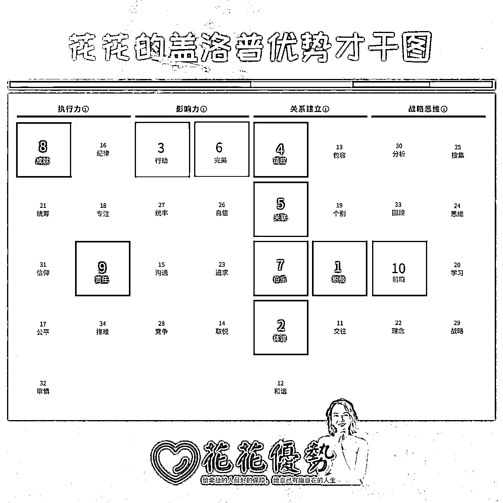

起初我也很羡慕靠谱，感觉她发条朋友圈就能变现，影响力爆棚。

后来系统学习盖洛普后我明白了，要看自己的才干，而不是总盯着别人的。

靠谱适合大舞台，我是典型的大关系建立，更适合小圈层深耕，1对1交流时我更有状态，气场更稳。

从我的才干图能看到我的内耗三件套：【体谅、适应、和谐】都在前15。

所以我极易内耗，但我学会了自洽，找准了适合自己的商业模式，为认可我的人创造价值。

每天践行盖洛普，我像挖矿一样不断提炼最高效的方法并迭代。

【成就】让我每天都有完成任务的驱动力，不断升级自己。

【积极、行动】让我开朗真诚，不纠结他人眼光，敢试敢干。

【体谅】让我能共情客户视角。

【关联、伯乐、前瞻】让我相信每一次相遇都有意义，想帮别人少走弯路。

我想帮助客户成长，付费用户我会更用心交付，但我也不会为不识货的人消耗自己。

我是长期主义者，今天不成交也不会气馁，相信能量终会回流。

成交是双向选择。

我能做的，是站在客户立场，用专业和技巧帮他做出最优选择。

心态上，跟随本心，看我能怎么帮到他。也许他不付费，但一句话可能点醒他。

技巧上，坚守框架，透过表象看到本质，让客户在对的选项里做选择。

很多人总盯着自己缺什么，才干没什么就一直内耗。

这种思维不改，弱点不管理，优势就发挥不出来，成绩自然上不去。

销冠的思维转换是：

从“我没有xxx怎么办”

变成“我有zzz，我怎么用它达成想要的结果”

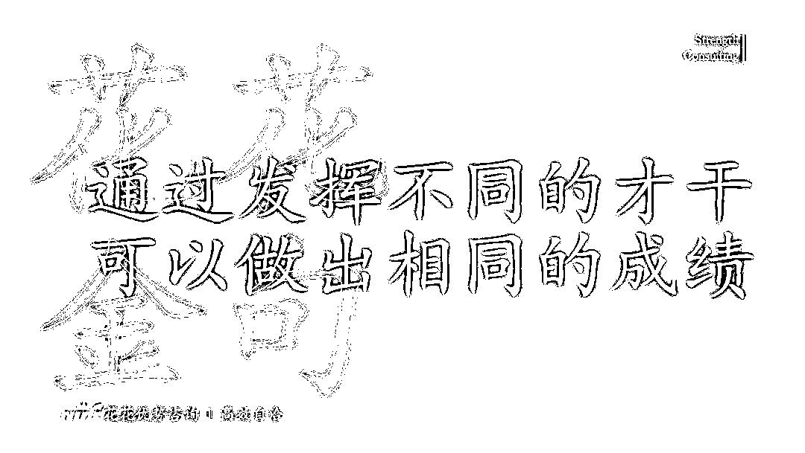

别总盯着自己缺的，多想想手里的牌怎么打。

罗马只有一个，但通往罗马的路很多。

找到适合自己的那条路，才是关键。

总盯着开跑车的人，而你只有双腿，时间长了会怀疑自己，最后想躺平。

可真正的躺平是有条件的，你可能连躺平的资格都没有。

悄悄告诉你成为销冠的要点：

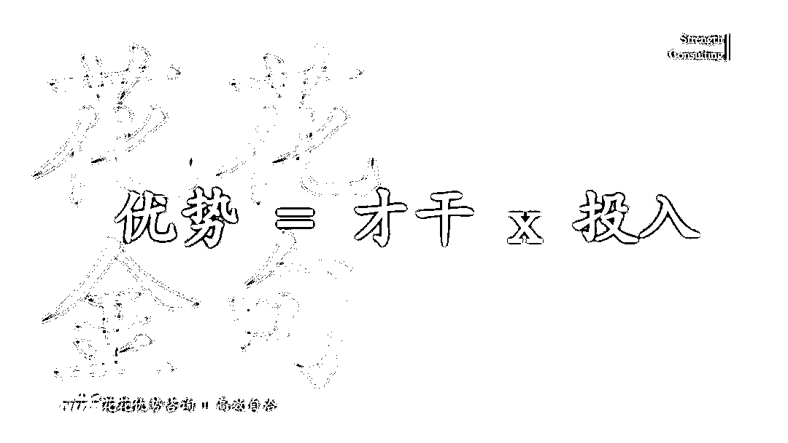

无论才干组合如何，只要认识自己、管理好自己，找到合适的销售方式并持续投入，你就是下一个销冠。

# 三、销冠：找到你擅长的销售优势风格吧！

别被传统销售技巧绑架，找到属于你的销售优势风格才重要。

销售就像做菜，要好吃，也要对胃口。

传统话术都是老套路，得找到自己的打法，让销售变得自然像呼吸。

每个人都是一道不同的菜，有人辣有人甜。

销售方法也得因人而异，别人有效的招数，用在你身上可能适得其反。

选对自己擅长的、客户买账的，才是王道。

推广产品时，我建议卖自己用过、真心认可的产品。

你自己都不信的东西，别人凭什么信？

起步期专注1-2款产品吃透，说话才有底气，靠真诚打动人。

产品有了，怎么卖？

先搭上线，用你最自在且能坚持的方式。

公式很简单：

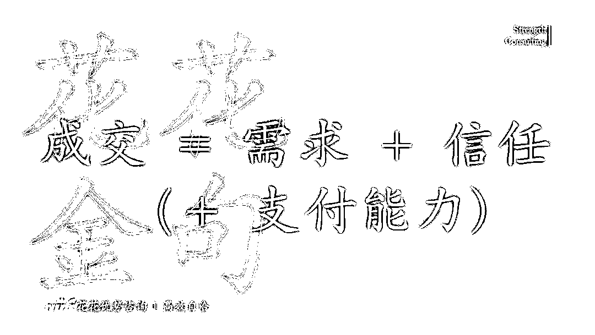

核心就是提升信任和挖掘需求。

尤其是高客单，信任需要慢慢沉淀。

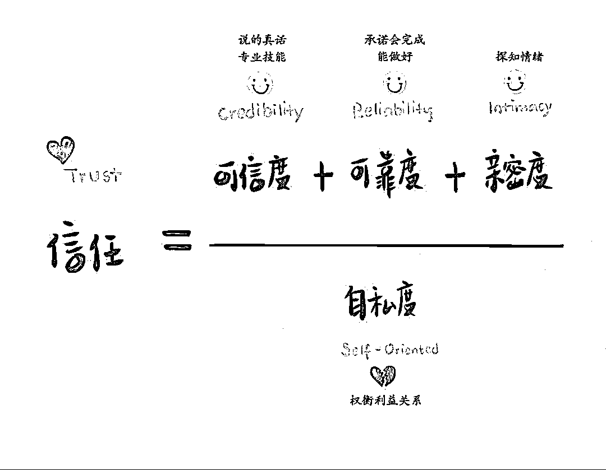

你可能是I人，社交简单都觉得累。

没关系，每个人都有自己的连接方式，用最自然的方式接触，用优势打动客户，订单自然来。

盖洛普不仅是自知工具，更是读懂客户的工具。

学了盖洛普，你能听懂客户话语背后的真实需求。

就像分手理由，男生说的往往不是真正原因，不懂人性就永远猜不透。

人性是商业的核心，盖洛普帮你看见本质，提升成交率。

# 四、四大优势领域的人常见的销售特征

不同才干类型的人，销售状态、节奏、卡点、打法差异巨大。

## 4.1 战略思维【绿巨人】：洞察力强但启动慢

绿巨人是典型的佛系销售，洞察力一流，就是行动像蜗牛。

一眼看穿本质，自己很爽，但卖货时完全蔫。

主打“我都懂，就是不动”。

比如学员小星，大战略思维。

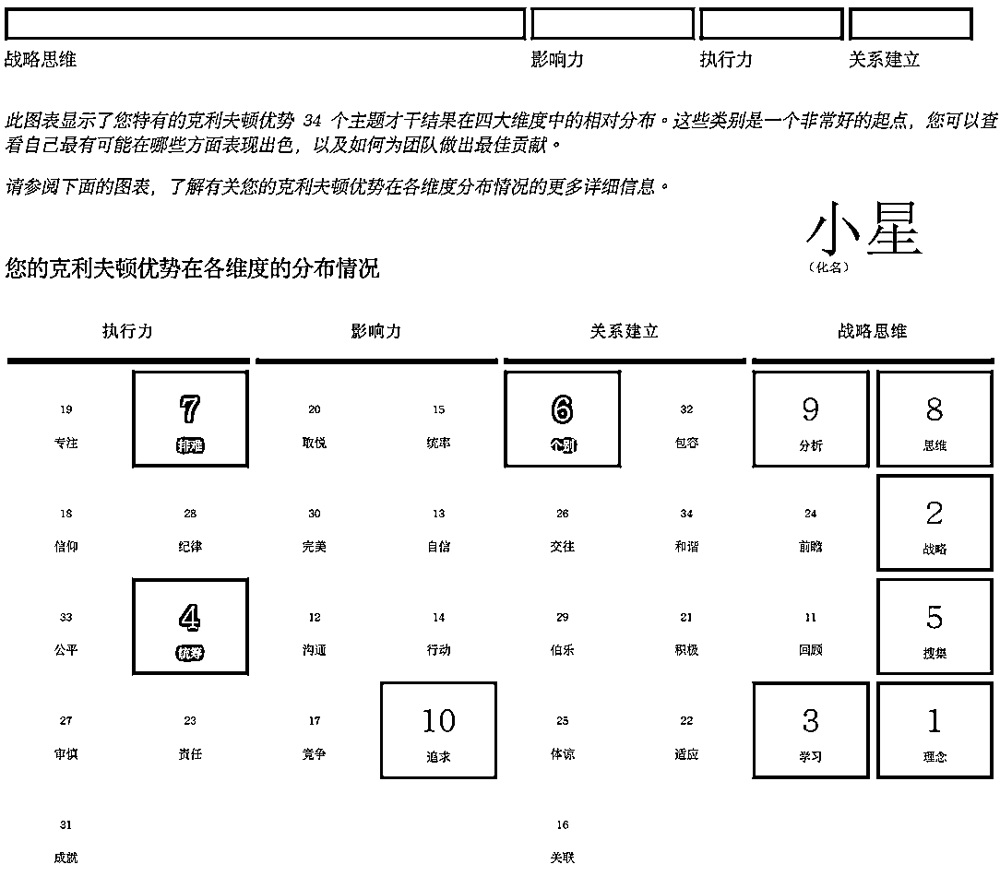

创业多次，每次启动猛如虎，闭环后就泄气，心气像放气的球。

困扰多年。

咨询后她明白，自己就爱啃硬骨头，难题一旦解决就提不起劲。

哪怕成本很高，让她去找新客户也很难。

我建议她把优势理念结合业务，深挖专业，给客户做深度定制方案。

这样既能保持挑战感，又能做差异化，专业感一出，客户自然信服。

标准化内功，个性化交付，价格自然上去。

适合卖复杂咨询方案。

要注意，战略思维的阴影面是想太多：【前瞻、理念、学习】过载会导致发散过度，客户跟不上，或者只盯未来忽略当下需求，沟通脱节。

因此，战略思维突出的人，选能让专业和洞察发光的产品模式，优势才能最大化。

## 4.2 执行力【紫衣侠】：勤奋可靠但缺弹性

盖洛普的执行力不是普通意义上的执行力，而是由内在驱动力决定的行动意愿。

紫衣侠的特质是：“你信我，我能成，我绝不会让你失望。”

踏实、勤奋、负责任的形象天然建立信任。

在“靠谱、使命必达、流程清晰”的成交场景里有先天优势。

这是当下信任稀缺时代的金字招牌。

记住：成交 = 信任 + 需求。

学员小曼，大执行力。

👇她的才干图。

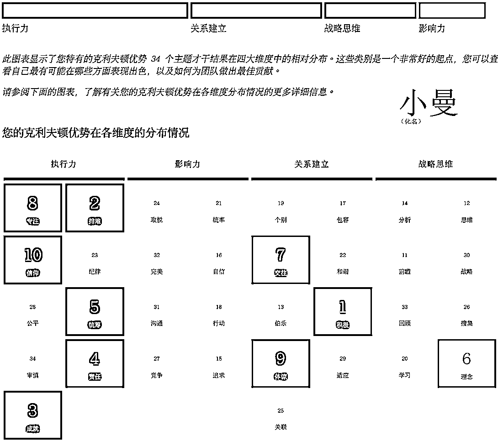

自媒体项目，I人社恐，却靠执行力才干【责任】吸引了一大批付费铁粉。

大家觉得跟着她，执行到位，收益可期。

她交付上“有回应、有落实”，让客户安心。

用【排难和纪律】把流程做成新手手册，一看就会。

【成就和专注】让她持续跟进直到成交。

【排难】让她快速识别问题并解决。

要警惕执行力过度的副作用：过度关注细节，给自己和他人施压，自己焦虑。

保持平衡很重要。

如果你还有“卷王三件套”成就、专注、完美，成交能力会更强。

不知道自己有没有？可以找我免费看。

最后提醒紫衣侠：多复盘，多展示，多曝光，让努力被看见，才能吃到表达红利。

## 4.3 关系建立【蓝精灵】：细腻但易内耗

关系建立的人容易内耗，做不好破冰，情绪易共振。

有内耗三件套：怕冲突、敏感、过度在意他人感受。

但发挥好了，销冠也能做到。

比如学员小🍊，从半年2000万业绩，一跃成月销2350万销冠。

👇她的才干图。

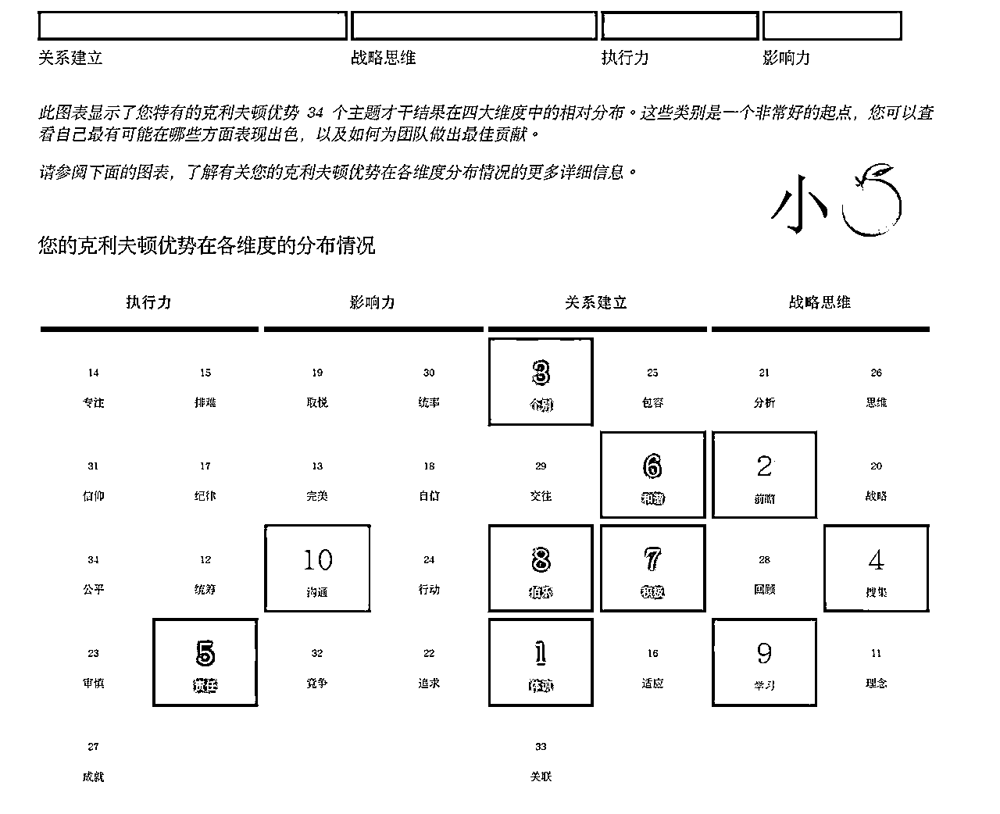

学了优势和教练技术后，她完成了思维转变。

以前卖理财，总怕客户亏，心里没底，这是【责任】过度发挥。

后来她学会发挥【积极】，抑制【责任】【体谅】【前瞻】的过度。

明白理财期限可控，风险可控，帮助客户在可预见范围内规避风险即可。

客户关系上，她原来想和陌生人深度连接，建立不了信任。

后来发现是【学习+前瞻+搜集】在起作用，她更适合和能让她成长的客户交流。

通过抑制【体谅】【和谐】，多用【积极】推进，不再过度顾忌。

她明白分享是提供选择，讲清利弊，不是强迫。

如果影响关系，那可能不是理想客户。

销售风格上，她从专业术语切换到情绪价值输出。

用【个别】识别客户特点，用【沟通】【体谅】让客户感受到被重视。

产品同质化严重，差异化在于人。专业+情绪价值=成交关键。

蓝精灵别怀疑自己，社恐也能成为销冠，关键是找到适合的风格。

## 4.4 影响力【橙将军】：魅力强但易强势

很多人以为影响力才干靠后就做不了销售，这是误解。

不了解自己优势，导致心态和技巧用错，才是不适合。

影响力才干突出的人稀缺，能成价值中心和流量枢纽。

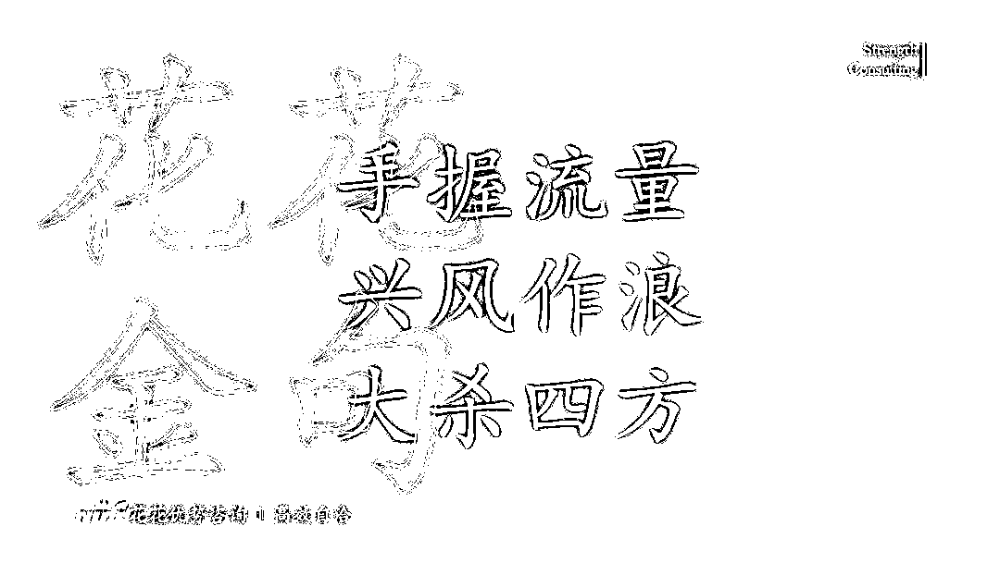

但影响力也有类型：软性的取悦、沟通，硬性的统率、竞争。

销冠三件套沟通、取悦、个别，属软性影响力。

有销冠三件套就一定成销冠吗？不一定。

梁靠谱老师是典范，除了三件套，她还有#8统率和#11竞争。

👇她的才干图。

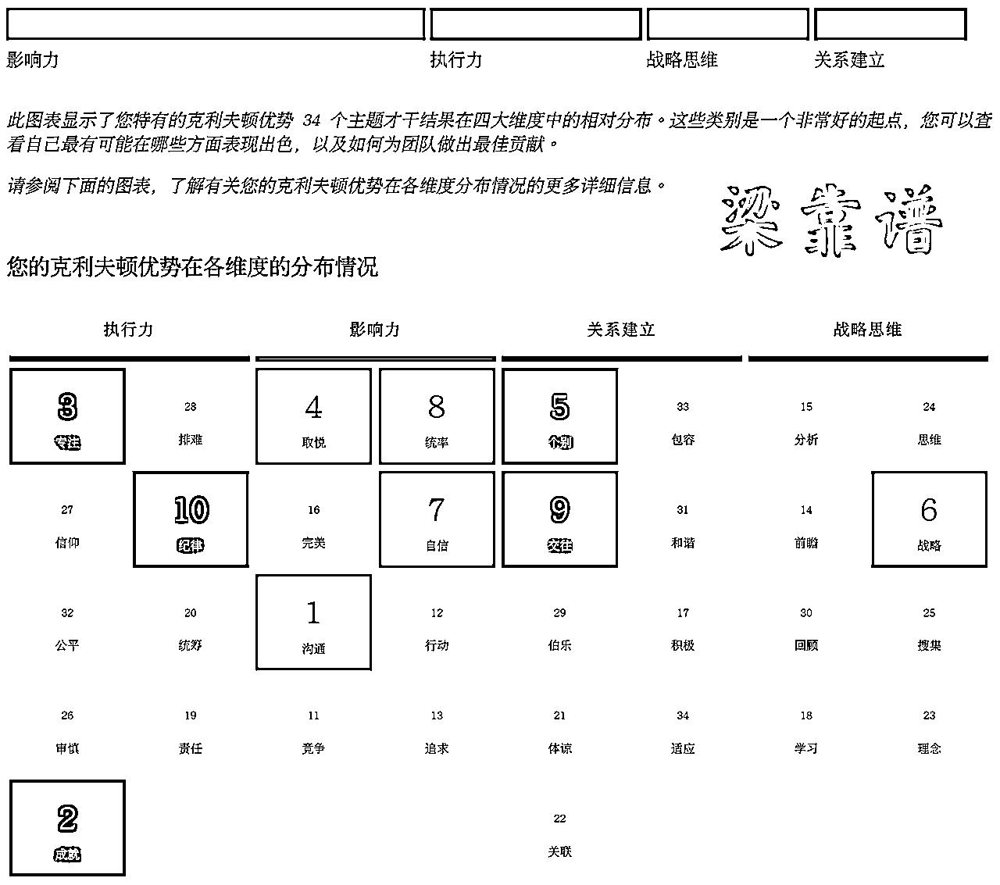

靠谱说过：“发挥影响力，有时需要压制影响力才干”

比如销冠三件套人群要注意：

1. 【沟通】靠前的人爱讲话。没表达机会会难受，但过度就变成光说不听，只输出卖点，忽略客户真实需求。容易陷入产品思维，无法转向用户思维。

2. 【取悦】靠前的人破冰强，招人喜欢，但过度会显得浮夸，削弱信任。维护老客户和复购时，面对认知更高的客户，取悦也不一定有效。

你有没有发现，那些站在销售金字塔顶端的人，未必是口才最好的，但一定是“看人很准”的。比如拥有“个别”才干的人，能敏锐捕捉到每位客户的特殊之处，给出量身定做的方案，让客户觉得“你真的懂我”。可问题是，如果对每个人都要花大量心思去精细区分，效率从哪来？客户一多，手忙脚乱，反而可能丢掉更多机会。如何在“个性化”和“高效率”之间找到平衡？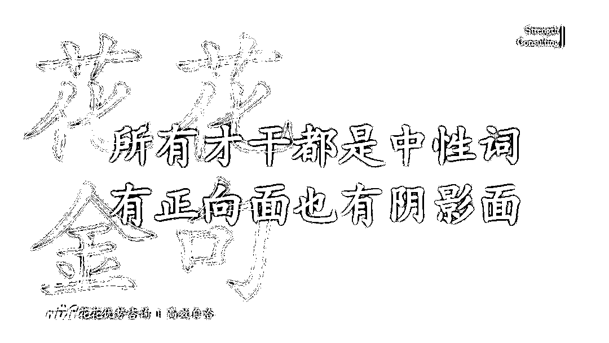答案不在于盲目模仿别人的打法，而在于你是否真正看清自己：你知道自己内心最想追求什么吗？你清楚自己最容易在哪里掉坑吗？你能不能管住那些消耗你的小情绪和致命短板？

想靠“销冠三件套”冲业绩，光有行业专业知识还不够。你得学会管住“沟通”和“取悦”背后的阴影面——比如别让客户觉得你是在刻意讨好，反而丢了你的谈单节奏。哪怕你天生擅长影响他人，缺了时间沉淀的知识和技能，光靠一张嘴也撑不起信任，更别谈成交。

梁老师就是个活生生的例子。她现在的成功，不是一夜之间冒出来的。刚开始主业副业两头忙，她也满脑子问号。好在她很早就跟着我的优势导师苏姐上私教课，花了很长时间学习、投入，不断观察自己在不同场景里的冲突和正向反馈，一点点调整底层思维，才终于有了质的飞跃。这再次印证了：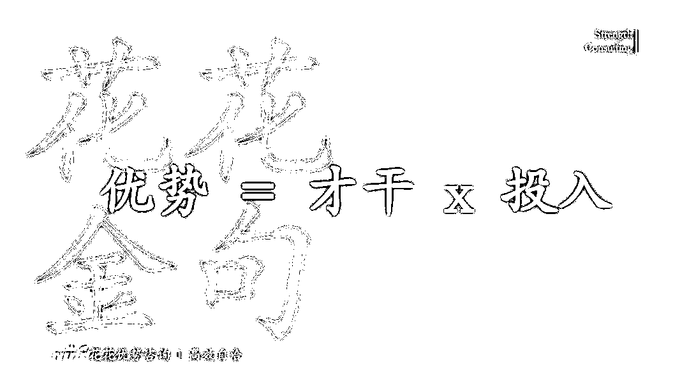当你把优势用对地方，成功就会自然找上门。

现在的梁老师，做销售时能用“个别”快速抓准客户需求，用“统率”帮客户理清痛点，用“取悦”提供情绪价值，再用“成就”给客户实打实的专业方案。就像靠谱说的，成交的本质就是两件事：问题解决了，情感满足了。两样都占，客户就会持续买单。她也不再像以前那样，靠咄咄逼人的强势去刷存在感，而是有了稳定的自我框架，同时懂得把舞台让给别人。她找到了自己最舒服的战场——直播、社群、演讲这些一对多的场景，把影响力彻底释放出来，成了人见人爱的“梁大”（当然，她的付费用户对她评价更高，对外她依然是那个硬核的橙将军）。

对吃影响力这碗饭的人来说，人脉就是钱。单位时间里能触达的人越多，流量分发者的商业模式就越强。但越是这样，越要珍惜自己的羽毛——普通人的口碑一旦坏了，基本就等于自断前程。

那么问题来了：我没有某些才干，怎么办？两个方法，简单有效，记好了：

### 1. 优势互补

这是我优势导师苏姐的才干图：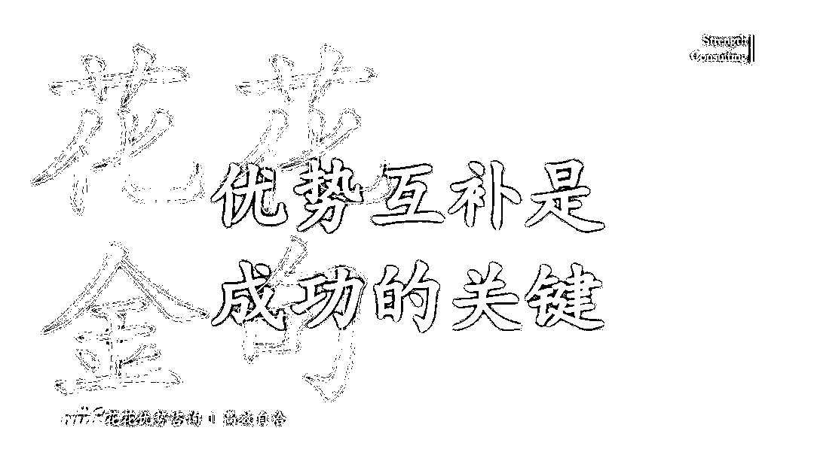再看看我的才干图，跟苏姐、靠谱老师放在一起，你会发现我们的优势正好互相补位，搭配得刚刚好。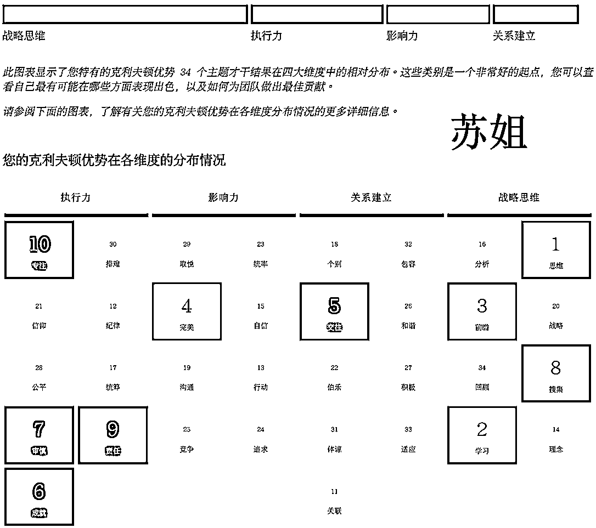我们不需要样样精通，但只要你在自己擅长的那件事上做到极致，就够了。你不需要一个人既做产品、又搞流量、还管成交和交付。就算你能力再强，短期内能扛下来，长期也成不了单项冠军。到后面，你只需要守好自己最擅长的那块，其余交给合作或外包，这才是最聪明的创业方式。当你学会用优势才干的视角看自己、看别人、看世界，就像开了天眼，一下子打开新世界的大门。

### 2. 弱点管理

想做销售，光有技能和知识不顶用，你还得清楚自己的致命弱点，并学会管理它们，别让它们拖住你。我们做副业，大多数人就是奔着赚钱去的，想把自己认可的产品卖出去。可如果长期没业绩，钱没赚到，人先内耗了。尤其是像我这种自带“内耗三件套”的人，如果不刻意练习自我觉察，一遇到不顺就否定自己，掉进情绪漩涡里爬不出来。内耗和无法成交的原因很多，但我们唯一能控制的，只有自己。所以先搞清楚内耗从哪来，再把弱点管好，路上的障碍就少了一大半。不然你只会离销冠越来越远，一直在原地打转。

看看四大才干领域常见的内耗长什么样：

* 战略思维：脑子里想得明明白白，就是不动手。打开手机，满屏都是别人报喜，一看自己成果没人家好，认知比结果高，就开始内耗。活像孔乙己的长衫——看着别人赚钱，自己放不下面子，最后成了个“高认知的穷人”。
* 关系建立：情感细腻是好事，但总担心别人怎么看自己，一遇到一点阻碍就自我怀疑，心累到不行。
* 执行力：一门心思傻干猛干，却不会表达，觉得自己平平无奇，吸引不到关注，越干越憋屈。
* 影响力：特别渴望被人认可，可实力还跟不上。想要的得不到，加上天生的攻击性，得罪了客户自己都不知道，销冠自然无望，内耗不断。

更麻烦的是，你身上的几种才干，内在渴望可能彼此打架，让你没事就往自己身上捅两刀。这种内部冲突，同样会消耗你，最后挡在你和业绩中间。

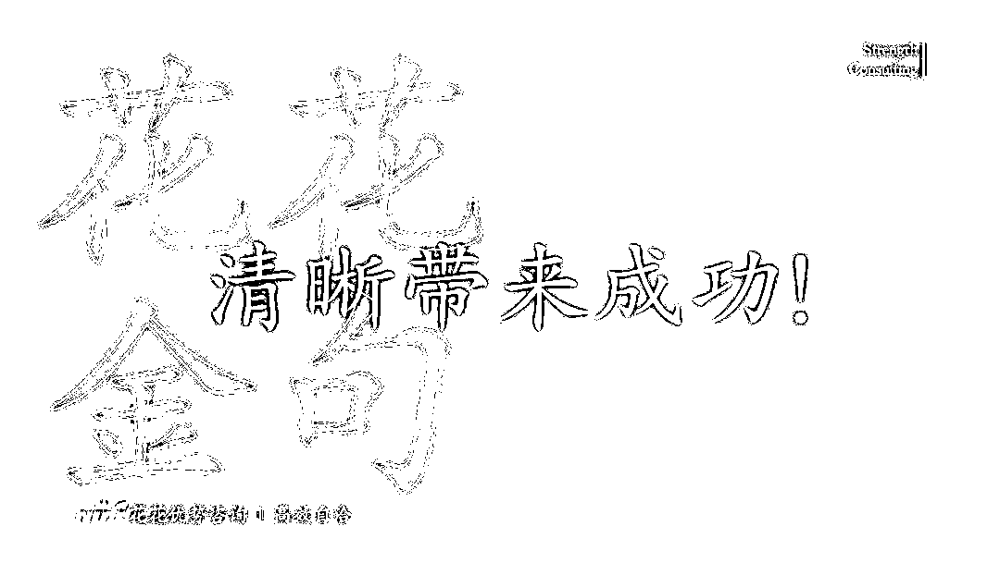所以，真正的解药是从“自知”开始。先看清自己的才干结构，找到那些内耗和互相掣肘的点，明白这些弱点是怎么在你身上发作的，通常在什么场景下冒出来。找到病根，才能对症下药。可大部分人对自己根本没有觉察，任由才干像自动驾驶一样乱跑，这样怎么可能有好结果？治病不能只治标。

如果你现在内耗严重，或者业绩看起来不错但内心依旧疲累，又找不到原因，真心建议你约一位优势教练做一次咨询。盖洛普优势在咨询领域是很专业的，让专业人士帮你找到真正的病根，然后对症下药。提升对自己才干的理解，找出告别内耗的方案，从根源解决问题。

最后，送你十六字成功口诀：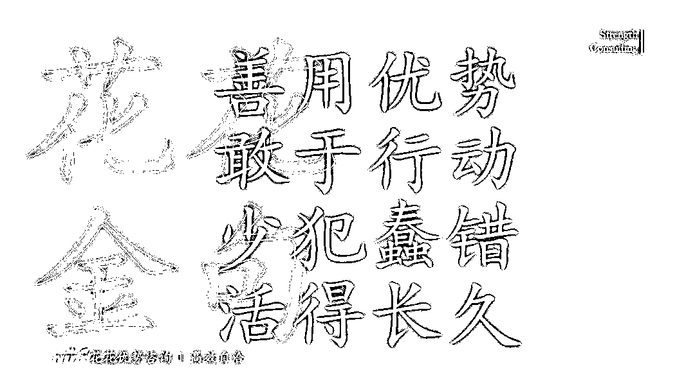祝大家都能早日实现“高效自洽创富”！

以上就是我今天的全部掏心窝分享，谢谢你耐心听到这里。如果其中任何一句话让你多了一点信心或启发，未来帮你多做出一点业绩，我就特别开心了。让我们一起在优势的海洋里乘风破浪，赚得盆满钵满，成人达己！我是花花，和你一起高效自洽地工作和生活。