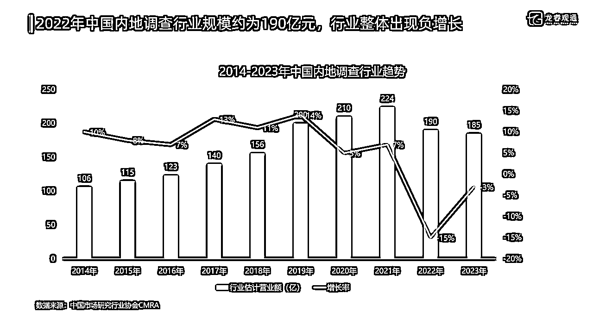
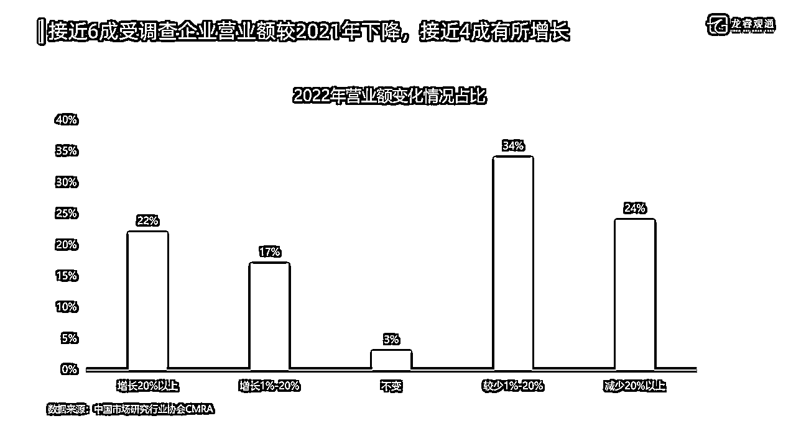

# ('从一个自由职业/个体到开一家公司，背后的思考逻辑', (2, 26))

两年前，我把工牌放在前台，转身走出那栋大楼。前台小姑娘问：Peron，你去哪儿？我说，回去想一个问题。

她大概以为我在开玩笑。但这个问题真的折磨了我整整一年：如果脱掉大厂光环，我能为这个行业提供什么不可替代的价值？

这个行当在中国走了快四十年。从1987年第一批机构成立算起，它尝过高速增长的高光，也被数字化浪潮反复掀翻。如今连行业里体量最大的公司都开始收缩，亏损、裁员、把项目层层打包出去，这些事放在十年前根本没人敢想。光是在协会备案的调研机构，数量就有几千家，市场早就不缺新名字了——很多人说，调研的黄金时代已经翻篇了。

我的看法不太一样。需求并没有蒸发，只是换了形状。就像一家老牌餐厅，客流没少，可客人的口味变了，后厨还攥着旧菜单，自然越做越冷清。

我观察过一家本土大型咨询公司的经营数据：去年，他们的单笔合同金额在缩水，但成交的项目数量反而增加了，全年营收不降反升。行业协会的统计也在传递同样的信号——那一年，将近六成调研企业营业额下滑，却仍有接近四成实现了正增长。跌有跌的原因，涨有涨的道理。

所以，客户到底在为什么买单？

第一个变化：甲方把思考留在了内部，把跑腿交给了外部。

行业里长期存在两类角色。一类靠脑力吃饭，负责项目设计、数据解读、报告输出；一类靠脚力吃饭，负责跑现场、发问卷、约访谈。过去，脑力型公司拿大头，执行型公司赚辛苦钱。

这几年风向变了。甲方大厂纷纷组建内部的用户与市场研究团队，把乙方的人才和经验整建制挖走。论专业能力，一些大厂的内生团队甚至超过了大多数乙方。结果是，需要逻辑、方法论和分析的活儿，甲方内部就消化了；真正外溢的，反而是那些需要大量人力铺开的执行环节——采样本、找受访者、办线下小组座谈。

于是我们看到了一个有些意外的局面：纯执行型机构活得越来越稳，很多以研究见长的公司反而不断失血。为了续命，不少研究机构放弃了自己的看家本领，转型去做执行，多年积累的分析能力慢慢荒废。更可惜的是转了一半的那种——研究做得不深，执行又没有自己的网络，只能当一个发包的二传手，赚点薄利差价。

第二个变化：客户要的依然是解决问题的方案，但预算和耐心都变薄了。

动辄七八位数的项目预算，现在越来越罕见。几万、十几万启动一个调研，成为市场常态。客户面临的商业决策没有变简单，但他们希望用更少的钱、更短的时间拿到结论。

数字化是第一条出路。线下的问卷采集，一个样本要几百块成本，上千份样本回收可能要等一个月；搬到线上以后，样本单价降到几块钱，回收周期压缩到几天。定性访谈也一样，过去请一位专业主持人，一场至少两千元，座谈会主持人更是三四千起步。现在国外已经成熟的无主持人访谈，让受访者自己面对屏幕记录反馈，再由AI完成归纳分析，成本结构焕然一新。就连报告这个环节也在被技术改造。过去一本常规研究PPT，行业报价两三万是家常便饭；但如果项目是标准化的连续监测，比如满意度、品牌健康度、广告效果追踪，现在可以用程序自动产出结果。我们数据团队的Alen，就能把这类项目做到几千元交付。

数字化是减少人的参与，而开放协作是重新组织人。传统外包是一条纵向链条：甲方找公司，公司雇佣员工，员工领工资，中间还要叠加社保、公积金、场地和管理成本。开放协作模式则完全不一样——需求方把任务发布在平台上，分散在全国各地的资深从业者直接接单，双方只有合作关系，不建立雇佣关系。省掉的不只是钱，还有一整套流转流程。

有人会问：甲方不是都自己做了吗？但能养得起规模化用户研究团队的企业，终究是少数。大量中小企业遇到研究需求，依然需要外部支持。即便大厂内部团队兵强马壮，也有忙不过来的时候——项目扎堆、人手吃紧，自然会把一部分非核心任务释出。这些缝隙，就是开放协作的空间。

第三个变化：客户兜里揣着钱，但找不到真正能把问题解决掉的人。

行业协会做过一个判断：除了极少数头部的公司，多数调研机构的影响力和专业度都处在较低水位。很多乙方没有自己的方法论体系，方案高度同质化，谁都说自己是全案专家，谁也说不出自己究竟在哪方面优于同行。这种供给能力，确实很难理直气壮地帮客户做重大决策。

但总有需求是甲方自己搞不定的。要接住这些需求，要么在一类行业里当“钉子户”，要么在一个需求场景里做“孤品”。

我的第一份工作，在一家只研究汽车的机构。十几年时间，它从一支几个人的小队伍，长成几百人、年营收几千万的规模。而当年那些什么都做的全能型选手，大多越做越淡，很多已经听不到名字了。上个月和一位从腾讯游戏出来的创业者聊了几句，他带了个小组，专门做游戏玩家研究。我说，这事你肯定能成——行业不缺通才，缺的是在一件事上扎到底的人。

深耕场景同样是条护城河。我待过的华通明略，后来改名凯度，长期专注于品牌传播与广告效果研究，客户愿意为它的定价买单，因为它手里有模型和数据资产。科罗思咨询集团则是满意度研究领域的隐形冠军，客户数量不多，但个个都是世界500强，很多合同一签就是几十年。这些东西是靠时间和投入垒出来的壁垒，外人很难抢走。

看完需求，再做一个排除法，我想走的路就清楚了。

我不去跑执行。不是说执行生意不好，恰恰相反，现在现金流最健康的就是执行机构，很多看似光鲜的研究公司，年底算账还不如执行团队的利润率。但我和我的伙伴都是研究出身，没有那份基因，也没有那份热情。

我也不会做一家数字化软件公司。研发产品需要技术积累和资本投入，这两样都不是我们的强项；而且市面已经有快决策这样的成熟玩家，这个生态不需要再多一个复制品。

我更愿意做的是开放协作。把这群分散在各地的资深研究者，通过一个共享网络连接起来，没有写字楼的租金，也没有层层汇报的动作损耗，但每支队伍的专业底子，都敢拿到台面上硬碰硬。我们现在有六到八位常驻伙伴，全职，远程，配合默契。选拔时我会看四个硬指标：是否在某类行业或课题上有积累、是否具备五年以上的研究经验、是否有像样的学历背景、是否有头部乙方或大厂的履历。但比这些更重要的，只有一条——靠不靠谱。你说得再漂亮也没用，把项目交给你，你能让它稳稳落地，这才是硬功夫。

常驻班底之外，还有一张按行业划分的协作网络。目前3C、汽车、快消、互联网四条线已经运转起来，每条线都有核心成员带队。这样的阵容，放到任何一场竞标里都不怯场。如果你是资深研究者，欢迎来碰个面；如果你带着真实需求来，我们也完全可以用结果和你对话——资质和合规的路径，我们同样备好了。

当然，开放协作更适合服务成长期的中小企业。大客户往往需要走严格的供应商体系，众包式的松散协作很难通过采购审核。所以，我还在筹备一家走正规雇佣制路径的公司，方向是借助成熟品牌的资质来落地，不打算从零开始做新招牌，预计会有结果。这家公司的定位，是把战略咨询和市场研究绑在一起：不卖报告，卖决策；不仅要洞察，还要把洞察转化为可执行的增长动作。收费模式向管理咨询看齐，而不是对标调研盒饭价。说白了，我们切的是咨询那块蛋糕，不是调研那块边角料。

这种组合并不是什么新发明。我在华通明略工作时，就曾与旗下战略咨询团队Millward Brown Vermeer并肩作战；BCG这样的世界级咨询机构，内部同样养着研究队伍。只是把它作为一家独立公司的主打产品，行业里还很少有人做。

过去，调研行业的门是“会做研究”就能进；现在，门框换了，客户只为能拍板的底气买单。他们不需要一摞精美的PPT，他们需要一个准确的判断。我选择做一个给判断的人，而不是一个递报告的人。

这就是我这一年想明白的事，也是我接下来要走的路。