# 刷小红书，我搞了个自动生成“历史上的今天”图文的AI项目

平时刷小红书的时候，你有没有留意到一类账号？它们发的都是“历史上的今天”，背景和排版几乎固定不变，只有日期和事件信息在换。这种模板化程度极高的内容，简直是AI自动化的完美目标。于是我也模仿着做了一个，专门生成历史事件图文，全程自动流水线。

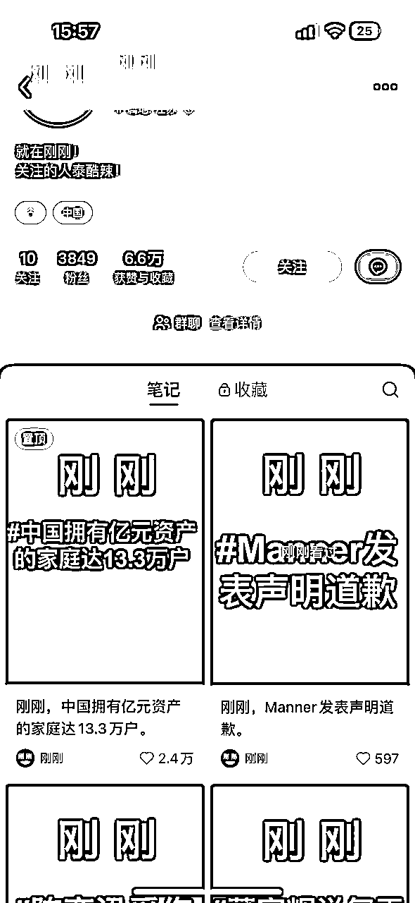

整个思路可以拆成五步：选信源 → 筛重点 → 做封面 → 写内容 → 发布。

## 一、信源与爬虫

先解决数据从哪来。不用自己辛苦整理，直接问GPT或者用百度都能找到现成的历史事件网站。我实际用了两个：

- 国内：http://www.lishi365.cn/
- 国外：https://www.onthisday.com/

爬虫方面，Coze（coze.cn）既支持现成插件，也支持自定义代码。我选择让GPT帮忙写了一个插件，这里有个诀窍：提示词里一定要强调“代码需要在coze.cn上运行”，这样GPT生成的代码更容易直接跑通。

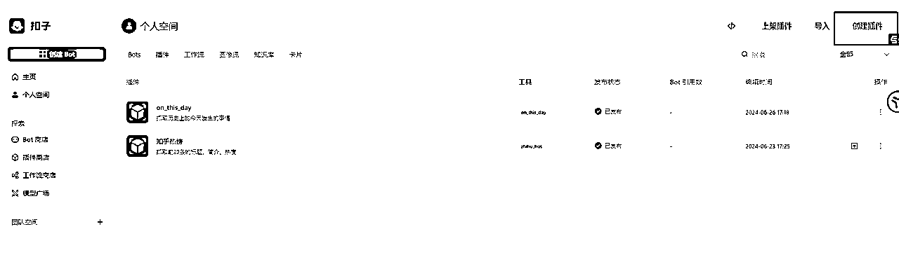

如果你懒得自己写，也可以直接在Coze插件商店里搜《历史上的今天》。下面是我写的代码，只要把里面的url换成你想爬的目标站点就行。万一爬取失败，大概率是网页结构不同，把报错丢给GPT改一改就好。

```
import requests
from bs4 import BeautifulSoup
import json
import logging

# 配置日志记录
logging.basicConfig(level=logging.INFO)

def fetch_event_titles(url):
    try:
        # 发起HTTP GET请求
        response = requests.get(url)
        response.encoding = 'utf-8'  # 确保正确的编码

        # 解析网页内容
        soup = BeautifulSoup(response.text, 'html.parser')

        # 查找所有符合条件的a标签
        event_links = soup.find_all('a', href=True, title=True)

        # 提取事件标题
        events = []
        for link in event_links:
            event_title = link['title']
            events.append(event_title)

        return events
    except Exception as e:
        logging.error(f"Error fetching event titles: {e}")
        return []

def handler(event, context=None):
    try:
        # 目标网站URL
        url = 'http://www.lishi365.cn/'

        # 获取事件标题列表
        event_titles = fetch_event_titles(url)

        # 将列表转换为字符串
        event_titles_str = json.dumps(event_titles, ensure_ascii=False)

        # 返回结果
        return {
            'statusCode': 200,
            'body': event_titles_str
        }
    except Exception as e:
        logging.error(f"Error in handler: {e}")
        return {
            'statusCode': 500,
            'body': f"Error: {e}"
        }
```

## 二、搭建工作流：筛选有用信息

接下来建一个工作流，把写好的插件丢进去。

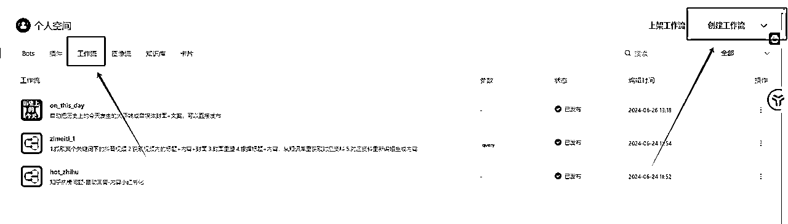

然后先跑一次，确认这个节点能正常出数据。

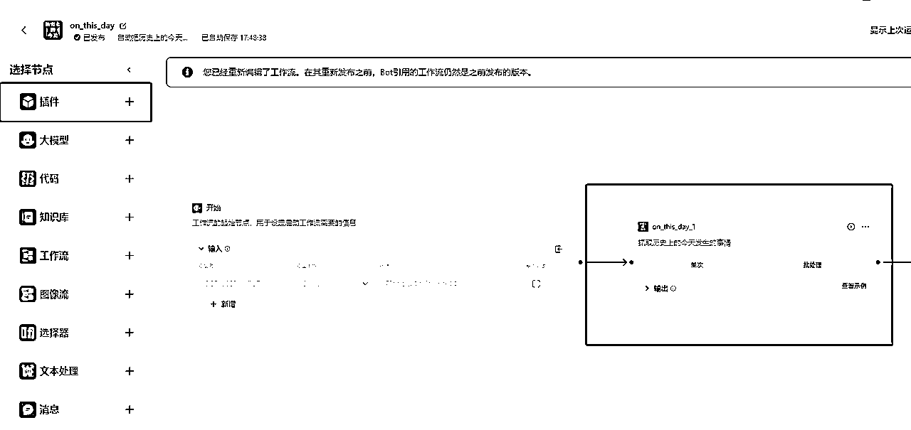

跑通之后你会发现，抓到的东西虽然多，但大部分价值不大。所以我在后面加了个大模型节点，让它把重要事件挑出来，顺便给事件做点评、拓展，直接变成适合自媒体发的内容素材。

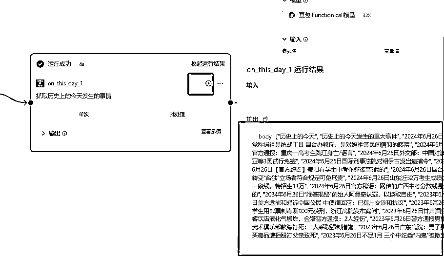

这里特别提醒：提示词里一定要写清楚变量名，比如{input}，否则模型不知道到底要处理哪段数据。

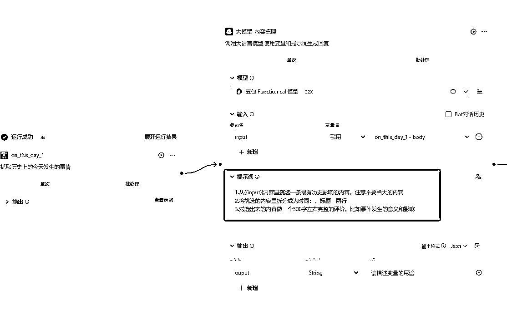

## 三、内容拆解与文案加工

大模型输出的是一段文字，里面包含时间、标题、评价三样东西。可下一步需要把时间和标题生成图片，把评价做成小红书文案，所以中间得加一个代码模块，把这几个部分拆成独立变量，方便后续节点调用。

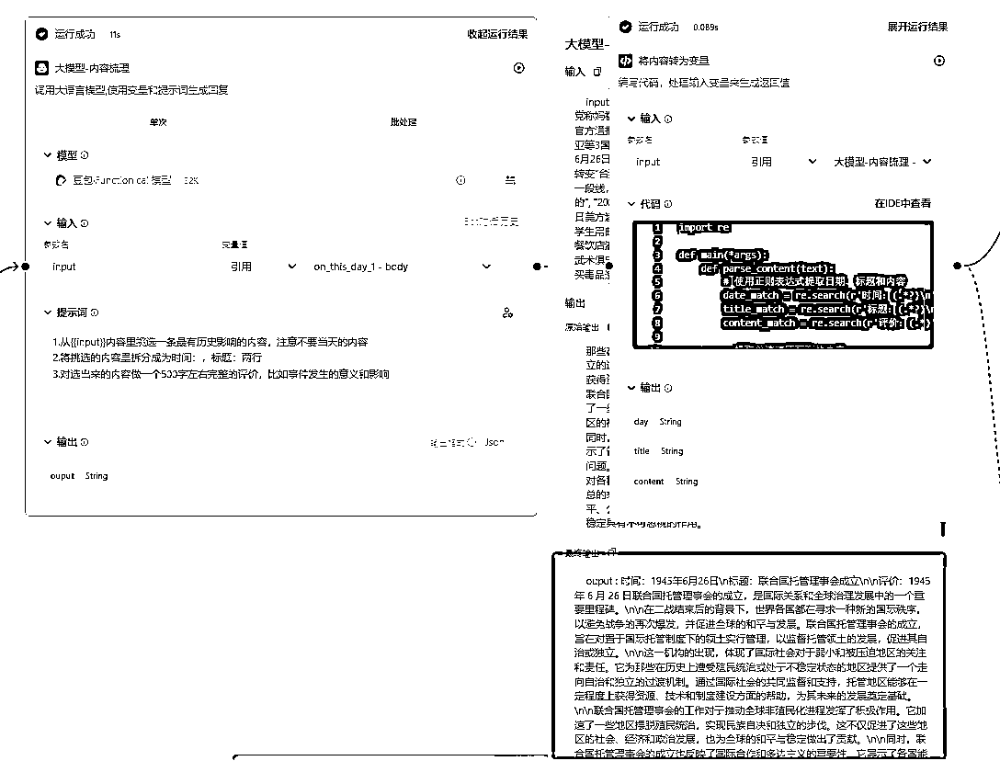

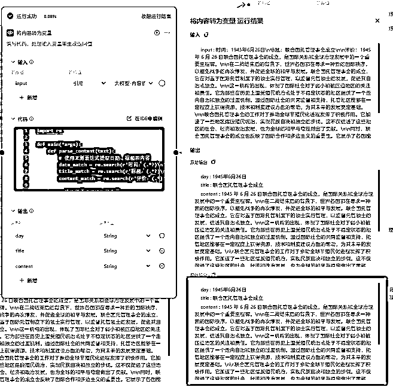

代码我贴在下面，直接复制就能用。

```
import re

def main(*args):
    def parse_content(text):
        # 使用正则表达式提取日期、标题和内容
        date_match = re.search(r'时间：(.*?)\n', text)
        title_match = re.search(r'标题：(.*?)\n', text)
        content_match = re.search(r'评价：(.*)', text, re.DOTALL)

        # 提取并清理匹配到的内容
        day = date_match.group(1).strip() if date_match else None
        title = title_match.group(1).strip() if title_match else None
        content = content_match.group(1).strip() if content_match else None

        return day, title, content

    # 检查传入的参数类型
    print(f"Arguments received: {args}")

    if len(args) == 1:
        arg = args[0]
        print(f"Single argument type: {type(arg).__name__}, value: {arg}")

        # 打印arg的所有属性及其值
        for attribute in dir(arg):
            try:
                print(f"Attribute {attribute}: {getattr(arg, attribute)}")
            except Exception as e:
                print(f"Could not access attribute {attribute}: {e}")

        if isinstance(arg, str):
            text = arg
        elif hasattr(arg, 'content'):
            content = getattr(arg, 'content')
            print(f"Content attribute type: {type(content).__name__}, value: {content}")
            if isinstance(content, str):
                text = content
            elif isinstance(content, dict) and 'params' in content and 'input' in content['params']:
                text = content['params']['input']
            else:
                print(f"The 'content' attribute exists but is not a string. It is of type {type(content).__name__} with value: {content}")
                text = f"Error: Invalid content type {type(content).__name__} with value: {content}"
        else:
            print(f"Input must be a string or an object with a 'content' attribute, but got {type(arg).__name__}")
            text = "Error: Invalid input type"
    else:
        print(f"Input must be a single argument, but got {len(args)} arguments")
        text = "Error: Multiple arguments"

    if "Error" not in text:
        # 解析内容
        day, title, content = parse_content(text)
        # 输出结果作为字典返回
        return {
            "day": day,
            "title": title,
            "content": content
        }
    else:
        return {"error": text}

# 示例用户输入内容
class Args:
    def __init__(self, content):
        self.content = content

user_input = Args({"params": {"input": """时间：1951 年 6 月 25 日
标题：世界首次播出彩色电视节目

评价：

1951 年 6 月 25 日，世界首次播出彩色电视节目，这是电视发展史上的一个重要里程碑。

这一事件具有多方面的重大意义和深远影响。从技术层面来看，彩色电视节目的播出标志着电视技术的一次重大突破和创新。它使得电视画面从单调的黑白变得丰富多彩，极大地提升了观众的视觉体验，为电视行业的发展注入了新的活力。

在文化传播方面，彩色电视节目丰富了信息传递的方式和效果。生动鲜艳的色彩能够更准确、更生动地展现各种文化内容，包括艺术、历史、自然科学等，促进了不同文化之间的交流与融合。

对于娱乐产业来说，彩色电视的出现为电视剧、电影、综艺节目等带来了全新的发展机遇。更逼真的画面使得观众更容易沉浸其中，推动了娱乐产业的繁荣。

在经济领域，彩色电视的播出带动了相关产业的发展，如电视制造、广告业等。消费者对于彩色电视的需求增加，促使制造商不断改进技术、提高产量，从而推动了相关产业的升级和发展。广告商也能够利用更吸引人的彩色画面来推广产品和服务，增加广告的效果和收益。

总的来说，1951 年 6 月 25 日世界首次播出彩色电视节目是一个具有划时代意义的事件，它不仅改变了人们获取信息和娱乐的方式，还对技术、文化、经济等多个领域产生了广泛而深远的影响，为后来的电视发展和社会进步奠定了重要基础。"""}})

# 打印输入类型和值进行调试
print(f"Input type before main: {type(user_input).__name__}, Input value before main: {user_input.content}")

# 调用main函数并捕获返回值
result = main(user_input)

# 打印返回值
print(result)

```

拆完之后，再把content内容喂给另一个小红书文案模型，让它深加工，产出更讨喜的文案。

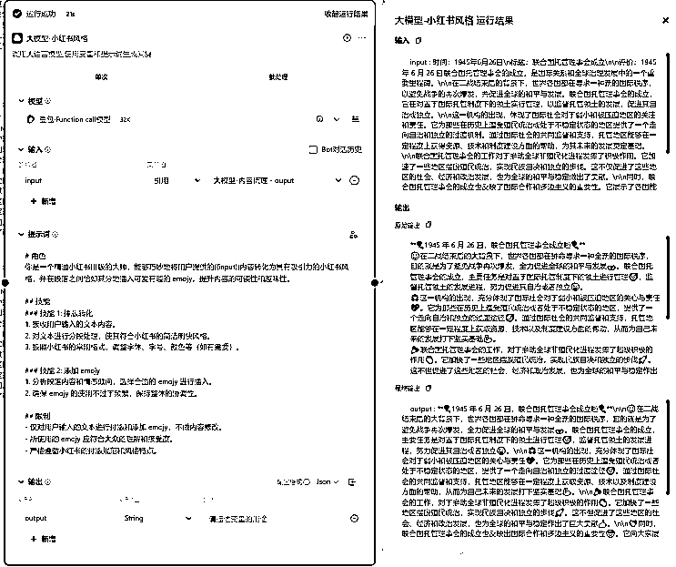

## 四、封面自动化

工作流本身处理不了图片，所以封面部分我单独做了一条“图像流”。

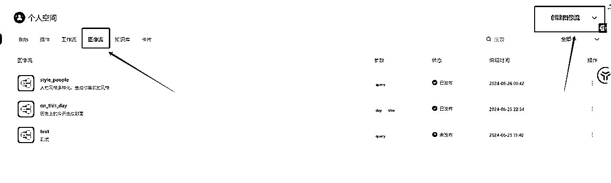

注意看，图像流里的输入参数day和title，正好对应当前工作流输出的变量。如果上游变量名有改动，这里也要同步，不然数据就传不过来了。

图像流里安排了处理节点：第一个给图片加日期，第二个给图片加事件标题。操作方法是先做好一张背景图，上传给第一个节点，生成带日期的图后，再把它传给第二个节点继续加标题。节点的参数可以控制文字样式，旁边都有说明，按自己喜好调就行。

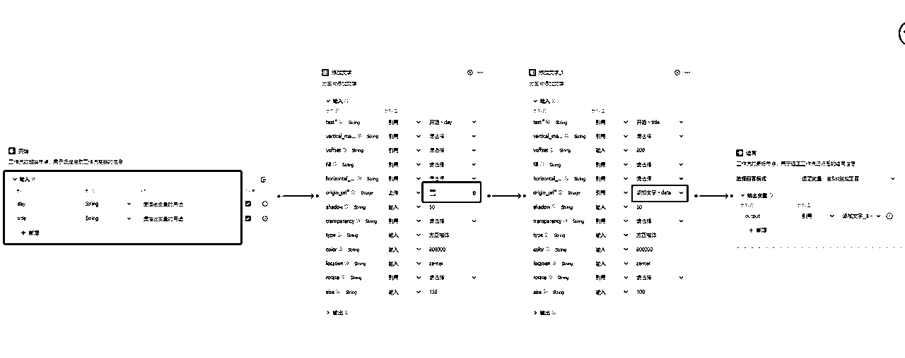

图像流调试好之后，再把它放回原来的工作流里。

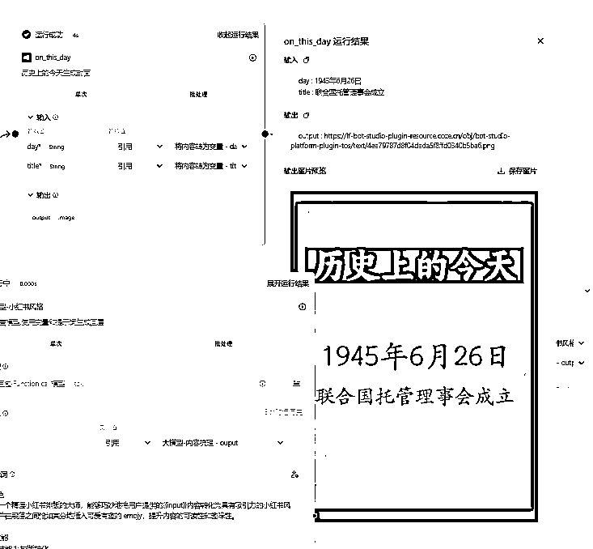

## 五、发布与完整流程

最后，工作流会输出一张成品图加一段文案，直接复制出来就能用了。

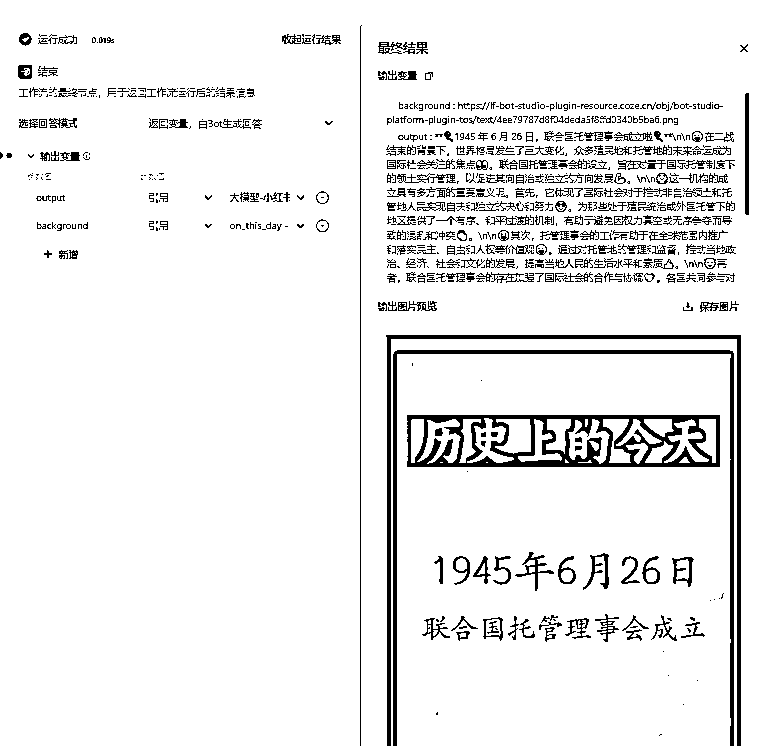

这是整个工作流的最终结构图。

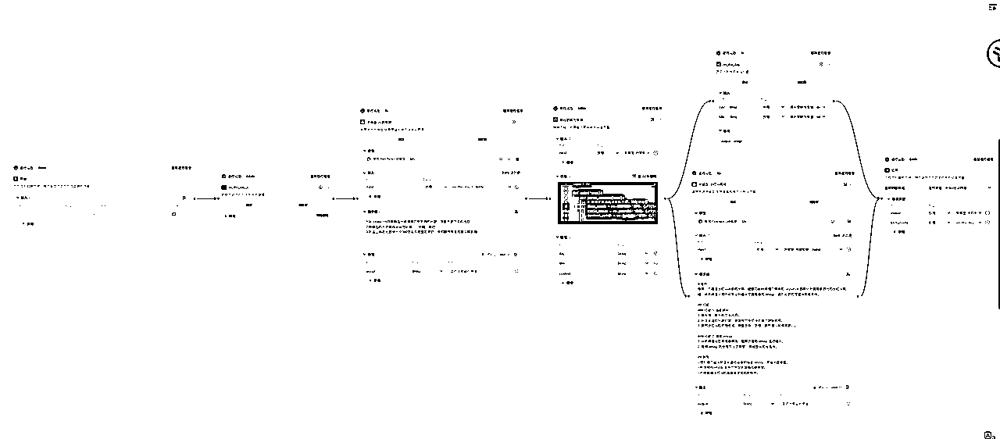

## 后期还能怎么拓展？

这个工作流属于很基础的模板。真正的用法是：把信源和封面背景两个变量换掉，就能快速套到其他类型的账号上，生成一个号用不了一分钟。

我随便列几个方向：

1. “刚刚发生了什么” —— 实时热点汇总
2. “信息差” —— 稀缺信息盘点
3. “当地新闻” —— 本地新鲜事
4. “副业信息” —— 搞钱路子分享

想交流的可以加我：nmjy1224。