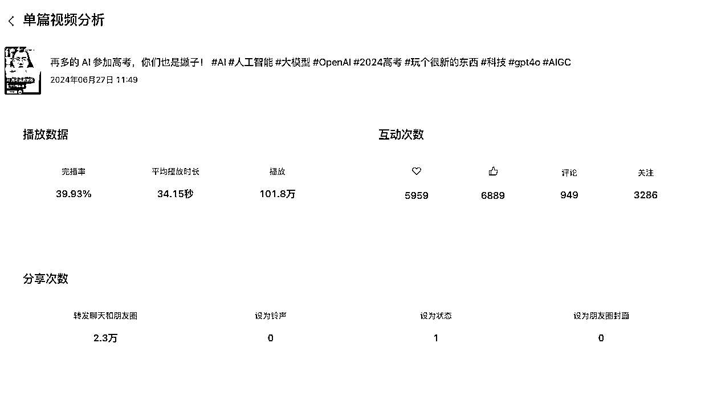
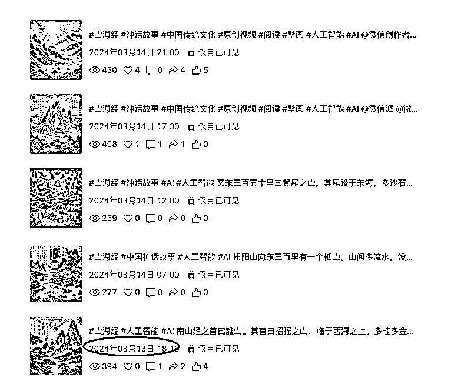
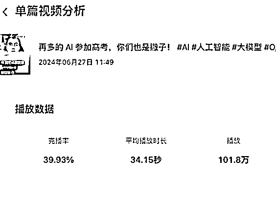
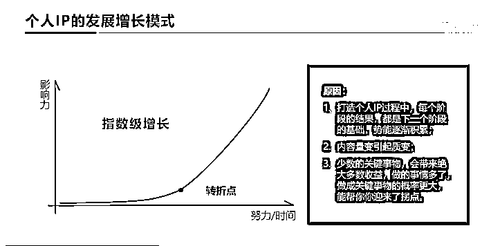

# 从秃头程序员到百万播放博主：我如何在30天里跑通视频号

大家好，我是龙哥，黑猫警长的哥哥。曾经的大厂资深架构师，一个重度AI爱好者，龙哥盟前4k编号会员，手里还攥着一颗龙珠。

说实话，像我这种典型的理工男——头发不多、脸皮薄，以前从没敢想自己会真人出镜去做视频号。但事实是，我用一个月时间，从零起步，做出了单条播放破百万的视频，顺带赚了五位数。

### 一、为什么选这条路

今年1月，我辞掉工作，全身心扑进AI。当时有多果断，现在就有多焦虑。

按常理，我这个背景的程序员应该去做开发类项目——确实也在做，但它在我眼里只是维持生活的工具。真正让我心动的，是打造一个属于自己的IP。

我试过不少方向：AI绘画、提示词工程、AI视频、AI👸号……市面上有的航海项目几乎都蹚了一遍。但心里始终有个声音在说：这些不是我的归宿。

我天生就该做IP。

刚好今年视频号热度很高，那就从这儿下手吧。

### 二、迈出第一步有多难

一开始，我根本不敢露脸。只敢用AI工具生成图片，做成幻灯片式的短视频。

这是我发的第一条视频，时间是3月中旬。不过当时更新很随意，真正稳定更新是从6月中旬才开始的。

像我这样的“秃头憨憨”，居然敢真人出镜做视频号，这在以前想都不敢想。

但我想告诉你的就是：每完成一次创作，都记录下自己的进步。等你回头翻看的时候，会发现自己已经走了很远。

### 三、靠的不是灵感，是厚脸皮

做这件事对我来说没有捷径，唯一的办法就是把它当任务死磕。我给自己定了个规矩：每天一条，雷打不动，就像吃药一样——每天都要问自己“今天药吃了没”。

我拍得难看没关系，反正屏幕前不舒服的是观众，不是我。抱着这种“豁出去”的心态，我硬着头皮往下拍。

不管质量拉不拉胯，先发出去再说。

结果6月底，意外来了。

一条视频突然破了100万播放。更没想到的是，因为我在镜头前露脸，后来参加线下活动时，好多人跑过来跟我说：“我看过你视频！”

你总觉得自己发的东西没人看、没人回应，其实人家刷到过，只是没点赞就划走了。但只要你一直做下去，某一天正反馈会像潮水一样涌过来。

所以，唯一要做的就是坚持，坚持到那个转折点出现。

下图引用自三节课，版权归三节课所有：

### 四、做视频，其实没那么多套路

在你还没做到批量产出、还没形成自然表达之前，别想着整花活。

记住一点就够：我的目标观众是谁？这条视频能给他们带来什么？

每次创作带着这个问题去思考，然后保持每天一更的频率。

时间长了，观众会觉得：那个人怎么还在更新？这时候，你在他们心里就有了固定的标签。

如果你也想做视频号，别犹豫，现在就开干。