**灰豚数据小红书保姆级教程：从基础功能到进阶玩法，一篇讲透**

哈喽，我是哆元。当初给自己起这个ID，就是希望像哆啦A梦那个百宝袋一样，时不时能掏出点让人眼前一亮的东西。

做自媒体这行，基本绕不开各种数据工具：蝉妈妈、新红、千瓜、灰豚……说实话，市面上选择不少，但我个人最常用的还是灰豚。它在圈子里口碑扎实、认知度也不差，并不是那种听都没听过的小众平台。只是我发现，很多朋友压根没把它用到位，系统性的玩法教程更是少见。

所以这篇，我打算把灰豚在小红书端的常用功能、进阶玩法，一次讲清楚。

**一、基础功能：先把这几个模块用熟**

先说使用环境：有条件尽量用电脑。打开浏览器访问灰豚官网 https://xhs.huitun.com，进入小红书数据板块。我自己演示时领的是15天个人版会员——因为和灰豚有官方合作，也给大家准备了免费名额，加我 dybbd8 就能领。

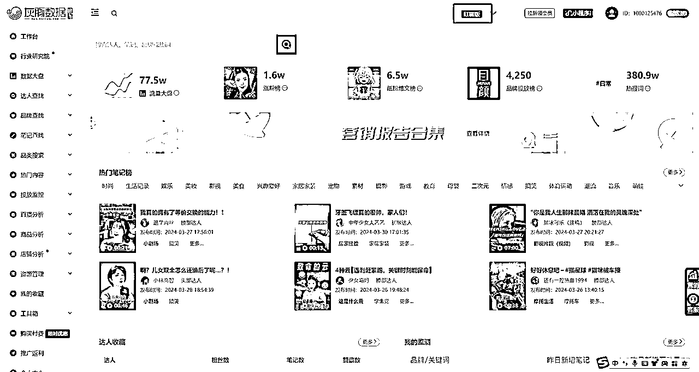

接下来，重点拆解几个核心功能。

**（一）达人查找**

想分析某个博主，最简单的方式就是直接搜账号。先看它的功能入口：

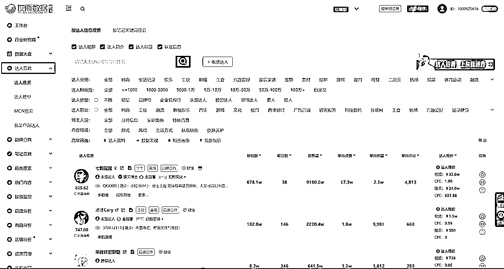

登录后随便拿一个账号举例，页面数据大致就是这样：

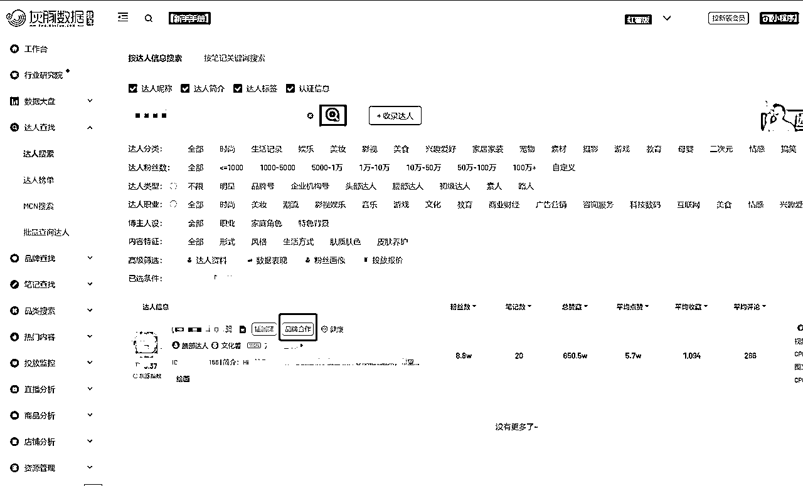

这里要留意一点：页面上看到的数据，不一定是你打开那一刻的实时值，可能是当天上午或前一天留下的快照。所以粉丝数、互动量会有轻微出入，但基本不影响做判断。

如果账号旁边有“品牌合作”标识，说明对方入驻了蒲公英——也就是小红书官方的接广告平台。同时，页面还会显示它签约的MCN公司。点进账号详情：

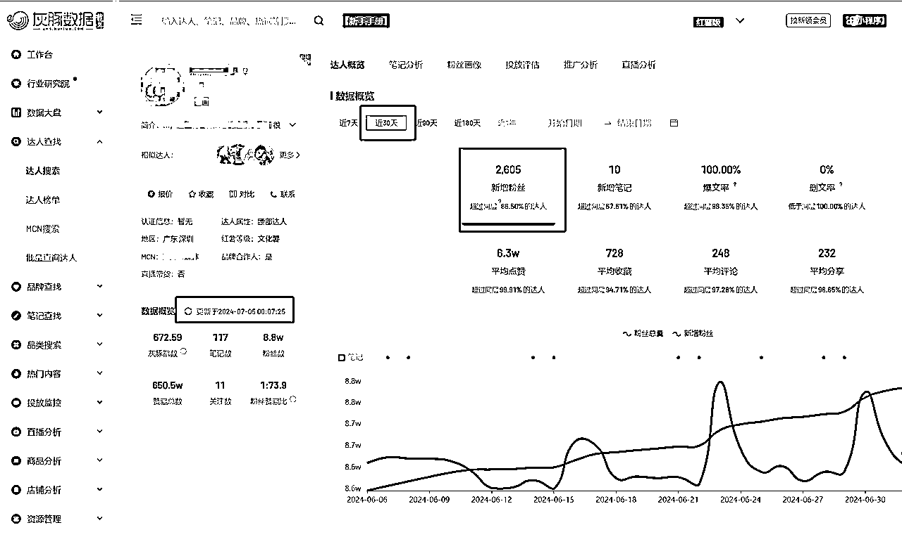

最新数据需要手动刷新，刷新入口在左侧。注意，会员等级不同，可刷新的次数也有差别。

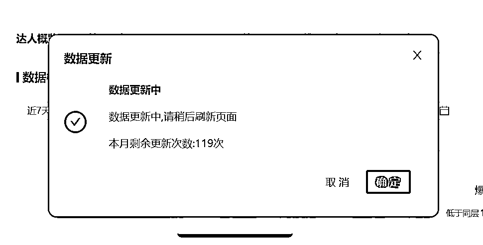

在详情页里，你还能自由选择时间段，查看周期内的笔记分析、粉丝画像、投放评估等维度。拿笔记分析举例：

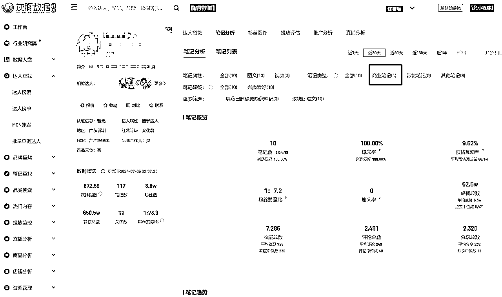

笔记分析里可以看到博主这几条笔记是不是广告。不过我更建议你把小红书App打开，翻一翻笔记原内容做二次核实——因为不少广告并不会走蒲公英平台，直接从后台看会漏。

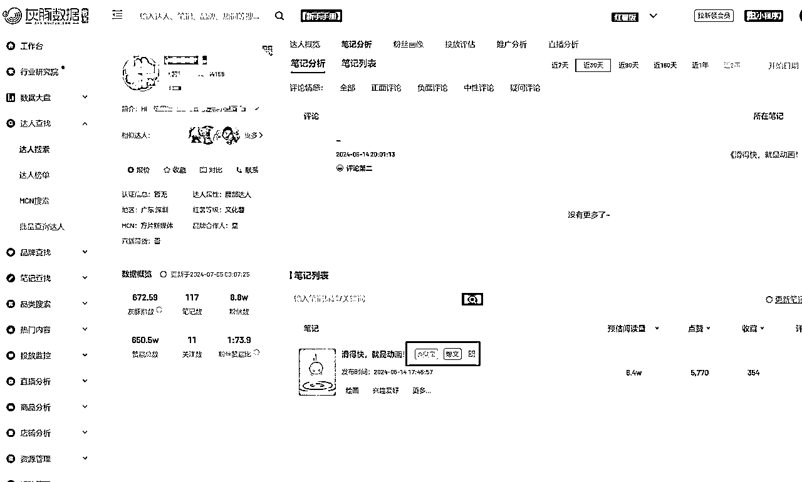

继续往下滚，还能看到博主合作过的品牌列表。再看达人榜单，涨粉榜、商业推广榜都在这里。

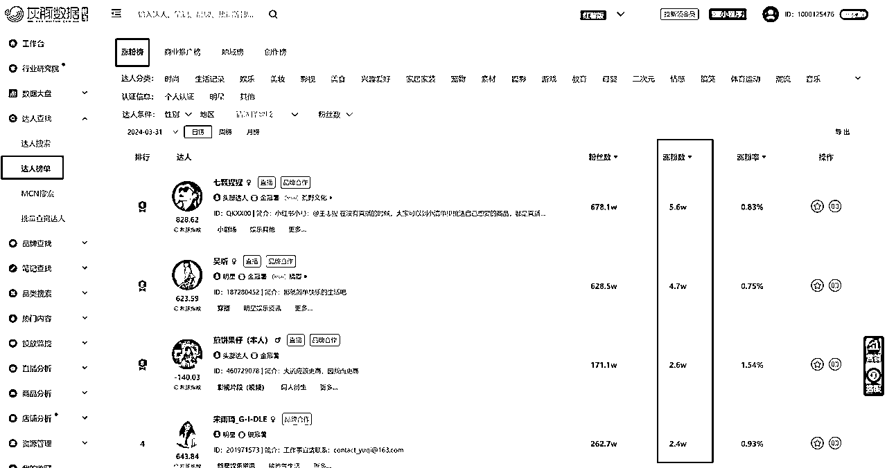

很多突然涨势惊人的黑马账号，就是从这个入口被挖出来的。

**（二）笔记查找**

笔记查找是大家平时用得最多的功能之一。入口界面是这样的：

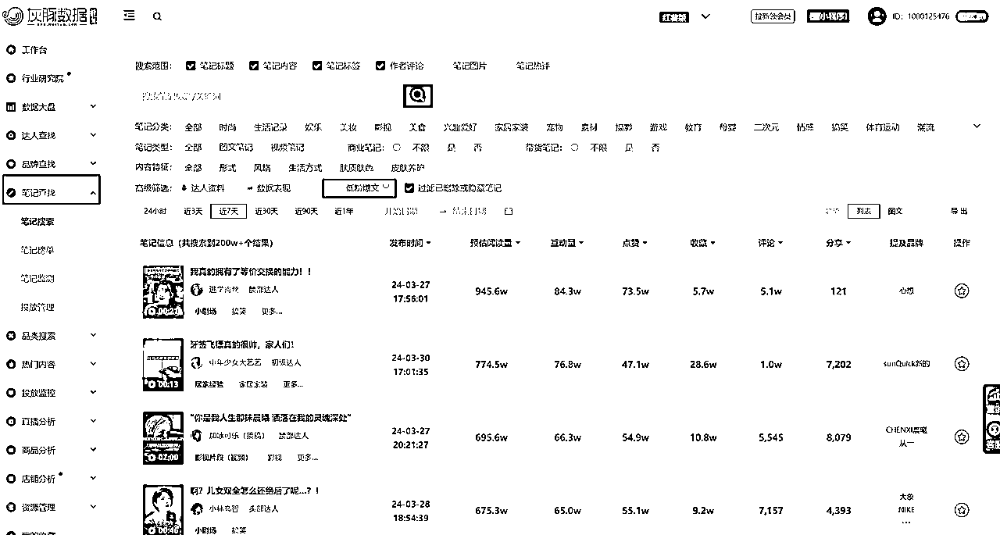

里面最有价值的模块是“低粉爆文”——专门筛粉丝数不多、但跑出爆款笔记的账号。对刚起步找对标的人来说，这个功能非常对口。选定自己的赛道后，还能用“达人资料”和“数据表现”这两个筛选项做更细的筛选，最后把结果导出成表格慢慢研究。

**（三）热门内容**

热门内容板块，适合用来感受当下的流量风向。

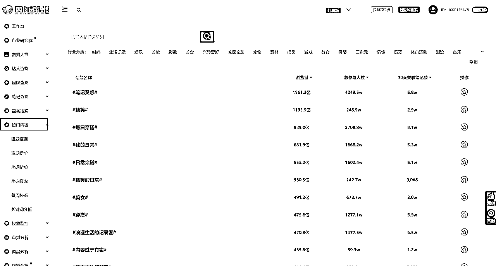

比如我在搜索框输入“宠物”二字，出来的就是当前热度最高的一批话题。

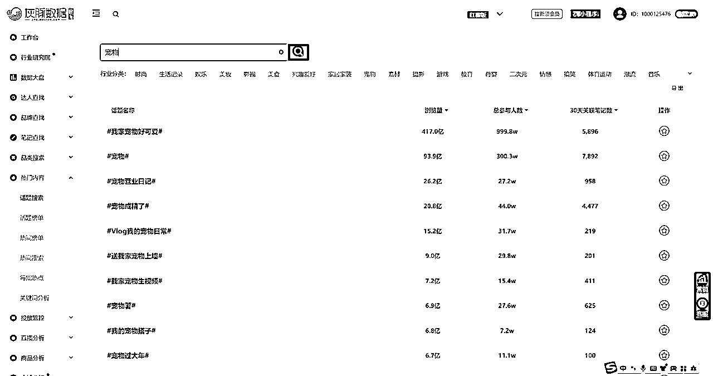

这些话题词很有参考价值：写笔记时，有意识地把排在前面的几个热门关键词埋进内容里，能蹭到不少自然流量。旁边的热词榜单也一样：

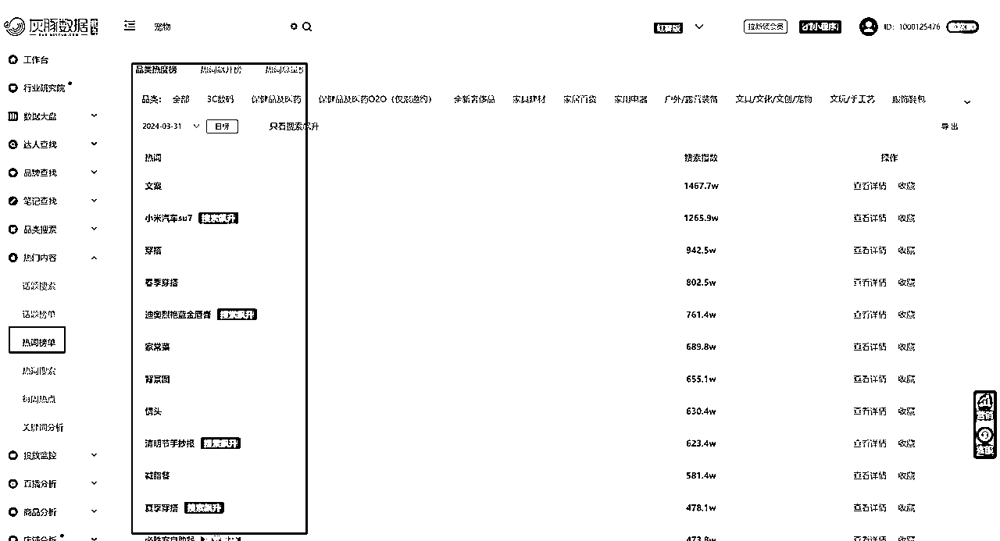

它会展示当下用户搜索最多、关注度最高的词，对着这个方向做内容，等于顺势借流量。

**二、进阶玩法：把工具用出“外挂感”**

光会看数据还不够，我更想分享两个日常实战中比较香的玩法。

**玩法一：找行业起号互动笔记**

账号起步阶段，互动笔记能有效拉高账号权重。所以你需要一种方式，快速找到“评论很高”的笔记案例。

直接在小红书App里搜“最热”是有缺陷的——平台不支持按评论数筛选。搜出来的往往是点赞、收藏漂亮，但评论寥寥的内容，这类不是我们想要的。

互动笔记的核心指标就是评论量。正确做法是：用灰豚的笔记搜索功能，填入目标关键词，把时间范围设在近90天或一年，然后筛选低粉爆款。

拿装修行业来说，输入“装修”二字，也可以通过笔记分类里的装修类目进入。接着把低粉爆款勾上，时间周期选近90天，最后把评论排序改成降序。这样排在前面的，就是评论数最高的笔记。

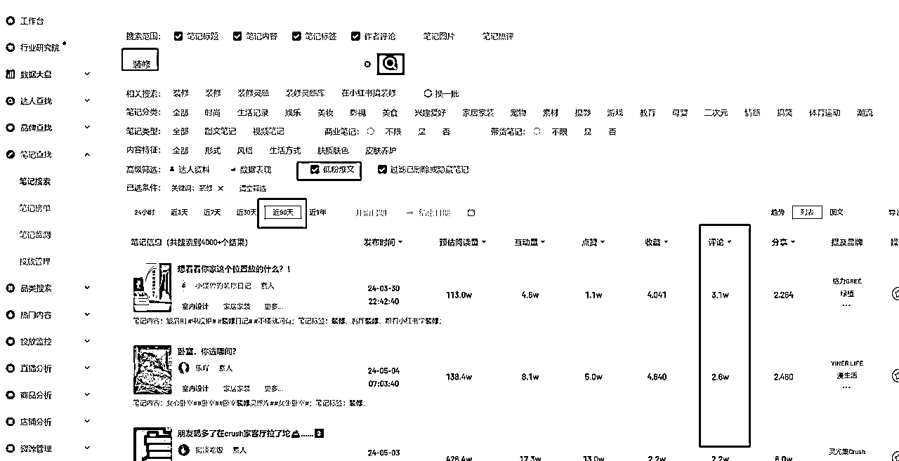

再把页面视图切成列表模式，所有封面排成一列，有没有吸引力一眼就能扫出来。

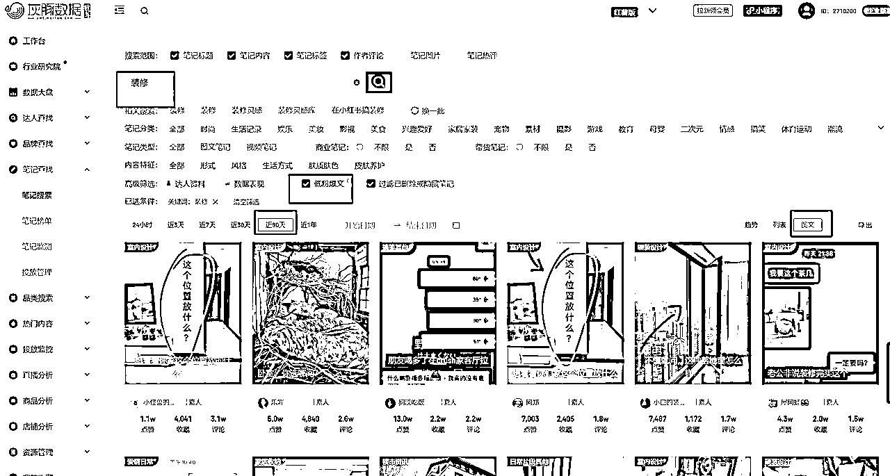

其他行业也能这么操作，比如：

摄影方向：

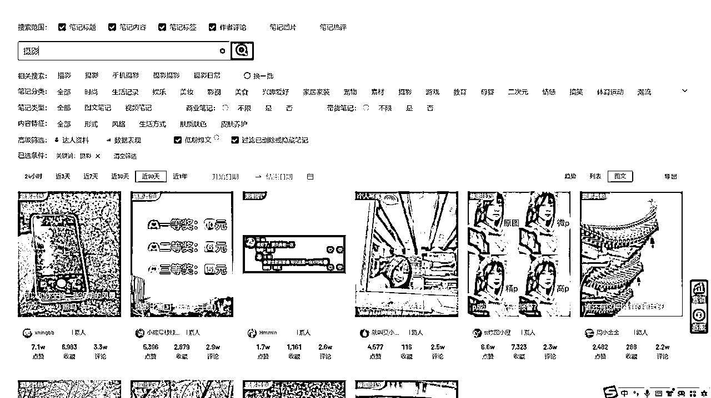

糕点烘焙：

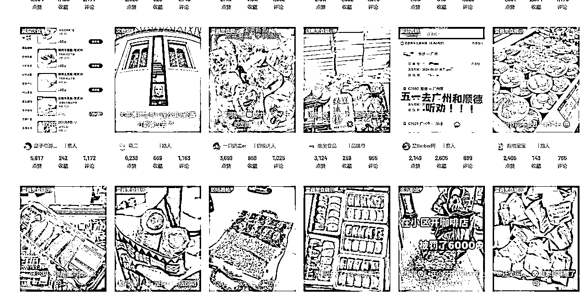

医美赛道：

国学八字：

减肥领域：

总之，你想切入哪个细分方向，就搜对应关键词。如果筛出来的结果很少，把时间周期拉长一点，样本量自然就起来了。

**玩法二：实时低粉爆文榜**

做号前期，最重要的动作就是“找对标、抄对标”。但对标最好选低粉博主：粉丝量太高，参考价值反而有限；发布时间太久的，也不建议照搬——2019年那会儿小红书涨粉比现在容易得多，人家是吃到了平台红利。

更实际的做法，是盯着“实时低粉爆文榜”，看看自己所在赛道此刻正在起量的笔记，及时跟进。

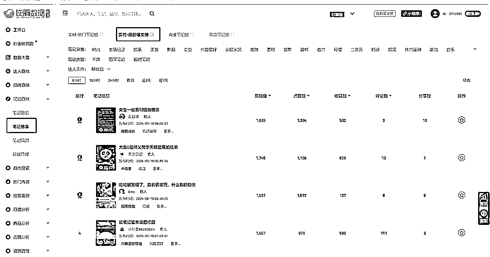

时间范围最短可以选6小时，但此时数据量偏少；如果你想看更完整的候选池，可以把时长拉长一些。同理，在笔记搜索里筛选低粉爆款，效果也是相通的。

**三、这些核心能力，值得记住**

把上面的功能串起来，灰豚主要帮我们解决三件事：

- 找对标：可以从“人”出发，搜索达人并按粉丝量筛选；也可以从“内容”出发，用低粉爆款反向收集。
- 分析对标：看一个号的整体情况、是否接广告、接广告的笔记数量，判断它的商业变现路径。
- 找互动笔记：用笔记搜索锁定关键词，优先关注评论量高的内容。

**四、依托灰豚，能做哪些项目？**

工具本身不产生收益，但能帮我们把副业路子打开。

如果你打算做小红书知识付费，灰豚榜单本身就是内容素材库。比如输出“小红书昨天涨粉最快的3个人”“最近一周涨粉最快的选题”这类盘点，

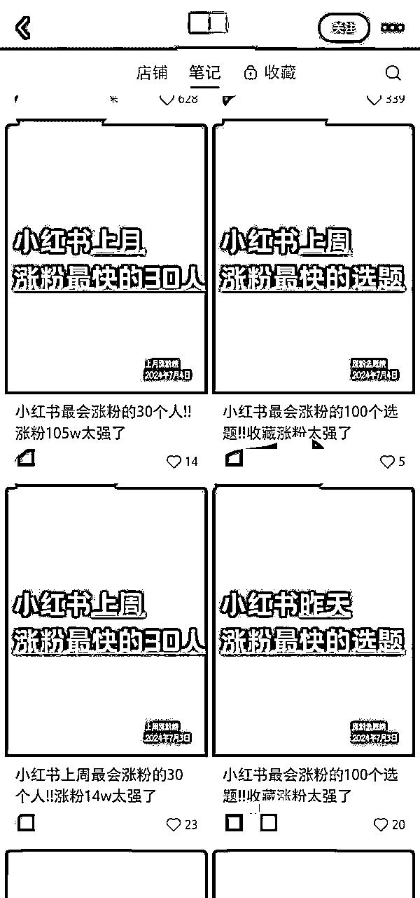

天然就能吸引想涨粉的用户。等到私域流量进来，课程售卖、账号诊断、一对一培训、IP孵化、长期陪跑、代运营这些变现路子，就能顺势做起来了。

如果你在某个细分领域有积累，也可以锁定垂类做内容。下面放三个赛道参考：

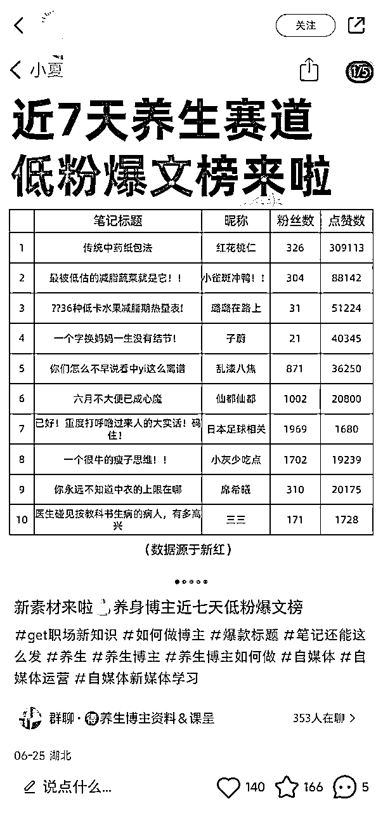

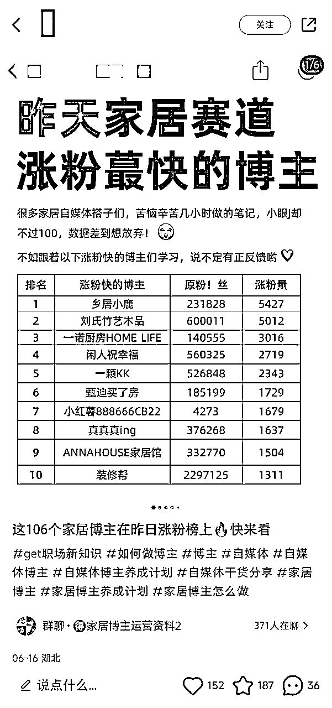

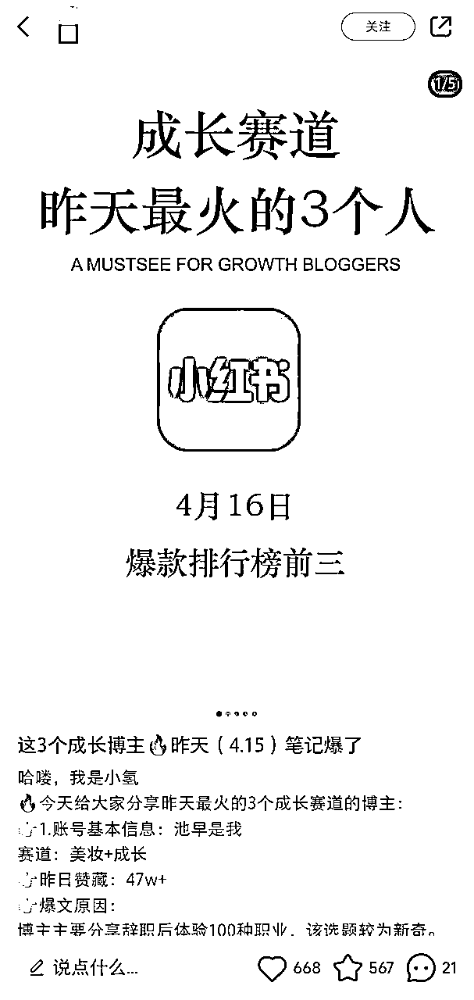

好啦，灰豚的常用功能和玩法基本覆盖完了。其实可挖掘的空间还有很多，建议你先领个15天会员，边用边摸索。不知道怎么领的话，直接找我拿名额就行。

我是哆元，平时专注小红书运营、AI提示词、AI写小红书这块，欢迎来交个朋友。