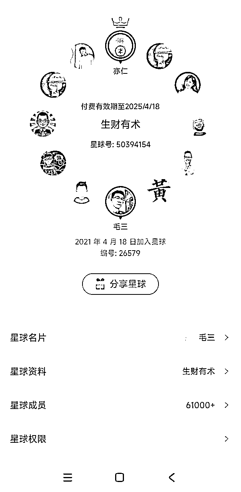
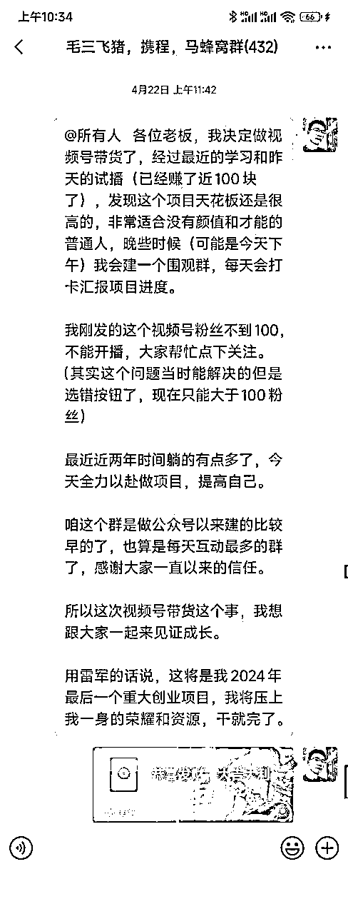
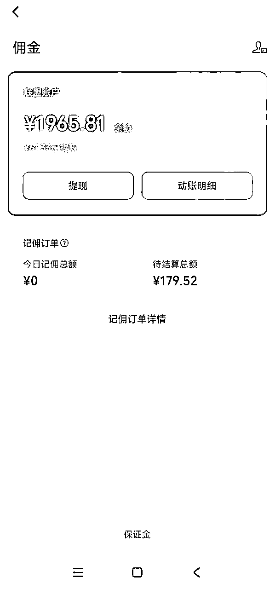
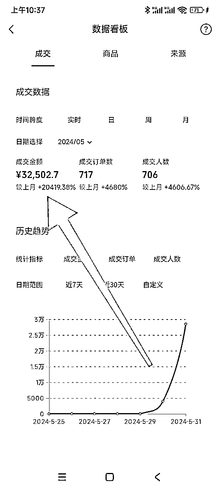
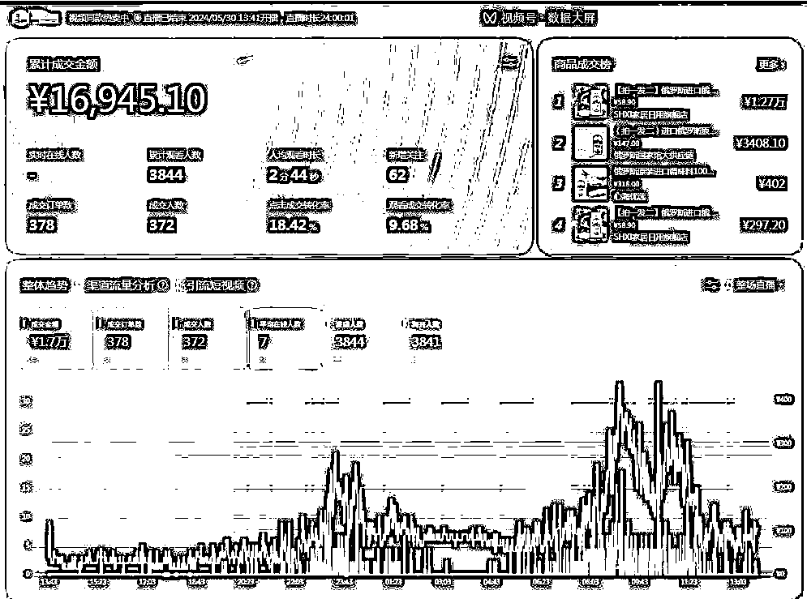
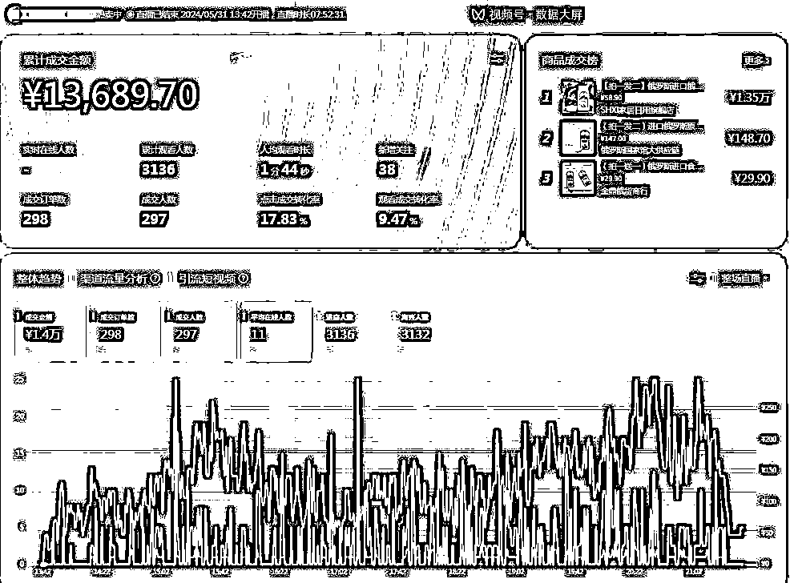
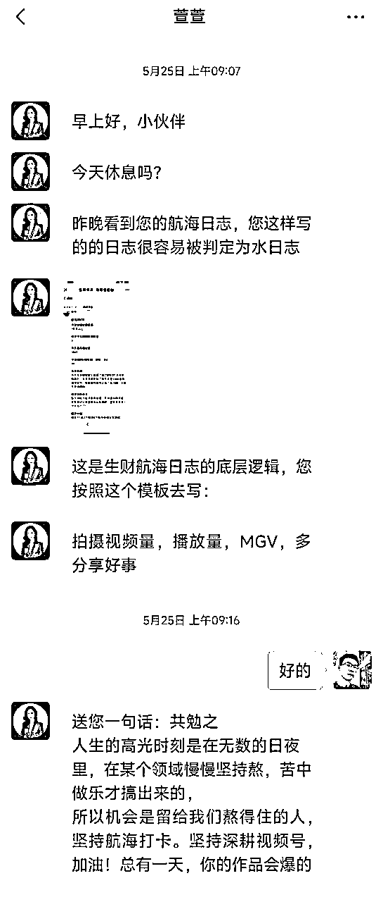

# 视频号带货航海日入过万复盘
作者：龙哥

视频号带货我其实从年初就开始留意了，赚钱里关于这块的讨论帖我也看了不少，自己也在摸索。4月22号我在几个自己的群里给自己定了调子，2024年一定要把视频号带货吃下来。

运气不错，5月份赚钱正好开了视频号带货长航海，我也就第一时间报了名。航海期内总GMV做了35000+，到手佣金15000+。航海结束后我还在持续做，目前累计佣金已经超过23000。先上图，再聊干货。

这是当时缺货只能走线上结算的一小笔佣金，大部分佣金都是线下打款的。

这是当时最火的那一条内容，半天多就冲出了这些成交。

赚钱的航海在我体验过的训练营里，交付质量是顶级的。航海手册、百问百答、直播答疑、领航高手、志愿者、教练配置，哪个环节都拉满。

航海开始前我把视频号实名和百粉的门槛提前搞定了，所以一开营就直接按手册开干。每天拍、剪、发，硬是坚持了十几二十天颗粒无收。那段时间真的很煎熬，押金999退不了，航海也过一周了，只能硬着头皮往前走。

转机出现在5月30号下午，一条视频突然起量了。我当时人在外面没法自己开播，只能找代播。下午1点半上线，两小时零成交。手机剪了三个视频跑网吧传上去，补的那几个加上爆款都有数据，但就是不转化。一直拖到晚上7点才勉强出两单，连代播费都快扛不住。群里有人劝我直接停，直播不下去会亏。我也想过收手，但看着后台播放和点赞还在疯涨，实在舍不得关播。

晚上10点后数据才开始回暖，直播间进人增多，GMV破了1000，终于不亏了。我让代播继续扛，我自己负责剪片补片盯数据。凌晨换播要我亲自操作，一晚上基本没合眼。到了5月31号早上10点，GMV已经冲到11000。后面状态稳定了，流量也稳，人员进店也顺。我也就没再补视频，集中精力直播。一直播到31号下午1点40，系统强制下播，24小时的GMV如图，再加上橱窗里用户自主下单，总共17万左右的GMV。

系统断播后我立刻又开了场，因为流量还在，浪费一分钟都觉得可惜。后面就顺多了，心态也平了。一直播到晚上9点多，系统提示视频违规，限流7天，这才停下来。其实违规提示后本来还能再播一阵子，那条视频转发点赞还在持续，尾流还能再卖点，到这里累计GMV也就32000多。

这次航海我就不展开技术细节了，帖子和手册里前辈分享得已经足够细。我想重点聊的是心态。

我4月就立了flag要干视频号，所以才报名航海。但实操半个月没成绩的时候，我差点就撤了。是志愿者萱萱把我从放弃的边缘拉了回来，才有了5月30、31号那波大爆。真的很感谢航海期间她的一对一跟进，下面这张图只是其中一次交流。

5月25号她在看我的打卡日志时，发现我执行没到位，给了我一段很扎心的提醒，她对每个人日志都这么仔细。

我做过不少项目，也拿过结果。但视频号带货带来的挫败感很特别：你熬夜拍、熬夜剪，发出去不赚钱不说，还可能被限流7天。更麻烦的是，如果几个号文案选择雷同，都可能一起被限，后来才看手册才知道是文案过于激进导致的。

我当时反复想，自己都已经决定2024年all in视频号了，航海这种几百人一起实操的场子，难得一遇，为啥要在这儿放弃。今天难，明天更难，后天就好了。这不是鸡血，是我当时给自己找的理由。我还在群里、朋友圈把话说死了，牛都吹出去了，怎么可能半途而废。而且我已经投入了拍摄支架、灯光、服装道具，还充了剪映会员，粉丝不足的号也花钱补齐了。

我女儿11岁，每天都能看见我在家折腾这些。她将来遇到想放弃的事，我也希望自己能有底气去点她。

最后说一句，做项目很难一直亢奋，状态差的时候可以适当慢下来苟一波，但千万别下桌子。用萱萱送我的那句话收尾：人生的高光，都是在无数个日夜的坚持里磨出来的，苦中作乐熬出来的，机会最终会留给能熬得住的人。