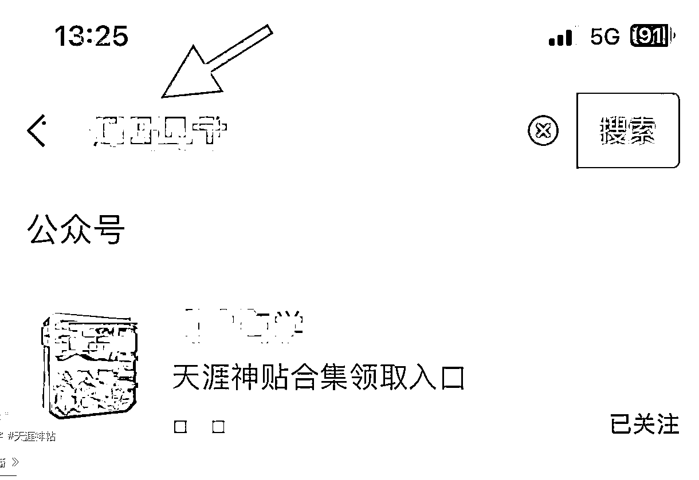
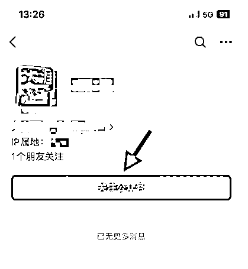
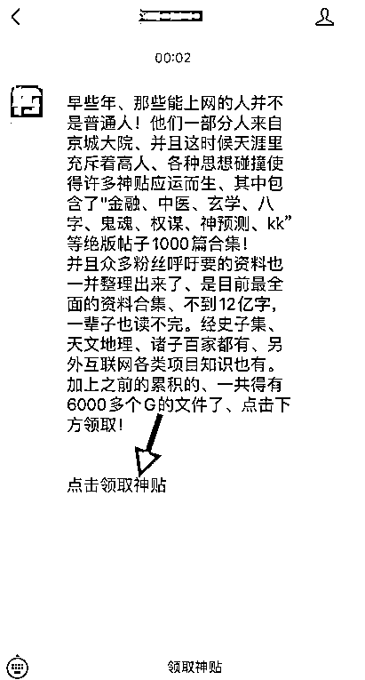

你是不是也刷到过那种“啥也不干，光靠信息差每月多赚好几万”的玩法？今天我来拆解一个门槛不高、操作路径很短的短视频引流变现项目，据说跑通的人每天进账千元并不夸张。

先简单交代一下我自己的经历。我原本在校读理工科，但大学期间一直折腾校园生意、社群引流和知识付费这类副业。14岁那年开始接触卡盟业务，靠搭建卡密分发平台做到日活四千左右，一周收益六千多；16岁迷上易语言编程，搞了个每月88元的付费线报社群，累计超过一千人买单；18岁去阿里实习，还带过小组拿到竞赛第一；20岁整合校园资源，手头积累了20w+的大学生流量；21岁专注研究流量转化，单月最高变现破10w。今天聊的这个项目，正是我在探索中跑通的其中一个模式。

最初我瞄准的是“单身经济”，在短视频上扮演“月老”，拉收费社群，效果虽然存在，但转化节奏实在太慢——很多用户进群后只是闲聊，后续推动很吃力。于是我把方向转向了“天涯神贴”这个经典领域。

科普一下：天涯神贴，指的是当年天涯论坛上那些极具传播力、看法独到、充满智慧或情感共鸣的帖子，被网友封为神作。内容覆盖历史、商业、玄学、个人成长、奇闻故事等方方面面，简直像一部“天涯百科全书”。作者里有地产研究者、商业分析师、社会观察者、历史爱好者，他们用大白话聊房价、聊政策、聊人性，不乏对现实一针见血的点评，直到今天依然被很多人怀念。虽然不少原帖已被删除，但人们对这些内容的兴趣没有消失，这恰恰是商机所在。

那么，这个项目主要吃哪几类人群呢？大概是：当年逛天涯的老用户、爱看故事和八卦的网友、蠢蠢欲动的创业人，以及闲来无事爱在网上找谈资的普通人。

收入怎么设计？我们不走9.9元低价路线，直接定价99元进付费群。群的价值自然要维护好，神贴资源在网上不难找，找不到也有途径对接。更重要的是开放分销机制，推广者可拿70元分成，比例达到70%。也就是说，每成交一单，推广者赚大头，自己赚小头，动力很足。

具体怎么操作？分前期和后期。

前期准备有两种路径可供选择。一种是自建付费进群平台，需要备案域名、服务器和支付接口。源码在电商平台大约五十到八十元可以拿下，但需要自己部署；如果嫌麻烦也能找人代搭建，花费大概300到500元。平台搭好后可生成分销码，别人扫码即成为推广员，用户支付完自动进群，效率很高。另一种是省掉平台费，直接引流到个人微信，按广告引导用户付费，再由人工拉群，后期分销也走手动转账。两种我都试过，体感是平台模式更专业，成交更快、更顺滑，但个人直聊模式也有它轻量的优势，看自己条件选择。

后期引流要学对标账号。比如抖音上有人专做这个赛道，主要模仿方式不难：账号名称用“天涯论坛-xx”或“天涯神贴-xx”的格式；个人简介写“原天涯xx，每日分享天涯神贴，交流群见置顶”；内容方面，可以找古典油画类素材进行剪辑，配原声、压字幕，也可以找易经国学类素材重新配音。抖音、视频号、快手的逻辑都差不多。养号也很简单：每天在线至少两小时，搜索“天涯神贴”相关关键词并关注、点赞、评论；持续养号三到五天；期间每天发两到三条作品。

完成以上后把流量引到私域。建议建一个公众号，名字类似“天涯分享”就可以。然后设置自动推送：如果有付费平台就分享平台码；没有平台就放个人微信二维码。

按这几步做成抖音图文置顶即可。

这个项目还可以继续延伸。付费进群只是最直接的一种变现方式，能精准花钱进群的人，消费力普遍不差。完全可以在私域继续二次转化，做更深度的产品交付。

总结下来，这个项目操作不复杂，破局速度也快，不少人一周左右就能看到明显反馈。如果你也对这个方向感兴趣，欢迎来交流经验，一起死磕流量，一起把变富的路子走宽。