# 一个人3个月做到300万的销冠，把15年销售经验浓缩成6个关键点

嗨，我是糖糖。

很高兴在这里遇到你。无论我们是线上初识，还是线下早就熟络，这次重逢都算缘分。

先用几个关键词认识我一下

1. 做销售15年，年年都是团队销冠
2. 曾在上市公司做女装运营，5年累计业绩过亿
3. 创业开实体店，3年内做到9家
4. 最夸张的一次，去留学公司从零起步，3个月就做到300万

今天把这15年里踩过的坑、打过的胜仗全部摊开讲给你听。学会了这些，你也能复制销冠路径。

全文将近一万字，我花了两周整理出来，结合实战反复推敲，还和玩赚创始人芷蓝聊了40个小时才定稿。

内容分三大部分讲：

## 一、销售底层逻辑篇

## 1. 到底什么样的人能做好销售？

## 2. 高情商聊天成交术：把对话变成成交力

## 二、销售实战打法篇

## 1. 塑造强大个人魅力，成交转化翻三倍的办法

## 2. 客户说“再考虑考虑”，两句话拿下
## 3. 客户问“最低能给多少”，这样回更容易成交
## 4. 怎么摆脱被客户牵着走的僵局
## 5. 如何加速促成订单
## 6. 如何让客户主动帮你介绍

## 三、销售心态篇

## 1. 被拒绝多了怎么办，心态怎么扛住
## 2. 顶尖销售的心态长什么样

## 四、致谢

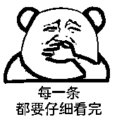

## 一、销售底层逻辑篇

## 1. 到底什么样的人能做好销售？

以前常听到这句话：不爱说话、性格内向、不喝酒，就别做销售了。

我也在心里认可过这种说法。刚入行时我就觉得自己和销售八字不合，大伙说得对，我当时也这样想。

看看身边有多少人跟我有同感。

不过我要纠正你一点：那些所谓的短板，根本不是成为销售黑马的阻碍。

原因很简单，销售不是天赋，是可以被学习、可以被复制的方法论。

只要方法对，肯下功夫，你完全能靠销售赚到10万、100万，甚至1000万。

举个例子说明白。

2021年疫情期间，我关闭了11家服装店，裸辞去留学公司，从一个连电话都不敢打的小白做起，面谈客户还要靠领导搭话。一年下来，我做到了1000万业绩，顶得上部门两个老员工的总和。

所以哪怕别人都说你不适合做销售，也别忘了，曾经的我也是被判定为“不合适”的那类人，但照样靠一套训练体系拿下销冠。

总结下来，判断适不适合，可以从三点自检：

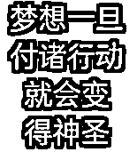

第一：驱动力

先问自己，为什么要做销售？

对我来说，答案很直接：为了更好的生活，为了多赚点钱。我相信大多数人动机都一样。

承认这一点没什么丢人。没钱才丢人。就算是星辰大海，也得先买得起门票。

当你的驱动力清晰了，叫醒你的就不再是闹钟，而是那股想变好的劲。

第二、自我调节的能力

销售这行，被拒绝是日常。前一个客户刚把你怼回去，下一秒你就要拍拍衣服继续上。

自我激励听起来简单，做起来很难，但它是你的核心续航能力。

具体的调节方法，我会在心态篇“被客户拒绝怎么办”里详细拆解练习。

第三、持续学习的能力

销售专业知识就那么多，一个月就能学个八九不离十。关键是你要学会跟着客户走，客户关注什么，你就去学什么。

想跟客户聊得来，被客户尊重，你就得跟客户保持认知对齐。比如客户爱打羽毛球，你至少要懂装备、懂动作，才能接上话。

有人会问：糖糖，如果我这些能力都没有，还能做销售吗？

别慌。这些素质都是可以训练出来的。

关键在于你有没有清晰的自我认知，知道自己强在哪弱在哪，哪里短板立刻补。不是有没有天赋的问题，是愿不愿意突破的问题。

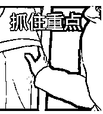

## 2. 销售高手必杀技：在高情商聊天中成交

你有没有遇到过这种状况：你很想获得客户信任，可客户永远半开着门，防备心很强；

你想和客户做朋友，可关系始终卡在买卖层面。

到底是什么在阻碍你？

很多人会砸钱：发红包、送礼、跑腿、陪聊。这些成本高得吓人，效果也一般。

还有人会为客户两肋插刀，结果人家只觉得“你是个好人”，感情上不升温。

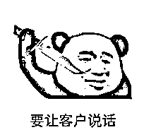

真正的高效做法是，把聊天变成一把万能钥匙。它能弥补其他短板，让客户更喜欢你、更信任你。

因为聊得好，人心情就好，会觉得你懂他、像知音，自然愿意深交。

聊天的本质是自我暴露、交换信息、建立连接。

但要注意，客户的自我暴露是一把双刃剑。

如果你敞开了，客户认可，你们的信任会迅速升温；如果客户不接招，你的真心就可能被伤到。

所以高手会先给客户营造一个安全区，让他敢讲、敢露。

当客户开始对你敞开心扉，信任就落地了，有了信任，还怕签不成单吗？

销售中的自我暴露是有层次的，掌控好这个度，客户才会一步步打开心门。

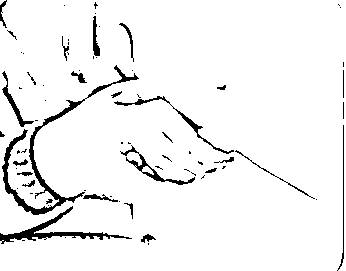

1. 打招呼 —— 最安全的开场
打招呼几乎不涉及暴露，比如“早上好”“欢迎”“久等了”。小小一句，却是聊天的敲门砖。

2. 聊事情 —— 传递信息同步需求
聊产品、聊流程、聊服务，属于事实层。自我暴露少，主要是信息对齐。这个阶段，你会感受到客户的表达欲，满足了与人交流的需求。

给你一个让客户开口的小技巧：表现好奇心。

当客户讲完，你追加一句：为什么会这样？具体是什么情况？后来怎么样了？能具体讲下那个细节吗？发生了什么？

在你的好奇里，客户会觉得被接纳、被重视，就会更愿意讲故事。

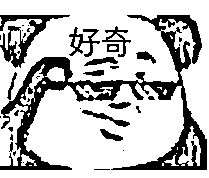

很多时候客户聊着聊着就上头了，需求甚至会主动说出来。那你对症下药，成交自然水到渠成。

表现好奇的核心句式就是追问：为什么呢？是什么呀？后来如何？

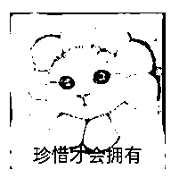

3. 聊观点 —— 共情是信任的标志
这时你开始表达观点，客户能感受到你的专业和真诚，亲密度再上一个台阶。一定要珍惜客户的袒露。

你的接纳和认同，会让客户说得更多。

举例：
客户说：我家孩子天生就不爱学习。
否定式回应：哪有天生不爱学习的，是不是你没陪伴好？
这样客户马上会关闭。

正确做法是先承接情绪：我特别理解你现在的感受，孩子这样确实让人着急。

既不盲目认同，也不否定冲突，让对方舒服。

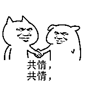

4. 聊感受 —— 挖到内心需求
把个人情绪带进对话，让客户感受到你的共情，关系更近。

对方开始说感受了：我很生气、我很怕、我很伤心、太郁闷了。

比如妈妈倾诉：
差的说法：孩子考差了，傻子都不会错这么多。
好的说法：孩子考差了，我真的是很生气，很郁闷。

第二种更容易走出负面情绪。

回应时说：看来孩子的事真的让你很伤心。
她会觉得你站在同一阵营，愿意吐更多槽，也会透露真实需求。

这就是共情后的信任落地。

5. 聊缺点 —— 信任的最高层
能跟你聊他最不喜欢自己的部分，说明已经完全信任你。

比如一段黑历史、不好的习惯、最难启齿的事、藏着的隐私。

每个人内心都有想改变的部分。如果你能接住客户的脆弱，让他感受到被爱、被接纳，他就会敢在你面前袒露。

在安全感的前提下，多关心故事、看法、感受、甚至小缺点。你越接纳，他越展示。关系自然越深。

把这些层次吃透，再用到实战里，你就不会再为“聊什么”发愁。

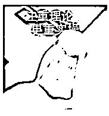

## 二、销售实战打法篇

## 1. 如何塑造个人魅力，让成交率提升300%

核心就四点

第一、把客户信息整理成文档
沟通结束后，整理成需求清单发给客户。客户会觉得你专业、尊重、重视。这也在潜移默化中帮客户理清自己的需求。

话术可以是：我刚才把您提到的需求记录下来了，共1234点，有遗漏请提醒我。

第二、沟通语言简洁有重点
话少说得好。微信一段不超过三行，连续两段客户没回，就停。段落越少气场越稳，有来有回才有张力。

第三、敢于沉默、敢于留白
参考《肖申克的救赎》那种张力。聊天中停顿2-3秒，别人会尴尬，但尴尬的是谁，取决于谁更从容。

自信的人留白是气场，不自信的人留白是死局。适当的停顿能激发客户的优越感。

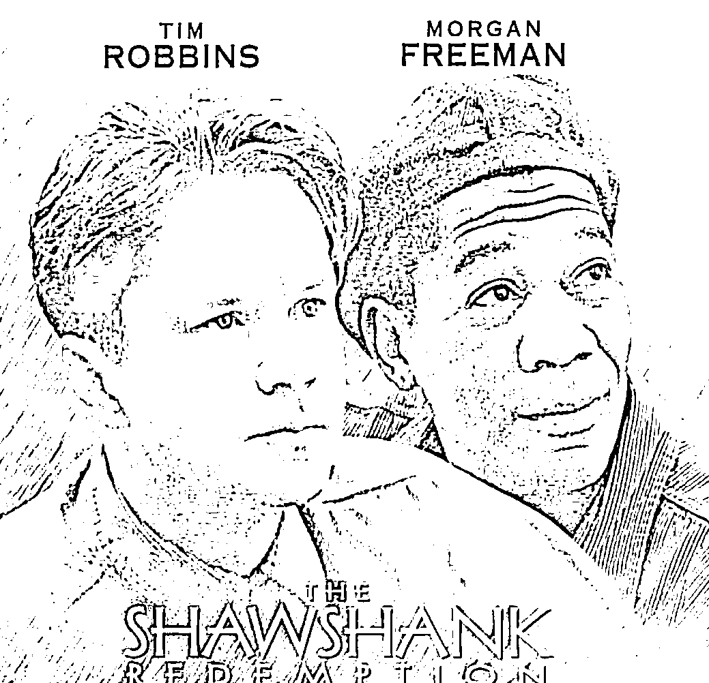

第四、敢于对客户提要求
比如：我能问你个问题吗？刚才你说的那句，能再复述一下吗，我没听清。
这不是没礼貌，是夺回话语权。客户会觉得你不是来陪聊的，是来解决问题的。

## 2. 客户说“考虑下”，两句话就能搞定

“考虑一下”多半是客套，背后是有顾虑。你的任务是把顾虑挖出来。

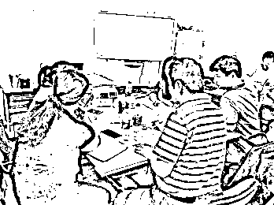

思路一：引导客户说出真实原因
你可以说：给孩子选老师确实要慎重，我看您对课程挺感兴趣，不然也不会花这么多时间聊，您主要是在纠结效果还是费用？还是别的方面？

一问，顾虑就出来了，有了痛点才能解决，成交才顺。

思路二：直接点破应付
你可以说：浩然妈妈，通常说考虑考虑要么是真有疑惑，要么是客套。你这么真诚，我相信不是客套。我做事比较直接，不爱死缠烂打，既然聊到这份上，直接说，我们一起把问题解决了。

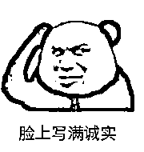

销售打动人的不是花招，是真诚。真诚换真诚，买不买不重要，别把时间耗在无效客户上。时间是销售最宝贵的资产。

## 3. 客户说“最低多少”，两句话回就签单

客户问最低价时，你不能回：
“你今天能定吗”“我没权限”“全国统一价”
这些等于明说“你别买了”，客户会不爽。

直接降价更糟，会让客户觉得你虚高，继续砍价。

应该怎么做？

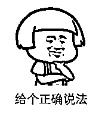

第一步，先共情
看得出来xx妈妈，您很会过日子，每一分钱都花在刀刃上。我们公司价格管控很严，调整空间不大。

第二步，强化价值
价格不能变，但服务和赠品可以。公司规范意味着师资和课程质量有保障。如果您觉得我靠谱，给我一次信任，后续服务我一定让您满意。

然后递上付款码，眼神期待：您是微信还是微信？犹豫的客户基本就成交了。

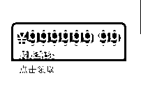

## 4. 如何不被客户牵着鼻子走

有没有这种体验：客户一问，你就答，最后客户说“谢谢我再考虑”，然后没下文？

被牵着走有两个原因：准备不充分、思维惯性。

先说准备。

产品知识要准备三层：了解产品→分析优点→提炼利益点。别只说“两个星期13次课”，要说孩子学完思维会有什么改变，能解决什么问题。

市场知识要了解竞品，知道差异化在哪。

心理准备要自信。镜子前做超人姿势，提升能量场。肢体状态会反过来影响大脑。

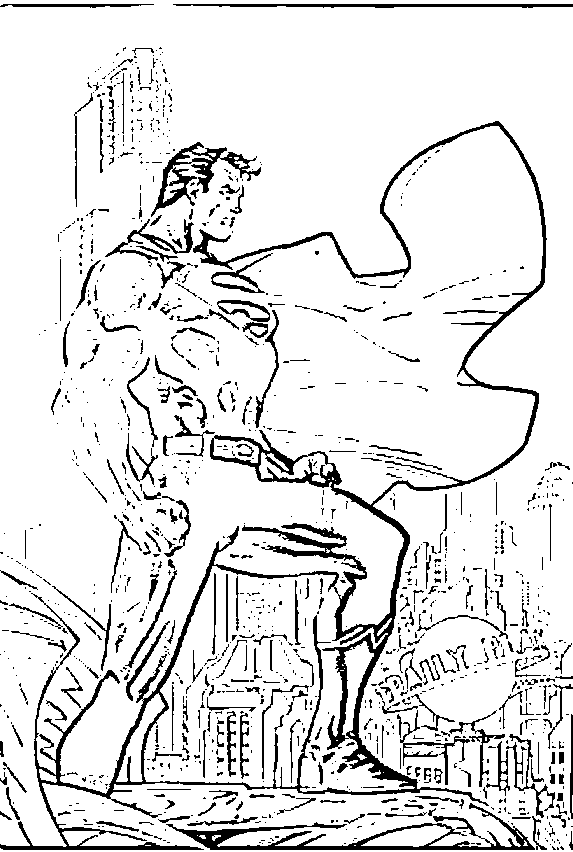

再说思维惯性。记住：谁提问，谁主导。你要学会反问。

客户问：你们有哪些适合三年级的课程？
别直接列。回：浩然妈妈，我们课程很多，但未必都适合您家宝贝。先看看孩子想提升哪科，目前学习状况怎样？

把问题抛回去，信息收集的主动权就回到你手里。

客户问：你们课程怎么这么贵？
回：浩然妈妈我很理解你有这想法，你是对比过其他机构，还是觉得我们课程不值呢？

把宽泛问题具体化，听出背后的痛点，你就掌握节奏了。

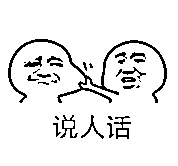

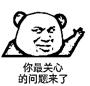

## 5、如何做到快速成交？

当购买意向已经从客户那里流露出来，你要怎样乘胜追击，一把拿下？

这里要用的手法是假设成交

假设成交是什么？

就是在捕捉到客户的买单信号后，你先默认他已经下定决心，然后用一套层层递进的确认问题，把各个细节逐一敲定。

拿孩子报课来举例

按购课数量、科目、学习时段、上课校区、授课老师、缴费方式等要素，从客户压力最小的点开始，一项项往下确认。

顺着客户的接受度由低到高去推进，成交显得水到渠成，既高效又不突兀。

现在你来演练一下这个场景

你说：浩然妈妈，暑期班你们打算去哪个校区上比较方便？

客户：回复地点

你说：好的我记下来，那你看1、2、3期，偏向哪一期呢？

时间一确定，就能顺势确认课时

你说：你刚才选的是廖老师的班对吧？

客户：对

你说：那就是20节的暑期课时包是吧

只要客户继续回应，这单基本就稳了

要点提示：

如果客户开始砍价，即便前面已经谈妥，也不要立刻让步。顶多送点小赠品或增值服务。因为此刻客户内心其实是想买的，只是想在最后再争取一点点。

如果客户在询问配送地址和时间时突然停下来，说要先问个问题，那你先把他的疑问解决掉，再回到刚才的推进节奏。

为什么这么做？

成交前客户心里会自然产生压力，压力一大就容易退缩或回避。你把压力拆成小块逐步推进，给他缓冲空间，接受起来就顺多了。

## 6.怎样让客户主动帮你转介绍

告诉你一个销冠都在用的利器，一招打通全场的秘诀——登门槛效应，也就是得寸进尺效应，试过都说好

第一步、模糊承诺

比如我之前带过的一个留学客户，签约很顺利

我就跟他说：李总，学校我给你挑的还满意吧，有空的话记得帮我留意一下客户资源

他当时就答应了，但这种话90%是客套，得看后续动作。

第二步、三天后回访

三天后我打电话回访，正事说完就闲聊起来：“李总，月底了，我业绩还没完成呢。上回您答应帮我介绍客户的事，现在进展如何？”

李总说：“别急，这两天太忙，有空我再想想。”

这种话是不是很熟悉？忙、想想，都是需要你主动推动的信号。

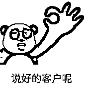

第三步、礼物加码

再隔两天，我安排了一箱水果寄到他家里

李总：糖糖老师，你也太客气了！

这时要自然熟一点，我说：这是给我老妹的。

气氛缓和后，我半开玩笑半认真：李总，您该不会是拿我寻开心吧，说好的介绍呢？他说：我老婆一直想了解企业管理课，这是她电话，你联系一下吧。

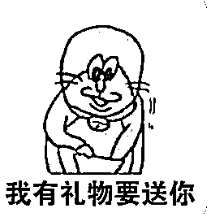

第四步、请对方搭把手

我接着说：李总，我这人比较腼腆，您看能不能帮个忙，下次开课时带太太过来体验一下

李总很给面子：当天就和老婆敲定时间，周末全家都过来了

第五步、当面表达谢意

我赶紧夸赞：李总，现在爱学习的企业家很多，像您一家子一起来进修的真不多，为我们树立了榜样，今天正好有清华大学经济管理学教授的课，你们可以先体验一下。李总太太听完，当场就决定签约了。

看明白了吗？这就是登门槛效应，从一句模糊的承诺开始，经由持续跟进，一步步变成真实的转介绍，不能中途松懈。

## 三、销售心态篇

## 1.销售被拒怎么办？心态怎么调

你和客户谈单的过程，就像打怪升级，每一次被拒都是在攒经验、捡装备、回血

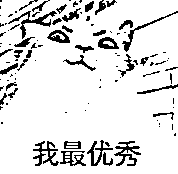

你怕被拒绝，本质是内心能量不够，大致原因有三

过去吃过亏，留有失败阴影

在行业里专业经验不足

自我否定严重，思维受限，发挥不出潜能

那怎么破？给你三招可直接用的锦囊

（1）充盈内心能量

*   找优点：你会写字、会跳舞、会做饭，哪怕笑点低也算优点。实在找不出，就去学个新技能，比如羽毛球、乒乓球、散步、慢跑。能让你大汗淋漓的运动，就是给内心的能量补给站。

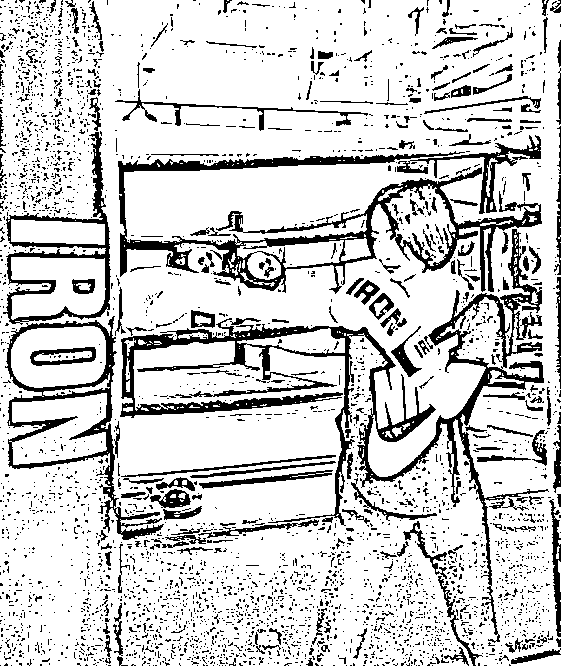

*   专业储备：别偷懒，不会就从零开始建体系。用思维导图或Excel把专业知识从头到尾梳理清楚。客户一提问，你能在体系里快速调用，游刃有余。

*   复盘迭代：每次拜访结束，用录音回听自己的表达，找短板，优化话术。每一次小进步，复利起来成长速度惊人。

（2）换个角度看拒绝

对同一件事的看法不同，心态自然不同

现在做个小练习

*   还原场景

拿笔写下当时的对话情境

客户淡淡回你一句“不需要”

再换个解读

也许她今天心情不好，或者和家人吵架了。别把拒绝过度解读，它可能只是当下的情绪反应。

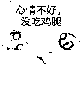

*   真正的拒绝

对不熟悉的事物，人第一反应是回避。所以拒绝多半是思维惯性，也是想更了解产品后的正常反应。

*   防御伪装：把客户的拒绝看作心理防线的“假性抵抗”。

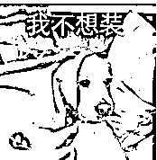

所以，别被这类话困住，保持笃定继续往前走。

### （3）当下被拒，不等于永远被拒

销售不是一锤子买卖，从认识、传递信息、挖掘需求、化解顾虑到成交，每一步都可能遇到拒绝，但拒绝不会一直存在。

只要你保持积极乐观，精准挖掘真实需求，做好解释说明，所有阻碍都能被突破。

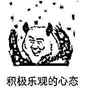

销售每一步的结果不是成交，而是顺利迈向下一步。你若这样理解，拒绝感会少很多

你对拒绝的包容度

恰恰体现了你对销售的理解深度。销售这个行业，被拒的频次和强度远超其他行当，只有好的心态才能成为高手。

## 2.顶尖销售高手的心态长什么样

对销售而言，80%是心态问题。心态调对了，成功就完成了一半。

顶尖销售的心态有哪些？

### （1）销售是平等协作，不是求人办事

很多销售有求人心理，是因为内心不确认产品价值和自己能给客户的好处，总觉得客户占了便宜，心里过意不去。

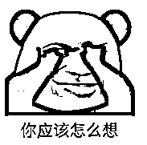

其实客户买了你的产品或服务，获得的价值远大于支付的金钱。若客户没感知到，就需要销售去点醒。

所以你和客户是平等的合作关系，因为你能帮客户解决问题。

如果你总觉得自己在求人，说明

你还没挖到产品和服务真正的核心价值，也没把价值讲出来。

所以这份工作并不低人一等

也不需要在销售中卑微讨好

当你心态正常，你一定能在销售上取得好成绩。

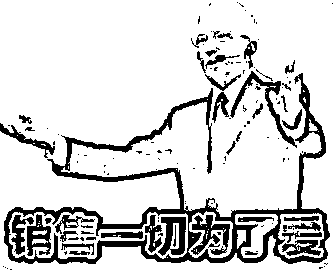

### （2）恒心在握，天下皆可得

老话说“有志者事竟成”。做销售就要有不服输的劲儿。

这次被拒不代表下次还拒

下次还拒也不代表拒绝这件事

即便拒绝这件事，也不等于拒绝你这个人。

所以面对拒绝，要坚定信念，不停寻找客户的柔软点，一击即中，这就是成功销售必备的要素。

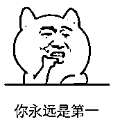

### （3）平常心，不带情绪

做销售，耳朵要厚。

客户的抱怨、上司的批评、同事的议论，放在心上就受影响，放下就无事。

客户对你的态度，并不完全决定结果，关键在你的销售方法。

一旦情绪化，能力发挥就会打折，业绩自然受损。

所以心态要稳，宠辱不惊，放下包袱轻装上阵

你的心态决定你的业绩，摆正心态，找准状态。

总结，做好销售要做到：

1.  学习力

保持持续学习，不断升级认知，这样才能和不同行业的人聊到一起

1.  坚持不懈

坚持到最后，永不放弃，也许再多一次努力，客户就成交了

1.  心态调节：

状态对了，事情自然成。

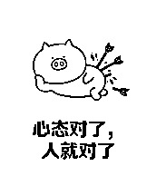

分享到这里，感谢你认真看到最后，你的善良认真让我多了一份认可

我是糖，一个愿意陪你一起变得更优秀的成交教练。

# 💓致谢：

感谢颜乐乐，帮我梳理方向，让我能把精力放到更重要、回报更长远的事上。

感谢驿涵，手把手带我做基础搭建、文案改写、社群冷启动，推动我去做一直想做却没勇气做的事。

感谢芷蓝，当我说要推进社群流程时，给我方向并搭好框架，协助我完成这次复盘写作。

感谢靠谱，在我迷茫时帮我找到优势，从已有的经验和成果出发。

感谢王司基，我5月加入玩赚合伙人时，就给了我清晰的定位和多维度的执行方法论，还在合伙人群里分享，让我这个从无战略思维的人打开了新认知。