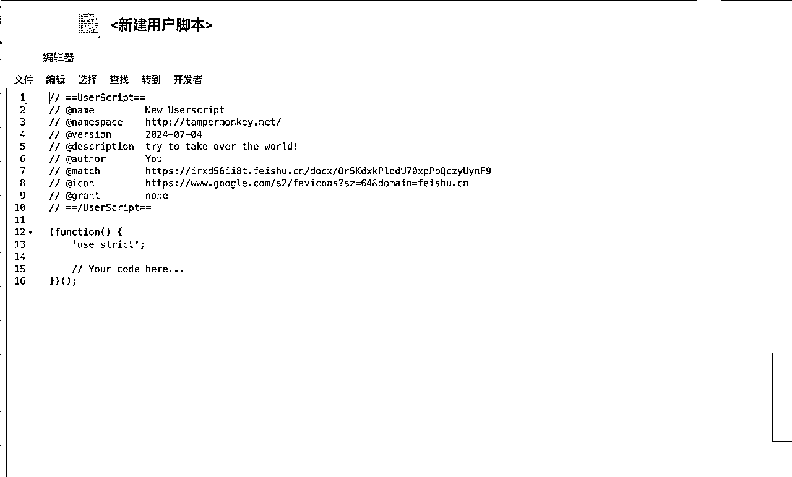
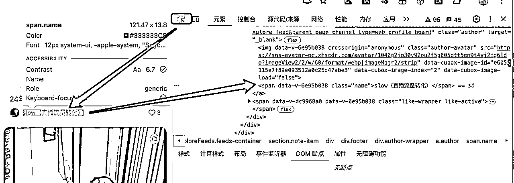

# 6月📕航海营里，我手搓的几件 mac 实战小工具


大家好，我是香君，赚钱的新人。

五月是我第一次参加航海。这次闭环是跑通了，但成绩没达到预期，有点小遗憾。换个角度看，这次经历也算值了，思路被打开了，围绕航海手册我自制了几款好用的小工具，特别照顾到 mac 用户。教练分享的多是 Windows 向的方案，mac 同学只能一边跑流程一边自己造轮子了。下面直接开干。

先说前置

本次内容主要拆解我的思考路径，并附上可跑的代码。所有脚本都依赖 Python 环境，如果你还没装好 Python 和 IDE，建议去翻 5 月 AI 编程航海的手册，里面有完整的安装教程。

# 一、我的思路梳理

说实话，电商对我来说是第一次。我挺庆幸首战选了📕电商。之前我接触过不少平台，对📕有自己的观察，归纳起来有三点：

1、推荐周期偏长，考验心态
2、玩法和格式比较固定，适合复制和矩阵放大
3、用户多集中在高线城市的年轻人，选品门槛相应提高

拿到命题后，我先对照航海手册把关键动作列出来，再挑出能用技术提效、省人力的环节。最后锁定了下面几个能标准化的流程：

1、爆款笔记采集
* 可以用浏览器油猴插件+Js 脚本实现采集

2、视频笔记制作
* 爆款视频的分镜自动裁切，用 python 脚本搞定
* 奇杰老师剪辑法里要用到的 5 秒垫片素材剪辑

3、图文笔记
* 图文去重是核心。教练提到做 live 图是去重手段之一。我的 live 图生成目前有三条路：
* 素材充足时，直接从视频里截取
* 只有静态图时，丢进可灵 AI 做图生视频
* 生成失败时，用我调好的 python 脚本做随机抖动和位移，模拟镜头呼吸感

思路理清了，就进入代码环节。

# 二、实操代码

## 1、爆款笔记采集

声明：本工具仅模拟人工操作，采集内容均为公开信息，未对📕进行任何破解或篡改。

因此不会导致封号风险，严禁用于非法用途。

📕对访问频率有限制，刷页时请放慢节奏，避免触发风控。若真的被限，可先关闭光猫几分钟再重启，IP 会更新。

因涉及敏感操作，我把完整操作流程公开，并提供给 AI 生成代码的 Prompt。

### ① 安装油猴插件

油猴在浏览器里能实现很多功能，比如去视频广告、免会员看百度文库等。功能非常多，自行探索。下载地址：https://www.tampermonkey.net/

### ② 让 GPT 写代码

下面这个 Prompt 是我反复打磨后能复现我代码的版本，直接喂给 GPT 就能出结果

```
Prompt如下：
我需要一个Tampermonkey脚本，它可以在📕网页上采集笔记的作者、标题、点赞数、详情页URL、全文内容、粉丝数和发布时间，并在页面左中侧显示一个采集计数器，包含一个刷新功能来清除已采集的数据并重新开始。请帮我生成一个能实现这个效果的完整的JavaScript代码。具体需求如下：

1.数据采集：
•采集每个笔记的以下信息：
•作者
•标题
•点赞数
•详情页UR
•全文内容
•粉丝数
•发布时间
需要用到的选择器为：
1.笔记项选择器：.note-item
2.标题选择器：a.title span
3.作者选择器：.author .name
4.点赞数选择器：.like-wrapper .count
5.详细页面 URL 选择器：a.cover
6.作者主页链接选择器：a.author
7.粉丝数量选择器：span.count
8.发布内容选择器：#detail-desc
9.发布时间选择器：span.date
2.计数器：
•在页面左中侧显示一个浮动的采集计数器。
•计数器显示当前已采集的数据条数。
•计数器包含一个“复制按钮”，点击后可以将所有采集到的数据复制到剪切板上，方便后续粘贴到excel中
•计数器包含一个“刷新”按钮，点击后清除已采集的数据并重新开始。
3.数据输出：
•将采集到的数据格式化为适合粘贴到Excel中的形式，每种数据类型在单独的列中正确对齐。
•数据输出到计数器中的文本区域，方便复制。
4.界面设计：
•计数器界面简洁，使用白色背景和黑色边框。
5.技术要求：
•使用jQuery来简化DOM操作。
•使用MutationObserver来监听DOM变化并实时采集数据。
```

③ 油猴里导入代码

a、打开管理面板


b、点击加号新建脚本


c、把 GPT 生成的代码粘贴覆盖，点击文件菜单保存



### ④ 测试采集器

基本不会出问题，偶尔 GPT 会抽风跑不出数据。这时打开浏览器开发者工具，点击元素，再点左上角的选取箭头，手动点选网页元素，逐步喂给 GPT 调整。



实在搞不定也可以联系我，我直接把成品代码发你。

调优美化后的完整采集器长这样，名字有点中二


点一下复制，粘贴到 Excel 就能直接看数据了。

## 2、爆款视频分镜裁切

mac 上现成好用的工具比 Windows 少，苦逼的 mac 用户很多事只能自己来。好在代码不复杂，今天也免费分享。

### ① 准备环境

本脚本依赖 scenedetect 和 ffmpeg

scenedetect：检测视频场景切换，识别镜头变化
ffmpeg：多媒体处理工具，用来剪视频和音频

Windows 和 macOS 安装步骤如下：

#### a、Windows

1. 安装 scenedetect

打开命令提示符运行：

```
pip install scenedetect
```

2. 安装 ffmpeg

* 访问 FFmpeg 官网
* 在 Get packages & executable files 部分选择 Windows builds from gyan.dev
* 下载 ffmpeg-release-full.zip，解压后重命名为 ffmpeg
* 移动到比如 C:\ffmpeg
* 加入系统环境变量 Path，添加 C:\ffmpeg\bin

验证安装：

打开命令提示符运行：

```
ffmpeg -version
```

#### b、macOS

1. 安装 scenedetect

打开终端运行：

```
pip install scenedetect
```

2. 安装 ffmpeg

* 先装 Homebrew，不装的话先运行：

```
/bin/bash -c "$(curl -fsSL https://raw.githubusercontent.com/Homebrew/install/HEAD/install.sh)"
```

* 安装 FFmpeg：

```
brew install ffmpeg
```

验证安装：

终端运行：

```
ffmpeg -version
```

### ② 部署运行

航海手册里有怎么粘贴和运行代码的具体拆解，这里直接上代码：

```
import os
import sys
from scenedetect import VideoManager, SceneManager
from scenedetect.detectors import ContentDetector
import subprocess

def split_video(input_file, output_folder):
    video_manager = VideoManager([input_file])
    scene_manager = SceneManager()
    scene_manager.add_detector(ContentDetector())

    base_name = os.path.splitext(os.path.basename(input_file))[0]
    output_subfolder = os.path.join(output_folder, base_name)
    os.makedirs(output_subfolder, exist_ok=True)

    try:
        video_manager.start()
        scene_manager.detect_scenes(frame_source=video_manager)

        scene_list = scene_manager.get_scene_list()
        scene_list_csv = os.path.join(output_subfolder, f"{base_name}-Scenes.csv")

        with open(scene_list_csv, 'w') as f:
            f.write("Scene Number, Start Time, End Time\n")
            for i, scene in enumerate(scene_list):
                f.write(f"{i + 1}, {scene[0].get_timecode()}, {scene[1].get_timecode()}\n")

        for i, scene in enumerate(scene_list):
            start_time = scene[0].get_seconds()
            end_time = scene[1].get_seconds()
            output_clip = os.path.join(output_subfolder, f"clip_{i + 1}.mp4")

            command = [
                'ffmpeg', '-y', '-i', input_file,
                '-ss', str(start_time), '-to', str(end_time),
                '-c:v', 'libx264', '-crf', '18', '-preset', 'fast',
                '-c:a', 'aac', '-b:a', '128k', output_clip
            ]
            subprocess.run(command, stdout=subprocess.PIPE, stderr=subprocess.PIPE)
    finally:
        video_manager.release()

def process_videos(input_folder, output_folder):
    if not os.path.exists(input_folder):
        print(f"Input folder {input_folder} does not exist")
        return

    os.makedirs(output_folder, exist_ok=True)

    for filename in os.listdir(input_folder):
        input_file = os.path.join(input_folder, filename)
        if os.path.isfile(input_file) and filename.lower().endswith(('.mp4', '.mov', '.mkv', '.avi')):
            split_video(input_file, output_folder)

if __name__ == "__main__":
    input_folder = "/填你放素材的地址"
    output_folder = "/填你输出切片的地址"
    process_videos(input_folder, output_folder)
    print("已经全部剪辑完成!")
```

## 3、奇杰老师剪辑法 5 秒垫片素材剪辑

研究奇杰老师的拼配剪辑法后发现，他对素材长度要求很固定，会把一段素材切成很多 5 秒片段。为了让素材利用率最大化，我的代码会从头向前裁 5 秒，同时从尾向后裁 5 秒，让一段素材能重复利用两次。代码如下：

```
import os
import ffmpeg

# 用户名和基础路径
user_name = "你的用户名"
base_path = f'你的文件地址'

# 创建输入和输出文件夹
input_folder = os.path.join(base_path, 'video_input')
output_folder = os.path.join(base_path, 'video_output')

# 创建输出文件夹及其子文件夹
os.makedirs(output_folder, exist_ok=True)
forward_folder = os.path.join(output_folder, 'forward')
backward_folder = os.path.join(output_folder, 'backward')
os.makedirs(forward_folder, exist_ok=True)
os.makedirs(backward_folder, exist_ok=True)

def cut_video(input_path, output_dir, direction='forward'):
    # 获取视频信息
    probe = ffmpeg.probe(input_path)
    video_stream = next((stream for stream in probe['streams'] if stream['codec_type'] == 'video'), None)
    duration = float(video_stream['duration'])

    if direction == 'forward':
        # 从前往后裁切，从1秒开始
        start = 1
        while start + 5 <= duration:
            output_path = os.path.join(output_dir, f"{os.path.splitext(os.path.basename(input_path))[0]}_start_{int(start)}.mp4")
            (
                ffmpeg
                .input(input_path, ss=start, t=5)
                .output(output_path)
                .run(overwrite_output=True)
            )
            start += 5
    elif direction == 'backward':
        # 从后往前裁切，裁掉最后1秒
        end = duration - 1
        while end - 5 >= 1:
            output_path = os.path.join(output_dir, f"{os.path.splitext(os.path.basename(input_path))[0]}_end_{int(end)}.mp4")
            (
                ffmpeg
                .input(input_path, ss=end - 5, t=5)
                .output(output_path)
                .run(overwrite_output=True)
            )
            end -= 5

def process_videos():
    for filename in os.listdir(input_folder):
        if filename.endswith(('.mp4', '.mov', '.avi', '.mkv')):
            input_path = os.path.join(input_folder, filename)
            cut_video(input_path, forward_folder, 'forward')
            cut_video(input_path, backward_folder, 'backward')

if __name__ == "__main__":
    process_videos()
```

## 图文笔记 Live 图制作

最近常有人问我：图文笔记里的 Live 图到底是怎么做出来的？我现在实际在用的方法主要有三条路径。

**第一条**：如果手上视频素材足够多，就直接从原视频里裁出想要的片段。这个操作门槛比较低，大家一般都会，我就不展开说了。

**第二条**：如果手里只有静态图片，没有视频，我会把图片传到一个叫可灵 AI 的工具里，让它把静态画面变成动态视频。具体的操作细节，可以翻我前几天发在星球的那条风向标。（示意视频）

**第三条**：万一可灵 AI 没能顺利生成，我就会搬出自己调好的 Python 脚本——它的核心思路很简单：用随机偏移和轻微抖动的办法，去模仿镜头在拍摄时的那种“呼吸感”。这也就是今天重点要讲的模式。（示意视频）

### 什么是“呼吸感”？

一张静态照片如果只是被硬生生放大或缩小，最后生成的视频会显得很死板。但如果在运动过程中加入一些随机的位置变化和大小变化，画面就会立刻变得生动很多，也更像真人手持设备拍出来的感觉。

大家看到上面那段示意视频，就是用随机位移生成的画面。虽然仔细看还是能发现一点生硬，但整体已经非常接近“人手拿着设备在拍”的状态，观众看起来会舒服很多。

### 这段脚本做了什么？

1. 先随机决定镜头是要把画面拉近，还是拉远；
2. 再加入一点轻微的随机位移，模拟手持拍摄时的小幅抖动；
3. 叠加一条随机曲线轨迹，让画面像在跟着手部自然移动；
4. 最终输出一段 5 秒的短视频，方便后续放到美图秀秀里直接转成 Live 图。

把这四条逻辑合在一起，就有了下面这段脚本：

```
import cv2
import os
import random
import numpy as np

def ease_in_out_quad(t):
    if t < 0.5:
        return 2 * t * t
    else:
        return -1 + (4 - 2 * t) * t

def ease_in_out_sine(t):
    return -(np.cos(np.pi * t) - 1) / 2

def generate_random_curve_points(start_point, end_point, num_points=10):
    points = [start_point]
    for _ in range(num_points - 2):
        mid_x = random.uniform(start_point[0], end_point[0])
        mid_y = random.uniform(start_point[1], end_point[1])
        points.append((mid_x, mid_y))
    points.append(end_point)
    return points

def bezier_curve(points, t):
    n = len(points) - 1
    x = sum([binomial_coeff(n, i) * (1 - t) ** (n - i) * t ** i * points[i][0] for i in range(n + 1)])
    y = sum([binomial_coeff(n, i) * (1 - t) ** (n - i) * t ** i * points[i][1] for i in range(n + 1)])
    return x, y

def binomial_coeff(n, k):
    if k > n - k:
        k = n - k
    c = 1
    for i in range(k):
        c = c * (n - i) // (i + 1)
    return c

def zoom_effect(image_folder, output_folder, duration=5, fps=30):
    # 确保输出文件夹存在
    if not os.path.exists(output_folder):
        os.makedirs(output_folder)

    total_frames = duration * fps

    for filename in os.listdir(image_folder):
        if filename.lower().endswith(('.png', '.jpg', '.jpeg')):
            image_path = os.path.join(image_folder, filename)
            img = cv2.imread(image_path)
            height, width = img.shape[:2]
            video_path = os.path.join(output_folder, os.path.splitext(filename)[0] + ".mp4")

            fourcc = cv2.VideoWriter_fourcc(*'mp4v')
            video = cv2.VideoWriter(video_path, fourcc, fps, (width, height))

            zoom_in = random.choice([True, False])
            print(f"Processing {filename} - Zoom {'In' if zoom_in else 'Out'}")

            jitter_dx, jitter_dy = 0, 0
            move_start = (0, 0)
            move_end = (random.uniform(-50, 50), random.uniform(-50, 50))
            move_curve_points = generate_random_curve_points(move_start, move_end)

            for frame in range(total_frames):
                t = frame / total_frames
                scale_t = ease_in_out_sine(t)
                scale = 1.0 + 0.5 * scale_t if zoom_in else 1.5 - 0.5 * scale_t

                new_height, new_width = int(height * scale), int(width * scale)
                resized_img = cv2.resize(img, (new_width, new_height))

                if frame % 5 == 0:
                    jitter_dx = random.uniform(-2, 2)
                    jitter_dy = random.uniform(-2, 2)

                move_smooth_x, move_smooth_y = bezier_curve(move_curve_points, t)

                start_x = int((new_width - width) // 2 + jitter_dx + move_smooth_x)
                start_y = int((new_height - height) // 2 + jitter_dy + move_smooth_y)
                end_x = start_x + width
                end_y = start_y + height

                start_x = max(0, min(start_x, new_width - width))
                start_y = max(0, min(start_y, new_height - height))
                end_x = start_x + width
                end_y = start_y + height

                cropped_img = resized_img[start_y:end_y, start_x:end_x]
                video.write(cropped_img)

            video.release()
            print(f"Saved video to {video_path}")

if __name__ == "__main__":
    image_folder = "你的输入地址"
    output_folder = "你的输出地址"
    zoom_effect(image_folder, output_folder)
```

## 总结与感想

这次六月航海，我给自己选择了“AI 编程”和“📕电商”这两条线，最后回头看，两条线的价值都远超预期。

先说📕电商。过去我对📕和其他平台都多少有过接触，心里也慢慢形成了一些看法：第一，它的算法推荐周期偏长，这一点非常磨练心态；第二，它有一套相对固定的玩法和格式，所以“复制”和“矩阵化”操作带来的收益会被进一步放大；第三，用户画像更偏向年轻人，而且以高线城市为主，这让选品变得更讲究。

也恰恰是推荐周期长、玩法固定，反而能把更多人力释放出来，去做剪辑、裁切、做图这些内容加工环节。为了适配这次航海，我一口气做了不少小工具，内容生产的效率也明显被拉了上来。

再来说 AI 编程。这条线是这次最让我惊喜的。说实话，我以前在互联网大厂做过运营，编程只能算懂一点皮毛，基础并不深。但在这 21 天里，教练把步骤拆得非常细，带着我一点一点上手，我才真正感受到 AI 赋能的威力——很多原本只停留在脑子里的想法，居然都能很快落地。

前面提到的那些脚本，大概有八九成都是 AI 写出来的，我再根据自己的需要去做修改和调试。自己徒手做工具的速度变快了，产能也跟着往上走，自然也就更容易拿到结果。

最后，真心感谢这两条船上的教练、志愿者，以及所有在群里互相交流、互相帮助的圈友。这段时间的成长，是我自己都能真切感受到的。

前两天看书时，我读到一句话：一个人如果从来没失败过，可能不是因为他有多厉害，只是说明他玩的层级还不够高。把这句话送给所有耐心看到这里的朋友——别害怕失败，也别怕眼下没有结果，先动手做起来。真正重要的，永远是过程中的积累和沉淀。