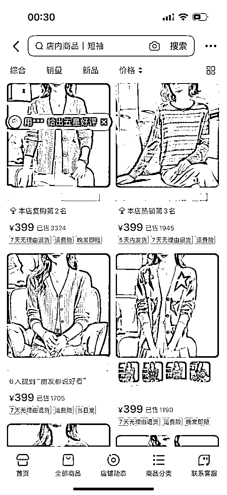
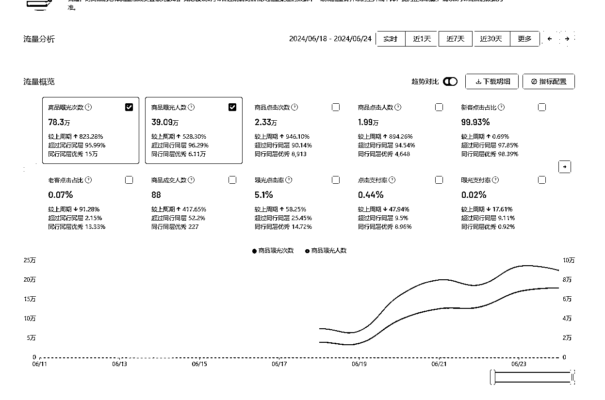
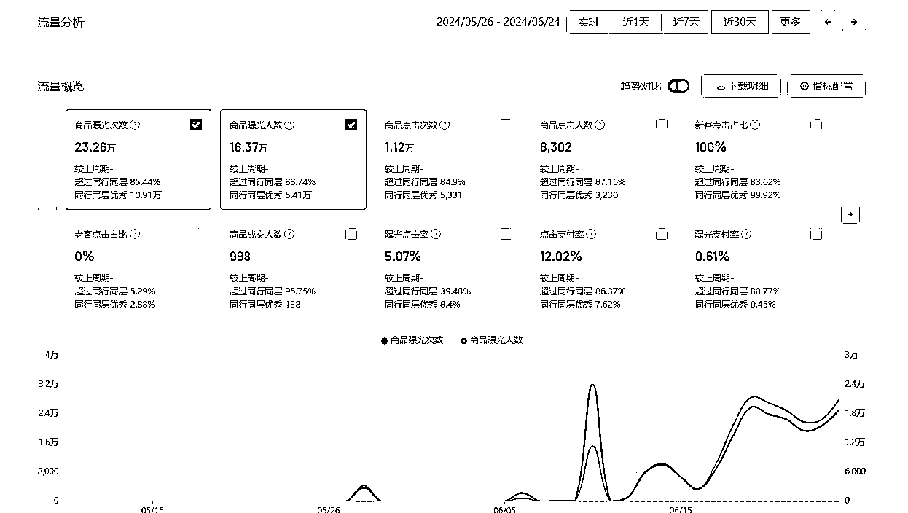
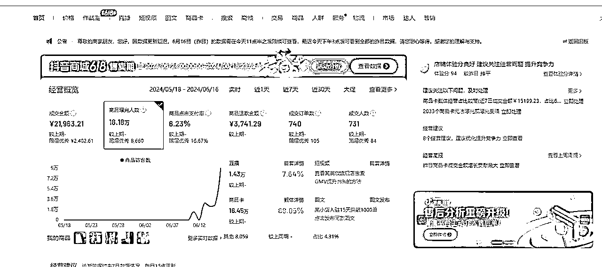
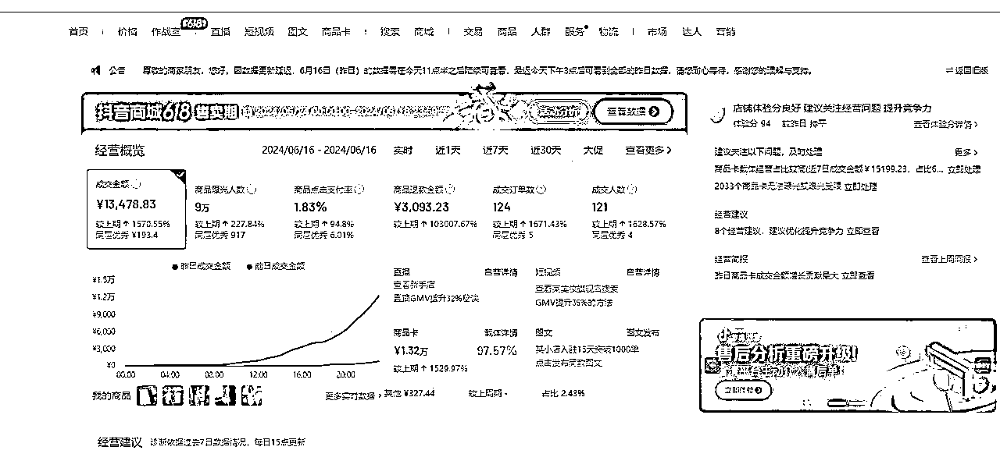

最近很多人问我：短视频流量越来越难抢，直播间投流成本高到离谱，抖音电商现在还有普通人能抓的机会吗？

我的答案是：有，而且可能正处在一波新红利的起点。

先简单介绍一下自己。我做电商已经八年了，现在手里动态运营着50多个抖音店、20多个天猫店、300多个淘宝店铺，每天出货量稳定在1000单以上，月GMV大概三五百万。

听起来好像还挺风光？但我高一就辍学了。第一份工作是送快递，那时候很多老小区没电梯，全靠扛。后来想加盟快递站轻松点，结果太年轻没经验，被坑了十几万。

学历低不好找工作，网上到处投简历，终于有家电商公司收留了我。我从杭州跑去广州，从月薪两三千的客服做起，再到运营、运营负责人，最高一个月拿过十几万。那两年基本每天干到凌晨三四点，睡醒继续干。

后来因为分钱谈不拢，加上家里希望我回杭州，我就出来自己创业了。

经常有人问我：怎么选项目？怎么把一个项目做起来？

我的答案就两条。

第一，能吃苦。我上面这段经历看着像爽文，实际上里面全是说不出口的折磨和煎熬。那时候没人分享经验，全靠自己一点点试错。现在虽然资料多了、教练多了，但没有任何人能替你踩坑。能赚钱的人，没一个是躺着赚的。

第二，会选赛道。我看了很多项目，最后一直以电商为主线。原因很简单：市场空间足够大、能长期积累、可复制放大。电商永远有买卖需求，你的选品能力、供应链资源、店铺管理经验都能沉淀下来，越做越值钱。

回到正题。

上个月生财有术找我聊最近有什么好项目，我说我在做抖音商品卡，现在每天能出10万GMV。他们问我能不能带带大家，我就答应了，于是有了这次航海。

先解释一下商品卡是什么。

商品卡就是在货架场景下展示商品信息的卡片。不需要开直播，也不用发短视频，就能拿到商品搜索和推荐流量。用户点卡片进详情页，下单就算商品卡订单。说白了，就跟你在淘宝、京东上看到的商品卡片差不多。

这次要带大家做的，是抖音小店高客单方向——就是开抖音店，选高客单价的产品，靠商品卡流量把曝光和订单做起来。

为什么现在做这个？

因为直播已经卷到没法看了，商家很难在直播间赚到利润，抖音自己也清楚直播带来的GMV快到天花板了。据我了解到的内外信息，抖音接下来会花很长一段时间调整流量结构，商品卡正好处在这波流量增长的早期。

这个阶段对中小玩家特别友好：自然流量还能“白嫖”，但量还没大到让大玩家眼红进场。

那为什么非要做高客单？

因为低价——我一般把150元以下定义为低价——不管怎么算都是亏的，哪怕你把所有成本压到极致。这是我拿真金白银换来的教训。所以只要店铺起来，必须立刻换高价品。具体原因可以看我之前分享的《我在抖音做小店一年，只看利润不看成本差点亏了》。

有人担心：618刚过，现在不是淡季吗？是不是只能等双十一？

不会。抖音的流量扶持力度很大。

看这个店，正好是618尾声开始起的，没有任何直播，也不靠达人，照样拿到78.3万次曝光，曝光人数39.09万，流量和购买人数一直涨。

选品选得对，页面维护得好，点击支付率能到12.02%。

再看看这两家新店：

6月9日开的店，10日做体验分，13号开始起飞，4天成交2.1万，总曝光人数18.18万。

6月16日当天起的新店，当天成交1.3万，利润率60%。

我能这么快做出来，是因为干这行久了，电商的底层能力都是通用的——选品、供应链、店铺管理、人员配置、平台人脉等等。这行越老越吃香，哪怕平台以后换了，只要你会做店、会选品，到哪儿都能打。

坦白讲，现在这个领域还处于蛮荒状态，不需要多深厚的积累。零基础新手靠执行力，一两个月赚一两千没压力；有点电商经验、执行到位的，赚个几千块也不难。

如果现在有人问我怎么做拼多多、怎么做天猫，我会劝他：没能力没本金就别碰了，你玩不过我们专业的。

但入行，就选相对不卷、门槛低、还有红利的地方。如果你本来就有电商底子，我更建议你做抖音小店。做完你肯定会回来感谢我——到时候记得给我发个大红包。

接下来说说这次航海的门槛：

1. 能接受3万块可能打水漂。拿不出这笔闲置资金，或者接受不了项目亏损的，可以看看其他项目，这都很正常。愿意拿3万块来实战的，恭喜你，已经突破了大部分人做项目的限制。

2. 强执行力。做电商就是苦，但也是市面上少有的、苦吃完真能收成的项目。一分耕耘一分收获。赚不到钱，就是不够努力，没有第二个理由。

3. 心理承受能力强，不怕被骂，不怕负反馈。我说话比较直接，但从不讲假话。行就行，不行就不行。不好好看手册、不听直播的伸手党，真不建议来——我会骂人，不想浪费时间，也不会给你做心理按摩。

4. 有电商经验更好。

生财有术这几年帮了我很多，所以我很乐意来做这次航海教练，回报一下圈子。另外，做电商也需要一个交流氛围，多看看别人的打法、交交朋友，挺有意思。

如果你看到这里，还想再试一次抖音这波风口，请留意生财7月星球报名帖——7月5日到7月9日正式开放报名。

这次限额500人。抖音红利肯定是越来越少的，觉得合适就抓紧报。

想了解更多项目细节的话，下周三（7月3日）会有一场对谈直播，主题是《2024年值得关注的电商新红利》，欢迎大家预约，到时候一起聊聊。

就这样，7月抖音小店（高客单）船上见。