# 23岁赚到100w，做互联网这十几年，我是如何一步一步成长起来的？

标题：从月薪2000到23岁赚到100万：一个“三无青年”在互联网的逆袭复盘

你好，我是铲哥。

我出生在洛阳，一座三线小城。刚出社会时，我也是一个普通的底层打工人，月薪不到2000，生活一眼望到头。没有资源、没有人脉、没有资金，标准的“三无人员”。正因如此，互联网成了我唯一的出路，也彻底改变了我的人生走向。

从一个穷打工的，到赚到人生第一个100万，再到买跑车，这条路我走了十几年。今天我把这段经历掰开揉碎，讲给想在网上找机会的你听。

13岁那年，我对电脑着了迷。别人在QQ农场偷菜，我在偷偷研究编程，目标很简单——成为黑客那样的电脑高手。费了好大劲才把一款中文编程软件装上电脑，写出的第一行“程序”特别蠢：点一下按钮，弹出“你好”两个字。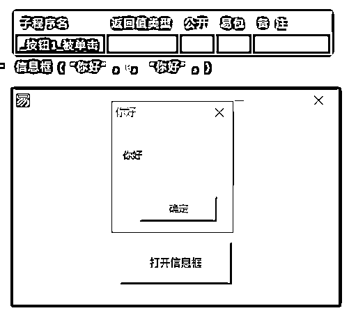但就这么点即时反馈，却让我兴奋了很久，也让我从此养成了一个习惯：做任何事，先想办法快速拿到正反馈。比如做项目，先闷头做出第一单，先赚到第一块钱。很多人做项目连一周都坚持不了，就开始怀疑方向、怀疑行业，最后草草收场。不是项目不行，是你没有给自己制造持续的正反馈。

17岁那年，我拿到了全国网络安全年度贡献银牌。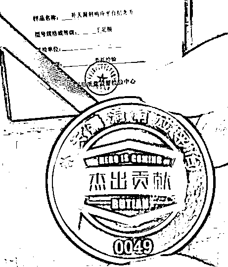奖牌有了，但我越来越清楚，光靠兴趣和埋头努力，撑不起更大的梦想。从那时起，我开始认真思考怎么靠互联网赚钱。后来用了整整4年，我才真正懂了一句话：方向大于努力。

18岁，我靠“自媒体+私域”赚到第一桶金。那时候做头条号，有两条路摆在面前：一是靠内容赚播放分红，二是卖产品和服务赚用户的钱。前者要持续产出内容，太累；后者同样花时间，回报却更高。我毫不犹豫选了后者。做什么，其实比做多少更重要。

但卖什么？流量从哪来？这两个问题必须解决。当时知识付费还不流行，没人手把手教我，我就自己去找“参考答案”。我疯狂刷头条文章，不是真的看内容，而是看这个账号发了几篇、数据怎么样、有没有留引流信息。有的话，我就把自己当成客户，加过去咨询对方。就这么一个简单动作，我挖出了几十个拿到结果的对标账号。

互联网上赚钱，其实就是一场开卷考试，很多答案早就摊开了。你要做的，是找到优秀同行，然后抄他们的作业。我一直觉得，最好的学习不是报课，而是拆解同行，你的对手就是你最好的老师。当然，光找到还不行，得挑自己打得过的对手。我当时既没资金也没经验，实体产品直接舍弃，需要专业技能的也先放一边。选来选去，我锁定了卖PPT模板。

为什么是它？因为快到年底了，很多人要做年终总结，又做不出好看的PPT，这是刚需。而且虚拟产品不用发货，卖一单就赚一单，正反馈来得特别快。为了验证需求，我又去头条搜了一圈“PPT模板”，发现同行数据都不错，评论区一堆人求模板。既然人家已经验证好了，我就不客气了，直接拿来主义，模仿加优化。

第一篇内容发布后，运气很好，爆了。区区几万播放，放到现在不算什么，但平台会把内容推给最精准的人，这一下就给我引来了几千个精准🛰️好友。后台消息每天99+，私信多到页面卡死。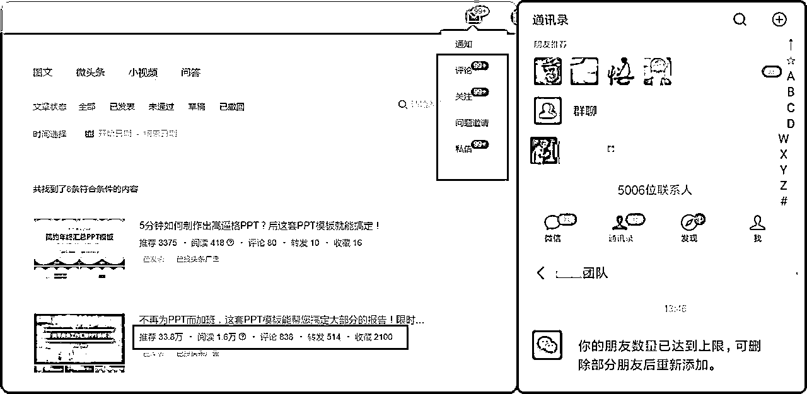

为什么爆？我研究过那些做得早的账号，他们都会在文末放个钩子：点赞+评论+私信关键词，免费领PPT模板。这个小动作能让互动率飙升，系统一看互动好，就会继续推给新人，新人再互动，雪球越滚越大。到这一步，项目的最小MVP算是跑通了。

但我没敢小富即安。太多人跑通一个项目就停在那里，结果只能赚点小钱。一个账号的流量和收益终究有限，我想的是复制和放大。因为以前学过编程，我写了一个批量生成PPT模板缩略图的工具。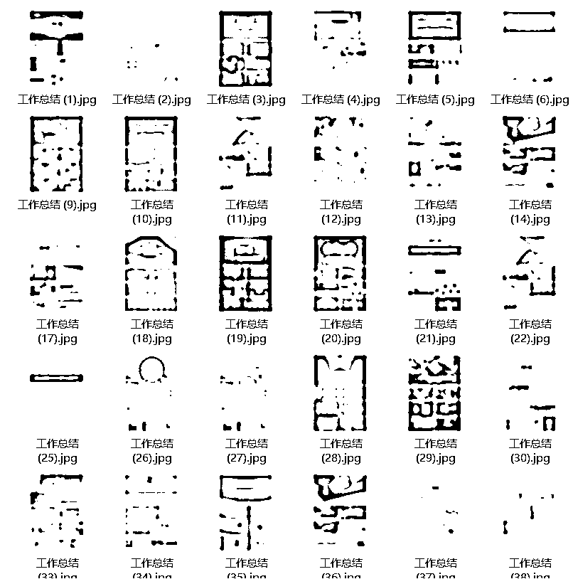每10张缩略图发一篇图文，标题全部带上关键词，提升推荐的精准度。文章结构也不复杂，就是痛点→解法→钩子。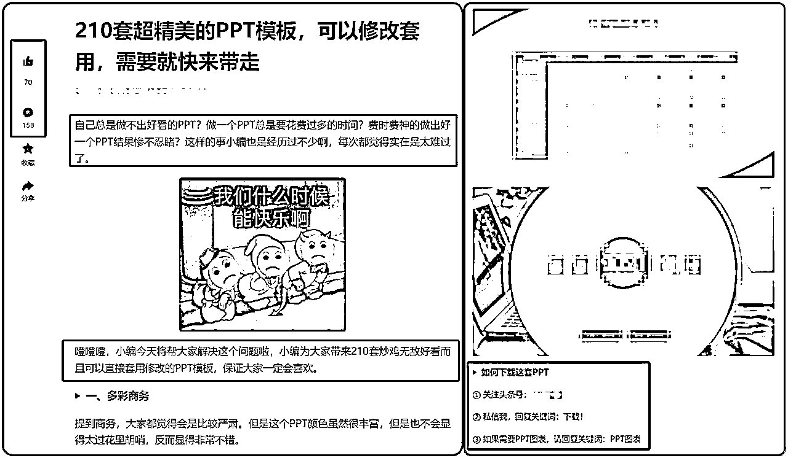这个玩法直到现在都没过时，抖音、📕上到处都是“评论区回复关键词领取资料”的内容。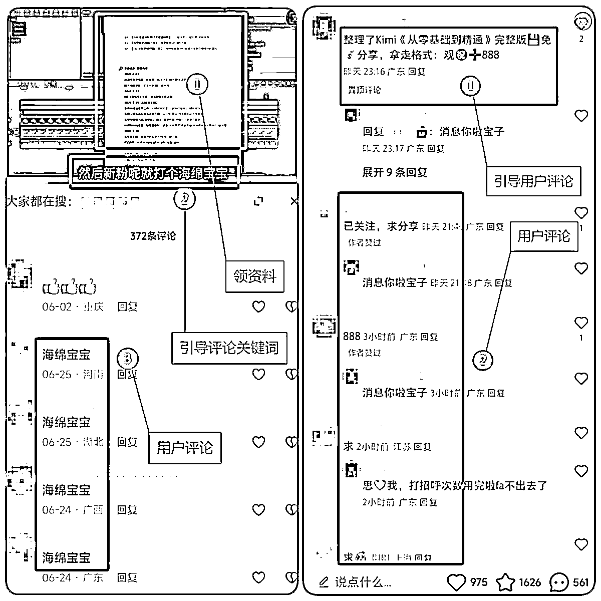万变不离其宗，就算平台规则变了，去找新同行再模仿一遍就好。

后来我发现，只卖资料没什么竞争力，前一秒是客户，后一秒就可能变成同行。于是我又搞了一个小软件，可以直接预览每套模板里面长什么样。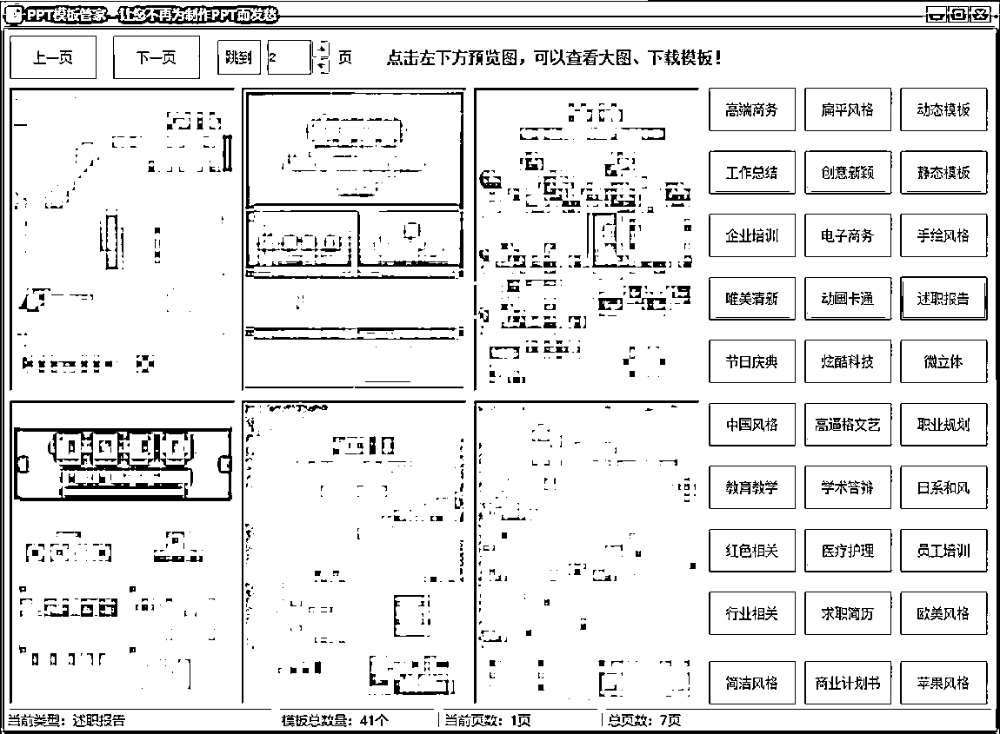用户再也不用面对几千个压缩包发愁，能一眼找到自己最喜欢的那一套，自然更愿意付费。同样卖PPT模板，别人卖9.9元，我卖39.9元，销量还比他们好。因为产品的价格，取决于它在用户心里的价值。我不只会写软件，更懂得站到用户那边去解决问题。

有朋友问，我不会编程怎么办？很简单，跳过这个问题，花钱找会编程的人帮你。高手从来不是看自己手里有什么，而是看做成这件事需要什么，然后去链接人和资源。很多时候，你不需要多厉害，只要比同行强一点点就够了。实践出真知，就像有些抖音直播间平均在线只有几十人，一个月却能卖出几百万的货。看到这类被忽视的玩法，别急着划走，想一想：他们都能赚钱，我优化一下是不是赚更多？

再往后，我学会了举一反三。PPT模板能这么玩，其他领域当然也能。我见过一个做手绘头像定制的账号，套路和我几乎一模一样，难吗？一点不难，可就是赚钱。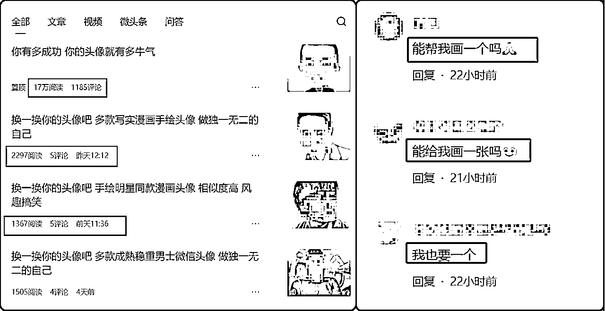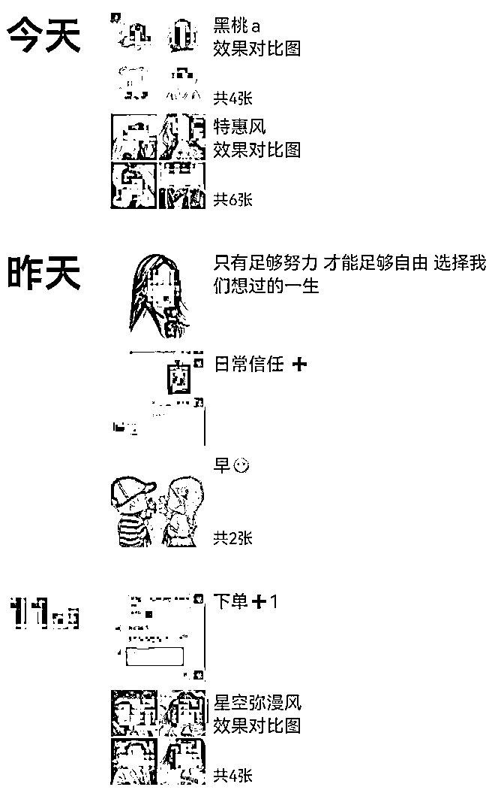我说这些，不是劝你去做PPT或者手绘头像，而是希望你能刻意练就一双发现小项目的眼睛，瞄准了就直接下场干。以前我可能看不上这种玩法，做多了才明白，大道至简，赚钱本来就是一件简单的事。如果觉得复杂，可能是方法还不够好。

后来因为版权风险，这个PPT项目就停了，但它让我悟到了互联网最基础的赚钱公式：需求（问题）→ 流量（内容）→ 产品（万物皆可卖）= 转化。简单说，就是找到一群人遇到的问题，用内容吸引他们，再卖给他们对应的产品或服务。靠这个项目，我赚到了第一桶金，也买了人生第一辆车。车不贵，但那种自己挣来的感觉，真的很奇妙。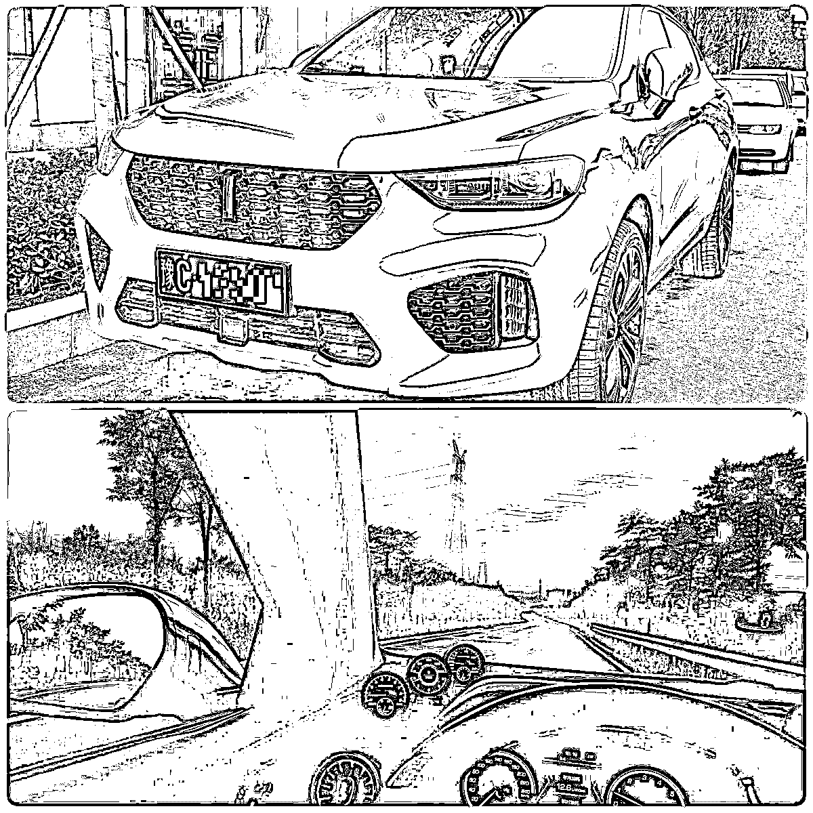

23岁那年，我靠开发视频批量剪辑软件，赚到了第一个100万。

很多人说自己迷茫，其实是因为目标太模糊，既想做这个又想做那个，最后只能在刷手机里浪费时间。人生目标不是一开始就摆在那里的，它靠的是不断试错、不断消除模糊。只要试错成本可控，就赶紧去试，试着试着路就出来了。

我当时做图文引流，发现图文越来越卷，就转去做视频。为了提高效率，我给自己开发了一个批量剪辑的小工具。工具做出来后我就在想：我有这个需求，别人是不是也有？为了验证，我第一件事还是找对标，把市面上能找到的批量剪辑软件全部买回来，逐个体验，去粗取精，最后做出了功能相当全面的视频批量剪辑大师。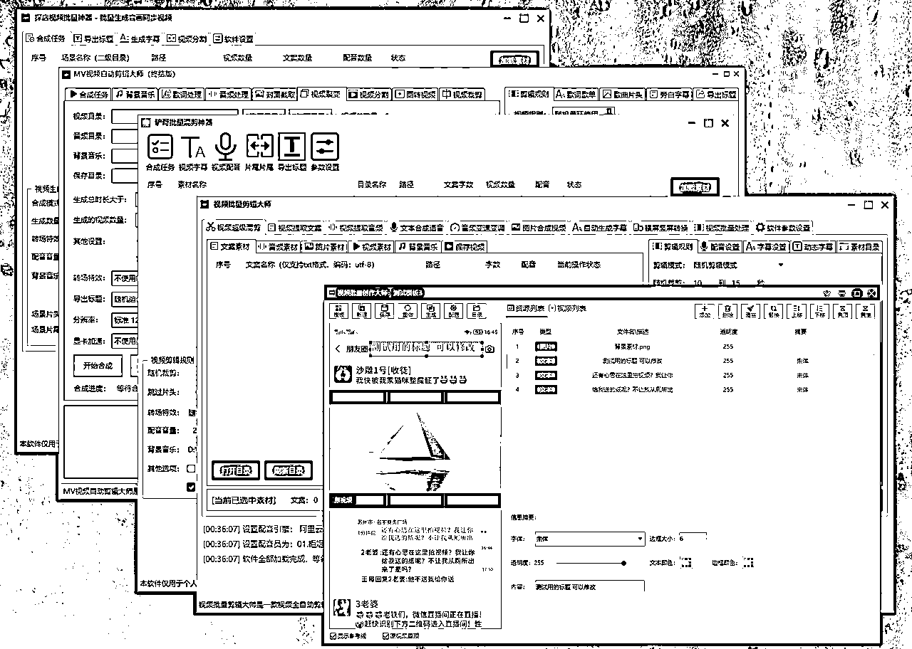后来咨询的人越来越多，我又根据用户反馈，陆续开发了多款同类软件。这里提醒一下：这些软件早就停售了，市面上流传的破解版可能有风险。如果你有需要，可以用我后来做的免费版“铲哥批量剪辑神器”。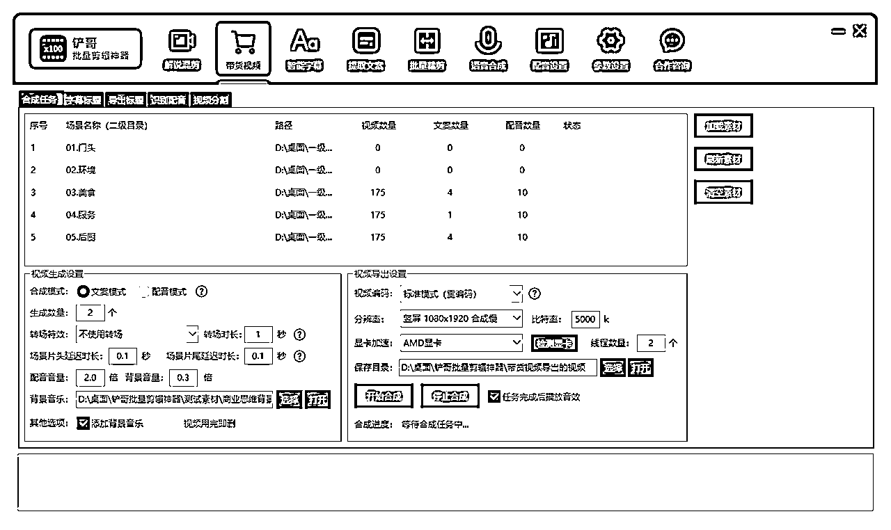

验证需求还有个笨办法：在各大平台搜索框输入“批量剪辑”，看有没有下拉词。我试了，结果证明这需求是真的大。赚钱，就是在生活里发现问题，然后创造一种产品去解决它。

产品有了，怎么卖？我还是用老办法：做内容，全网分发。引流本质上没那么复杂，就是把简单的动作重复做，重复的事情认真做。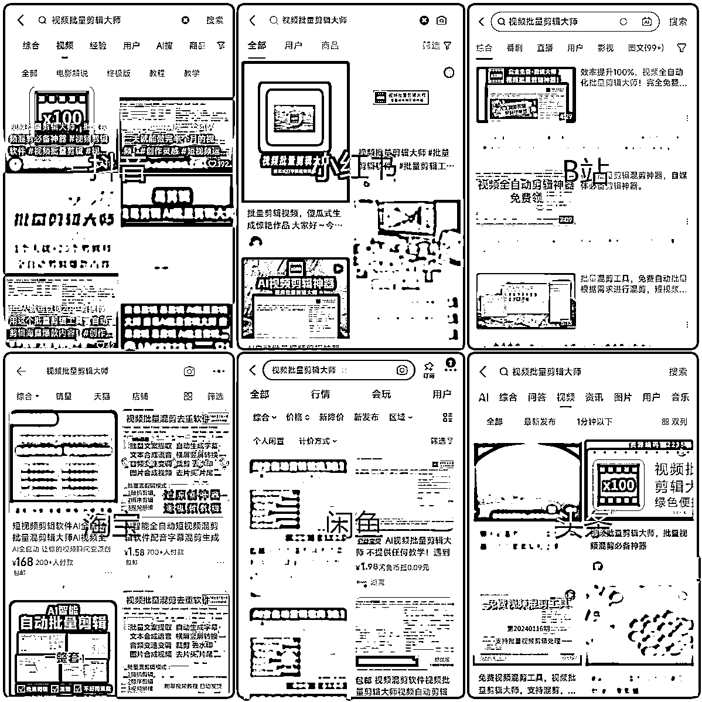

但真正让我赚到大钱的，是接下来的操作。一个人又要开发、又要做内容、又要当客服、又要管售后，精力太有限了。想放大，必须借力杠杆。我把整套流程整理成SOP，做了一张简单的海报发到朋友圈，开始招代理。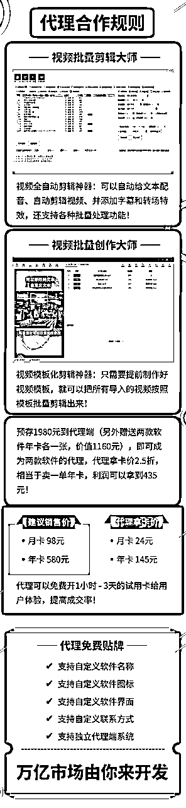很多老客户，就此变成了我的合作伙伴。我负责写软件、维护和解决难题，代理负责引流和销售，合作双赢。同样卖软件，成百上千的人帮我卖，相当于成百上千的人帮我赚钱。

常见的杠杆有几种：劳动力杠杆，就是招人、招代理，让别人替你干活；自媒体杠杆，靠内容无限放大影响力；产品杠杆，做复制边际成本几乎为零的软件、教程、版权；资金杠杆，投广告、花钱买流量。想赚大钱，就要学会组合使用这些杠杆。

那一年，我硬是招了上百名代理，睡觉都有收入。为了犒劳自己，我买了一辆smart敞篷送给女友，给自己买了一辆杜卡迪街霸。见过太多人只赚钱不花钱，其实20岁想要的东西，30岁再拥有，早就没了当年的心动。在合适的年纪赚到合适的钱，才是幸福。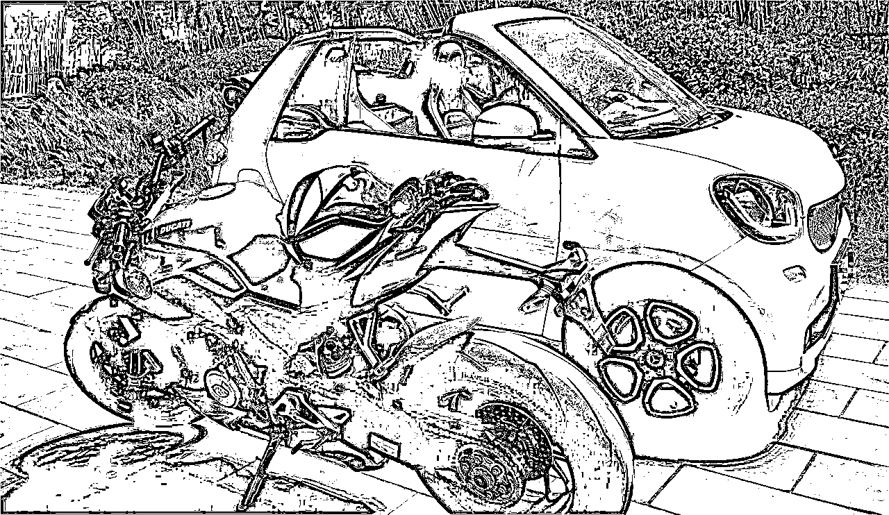

再后来，做自媒体的人越来越多，我因为手里有实战经验，顺势切入了自媒体培训，算是踩中了一波风口。但风口永远留给有准备的人。当时很多培训机构收钱后只丢给你一堆资料，用户根本落不了地。我就想做点不一样的，搞了一个7天实战营，以实战为主，理论为辅。第一次做没有对标，就只能摸着石头过河，把已经跑通的玩法录成教程，然后发布招募。

我还做了一个当时同行不敢做的决定：先带后收费。学员交100块押金进营，结营后不满意就退款。因为门槛低、又有承诺，第一次就招了上百人。后来这种押金打卡模式被很多个人IP学去，演化出了各种版本。门槛不是拦路虎，恰恰是筛选用户最有效的方式，交了钱的人才会重视。

7天实战营的交付流程，我大概是这么设计的：1.收押金后，告诉学员开营时间、需要准备什么；2.建群，让大家改好群昵称和资料，发群公告讲清楚这个群是干嘛的；3.开营前一天把所有付费用户拉进群；4.发操作教程，让用户学完做出3个成品视频并发布；5.后5天每天发布实操任务，遇到问题远程一对一指导；6.最后一天发转化文案，愿意继续的付尾款，不继续的退押金。整个过程没有奇淫技巧，只有实战和真诚。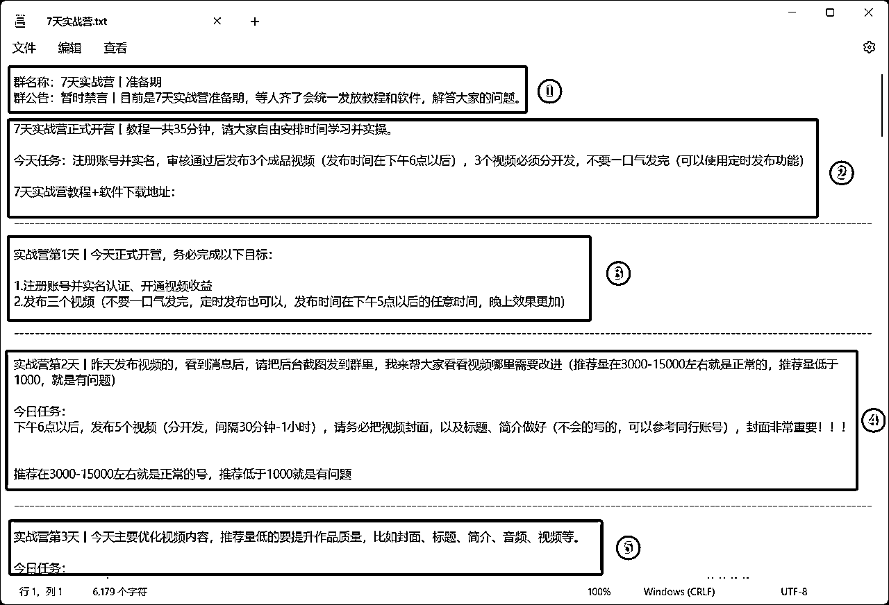

我还体会到一件事：厉害的人，都在做资源整合。跑通闭环后，我决定用直播引流扩大规模。但摆在面前有两个选择：自己招主播培养，或者找现成的直播博主合作。时间就是金钱，等我培养好主播，市场可能都饱和了，专业的事还是交给专业的人。于是我去找了一家专门做自媒体培训的直播公司，他们有专业的直播团队和后端交付，我手里有跑通的项目和配套软件，双方一拍即合。后来做的人太多，项目收益下滑，就停掉了。但这个经历让我明白：不要给自己设限，万物皆可为我所用。发现机会时，不一定非要从0开始攒，去找到匹配的人合作，才是最快的路。

最后，我想对你说：你想要什么样的生活，由你自己决定。哪怕现在是三无人员，也别认命。命运这东西，只要你不松手，它就一直握在自己手里。只要开始，永远都不晚。

任何让人艳羡的成绩，本质上都始于一次不退缩的迈步。第一桶金到手的那100万，对我而言只是个路标，后续换上保时捷718，把小时候的跑车梦真正落地。总结下来，唯一的共通点就四个字：先做再说。

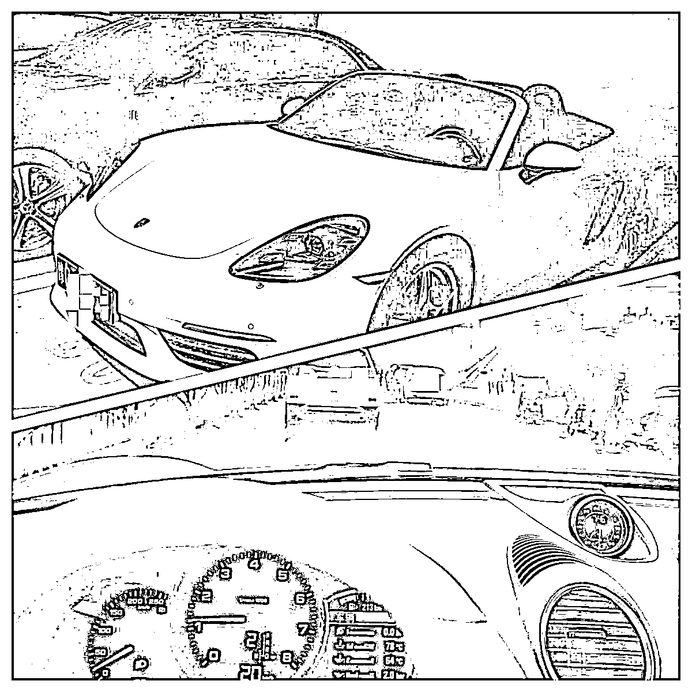

### 关于未来，我的看法

红利是跟着时代走的。曾经是电商风口，紧接着是自媒体爆发，现在轮到了短视频和直播。

往后看，最大的一块蛋糕几乎可以肯定是AI+各行各业。人机融合已经渗透到生活的每个角落，几乎所有赛道都值得用人工智能重新梳理一遍。

能先发现痛点，并用AI给出解决方案的人，就能卡位这波浪潮。

那如果不做AI，普通人还有机会吗？

答案是超级个体。表达的价值不会消失，每个人都有机会成为某个领域的发声者。挑准一个赛道，用三五年的时间持续钻研，熬成真正的行家，找到那个最能代表你的核心竞争力，再把这点优势无限放大。

看完的朋友，感谢你的时间，我是铲哥，跨行业交流欢迎加我个人🛰️：zmt663

铲哥个人介绍：

全国网络安全银牌获得者

互联网百科全书，拥有10年互联网实战经验

视频批量剪辑大师，多款工具软件的开发者