# 双人实操，一个月做到百万流水的内容型直播复盘

大家好，我是龙哥。今天把我们团队过去一年跑通的项目拿出来细聊，也跟大家做个交流。我们用 2 个人，把内容型直播做到单月 100W+ 的营收。

# 项目经历

21 年我开始在抖音做直播带货，玩过纯免费流、憋单低价拉高价、AB 链路等各种打法，几乎每种形态的间都试过。

22 年下半年我切到园艺用品赛道，当时免费自然流正被千川抢食，我们被卡在流量池里。出于无奈开始投流，全变成了付费间，ROI 能做到 3-4，撑了半年也赚了钱。那会觉得付费就是香。

但行情不会一直好。23 年年后 ROI 断崖式下跌，换了好几个品，ROI 长期被压在 1.8-2.5 之间，GMV 看着还行，利润从之前的 20-30% 直接掉到 5-10%。23 年 3-6 月项目基本不赚钱。

正好看到盗坤哥的一篇文章说付费是慢性毒药。确实，付费虽然简单，却是给平台打工，投放团队核心是压成本，本身没有做内容的能力。于是 23 年 7 月我把公司的付费间全部停掉。

23 年 7 月重新回到免费流项目。我做了个梳理，把百货和食品里月销 10 万以上的商品链接全部过一遍，用蝉妈妈把链接逐个筛，找到近一个月才起号、免费流在线还不错的间。

最后锁定一个近期起量的间，首月销售额破 100W+，毛利 40%，用的还是精选联盟发货。模式很清晰：前段做知识沉淀留人，后段成交，单品打爆。研究完对标后到 10 月份，我也把自己间做到单月 100W。后来我陆续发现很多类似的间，我给这种形态统一命名为内容型直播。

# 什么是内容型电商直播间

简单说，通过内容把人吸引进来并留住的直播间，都算内容型。

比如唱歌跳舞、讲干货知识、刘畊宏式的有氧健身、中老年拍打操/八段锦、家庭教育/法律在线答疑、导游云逛景的间比比皆是。

内容型电商直播间则是用内容把用户吸进来、增加停留互动、建立信任，最后完成转化的间。我做的就是养胃知识分享 + 带货，属于大健康赛道。

在抖音、视频号、📕这类内容平台上，拿流量无非两条路：用优质内容帮平台提升留存和营收，系统给你免费用量；或者直接花钱买量。

内容型直播还有一个进阶形态——类目 IP 间。

下面是部分内容型直播的案例，分真人出镜和非真人出镜两种形式。

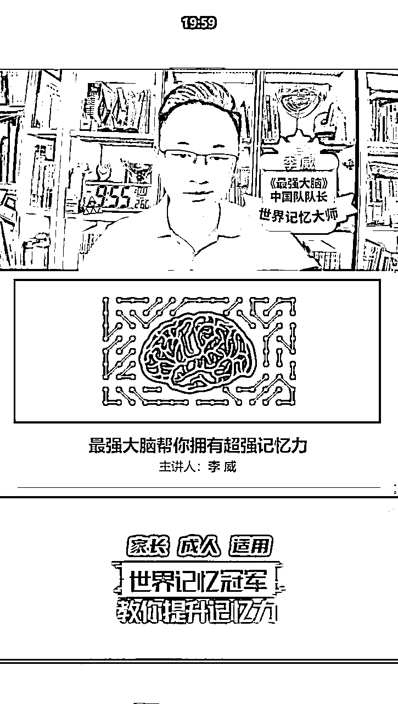

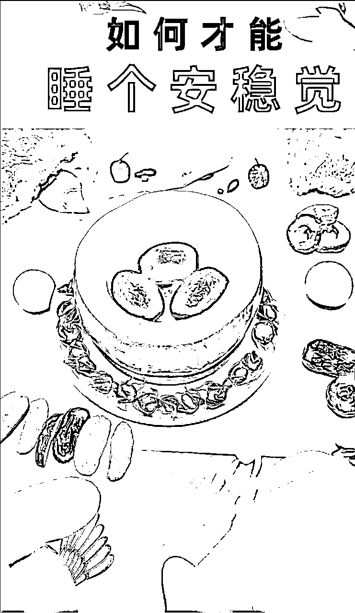

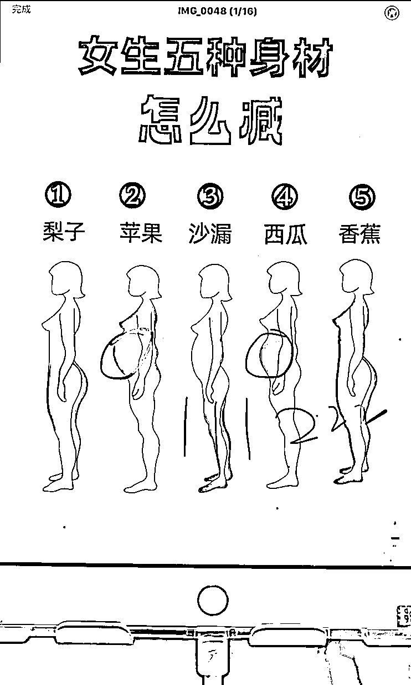

我做的养胃间，养胃赛道同样有真人出镜和非真人出镜两个分支。

# 实际成绩

这是我们直播间的真实数据，前期是纯免费流，后期是免费流为主 + 约 30% 的付费补充。

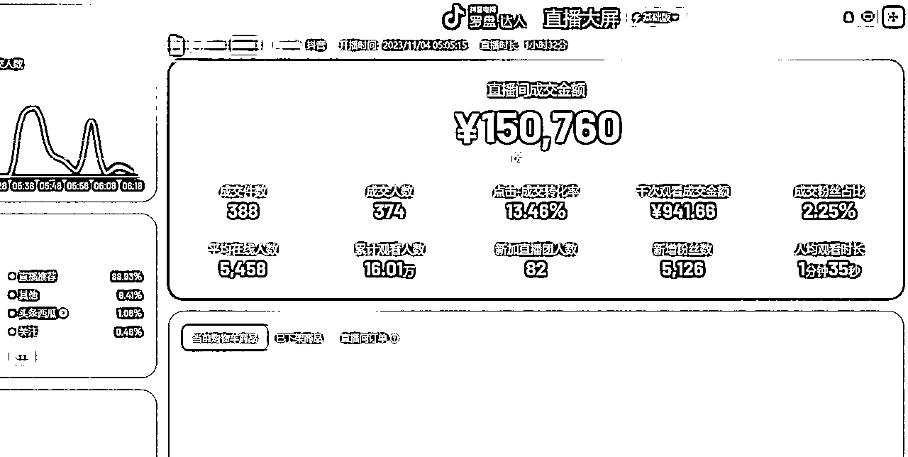

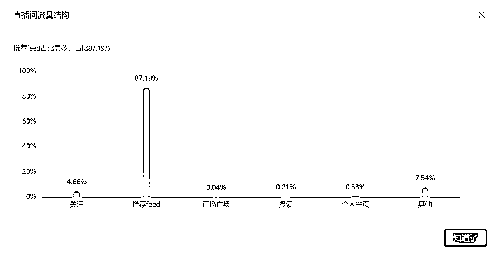

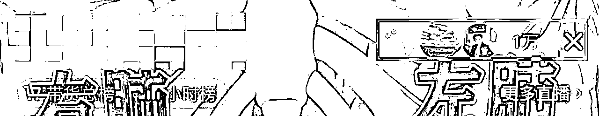

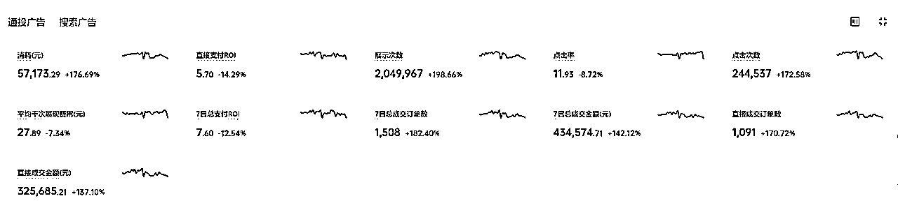

# 玩法拆解

内容型电商直播间的底层逻辑大同小异：用内容把停留和互动拉起来，触发系统免费推送，冲破流量池。正常开播极速流在线就能破 3000 人；服饰美妆健身等大类目能做到 3-4 万在线，养胃赛道我们最高做到 1.8 万在线。

人多了以后，前半小时讲干货，后半段开始卖货，等在线掉到几百人就收工。这类间普遍直播时长在 1-2.5 小时，1 个主播 + 1 个运营就能同时带 2 个间。

变现路径：直接起号起盘。起号期先用知识留人，把浅层数据做上去，极速流拉高后，前讲后卖。商品优先选精选联盟的爆款，对性价比要求不高，核心是品要好。

# 项目拆解：GMV = 流量 × 转化

## 一、流量端

1、内容型间吃的就是极速流的高在线和开播前半小时的推量。所以核心任务是把极速流的在线人数拉上去。这里放一下起号期的在线变化、互动关注数据变化。

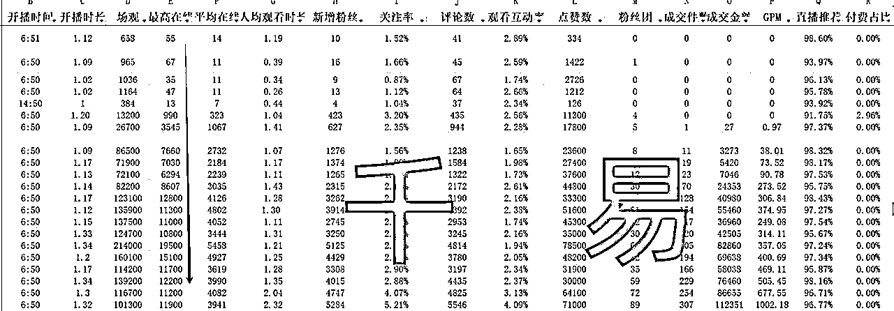

2、抖音推流靠标签算法 + 流量池算法，想把极速流做大，就要在间里打上浅层数据标签：停留时长、评论、关注等，且要比同行做得更好，系统才会给更大的推荐。

3、极速流是抖音的预分配流量，预分配层级参考的是过去 1-3 场的实时表现。想要预分配变高，就需要在上一场把在线做上去，卡在黄线附近下播。

4、抖音流量分配是赛马制的流量池机制，阈值大概是 30 人、60 人、80 人、120 人、180 人、230 人、260 人、1000 人、3000 人、6000 人、10000 人、13000 人、15000 人、18000 人、21000 人、30000 人。破一个层级就能拿到下一层级的人量。

5、这类间一定要用新号起，平台会给扶持。新号能跳层级，比如从 120 人直接跳到 1000 人，老号只能一级一级打。

6、核心是爆款内容。没有爆款内容就拉不起停留和互动，在线也上不去。

7、流量来自内容，内容必须兼顾干货 + 互动引导。话术节奏是 知识 + 互动 + 知识 + 互动，像老师上课一样边讲边提问，调动情绪。

8、直播间的视觉系统也是内容的一部分：背景、贴纸、文字、配色、主播形象、服化道、摆件、整体氛围全都算。养胃客群偏中老年，主播要是 20 多岁的小姑娘，基本留不住。

9、新手建议优先做非真人出镜，变量少，成功率更高。真人出镜则要匹配合适的形象。

## 二、转化端

1、人足够多基本就能卖出去，但转化率会差很多。

2、影响转化的两大因素：从内容到卖货的承接话术、产品本身是不是爆品。

3、前 20 分钟讲知识做清洗和信任背书，中间 10 分钟要从知识无缝切到产品，衔接别扭就会掉人。

4、品必须是大众爆品，能让上千人停留同时下单。同样是养胃间，卖驼奶粉一场能做 10W+，卖养胃中草药包只能做 2.5W。

5、客单别太低。内容留下来的人心智较精准，中高客单也能转。常规建议客单价 100 左右，有痛点有功效的 200 左右。

6、我们养胃间匹配的是驼奶粉，298 买一送一，894 买三送四，1799 买六送九，还配礼品袋、燕麦饼干、试喝装。起量期达人佣金 40%，起量后提到 50%。

7、卖货时的规格和价格组合要做出福利感。

8、品要有背书：明星代言、XX 院研发、专利配方、防伪码、质检报告、网红同款，都加分。

9、直播中多次逼单促单，能有效提升转化。

## 总结

内容型电商直播的流程：内容留人拉高极速流 + 产品完成转化

核心要素：爆款内容 + 爆款产品 + 人群匹配

难点：主播个人特质 + 话术衔接

利润测算 = （销售额-退款退货）× 佣金率 × 0.9（扣 10% 技术服务费）- 投流费用（可能为 0）

# 项目准备

## 一、团队配置

1、先确定形式。非真人出镜对主播要求低，普通话清晰即可。真人出镜则对形象和特质要求高。

2、主播。要找年龄、气质、风格与对标间相似、与目标人群同频的人。最好有免费流拉流能力，懂抖音逻辑，会做数据；能讲专业知识最佳，比如养生间主播最好是营养师背景。

3、运营。需有 1 年以上自然流运营经验，懂起号、话术、场景搭建，有成功案例，熟悉算法，能拆解对标，能在线盯盘快速解决问题。

重点：内容型直播对运营和主播能力要求偏高。

## 二、账号准备

1、备 2-3 个全新抖音号，养号 3 天正常刷内容。

2、新号需要涨到 1000 粉，不能互粉互赞。

3、完成实名认证，开通电商橱窗、直播伴侣、信用分、经营护航考试。

4、开播前两天完善头像、昵称、签名、背景图。

5、联系精选商家开通定向高佣并加入选品车。

# 三、非真人直播间准备

1、准备图片背景或用 iPad 展示。

2、手机直播即可，建议 iPhone 12 以上 + 水冷散热 + 充电线 + 支架。

3、准备样品、资质图、话术脚本，非真人可以照读。

4、运营用一台电脑后台盯盘、控弹幕、上架商品。

5、灯光 2 个，金贝 220BI。

6、手机用流量卡，需大流量套餐。

## 四、真人直播间准备

1、直播电脑一台，i5/i7 12 代以上，显卡 3060 以上。

2、摄像头：索尼 ZVE10 / A7M4 + 适马镜头。

3、采集卡：美乐威或圆钢。

4、声卡：IXI 或 icon，我用 IXI。

5、麦克风：电容麦或罗德无线麦。

6、显示器：主播用 50 寸小米电视，运营用普通显示器。

7、灯光：3-4 盏金贝 + 柔光罩。

8、背景：实景布置、喷绘布或绿幕抠图三选一。

9、软件：OBS + 直播伴侣。

10、主播看播手机一台。

11、调音需专业调音师处理麦克风 + 声卡。

12、场地 20 平以上，30 平左右最佳。

13、知识讲解类可配多媒体一体机，我用的是 JAV。

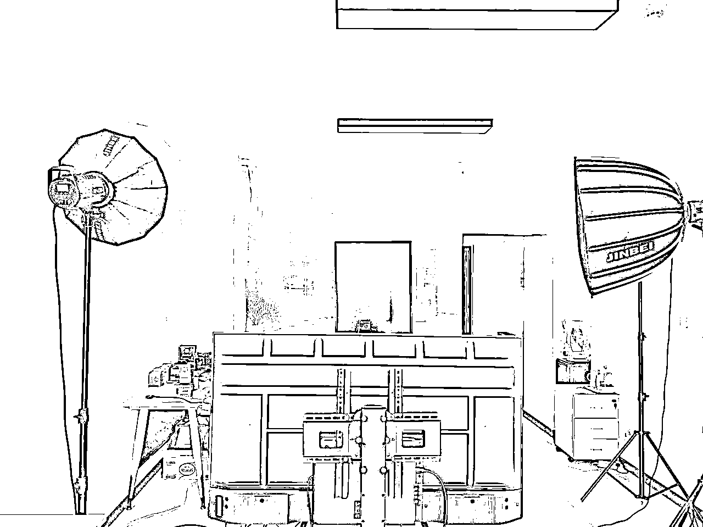

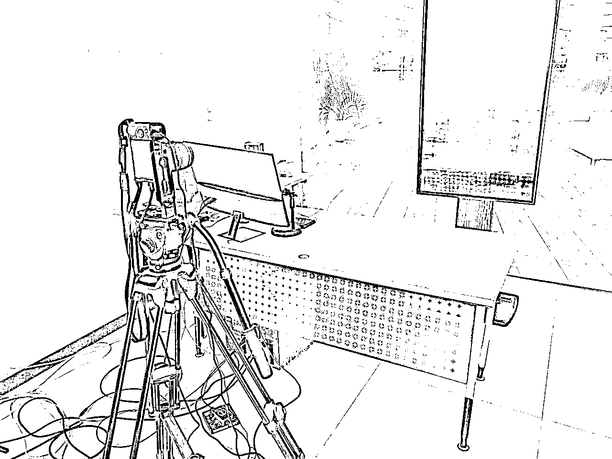

投入参考：非真人间 5000-1W 可起步，真人间全新设备 4W+。前期可租设备。新手建议先从非真人做起。

# 实操流程

## 一、找对标

1、用蝉妈妈看领域内达人账号，按佣金从高到低排，筛粉丝 0-10 万的间，找到对标。

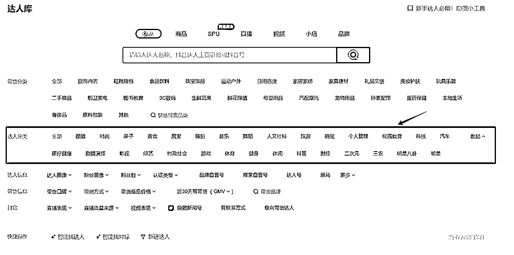

2、通过商品详情页看类目产品，逐个链接往下看，找内容型间。特征是客单价 50 元以上，看近 30 天数据。

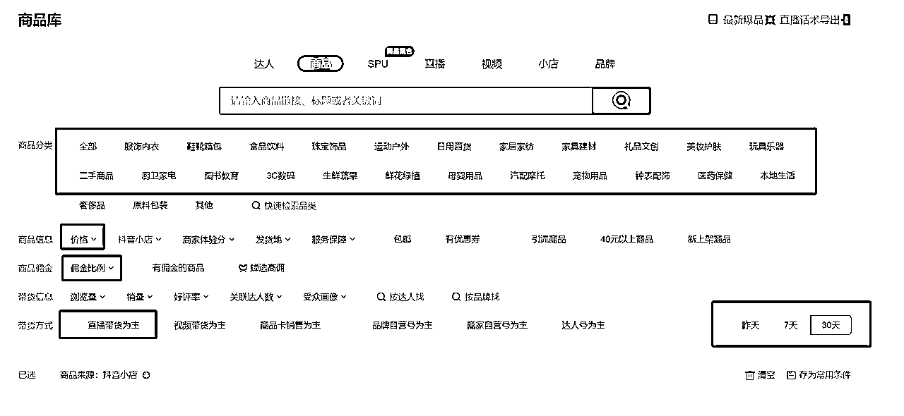

3、用抖音关键词搜索同类内容，主动关注评论互动，系统会推更多同类间。关键词可用巨量算数辅助。

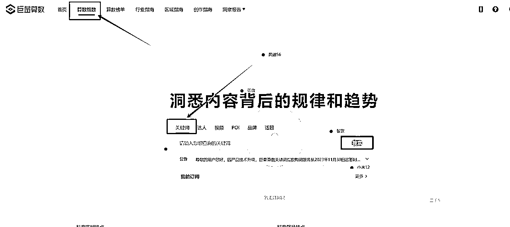

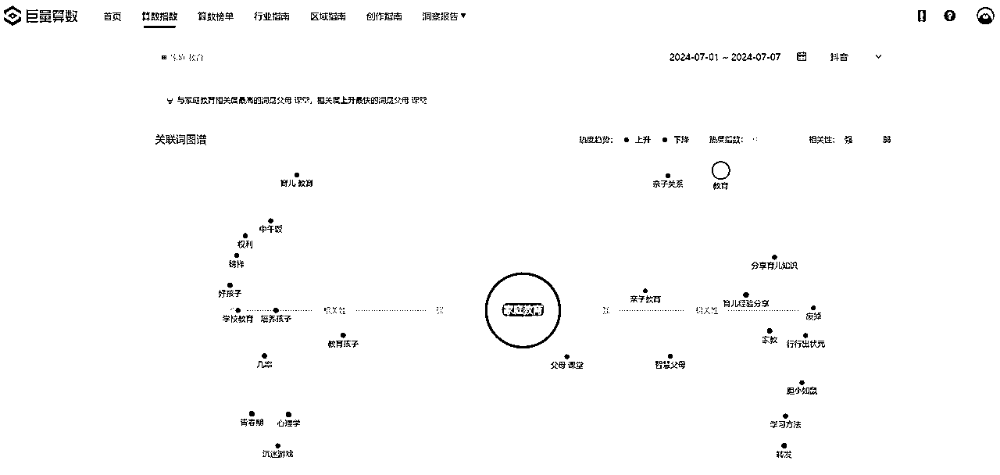

## 二、对标判断

1、要选近期起量的对标。内容有生命周期，爆款十天半月就凉。内容型非 IP 间存活周期约 1 年。看头部账号做了多久，以及赛道有多少同行。

养胃间我刚做时同行 4 个，到今年 3 月已 300+，但 80% 盈利的是年前起的。先发优势明显。竞争太激烈就换赛道，比如有氧健身近 3 个月已无新号月销 100W。

2、确定一个标后，把全赛道的标都看一遍，区分真人/非真人。先选非真人 1:1 模仿，成功率更高。

赛道竞争到一定阶段，非真人很难起新号，老号还能活。非真人不行时立刻转真人，真人存活周期更长。我做养胃真人晚了，第一波红利被吃掉，对方单月 GMV 300W 持续 2 个多月。

## 三、拆解模仿

1、找到标后，用录屏软件把画面场景、话术全录下来，1:1 复刻，主播背熟话术直接开播。

2、运营从商家端扒同行的所有直播数据，整理成表。起号时要把停留、互动、关注、转化率、GPM 等数据做到比对标更好，才能破池。

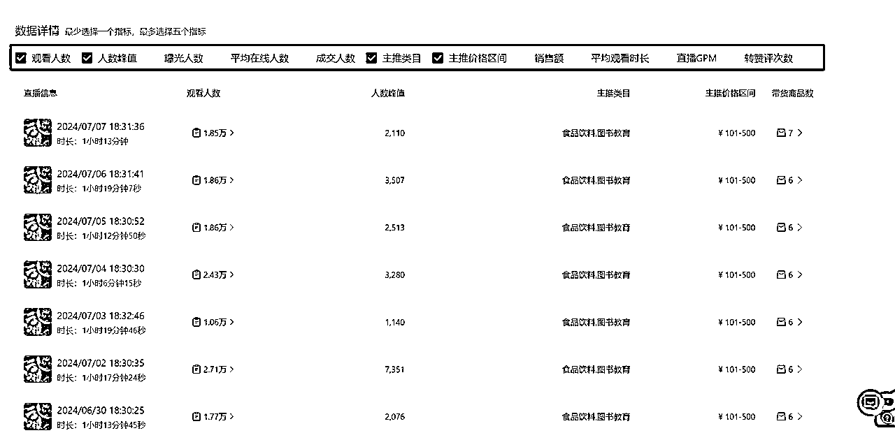

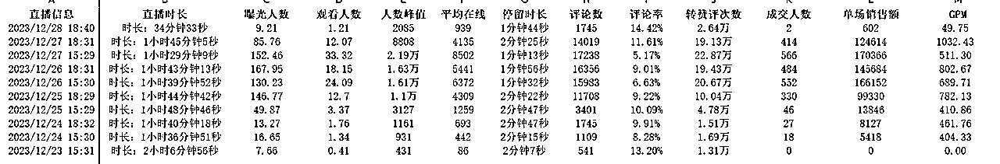

## 四、起号流程

准备就绪后开播，0-1 是最难的阶段，需要同时做精准标签和拉流，极速流目标是 3000 人在线以上。通用起号节奏如下：

PS：去年数据无截图，现用蝉妈妈图替代，数据有偏差。

1、第一阶段：破风控。刚开播 1 小时场观 200-500 正常，前几场曝光点击率会 >30%，说明在风控，不推真人。主播正常播 1 小时几分钟下，不卖货。运营每 10 分钟一波福袋。

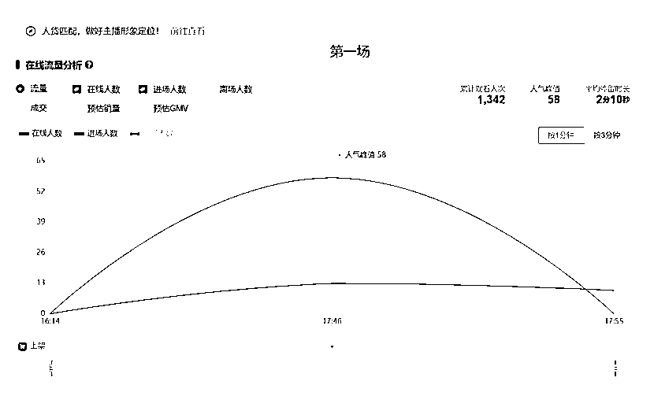

2、第二阶段：拉流。开始有真人互动停留后，进入拉流期。主播按话术节点引导评论关注点赞。运营每 10 分钟发福袋，盯后台：曝光点击率 10-20%，直播推荐占比 >70%，优秀接近 90%，停留 >1 分钟，互动关注达到同行水平。

直播时长 1-2 小时，在线持续上升即在破池，直到在线下滑卡黄线下播。若一场的实时推流在线能过 100 人，第二场极速流基本就能到 100 人。

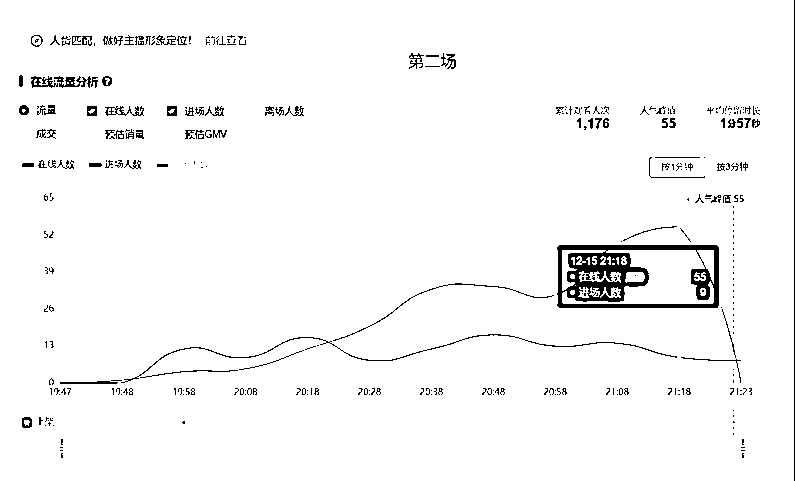

3、第三阶段：拉高在线。当开播极速流稳定过 100 人时，重点承接。按对标前 10 分钟话术留人，留住才不会掉。过极速流后正常操作，争取破 260 人，进入 1000 人层级。数据好时会连破层级，主播要会做数据承接。待在线下滑数据做够后卡黄线下播。

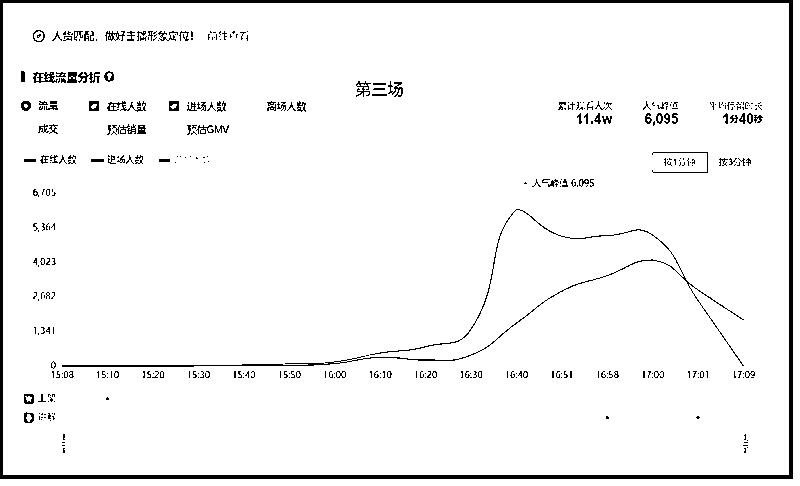

4、第四阶段：极速流破 3000 人卖货。开播能破 3000 人时本场开始成交。前面做浅层数据，现在做深层成交。

看到破 3000 人后切换话术：前讲知识后卖货。卖货时机看前 30 分钟浅层数据是否到位，有时要讲到 50 分钟。节奏由运营把控。

浅层没到位就卖货，下场极速流会掉层。成败在这一两天。

承接成功，极速流稳定在 3000-10000 人，每场都能正常卖货。承接失败会掉回 1000 人，需重复拉流；拉不上去会掉到 260 人，基本就没救，换号。

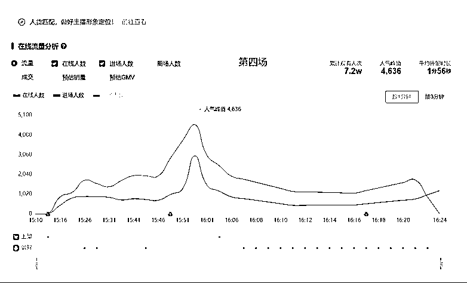

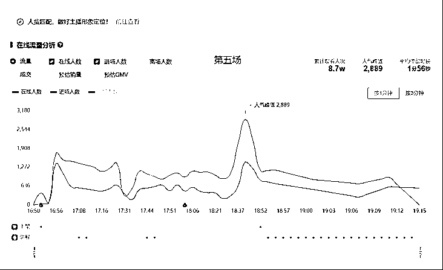

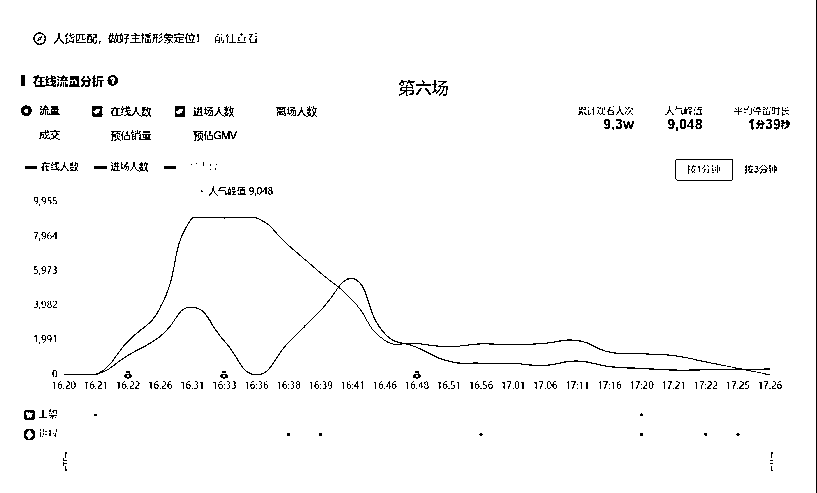

5、下播后分钟级复盘。主播运营复盘全场，调整话术、逻辑、表现、运营配合，并把同行间录下来对比。找到问题快速改，不断优化。

抖音的主播和运营配合是经验活，必须有经验的运营带主播。我说的只是框架，细节会不断遇到新问题。运营经验 + 主播经验是关键。

能做起一个号，背后可能死了好几个号。别怕死号，多试多优化。

# 实操补充

1、起号先解决违规。主播要熟知违规词，话术一步一模仿，不要随意发挥。养生类易出现功效虚假、医疗问诊违规。新号起号期被扣 2 分以上基本就没大推流了。

2、新号前三四天是风控期，人少或有人不留很正常，一般第三四天破风控，直播间开始有正常停留互动。

做内容型直播间，最怕走弯路。把我们团队过去一年研究上万个直播间后沉淀下来的起号经验，整理成一套可直接用的实操方法论。

先说播什么时间。

别硬刚大主播。内容型直播间的大流量基本集中在开播后的半小时内，所以选时段要错峰。参考你对标账号，提前或延后1小时左右上播，避开正面竞争，又能吃到那个时段的搜索和推荐惯性。举例来说，对标是早上7点，你就选6点或8点，起号成功率明显更高。晚间6-8点是红海坑，新号尽量别去，老号才考虑换时段博流量。

再说播多久。

起号期别贪时长，控制在1-2小时左右，卡在数据黄线附近就收工。时间到了就下播，保持账号健康感。

信用分是起号期的生命线。

现在平台的违规机制是第一次警告不扣分，二次就会直接断播并扣0.5-2分。收到第一次警告，话术立刻收敛，有风险就果断下播，起号期绝对不能被扣分。停一天，第二天再上。

一场一天是节奏。

起号阶段一天只播一场的频率最稳。精力允许的话可以同时起2个号，双线并行成功率更高。所以备号时建议提前准备2-3个号轮换。

怎么判断号是干净的。

前几场开播1小时内，场观能到200-500，正常推流在线0-5人，推荐feed占比能稳定在70%以上，就说明账号没问题，推流正常。

号没问题了，后面所有问题都是内容问题。

从背景布置、贴纸样式、文字颜色、主播站位，到主播的状态语气、话术演绎、道具使用，这些细节都要反复拆解打磨。我们自己也是花了一个月才把号养起来。

运营在线盯数据，比主播重要。

直播中要实时看曝光点击率、停留时长、互动率、关注率，这些数据会告诉你内容哪里掉了链子。主播上镜容易忘互动、被弹幕带节奏，这时候运营必须及时提醒。评论区也要控评，带节奏或说风凉话的直接拉黑，同行恶意举报的也拉黑。我们做起来后，一场能收到十几个举报。

说到举报，记住一句话：举报不一定会断播，断播才代表真有问题。点举报只会触发系统人工抽检，如果直播间本身没违规，系统不会处罚。只要违规风险控住，就别怕举报。

总结三句话：

对标选准了，起号会快很多。
起号第一件事是先保证不违规。
直播间能不能起来，核心终究是内容。

主播和运营配合越默契，成功率越高。

项目总结

我从去年开始做内容型直播间，到今年4-5月，我们团队调研了上万个直播间，可以明确说，内容型直播间是当下抖音最大的红利赛道之一。用内容拉人赚免费流量，再走精选联盟成交，后端不用操心，2个人就能跑起来。内容是抖音永远的稀缺品，制作能力越强，流量成本越低，所以商家能给到40-50%的佣金也愿意合作。

抖音本质是内容平台，用内容换流量再转化，符合平台长期发展，所以能长期做。但用户对单一内容有审美疲劳，需要持续迭代，如果能做成IP，有信任背书，就能走得更久。

变现也不止电商带货。小风车导流、小雪花卖课、小游戏推广、小程序推广、APP推广，都是内容直播间的变现路径，其中还有不少蓝海等待挖掘。

平台是爆款逻辑，一九定律很明显，一个细分赛道真正赚钱的直播间占比不超过10%。养胃赛道同时期赚钱的直播间没有超过10个。我们统计过，100多人播了300多个号，先发优势极其关键。

养胃这个赛道基本已到尾声。同行太多把赛道打穿，平台也因涉及医疗问诊行为，在315前后、618前后两次大面积封号。现在存活的直播间在线基本不超过3000人，超了就容易被处理。我们自己的养胃间也在618被封了。5月后还出现了纯付费直播间，这个方向基本快走到头。

想找新赛道，可以用蝉妈妈这类数据平台去找对标。如果你目标是一个月几万，合适的标一大把。内容型直播间容易做到的天花板是月GMV百万级。大类目要想做到月250万以上，需要长期积累。

内容直播间的操作流程和起号方法本质相通，按这个方向去试，遇到问题多交流。

个人介绍

你好，我是千易，9年自媒体人，6年电商人，2017年创业做今日头条至今。头条、抖音、视频号、📕都做过，目前主要深耕抖音、📕。连续三次用5万本金做到100万，操盘过多个项目，现在主要做大健康产业的直播间和短视频带货。有相关资源的朋友欢迎来链接。