# 为什么产品定价不能太低？这篇万字定价哲学值得所有想当老板的朋友读一读【深度解读】

定价越低越好卖？别再被这个错觉坑了

各位朋友，我是浩哥Eilvo。开过咖啡馆、敲过代码、也跑过外贸，算是一个爱折腾、爱分享、对商业充满好奇的00后。今天想聊聊定价这件事，分享一些我的真实想法。

这篇内容结合了我自己的实践和思考，也融合了读小马宋老师《营销笔记》后的收获。不一定全对，欢迎大家批评指正。

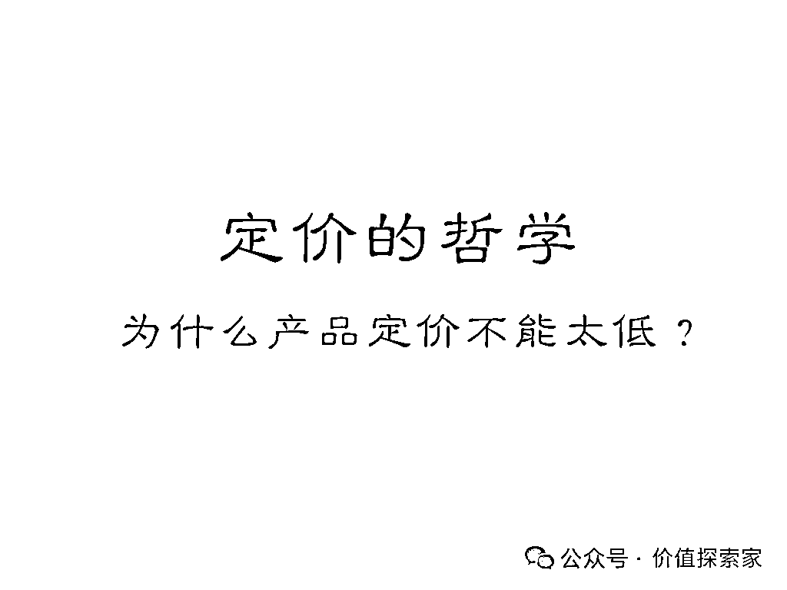

前阵子，一位做灯具照明生意的老板跟我吐槽，他手底下有个业务员，客户一砍价就发慌，三两个回合就把产品卖到了接近成本的价格。业务员的想法很简单——少赚点，总比丢单强。但老板很清楚，这种习惯要是养成了，离关门就不远了。

先说说客户压价这件事。为什么有时候宁愿不接这个单，也不能顺着客户的意降价？

因为你一旦痛快降了，客户反而会不安。他会想：这人报价这么随意，是不是一直在虚报高价？第一次砍价就成功，那再磨一磨是不是还能更便宜？或者更糟糕——价格这么低，成本能有多少？质量靠得住吗？

外贸圈有个潜规则：接待美国客户，开的车别太张扬。不是让你装寒酸，而是让客户觉得你利润薄。不然对方会认定你赚得太多，给他的价格远不是底价。

生意做到最后，拼的就是对人心的洞察。价格不是账本上的数字，而是客户给你的信任投票。

再换个角度，从选品说起。

客单价低的东西，容易把人拖垮。这类产品没什么壁垒，没什么溢价能力，最后只能卷价格，比谁报得更低。像塑料包装这种，厂家之间拼的全是几分钱差价。利润薄、耗神多，投入产出比低到没法看。

我有个做电商的朋友，过去就卖这种低价货。一件赚3块钱，哪怕爆单了，出一百单也才300块。钱少就算了，你还得耐心伺候100个客户。更扎心的是，买低价货的客户往往对价格极其敏感，要求还特别多，动不动就投诉差评，用他的话讲，真是费力不讨好。

反过来，如果做的是高客单产品，一单利润可能有300块，出一单就顶人家一百单。而且你只需伺候好一个客户，省下来的时间精力，可以去打磨产品、提升服务。

定价，其实是在筛选你的客户群。高价天然帮你过滤掉那些只纠结价格的客户，留下愿意为价值买单的人。这类客户的整体质量，比只盯着低价来的人高出一大截。利润空间有了，服务才能跟得上，口碑慢慢积累，复购也就来了，这就是正向循环。

劳力士早年间宁可拒绝一百万美元的大单，也坚决不降价，要的就是这份战略定力。

我们做生意有个原则：只筛选，不改变。改变客户的消费习惯，远比找到对的客户难。

当然，低价也并非一无是处。它用来做引流品，效果很好。瑞幸的9块9咖啡、麦当劳的“1+1”套餐，走的就是这个路子。知识付费赛道也常用阶梯定价来做筛选，比如短视频大IP“大蓝”，先卖99块的流量课，再往上是几万、几十万的私教课和私董会，后者才是真正赚钱的。甚至澳门的赌场，像永利、美高梅，也用小点心免费供应来吸引人流，听说最近准备取消，因为政府担心抢走中小企业的生意。此外，定期打折、给老客户让利，还能激活用户、增强黏性，这些都是低价的价值。

但让低价成为产品的主菜，就危险了。

还有个心理学规律：价格太低，用户会本能地觉得东西不行。哪怕你的产品真不差，也架不住大众那句“便宜没好货”。名创优品早期把店开在广州花都的旺街上，价格压得很低，主打性价比。结果顾客反而不买账——装修这么有格调，东西卖这么便宜，怕不是假货吧？后来他们通过MVP测试，把价格带从39元调到49元，销量不降反升。

所以你看，定价还真不是越低越好。

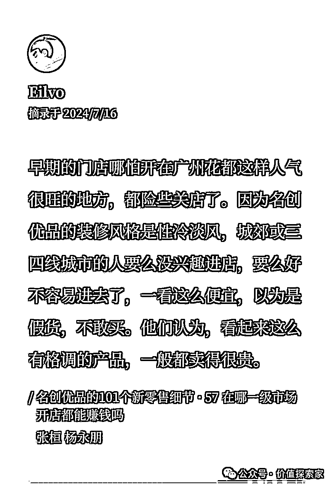

当然，贵的也未必就好。价格是多重因素的产物：稀缺性、品牌溢价、生产成本，原材料和社会必要劳动时间，都被算了进去。稀缺就等于优质吗？

我说一种鱼——桂花鱼。你在酒楼里常能看到它，一斤上百块，很多讲究排场的人，婚宴上都爱用它来撑场面。哪怕直接从原产地农场进货，也要三四十块一斤，对比市场里十几块一斤的普通家常鱼，贵了不止一点。

但论味道，我个人是真不太喜欢。肉质倒是紧实，但鲜味不够，而且这鱼容易生病，养殖户得经常用药。要说比它好吃、便宜又健康的鱼，一抓一大把。

那它凭什么卖这么贵？一是相对稀缺，养的人少；二来养殖成本高，它是纯肉食鱼，不吃饲料，只吃小鱼，还特别能吃，经常有撑死的。

所以，“贵的就是好的”在事实层面并不成立。但大众心理就是这么想的，你没办法跟人性较劲。做生意的智慧，是顺着人性走。

那定价还能低吗？当然能，但要讲究打法。

打法之一：永远别急着交底牌。先报一个高价，再通过促销、折扣的方式让价。同时要让对方明白，便宜是因为让了利润、提了效率，不是因为降低了品质。你也可以来一句：“我去跟经理商量下，看你头一回合作，破例给您打个折。”总之，别让客户觉得砍价砍得太轻松。轻易到手的东西没人珍惜，反而让他怀疑产品有水分。

这背后是“价格锚定”的效应。研究早就发现，顾客在还没看到真实价格之前，只要瞥见一个较大的数字，对价格的心理预期就会被拉高。

你买衣服时，预算明明只有五百。店员一开口先报一千，你心里会觉得，原来这条裙子值这个价。接着她说最近促销，八百块就能拿下。你什么感觉？是不是瞬间觉得自己赚到了？同样的心理，也会出现在谈薪水和菜单点菜的时候。想深入了解的，推荐读一读小马宋老师的《营销笔记》。

打法之二：让价格“看起来低”。最低价只给基础版，其他服务按需叠加。这么做有三个好处：一是抬高实际客单价，利润空间更大；二是顾客清楚钱花在哪，明明白白；三是平台上的低价能吸引流量。

有个澳大利亚客户曾气呼呼地跟我说，阿里巴巴上好多“价格欺诈”，点进去看到的低价，到最后报价出来差了一大截。我笑着解释，这不是欺诈，是中国市场太卷，先用低标价吸引点击，再靠各项配置把总价拉回来。这实际上就是价格拆分，降低数字带来的视觉冲击，同时把人群覆盖得更广。有钱的，多选配置多花钱；预算紧的，拿基础版也开心。买车不也是这样？天窗、自动挡、倒车雷达、倒车镜自动折叠，全是加钱项。

打法之三：不一定要真便宜，只要超出预期。这就是大家常说的性价比。有次我去山姆，看到车厘子两斤才90元，折合一斤45元，跟外面普通市场价差不多。但那是华盛顿当天采摘、空运过来的，又新鲜又脆甜，比我之前买的六十块一斤的还好吃。价格不算低，可体验完全超预期，你就会觉得这钱花得太值了。

打法之四：给自己找一个有分量的背书。大商圈就是极好的背书——租金高、门槛高，你能在里面立住，本身就在传递“我有实力”的信号。就算你定价不高，顾客也只会觉得你性价比好，而不会怀疑你卖假货。

名创优品当初就是没想通这一点，开在街边，一连败了十家店，后来才总结出教训：店，一定要开进商场。

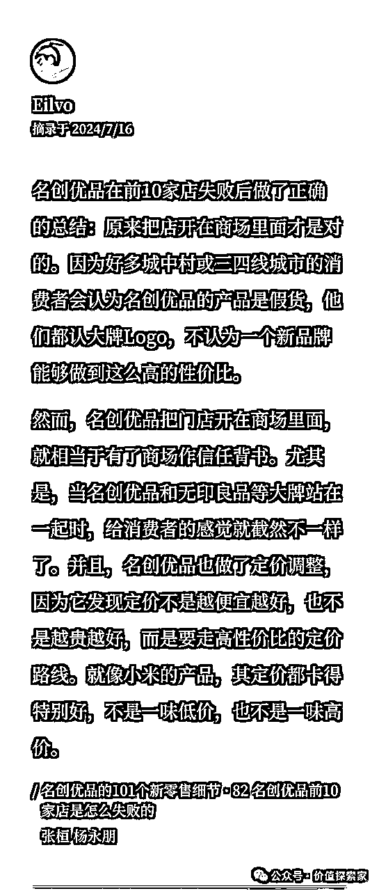

商圈之外，也可以刻意贴近知名品牌。你会发现，有星巴克的地方，多半还有喜茶、奈雪。这是借力，也是“近朱者赤”在商业世界的应用。身边都是优秀的人，你也不会差哪去；隔壁都是大牌，你自然沾光。至于品牌联名、明星代言，也都是相似的逻辑。

再往深处说，定价太低还会危及生存。

价格撑不起成本，资金链就会出问题。用价格战卷同行，表面是抢市场，实际是自掘坟墓。真正的降价，是效率提升、成本下降之后的从容降价，而不是成本没动、硬砍自己利润的冒险。

特斯拉就是一例。它靠一体化压铸技术，把生产成本压下去之后才选择降价。蜜雪冰城也一样，门店越开越多，供应链成本不断被摊薄，于是便宜卖还能有钱赚。你可能会问，店开多了难道不是更烧钱吗？关键在于，一条供应链投下去，钱就已经花了，产量越大，单位分到的成本自然越少。仓储配送也是这个理，一个仓储中心，同一趟配送，门店密度高了，原本只能覆盖一百家，现在能辐射一千家，单次成本自然下降。

波士顿咨询1960年提出的“经验曲线”早就讲透了：产量越大，经验越丰富，成本越低。这一点在科技品类上尤其明显——一百年前造一部相机，跟今天造一部相机，成本差了何止几倍。

规模上去了，原材料采购也更有议价权。这就是名创优品老板叶国富后期坚持“要么不开店，要开十家一起开”的原因。再往后，还能建自动化工厂，用效率碾压成本。雷军展示过的小米全自动智能生产车间，走的就是这条路。

这时候你可能会问：小米、蜜雪冰城、瑞幸不也都在卖低价吗？为什么人家活得好好的？

原因在于配套条件不一样。

第一，人家有真成本优势。小米早期靠自有商城直销，没有中间商抽成；而且就算硬件利润微薄，还有App预装、流量入口、广告费这些源源不断的收入。

第二，人家亏得起。雷军一出场就拿下了海量融资，资本愿意牺牲前期利润去抢市场占有率，正常生意人哪有这个底气？

第三，人家算过未来账。瑞幸团队一定测算过：这个价格，要开多少店才能打平；未来把成本压到什么程度，这个价格才能赚钱。逻辑一旦成立，先定这个价，再跑马圈地就够了。

第四，人家太懂消费者心理。我的小米11，哈曼卡顿扬声器、一亿像素、2K屏、骁龙最新的芯片，列一大串硬核配置，然后甩出一个超预期的价格。这些配置真有多大用处吗？说实话感知不强，但配置单堆在这儿，价格一对比，消费者就会觉得太划算了。瑞幸一直讲金奖豆、世界大师团队，喝起来真有世界级水准？也不见得，街边小店做得比它好的一抓一大把。但人家传递的信号很明确：我们便宜，可原材料和团队都是顶配。这就要让你在消费感知上觉得超预期。

第五，也是最后一点，便宜的可能只是饵。瑞幸的9块9、麦当劳的工作日10元早餐和13元“1+1”，都是用来引流的，利润大头在别的产品上。

所以啊，兵无常势，水无常形。别看到谁降价就跟着降，先想清楚自己的牌面。因地制宜、因时制敌，才是正经。

定高价不可怕，可怕的是让人看不出高在哪。

一件衣服，客户嫌贵，你可以说：“我们也有便宜的，但用料完全不同。这件用的是加拿大进口羊毛，保暖性、质感都是另一个级别。”客户一听，就不觉得是割韭菜了，而是认可贵有贵的道理。

要站在消费者的角度想问题，给他实实在在的获得感。前阵子我去广州参加曹大的线下活动，住的一家酒店四百多块，免费停车、免费自助早餐、免费下午茶，连饮料都不另外收钱。当下就觉得，这钱花得真舒服。但仔细想想，这些服务的成本真的很贵吗？未必。下午茶不过是薯条、面包、果汁，饮料也只是几盒平价饮品。

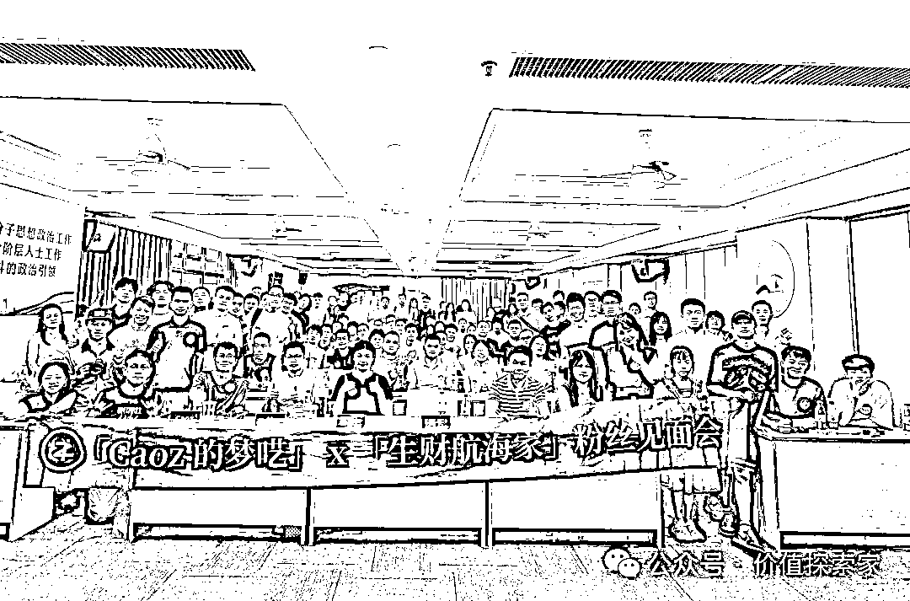

蜜雪冰城也干了同样的事。五块钱一大杯冰鲜柠檬水，看着划算得不像话。里面其实就是水、糖浆、柠檬片，柠檬还只放两片。

知识付费的逻辑也很像。周末听涛哥分享，他说了一句特别扎心的话：“知识付费就是卖海报，内容只是售后。”仔细琢磨，确实如此。用海报让你提前看到加入后的收获，获得感先拉满。而人性总是高估自己的执行力——我念书那会儿，每逢放假都以为会好好学习，塞一箱书回家，最后又原封不动拖回学校——所以付费，就是为那个想象中的自己买单。

定价的基本功还有一条：摸清同类产品在市场里的常见价格区间。当你知道自己的价格已经低于市场均价，客户再压价，你就能理直气壮地说“不”。很多客户只是习惯性砍价，试探你的底线，比如外贸圈里的印度客户，就是出了名的爱砍价。这时候，你手里的行情表，就是你最大的底气。知己知彼，百战不殆。

最后，聊一个更大的层面。

定价策略，本质上是你的战略定位。京东和拼多多就是最典型的对照组。

京东定价高，高定价反向倒逼它把品控做深。京东以自营起家，自己既是最大的信任主体，也是最大的风险兜底者，品控不严就是在砸自己招牌。一双3.99元的拖鞋，上架前要经过防滑、重量、软硬、成本、色差等层层筛选，不合格的直接在初筛阶段淘汰。最后这款拖鞋在京喜自营能做到月销二三十万双。质量好，口碑立住了，用户心智就是“买家电、买数码，上京东放心”。

拼多多则不一样。低价定位决定了它的用户画像是价格敏感、但对质量相对宽容的人群。当然，不是说有钱人不用拼多多。一个对价格不敏感的人，也可能买手机去京东，但买纸巾、毛巾这类试错成本低的东西就打开拼多多。不同定价，切的是不同场景，做到差异化，各自都能活得很滋润。

段永平说过，差异化是好商业模式的前提。

所谓差异化，就是用户有需要、但其他对手满足不了的那部分价值。

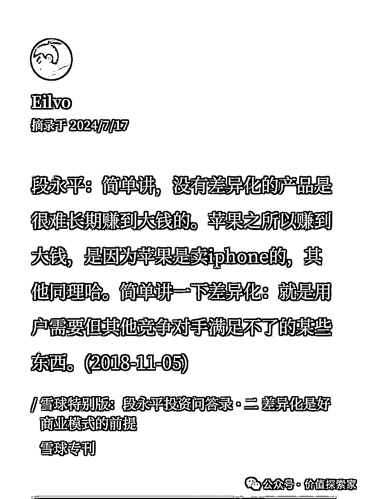

没有差异化的存量市场，注定只能打价格战，最终把蛋糕越卷越小。

所以，别再把“低价”当成唯一的武器。你的定价，是筛选客户的门槛，是品牌身价的信号，更是你商业战略的延伸。贱卖自己，往往是最贵的代价。

段永平讲过一个航空业的例子，这个赛道里各家很难拉开差距，大家最先看的永远是安全，安全没问题时，关注点立刻就掉到了从A点到B点花多少钱。服务上能分个高下，但差异微乎其微，除非哪家实在差到离谱。所以同质化严重的行业，价格战往往打得异常惨烈。

行业越是同质化，想赚钱就越难。而定价恰恰是塑造差异化的关键抓手，这也说明了定价策略有多重要。

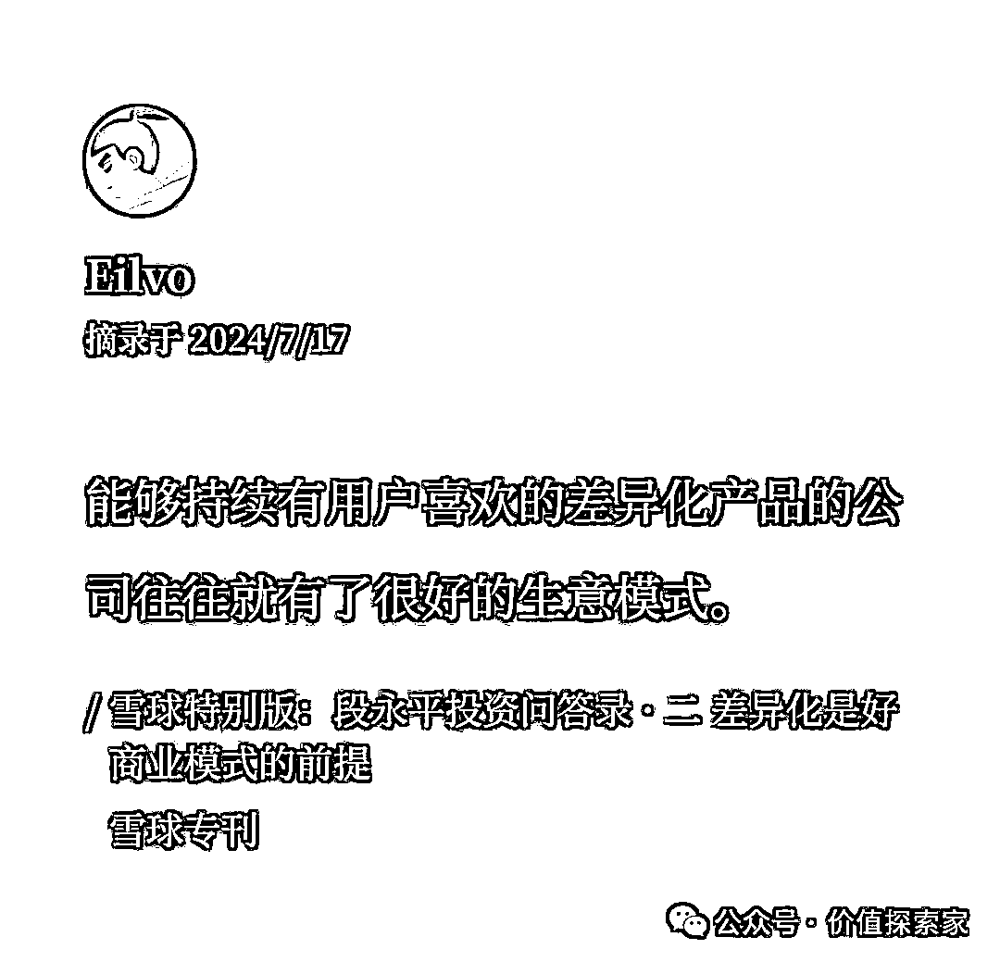

想了解京东的打法，可以去看看刘润老师的《京东的三板斧》，写得非常透彻。

想搞懂拼多多的逻辑，这几篇值得一读：
拼多多最牛的，从来都不是便宜
淘宝、京东、拼多多...5种赚钱模型，5种赚钱思路
揭秘拼多多：市值超越阿里，它是怎么做到的？

价格会筛人，什么样的价位就养活什么样的客群。

前阵子Manner员工打人的话题很火，为什么大家对它的出餐速度盯得这么紧？

本质上因为Manner的定位是平价精品，客单价基本卡在20到25之间，相对同行要亲民，性价比是它的核心卖点。为了留利润，它在其他维度压缩成本。店面做得小巧，主打外带，和星巴克做“第三空间”、走高端商务社交的路线完全不同。需要外带的人大多是赶时间的，和慢坐着享受咖啡的人群截然相反。

所以Manner吸引的是对价格和效率都敏感的人，而星巴克吸引的则是追求氛围和体验的人。

想深入了解咖啡赛道的朋友，可以读李翔老师的《Manner真正的问题》，以及黄海老师的播客：#98 咖啡战争2024。

7/

定价就是品牌形象的外化。

中国市场卷到极致，连宝马、星巴克这种国际高端品牌都被卷进降价潮。宝马的压力来自国内新能源新势力的崛起，星巴克的压力来自瑞幸。宝马3系传闻某些店30万能落地，星巴克也在各大线上渠道暗戳戳发券。

但最近两边的负责人都表态要拒绝价格战，要稳住价格来维护品牌势能。

高端形象必须靠稳定且高的价格来支撑。

去买LV、劳力士的人，很大程度上是买身份背书。如果价格跌到和普通替代品没区别，谁还会去追？

溢价能力和议价能力，本身就是品牌实力的体现。真正有底气的品牌，价格越高销量反而可能越高。

8/

定价里藏着的不仅是产品本身价值，还有情绪价值。

贵的商品不一定比同类好很多倍，很多时候只好一点点，多出来的溢价是情绪在买单，这也是品牌溢价的来源。

一个知名品牌能给到消费者面子、虚荣感、谈生意时的派头和气场、社交送礼的体面。送酒基本要送马爹利、人头马、轩尼诗，送烟要中华，没错就是为了让对方感受到重视，哪怕实用价值一般。冷门好物再好，也只提供使用价值，情绪价值几乎为零。溢价高的产品，往往是情绪价值大于实用价值。

市面上的99元入门课、999元进阶课、9999元私董会，课程内容真的差很多吗？说不定底稿是一样的，私董会卖的多是情绪价值，是“进了这个圈子就能学到不一样的东西”的感觉。

当然这不是否定私董会的价值，如果能带来高价值信息或人脉，那依然值。

奢侈品LV、劳力士、BBA，本质也在卖情绪价值。乔布斯、张小龙做产品时也把情绪价值放进设计里。

下图是张小龙的《🛰️背后的产品观》一书。

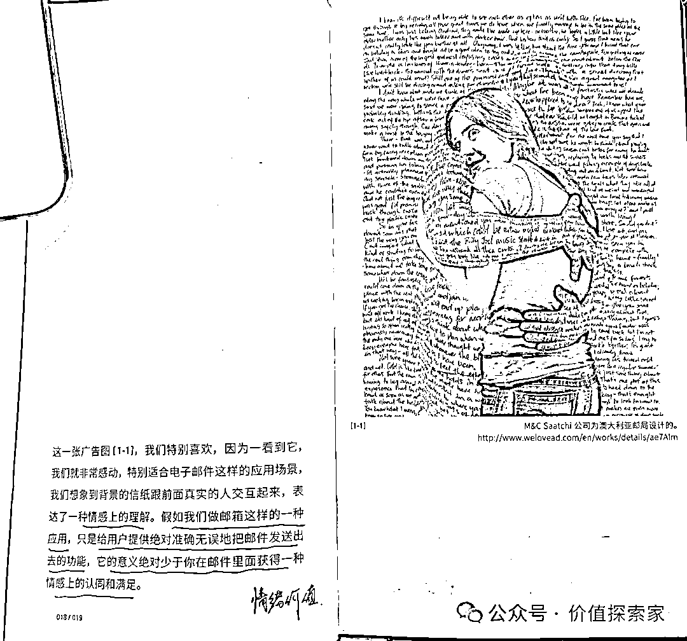

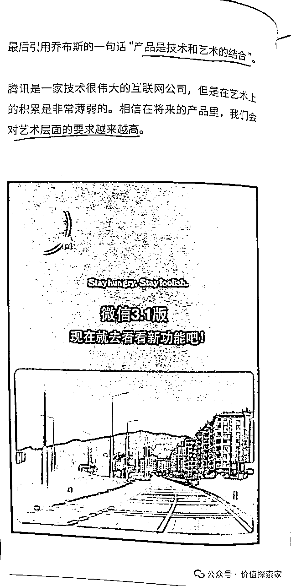

乔布斯说产品是技术与艺术的结合，这个“艺术”在我看来就是情绪价值。

消费者买单的不只是使用价值，还有情绪价值。

9/

最后分享几招实操的定价思路。

三年前我还在上大学时，对咖啡很感兴趣，发现校园周边咖啡店少、价格高、品质一般，性价比极差，对学生不友好。

于是我用快团团从零搭了一个线上咖啡店，从进货到运营、研发、定价、制作全流程自己来。

口碑、转化、复购都很不错，得到很多校友认可。

怎么证明？当时没有门店，只能在宿舍现做，一个人负责，用的还是家用咖啡机，产量和效率都很有限。学业也忙，基本只能每天中午回宿舍后那一个小时开放接龙。选这个时段考虑了舍友休息、午后需求大以及我自己的时间。

就这一个小时，也常有8到10单，手忙脚乱。而且我只在大群里宣传过，最后连外楼的同学都特地过来取。

当时拍的宣传图。

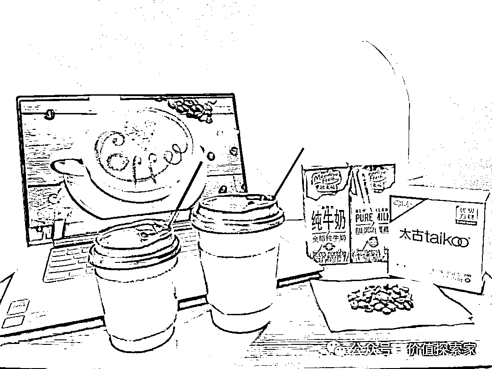

订单截图。

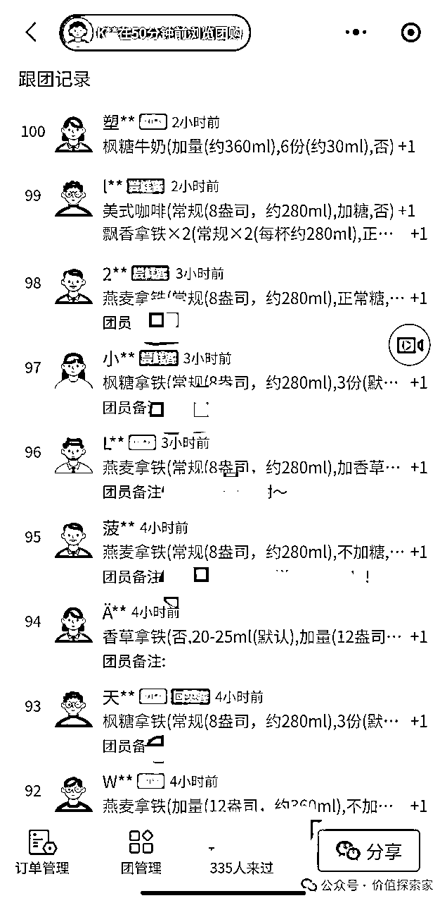

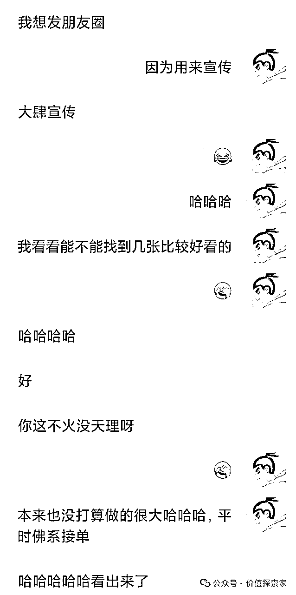

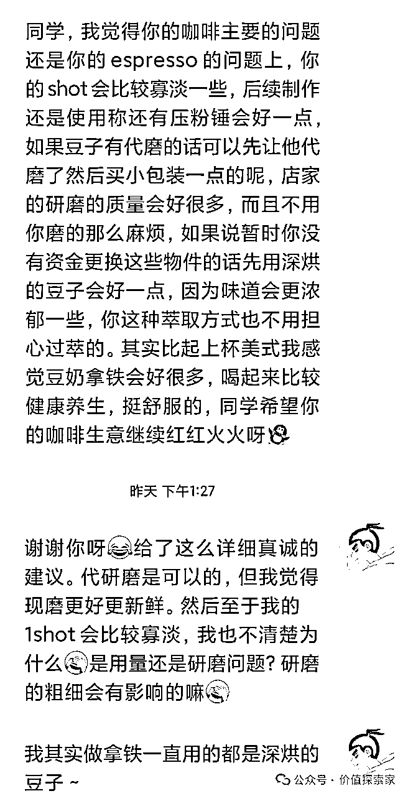

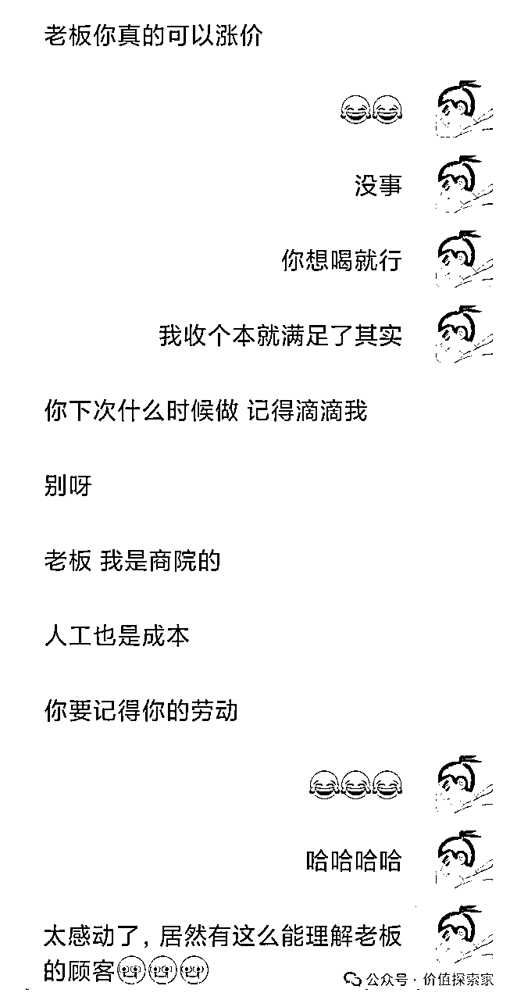

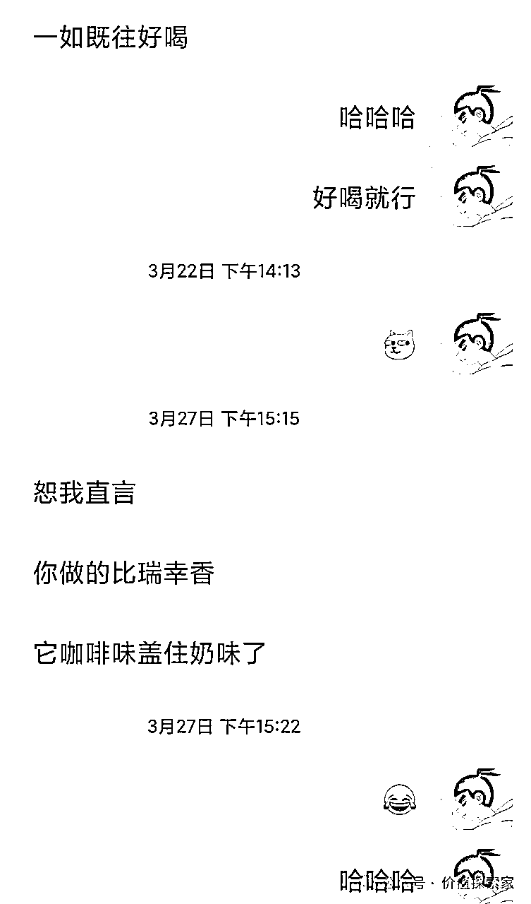

顾客的部分回评，甚至有人说比瑞幸好喝，看见这句话我当时特别开心。

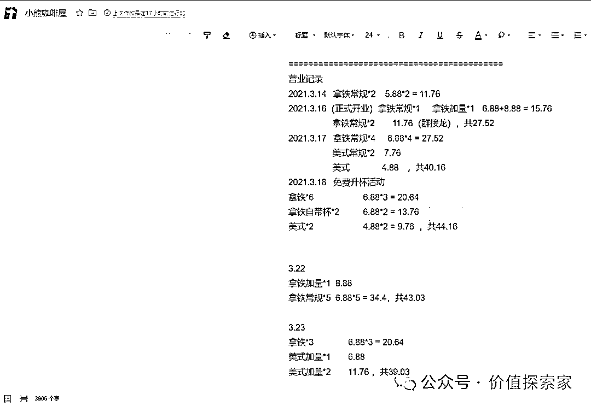

当时的营业记录，记了账务、数据和经营心得，到现在都还在。

现在想来，那段时间每天都在想怎么改进产品、运营、营销，虽然累，但每天都很充实，这就是热爱带来的状态。

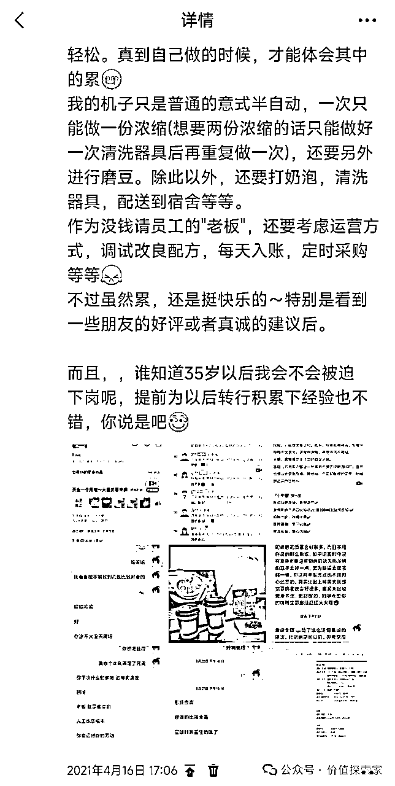

我当时发的一条朋友圈。

看到这里有人可能会问，后来呢？

当时确实不错，还孵化了三四百人的私域🛰️群。2021年咖啡还是个蓝海，Manner、M Stand也是那年起来的，资本大举入局是这两年的事。

我本打算找合伙人校外开店并招校内骑手配送，但最终因学业繁忙中途停止，技术、社群、方法打包转让给师妹，拿了分成和转让费。

这段经历对本文来说算是跑题了，只是想说，我对定价有一些自己的体感，下面这些心得就基于这段实践。

一，趣味性定价。

小马宋老师在《营销笔记》提到，2012年伦敦奥运开幕式门票最低20.12英镑，最高2012英镑。用数字做记忆点，门票收入比预期高出75%，超过前三届总和。

我当时也用了类似做法，用“xx.88”的定价结构。8象征发财、吉利，符合国人心理。消费者会把6.88感知成6块钱，7.01感知成7块钱，相差一毛钱，感知却不一样。

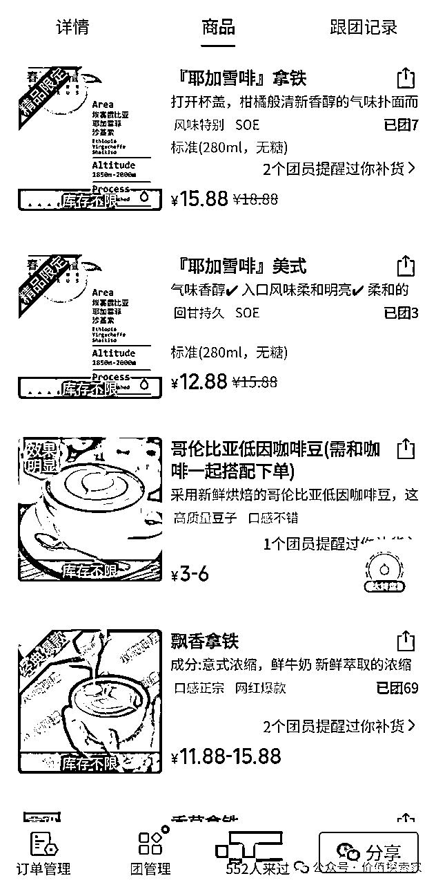

二，设置价格诱饵。

先给一个足够大的锚点，再让目标价显得合理，这就是价格锚定。

在会员付费页很常见。下图是🐧音乐绿钻页，最后的“1个月18元”就是诱饵，让前两个选项显得更划算。

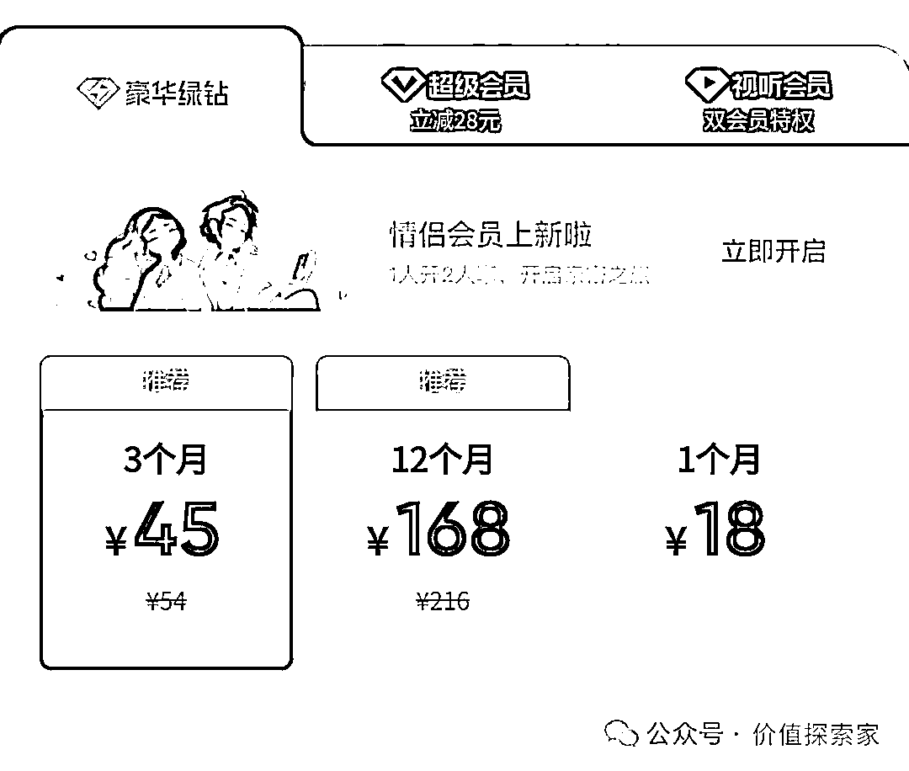

下图是🛰️读书会员页，30元/月的月卡也是诱饵，明眼人都知道年卡更值。

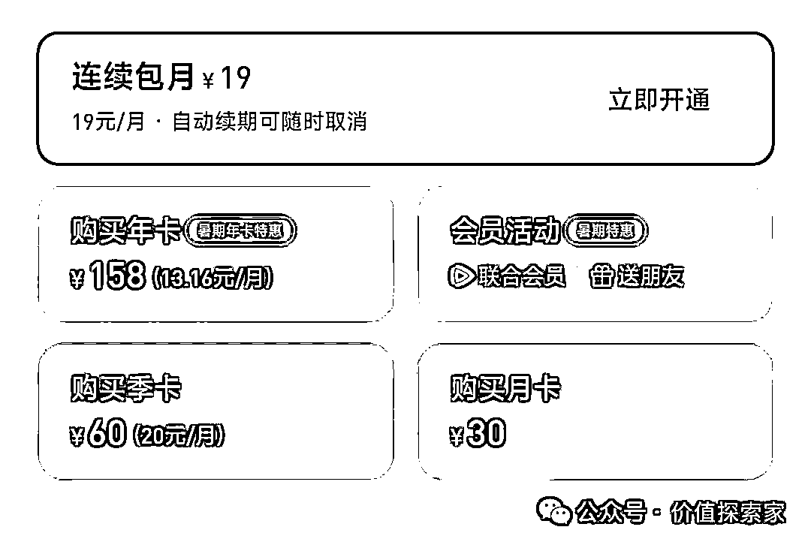

直播带货也会这么玩，用京东的原价来衬托自家折扣大，京东价就是诱饵。

在产品列表里放几款高客单的引流品，能让主推款显得不贵。诱饵可以用自家产品，也可以用竞品。

三，分层定价。

产品矩阵里既要有大众可接受的平价引流款，也要有高客单的利润款。

主推爆款要大众价，容易推广；小众高客单款满足付费能力强的人群。

当时我的矩阵是“经典高性价比+高端”。经典款11.88的飘香拿铁，定位是招牌爆品，像霸王茶姬的伯牙绝弦那样单点爆破，可以少赚但要负责口碑传播和引流。

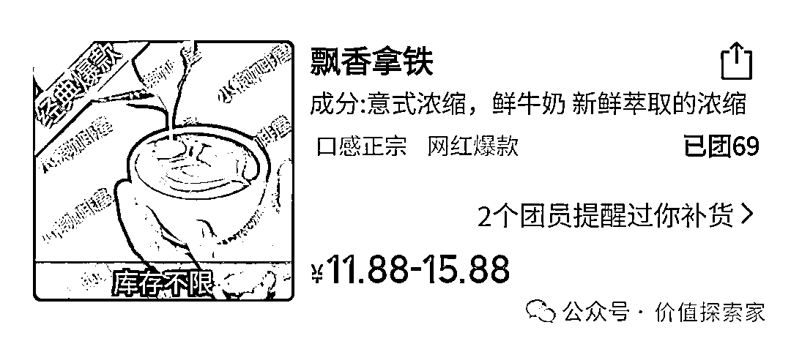

高端款是15.88的耶加雪菲拿铁，以及每周三周五限量的豆香拿铁和燕麦拿铁，价位在我的体系里已算高，但目标是学生高性价比，整体都控制在20元内。耶加雪菲用90多一磅的SOE精品豆，成本很高；豆香和燕麦用的是星巴克同款原料，定价自然偏高。

耶加雪菲拿铁的灵感来自瑞幸的“小黑杯”，SOE豆配黑杯很有高级感。豆香拿铁是当时我很喜欢的星巴克产品，后来星巴克已下架。

我做的品首先是自己爱喝，才会推。

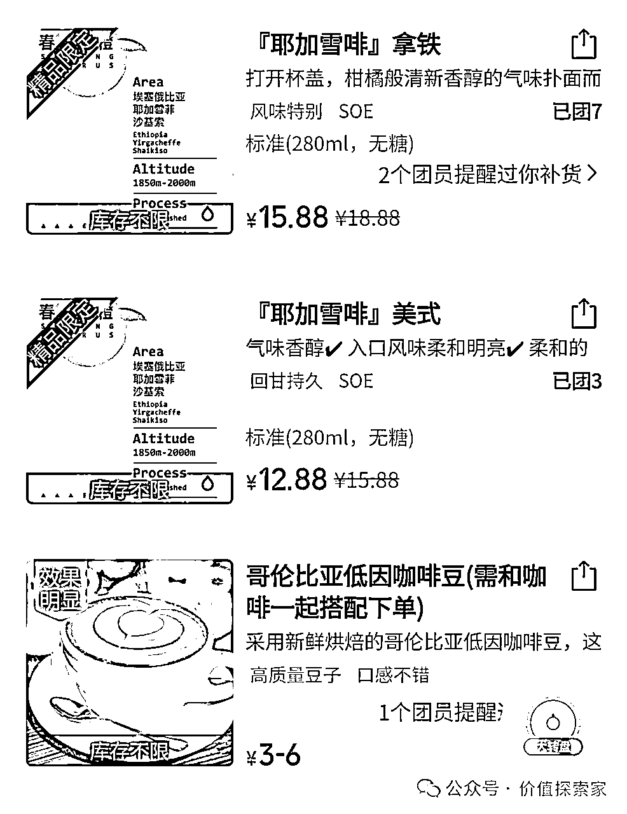

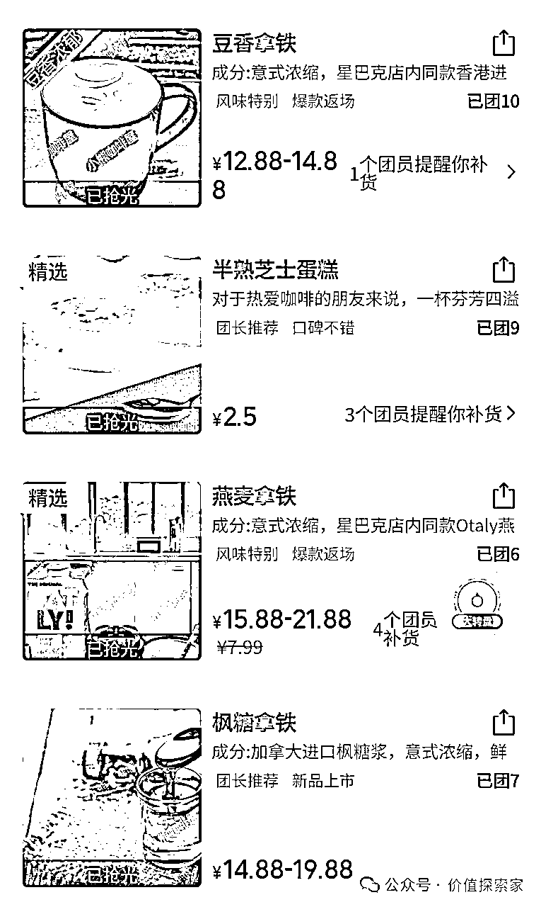

四，堆料营销。

把产品的卖点全部摊开，再配一个超预期的价格，性价比感就出来了。

图中我把新鲜现磨、进口奶源、提神醒脑、味道正宗、价格亲民、精美包装全部列出，最后是6.88一杯280ml的拿铁。卖点多+价格诱人，就是降维打击。

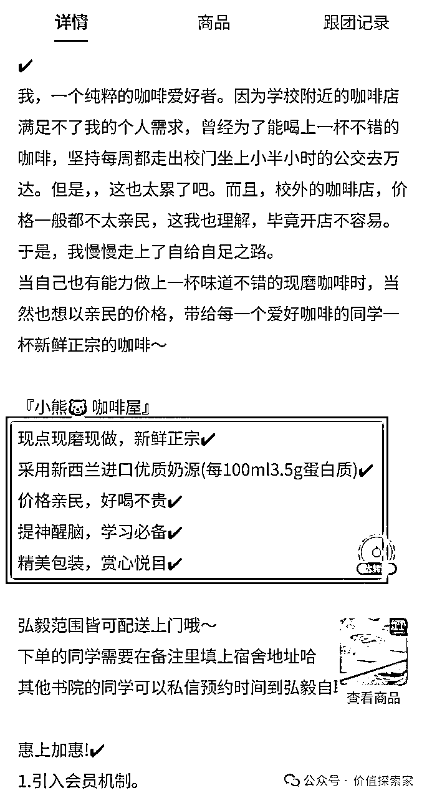

五，巧妙利用价格歧视。

之前写过《一碟肠粉引发的商业思考》，价格歧视就是对同一产品对不同人收不同价。

比如很久没去消费的顾客，商家突然发优惠券召回，就是对低粘性客群降价。美团大数据杀熟则是对高消群体加价。

我当时用会员折扣和双杯折扣，对高频老客和大额订单让利。有券就会想消费，这是人性。

对老客每次推新品都会邀请试喝，尊重他们并吸纳建议。节假日也会降价促销，提升粘性和忠诚度。

六，先低价冷启动，再提价。

“高转低”容易，“低转高”难，但冷启动阶段低价有它的好处。

前期没品牌、没口碑，先用低价验证需求和品质，积累客户和反馈，是可行策略。

有了种子用户，自发口碑传播。同时经验曲线也在起作用，杯量多了，技术和配方不断优化，出品更好，时间成本也降了。

后来我把价格从6.88提到12.88，销量没明显下滑。

10/

总结。

产品定价不能太低的原因有三：

第一，低客单易把自己耗死，投入产出不成正比。
第二，价格太低会让人怀疑偷工减料、质量不行。
第三，覆盖不了成本，资金链会断。

同时要懂得抬价的逻辑和品牌定位，合理的定价代表战略、差异化和品牌形象。

定价的本质是产品价值+情绪价值。

好的定价是营销的一部分，和营销密不可分，但再好的定价也需要过硬的产品和服务作支撑。

* * *

以上就是全部分享，感谢耐心看到这里，希望能给你一些启发。

我是浩哥Eilvo，曾开过咖啡店、做过程序员、当过外贸销售，一个对商业感兴趣、崇尚终身学习、爱折腾爱分享的00后。

👸号「价值探索家」，专注分享个人思考与商业认知。

VX：eilvo888，欢迎交流，添加请备注来意。

PS：上周末参加了曹大的广州线下见面会，这是我第一次参加赚钱线下活动，收获很大。确实是线上聊千遍不如线下见一面。氛围很好，分享很干货。涛哥太帅了，感觉25岁。很多问题线上大佬未必有空回，线下几句话就讲清了。线下有着线上不可替代的优势。

给未来的自己立个flag：能参加的线下见面会都尽量参加！也鼓励没参加过的小伙伴大胆去试！一起龙哥盟！

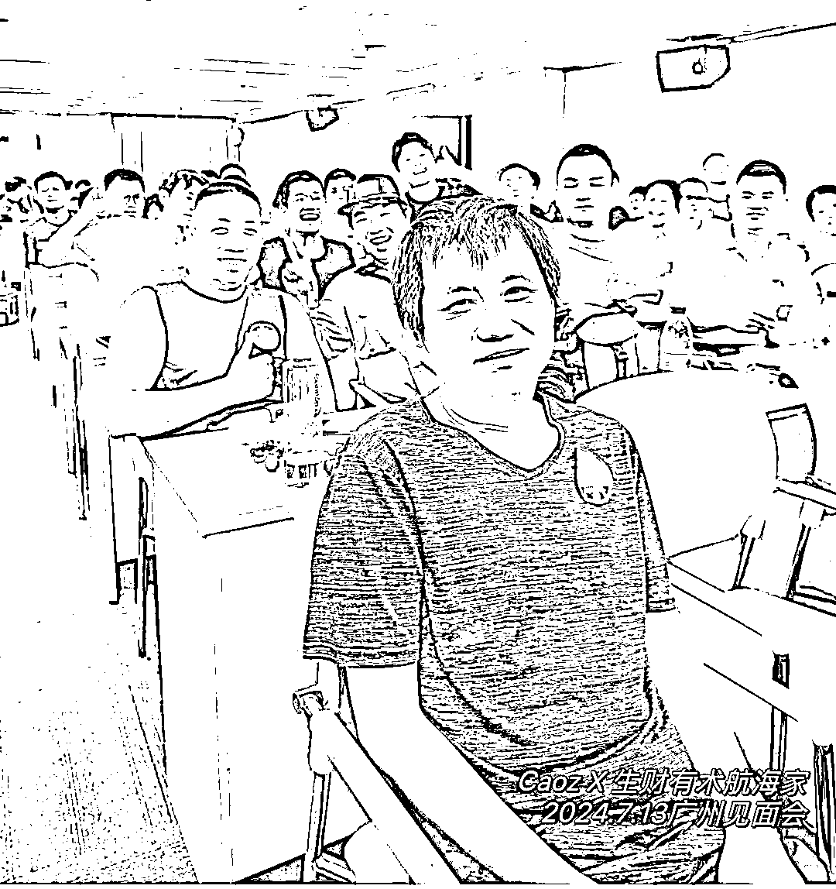

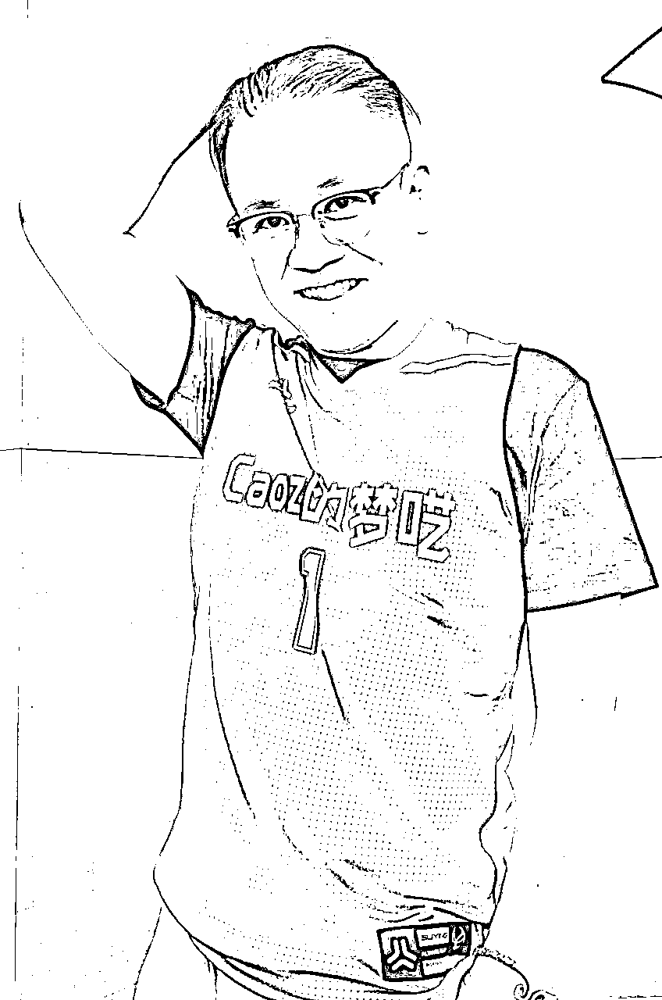

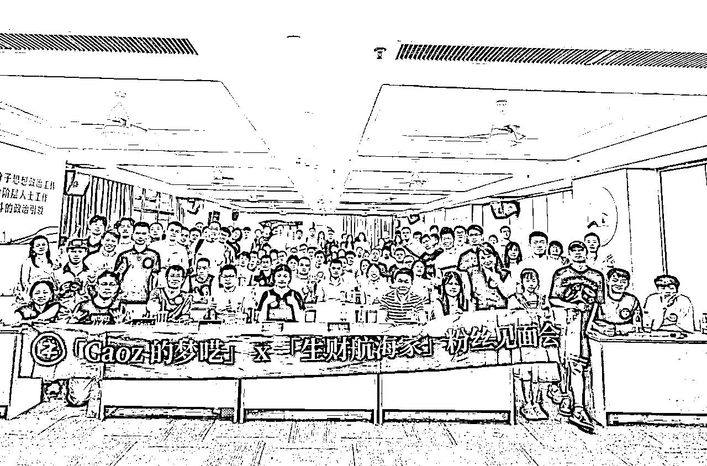