# 关于AI搜索，我整理了十个绕不开的问题
作者：龙哥

最近深度体验了一圈AI搜索产品，也和不少同行聊了个痛快。这个赛道可能是AI领域最有机会跑出杀手级应用的方向，热度一路飙升。之前我写过不少产品拆解，这次索性挑出十个最核心的问题，摆出来认真聊聊。

前段时间我做了一场AI搜索线下闭门会：

到场的嘉宾来自360AI搜索、某大厂搜索、Gemini、ThinkAny、万知、Repotify、Miku、荣耀，基本把国内AI搜索的头部玩家凑齐了大半。交流下来收获不少，又连夜找小邵深聊了一次（实在太卷了），快速沉淀出这篇文章。里面有些问题，也附带了一些我自己的思考。

## 01 数据，才是AI搜索最大的护城河

闭门会上有位大厂搜索的同学，开场就甩出一句狠话：

没有数据，全是空谈！

外壳再精致、交互再顺滑，用户一问，答案稀烂，照样留不住人。

这也是为什么内容平台做AI搜索天生占优：🛰️读书的AI问书、知乎/抖音/📕的AI搜索、腾讯元宝接入👸号内容，都是靠自家数据池吃饭。

我最近试了📕的达芬奇AI搜索，效果真的让我意外：

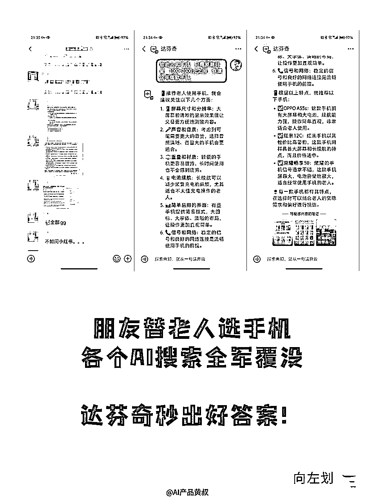

原因不复杂——📕在旅游、美食、美妆、宠物、健身这些品类上，攒了全网最顶级的内容。只要问题落在它的优势垂域里，答案质量自然甩开别人几条街。

这也顺带说清了百度式微的老问题：数据被一个个App圈成了孤岛。

## 02 要不要自建索引库？

结论：做通用搜索没必要，做垂直搜索必须有！

很多AI搜索直接调Google或Bing的API，图什么？因为这两家早就建好了超强搜索引擎，索引库庞大，检索质量稳定，排序也靠谱。靠它们的接口，已经能解决95%的需求了。

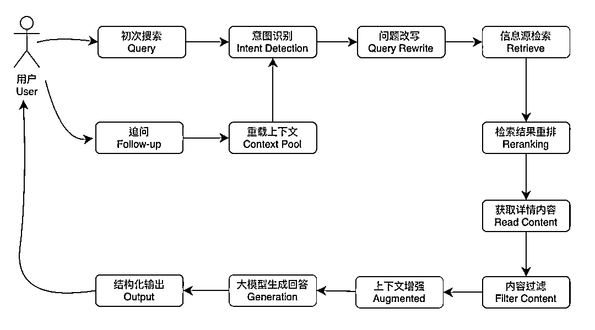

（流程图来自👸号“艾逗笔”《我做了一个AI搜索引擎》）

关键问题在于：自建索引库之后，重排阶段能不能保证自己召回的结果，比单纯从Google API拿回来的更好？

打个比方。你是个园丁，目标是种出最美的花。Google和Bing的API就像大型花市，世界各地的好花都能买到，大多数时候直接买就行。可如果你非要自建私家花园，那就要想清楚：园里可能没有花市里那么多品种，但你可以精挑细选，培育出外面买不到的独特品种。

所以真正重要的是：你的索引库里有没有足够多的高质量信源，每次检索都能拿出比Google API返回结果权重更高的URL，再做一轮Reranking，AI搜索的答案质量才能上去。

但这对创业公司来说太苛刻了。跟360VP梁志辉聊的时候他就直说：索引库的搭建和维护烧钱得很。爬5000万个网页，成本就要一两百万RMB。放到通用搜索引擎里，5000万这个数字根本不够看。

更麻烦的是，通用搜索几乎都索引了千亿级网页。360花了10年，每年爬100亿的量级才攒下来，而且网页还会过时失效。

方汉也补充过：

我们愿意干这事，是因为当年在海外做Opera News新闻推荐的时候，从16年开始就自建了一个小型搜索引擎，每天大概索引5000万个新闻网站。我们的AI搜索团队是一脉相承的，这套搜索引擎集群已经打磨了七八年。

但不建索引库，就得持续给Google和Bing交API费用。“这成本比推理成本高多了，而推理成本还在飞速下降。”

所以结论清楚：做通用AI搜索，别惦记自建索引库了，钱和时间的消耗都极其惊人。靠第三方API快速把商业模式跑通，可能是更现实的路。

这也是大家不看好创业公司做通用AI搜索的主要原因。

那垂直搜索呢？就要看第二点——优质索引库。

索引库也有层级。刚才说的是一个巨大的库，要在里面捞合适的内容，效率偏低。但在大库之上，可以有更优质、更权威的精品库。垂直AI搜索如果能建出这样的优质索引库，帮助会非常大。

还记得第一点说的吗？AI搜索最核心的就是数据！你要是知道某个垂类最优质的内容和信息在哪儿，答案质量不就直接起飞了？

Perplexity一开始从学术场景切入，也是同理——锚定垂类，提前构建垂直索引库，保证初期体验足够惊艳。

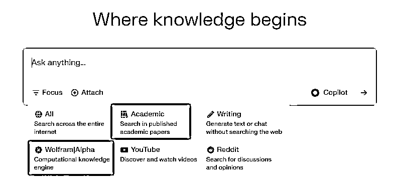

再用餐馆比喻一下：一家什么菜都做的餐厅，你多换一个供货渠道，客人会变多吗？可能影响不大。但如果你只做大阪和牛烧鸟，找到一条独家精品货源，口碑立刻就不一样了。

## 03 垂类赛道，才是AI搜索初创公司的最佳入口

结合前两点，答案已经很明显了。不管是因为数据壁垒，还是索引库的门槛，创业者想入局，从垂类切入几乎是唯一合理的选择。

还有两个额外理由：

1. 更容易建立用户口碑和心智认知；
2. 垂类更方便融入用户的工作流。

秘塔为什么能靠口碑出圈？因为科技工作者和学生查资料时，能快速拿到大块结构化信息。我猜秘塔的索引库也重点覆盖了这些用户关注的内容品类，从而保证生成质量。

最近秘塔上线了播客搜索，精准击中目标用户群：

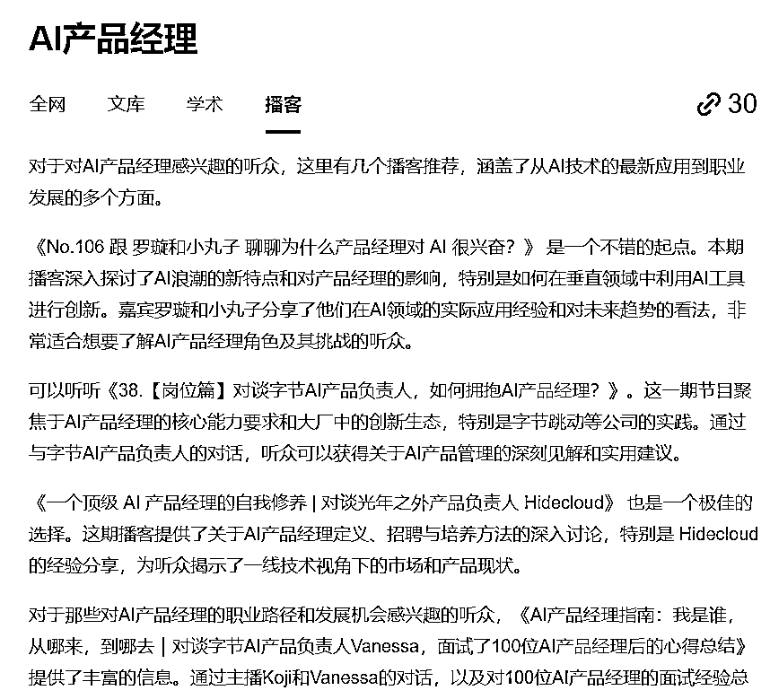

Repotify更聚焦，直接盯住财报、研报，服务炒股投资人群：

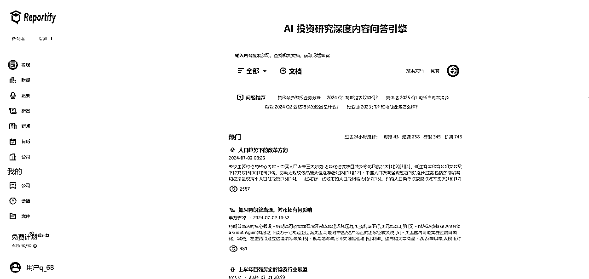

我有时查企业财报和电话会信息，也会打开它用一下。

还有Devv，可以指定信息源，直接连到某个Github仓库去搜索：

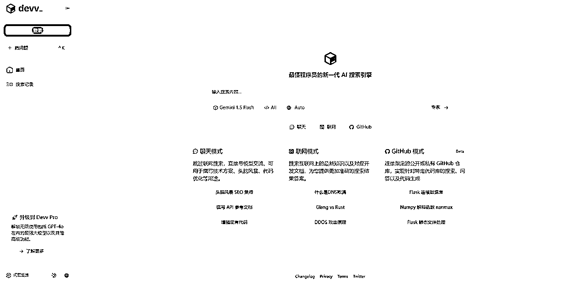

这种深入场景的打法，就是心智的建立：用户知道这个AI搜索能解决我的具体问题。

反过来，垂直AI搜索也更清楚优质信息源藏在哪，还能满足很多独特的用户需求。

## 04 用户习惯的惯性，能撬动AI搜索吗？

结论：太重要了！

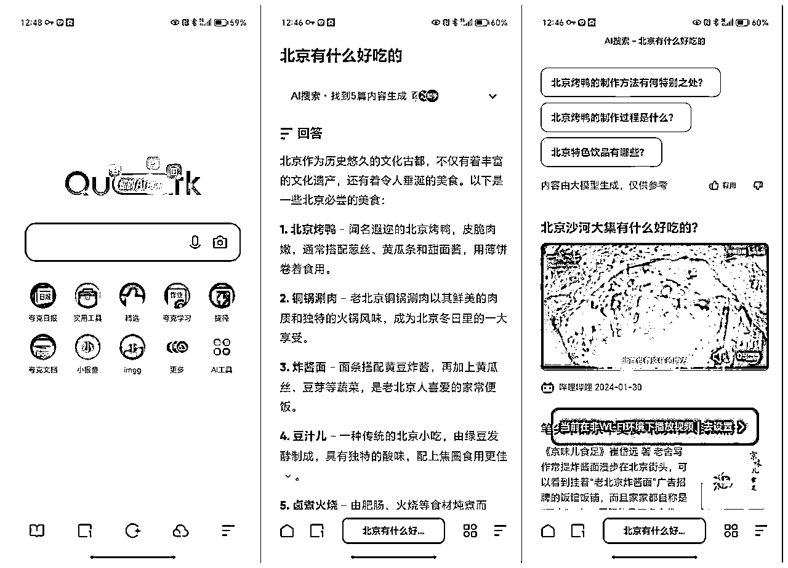

上面是夸克最近全面升级的AI搜索。

如果你是夸克的老用户，是不是自然而然就会用上它的AI搜索？

回想一下，就算在百度最巅峰的时候，依然有海量用户不碰它。为什么？因为用户习惯被其他产品占据了。搜狗和360的“三级火箭”就是用浏览器养成搜索习惯——百度哪怕做得比Google还好，也抢不动那批人。

通用AI搜索最难啃的骨头，就是迁移用户习惯。他习惯了夸克，就会继续用夸克的AI搜索。更何况Google这些巨头都在全力押注AI搜索，你很难做到比Google好出一个量级，让用户主动换门。而且Google全量铺开AI搜索之前，留给大家的时间窗口可能非常短。

## 05 模型微调是必需品吗？

结论：现阶段特别有价值！

原因是搜索场景太泛化，用户什么都会问：

“黄河有多长？”——一句话就够。
“怎么哄小孩睡觉？”——可能需要手把手教学。

所以搜索依赖的大模型，必须在不同分支下具备不同的回答模式。

360AI搜索已经把Query意图识别分成了4000多种，每种需求配对应Prompt。这个精细度已经很高了，但梁志辉说，其实还是相对粗颗粒度的匹配。

可能有人会问：为什么360这么使劲做Prompt工程，没怎么提微调？

这就是两条不同的技术路线。

Prompt和微调，本质上是对模型做不同力度的引导！

现在大模型的指令跟随能力还没那么强，所以在这个阶段，微调的价值非常明显。

## 06 AI搜索+Agent，会变成主流吗？

结论：大模型提供信息，Agent提供服务。

未来很可能的局面是：AI搜索变成平台，上面的Agent是各种服务。

目前的Agent大多还是靠Prompt调教出来的，垂直能力深度有限。如果AI搜索和Agent能紧密协作，那就厉害了。

换个思路想想🛰️小程序：🛰️提供基础服务和信息，小程序承载各种垂直功能。

更进阶的形态是Multi-Agent：

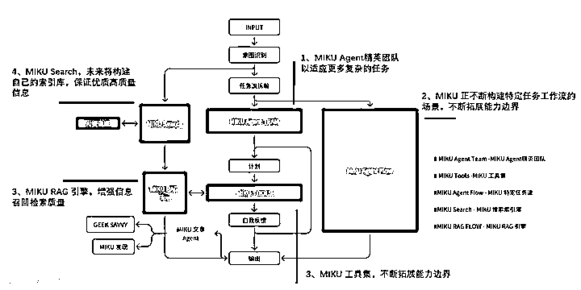

Miku AI搜索就是典型的基于Agent框架构建的产品。吴恩达在AI Ascent 2024大会上说过：“基于GPT-3.5构建的AI智能体工作流，实际表现比GPT-4更好。”

ThinkAny的创始人idoubi也计划加入Workflow，也就是Multi-Agents。你可以把它理解成：前端是AI搜索去查信息，然后进入用户自定义的多智能体流程，最后得到想要的结果。

本质上就是AI搜索+Coze的组合。

## 07 AI搜索生成内容，AI📕会来吗？

结论：这是个明确的方向。

我们之前在文章里提过Genspark的Sparkpage这套逻辑：

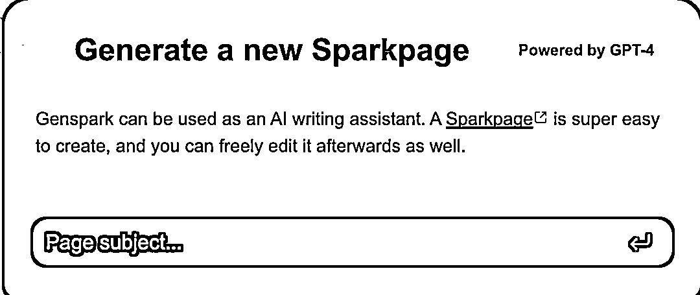

AI先生成一次结果，用户在此基础上修改，相当于AI和人共同完成一个网页。

Perplexity也推出了类似功能。

从某种角度说，这种模式和人类创作者直接对上了——AI搜索+人，去PK人类创作者。

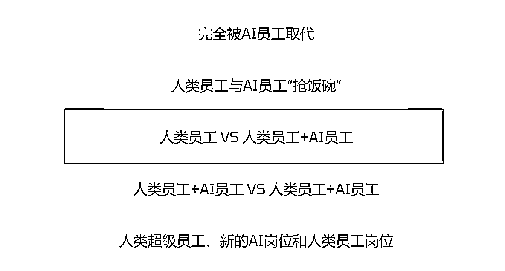

参考即刻@余一 的《普通人的AI使用说明书》，相当于中间那一层。

其实AI搜索走到这一步很自然。就像大厂和模型厂商的效率工具都会加搜索能力一样，只要你明白搜索是为了帮后续工具获取信息，就很容易理解这个演进。

也就明白📕为什么警惕这类产品了：如果AI+人也能产出高质量内容，还形成自己的社区生态，那和📕必然正面竞争。

## 08 AI SEO很快会成为共识？

顺着上面这点，可以推出一个结论：AI SEO马上就会变成行业共识。

新产品怎么获取流量，已经是大家都在焦虑的问题了，AI搜索也逃不掉。我们在Genspark的文章里提过，它通过Agent生成Sparkpage，内容质量“很高”，能被Google收录，从而带来持续流量：

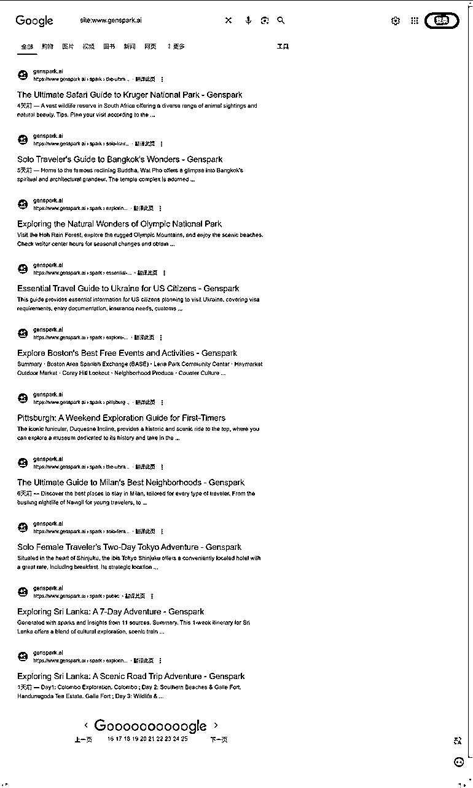

Perplexity已经尝到了甜头：

大多数Perplexity页面在12-24小时内就会出现在Google搜索结果里。

有趣的是，自从推出Page功能，Perplexity域名的关键词可见度涨了84.63%。Semrush数据显示，5月30日到6月19日期间，Perplexity网站在Google搜索里的有机关键词数量从24839涨到了45864。出现在Google SERP特色位（比如精选摘要、AI概述）的次数也增加了49.09%。

还要注意，Google并不排斥AI生成内容，它只关心内容有没有价值、有没有用心做。

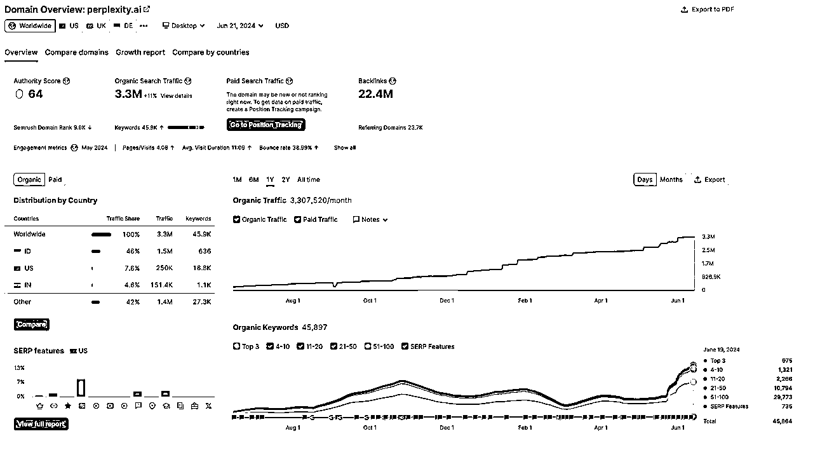

更绝的是，Perplexity的Page页面都能出现在Google的AI Overview里了：

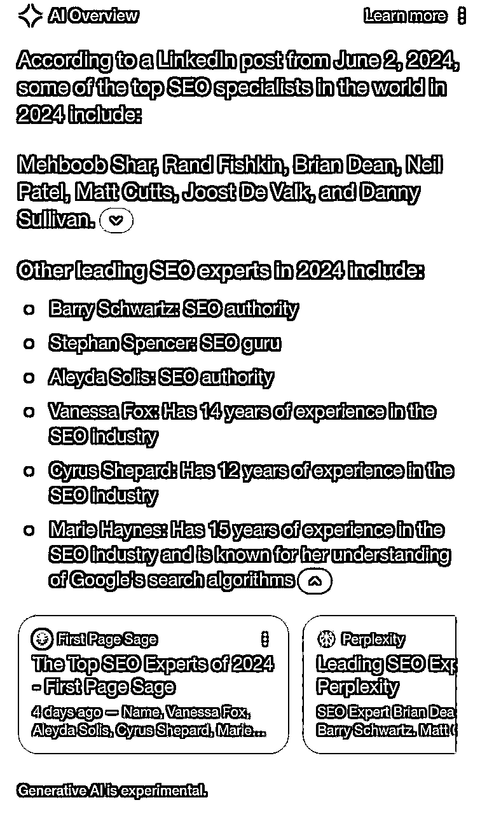

360AI搜索也一样：每天晚上定时跑任务，用更高优先级的方式插入360搜索的索引。用AI生成网页，既满足了长尾Query，也给AI搜索自己带去流量。

AI搜索本身就是极佳的内容生成框架，结合AI SEO从传统搜索引擎吸流量，确实是早期快速成长的捷径。

## 09 有人说Sparkpage内容质量一般，重要吗？

结论：可能真不重要。

顺着上面的思路，我们想深一层：

不是所有问题都必须一步到位。

答案可以是一个过程、一个中间态，这本身就很有价值。

说白了，Sparkpage能给你一些启发，帮你优化攻略或购买决策，已经很实用了。如果未来更多用户基于它生成高质量的人机共创内容，那真的就是AI📕。

换个角度想：

传统搜索里，Top10%的Query占掉了95%以上的流量。这意味着AI搜索完全有可能把用户最关心的答案好好生成出来！

## 10 AI搜索是一种退化？

结论：从10个链接变成1个答案是进化，但从视频变成文字，是退化。

闭门会上有位小伙伴说了句很扎心的话：传统搜索是菜市场，AI搜索是送外卖，但把视频变成文字，确实是退化。

你可能会想：为什么AI搜索大多都是文字结果？

我们可以看看可能性：

广义的AI搜索可以包含很多可扩展能力：

输入变得更丰富自由：

Query多模态：从文字+语音输入，到Circle to Search、智能镜头、图片、视频输入等等。

360AI搜索App已经上线了AI图片识别搜索：

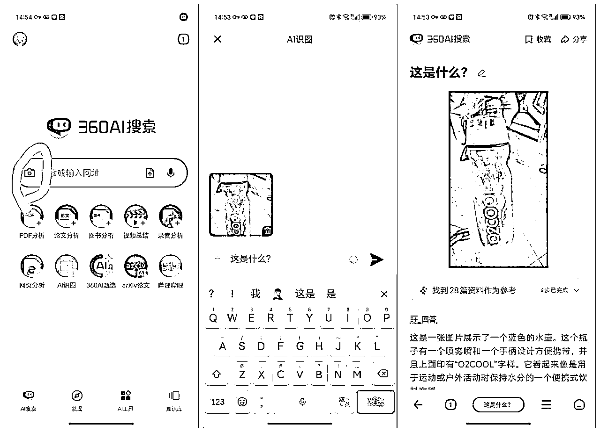

Google的Take a video，微软的Copilot陪你一起玩，技术层面已经开始进入视频交互了，这是非常大的跨越。不难想象，一旦这些能力整合到随身硬件上，体验提升会有多惊人。

输出也会更多元：

1. 信息整合：AI Overview（链接、图片、POI、邮件、文档等），典型产品是Genspark的Sparkpage；Perplexity和Tako信息卡片合作，输出内容能支持图标；秘塔AI搜索还可以直接生成PPT；

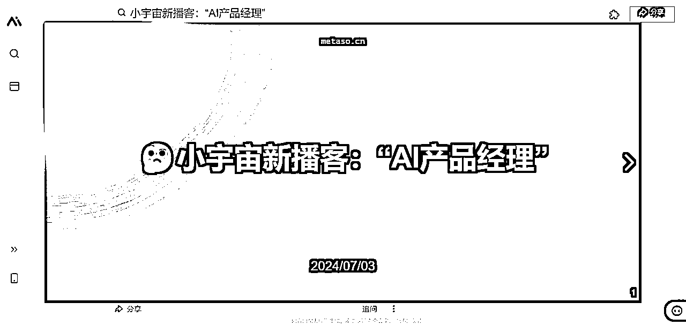

（秘塔AI搜索：Search Query to PPT）

2. 服务整合：Planning、Agent、Prompt-pic-Shopping等等。

两者的边界同时在扩充，并且都能更深理解用户意图。AI搜索能满足的需求，已经从单纯的信息整理，扩展到工作学习生活的方方面面。

最近的方向是：AI搜索应该把答案组织成用户更喜欢的载体——图文混排、包含视频都可以。这涉及信息的组织方式。Genspark的Sparkpage就很典型。

所以，目前只能生成文字的AI搜索，在局部确实是退化了。

## 写在最后

这篇文章是一个阶段性的思考。期间我大量使用AI搜索做日常信息搜集，也跟很多从业者反复交流，感谢每一位参与的朋友。

接下来我会继续盯着AI搜索——这个市场上最快达成共识的方向，也会约更多AI从业者线下CoffeeChat，思考笔记会脱敏并征得同意后发在📕，欢迎关注。

如果你也是AI方向的从业者，欢迎加我🛰️：lookforward，备注“AI产品黄叔”，通过后请发一份自我介绍。

# 参考

我做了一个 AI 搜索引擎
https://mp.weixin.qq.com/s/25eXZi1QgGYIPpXeDzkQrg

余一 普通人的AI使用说明书
https://gamma.app/docs/AI-Dev-9y7n4vslcp2bol2?mode=doc