一个97年的小伙，两个人，三个月，把独立站做到1000万业绩。这不是神话，而是我今天要分享的实战干货。我是小迪，生财有术二年级，第一次发帖，欢迎圈友拍砖。

圈里有句老话：选品选错了，其他都白折腾。下面我就把这段经历掰开揉碎讲给大家。

先给新手科普下独立站，老玩家直接跳过。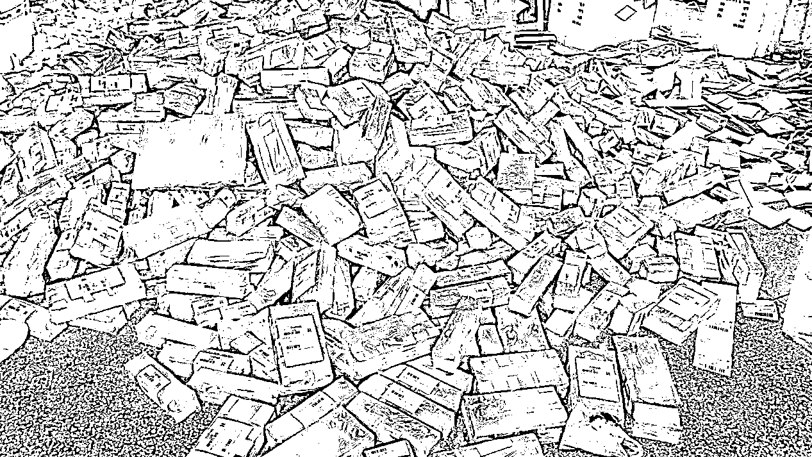

独立站，通俗讲就是脱离亚马逊、eBay、Wish、Lazada这些第三方平台，自己搭个站点卖货。相当于完全自主的电商平台，商品上架、营销推广统统自己来。

成本方面，独立站整体比平台卖家要省一些，但也不绝对。通常利润比平台高。成本大头有四块：
- 建站：一年大约3000元上下，如果定制需求多，费用另算。
- 引流：除了免费渠道，要备钱测试Facebook、谷歌、YouTube、KOL网红。
- 备货仓储：需要少量储备，回款快，备货压力不大。
- 物流：根据商品选物流方式再算成本，和平台物流差别不大。

运营逻辑其实和平台电商一样：产品—流量—转化。具体怎么做？
选品：参考亚马逊思路，选30—50美元、轻便小巧的商品，成本控制好，利润能比亚马逊高不少。
建站：买域名、选平台，Shopify、Shopline、Ueeshop都很成熟。
流量：平台卖家靠站内SEO和PPC，独立站得从社媒、搜索引擎把用户引过来，开放性更强。每个卖家情况不同，要选最适合自己的推广方式。

我自己的从0到1，大致拆成几个阶段。

**市场调研**

当时我用Adspy这个广告间谍工具，把近5年情人节、圣诞节前几个月的爆品全都扒了一遍。整理成选品表，把同行投放日期、视频图片素材、互动率、投放国家、广告文案全部记录下来。每天盯最新帖子，如果同行持续投放，说明在加预算；再看评论区，如果最近几小时还有新评论，说明广告一直处于活跃状态。

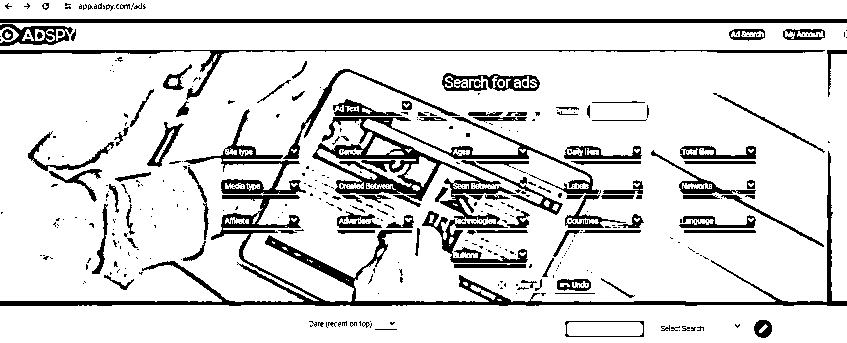
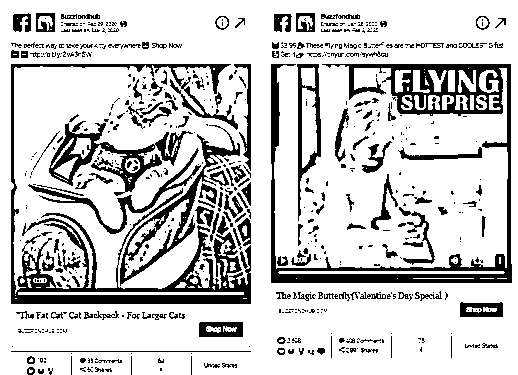
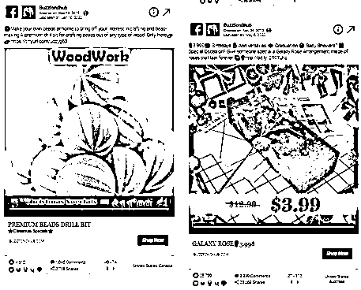

另一个渠道是Facebook广告资料库。看同行主页投放了多少条帖子，数量越多，说明广告组或素材测试越多，代表他们很看重这个产品。如果每天还在增加，可能是正在放大预算。

这里有个坑必须提醒：近两年有些跨境工厂滞销了定制库存，他们发现广告资料库会统计帖子数量，于是故意把滞销品外包给老外拍混剪视频，开200条广告，每条只给0.1美金预算，资料库显示200条，制造爆品假象。很多人见到就冲进去跟卖，结果测品费用打水漂。这种就是假爆品。

筛选完产品后，去1688找货源，做利润表，算出广告要做到多少单次购物成本才能保本。

**制定广告投放预算**

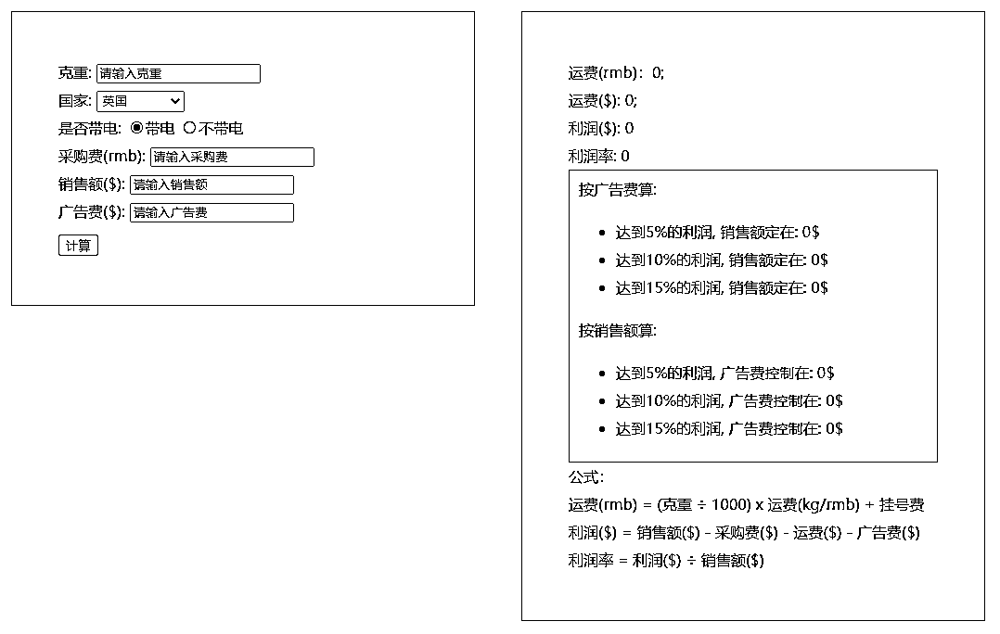

预算怎么定？后面有具体公式。

**素材**

素材能用YouTube博主的开箱或测评视频做开头混剪。担心肖像权、版权？我们做过处理：只剪开箱部分，不露脸，换音频，加转场卡点，再混入一些亚马逊买家秀里拍得好的片段，剪成15秒左右。

剪辑思路有几条：
- 先想清楚视频要表达什么。
- 确定产品定位，大脑里有个大概样式再找素材。
- 根据落地页关键词去YouTube、Ins搜，没找到就换关键词。
- 剪辑前先把音乐风格定好，省时间。
- 素材有限，要让有趣的画面凸显出来。
- 前几秒最关键，把亮点放在第3、4、5秒。
- 加音效增强氛围和互动感。
- 认真检查是否有侵权logo、画面或音乐，发现就改。
- 相同产品可剪多种风格，对比数据后总结适合的风格。

**广告测试投放**

单个产品建2个广告系列，分别投FB和INS。
测试期选最有把握的性别和年龄，产品跑起来后再扩展受众。
单个广告组预算10美金，首次上架只开2个广告组。
排期从凌晨0:05开始投，早上醒来就能看到数据。
版位方面，FB和INS全部勾选。

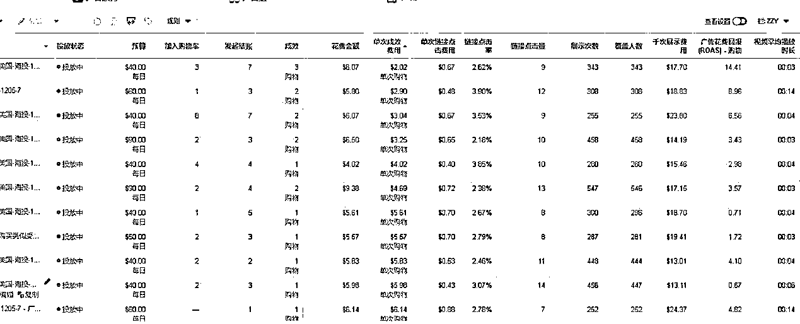

**测试期怎么优化和判断**

广告覆盖到300人后开始看数据。

没出单时：如果单次链接点击费用超过1美金，或者链接点击率低于1.5%，满足任一条就关闭广告。分析问题、优化后再建新广告组，重复试2-3次。如果数据达标但还是没出单，最大测试费用不能超过预算广告费。

预算广告费=（采购成本+运费+30）×0.4

有出单时，以广告组为单位衡量：
- 单次链接点击费用低于1美金（主要）
- 链接点击率高于1.5%
满足这两个条件前提下：
- 第一天单次成效最高允许预算广告费的200%，超出就关闭重开。
- 第5天单次成效不能超过150%（以投放期间数据为准）。
- 第10天不能超过100%。

产品售价=（采购成本+运费+预算广告费+30）×1.05

**已验证产品的放大**

当一个广告组连续3天盈利，就可以优化放大。

初始状态是广告组预算10美金。
受众细分：按测试数据拆分性别、年龄、版位、广告媒介（FB和INS分开建系列）。兴趣保持和测试组一致。注意细分后人群要超过100万，比如某兴趣下30岁男性只有30万，就把多个年龄合并到一个组。

预算调整：当广告组成效到10、20、30，且单次成效在预算范围内，就把预算增加到20、30、50美金。

年龄边界：边界年龄成效在预算范围内，就向外扩2岁；超出预算范围就收缩。经过至少3轮重投后，再依据数据决定是否关闭。
另外，FB广告有偶然性，初期走势会影响后续成效。如果单次成效超过预算广告费，就关掉原组，复制重建，按上面的判断重新测试。

**日常维护**

每天看评论，能回复就回复，不能回复就隐藏。

**案例分享：银河玫瑰**

最后分享一个印象很深的爆款。拼夕夕进货价只要1块钱的塑料玫瑰，用滤镜拍出高级感，加上精美包装，一天出1万单——这就是“Galaxy rose”特效银河玫瑰。

2019年我做了20多个玫瑰相关网站。卖得好的店铺，在广告资料库或Adspy里能搜到历史广告记录、互动率和真实客户留言。现在很多店铺已经找不到，因为这个产品就像玫瑰，只红了一阵子。

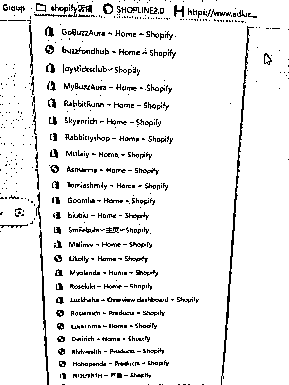
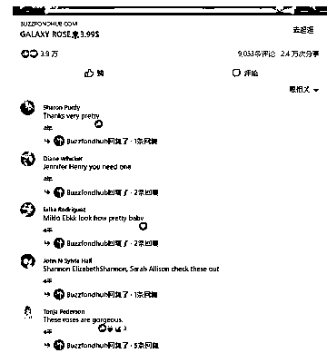
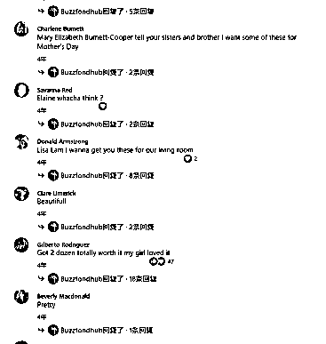

国外用户对运费比较接受，独立站购物付运费很正常，甚至有人愿意给小费。不像国内，看到2块钱运费都想换一家。

当时算过一笔账：1元成本，卖19.99美元，单件利润大概140元。1朵加盒子的运费约30元，广告能扛到15美金；如果一单卖2朵以上，广告能扛到30美金；如果一单卖19朵，利润接近500块。于是策略来了：既然成本这么低，为什么不按数量捆绑卖？

然后找厂家定制礼盒，有3朵、9朵、18朵、99朵不同规格。精美的玫瑰盒子卖9.9美元，因为会增加物流体积和抛重成本。

为了把量做大，我查了大量资料，结合国外不同地区的花语含义，在详情页写清各种数量代表什么寓意，还在海外花语博客社群发内容，同时开Facebook广告。广告缩略图上加了醒目的“3.99$”，进来的访客转化率很理想——很多人觉得便宜，带着购买意愿点进来。

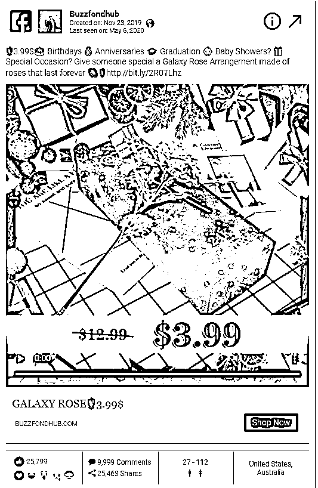

其他同行的缩略图做得很精美，但进去之后价格普遍19.99美元起，最便宜也要8.99美元，可能更想靠视频效果一朵朵卖。

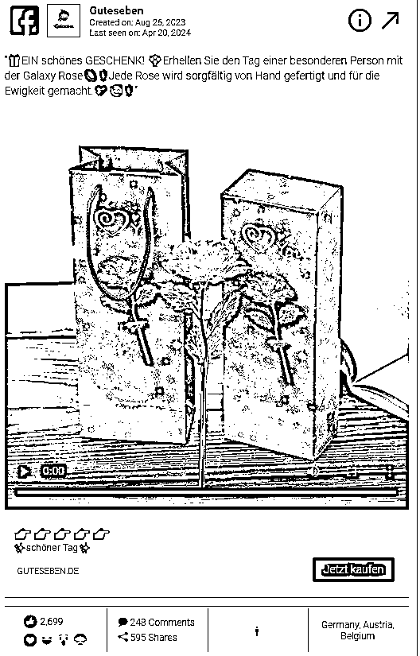

这整套打法的关键，不光是视频滤镜包装产品，还要用礼盒、玫瑰小熊这类配件提升价值感。流量也不只靠Facebook，还要配合社媒营销、帖子转发。当时我在海外红人合作网站找了网红，请她们写情人节礼物含义和花语文章，顺便转发到Ins，总共只花200美元，换来5篇高质量文章。很多粉丝看到博主内容直接来下单，使用博主折扣码，每朵花减1美元，订单完成后我再返博主0.5美元。通过这种方式带来大概2万朵订单，博主也拿到了1万多美元返金。

第一次发帖就聊到这。觉得有用的话，后面我会继续写。