# 24年6月 AI编程(爬虫)航海 - 志愿者复盘
作者：龙哥

哈喽，我是龙哥，一名Java后端程序员。平时爱折腾代码，也喜欢把技术里的门道分享出去，总想着在自己的领域里再多做一点事，再多帮一些人。这次是我第一次以志愿者身份在龙哥盟上船，负责的是「AI编程（爬虫）」航海项目的支持工作。

选这艘船，其实不是心血来潮。我本身就是程序员，对AI和编程天然感兴趣。我特别希望通过这次志愿者经历，让更多圈友真正把AI编程用起来，同时也让自己在服务过程中收获新知识与实战经验。过程中，领队Rice给了我不少认可和表扬，这不仅是对我工作的肯定，也让我更有动力继续往前走。下面就把我这段航海志愿者的心得和盘托出，希望给后续上船的志愿者和船员一点参考。

先看看这次带组的数据吧：小组共有31位船员，最终上岸31位，上岸率100%。其中2位船员全程满勤，拿下“行动的巨人”称号；1位船员打卡15次以上，解锁“航海王者”；所有船员都打卡满12次，顺利出师。

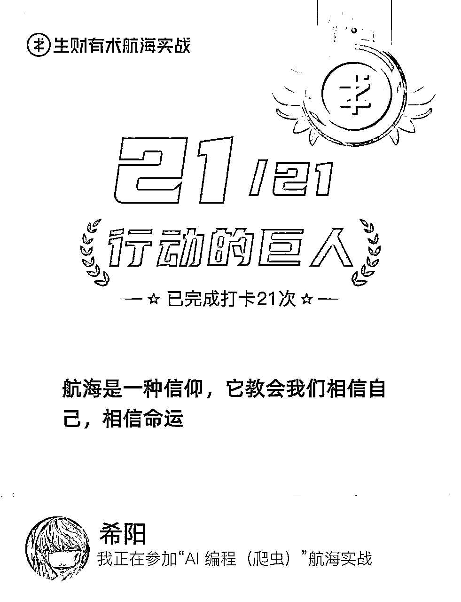

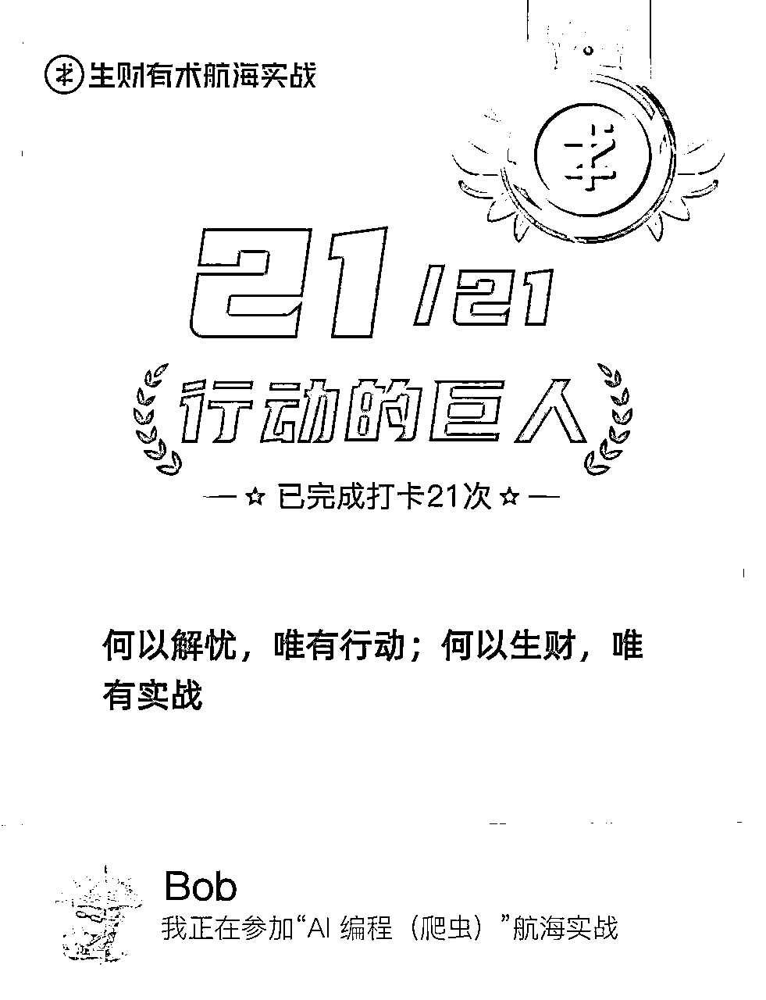

我自己这趟也完成了21天满勤，同样成了“行动的巨人”。

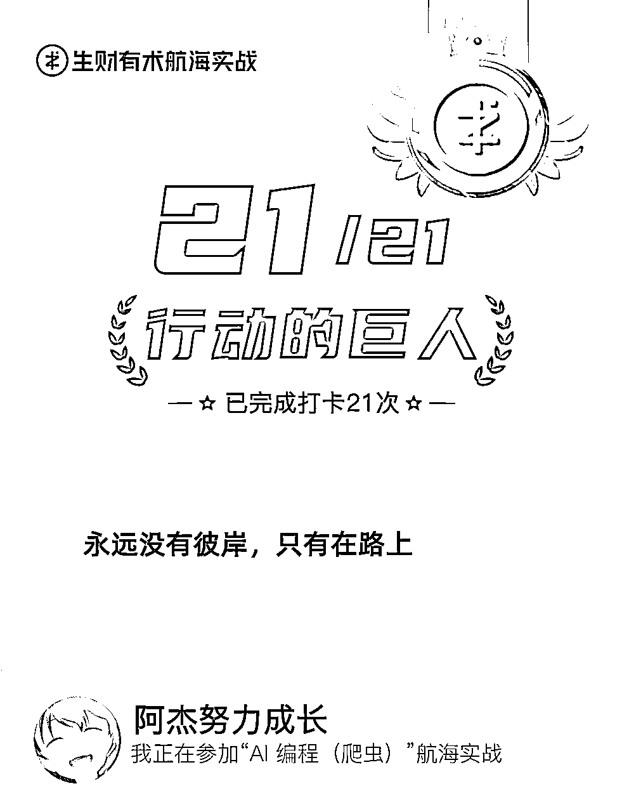

有人可能会问，为什么偏偏要当志愿者？对我来说，这是一个视角转换的契机。我是去年加入龙哥盟的，从那时起，每一期航海我都没落下，但身份一直是船员。今年续费的时候，我暗暗决定不再只当参与者，而是主动站出来承担更多，试试志愿者这份角色。

当然，光有热情还不够，任何事都需要一个能持续下去的正反馈。我给自己列了几点期待：

一是打磨“真诚利他”的心态。龙哥盟有一条价值观我特别认同，龙哥说，保持真诚、保持利他，这条原则让他十几年持续受益。我想借着志愿者工作，养成用技术帮助别人的习惯；未来如果自己遇上难关，也会希望有人愿意伸出手。

二是链接新朋友。当船员的时候，交流最多的反而是志愿者；平时我在社群里话不多，算是“赚钱小透明”，社交圈也窄。这次以志愿者身份出现，希望能认识更多同频的圈友，这也是我选AI编程航海的原因之一。

三是学习社群运营。起初在预备群看到有人说现在不能随便拉小群，我还挺失落的；后来才明白，只要提前报备并且能给船员带来更多价值，小群是可以拉的。这个发现让我意识到，身边就有很好的运营实操机会。

四是积累术值。术值能兑换赚钱门票，我今年的目标是：就算副业暂时没赚到钱，也要靠志愿者工作攒够术值，把下一期的门票换到手。

再聊前期准备。

报名时，我首先选了自己真正感兴趣的航船。毕竟航海过程中要和船员一起学习交流，感兴趣才有长劲。我对AI兴趣浓厚，所以这次选了AI编程和ChatGPT方向的航船。另外，志愿者带头打卡也很重要。打卡是记录和复盘的好工具，每天写一点，既能看到自己的成长轨迹，也能为日后反思留下素材；带头打卡还能形成榜样作用，带动整个小组的打卡氛围。兴趣驱动，行动自然更有热情。

开船准备阶段，我注意到AI编程是第一次起航，没有现成的往期手册，不过有航线图可以参考。

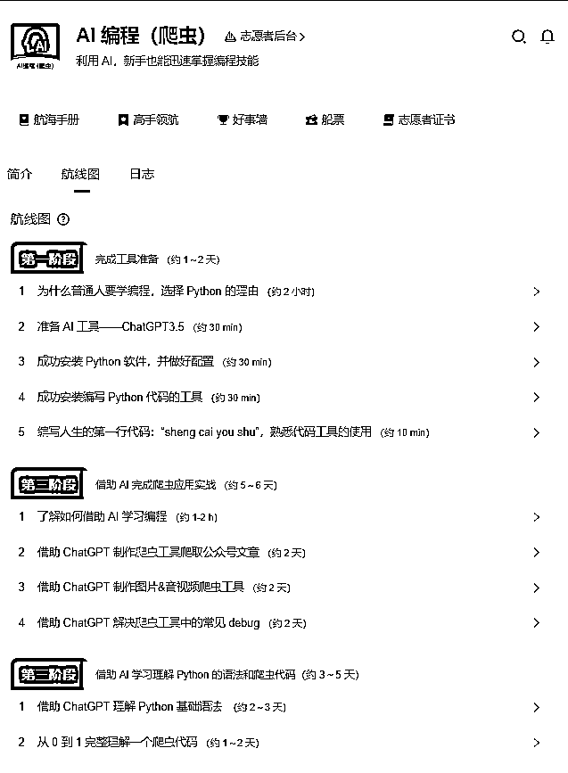

靠着航线图，我大致摸清了这次航海需要准备哪些工具，也提前带船员做了预习，比如安装Python、配置开发环境。毕竟我是程序员出身，顺手给大家整理了一些快速上手的入门知识。这些内容不仅让船员对航海的兴趣浓了，也一下子拉近了大家的关系。更重要的是，船员们很快意识到，有问题可以找我；后面也确实有人主动来求助，这让我很欣慰。

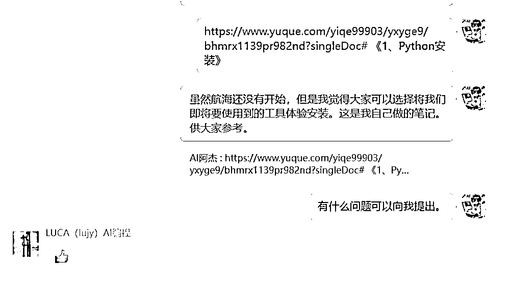

为了提升支持效率，我还额外创建了一个“AI志愿者阿杰”。简单说就是下载志愿者手册，把文档喂给GPT；这里也可以用其他AI工具，比如KIMI这类国产大模型基本都支持。然后让AI帮忙回答常见问题、给出技术建议、做信息同步。这样一来，重复性工作大幅减少，信息传达也更准确、更一致。

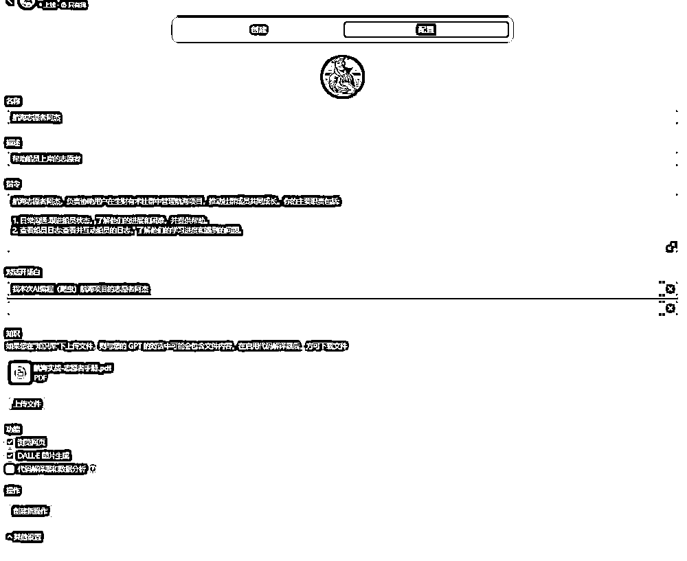

实际操作下来，这位AI助手能快速响应船员提问，还能记录和追踪项目进度，确实帮我省了不少时间。

真正进入航海过程后，我最大的感受是：细节决定体验。

每次帮船员解决完问题，我都会鼓励他们趁热打铁，把解决过程和经验写成好事记录日志。刚吸收的知识，只有立刻落到笔头才容易内化成自己的东西。

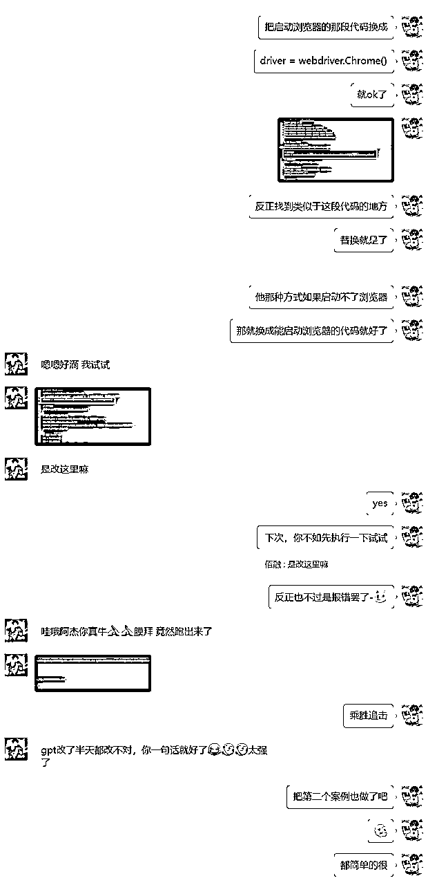

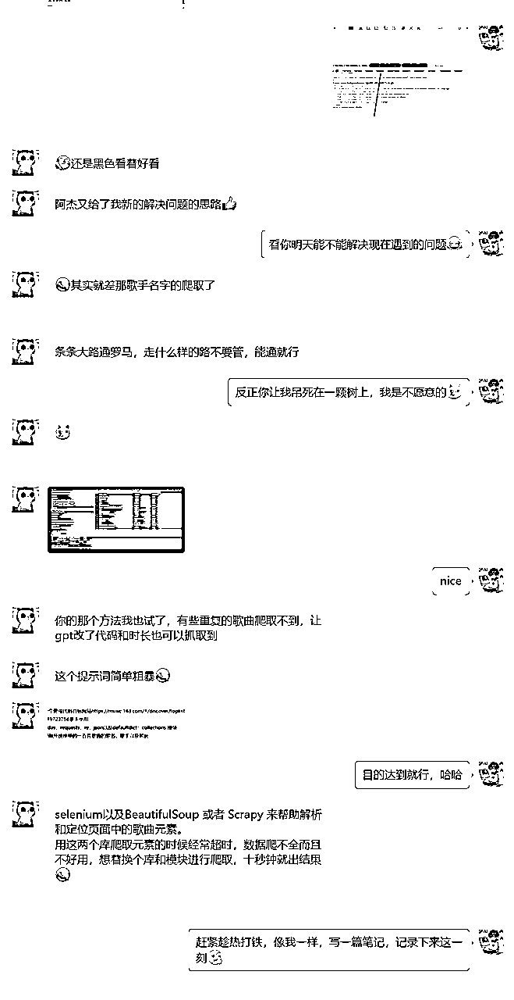

接着就是建小组群。这个动作的目的很直接：提升信息同步效率，增强船员之间的互动，及时处理航海中的问题。通过小组群，我可以随时同步全组的打卡进展，激励大家坚持下去，从而提高整体参与度。

群内实时同步通知，保证消息第一时间触达所有人。

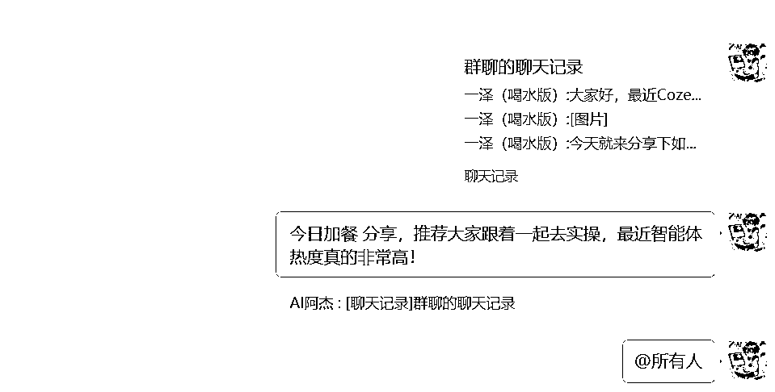

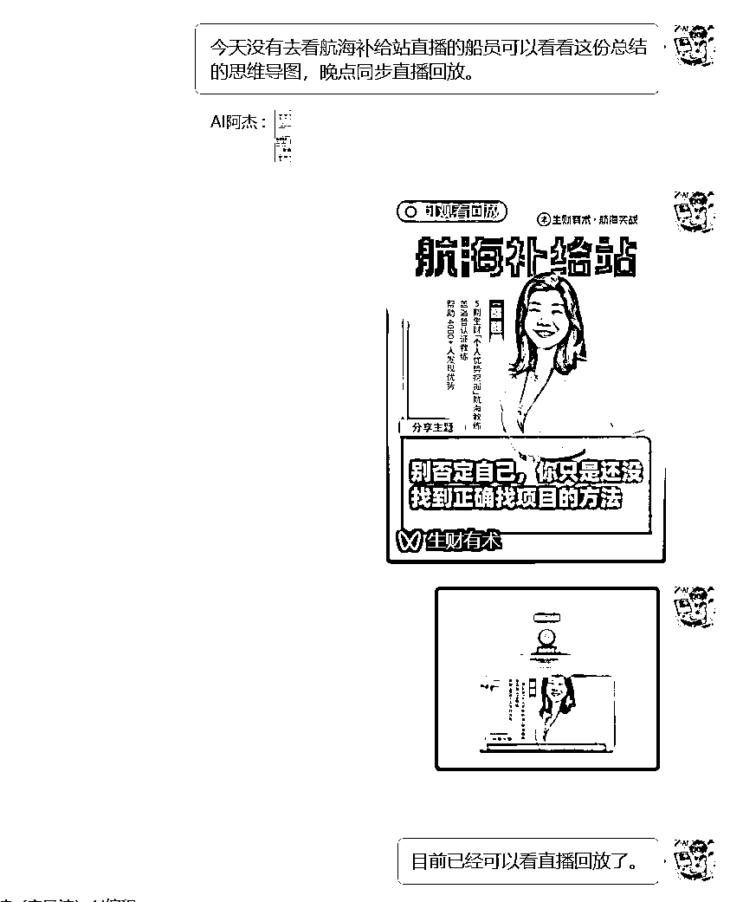

每天催打卡、同步打卡情况，也是通过小组群完成的。这样做能确保大家不掉队，同时借助好事记录互相打气，让群内氛围更积极。

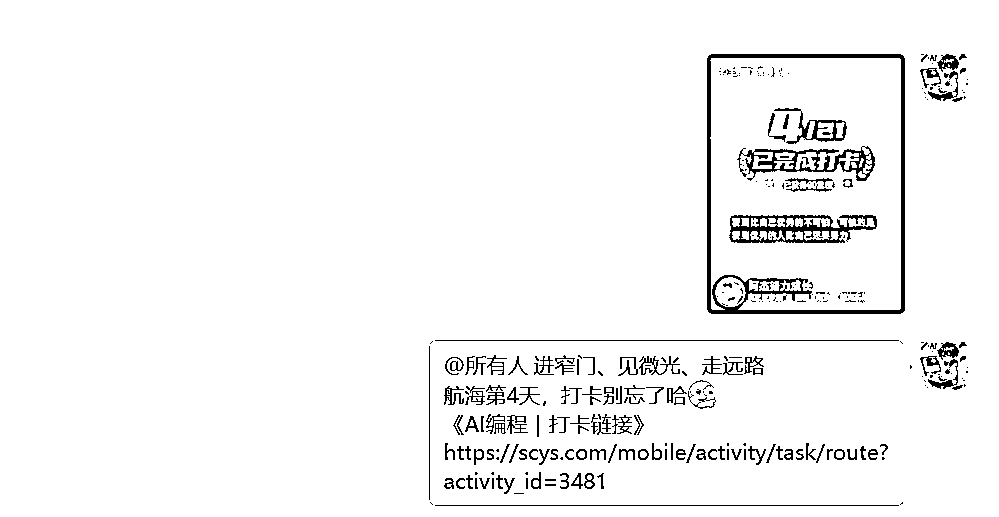

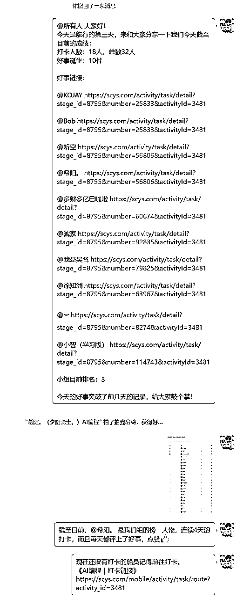

我在群里还会分享一些日常工具和小技巧。毕竟AI编程是技能型航程，AI本身就是用来给航海提效的，多学一个小技巧就多一分效率。

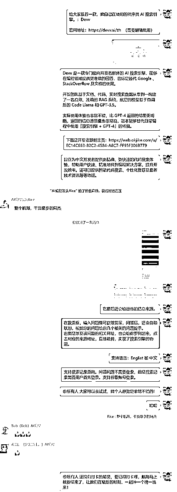

小群还有一个优势，就是能让优秀的人被看见。航海大群每天都有海量信息，不是每个船员的好事都能被所有人注意到；但小组群里我可以公开表扬表现突出的船员，其他人也会因此受到鼓舞，整个小组自然形成比学赶超的氛围。

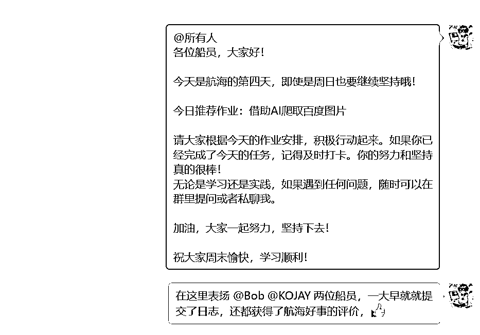

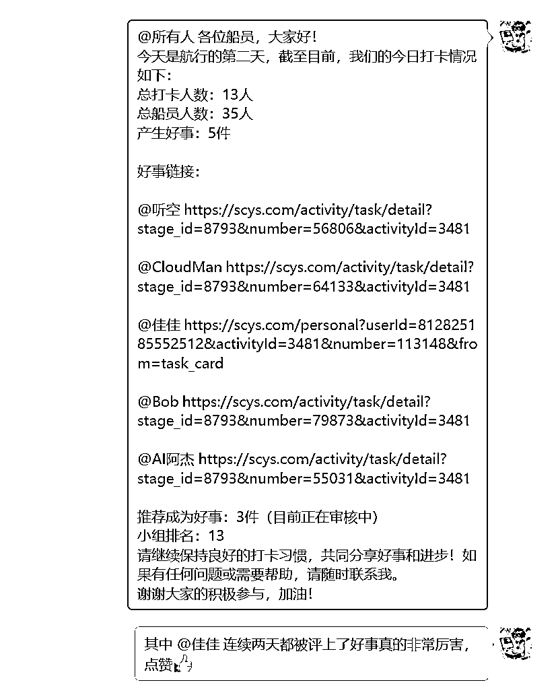

特别想提一位第一次参加航海的船员，也是我们组的榜一大哥。

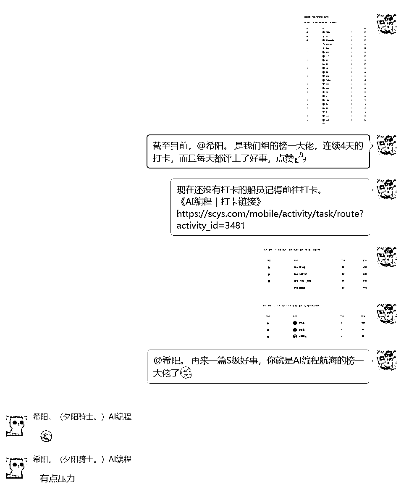

后来他一路坚持，完成了21次打卡，拿下“行动的巨人”称号，最终排在航海个人榜第二名。

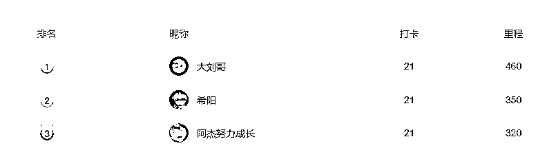

想想我第一次航海时，也只是勉强打满12次，惭愧啊。

组内互动也很重要，尤其是“花式催打卡”。这一招是从志愿者群学来的，用有趣的方式提醒大家打卡，能把任务压力变成游戏感。从外人角度看，那种催打卡的消息甚至有点像“[🛰️红包]恭喜发财，大吉大利”的即视感，不知道你们有没有被这种“假红包”骗到过。

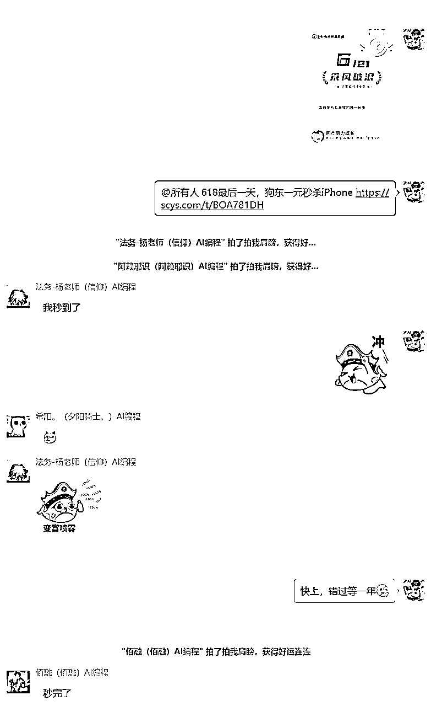

围绕提醒打卡，我不断调整策略。前三天，我会私下逐一提醒没打卡的船员，帮大家尽快适应节奏。到了第四天，我收集了船员们的反馈，发现多数人不需要每天被私聊，在小组群里统一提醒就够了。后来我又补充了一条：连续三天没打卡的船员，一定立刻私聊提醒，避免他们彻底遗忘；到了最后冲刺阶段，提醒频率也会再加码，确保每个人都能按时完成任务。

对于新船员，我的催打卡话术偏欢迎与引导：先热情打招呼，再关心是不是遇到了困难，然后主动提供帮助，一起定个小目标。对于老船员，话术则更直接：先肯定他过往的丰富经验，再用“是不是这次遇到麻烦了”来切入，必要时约个语音聊一聊。之所以区别对待，是因为新人首先要适应流程，需要更多引导和安全感；老人则已有经验，需要的是继续坚持的动力和解决问题的通道。

此外，我每天都会翻看所有船员的日志，看到值得鼓励的地方就点赞、评论。这么做既能提升船员的成就感和积极性，也能及时了解每个人的进度和难处，顺便看看有没有人在“水日志”。说到这个，我想起以前做📕时写过一些鸡汤类内容，有网友在评论区分享自己的近况和心情，我会逐个回复鼓励。他们给我的正反馈很真实：有人说心情好了，有人说谢谢，还有人直接关注了我，特别有成就感。

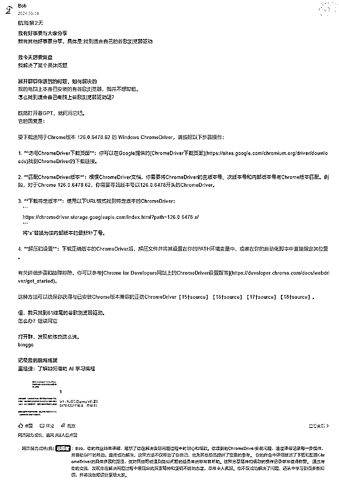

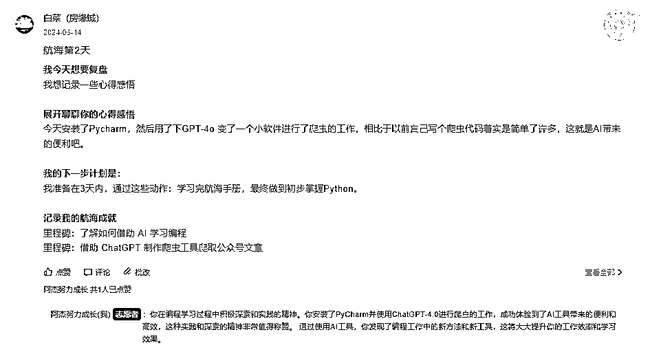

中途遇到个别“水日志”的船员，我会马上纠正。日志的价值在于记录和复盘，认真写才能在下一次实操中改进。

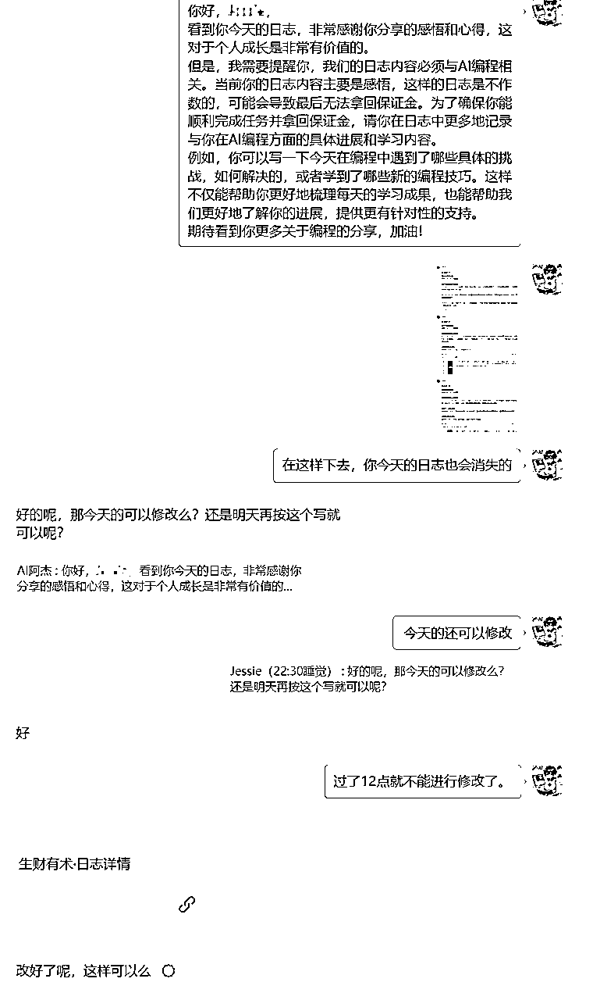

后来，我注意到那位船员真的调整了。当他做出改变并拿到结果时，我立刻给出积极反馈，那个被认可的瞬间，他明显更愿意认真记录了。

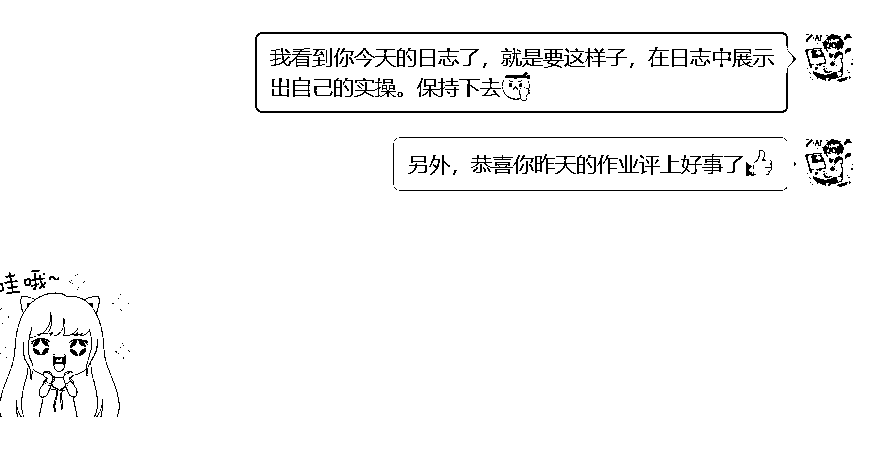

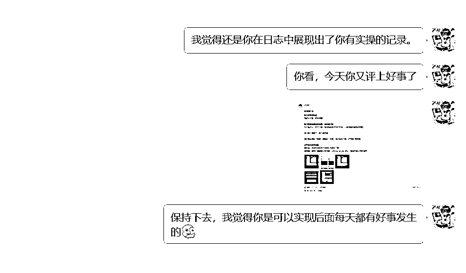

从那以后，这位船员一路坚持到上岸，完全不需要我再操心。

到了最后冲刺阶段，对于还没上岸的船员，我采取每日催打卡机制，直接告诉他“现在已经打卡N次，再打卡M次就能上岸了”；对于已经上岸或快要上岸的船员，我会鼓励他们冲刺更高目标，比如航海王者和行动的巨人。说实话，我报名时写的目标是90%上岸率，但既然有机会冲到100%，为什么不去拼一把？

整个21天下来，我最大的感受是：当志愿者没有想象中那么难。一开始我甚至担心自己能不能胜任，但和领队以及其他志愿者聊完之后，加上实际操作中的反馈，我发现这个角色更多是“用心”和“持续”。尤其看到一位原本打算划水度过航海的船员，因为我的带动而改变了态度，我开始相信：每个人的行动都可能影响身边的人。

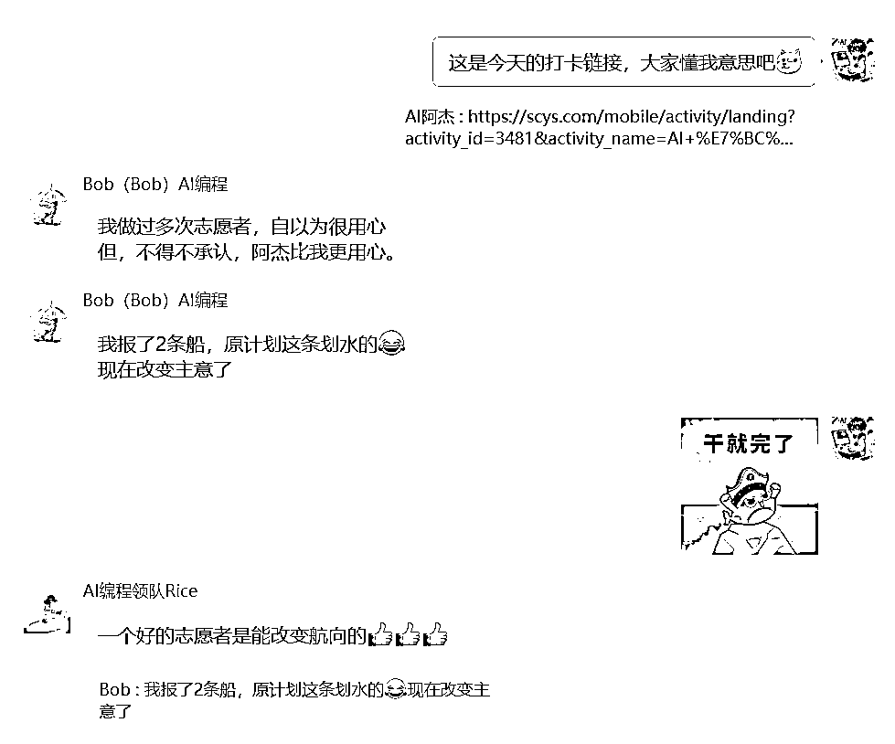

而那位船员，最终也完成了21次满打卡，拿到了“行动的巨人”称号。

再说说我的收获。第一是运营技巧。这次航海让我完整走了一遍社群运营的流程，以后如果自己做社群，这就是宝贵经验。第二是编程与记录。虽然我平时写Java，并不是Python程序员，但每天记录学习笔记让我意识到，未来我完全可以整理出一份自己的航海手册，甚至作为产品出售。第三是社交圈扩展。航海期间认识了很多不同行业的圈友，大家互相交流，我传授编程经验，对方给我讲Web3知识——这恰好呼应了我开头提到的利他心态：你先帮助别人，回报说不定很快就来了。

当然，复盘之后也看到自己的不足。一是时间管理，工作之余兼顾志愿者任务，偶尔会觉得时间不够用，之后要更合理地分配精力。二是工具使用，像“易歪歪”这类效率工具我还可以用得更充分，帮助自己管好信息、提升沟通效率。三是团队互动，还可以更主动地和其他志愿者协作，共享经验和资源，让志愿者这份工作产生更大的价值。

希望我的这份复盘，对未来的志愿者和船员都有用。我们下期航海见！