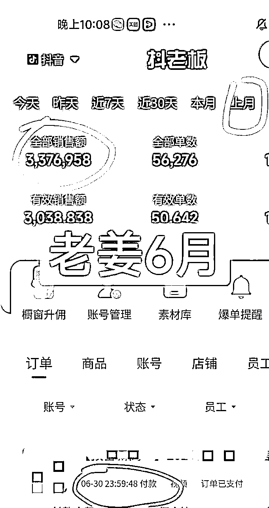
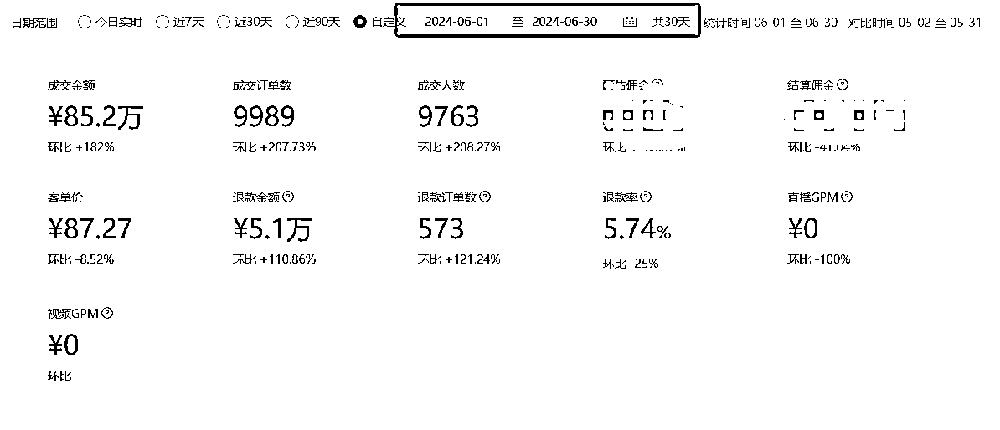
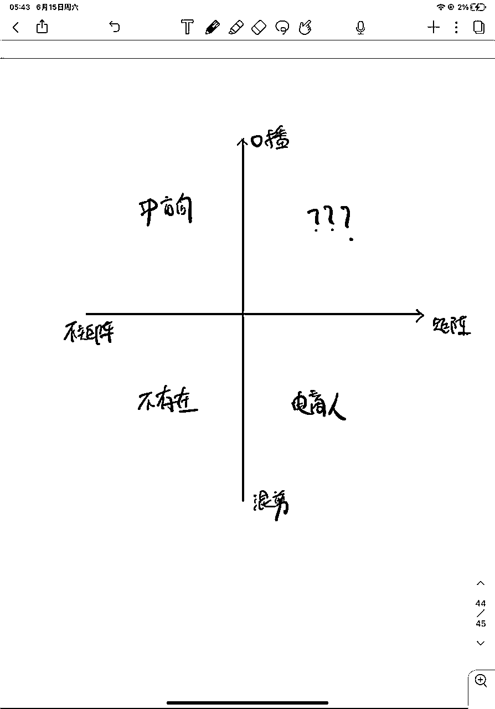

# 短视频带货一年，我把流水干到了30倍，这三个月悟到的事

> 来源：[https://bqwkrkc6dh.feishu.cn/docx/Ac7HdDG2TokddQxPA8Ic1YcAnnc](https://bqwkrkc6dh.feishu.cn/docx/Ac7HdDG2TokddQxPA8Ic1YcAnnc)

我是 lip 老姜。近三个月，依旧死磕教辅短视频这个赛道。

这半年里，我一直在这儿更新项目养成笔记，教辅带货的实操全过程。每次都觉得这可能是最后一更了，结果项目又活了过来。

现在的状态是，小团队从起初两个人，扩到四个人。六月流水冲到了450万。

回头复盘这三个月在干嘛，很有意思。总结出来的经验，基本都和生财反复说的赚钱底层逻辑一模一样。今天就用我这三个月的实战进展，聊聊生财那些真能落地的原则。

# 前言

市面上有个老问题：为什么道理都懂，还是过不好这一生。

放到生财的语境里就是：为什么发财的道理听了一箩筐，人还是穷。

我觉得，道理只有穿透身体才算你的。

道理很简单吧，知识多的人就强？一个桶往里倒水，水越多桶越满？这逻辑太粗了。

知识改变命运，是需要一个载体的，这个载体就是人格和故事。我们读的书、刷的视频，大多数很快就忘了。但如果你遇到过几个真正喜欢的人，有趣的人，他们坚守着你早就知道的原则，并且用结果证明了它。那这些原则就会通过他们的故事钉进你的脑子里，形成烙印。

这时候，道理才真正属于你。

希望我接下来的这些经历，能帮那些硬核道理穿透过来。

# 一、把心磨出茧

想赚钱，执行力必须拉满。生财一直强调执行，但执行力其实是结果，不是起点。你不能空喊着要执行力。更该盯的是执行力之前的那个前提。

菩萨畏因，众生畏果，因控制住了，结果自然成。

我给这个前提起个名字：磨心茧。

## 我的经历

要聊明白这个，得回到六年前我刚做销售的时候。

2018年我30岁，抱着销售赚钱的念头去做大客户销售。心理准备是有的，知道会被虐。

现实比预期更难受。

刚开始就是给一堆奇奇怪怪的线索打电话。有的线索不知道从哪儿捡来的，有的被前同事骚扰过无数次，有的和业务压根不沾边。心里只想骂人。

打电话只是第一步。成交几万几十万的东西，还要跟进、拜访、摸需求、出方案、砍价、走流程。距离成交远得很。

很多新人卡在打电话这关就怂了。

现在回看，那其实是一个心变硬的过程。做事的人谁都逃不掉。

一次次被拒是常态，一次就签单是运气。玻璃心不被老茧包裹住，一点拒绝就情绪炸裂、计划全乱，后面就没了。

所以执行的前提是，别被拒绝带偏情绪。每天100通有效拜访，打不完就继续干，没空回味上一通被挂电话。

刚开始还会想下一个怎么说，做心理建设。后来直接打，有号码就拨。话术顺口就来。进入一种脑子在想怎么做，心里没波澜的状态。

不管上一通是热情、闲聊还是骂街，心都被厚茧包住了。

大客户销售这条路，成千上万人走通了。你只要照做，结果就不会差。做项目也一样，有结果的人告诉你12345，你磨好心茧照做就行。

## 学员的反馈

短视频也一样。不出单是常态，爆单是偶然。

做短视频也是给心里上茧的过程。十几二十条没出单就怀疑方向、怀疑自己，执行就断了。

我观察最近三个月一直出单、甚至爆单的朋友，他们交流完就去干了。偶尔问问选品，也不纠结。

反倒是总问我：

“这条素材为啥不出单”

“我做了这么多，为啥没转化”

“发了好几条，为什么不消耗”

这些问题背后都是心还没定。一点涟漪就波动，影响动作。

遇到挫折就停下来找安慰，任务没完成也罢了。

内容需要情绪，但创业者不需要。收起情绪，当个没感情的拍摄剪辑机器，才能持续进步。

在我眼里，大家就跟当年验证过的大客户销售一样。我这个去年才入局、没有任何短视频经验的跨行新人，没技巧没黑科技，就是想清楚了、磨了心茧、执行拉满，才走到现在。这条路我能走，你也能。

# 二、先看清市场，再看清自己

六月GMV破450万。

在生财里不算高，但放在当下环境，对一个入局一年的人来说，我已经很满意了。

支撑业绩的，除了执行力，就是规模化。而规模化之前，必须先搞清楚自己。

## 教辅市场现在长什么样

先说玩家分布，我的粗糙分法是看口播和矩阵两个维度。

不矩阵+混剪：基本看不到，有点难度根本起不来。

不矩阵+口播：市场上最多的是这种“老师型”个人号，自己想选题写稿拍剪发，一条龙全包，两三个号就满负荷，矩阵不了。

矩阵+混剪：大量电商团队的选择。没IP不想IP，不写稿不拍人，直接下素材混剪海量发，靠量打。

口播+矩阵：最少。除了头部几家，几乎没人玩。头部之所以能玩，是因为有料会讲，又舍得拼命，一天拍50条起步。

看清形态后，再说规模化怎么来。

## 了解自己：我是谁，我的边界，我怎么放大

我快奔四了，社会毒打总结出来的自我画像：

### 第一，踏实且有欲望。

意识到市场玩家格局后，我马上看到机会：口播+矩阵这个位子是空的。

老师和商人是冲突的。你很难想象一个老师一天写20条稿、拍20条、剪20条，再分发到10个号，还要带商务、投流、发布。

老板也一样，很难想象老板每天什么都不干就去拍。文案能外包，剪辑能外包，但脸必须自己露。每天20条，太要命。

这个生态位一直空着。我相信看到的人不止我一个，但没人上。我就上了。

我错过了买房、比特币、拼多多、抖音，太多个生财的情报我都错过了。这次不能再错过。这只靠努力和执行力就能拿下。

所以我用勤奋给模型加了第一桶油。

### 第二，我是商人，不是老师。

卖教辅不等于必须是老师，这让我复制和放大特别快。

起号时，我从不自我限制。什么起号法流行就用什么。

选品上，只要一个品在出单就持续拍，爆了就猛拍。很多老师做不到，他们会想“这个粉丝早买过了，要照顾用户，推荐别的吧”。这想法对用户负责，但公域里用户看得到你的照顾吗？

我也不会去做xx文化课的深度内容。一旦开始研究单词背法、几何模型、文言文，我就从商人变半吊子老师，这对我来说是灾难。

我信流程和组织。完成比完美重要得多。很多人说我成了IP，根本不是。我定位就是一个带货素人。正因为身份清楚，规模化路上少了很多无谓的牵绊。

# 三、路是跑出来的，别信顶层设计

这是最近三个月我感受最强的点。

## 新业务自己长出来了

在主营教辅带货之外，现在多了两块业务：

培训业务：第一期30个学员，只要肯干基本都出单，爆单占比20%。佛系的也有。但只要按框架持续拍剪发，吃平单、小爆单，账号权重和精准度会越来越高。等有正反馈了，学员就敢请剪辑，产能上去，爆的概率上去，投入就敢加深，正循环就起来了。

私域业务：过年前开始在内容和评论区引导进群。三个月下来日均进线20人左右。靠这些用户，客单300左右的押题卷在朋友圈卖了大概100单，自然流佣金50%起跳。按这个速度，再优化流程，三个月后朋友圈一天卖一两单高价课也不是梦。

这两个业务起初带货时压根没想过，现在全有了。关键是我没设计它们，是它们自己长出来的。

## 我坚信的一个世界观：盖尔定律

约翰·盖尔在《通用系统学》里说：有效复杂的系统一定由有效简单的系统演变而来。从零开始设计的复杂系统跑不通，也修不通。你只能从一个简单能跑的系统开始演化。

这规律否定了顶层设计的万能。所有复杂的事都来自简单系统的演化。上来就讲宏大设想，大概率是傻。

互联网刚出来时不是给老百姓用的，能用就迭代，一点点变复杂。现在才无所不能。三十年前你说它能写文章、直播，人家觉得你疯了。

阿里也是这样。起初靠电销陌拜，发现商家需要推广，于是做平台；平台有了双边不信任，于是支付宝；支付宝有了沉淀资金，于是余额宝。马爸爸再远见，也想不到电销团队会变成金融巨头吧。

还有铱星计划。摩托罗拉想发射77颗卫星做太空WiFi，花了50多亿，1999年就破产了。原因简单到可笑：网速太慢。早上做个小规模MVP就能避免。

我也见过太多创业者，包括我，一开始雄心勃勃，路上不断怀疑自己是不是错了。其实往往不是起点错，是天时地利细节不一样。我从一条条视频、一场场商务谈起，到现在的高效小团队，这个复杂系统就是在路上长出来的。我信盖尔定律，边跑边精进，而不是卡在完美设计里。

罗马不是一天建成的，但更像是在提醒我们别想太多，先把今天的事做好。

# 四、卷的时代，机会藏在细节里

第一篇我就说过，教辅打法已经很成熟，和图书赛道一样流程化。视频被看到就是爆单，环节多：商务、寄样、写稿、拍摄、剪辑、发布、链接、投放。

成熟赛道的机会就是降本提效，抠每个环节的优化空间。

## 每个环节都可以更快

很典型的达人A找我，说写稿太慢，一天憋半天才两三条。

聊下来发现他剪辑、拍摄、发布全套都有问题。

他用手机剪。团队经验丰富的都知道，手机和电脑在找素材、执行、分享效率上差太多。电脑建个清晰文件夹，按命名规则放着，5秒找到素材。手机刷半天文件夹，越拍越难找。

他拍摄追求完美，一卡就重拍。我不否认一镜到底好看，但中途卡住直接从出错点继续拍，观感影响不大，时间省很多。

他发布也夸张，每个素材都在发布机上再剪一遍再发。

这种细节问题解决后，产出效率直接翻倍。创业者要在出品端盯住每个环节，去提效。

## 商家会区别对待

打法还涉及商家。达人出片，商家投放，看似简单，坑很多。

核心问题是：商家会一视同仁吗？会条条投放吗？会都发样书吗？

核心是第一个。商业世界不可能一视同仁。达人A一天卖2000单，达人B一天20单，资源能一样吗？

新人怎么破局？找细微机会。

一是别硬刚大玩家。他们手里达人不缺，不会给新人资源倾斜。找同样新起来的小商家，共鸣多、手活多、响应快。先把内容质量做上去，等花开了再说。

二是商家也是圈子。商务跳槽、商家拓展代播代剪辑，都是机会窗口。嗅觉敏锐的人能提前卡位。

没有不卷的赛道，机会都在细节里，深耕和敏感度决定成败。

# 写在最后

生财反复验证的道理就这些。想挣点钱，先沉住气。世界不公平，但把一件事做成的基础逻辑是公平的：

第一步谁都绕不开，给心磨出茧。让拒绝和不出单穿透你，再看下一步。