这两年的大环境，相信大家都深有体会。不止你我兜里紧张，我朋友圈里那些曾经风光的老板，也一个接一个破产了。以前开百万豪车的，现在骑着共享小电驴满街跑：
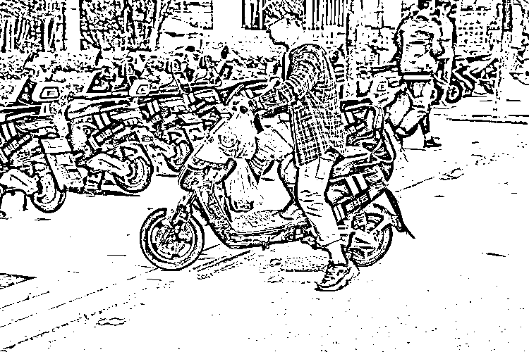
原来住别墅的，如今也搬进了出租屋：
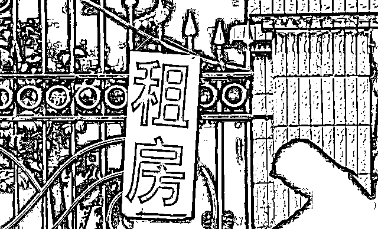
这的确没什么好说的。这几年被市场淘汰的生意，普遍有这么个毛病：同质化严重、门槛又低，说白了就是盈利方式太简单。比如那些低端制造业、建材建筑公司，本质上就是倒买倒卖赚差价。过去行情好时还能赚得盆满钵满，现在经济下行，整条产业链上谁都没得赚。听说连王思聪前任要孩子的抚养费，都说先撑过今年再说：
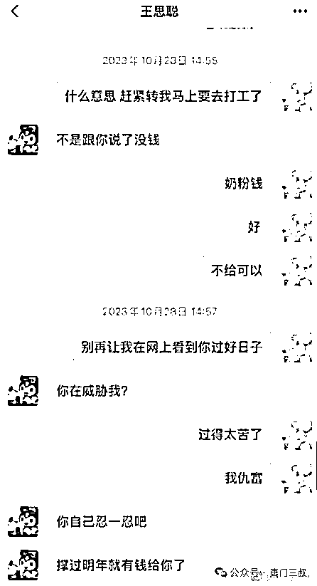
所以从上游到下游，大家全在勒紧腰带过日子。而普通人站在食物链的最末端，当然是最惨的——利润稍微一降，工资就发不出来了，撑不过几个月只能关门。

可偏偏这几年，那些一夜暴富的故事全都发生在你看不懂的互联网上。比如最近爆火的郭有才：
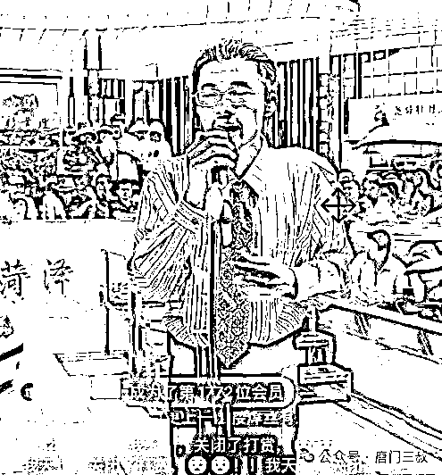
很多大哥大姐就纳闷了：网上火了，钱是从哪儿冒出来的？谁在给钱？其实这属于线上经济，本质上是影响力变现。谁影响力大，谁就有数不清的广告商排队送钱，这和明星代言一个逻辑。但更吓人的是，网红光靠粉丝打赏，攒下来的那个数字，普通人一辈子都赚不到。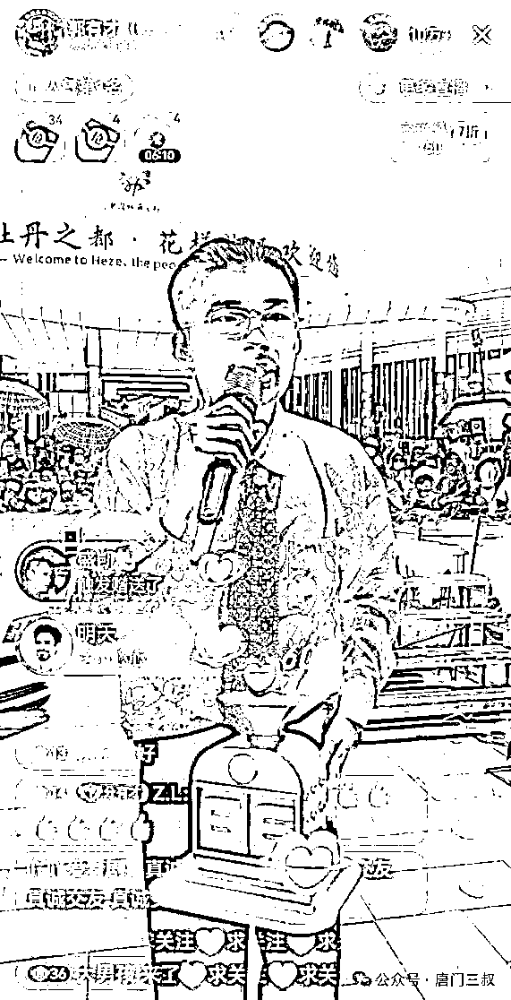 这种模式确实没法三言两语讲透，但我还是想让你明白：正因为如此，才有人能在经济寒冬里照样日进斗金。

反过来想，如果你现在做的事太过简单，谁都能一眼看穿，那竞争必然会白热化。你踩我一脚，我捅你一刀，最后只能恶性内卷，谁都讨不到好处。所以真正赚钱的生意，一定是去做别人想不明白的事，然后悄悄潜伏、下狠功夫。等你赚到了，别人眼馋得不行，却不知道怎么抄，一时半会也挤不进来，更别提取代你，只能干瞪眼看着你数钱。这叫什么？闷声发大财。

所以说，不管线下实体还是线上项目，都得守住一条铁律：只做长期利他的事，只深耕那些别人看不懂的赛道。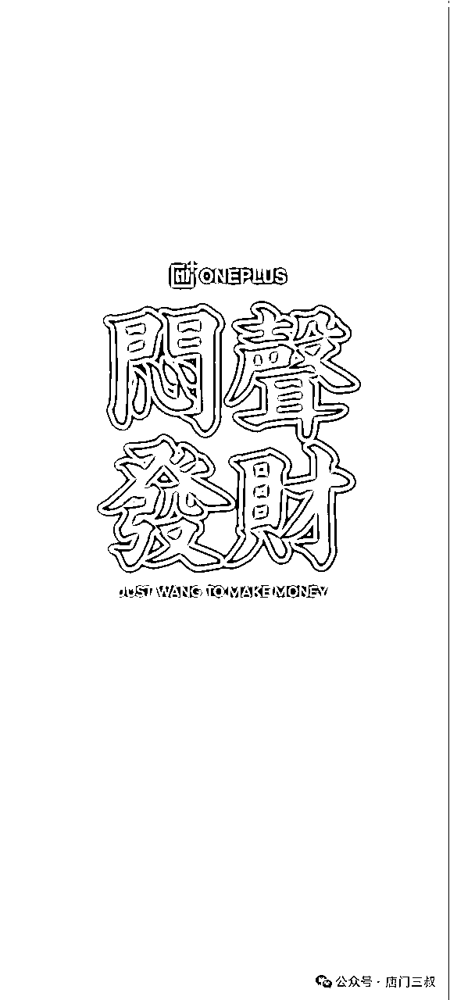

前几天天气特别热，几个老友约我出来喝啤酒吃烤串，问我：“你现在怎么不上班也过得这么滋润？”我说我在做私域IP加视频号带货。他们一听“捞钱”两个字，眼睛马上亮了，借着酒劲嚷嚷：“带兄弟们一把呗……”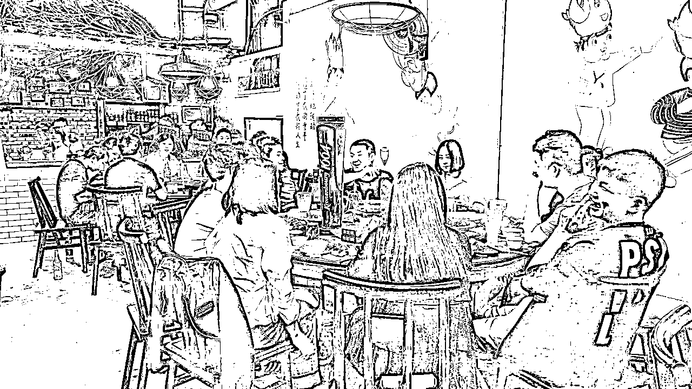 我说行啊，先拿10万块本金出来。他们一听钱，立马打退堂鼓：“我现在要是有钱，还用你带？有没有那种不用本钱的活儿？”我把公众号推给他们看：你看我这个号，每天就写写东西，一年也能赚个几十万。但你能连续两百天，一天不落写文章吗？他琢磨了几秒说：“能，但总得有个保底吧，不然图啥？”我说没有保底，也没人管你死活，爱干不干。话说到这儿，他心里那点念想就灭了，之后再没跟我提过赚钱的事。但每次碰面，说话就变得阴阳怪气：
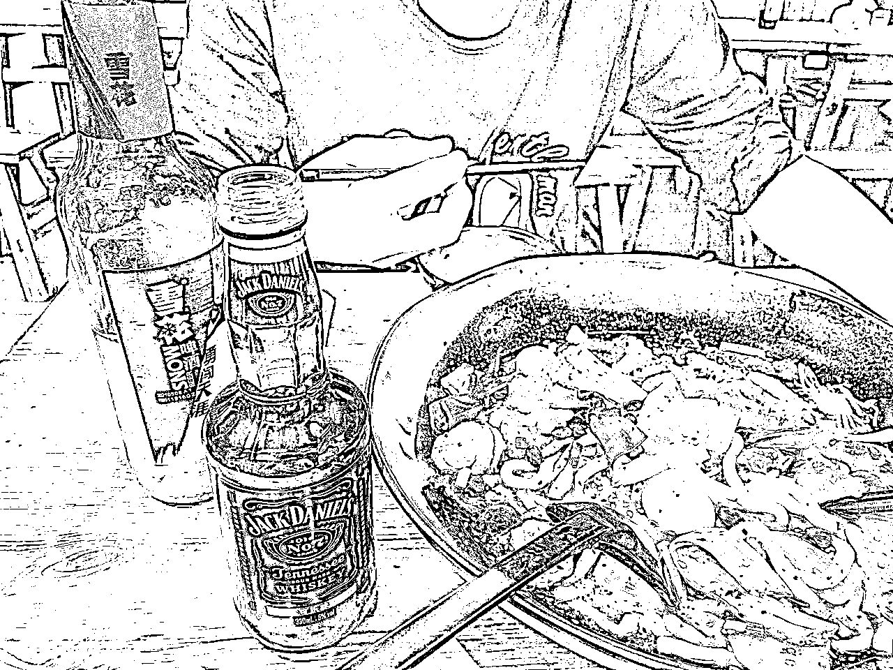
我其实能理解，那不过是想要又得不到的怨气罢了。表面上听着膈应，心里反而偷着乐——因为我清楚，我和他们之间隔着一条够宽够深的护城河，看得见，摸不着。这条护城河，就叫长期主义。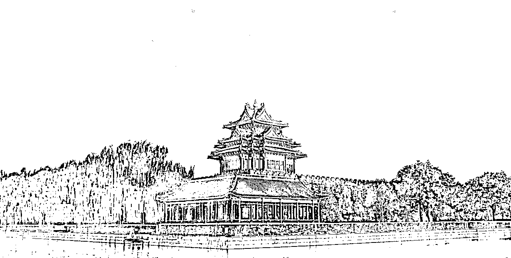

2022年，我在中视频学员群里带了一批人做私域IP。99.99%的人都没坚持住，两年过去了，他们还在不断找新项目、被割韭菜；最后只有3个徒弟扛了下来，其中有个徒弟现在月收入已经超过我了。2023年我又带了一批人做私域IP，写公众号、搭私域模型。这次有5个人坚持下来了，剩下那99.99%的人，退费的退费，转行的转行，把我骂得体无完肤。我也认了，因为坚持下来那几个，现在一个个都活得有滋有味。

刚才想找条聊天记录没找着，倒是翻出了这两年写的一大堆东西：光素材就存了1100多张，文章也有266篇：
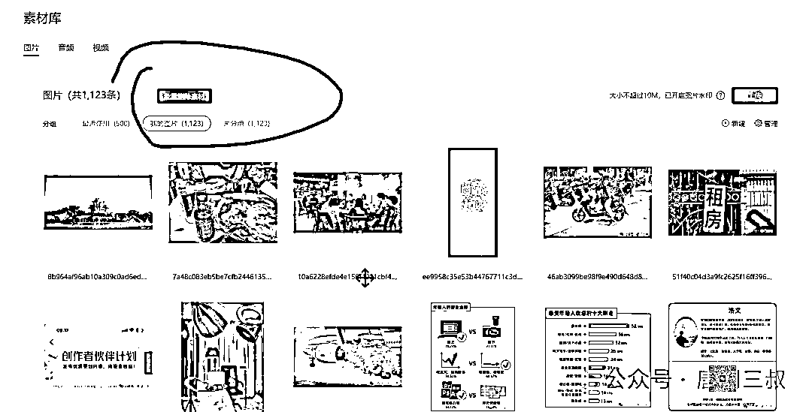
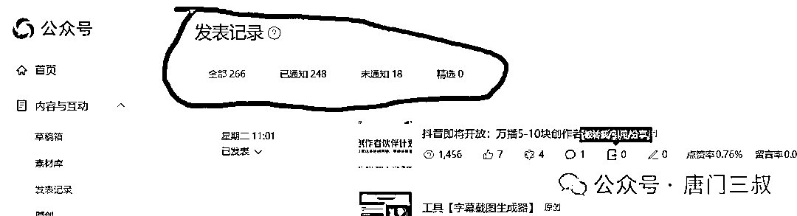
就按每篇文章从选题、构思到完稿发出去平均2.5小时来算，266篇乘以2.5小时，等于665个小时，再除以24小时一天，就是27.7天。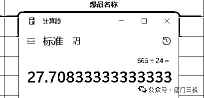 你品品这是什么分量——就是说，公众号上发表的这些文章，不算那些删了的、没发出去的，你全部写一遍，得花将近28天。不吃不喝、不出门、不睡觉，一直坐在那儿写啊、想啊、发啊……这是什么？这就是长期主义。

我知道每个人的时间和精力都有限，而且人与人之间能力差距真的不大。想干成一件大事，跟能力、学历没有必然关系，关键是有没有长期投入、持续打磨的决心。如果你做一件事，总想按天、按小时看到回报，那和上班打工有什么区别呢？世界首富们算的也是年度价值、日间价值，从来不是每小时赚多少。要论小时价值，最匹配的就是工厂的计件工，你只要埋头干活，自然有人把你的工钱算得清清楚楚。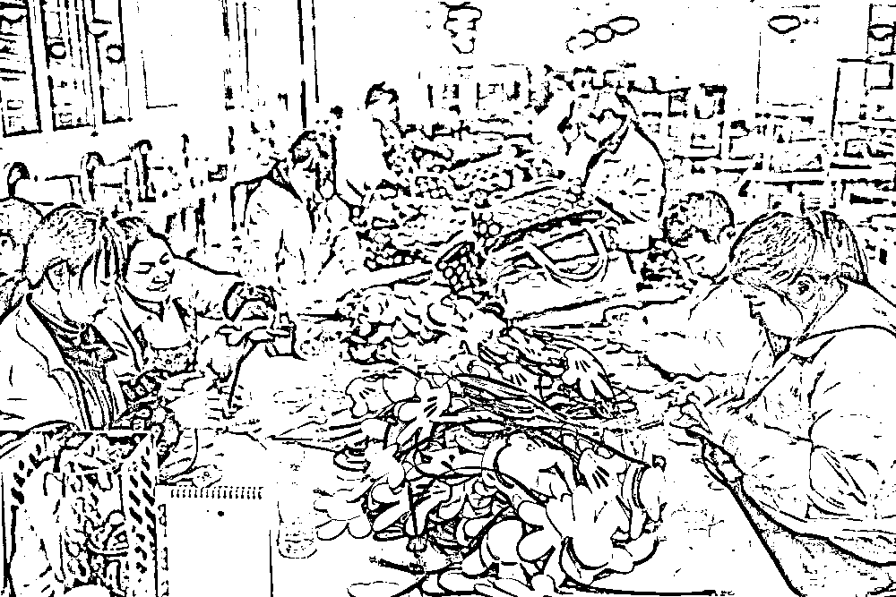

所以，今天给你这个很猛的赚钱偏方：去挑一件大多数人都不屑做、不肯做的事，然后心无旁骛地做很多年。这样做，竞争自然小，你能一直站在一个比较稳的位置。更关键的是，你做的东西要让人觉得望而生畏，既不会嫉妒你，也不会猜疑你，因为就算把成果摊开给他们看，他们也抄不了、学不会，就算想使绊子也没用，毕竟损人不利己。时间一长，大家反而对你心服口服。

一件事你愿意深耕一年、两年、三年、五年甚至十年，人体细胞都换过一轮了。两年后的你，跟现在完全是两个人；坚持三五年下来，你早就脱离了普通人的层面，跨越原来的阶级，成了别人口中那个成功的人。当然，这个过程极其艰难，但大多数人不知道的是，这件事最大的难处，其实在于——如何迈出第一步。

有人可能要说了：我连饭都快吃不上了，哪来的底气坚持三年五年？如果你有这样的困惑，那就先用脑子想想怎么解决生存问题。当初我下定决心做这个IP，最早是被一个叫桂花女王燕的人触动的：
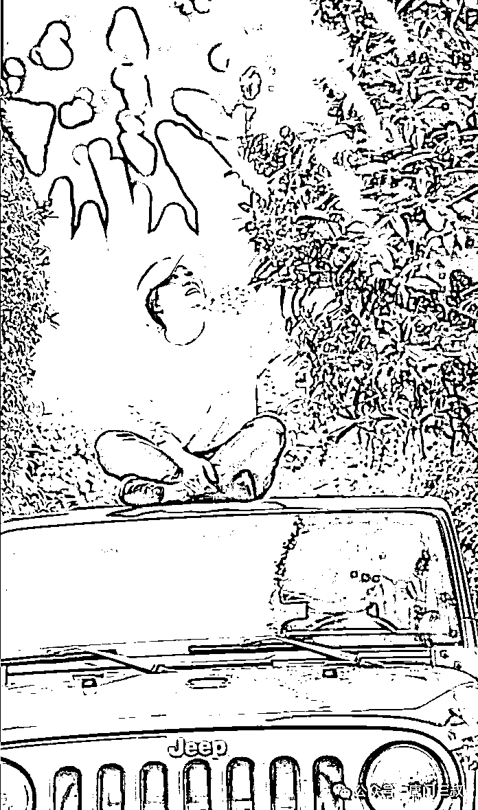
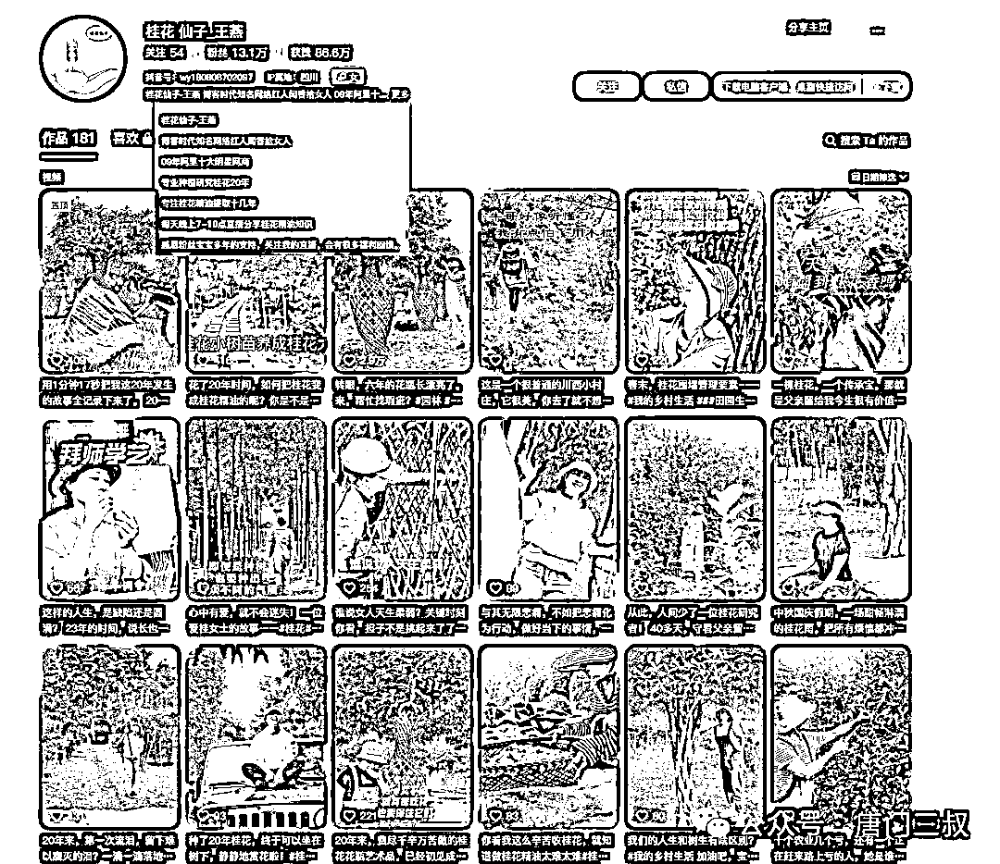
那是一个中年大姐，老公欠了上千万的债，她一个人扛了下来，足足种了十一年桂花，前十年一分钱没赚。第十年过去，第一年她不但把债全还完了，还多赚了将近一千万。我至今记得当时的震动：一个看着柔弱的女人，心里该有多硬，才能十年如一日干同一件事，十年没收入，却在一战成名后全赚回来了？当然，她也赶上了阿里巴巴给中小企业赋能的那波红利，这一点没办法否认。所以，一个人想赚大钱，除了内心足够强悍，还得学会借势、顺势而为。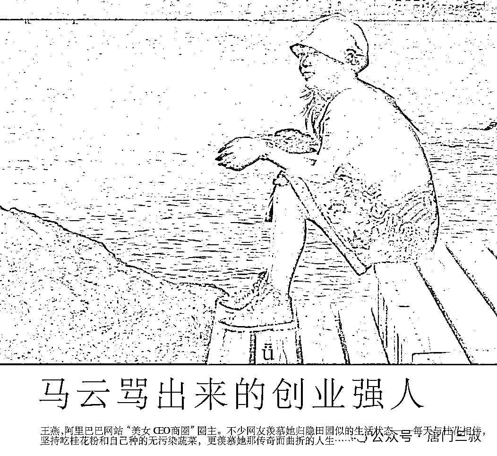

回头看看咱们身边那些熟人，基本都看不上长期主义，只想着有人喂饭，或者干脆白嫖。在互联网搞钱的路上，他们恨不得每一分钱都是快钱。可当你坚持长期主义一段时间之后，你会慢慢发现，身边绝大多数人跟你已经是两个世界了：因为你脑子里装的都是以后的事，他们眼睛里只有眼前那点收成；你琢磨的是三年后怎么着，他们想的是明天能不能到账。

我打拼这十几年，观察到一个现实：长期主义者混久了，身边几乎剩不下几个朋友。不是说没人支持你，家人除外。那些所谓的哥们儿，跟着你能赚到钱的时候，别提多热乎，一天一个哥，一三五烧烤啤酒，二四六西餐美女：
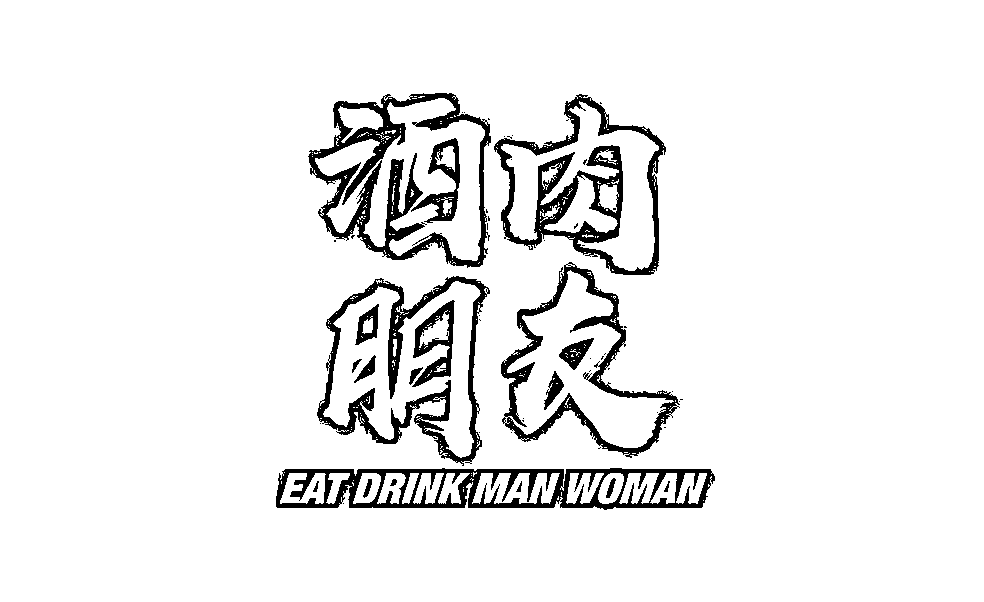
等到你哪个项目黄了，他们搂着你的肩膀说：“没事哥，亏就亏了，你把投资款打个借条就行，也算给大伙儿一个交代。”那会儿我年轻，重感情、讲义气，想着都是十几年的兄弟，签就签吧。签字的时候他们还安慰我：“签这个就是让你放心，大家都知道你现在没钱，等以后缓过来了再还不迟。”结果呢，第二个月，法院的起诉状就到了——是投资款纠纷。一纸诉状，我那十几年的兄弟把我卖给了江湖义气。那一刻我才看清楚，你捧在手心里的情义，在他们眼里一文不值。几个人轮番上诉，三五年你别想安宁。不搞死你，他们不会罢手——因为他们觉得，亏的是他们的钱，你的钱肯定还在。看你这边没什么油水了，也等不到你几年后翻身了，就开始朝你家人下手，妻子孩子、父母亲戚，托关系查了一遍又一遍。查完发现确实没存款，那就搞你家的车、房、公积金，一切能碰的东西全都招呼一遍。就这样，一场好心的、有情有义的签字，变成了你家破人亡的引信。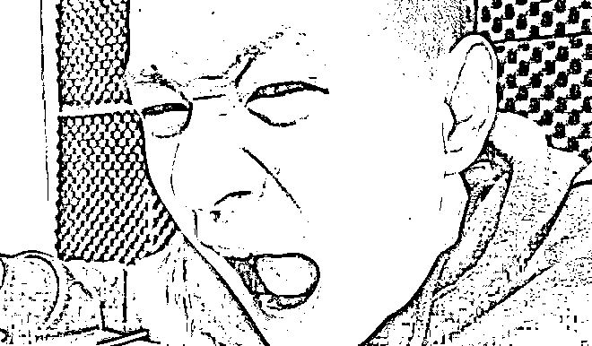
真应了那句老话：一辈子不遭点难，你根本不知道身边藏着一群什么人。一个个面目狰狞，又那么熟悉！

所以说，人不遇到点坎儿，就永远遇不到真朋友。我们这些长期主义者，在埋头做事的路上，其实也是在清洗自己的社交圈子。理解你、信你的人，会一直在你身边；不懂你的人，三五个月或三五年过去，自己就先露出马脚了。为什么会有这种人和事？大概率是，他们想把你当提款机。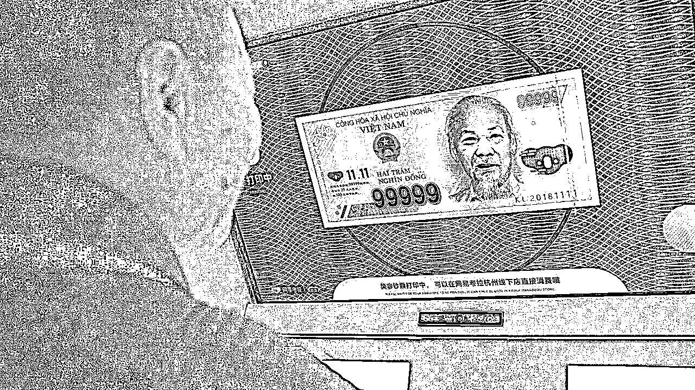 一旦发现你不能继续供他们取钱了，他们就会毫不犹豫地把你也牺牲掉，转头去找下一个替死鬼。

呼……以上，就是我唐门三叔掏心窝子的话。

一个人地位高不高，不是看他过去有多风光，而是看他能不能一直风光下去。一个不管外界环境怎么变都能赚钱的人，我敢说，他靠的绝对不是盲目跟风，更不是什么投机取巧、小聪明。我更倾向相信，他是在某个领域持续下死功夫，做了无数外人看不到的努力和铺陈。对，这就是深耕。

到最后，不但事情做成了，人也练出来了，方方面面都配得上自己的收获——这就叫：外在财富，配得上内在认知。你翻开那些被时间留下来、被一代代人传诵的经典故事，它们讲的从来不是事，而是人。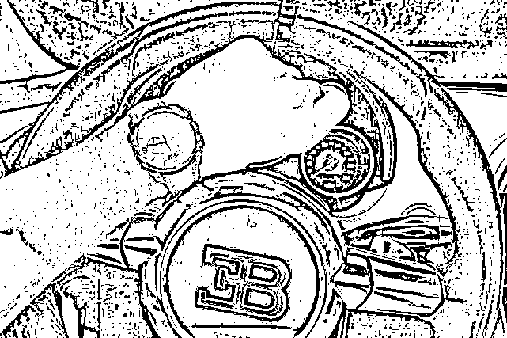
因为人一开始往往是失败的，然后坚持，每天前进一点点，主人公也在摔打中日渐强大，成功才会如约而至。一个人的成功，绝不会是天上掉馅饼。如果一个故事从头到尾主角都没什么成长，但事儿居然还成了，那叫骗局，不叫励志故事。骗局的逻辑就是：不用努力，也能一夜暴富。

换一个角度看，太多人做事只盯着方法和捷径，却忽略了自己有没有成长、有没有进化。这怎么行呢？你永远站在原地，一步也不肯迈，还巴望着成功自己撞到你怀里来吗？所以，能把事情做成，根本原因是你自己变强大了，好结果只是副产品。至于到底是什么事让你强大，每个故事里答案都不同，但最后的终点一定是：殊途同归。

请记住了：你越狠，才越活得清醒。人只有清醒了，才知道自己的方向，才清楚自己要什么。也只有这样，你才能不断蜕变、不断精进，直到活成自己喜欢的样子——那时候，你就成了。

好了，话就到这儿。觉得有帮助的话，关注一下呗。