# 小红书开店月销百万？我把这套爆款玩法拆开讲透了

如果你也在琢磨小红书开店这件事，那么这篇文章值得你花几分钟读完。我从去年三月开始做小红书店铺，到现在已经铺了200多个矩阵账号，主打自然流，不投一分钱广告，月销售额稳定在百万以上，利润率超过50%。很多人觉得不可思议，但事实就是：这个平台的门槛极低，爆发力却极强，一条笔记就能带起一个店铺的销量。

先说为什么值得入场。小红书的用户群体在消费决策上非常主动，愿意为好产品买单，而且平台官方也一直在引导商家做高品质、高客单价的商品。对于普通玩家来说，从小红书起量，比想象中要简单得多。

下面我直接把这个玩法的底层逻辑和操作步骤拆给你看。

## 一、起号的核心：先让系统认识你

很多新人一上来就发产品，结果数据惨淡。问题出在哪？账号没有标签、没有人群画像。小红书内部有一套评分机制，说白了就是：点赞1分、收藏1分、评论4分、转发4分、关注8分。分数越高，系统给你的推荐就越精准。所以起号阶段，别急着卖货，先用互动贴把分数拉起来，让系统给你打上人群标签。

具体怎么做？根据你的产品定位，找到目标人群喜欢的互动话题。比如学生群体，发这类互动内容就很容易引发共鸣：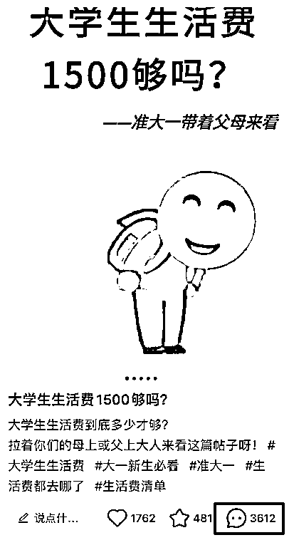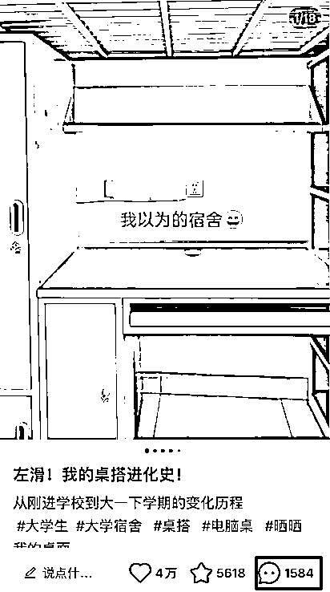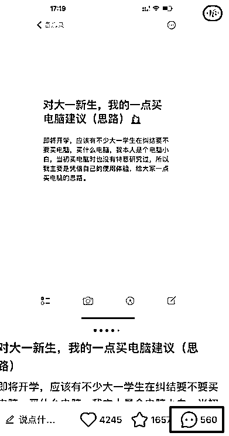
如果是上班族，那么这类贴子更合适：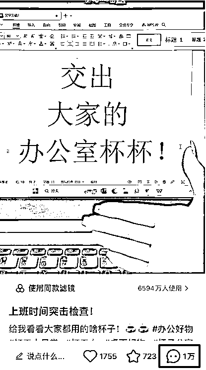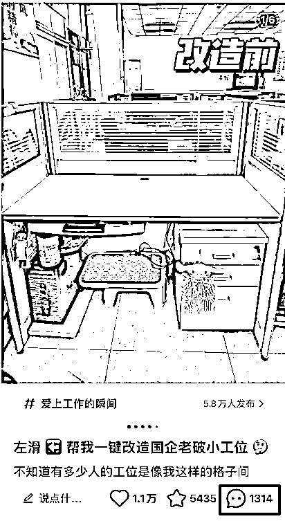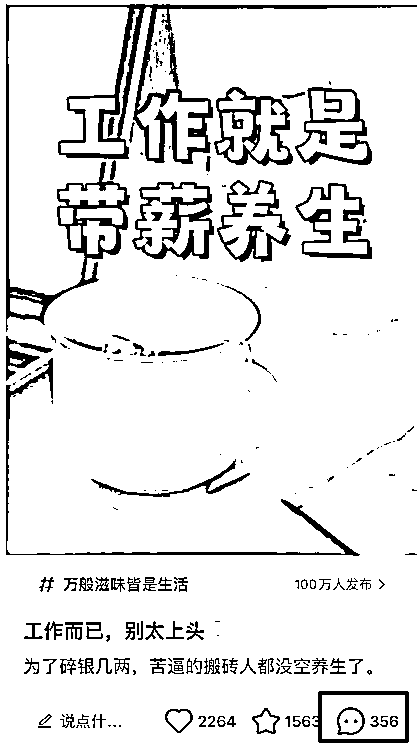
要是宝妈人群，可以参考这个方向：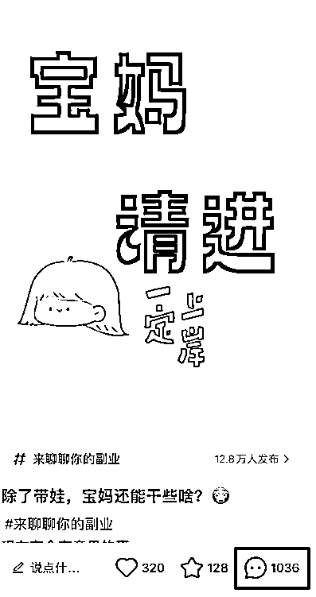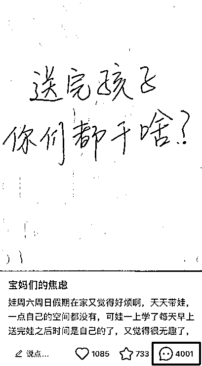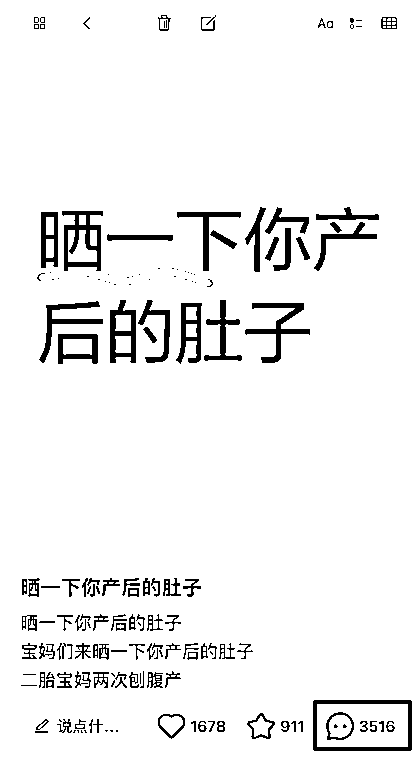

找到和你产品匹配的爆款互动贴，照猫画虎发几条。只要账号不违规，大概七成概率能跑出几万到十几万的小眼睛。有了这个基础，下一条产品笔记的数据基本就能破千，甚至直接出单。

## 二、爆款逻辑：一次爆发，不代表结束

我在实战中反复验证过一个规律：小红书上的爆款内容，往往会经历多轮爆发。为什么？因为平台的推流是周期性的——有的笔记一周内就能走完，有的能持续两三个月。判断当前流量是否还在推进，最简单的办法是盯数据：对标的账号点赞评论停了，说明这波推流正在收尾；产品的销量涨不动了，也说明笔记的快速流量期已经过了。

但注意，爆过的产品并没有死。你会发现，A店铺出了5000单后增长停住，B店铺只要跟上同样的品，就能把后续的销量吃掉。尤其对于消耗品、刚需品，用户用完还会复购，商机远没有结束。

那怎么锁定这些爆款？不需要自己猜，直接看商城销量数据：(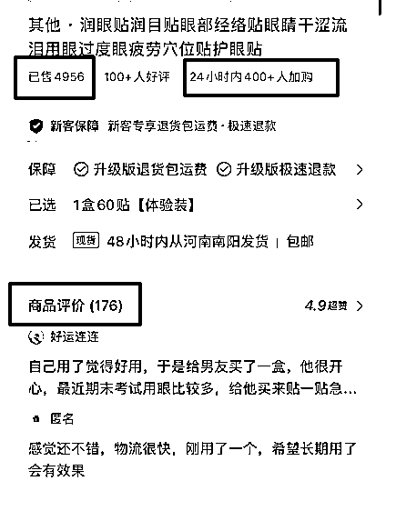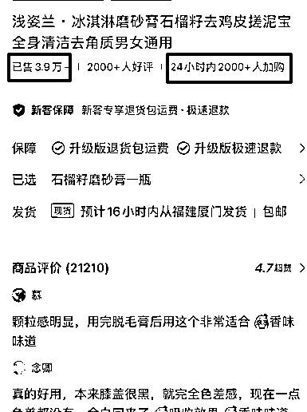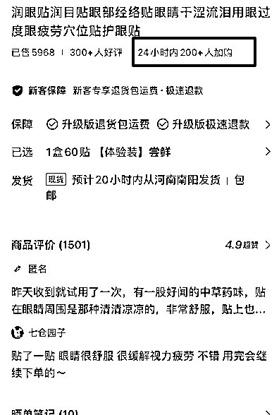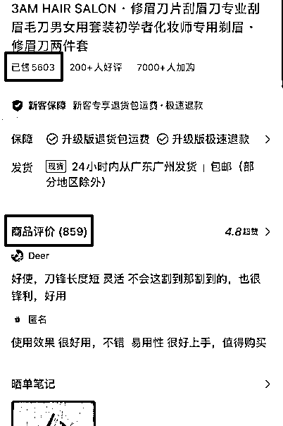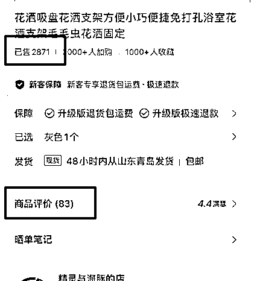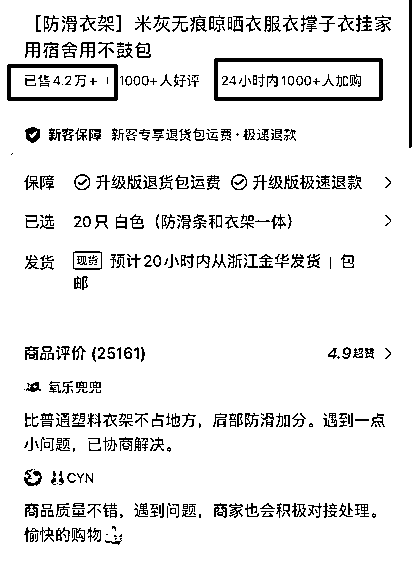)

主要看三个维度：
1、累计销量——销量漂亮，说明这个品已经跑爆过；
2、24小时加购量——加购激增，意味着正在被系统大力推流；
3、商品评价数——卖得多但评价少，大概率是刚爆不久，买家还没收货。

## 三、内容质量：能不能接住流量，就看这一步

混剪是很多人的选择，但混剪最怕两件事：违规和限流。一旦被判违规，笔记可能被限制14天发不出去。所以内容质量必须讲究，具体来说——

一是视频要高清，画面干净，不要有贴纸、画中画这种粗糙痕迹；二是笔记要照着已经验证过的爆款模板来做，封面、标题、结构完全对标，再在细节上做一些微调，绝不是直接抄袭。

实操中，你只需要准备3到5个爆款封面，标题稍作修改，就能批量产出笔记。下面这几个案例很有参考价值：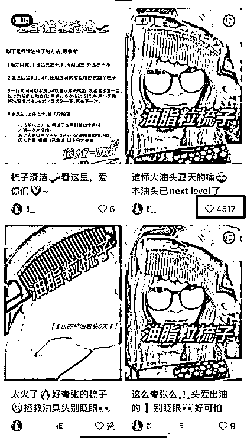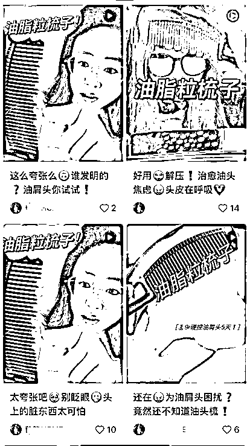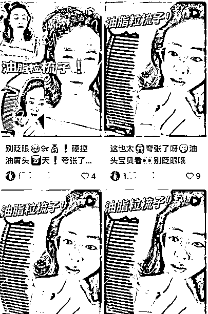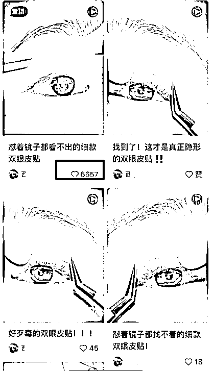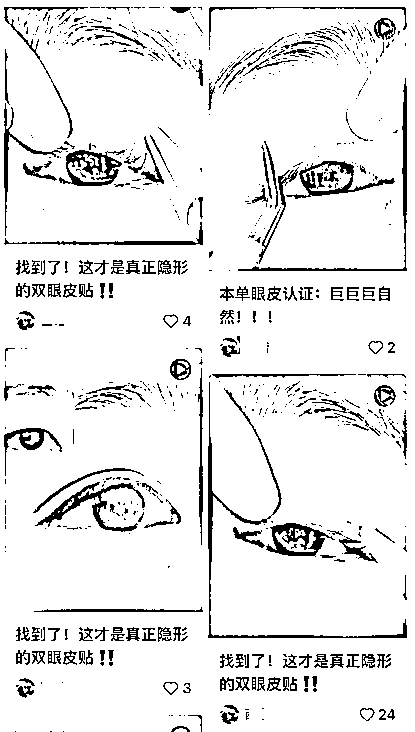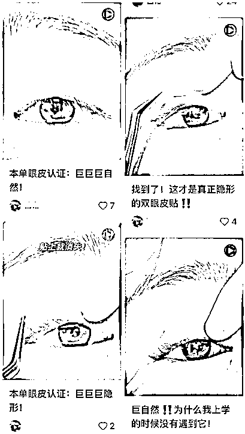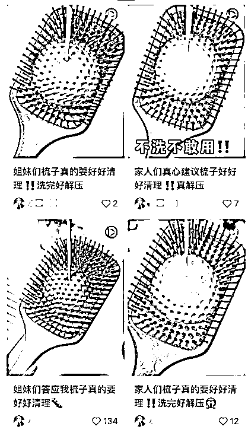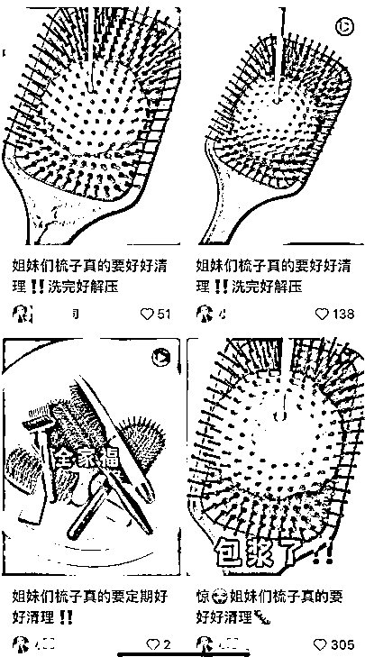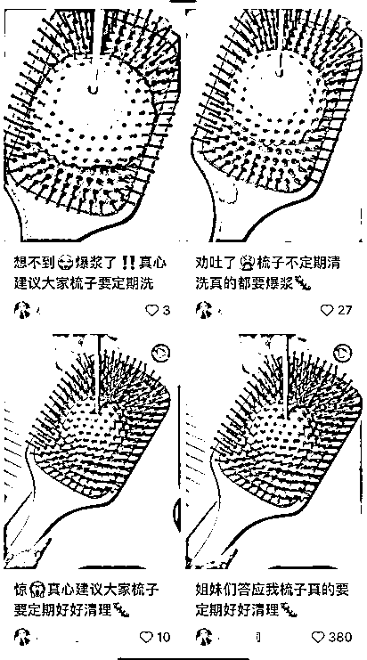

它们的共同点很明显：封面就那几套，标题高度相似，但都跑出了不错的点赞，爆款销量基本都在3000单以上，而且周期大多集中在一个月内，再次印证了“爆款会重复出现”的规律。

当然，你也要有心理准备。发了50篇才出一篇爆款很正常；一个细节疏忽导致违规也很常见；不小心撞上敏感词被限流，更是人人都可能遇到。正因为这样，每一步都得稳：素材要干净、标题要吸睛、内容要合规，功效型、裸露型的内容碰都不要碰。只要每篇笔记的数据都能稳定在500以上，哪怕只是1000多播放，你的店铺离爆款就不远了。

## 四、执行清单：照着做就够了

这篇文章看到这里，重要的不是记多少，而是去执行。我把整套流程浓缩成五个步骤：

第一步，圈定你的目标人群，用互动贴把账号权重和人群标签做起来；
第二步，锁定已经验证过的爆款产品，并掐准它的推流周期；
第三步，按爆款模板1:1制作内容，做到“形似而神不散”；
第四步，死磕内容质量，只要不违规，数据就会持续向好；
第五步，拼执行力。从选品、搜集素材，到发布笔记、记录数据，把流程跑顺，爆单只是时间问题。

现在的小红书店铺，正处在一个内容缺口大、平台对剪辑内容还没有严打的窗口期。看懂逻辑的人，现在入场刚刚好。

以上是我毫无保留的实战分享。如果你照着做拿到了结果，记得回来给我点个赞，让我看到你的好消息。