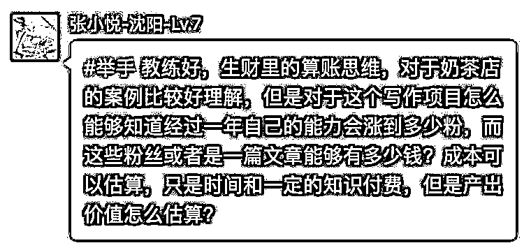
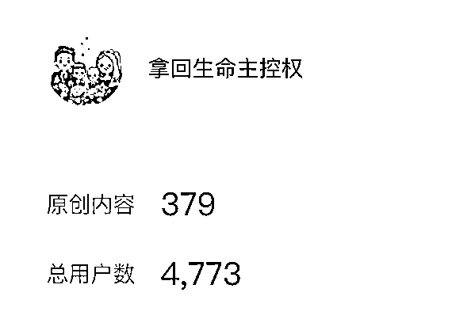
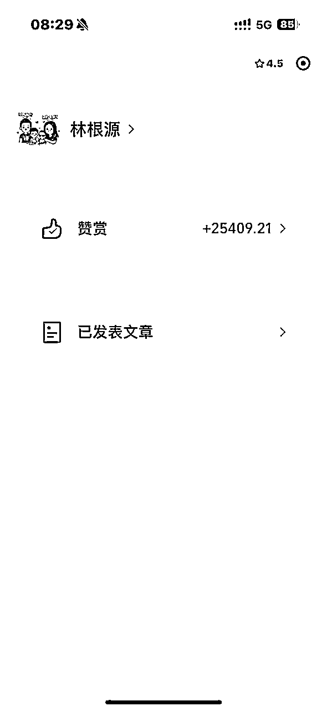

# ('写作赛道，如何使用「算账思维」精准地评估产出？', (2, 25))

写作迟迟不见回报？你不是写得不够好，而是还没算清一笔真正的账。

最近在航海交流时，有圈友跟我聊到一个很典型的问题：假如我开的是奶茶店，用算账思维算成本、算营收，清晰得很。但如果我的项目是写作呢？这套思维又该怎么用？

这个问题让我想认真展开聊聊——因为很多人对算账思维的理解，其实只停留在最浅的一层。

一、算账，算的从来不只是钱

提起算账，大家本能地就会想到：赚了多少，花了多少，利润多少。

但如果你只盯着钱，你看到的一定只是冰山一角。

钱只是项目跑完后的一个结果值，它背后连着的是你的资源、你的筹码、你在一个平台上的位置。只看钱的账，等于把整个项目看扁了。

举个例子。小明和小源各写了一篇文章，小源的内容明显更好，但小明的阅读量、赞赏数都远超小源。为什么？因为小明在网上的知名度比小源高出太多。就算小明抄的是小源的稿子，大家还会下意识觉得是小源抄他。

所以，写作赛道的第一步，不是急着算单篇文章能带来多少收入，而是先停下来问自己：我把这笔账算窄了吗？

二、第一笔账：你手里到底握着什么？

写作之前，你先要算的，是你除了写文章之外，还积累了什么。

文章只是你可以被看到的一个载体。除了它，你还有没有别的加分项？有没有一堂自己的课？有没有一套可以出售的方法论？有没有一个愿意为你说话的圈子？

我拿自己举例。

2022年初开始更新公众号时，我并没有想着靠它马上变现——因为我很清楚地看到，自己在互联网上没有任何「踪迹」。没人知道我是真有本事，还是一个会写字的骗子。

什么是「踪迹」？比如：

- 小红书有多少粉丝；
- 视频号有多少人关注；
- 公众号的订阅量是多少；
- 有没有十万加的文章；
- 有没有几篇生财精华帖；
- 有没有付费社群能证明你的影响力；
- 更广义地说——某个平台的核心圈层里，提到你的名字，别人会不会觉得「这个人靠谱」。

这些加在一起，才是你的互联网资产。

如果你的「踪迹」只有文章，那指望靠写作获得关注，真的太难了。很可能你埋头写两年，依旧没几个人知道你。

所以当时我盘了盘自己的底牌：

1. 一个刚注册、关注者不足100人的公众号；
2. 一堂定价131.4元的付费沟通课，大约有400名老学员；
3. 用了一年时间，通讯录里多了近700位生财圈友；
4. 和明白老师、陈雪、刺猬、涛哥、靠谱、大周、西门等人都有不错的交情。

这笔账一算，我心里就有数了：文章只是一个入口，真正能支撑我走下去的，是这些藏在文章背后的东西。

三、第二笔账：你能调动多少资源？

算清了自己拥有什么，下一步才是算：我能让哪些资源为我协作？

当时我花了整整一年，认真思考如何盘活手边的这些积累，看看它们能帮我创造出什么。那一年，我甚至没有预设过收入目标，因为我知道——先要有能被查证的数据，一切才有后续。

实际上，写到现在两年半，我一共只发了379篇原创，赞赏收入大约两万多，公众号总用户也还不到5000人。第一年关注量甚至才3000不到。

但你知道第一年我通过公众号带来的付费总量是多少吗？超过了100万。

换句话说，公众号对我来说，从来不是一个靠阅读量赚钱的媒体，而是我在互联网上留下「踪迹」的展示窗。人们愿意为我付费，不是因为我文章写得多好，而是因为我除了文章，还有自己的课，还有上过课的学员，还有一套能被查证的真实积累。

四、第三笔账：你手上的资源，哪些能帮你创造收入？

如果你现在问我：我想靠写作变现，应该怎么算？

我的建议是：不要先算收入，先算下面这些——你有没有自己的课程？有没有可以推荐的老师、帮他做CPS？有没有正在销售的产品？有没有准备推进的项目？

这一层，是你第一阶段的账。

算完之后，再进入第二阶段：怎么把手上这些资源真正盘活？

比如说，如果你有自己的课，你写完一篇文章后，有多少人阅读、有多少人转化？这篇文章除了发公众号，有没有同步到小红书、视频号？有没有发到自己的私域群里？

所以，完整的算账链路其实是这样的——

第一笔账：我有什么；
第二笔账：我能调动什么；
第三笔账：我拥有的加上我能调动的，最终能一起创造什么。

这才是写作赛道里「算账思维」的真正用法。

账面上那个简单的「赚多少钱」，从来都不是答案。收入是一整套复杂系统运转后的产物。你的内容、你的产品、你的信任资产、你的合作网络，每一个小系统都跑顺了，稳定收入才会自然浮现。

—— 关于我 ——

我是根源，第四期生财圈友，一名拥有2w+实战案例的心理咨询师，有12年线下销售和团队管理经验。2022年开始转型线上，做知识付费相关项目。

如果你也正在通过写作探索变现路径，欢迎看看我过去写过的文章，也欢迎加我微信「AF54094」交流探讨。

2021年文章：
- 精华《直觉式萨克斯 透过社群成功变现146万》
- 《73项被动收入打造》
- 《杭州夜话02场，夜话官复盘》
- 《年入百万，团队从20人到4万人》
- 《主题：如何更有效的链接见面会认识的圈友》

2022年文章：
- 《互联网小白，第1次做线上产品，7天赚回10倍门票》
- 《把捣乱分子『逆势』转成爱用者的好方式》
- 《好的内容，是目前依旧没退旧流行的变现方式》
- 《明白老师的一个启发，让我从100天日耕的过程赚了30W+》

2023年文章：
- 《私域的意义不是管理，而是经营》
- 精华《9年传统行业1年时间，从一无所有，到年入200万》
- 精华《25个提高微信成交率的小技巧》
- 精华《35个让私域收入翻3倍的技巧》
- 精华《续篇 - 25个提高微信成交率的小技巧（26 - 50）》
- 《私域话题：涨价之后，如何回复以及留住客户？》
- 精华《成为自由职业者的20个必备特质》
- 《36个让私域成交率翻倍的实战指南！》
- 精华《产品线有引流体系，如何通过沟通促成升单？》
- 《知识付费赛道，如何透过处理『反对问题』，增加用户粘性和复购率？》

2024年文章：
- 精华《第一次尝试「问答群形式」的公域往私域转化，7天变现11万》
- 《线上新手，我是如何用一套固定流程，累计成交300万高价产品？》
- 精华《私域话题-如何在客户咨询过程中，透过三个步骤提高2倍成交率？》
- 《私域的十倍增长话题：不同信任程度的客户，如何提升成交率？》
- 精华《为什么都是做副业，我能第一年就达到七位数？》

一路走来，也是因为加入了生财有术，才少走了很多弯路，沉淀下这些经验。如果你有任何想法，欢迎加微信「AF54094」一起聊聊。

也可以扫码撩我。