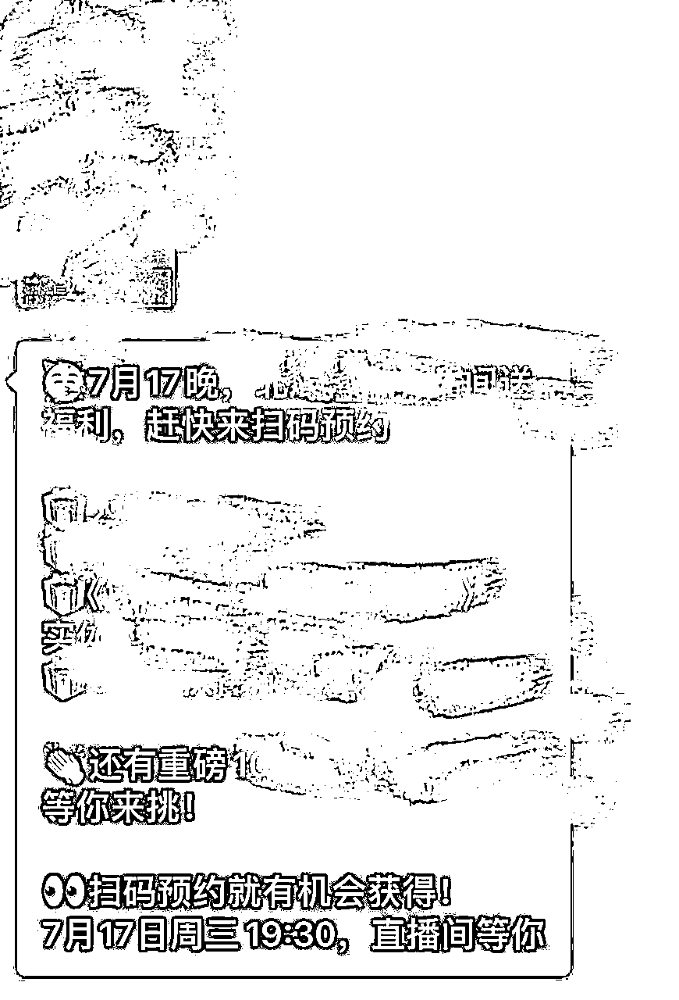

# 私域二次转化的核心变量：用合理的触达，把复购率拉升2倍以上

全文共：9,671 字
预计阅读时间：9.43 分钟

大家好，我是根源。

知识付费和私域运营这条线，我已经做了两年半。
过去一年多，和明白老师、陈雪一起在日新月异俱乐部里打磨产品，业绩很稳，年度利润基本都保持在七位数。会员的净增和复购也都不错。

今天想聊一个我特别得意的方向：私域的二次转化。尤其是怎么靠「合理增加触达次数」，让复购率实现两倍以上的跃升。

身边做知识付费的朋友很多，大家的第一笔成交做完后，焦虑最大的就是同一件事：如何让用户在5天、10天，或者2个月后，再掏钱买更高客单的课程？

最近正好有个学员的案例，我就借这个案例，把我自己的思路和实操，整理出来跟大家交流。

* * *

# 公域找效率，私域谈关系，逻辑完全不一样

关于私域二次转化，我觉得这是大多数人卡住的地方。

### 怎么让首次付费的人，在一段时间后，愿意持续买单？

前两天一个学员问我：老师，现在每天进来的新人很多，我应付不过来，有没有更省事的工具或方法，能帮我维护这些好友，也做好二次转化？

我一直的判断是：公域和私域，是两套完全不同的运营思维。

公域的核心是效率，像发公告。用视频、图文把人引到🛰️，一段快捷话术、一条固定公告走天下。这其实还是公域的打法。

加到🛰️不等于进私域。即使人进了通讯录，如果你对他还是群发内容、固定话术、定时公告，在我看来他依然是公域用户。

比如把人拉进🛰️群，100个人看着不少，但运营方式只是按时发课、发课件、发以前的资料，这跟公域没区别。这种群能不能成交？能，但转化率会掉很惨。

以前同样的群转化能做到15%-20%，甚至30%。现在用同样做法，可能只剩3%-5%。

就像这种一看就是群发的提醒，我自己也付过四位数的平台，但收到这样的内容，第一反应不是感激，是烦躁。一看就是批量发的机器人感，体验很差。

平台这么做不就是为了转化吗？想转化，动作已经做了，为什么不做得更体贴一些？这点很值得思考。

当然，我的经验有限，目前团队规模小，会员也就两千人以内。如果以后做大规模会不会变成现在这样，我也不确定。但就当下来说，我真的不喜欢被这样对待，尤其是已经付费的老用户，这是一种感受问题。

* * *

# 私域的本质是私人聊天，是交情的累积

真正的私域，终点是：我能不能和这个人私下建立更深的关系。

现在内容太多了，如果我只把人拉进一个免费群，没有特别的运营设计，没有让人眼前一亮的内容，没有独家的视觉呈现，用户只会觉得又加了一个免费群，随手就加入，随手就放弃。

要做二次转化，先要解决第一次转化的信任基础，那就是和每个进群、进通讯录的人，进行真正的私下交流。

### 我的私域定义很简单：够私人的对话。

能不能在1对1的过程中，把关系养起来。当用户愿意在私聊里多说几句，这才是私域初步建立的信号。

* * *

# 触达，就是创造合理再聊一次的场景

私域里我很强调一个词：触达率。

触达率就是我用怎样的事件、怎样的理由，让我有正当的开口，再次私聊这个新好友。

举个最常见的结业证书发放。

第一种做法：把全员头像合成一张墙，发到群里，说有需要自取。这等于一次性通知。

第二种做法：放一个网址，自行生成证书。省事，但冷冰冰。

第三种是我最常用，也一定会做的：逐个私发。

群里200人，我就发200张；100人，我就发100张。图是一样的，会带头像和名字，但文字一定不复制粘贴，一定是聊天语气。

我会拆成几段发，不会一次性甩一段长文。因为太长一眼就是复制的。

比如：

小明，在吗？
我是这次社群的讲师，特意来找你
这七天真的很感谢你全勤参与
所以私下给你发结业证书

先让对方回一句，我再继续。这种方式看起来费时间，但价值很大。我用一个完全合理的理由，重新链接上这个人，让他愿意回复。

* * *

# 触达的本质是让对方感受到「被重视」

私域的核心体验是：用户感觉是我专门为他服务的，而不是顺带服务的。

触达率的关键，不在于发得多，而在于有没有合理的理由，让对方感受到我在乎、我在认真服务、我对他不一样。

做好了，触达次数上去，转化率自然跟上来。

比如用飞书直播。课程完播后，没有上课的人需要申请回放。我会把申请权限做成需要后台确认的。这样一来，每一次申请我都能知道。

确认的那一刻，我就会私聊他：

谢谢你这么认真补课
早上就起来学了，很勤奋
已给你通过权限，可以看了

如果是中午申请，我就说：下午不休息来补课，真难得。

一个很小的动作，给了我一个完全合理的私聊理由。我能多聊三五句，次数多了关系就深了。用户会觉得被特殊对待，和别的服务团队不一样。我们真的在关心每一个学员。

触达的最终目的，是给到情绪价值。当情绪价值够高，二次转化时他更愿意点头。哪怕客单价更高，也会认真考虑。

* * *

# 成交率提升的关键，是合理触达次数的堆叠

具体能增加触达的动作有哪些？

⭕️结业证书私发
⭕️打卡统计。对全勤或完成率80%以上的学员，做一张专属证书私聊回访。字数多、内容认真的，我也会单独点赞并私聊。
⭕️群红包。领到一块的人，我会私下补9块到10块，让体验完整。
⭕️回放权限申请。每次申请都私聊确认并鼓励。

触达次数越多，私下交情越深，信任感越高，后续高客单成交的概率就越大。

但有条红线千万别踩：私聊时不要直接复制一段长文。那就成了私下的群发，体验极差。

重要信息要用聊天的方式拆解，一步步聊，让对方感觉是真人在线。不要设死板的SOP，不要用固定话术。话术太僵硬，对方一眼看穿是机器人，回复率自然低。

在触达过程中，我也会观察用户的群活跃度和对讲师的认同度，通过回复速度、回复字数来判断他是否具备二次复购的可能性。

* * *

# 私域经营拼的不是效率，是信任的沉淀

做私域转化时，一旦脑子里出现「我想省时间、我想省略步骤」的念头，私域的价值就没了。

我们花了大成本把人请进通讯录，却用群发的方式对待他，就像追了一年才追到的人，复合后每天只剩早安晚安，没有其他互动，很荒谬。

把私域做得更完善、更体贴，才能收更高单价。因为用户愿意为高单价买单的前提，是更信任你、觉得你不一样、服务特别贴心。

这两年的知识付费，和两年前最大的区别不是付费人数在萎缩，人数依然很多。变化在于，用户不想只买知识，他们想要更正确的人来服务、来陪伴。

内容做到位是基本功，在此之上，必须投入大量时间做陪伴。用户手里有钱，才会愿意交给你。

同样一个销售课程，你可以在📕、百度、视频号免费找到无数篇。为什么有人愿意付费让你教？因为他买到的不仅是知识，还有更深度的陪伴。

当服务值得，他就会想办法把钱凑出来给你。因为用户想的不是我付不起，而是你值不值得我超出预算去付。

* * *

# 五个我常用的私域触达延伸做法

**第一种：逐个私发毕业证**
结营时给每个人发一张专属证书。开场白可以是「小明，你在吗？」「小明早安」，说明今天结营了。我习惯先发一句，等对方回应再继续。群发感最可怕的就是不等回应就把内容一次性发完。

**第二种：打卡作业私下反馈**
群里布置小任务打卡或作业。作业写得好的，我会截图私聊称赞：「小明，你这份作业我印象很深，运用特别到位」。这种具体反馈非常有分量。

**第三种：课程权限申请增加触达**
线上课尽量做权限限制，必须申请才能看。对方申请时我就会私聊感谢并通过，并附上学习鼓励。后续还能发笔记、重点，形成二次触达。

**第四种：对高完成率学员回访**
打卡完成率70%以上的，我会做回访，送专属证书或小红包。让用户有获得感。

**第五种：随机抽取送小礼物**
准备一批小礼物或书籍，随机抽10%群成员，要求他们写两分钟课程反馈。私聊邀约：「我们随机抽到了你，写完反馈会送你一份小礼物」。抽到的人会觉得幸运，更愿意配合。

这些触达点都非常合理。最怕的是没有任何理由就去找用户要回复。那样的触达，只会让人反感。

希望这些实操能帮到正在做私域二次转化的朋友们，欢迎交流。

私域私聊总被“收到”终结？你的触达节奏出了问题

做私域久了，你会发现：真正决定成交的，往往不是话术多华丽，而是每一次触达的分寸感。

你带着一个合适的理由去找人聊天，同时又不能让对方觉得不舒服、被打扰，这本身就是一门手艺。我从来不会抱着“为了让你再复购一次”的目的去服务谁。你从📕也好，从某个社群也好，愿意进到我的私域里，甚至愿意真金白银地付费，这份信任已经很难得。既然你信任我，那我认真对待你，本来就是分内的事。

信任感不是一次建立起来的，而是靠一回回的回应攒出来的。当你们之间的信任积累到一定程度，你可以很直观地从对方的回复里感知到它：你发三小段话，对方会不会回你一两段？你敲了200字，对方会不会回你100字、150字？这背后是有比例的。

最让人心里没底的，是你无论发多少条，对方都只回“收到”“好的”“没问题”。看到这样的回复，先别急着给人贴标签。他可能不喜欢你聊的话题，可能当下真的在忙，也可能就是不喜欢被这样打扰。这几种情况，都说明现在不是继续推进的好时机。那就先放一放，转身去找那些愿意积极回应你的人。

关于触达的节奏，我把自己反复验证过的经验浓缩成三个要点。

第一，开场只寒暄，不谈正事。

哪怕我是要发一份结业证书，也绝不会上来就甩证书过去。我的习惯是先发一句：“下午好呀，在吗？有件小事想和你说。”然后停下来，等对方回应。对方不回，我就不再追问；等他问“什么事？”我再把真正想说的话带出来：“这期课程结束了，你的打卡特别认真，全勤也漂亮，所以我专门准备了一份证书，想私下发给你。”

这个环节，由讲师本人或者社群里活跃的工作人员来做，效果是最好的。因为在学员看来，这些人是社群里“有分量”的角色。他们发出来的认可，含金量远超过普通运营。

第二，不要一次把话全部说完。

哪怕对方已经开始回复了，也别急着把准备好的内容一口气全排出来。我的节奏通常是：一次发三小段，每段控制在三行以内，发完就停。如果对方没有回，那就安静等着。

你可以换位想想：你付费进了一个群，忙了一整天，晚上点开手机，发现讲师给你发了足足40条长文字。你的第一反应是什么？大概率不是感动，而是压力。你可能会想：这人是打算转化我吗？又想来让我掏钱了吧？一旦这种感觉冒出来，这次触达基本就变味了。

所以私域聊天必须保持“对话感”，它不是一次性放映。你三句我一句，你五句我四句，边聊边推进，该说的话也在自然的往来里慢慢说完。慢一点没关系，高客单价的产品本来就需要这种耐心来铺垫。如果担心占用对方太久，开场时先征求一下同意：“我大概会占用你三到五分钟，你看可以吗？”对方点头，你再展开。

第三，单次触达，时间不要太长。

完整的顺序是这样的：先用一句简短的问候把对话打开，然后停下来，等对面有动静。对方回应了，你再告诉他：“今天找你，是因为有一件具体的事想聊，差不多需要占用三到五分钟，你现在有空吗？”等他明确回一句“可以”或“有空”，再开始讲正事。

正事讲完，道声谢，再顺着对方最近的生活聊几句——朋友圈最新的动态、最近发生的小事，三四句就够了。整体尽量在五分钟内收住。如果对方兴致不错，愿意多聊，你顺势延长时间也没问题。但要是对方明显在忙，甚至主动说“我现在只有三分钟”，那就利索地先把正事讲完，之后再判断有没有必要继续下去。

这里有个大忌：计划的是三到五分钟，结果一开口就是半小时。要知道，这一次触达只是关系的开始，接下来几天你很可能还会继续找他。如果有一段30分钟的内容想分享，别急着一次输出，完全可以拆成三份，每天10分钟，在打卡营的几天里陆续讲完。这样做还有一个隐藏好处：到了第二天、第三天，对方依然愿意接你的话，这本身就是信任感在累积的证据。比起一口气聊上一个小时，这种细水长流的安排，带给关系的养分要大得多。

说到底，私域触达不是通知，而是经营。把开场、节奏和时长拿捏住，信任感才会一天天长出根来。

我是根源，龙哥盟第四期圈友。除了做心理咨询师积累的2w+实战案例，我也有12年线下销售和团队管理经验。2022年开始转型线上，专注知识付费。回头看看，多亏加入了龙哥盟，少走了很多弯路，也沉淀了一些经验和心得。

下面把我历年写过的文章按年份整理出来，感兴趣的圈友可以直接翻阅。

2021年那几篇里，有一篇精华：
- 《直觉式萨克斯 透过社群成功变现146万》 https://t.zsxq.com/116B1bcYc
- 《73项被动收入打造》 https://t.zsxq.com/11EHjTH0P
- 《杭州夜话02场，夜话官复盘》 https://t.zsxq.com/19IkX4UMl
- 《年入百万，团队从20人到4万人》 https://t.zsxq.com/19JYt77hL
- 《主题：如何更有效的链接见面会认识的圈友》 https://t.zsxq.com/19VY2LWg4

2022年写过的内容：
- 《互联网小白，第 1 次做线上产品，7 天赚回 10 倍门票》 https://t.zsxq.com/11ooZZbM7
- 《把捣乱分子『逆势』转成爱用者的好方式》 https://t.zsxq.com/19lipLhJ5
- 《好的内容，是目前依旧没退旧流行的变现方式》 https://t.zsxq.com/19BLMAYw1
- 《明白老师的一个启发，让我从100天日耕的过程赚了30W+》 https://t.zsxq.com/19BgNoxfi

2023年的内容里，也有好几篇精华：
- 《私域的意义不是管理，而是经营》 https://t.zsxq.com/19WEsfSq1
- 精华《9年传统行业 1 年时间，从一无所有，到年入 200 万》 https://t.zsxq.com/10nmEr1cA
- 精华《25个提高🛰️成交率的小技巧》 https://t.zsxq.com/11AgRW24F
- 精华《35 个让私域收入翻 3 倍的技巧》 https://t.zsxq.com/11FmV2aqZ
- 精华《续篇 - 25个提高🛰️成交率的小技巧（26 - 50）》 https://t.zsxq.com/13yRbmUwo
- 《私域话题：涨价之后，如何回复以及留住客户？》 https://t.zsxq.com/11UJk9HxQ
- 精华《成为自由职业者的20个必备特质 》 https://t.zsxq.com/14XTxhh15
- 《36个让私域成交率翻倍的实战指南！》 https://t.zsxq.com/17zSrYzvk
- 精华《产品线有引流体系，如何通过沟通促成升单？》 https://t.zsxq.com/17ocUJEFA
- 《知识付费赛道，如何透过处理『反对问题』，增加用户粘性和复购率？》 https://t.zsxq.com/181fSc5rv

2024年，也继续在写：
- 精华《第一次尝试「问答群形式」的公域往私域转化，7天变现11万》 https://t.zsxq.com/18gBXlWxE
- 《线上新手，我是如何用一套固定流程，累计成交 300 万高价产品？》 https://t.zsxq.com/18IWgDiXo
- 精华《私域话题-如何在客户咨询过程中，透过三个步骤提高2倍成交率？》 https://t.zsxq.com/196Ad34aR
- 《私域的十倍增长话题：不同信任程度的客户，如何提升成交率？》 https://t.zsxq.com/YKHGT
- 精华《为什么都是做副业，我能第一年就达到七位数？》 https://t.zsxq.com/APodD
- 《写作赛道，如何使用「算账思维」精准地评估产出？》 https://t.zsxq.com/ymcEE
- 《主题：私域+知识付费话题：如何通过增加合理的触达次数，提升2倍以上成交率？》 https://t.zsxq.com/uqU9P

如果圈友对私域、知识付费、变现路上有什么想探讨的，欢迎加我的🛰️「AF54094」交流。

▲
也能扫码撩我~