# 👸号小白首次出海即爆，单篇6千+，单号变现破万，手写也能爆，AI加持更省力，我到底做了什么？

赚钱互助！

我是开卷，985院校写作硕士，6年文案经验，赚钱二年级。👸号算是我完全陌生的赛道。

入圈一年，从去年首次航海拿下第一到今年👸号航海拿下第二，我试过📕带货、📕个人号、抖音图文带货、抖音直播、多多视频，偶有小成，多数折戟。

曾怀疑自己是不是不适合做变现项目。后来复盘旧账，又去请教销冠@梁靠谱，痛定思痛决定再开一局。

这次我不跟着热点跑，而是回到自己最擅长的写字上。头条曾半月出300W爆款，📕图文做过万粉和多枚千粉，抖音图文新手一周破千粉，这些经历让我放弃视频和直播，全押在👸号爆文上。

24年6月的👸号航海，我同时推两号，主号文章100%上池，最高单篇110w+阅读，另有2篇50W+、2篇20W+、2篇10W+，其余多在万量级，单篇最高收益6000+，航海期内单号变现5位数。

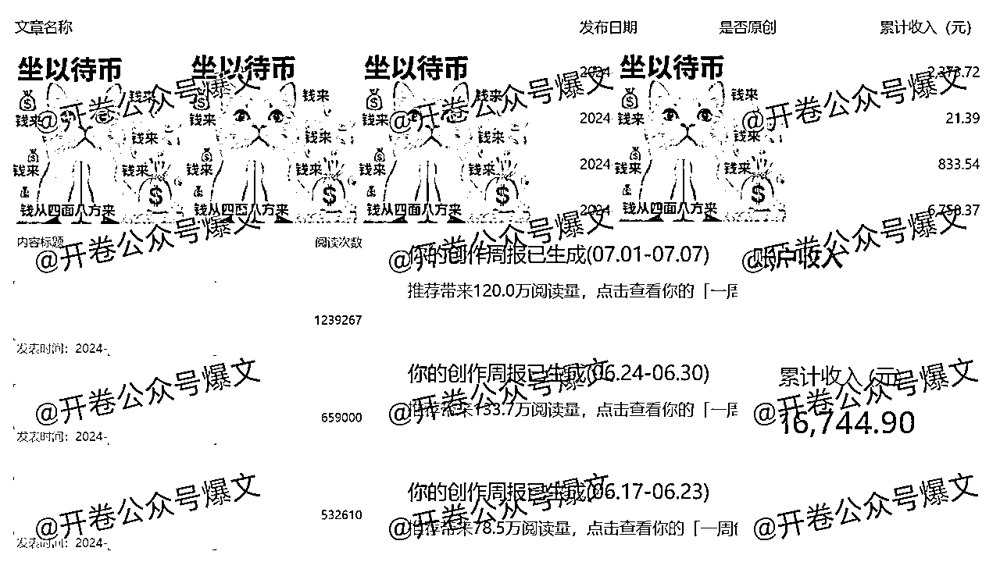

航海期间我全程手工写作。之前被AI劝退过好几次，项目期也没空研究它，况且账号少时上AI和RPA，反而像用大炮打蚊子，不划算。

但航海尾声，我明显感到纯手写消耗过大，脑子和时间都扛不住。航海结束后，我用国内AI工具重构了写作SOP，一周也能稳定出几篇爆款。目前纯手写SOP1.0和AI辅助手写SOP2.0的数据差距很小。

这次复盘我把两种打法都摊开说，给刚入坑👸号的新人一个可抄的路线。

全文共三块：

1. 新手纯手搓也能爆：👸号爆文的快写好写法，开卷SOP1.0
2. 爆款稳定后AI助攻：套路熟了如何解放生产力，开卷SOP2.0
3. 👸号爆文新手避坑与提效习惯

目录如下，方便按需取用：

1. 百万爆款复盘：纯手搓的6个核心动作 SOP1.0
2. 选题定生死：好选题的3个特征
3. 点击率超70%，标题是关键
4. 半小时写完一篇，结构是效率核心
5. 正文填充技巧，让读者停不下来
6. 运营细节做好，收益自然来
7. 数据复盘，批量复制爆款
8. 多号运营：AI辅助手搓 SOP2.0
9. 国内AI工具实测，怎么选写作助手
10. 新手该怎么用AI，从鸡肋到提效
11. 爆款框架+AI初稿+人工精修=爆款流水线
12. 避坑与提效Tips
13. 三大天坑务必避开
14. 提效减压三管齐下

全文约13723字，阅读约32分钟，没空的可以先收藏。

* * *

# 百万爆款复盘：新手纯手搓的6大核心要点 SOP1.0

这是我最初成型的流程，围绕选题、标题、结构、正文、运营、复盘展开。照着这套路子走，你也能把零散经验复制放大，完成第一篇爆款乃至连环爆。

## 选题定生死：好选题的3大特点

项目启动前，我把航海手册读了三遍，还做了符合自己习惯的思维导图。说选题先说手册，可能有人会纳闷。

其实大多数找选题的方法，手册里都讲了。航海群里常有人问选题，我的建议是先回头把手册再读一遍。

我虽是第一次做👸号航海，却参加过其他航海且有斩获，所以很清楚赚钱航海手册的价值。于是我做了两件事：

① 反复精读手册

开船前两天，我把上期手册又通读两遍，抓住项目主线和重点细节。本期手册出来后又读了一遍，看更新了哪些。相当于读了三次，抓到重点就不会在枝节上纠结，这也是我执行时相对轻松的原因。

② 做思维导图

每个人理解方式不同，我用导图把项目用自己的话梳理一遍。虽然航海结束也没完全整理完，但前期的梳理让我的输出几乎不卡壳。卡住再去手册查，边做边补。

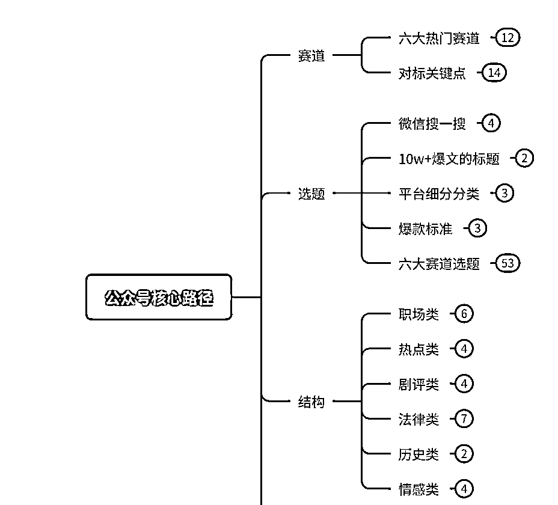

有了总览，选题方向更清晰，因为主流的选题打法基本都在手册里。

再补充一个我能做到100%上池的小细节。起初我翻遍多个号的选题，精力有限时必须判断哪些更值得投入，困扰了我好几天。

总结下来，大概率能保上池且阅读稳定的选题，有三类特征：

### 选题里一定要有异常

“狗咬人没人看，人咬狗才上头。”

带异常属性的选题自带新闻感，有流量密码。写好了阅读很可观。

比如“做博主月入五万，我却想回职场了”。

你可能觉得这是金钱元素，但我观察到带金钱的不一定爆，我写的只要带异常、有看点、正文过关，都炸了。这就是异常的魅力。

后来我发现百万爆款被模仿，但数据很差，因为模仿者把最核心的异常点给改没了，文章就顺理成章了，有梗的内容变味成了廉价鸡汤。

像这三个标题，你觉得哪个更容易爆：

1. 寒心！男人被狗连咬三次，竟无一人敢帮！
2. 震惊！男人被狗连咬三次，居然在大街上做出这种事……
3. 怒了！男人被狗连咬三次，竟被狗主人要求赔偿五千块……

不点破答案，自己多琢磨。

### 同类选题里已有3篇以上10W+，爆发的概率更高

我百万的那个爆款，就是因为看到多个号都已出10W+。后面50W+、20W+、10W+的选题，也都是至少有3篇同类爆款的底子。

有一个选题我当时只找到两篇10W+，因为感兴趣还是写了，最终阅读5W左右，有点可惜。

为什么盯10W+？同样的时间，一篇10W+相当于两篇5W+，单位产出更高。手写党靠质量弯道超车，这就是关键。

### 选题不一定要高大上，要让人有话说

这是抖音、📕、👸号的共同规律。

头部作者的百万爆款可能靠独特观点，普通人靠的是抓住一个能让大众展开讨论的话题。

比如：

刚过一本线十几分，是选普一本还是好点的二本？

只有三百万，买市中心的老破小还是郊区大平层？

这类见仁见智且大众关心的议题，讨论热度起来就容易爆。

我航海跑得顺，很大程度是前期把80%时间花在选题上。

说到选题，很多人问数据网站的会员是不是必备。对新手而言，至少前期不是。

做内容新人入场，第一步是熟悉平台内容生态。自己刷文章才能知道哪些好、哪些一般、哪些很差。

数据网站能快速定位高数据内容，但缺点也在这里，好坏是相对的，新人只看数据好的，会看不出它相对优势在哪，也分不清是偶发爆款、账号权重还是内容本身有价值。

所以👸号打基础期，我的内容全是手写的，选题也是手刷的。最后会分享我日常刷选题的习惯。因为任何平台，眼光要长远，新人必须养成的能力就是手感。这也是想深耕内容的人必备的基本功。

以后会不会用数据平台？会。等我真切感受到纯手刷选题、手写文章，全职一人管5个号脑力已到极限时，就需要外部工具辅助扩量提效。但前提是你先对内容生态有真实理解。

## 点击率＞70%，秘诀全在标题

自媒体本质是选题决定生死，但标题很大程度上决定打开率。

我主号的爆款点击率基本在70%以上，配图多用通用免费图，所以高点击的核心在标题。

我对标题有两种处理方式：直接用或改写。

### 直接沿用

很多人对直接用别人的标题有洁癖，如果你也有，可以想想小时候写的命题作文。选题好，标题也不错，就把它当成命题作文，用自己的观点去写。

📕很多经典选题：

* 一个普通女孩的十年
* 99年自媒体一年，一个人赚了30W
* 我发现，不上班的出路比你想象的多

各平台各领域的经典选题。写它们不叫抄袭，就像鲁迅写了《纪念刘和珍君》，别人一样可以写《纪念刘和珍君》，只要不洗稿，每个人的角度都可以不一样。

### 根据经验改写

前面说的是“对方标题不错时”。新手最难判断的是什么叫不错？我做📕时见过朋友把爆款标题改得平淡，因为她想原创、想不一样。

原创可以，但要加入思考。比如我会问：标题里有没有至少两个开幕雷击七要素？

如果选题不错但标题有优化空间，我就按【开幕雷击元素+爆款标题套路】去改。

这份经验来自刷对标，不止👸号，抖音和📕的爆款也一起刷。

常见疑问：选题定了，标题无所谓，内容好就行吗？

你面前两个女生，一个从头到脚精致，一个邋里邋遢，你先搭讪谁？标题和封面是门面，选题是灵魂。没有人有义务透过平庸的外表看到精致的灵魂。好的标题封面威力，刷📕的人都见识过。

## 半小时搞定爆文，好结构是大功臣

结构是我能手搓半小时成文的关键，也是手写党提升效率的捷径。

仿写前先看看这个方向的文章是否有明显结构。我看到的观点文多为总分总或总分，故事文多为起因经过结果，最后常加点评。

古人说成竹在胸，就是动笔前知道文章由几块组成。这样写起来顺畅，不会边写边想，像挤牙膏。

没思考过结构的话，建议先拆解爆款。中学学的那些结构大部分都能用，把它拆成自己的写作SOP，写什么都高效。

## 巧妙填充正文，读者欲罢不能

结构是树干，正文是枝叶。填充是让文章有生机更好看的环节。

我一般填充两类：案例和金句。

### 填充案例

案例让文章更可读，没人喜欢听干讲道理，但故事没人排斥。

新手没积累，可以参考对标号的推文。比如3篇对标里出现6个案例，你按自己的观点挑2个不同号的案例，用自己的语言重写，就是举例论证。

若你有自己的素材储备，能写出差异化当然更好。没有积累又想差异化，可以提炼核心关键词去搜一搜看热门文章的举例，也能成型。

### 填充金句

金句凝练、易共鸣、常带名人效应，自带流量buff。

观点文开头结尾，故事文点评处，都建议放金句点题。很多人会划线，甚至复制到评论区，这就是帮读者说出想说的话，降低评论成本。

我常用“深言达意”找金句，直接在找句里输入关键词，比如“成长”，挑合适的即可。

链接直达：https://www.shenyandayi.com/wantQuotesResult?lang=zh&query=%E6%88%90%E9%95%BF&mode=1&category=2001

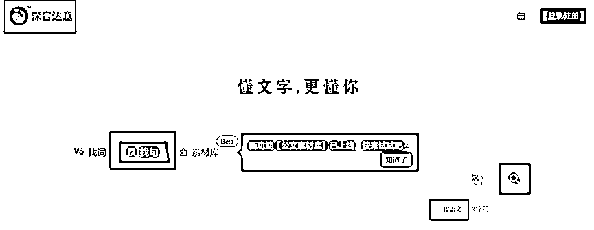

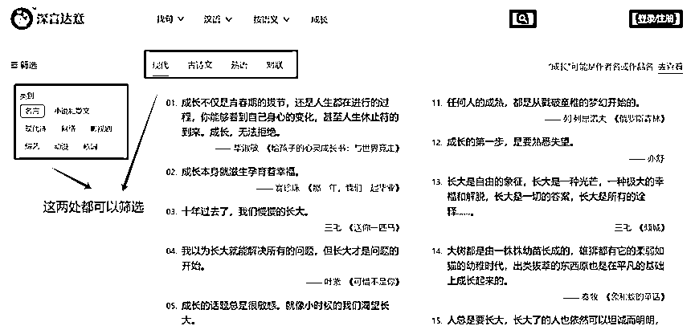

## 运营细节把握好，爆文收益少不了

流程走完，文章基础就有了。数据不错想成爆款多赚钱，有两个细节要盯。

### 评论区要不要开？

我所有文章都开评论，因为很多热度是评论顶起来的。

但开了就要维护。不必每条回，但人身攻击、辱骂、敏感不当言论要第一时间删。我百万爆款流量最猛那天，几乎半小时看一次手机处理评论，因为创作者对评论区氛围有责任。

自动精选见仁见智。开了能提高留言积极性，但维护成本也高。我一般只开三小时试水，没什么留言就关，有留言涨得快就关掉，减少无效留言，避免惯着喷子。

### 赞赏要不要开？

看情况。积极正向的文章开，消极焦虑或痛点型的关。

我这个赛道里，正能量文章赞赏金额较高，消极文章赞赏低，还容易让人有“扇完巴掌还要请喝奶茶”的感觉。赞赏太低不如放底部广告。

## 搞定数据复盘，批量复制爆款

数据预判能帮助你更清晰把控选题和细节，形成正循环。

我是👸号新手，数据分析经验不深，目前就是多看多积累，能根据点赞量反推阅读量，👸号整体点赞阅读比例比较稳定。

数据分析对我最大帮助是预估选题流量层级，能选50W+就不选10W+，能选100W+就不选50W+。

这样解决选择难题：如果手上有30个选题，一周只有7次推文位，选哪7个收益最大？

目前样本少，预估也粗略，方法偏体感，只能意会很难言传，也仅对我有效。圈友可以自己摸索👸号数据规律，这对选题的针对性比数据网站更强。

## 小结

选题+标题+正文+评论维护，这套组合拳下来就能快速完成写作发布，再加上数据分析和复盘，就能用有限选题放大收益。

这六步就是我日常SOP的心理暗示：

1. 找选题——文章进度60%
2. 定标题——文章进度80%
3. 选框架——文章进度90%
4. 填细节——文章进度100%
5. 运营优化——文章收益+50%
6. 数据复盘——收益最大化

理解这套流程，升级版的AI+手搓对你来说就很简单，是在基础上做微调。

恭喜你，爆款近在眼前！

* * *

# 多账号运营：AI辅助手搓 SOP2.0

我对文字有洁癖，23年初被各路AI伤害过很久。直到今年上半年国内工具更友好，我才重新拾起。目前我没怎么用国外工具，下面结合实际使用场景聊聊如何让国内AI当写作小助理。

项目做久了，人脑脑力值很珍贵。把人脑用在关键点，AI负责60分及格的部分，你既能出成绩也能休息，幸福感和收益一起涨。

以此打法，1200字的👸号文章，我可能只需要写300字左右，内存占用从100%降到25%，脑子不卡不烫。

先看观点文的对比：

|  | 纯手搓 SOP1.0 | AI辅助手搓 SOP2.0 |
| 找选题 | 10分钟 | 10分钟 |
| 拆结构 | 3分钟 | 3分钟 |
| 写开头-3分钟 | AI写初稿-3分钟 |
| 写3个分论点-15分钟 | 手动改稿-5-10分钟 |
| 写结尾-3分钟 | / |
| 找金句润色-6分钟 | / |
| 整体体验 | 半小时疯狂手搓，脑子被掏空 | 半小时搞定，细节还能完善 |

## 国内AI工具实测，选择适合你的写作助理

工欲善其事必先利其器。

AI辅助前选对工具很重要，目前我没批量做号，没用魔法。结合日常使用习惯，推荐3个常用的平替：

提前说清楚：不是拉踩，是个人使用习惯和写作状态的真实体验，有问题你说得对。

### 文心一言

最近常有人问我：国产 AI 到底哪个值得天天用？我用大半年时间，把市面上能叫得出名字的都试了一圈。这篇就来聊聊最真实的使用感受。

最先打动我的，是百度出的“文心一言”。它是我遇到的第一个让我愿意长期打开、真正放进工作流的产品。它的文字风格和我的审美很合拍：用词讲究，句子有分寸，却不会为了华丽而堆砌。特别是你要写偏文艺、偏精致的表达时，它的优势会很明显。

最开始我请它帮我写文学评论和书评，本来只想借它找点思路，没想到它自己写出来的段落已经很有味儿了。后来就慢慢形成习惯：只要内容稍微有点深度、需要专业表达，我都会先打开它。举个实际例子：我只给它一句很简单的指令，让它写《乌合之众》的拆书稿，没有喂过任何参考资料。当时我同时测了好几个同类产品，只有它交出来的东西还算成体系。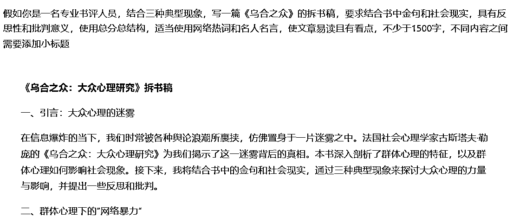
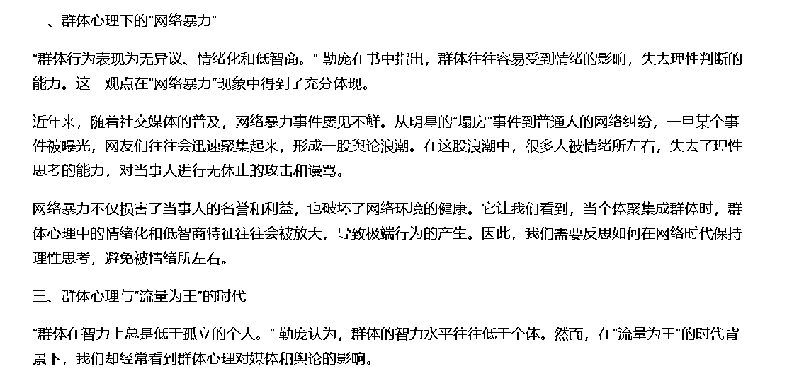

所以，如果你写书评类文章，或者你的读者、客户是“文化人”，又或者你希望文字更偏专业术语，而不是满屏大白话，那么它真的很好用。

第二款要说的，是 Kimi。今年五月份，很多人都在分享“用 Kimi 做内容号超好用”，我也跟风测过一阵。说白了，它有用，却远没有吹得那么惊艳。我甚至把大家公开分享的指令模板都试过，还是没能抓到它的核心优势。现在我会在两种场景下打开它：一是在外面，需要快速处理一些简单问题，它的手机端交互确实做得舒服；二是别的 AI 把我绕晕了，拿它临时顶一下，因为它出稿速度很快。缺点是机器腔明显，空话和废话不少。我把 Kimi 六月份生成的结果，和我三月份用文心跑出的结果放在一起比，差距一眼就能看出来：Kimi 更啰嗦，信息处理也比较死板。它不算难用，但对我而言，非用不可的场合并不多。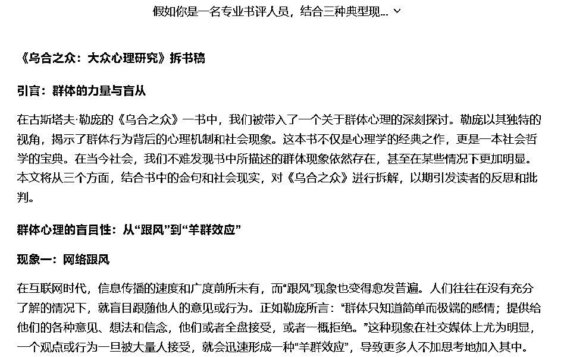
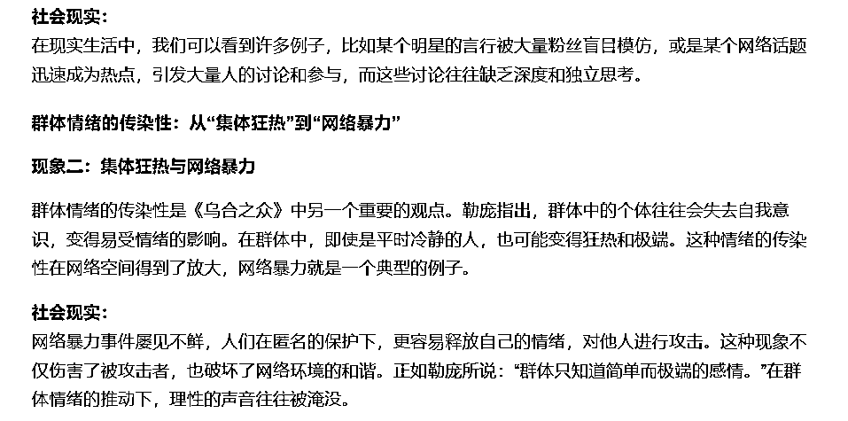

第三款是橙篇，这是我做内容项目快收尾时才发现的工具。比文采，它比不上第一款；但和 Kimi 摆在一起，它的表达明显更成熟、更稳重。下文里所有 AI 演示都是橙篇跑的。目前我感受到它的三个长处：能基本按照指令输出长文；长文里空转绕圈的情况不多；对常见的写作辅助需求响应得很准确。官方宣传页也正好在打这几个卖点。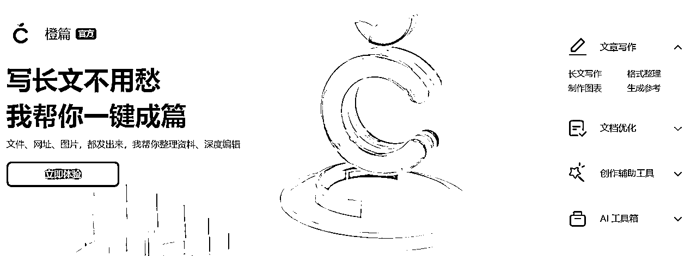

我没试过 Claude，不过以我现在“半自动写大白话文章”的需求来看，橙篇已经足够用了。细节我就不展开了，后面讲到的 AI 辅助操作，默认都用橙篇来做。

## 从鸡肋到效率加倍，新手该怎么用 AI？

我对国产 AI 的态度经历过一个转折：一开始觉得它们都是半成品，老想着“一步到位”，结果失望而归。后来把期待降低，只让 AI 做三件事——找句子、搭骨架、出草稿，效率一下子就上来了。

先说找句子。平时写稿需要金句润色，除了翻语录网站，你也可以直接让 AI 帮你整理。比如想要一批“勇敢”相关的名人名言，你给 AI 丢一句话，它就能按主题分类打包好，省掉大量人工筛选的功夫。对做文案号的人来说，这个功能非常贴心。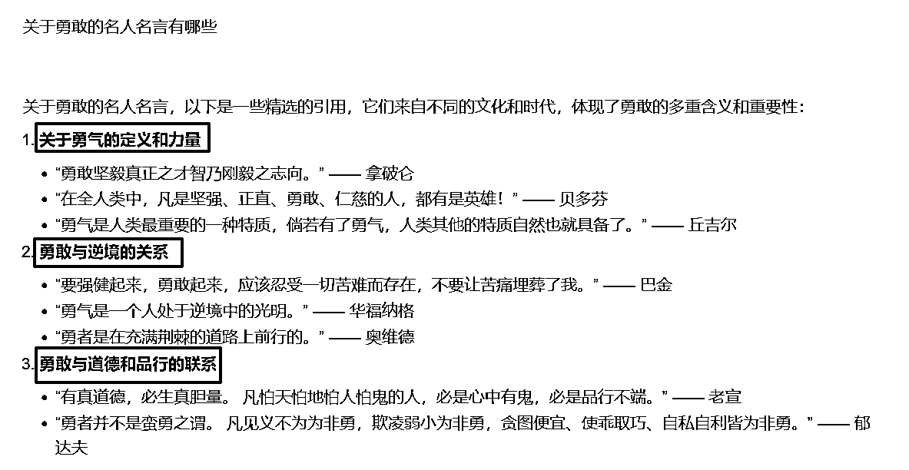
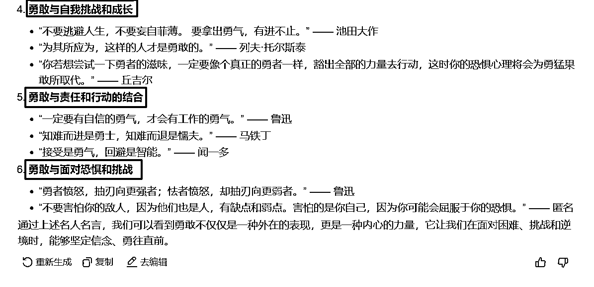

还有一种情况：你隐约记得某位名人讲过某个话题，但原话记不全了。这种时候，同样可以直接问 AI。比如我找张爱玲谈“爱情”的话、鲁迅谈“人性”的话，都是靠它检索出来的。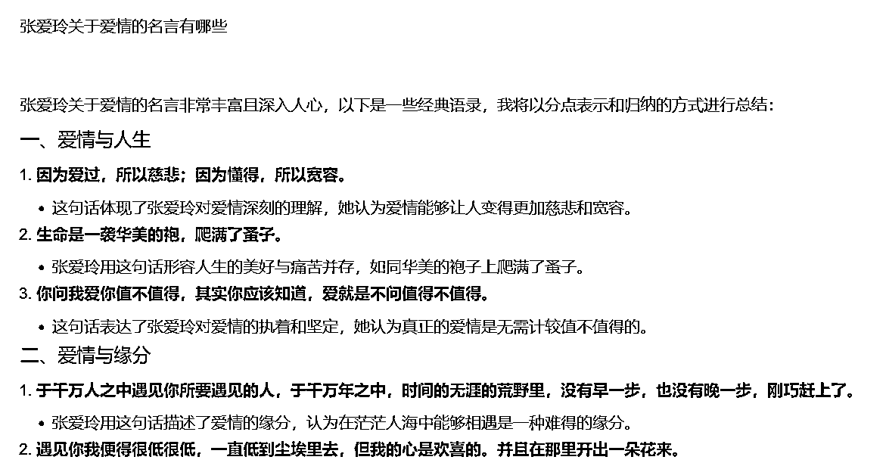
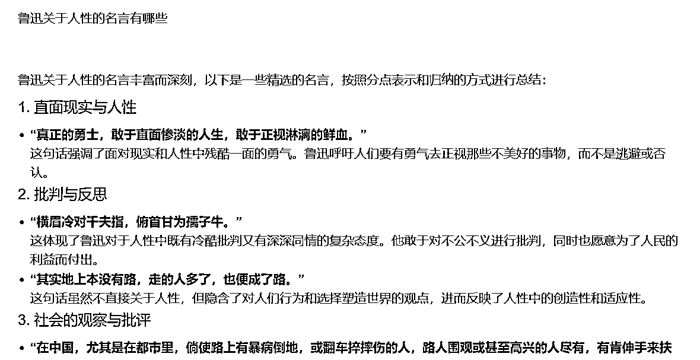

接下来是搭骨架。如果你是纯新手，不知道从哪儿开始拆分一篇文章，可以先让 AI 给你几条分析方向。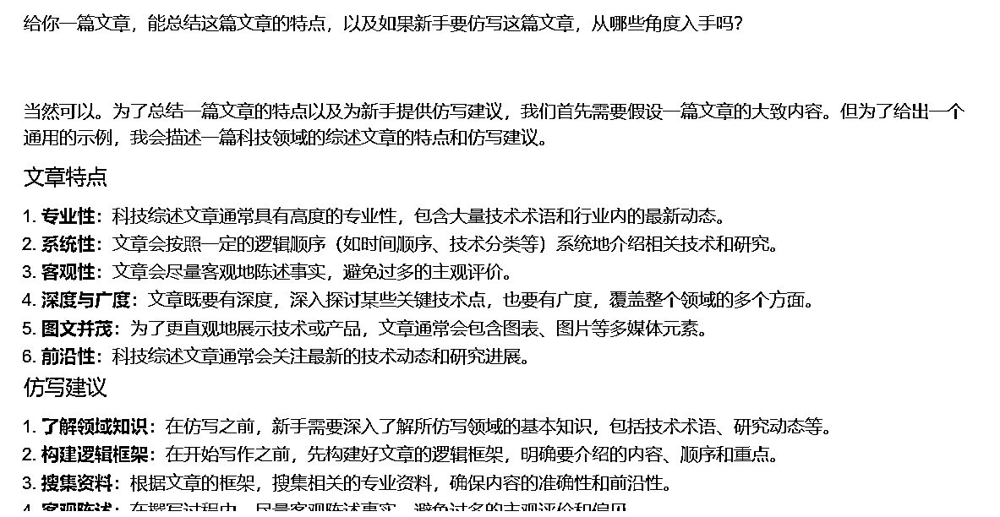

如果你手里有一篇具体的参考文章，可以继续追问，请它按这些方向给出仿写建议，再附一篇例文。下面左边是问题，右边是它给出的仿写方案。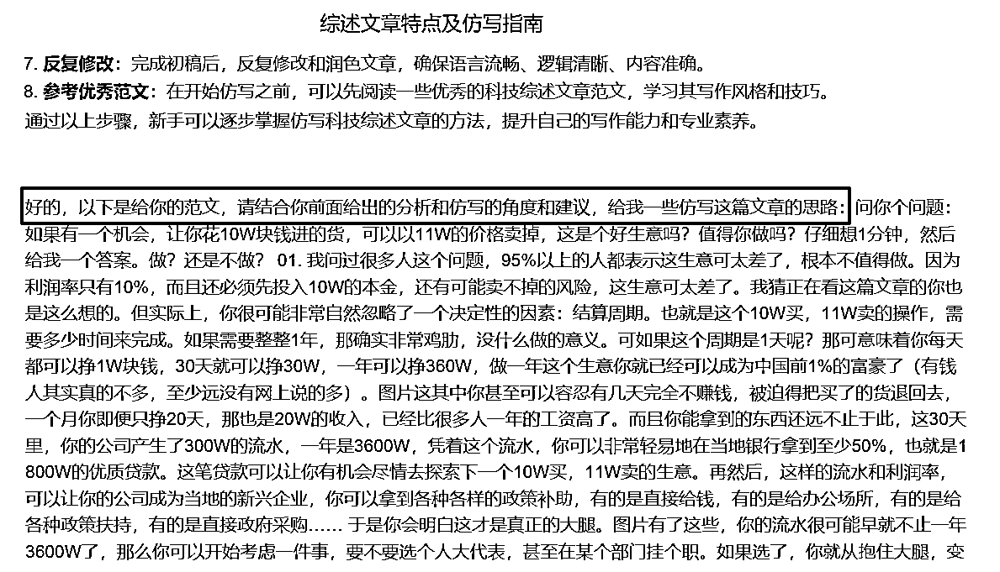
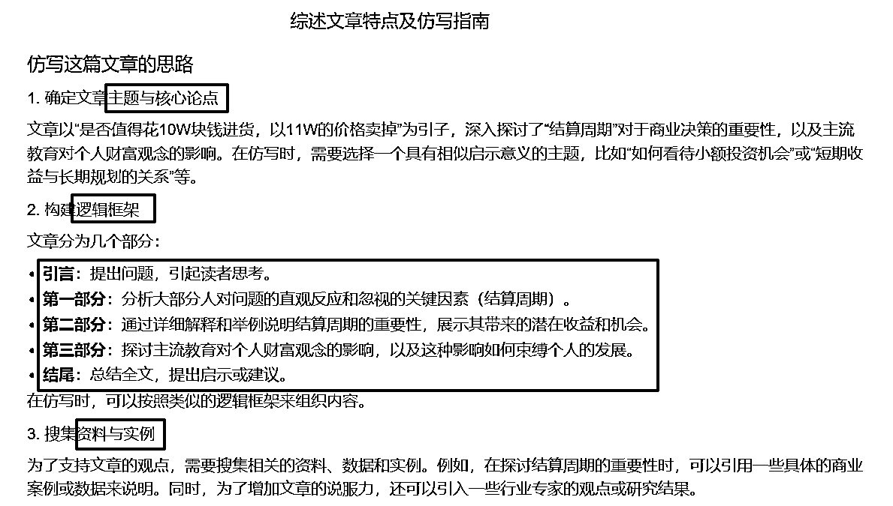

很多人写东西没有整体框架，也可以请 AI 搭一个。但要注意，AI 的思路不一定总对，问得越多，它可能越离谱，别被带到坑里。

框架搭好，就可以让 AI 出草稿。更完整的操作，我在下一节“爆款公式：结构定调 + AI 打底 + 人工微调”里会一步步展示。

## 爆款公式：结构定调 + AI 打底 + 人工微调

比如我想围绕“赚钱”写一篇能引发传播的内容，完整的流程分四步。

### 第一步：找话题（10 分钟）

我先从“赚钱”这个关键词往下挖，找到了一个方向：赚钱就是每天持续不断练习这3种本事。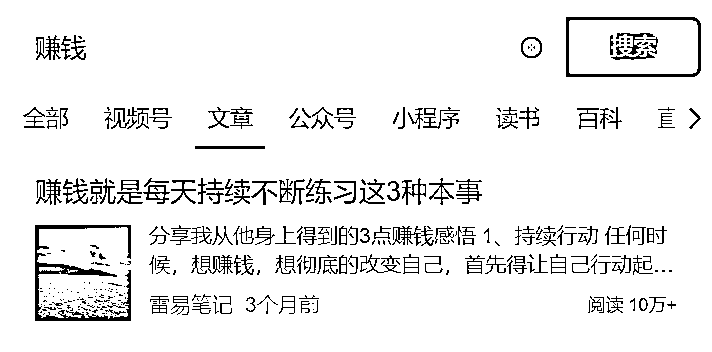
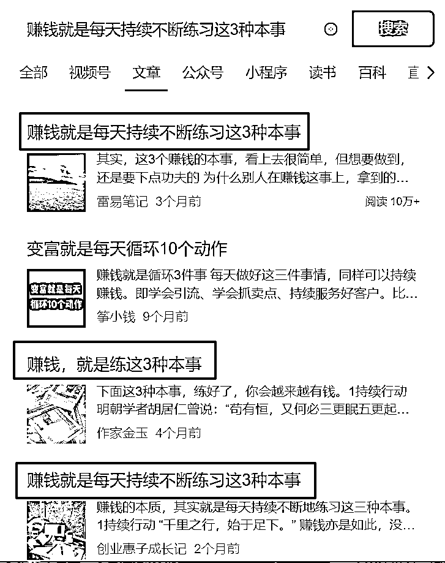

### 第二步：搭骨架（3 分钟）

先把参考文章的核心结构拎出来，看清它是总—分—总，还是别的逻辑，再确定自己要表达的三个分论点。这个过程，本身就是你对这件事的理解。如果不会拆，也可以用前面说的方法，请 AI 帮忙。

### 第三步：让 AI 出初稿（3 分钟）

心里有了结构，再找一套顺手的指令模板，把需求发给 AI。比如我会这么写：

“你是一位经验丰富的内容号主编。现在要写一篇叫《赚钱就是每天持续不断练习这3种本事》的文章。读者是希望提高赚钱能力的上班族，请用商业思维加创业心得，围绕‘提升赚钱认知、找到优质项目、持续试错复盘’三个核心，写成适合在微信订阅号传播的内容。希望它符合订阅号读者的阅读习惯，弱化 AI 味道，更像真人表达；同时可以加入一些网络热梗和名言，让人读完后有共鸣、有思考。”

把这个要求丢给橙篇，它大约十几秒就能给你一份初稿。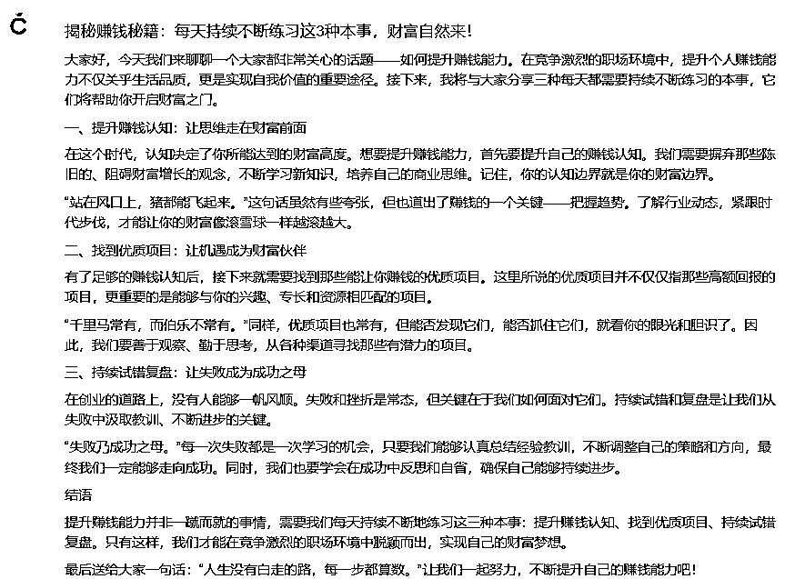

拿到初稿后，按你自己的需求微调。你也可以让 AI 再改几个版本。具体指令我就不晒了，因为每个人的口味不一样；找到合适的模板，改一下要求，直接丢回去就行。等你觉得 AI 越改越离谱，就挑其中最好的那一稿作为基础稿。

### 第四步：人工顺稿（5—10 分钟）

初稿在手，剩下的就是人工收拾。我的秘诀非常土——读出声音。只用眼睛看，很容易被书面语麻痹，察觉不出问题；但一旦出声读，卡壳的地方就是需要改的地方。等习惯以后，不用真读，扫一眼就能找到别扭的位置。

那么怎么改呢？如果你有自己的写作风格，就按自己的习惯来；如果没有，别硬凹，老老实实用平时说话的样子来写。比如下面这张图：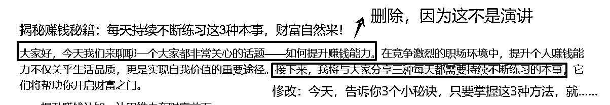

AI 写出来的第一段通常像领导致辞，我一般直接删掉。开头怎么引入？你可以参考对标文章，慢慢形成自己的习惯，用小故事带入、用设问开场、用场景切片都行，这里就不具体展开了。进入正文后，我主要把那些比较官方的表达，一个个改成更口语化、更接地气的说法。案例和金句如果觉得不合适，可以自己替换，也可以继续用前面提到的 AI 帮忙。

熟练以后，一千字上下的稿件，三五分钟润色一遍完全做得到。整篇下来，总用时和纯手写差不多，但体验完全不同：以前我写稿要关门、关歌、关聊天窗口，现在甚至可以边写边听播客。

### 总结一下这套流程

纯手写的话，找话题、拆结构、写开头、写三个分论点、写结尾、修金句，加起来至少半小时，而且不包括前期选题，脑子基本上是掏空的；AI 辅助的话，话题照找、结构照拆，AI 出草稿只要三分钟，人工润色五到十分钟，同样是半小时，却连选题带细节都包圆了。

只要你对自己要写的东西心里有数，手里有一套满意的指令，再具备把官方腔改成口头语的能力，文章基本就成了。这套方法熟练之后，你不是在搬砖，更像是在给文字点睛。

之前我担心 AI 写出来的东西没人味儿，会不会被平台减少推荐。实际走下来，让 AI 参与再由人工打磨，和纯手工写出来的内容，并没有明显的数据差异。所以，要想“去 AI 味”，不是让 AI 全包，而是让它把基础工作做了，你去做真正有价值、有判断力的部分。

聪明的人应该看出来了：AI 辅助的前提，是你先想清楚要写什么类型的文，是故事型还是观点型，想用深情还是幽默打动人，心里得有谱。这些，AI 替代不了你。只有你把框架想明白，AI 才有使力的地方。这也是用上工具之后，你仍然能继续深耕细节、放大收入的原因。

恭喜，你可以提速了！

## 避坑与提效，帮你少走弯路

先讲三个最容易踩的坑。

### 第一坑：新手错过四位数收入

做这个内容项目，我建议你什么都先别管，先找到平台的流量分成入口，马上开通，用什么办法都行。我 22 年在头条平台上出过一篇三百多万阅读的内容，收益却只有六百多块钱。原因就是文章跑到一百多万阅读时，我的分成功能还没开通，白白丢掉了三分之一的流量。那三分之一放在现在的订阅号里，错过的钱怎么也有四位数了。所以这次我非常重视尽早开通。不同渠道开通需要等的时间还不一样，新手一定要把时间节点卡好，别等流量爆了才后悔。

### 第二坑：连续更新一个月，怎么还没被推荐？

我除了主力号，还同时运营过一个小号，也帮朋友看过号。不少号起不来，原因是能看到的。

比如朋友的号，粉丝很大比例是中老年读者，我给她选的话题却是“励志奋斗”那一类。数据本身不差，但对即将进入退休生活的人来说，完全没有吸引力。后来换成了中老年关心的主题，数据才慢慢起来。所以，没流量，先看你的粉丝是谁，内容能不能对上他们的胃口。

另一个测试号更典型：一开始数据忽上忽下，长期没有推荐。直到主力号出了爆款，我再复盘数据，才发现是话题太杂造成的。拿读书内容举例：今天讲个人成长，明天聊传统文学，后天说古代谋略，大后天又跳到企业家传记——很可能一个月过去依然没动静。因为这些内容对应的人群完全不同：有人刚工作两三年，有人已经是资深从业者，有人做到公司中层，有人还在读大学。读者找不到关注你的理由。同样，我也见过很多作者说更新半年没水花，点进主页一看，美食、读书、追剧样样都有，生活感是很强，但给人的关注理由很弱。

如果你的话题没问题，写法也没问题，账号却一直没反馈，就该回头看看：内容方向和读者匹配吗？赛道够垂直吗？不要给小学生讲高数，也别逼自己什么都会。

### 第三坑：想赚到钱，就得有这两股“狠劲”

一是对留言的态度。不论好评还是差评，都在给你的内容加热。我之前做短视频时，看到无脑评论就忍不住对线，结果账号氛围乱成一团，流量掉了，一分没赚到；但在有分成机制的平台上，骂声也是助推器，至少还能顺便带来收益。文章一旦爆了，什么人都会出现，我也曾经被好评夸飘，被差评气到内耗。后来想开了：没有声音才是最可怕的。与其纠结情绪，不如趁劲儿还在，赶紧写下一篇，到手的收入比三天的情绪实在多了。

二是对收益的态度。有人发愁没推荐量，有人发愁单价低。可你知道吗，到今天还有人接 5 元一篇的稿子，一单只写三百到五百字。很多新手写一千字，实际到手也就十来二十块。但在订阅号上，文章超过一千字，只要开了广告位，至少有 3 个广告在帮你赚钱。我们来算笔账：甲接外包，千字 20 元，一周七篇赚 140 元，还要随时听编辑差遣；乙做自己的号，同样写一千字上下，想发几篇发几篇，一周只要超过 140 元，多出来的全是利润，而且上不封顶。时间越长，差距越明显。等项目跑通，单号每天赚 140 一点也不难——一天的产量，能换过去七天的收入。更不用说短视频平台上很多人出了不少爆款，最后变现却是零。两相对比，这种爆款文章的赚钱效率真的低吗？真不想做，那这个窗口就让给愿意做的人吧。

## 再送你三个提效减压的小技巧

### 技巧一：找话题太累？学会边玩边找

如果你每次找话题都要正襟危坐，开数据工具、翻热榜、往文档里粘贴，可能坚持不了半小时。不如换个玩法：刷到—转发—攒够再整理。先在手机上建几个分类收集群，建好之后，你平时刷手机，看到合适的内容就直接转进群里，隔一段时间再统一整理。这样做的好处是，玩的时候不用分心，整理的时候素材已经堆在那里了，直接进入排期，不用再重新翻一遍。两种模式我都试过，后者真能把焦虑降下来。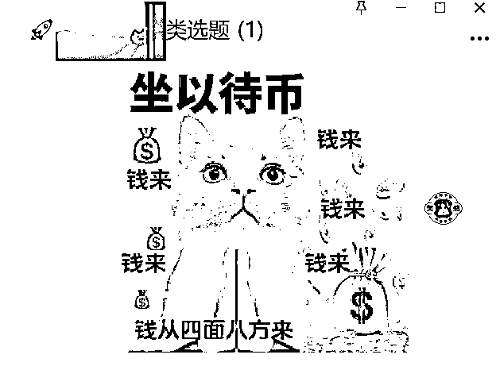
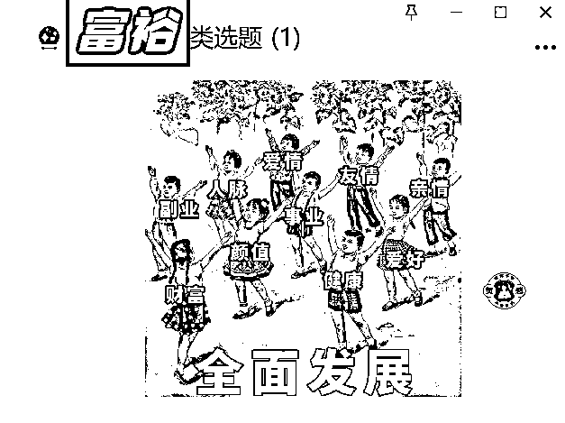

### 技巧二：配图和排版耽误时间？把流程拆开

我写一篇文章只要半小时，可找图、排版、加发布也要半小时，想想就亏。后来我学会把流程拆开，一段时间只做一件事。

比如每天上午 10 点集中找图。我的号内容偏激励方向，就搜“自信”“风景”“动物”；如果写情感内容，就搜“伤心”“愤怒”“争吵”，把合适的图提前存进素材库。如果你的配图来自 AI，也可以集中生成一批，一次搞定一两周的库存。

为什么集中找图更划算？因为同一个关键词，前几页翻来覆去都是那些图。假设一秒看一张，分散找图时，第一次搜 10 秒选中一张，第二次搜 20 秒选中第二张，第三次搜 30 秒选中第三张，加一起 60 秒只找到 3 张；集中找图时，同一分钟里就能扫出 6 张。需要找的图越多，集中处理省的功夫越多。

排版同理。每天下午固定一个时间，把五篇文章一次性排好，放进草稿箱，能定时就定时，到时间直接点发布就行。这比每次临时找模板、调配色、再发布，省出大把时间。

### 技巧三：越做越焦虑？先调整心态

起步期最常见的焦虑有两种，我以前做其他平台时也一模一样地经历过。

第一种，参考账号太少。我第一天找对标，翻了一整个下午才找到一个，心里特别没底。后来我使劲儿刷这一个号，平台渐渐开始给我推同类账号，越推越多，多到看不过来。但推荐一多，人反而容易花眼，不知道怎么下手，还容易跑偏。后来我认真分析不同账号的受众和定位，才发现最开始找到的那个号，才是整个阶段里最有价值的参考。所以，参考少不是坏事，少而精准，反而能帮你集中注意力。

第二种，怕坚持没有结果。我自己做过短视频，也试过别的平台，凡是有成绩的，都是靠一口气往前冲的状态做出来的。有前辈说，这类内容项目你只要先写够 100 篇，总会有爆的时候。我不确定 100 篇一定有效，但之前做号的经验告诉我：如果连 30 篇都没写到，你对数据根本不会有真实的感觉。

当我启动这个项目的时候，给自己定的准则是先把内容发出去，而不是一上来就追求写出一篇完美的文章。因为平台不一样、读者不一样、切入角度不一样，所谓“好”的标准本来就是流动的。

我始终觉得，刚起步最重要是空杯心态。文章写得多了，数据自然会说话，慢慢地你对选题好不好、写法顺不顺、数据行不行，判断力也就起来了。

如果你一开始就给自己设限，觉得不是10W+就没价值、没变现的文章就等于浪费时间、没有正反馈的选题就白干，我估计三五天就泄气了。这种想法我以前做项目时也或多或少有过。后来才发现，对新手来说，有些看起来“没啥用”的尝试，行动本身就已经在创造价值了。

（恭喜你，常见问题都了解啦！）

* * *

以上就是我这次新手阶段的复盘，希望能给同样在起步的圈友一点参考。

👸号航海末期回头看，真的很庆幸当时听了最强销冠@梁靠谱 女士的点拨，没有她的方向感和信心加持，我可能还在盲目跟风做项目。这次的尝试不仅把👸号航海跑成了，也让我对自己的长处和变现路径看得更清楚了。

最后，感恩赚钱这一年来的各种沉浸式体验，感恩靠谱一路的陪伴与指导，感恩醒醒教练在个人优势航海里的赋能，感恩所有并肩作战的航海搭子，感恩航海期间用实力和情绪价值双重托底的教练们，也感恩每一位捧场的航海伙伴！祝大家能看见微光，走得更远，赚得更多！

我相信，每一个真正热爱写作、热爱优质内容的人，终究会写出自己的10W+、100W+、1000W+！

也祝那些冲在流量一线的朋友们，业绩哐哐往上涨，钱满满进账！

谢谢大家的阅读，我们一起加油，下次👸号航海再见！